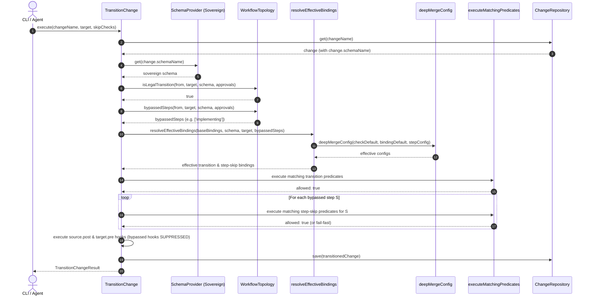
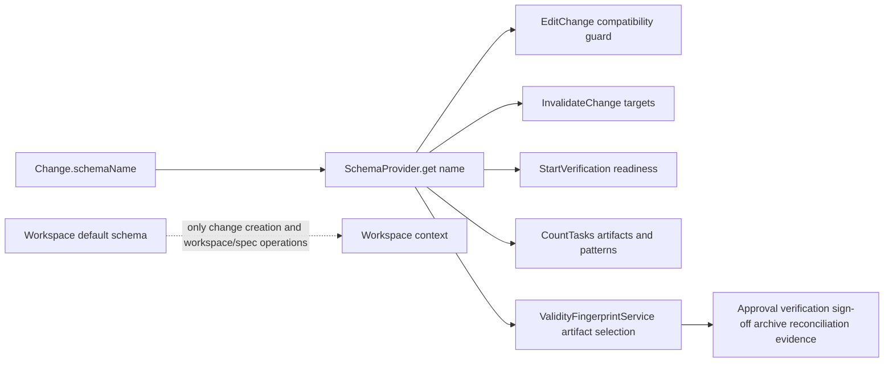
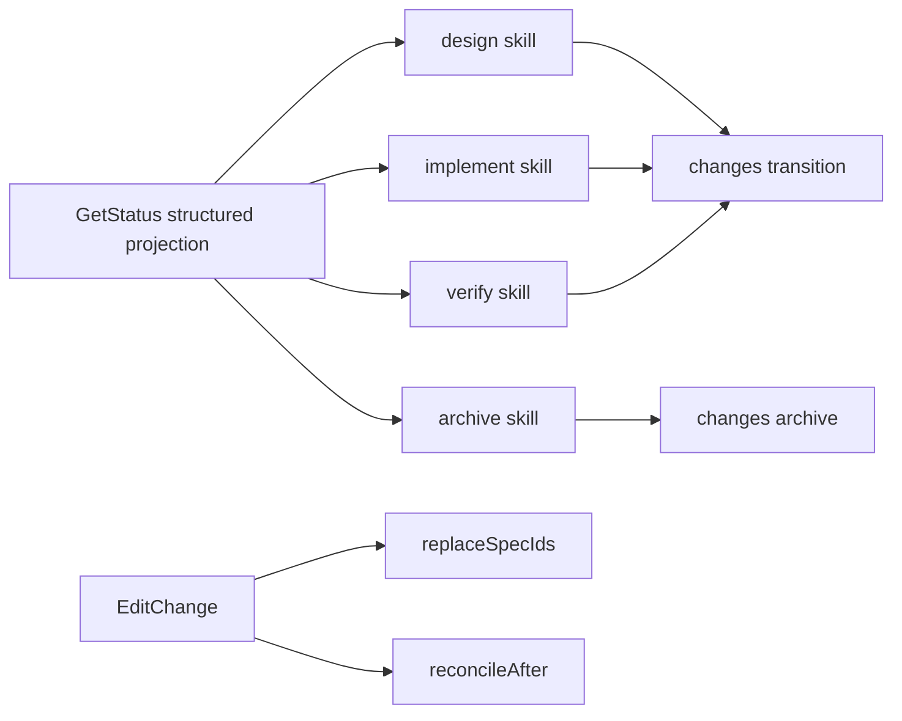
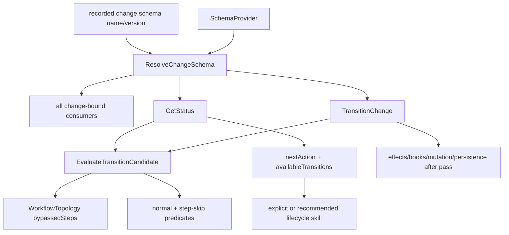

# Design: Schema-Defined Optional and Disabled Workflow Steps with Declarative Checks & Governance

## Context

In SpecD, change lifecycles are governed by workflow pipelines declared in `schema.yaml`. Historically, the transition model hardcoded valid state pairs, progress axes, and fallback insertions (`AXIS_FALLBACK`, `VALID_TRANSITIONS`, `HAPPY_PATH_NEXT`). Furthermore, while ADR-0030 designed the Open Check Registry and in-memory check declarations, critical gaps remained:

1. **Monolithic Topology**: Schemas could not declare intermediate steps (such as `implementing` or `verifying`) as `optional` or `disabled`.
2. **Missing Check Grammar in `schema.yaml`**: `schema-yaml-parser.ts` completely omitted `checks` from `WorkflowStepZodSchema`. Any check declarations authored in `schema.yaml` were silently stripped out by Zod before reaching domain construction.
3. **Conflation of Entry Checks vs Bypass Preconditions**: Schema authors had no way to distinguish checks that run when entering a step (`scope: 'transition'`) from checks that validate whether an optional step may be bypassed (`scope: 'step-skip'`).
4. **Disconnected Runtime Bindings**: `TransitionChange` and `GetStatus` relied on a static `_transitionBindings` array injected at startup, never dynamically merging the check declarations, disabled flags, or step configs declared on the Change's sovereign `Schema`.
5. **Incomplete Layer Merging**: `mergeSchemaLayers` lacked support for merging `skipChecks` and strictly preserving monotonic governance locks (`allow*`).
6. **Sovereign Schema Disconnect**: Use cases frequently defaulted to the workspace `specd.yaml` configuration rather than recognizing `manifest.schema` as sovereign.

This change introduces `WorkflowTopology`, establishes a declarative two-block schema grammar (`checks:` and `skipChecks:`), connects the YAML parser and domain validators, enforces monotonic two-tier governance locks (`allow*`), implements dynamic runtime binding composition with cascaded config resolution, and unifies sovereign change-schema authority through one shared `ResolveChangeSchema` boundary.

---

## Affected areas

### 1. `packages/core/src/domain/value-objects/workflow-step.ts`

- **Symbols**: `WorkflowStep`, `WorkflowStepCheckDeclaration`, `WorkflowStepSkipCheckDeclaration`
- **Specification**:

  ```ts
  /**
   * Declaration associating a transition check with a workflow step in schema.yaml.
   * Evaluated when transitioning INTO this step (scope: 'transition').
   */
  export interface WorkflowStepCheckDeclaration {
    /** Check identifier (must be registered in CheckRegistry). */
    readonly id: string
    /** Source state filter (defaults to '*'). */
    readonly from?: ChangeState | '*'
    /** Transition direction filter ('forward', 'backward', 'recovery', 'redesign', or '*'). Defaults to 'forward'. */
    readonly along?: TransitionAlong | '*'
    /** Failure policy ('abort' or 'collect'). Defaults to 'abort'. */
    readonly onFailure?: 'abort' | 'collect'
    /** Permission to bypass via `--skip-checks`, subject to governance locks. */
    readonly skippable?: boolean
    /** Whether this check is disabled for this workflow step, subject to governance locks. */
    readonly disabled?: boolean
    /** Step-specific configuration merged over check defaults. */
    readonly config?: Readonly<Record<string, unknown>>
  }

  /**
   * Declaration associating a step-skip check with an optional workflow step in schema.yaml.
   * Evaluated when this optional step is BYPASSED during a transition (scope: 'step-skip').
   */
  export interface WorkflowStepSkipCheckDeclaration {
    /** Check identifier (must be registered in CheckRegistry). */
    readonly id: string
    /** Failure policy ('abort' or 'collect'). Defaults to 'abort'. */
    readonly onFailure?: 'abort' | 'collect'
    /** Permission to bypass via `--skip-checks`, subject to governance locks. */
    readonly skippable?: boolean
    /** Whether this check is disabled for skipping this step, subject to governance locks. */
    readonly disabled?: boolean
    /** Step-specific configuration merged over check defaults. */
    readonly config?: Readonly<Record<string, unknown>>
  }

  export interface WorkflowStep {
    readonly step: string
    readonly optional?: boolean
    readonly disabled?: boolean
    readonly requires: readonly string[]
    readonly requiresTaskCompletion: readonly string[]
    readonly hooks: {
      readonly pre: readonly HookEntry[]
      readonly post: readonly HookEntry[]
    }
    readonly checks?: readonly WorkflowStepCheckDeclaration[]
    readonly skipChecks?: readonly WorkflowStepSkipCheckDeclaration[]
  }
  ```

- **Behavioral change**: Separates entry transition checks from bypass skip checks. Defaults `optional` and `disabled` to `false`.
- **Callers & Risk**: Consumed by `buildSchema`, `Schema`, `WorkflowTopology`, `mergeSchemaLayers`, and use cases. Risk: LOW (strictly additive).

---

### 2. `packages/core/src/infrastructure/schema-yaml-parser.ts`

- **Symbols**: `WorkflowStepZodSchema`, `WorkflowStepRaw`, `WorkflowStepCheckZodSchema`, `WorkflowStepSkipCheckZodSchema`
- **Specification**:

  ```ts
  const WorkflowStepCheckZodSchema = z.object({
    id: z.string(),
    from: z.string().optional(),
    along: z.enum(['forward', 'backward', 'recovery', 'redesign', '*']).optional(),
    onFailure: z.enum(['abort', 'collect']).optional(),
    skippable: z.boolean().optional(),
    disabled: z.boolean().optional(),
    config: z.record(z.unknown()).optional(),
  })

  const WorkflowStepSkipCheckZodSchema = z.object({
    id: z.string(),
    onFailure: z.enum(['abort', 'collect']).optional(),
    skippable: z.boolean().optional(),
    disabled: z.boolean().optional(),
    config: z.record(z.unknown()).optional(),
  })

  const WorkflowStepZodSchema = z
    .object({
      step: z.string(),
      optional: z.boolean().optional(),
      disabled: z.boolean().optional(),
      requires: z.array(z.string()).optional(),
      requiresTaskCompletion: z.array(z.string()).optional(),
      hooks: z
        .object({
          pre: z.array(HookEntryZodSchema).optional(),
          post: z.array(HookEntryZodSchema).optional(),
        })
        .optional(),
      checks: z.array(WorkflowStepCheckZodSchema).optional(),
      skipChecks: z.array(WorkflowStepSkipCheckZodSchema).optional(),
    })
    .transform(
      (ws): WorkflowStepRaw => ({
        step: ws.step,
        optional: ws.optional ?? false,
        disabled: ws.disabled ?? false,
        requires: ws.requires ?? [],
        requiresTaskCompletion: ws.requiresTaskCompletion ?? [],
        hooks: {
          pre: ws.hooks?.pre ?? [],
          post: ws.hooks?.post ?? [],
        },
        ...(ws.checks !== undefined ? { checks: ws.checks } : {}),
        ...(ws.skipChecks !== undefined ? { skipChecks: ws.skipChecks } : {}),
      }),
    )
  ```

- **Callers & Risk**: Core schema YAML parser. Risk: LOW (allows previously ignored keys).

---

### 3. `packages/core/src/domain/services/build-schema.ts`

- **Symbols**: `buildSchema`
- **Specification**:
  Enhance semantic validation for both `step.checks` and `step.skipChecks`:
  1. **Registry Existence**: Every `chk.id` in `step.checks` and `step.skipChecks` must exist in `activeRegistry.has(chk.id)` (throws `UnknownCheckError`).
  2. **Coordinate Uniqueness**:
     - For `checks`: `${chk.id}::transition::${step.step}::${chk.along ?? 'forward'}`.
     - For `skipChecks`: `${chk.id}::step-skip::${step.step}`.
     - Collisions throw `DuplicateCheckBindingError`.
  3. **Confinement Locks (`governance.allowBindingOverride: false`)**:
     - Category A & Category B built-in checks and confined plugin checks cannot be embedded in `checks` or `skipChecks` (throws `CheckEmbeddingForbiddenError`).
  4. **Policy Locks (`matchingBinding.allowBindingOverride: false`)**:
     - Locked coordinates cannot have `onFailure` or `skippable` modified (throws `CheckBindingOverrideForbiddenError`).
  5. **Parameter Locks (`allowConfigOverride: false`)**:
     - Locked checks or bindings cannot specify `config` overrides (throws `CheckConfigOverrideForbiddenError`).
  6. **Disablement Locks (`allowDisable: false`)**:
     - Locked checks or bindings cannot declare `disabled: true` (throws `CheckDisableForbiddenError`).
  7. **Step Status Invariant**:
     - If `step.disabled === true` and `step.skipChecks` is defined and non-empty, throw `SchemaValidationError` (`"disabled step '${step.step}' cannot declare skipChecks"`).
- **Callers & Risk**: Core schema builder. Risk: MEDIUM.

---

### 4. `packages/core/src/domain/services/merge-schema-layers.ts`

- **Symbols**: `mergeSchemaLayers`
- **Specification**:
  In `mergeWorkflowStepOperations`, safely aggregate both `step.checks` and `step.skipChecks`:
  ```ts
  if (entry.checks) {
    step = {
      ...step,
      checks: addToArray(
        step.checks ?? [],
        entry.checks,
        'id',
        position,
        layer,
        `${opName}.workflow[${entry.step}].checks`,
      ),
    }
  }
  if (entry.skipChecks) {
    step = {
      ...step,
      skipChecks: addToArray(
        step.skipChecks ?? [],
        entry.skipChecks,
        'id',
        position,
        layer,
        `${opName}.workflow[${entry.step}].skipChecks`,
      ),
    }
  }
  ```
  Enforces monotonic governance: merged declarations cannot downgrade or relax locks established by earlier layers.

---

### 5. `packages/core/src/domain/services/transition-checks.ts`

- **Symbols**: `CheckApplicability`, `CheckAttempt`, `resolveEffectiveBindings`
- **Specification**:
  Implement pure domain function `resolveEffectiveBindings`:

  ```ts
  export interface ResolveEffectiveBindingsInput {
    readonly baseBindings: readonly CheckBinding[]
    readonly schema: Schema
    readonly targetStep?: ChangeState
    readonly bypassedSteps?: readonly ChangeState[]
    readonly along?: TransitionAlong
    readonly registry?: CheckRegistry
  }

  export function resolveEffectiveBindings(
    input: ResolveEffectiveBindingsInput,
  ): readonly CheckBinding[]
  ```

  - **Target Step Transition Overlay**:
    - For `input.targetStep`, inspect `schema.workflowStep(targetStep).checks`.
    - If `disabled: true`: filter out matching base bindings for this coordinate.
    - If active: overlay step `config` using `deepMergeConfig(checkDefault, bindingDefault, chk.config)`, overlay `onFailure` and `skippable`, and synthesize `CheckBinding` if newly declared.
  - **Bypassed Steps Step-Skip Overlay**:
    - For each `S` in `input.bypassedSteps`:
      - Inspect `schema.workflowStep(S).skipChecks`.
      - If `disabled: true`: filter out matching step-skip bindings.
      - If active: synthesize `CheckBinding` under `scope: 'step-skip'` with step `S`, merging config via `deepMergeConfig`.

- **Callers & Risk**: Used by `TransitionChange` and `GetStatus`. Risk: MEDIUM.

---

### 6. `packages/core/src/domain/services/workflow-topology.ts`

> Superseded by "Post-Verification Revision (2026-10-16) → R1". The module exports plain functions (no `WorkflowTopology` class), the pipeline order is always canonical (row order ignored), and no reachability guard exists. The contract in R1 is authoritative.

---

### 7. `packages/core/src/domain/services/check-bindings.ts`

- **Symbols**: `TRANSITION_BINDING_SPECS`
- **Specification**:
  Register built-in `scope: 'step-skip'` bindings:
  - `workflow.tasksEmpty`: `{ scope: 'step-skip', step: 'implementing' }`, `skippable: false`, `allowDisable: false`.
  - `impl.filesResolved`: `{ scope: 'step-skip', step: 'implementing' }`, `skippable: false`, `allowDisable: true`.
  - `impl.linksInScope`: `{ scope: 'step-skip', step: 'implementing' }`, `skippable: true`, `allowDisable: true`.

---

### 8. `packages/core/src/application/use-cases/transition-change.ts`

- **Symbols**: `TransitionChange.execute`
- **Specification**:
  1. **Sovereign Schema Resolution**: Resolve schema via the injected shared `ResolveChangeSchema` boundary using the change name, recorded schema name, and recorded schema version.
  2. **Target Resolution**: Handle `to === 'next'` via `WorkflowTopology.nextForwardStep(fromState, schema, this._approvals)`.
  3. **Legality & Bypassed Detection**: Validate target legality via `WorkflowTopology.isLegalTransition` and compute `bypassedSteps`.
  4. **Dynamic Binding Composition**:
     - Call `resolveEffectiveBindings({ baseBindings: this._transitionBindings, schema, targetStep: requestedTarget, bypassedSteps, along, registry: this._checkRegistry })`.
  5. **Evaluate Transition Predicates**: Run matching predicates using resolved effective bindings.
  6. **Evaluate Bypassed Step-Skip Checks**:
     - For each bypassed step, evaluate matching `scope: 'step-skip'` predicates from resolved bindings.
     - Abort on failure with `CheckPredicateFailedError`.
  7. **Hook Suppression**: Execute hooks for `fromState` and `requestedTarget`. Suppress hooks for bypassed steps.
- **Callers & Risk**: CLI and SDK transition commands. Risk: HIGH.

#### `'next'` versus optional shortcut routing

- `TransitionChangeInput.to === 'next'` MUST call `WorkflowTopology.nextForwardStep` and select the closest subsequent enabled step. It skips disabled steps because they are absent from the active topology, but it does not evaluate or traverse an enabled optional step.
- Optional shortcut recommendation remains a separate lifecycle-verdict responsibility. `GetStatus.nextAction` may recommend a farther explicit target after the effective `step-skip` predicates pass; callers enact that recommendation by passing that target explicitly.
- This separation makes `--next` deterministic and one-hop while preserving Core-owned conditional routing. The CLI MUST NOT implement its own optionality or check evaluation.

---

### 9. `packages/core/src/application/use-cases/get-status.ts`

- **Symbols**: `GetStatus.execute`
- **Specification**:
  - Resolve the sovereign schema through the shared `ResolveChangeSchema` boundary.
  - Compose dynamic effective bindings for projected targets using `resolveEffectiveBindings`.
  - Project custom check blockers and remediation commands into `nextAction`.
  - Project ordered pipeline, annotating optional steps (`[optional]`) and omitting disabled steps.

---

## Data Models & Schema Contracts

### `schema.yaml` Workflow Step Specification:

```yaml
workflow:
  - step: implementing
    optional: true
    disabled: false
    requires: [specs, design, tasks]
    requiresTaskCompletion: [tasks]
    hooks:
      pre:
        - id: lint-pre
          run: pnpm lint
      post:
        - id: build-post
          run: pnpm build
    checks:
      - id: '@security.code-scan'
        along: forward
        from: '*'
        onFailure: abort
        skippable: true
        config:
          minSeverity: critical
      - id: 'impl.linksInScope'
        disabled: true
    skipChecks:
      - id: 'workflow.tasksEmpty'
        onFailure: abort
        skippable: false
      - id: '@qa.allow-bypass'
        skippable: false
        config:
          requireSignoffApproval: true
```

---

## Two-Tier Governance Enforcement Matrix

| Check / Binding Dimension        | Lock Flag                     | Rule                                                                                              | Rejection Error                         |
| :------------------------------- | :---------------------------- | :------------------------------------------------------------------------------------------------ | :-------------------------------------- |
| **Check Confinement (Global)**   | `allowBindingOverride: false` | Check cannot be embedded in `checks` or `skipChecks` unless already bound by kernel registration. | `CheckEmbeddingForbiddenError`          |
| **Coordinate Policy (Specific)** | `allowBindingOverride: false` | Matching binding cannot have `onFailure` or `skippable` modified by schema.                       | `CheckBindingOverrideForbiddenError`    |
| **Parameter Lock**               | `allowConfigOverride: false`  | Check or binding cannot have its configuration overridden by schema.                              | `CheckConfigOverrideForbiddenError`     |
| **Disablement Lock**             | `allowDisable: false`         | Check or binding cannot declare `disabled: true` in schema.                                       | `CheckDisableForbiddenError`            |
| **Disabled Step Invariant**      | `step.disabled: true`         | Step declared with `disabled: true` cannot declare `skipChecks`.                                  | `SchemaValidationError`                 |
| **Monotonicity**                 | Any lock = `false`            | Merged layers (`mergeSchemaLayers`) cannot downgrade or erase a `false` lock.                     | Monotonic enforcement / collision error |

---

## Runtime Execution Flow (`TransitionChange.execute`)



---

## Exhaustive Testing Strategy

To ensure zero regressions and complete compliance, specific test suites will verify:

1. **Schema YAML Parsing Tests (`packages/core/test/infrastructure/schema-yaml-parser.spec.ts`)**:
   - Parses valid `checks:` and `skipChecks:` with all properties.
   - Throws `SchemaValidationError` on malformed values or forbidden enum values.
2. **Schema Compilation & Governance Tests (`packages/core/test/domain/services/build-schema.spec.ts`)**:
   - Rejects unknown checks with `UnknownCheckError`.
   - Rejects duplicate coordinates with `DuplicateCheckBindingError`.
   - Rejects embedding Category A/B checks in `checks` or `skipChecks` with `CheckEmbeddingForbiddenError`.
   - Rejects altering `onFailure`/`skippable` on locked coordinates with `CheckBindingOverrideForbiddenError`.
   - Rejects overriding locked config with `CheckConfigOverrideForbiddenError`.
   - Rejects disabling locked checks with `CheckDisableForbiddenError`.
   - Rejects `skipChecks` on `disabled: true` steps with `SchemaValidationError`.
3. **Layer Merger Tests (`packages/core/test/domain/services/merge-schema-layers.spec.ts`)**:
   - Merges `checks` and `skipChecks` across schema layers without collisions.
   - Enforces monotonic lock preservation across layer extensions.
4. **Dynamic Binding Composition Tests (`packages/core/test/domain/services/transition-checks.spec.ts`)**:
   - `resolveEffectiveBindings` correctly overlays target step checks and bypassed step skip-checks.
   - Suppresses checks declared with `disabled: true`.
   - Injects cascaded configuration computed via `deepMergeConfig` into `ctx.config`.
5. **Runtime Transition & CLI Tests (`packages/core/test/application/use-cases/transition-change.spec.ts` & CLI tests)**:
   - Transitioning evaluates custom plugin checks declared in schema.
   - Bypassing optional step evaluates custom `skipChecks` declared in schema.
   - Bypassed step hooks are strictly suppressed.
   - `--skip-checks` permits bypassing skippable checks and rejects non-skippable checks with `CheckNotSkippableError`.
   - Verifies sovereign schema isolation: operations use `manifest.schema`, never workspace default `specd.yaml`.
6. **Topology Approval Propagation Tests (`packages/core/test/domain/services/workflow-topology.spec.ts` plus affected application/domain callers)**:
   - Pass an explicit `ApprovalGates` fixture to every pipeline-derived public method.
   - Assert the canonical tail order is `done`, `archivable`, `archiving`.
   - Assert a preceding pipeline state is not a legal backward destination unless `VALID_TRANSITIONS[from]` contains that edge.
   - Use a schema with conditionally invalid disabled `ready` plus unconditionally invalid optional/disabled `done`; assert every topology method enforces the same `ready` approval snapshot and mandatory-`done` invariant as `orderedPipeline`.
   - Assert `Change.transition`, `protocol.edge`, lifecycle verdict/guidance, status predicate projection, and `TransitionChange --next` pass the caller's approval snapshot rather than constructing or omitting a second value.
   - Explicitly declare bedrock rows in noncanonical order and assert the returned axis normalizes them to `drafting`, `designing`, delivery segment, `archivable`, `archiving`.
   - Declare configurable delivery rows in a noncanonical but reachable order and assert their relative order survives inside the canonical bedrock anchors.
7. **CLI next-resolution tests (`packages/cli/test/commands/change-transition.spec.ts`)**:
   - Assert `--next` skips a disabled step and reaches the closest enabled successor.
   - Assert `--next` enters an enabled optional successor even when its effective skip-check set passes or is empty.
   - Assert an optional shortcut is enacted only when the explicit target projected by `GetStatus.nextAction` is supplied.
8. **Archive sovereign-schema fixture (`packages/core/test/application/use-cases/archive-change.spec.ts`)**:
   - Rename the legacy mismatch describe/test so it states the actual invariant: a provider returning a schema whose identity differs from the requested sovereign `change.schemaName` is rejected.
   - Do not describe this case as comparison with the workspace default; the adjacent positive test remains proof that the recorded schema is requested.

---

## Verification Audit Remediation

The full verification audit found no missing product requirement, but it exposed source-quality and test-fixture defects that must be corrected before verification can complete.

### Failure-policy boundary

Two distinct failure-policy types remain intentionally separate:

```ts
// Executable workflow entry. Advisory process failure is supported.
export type HookFailurePolicy = 'abort' | 'warn'

// Check/effect orchestration binding. Multiple failures may be accumulated.
export type CheckFailurePolicy = 'abort' | 'collect'
```

`warn` belongs only to `HookEntry.onFailure`. It means a failed shell or external hook is captured in the hook runner's warnings while the phase continues. `collect` belongs only to `CheckBinding.onFailure`. It means a failed predicate/effect result is accumulated by the check orchestrator instead of aborting evaluation immediately. These policies are not aliases and MUST NOT be widened into a shared union.

Accordingly, the three `transition-checks.spec.ts` fixtures that assign `onFailure: 'warn'` to check bindings are stale fixtures. They MUST be rewritten to use `collect` when testing accumulated check failures, or moved to hook-entry tests when the intended behavior is advisory hook failure.

### Required implementation cleanup

- `packages/core/src/application/checks/protocol-edge.ts` and `packages/core/src/domain/checks/protocol-edge.ts`: construct `ProtocolEdgeFacts` without an explicit `approvals: undefined` property. Include `approvals` only when present so `exactOptionalPropertyTypes` remains satisfied.
- `packages/core/src/application/services/execute-matching-predicates.ts` and `packages/core/src/domain/services/lifecycle-verdict.ts`: remove unused `VALID_TRANSITIONS` imports and the unused `isStepPermitted` helper. Runtime topology MUST continue to come exclusively from `WorkflowTopology`.
- `packages/core/src/domain/services/transition-checks.ts`: remove redundant `ChangeState | string` unions and unnecessary assertions while preserving open check identifiers and exact lifecycle-state typing.
- `packages/core/src/domain/services/workflow-topology.ts`, `packages/core/src/domain/checks/workflow-tasks-empty.ts`, and `packages/core/src/domain/entities/change.ts`: complete JSDoc parameter and return contracts for public APIs; remove or use the currently unused approvals parameter without changing topology semantics.
- `packages/core/test/application/use-cases/get-artifact-instruction.spec.ts`: import/use `SchemaProvider` correctly and eliminate the unsafe argument.
- `packages/core/test/application/use-cases/transition-change.spec.ts`: use the real discriminated `HookEntry` shape (`{ id, run, onFailure? }` only where accepted by the hook-entry contract) and restore the missing `RunStepHooks` type/import used by the fixture.
- `packages/core/test/domain/services/lifecycle-engine.spec.ts`: type lifecycle transition fixtures against the complete `ChangeState` pair contract instead of an accidentally narrowed literal union.
- `packages/core/test/domain/services/transition-checks.spec.ts`: replace invalid check-binding `warn` values as described above.

No production API migration is required. The cleanup restores conformance to contracts already documented by the merged specs and the archived `custom-checks-and-resilient-hooks` change.

### Remediation validation

Run the following commands after the cleanup:

```bash
pnpm --filter @specd/core test
pnpm --filter @specd/cli test
pnpm --filter @specd/skills test
pnpm lint
pnpm typecheck
```

Expected result: every command exits zero; no lint suppression, type assertion, `any`, or widened failure-policy union is introduced merely to silence the checks.

Documentation under `docs/` requires no semantic update because the public distinction between resilient hook warnings and check orchestration policy is already represented by the hook and transition-check contracts. If implementation reveals user-facing ambiguity, update the existing workflow/custom-schema guide rather than adding a parallel document.

---

## Sovereign Schema Completion for Change-Bound Use Cases

The sovereign-schema invariant is: once a change has been loaded, every schema-derived decision for that change uses the shared `ResolveChangeSchema` boundary. That boundary alone calls `SchemaProvider.get(change.schemaName)`, verifies the returned canonical name, and compares the returned version with the recorded version. Calling `SchemaProvider.get()` without a name remains reserved for workspace/spec operations that have no change identity, including `CreateChange` initialization, `ValidateSpecs`, `GetSpecContext`, and `GetProjectContext`. A difference between the recorded schema and the workspace default is expected isolation, not an error. A provider returning the wrong canonical name throws `SchemaProviderIdentityMismatchError`; same-name version drift produces an advisory and continues.

### Affected areas and exact modifications

- `packages/core/src/application/use-cases/edit-change.ts` — `EditChange.execute(input: EditChangeInput): Promise<EditChangeResult>` keeps its public signature. Added-spec compatibility validation uses the injected `ResolveChangeSchema` before entering the serialized scope edit. The active `_executeScopeEdit(...)` callback MUST continue to call `freshChange.replaceSpecIds(specIds)` and then `ctx.reconcileAfter({ type: 'scope-change', ... })`; it MUST NOT call `updateSpecIds(...)` or perform a second schema resolution. `ReconcileChangeValidity` is the sole owner of artifact review, projection invalidation, audit, and automatic recovery and resolves the fresh change through the same boundary. Remove the unreachable legacy `if (hasSpecChanges)` branch. Resolution failure occurs before mutation and propagates unchanged.
- `packages/core/src/application/use-cases/invalidate-change.ts` — `InvalidateChange.execute(input: InvalidateChangeInput): Promise<InvalidateChangeResult>` keeps its signature. After loading `change`, resolve through `ResolveChangeSchema`. Focused, downstream, and global target calculation use only this schema's artifact DAG; failure occurs before saving invalidation.
- `packages/core/src/application/use-cases/start-verification.ts` — `StartVerification.execute(input: StartVerificationInput): Promise<StartVerificationResult>` and `_assertImplementationReady(change, ...)` keep their signatures. `_assertImplementationReady` uses `ResolveChangeSchema` before building the readiness/check context. Failure propagates before `startVerification`, so no attempt or audit event is created.
- `packages/core/src/application/use-cases/count-tasks.ts` — `CountTasks.execute({ change }: CountTasksInput): Promise<TaskCounts>` keeps its signature. Resolve through `ResolveChangeSchema`; both discovery of `hasTasks` artifacts and parsing/count patterns come solely from that schema.
- `packages/core/src/application/services/validity-fingerprint-service.ts` — `ValidityFingerprintService.artifactFingerprint(change)`, `specApprovalFingerprint(change)`, and `completeFingerprint(change)` keep their public signatures. Their shared private `_collectArtifacts(change)` uses `ResolveChangeSchema`. Artifact type enumeration, `hasTasks` exclusion, file keys, and hashes therefore use the schema sovereign to the supplied change. Resolution failure propagates; no fallback fingerprint is constructed.
- `packages/core/test/application/use-cases/edit-change.spec.ts` — add distinct sovereign/default schema fixtures and assertions for compatibility and failure atomicity. Assert that the compatibility lookup is named, but do not require two calls: the active scope mutation delegates validity and DAG consequences to `ReconcileChangeValidity` and preserves existing approval semantics.
- `packages/core/test/application/use-cases/invalidate-change.spec.ts` — assert the provider receives `change.schemaName`, default-only artifact targets are ignored, and resolution failure writes no invalidation.
- `packages/core/test/application/use-cases/start-verification.spec.ts` — assert readiness uses the named schema and provider failure creates no active attempt.
- `packages/core/test/application/use-cases/count-tasks.spec.ts` — assert task artifact/pattern selection comes from the named schema and provider failure never returns default-schema counts.
- `packages/core/test/application/services/validity-fingerprint-service.spec.ts` — add observably different sovereign/default artifact definitions; assert all artifact-bearing fingerprint APIs request `change.schemaName`, exclude task artifacts according to that schema, and propagate resolution failure without returning a fingerprint.

Existing public change-operation inputs and persisted models do not change. Composition wiring and internal dependencies do change so every change-bound consumer receives the same resolver. `SchemaProvider.get(name?: string)` remains unchanged and is called only inside the boundary for these operations. This is behaviorally breaking only for incorrect callers that expected an existing change to follow a later workspace-default schema change or accepted a provider returning the wrong identity.

### Execution and failure flow

1. Load or receive the `Change` using the existing repository/input contract.
2. Read `change.schemaName`. For `EditChange`, resolve it once for pre-mutation compatibility; inside the serialized scope mutation use `replaceSpecIds(...)` and delegate validity consequences to `ctx.reconcileAfter(...)` without another direct schema lookup.
3. Await `SchemaProvider.get(schemaName)` with the name explicitly supplied.
4. Confirm that the resolved schema identity equals the requested `schemaName`. If the provider violates that contract, throw `SchemaProviderIdentityMismatchError` before consuming any topology, artifacts, checks, hooks, or validation rules.
5. Derive compatibility, artifact targets, readiness facts, task patterns, or fingerprint artifact selection only from the returned schema.
6. Continue the existing algorithm without changing result types or persistence ordering.
7. If schema resolution rejects, propagate that exact error. Do not retry with `get()`, do not fall back to the workspace default, and do not persist partial mutation, invalidation, or verification-attempt state. `GetStatus` is the sole exception to throwing: it converts general resolution failures into `SCHEMA_RESOLUTION_FAILED` and identity mismatch into `SCHEMA_IDENTITY_MISMATCH`, clears both transition arrays, and projects no schema-derived topology or action.

For `EditChange`, the compatibility guard uses the loaded change identity before mutation, while the existing reconciler evaluates the fresh repository entity inside the serialized callback. This preserves concurrency correctness without duplicating invalidation through `updateSpecIds(...)`. Empty scope edits, empty invalidation targets, and zero-task results retain existing semantics after successful named resolution.

### Dependency and risk map

The graph impact for these five files is `CRITICAL`: 221 affected files, 92 direct dependents, 325 indirect dependents, and 272 transitive dependents. This high fan-out comes primarily from the shared fingerprint service plus application/composition and test consumers; signatures and dependency injection remain unchanged, limiting production implementation to five sovereign-schema corrections plus focused regression tests. Direct fingerprint consumers include approval, verification, archive, validity reconciliation, status, transition, and validation flows. Their contracts remain valid because they consume unchanged fingerprint shapes and the correction only selects the schema already recorded by the change.



```text
Change.schemaName
      |
      v
SchemaProvider.get(name)
  |        |          |           |          |
  v        v          v           v          v
 Edit   Invalidate  Verify      Count     Fingerprint
 scope   targets    readiness    tasks     evidence

Workspace default -> create-change / workspace-spec operations only
```

### Key decisions and trade-offs

- Pass the schema name at each existing lookup instead of introducing a wrapper/helper. Five explicit production lookup corrections make authority visible and avoid a new abstraction with no distinct policy.
- Preserve `replaceSpecIds(...)` plus `ctx.reconcileAfter(...)` in the active serialized edit mutation. Calling `updateSpecIds(...)` there was rejected because it duplicates validity ownership, immediately invalidates approval state, and breaks the reconciler's projection-preservation contract. A second direct provider lookup is neither required nor expected on this path.
- Propagate provider errors and never fall back. Fallback would silently evaluate one change under another workflow and could persist corrupt topology or evidence.
- Keep workspace-only unnamed lookups. Forcing a change schema into operations with no change would invent identity and alter their intended project-level semantics.
- Centralize the fingerprint correction in `_collectArtifacts(change)` rather than updating every caller. All public fingerprint APIs already pass the `Change`, so one named lookup guarantees consistent evidence without signature churn.
- Risk: tests whose mocks only expect `get()` may fail. Mitigation: update focused fixtures to accept/assert the name; do not weaken assertions with `any` or broad matchers.

### Testing and validation

Automated tests must make the sovereign and default schemas observably different rather than merely spying on an argument:

1. In `edit-change.spec.ts`, use incompatible sovereign/default compatibility identities; assert added-spec acceptance/rejection follows `change.schemaName`. Assert the compatibility provider receives the name without requiring a second call, make it reject for that name and assert no persisted scope edit, and retain the existing test proving scope reconciliation does not prematurely invalidate an otherwise current approval.
2. In `invalidate-change.spec.ts`, give the sovereign schema a target absent from the default and vice versa; assert focused/downstream/global selection follows the sovereign DAG. On rejection, assert repository save/mutation and invalidation events are absent.
3. In `start-verification.spec.ts`, make required artifacts/check outcomes differ across schemas; assert readiness follows the sovereign schema. On rejection, assert no active attempt and no start event.
4. In `count-tasks.spec.ts`, give schemas different `hasTasks` artifacts or task patterns; assert counts use only the sovereign declaration. On rejection, assert the promise rejects instead of returning fallback counts.
5. In `validity-fingerprint-service.spec.ts`, give the sovereign and default schemas different artifact sets and `hasTasks` flags. Exercise `artifactFingerprint`, `specApprovalFingerprint`, and `completeFingerprint`; assert the provider receives `change.schemaName`, only sovereign non-task artifacts appear, and provider rejection yields no fingerprint or fallback evidence under the existing caller contract.
6. Re-run the `InvalidateChange` sovereign-schema test with a provider that rejects unnamed resolution; reconciliation must pass because both invalidation targeting and fingerprint collection now request the same `change.schemaName`.
7. In `change-repository.spec.ts`, keep the regression proving a change loads when the workspace default has a different name. In `archive-change.spec.ts`, keep the distinct negative fixture proving that a provider returning an identity different from the explicitly requested sovereign name throws `SchemaProviderIdentityMismatchError`. The two fixtures MUST NOT describe the same condition.
8. Run `pnpm --filter @specd/core test`, `pnpm lint`, and `pnpm typecheck`; all must exit zero. Existing CLI/skills suites from the broader change remain required because graph impact is critical.

No migration is needed: `schemaName` already exists on every persisted change. Rollback is the five sovereign-schema corrections plus their tests; no stored data requires reversal. No documentation update under `docs/` is required because this completes an existing sovereign-schema contract rather than adding a user-facing configuration feature. Architecture remains hexagonal: application use cases consume the existing `SchemaProvider` port, domain code gains no I/O, exports remain named, and no `any`, unsafe assertion, or default export is introduced.

---

## Full-Compliance Corrective Pass: Dynamic Skill Routing and Legacy Cleanup

### Affected areas

- `packages/skills/templates/skills/specd-design/SKILL.md.tpl`
- `packages/skills/templates/skills/specd-implement/SKILL.md.tpl`
- `packages/skills/templates/skills/specd-verify/SKILL.md.tpl`
- `packages/skills/templates/skills/specd-archive/SKILL.md.tpl`
  - Replace fixed happy-path assumptions with one shared routing contract expressed identically in each template: obtain fresh structured status, treat `nextAction.command` as the canonical skill recommendation, and use `lifecycle.availableTransitions` to determine the actual target step before running target hooks.
  - A skill may retain phase-specific work, but it MUST NOT run pre/post hooks for an intermediate step that is absent from the active pipeline or bypassed by the chosen legal hop.
  - Text status remains mandatory for diagnostics and repair guides. A TOON status read is additionally required only when extracting `nextAction`, `availableTransitions`, current state, and schema-derived step data for routing.
  - Treat the canonical next action as the preferred default, not an exclusive route. When the user explicitly invokes a lifecycle skill, that skill may continue toward its own intended target when that target is present in `availableTransitions`, while reporting the different recommendation. It stops only when its intended target is absent.
  - Preserve the human stop points, approval ownership, verification attempt ownership, artifact sequencing, and explicit hook ordering already defined by each skill.
- `.agents/skills/specd-{design,implement,verify,archive}/SKILL.md` and `.codex/skills/specd-{design,implement,verify,archive}/SKILL.md`
  - Regenerate these installed outputs from the templates with the repository synchronization command; do not hand-maintain behavior that diverges from template sources.
- `packages/skills/test/generated-skill-protocol.spec.ts`
  - Add protocol assertions that all four generated lifecycle skills request structured routing fields, follow `nextAction.command`, consult `availableTransitions`, and prohibit hooks for bypassed steps.
- `packages/skills/test/template-workflow.spec.ts`
  - Add template-level regressions for a disabled `verifying` route and an optional `implementing` bypass. Assertions must prove that the selected direct target receives hooks while skipped intermediate steps receive none.
- `packages/core/src/application/use-cases/edit-change.ts`
  - Delete the unreachable legacy scope synchronization branch after the early `_executeScopeEdit(...)` return. The remaining non-scope mutation path handles description/policy only and contains no schema lookup or spec-ID mutation.
- `packages/core/test/application/use-cases/edit-change.spec.ts`
  - Retain the one-lookup assertion and add reconciliation-failure atomicity: when `ctx.reconcileAfter()` rejects, no partial spec-scope state is persisted.
- `packages/core/test/application/use-cases/get-status.spec.ts`, `archive-change.spec.ts`, and `get-hook-instructions.spec.ts`
  - Add positive sovereign-schema regressions using observably different default and recorded schemas. Assert the recorded schema name is requested and its workflow/artifact/hook behavior wins.

No public TypeScript type, CLI payload, persisted schema, or lifecycle state is added. The dynamic routing payload already exists:

```ts
interface SkillRoutingSnapshot {
  readonly state: ChangeState
  readonly nextAction: {
    readonly targetStep: ChangeState
    readonly actionType: 'cognitive' | 'mechanical'
    readonly reason: string
    readonly command: string
  } | null
  readonly lifecycle: {
    readonly availableTransitions: readonly ChangeState[]
  }
}
```

This interface is descriptive documentation for the fields consumed from structured status; it is not a new exported runtime type.

### Execution flow

1. Each lifecycle skill reads diagnostic text status and a structured status projection from the same fresh change state.
2. It validates that its intended target is present in `lifecycle.availableTransitions`; it never infers the target from a canonical state table.
3. It compares `nextAction.command` with the invoked skill. A different recommended skill is reported as the preferred default. An explicit invocation continues only when the invoked skill's intended target is present in `lifecycle.availableTransitions`; otherwise it stops without hooks or transition and surfaces blockers.
4. When the invoked skill owns the current work, it performs that work and refreshes status before advancement.
5. It runs source post-hooks only when leaving an actually visited delivery state and only for forward progression. It runs target pre-hooks only for the actual selected target.
6. It transitions with `--skip-hooks all`, reloads context, and never synthesizes hook execution for intermediate states omitted by the hop.
7. A disabled `verifying` pipeline therefore advances from implementation to the next advertised legal target without running `verifying.pre` or `verifying.post`. An optional `implementing` hop behaves analogously after its step-skip predicates pass in Core.
8. `EditChange` scope edits continue exclusively through `_executeScopeEdit`, `replaceSpecIds`, and `ctx.reconcileAfter`; description/policy-only edits cannot enter schema or spec synchronization logic.

### Error handling and edge cases

- Missing or malformed structured routing fields are a hard stop with the diagnostic text status surfaced; skills must not fall back to a hardcoded target.
- An advertised target absent from `availableTransitions` is treated as stale status: refresh once, then stop with current blockers rather than running hooks.
- Approval gates remain human-only and may keep a change in `ready` or `done`; dynamic routing does not auto-approve.
- Backward, redesign, and recovery hops do not run source post-hooks, preserving the shared hook protocol.
- An active verification attempt is never completed by design or implementation routing.
- Synchronization updates must be applied to both `.agents` and `.codex` generated skill trees; a mismatch fails generated-protocol tests.

### Dependency map and risk



```text
GetStatus.nextAction + availableTransitions
       |          |          |          |
       v          v          v          v
    design     implement    verify     archive
       \          |          |          /
        +---- actual-step hooks only ---+

EditChange scope edit -> replaceSpecIds -> reconcileAfter
EditChange other edit -> description/policy mutation only
```

Skill templates are cross-agent distribution sources and therefore HIGH risk despite being Markdown; incorrect routing is replicated into every installed agent bundle. `EditChange` is application-layer code with broad Core consumers, but deleting unreachable code is behavior-preserving. No workspace boundary changes are introduced.

### Testing and validation

1. `generated-skill-protocol.spec.ts` must fail if design/implement/verify/archive omit structured routing, consult a fixed happy-path table, or run hooks for a skipped step.
2. `template-workflow.spec.ts` must render representative disabled-`verifying` and optional-`implementing` instructions and assert direct routing/hook suppression.
3. `edit-change.spec.ts` must prove one compatibility lookup, absence of `updateSpecIds` ownership, and atomic rollback/no persistence when reconciliation fails.
4. `get-status.spec.ts` must prove a custom recorded schema controls workflow/artifact projection when the workspace default differs.
5. `archive-change.spec.ts` must prove successful archive resolution uses the recorded schema, distinct from the existing mismatch rejection test.
6. `get-hook-instructions.spec.ts` must prove active and archived instruction lookup uses the recorded schema.
7. Synchronize generated skills, then run `pnpm --filter @specd/skills test`, focused Core suites, full Core/CLI/Skills suites, `pnpm lint`, and `pnpm typecheck`.

No docs update is required: the existing workflow/custom-schema documentation already states schema-driven routing and hook suppression. If implementation exposes a user-visible nuance not represented there, update the existing guide source and regenerate `packages/guide/src/infrastructure/generated/guides.ts` rather than creating a new document.

### Migration / rollback

No data migration is required. Rollback restores the four skill templates/generated outputs and the removed dead branch/tests; persisted changes and schemas remain compatible. The rollback must keep template and generated copies synchronized.

---

## Audit Closure Pass: Contract and Runtime Convergence

This pass closes every discrepancy found by the full verification audit. The final behavior is the proposal's original behavior: workflow topology has one domain authority, schema-declared governance is monotonic, existing changes use their sovereign schema, and lifecycle agents execute only the actual schema-advertised hop.

### Exact implementation changes

1. **Standard schema contract**
   - packages/schema-std/schema.yaml remains unchanged: its workflow rows are designing, ready, implementing, verifying, and archiving.
   - The standard-schema spec and verification suite must assert that pending-spec-approval, pending-signoff, and signed-off are absent from workflow[]. These are historical drain states only; approvals are checks on delivery edges.

2. **Plugin namespace grammar**
   - In packages/core/src/domain/services/check-registry.ts, PLUGIN*NAME_REGEX becomes /^[a-zA-Z0-9*-]+$/.
   - Empty names and punctuation outside that grammar still throw InvalidPluginNameError. Tests must cover uppercase, leading-digit, and underscore namespaces.

3. **Single workflow-axis authority**
   - Delete private buildAxis and AXIS_FALLBACK ownership from packages/core/src/domain/services/transition-checks.ts.
   - classifyAlong changes from (from, to, workflowSteps, disabledSteps) to (from: ChangeState, to: ChangeState, schema: Schema, approvals: ApprovalGates): TransitionAlong.
   - Preserve explicit recovery, redesign, same-delivery-state, and neutral-self classifications. For ordinary direction, use WorkflowTopology.orderedPipeline(schema, approvals) exclusively. Update all Core callers and fixtures; no caller may pass a projected string array or disabled-state list.

4. **Monotonic governance in synthesized bindings**
   - In both synthesis branches of resolveEffectiveBindings, read registry.getGovernance(check.id).
   - Set allowBindingOverride, allowConfigOverride, and allowDisable from that governance record, using registry defaults only where the governance field is absent. Never stamp the three fields to true.
   - Existing base bindings retain the most restrictive value when overlaid; schema declarations cannot relax a false lock.

5. **Workflow declaration validation**
   - checks[].from accepts only '\*' or a known ChangeState. The YAML parser and semantic builder must reject every other string with a typed schema-validation failure before runtime matching.

6. **TransitionChange input**
   - Remove allowOutOfScope?: boolean and allowOverlap?: boolean from TransitionChangeInput and delete their translation branches in execute.
   - CLI legacy flags remain adapter compatibility only: packages/cli translates them into skipChecks before calling Core. No Core factory, SDK surface, or use-case test may pass the removed aliases.

7. **EditChange transactional test**
   - Replace the test double that rejects before invoking mutate's callback. The fixture must invoke the callback on a fresh aggregate, allow replaceSpecIds() to run, then reject from ctx.reconcileAfter().
   - Assert callback reachability plus unchanged persisted spec IDs, history, artifacts, and validity. This is a test correction; the production serialized mutation path remains unchanged unless the faithful test exposes a defect.

8. **Executable dynamic routing in lifecycle skills**
   - The four source templates and both generated trees must use one explicit routing algorithm:
     1. read diagnostic text status;
     2. read fresh structured status;
     3. treat nextAction.command as the preferred default; if the user explicitly invoked another lifecycle skill, map it to its intended target and continue only when that target is in lifecycle.availableTransitions;
     4. bind actualTarget from the recommendation or the valid explicit invocation and require membership in lifecycle.availableTransitions;
     5. run source post-hooks only for a forward exit from the actually visited source;
     6. run actualTarget pre-hooks;
     7. transition to actualTarget with --skip-hooks all;
     8. run post-hooks only for states actually visited and only at their phase completion.
   - Remove or conditionalize every later recipe that unconditionally targets ready, implementing, verifying, done, or archivable. Examples may name canonical states only inside branches whose structured target equals that state.
   - Disabled verifying must never select verifying hooks. Optional implementing bypass must never select implementing hooks.

9. **Core-owned optional-path recommendation**
   - WorkflowTopology.nextForwardStep remains the closest enabled successor and is not itself a preference policy.
   - Add a pure helper in lifecycle-verdict.ts:
     recommendedForwardTarget(state: ChangeState, availableTransitions: readonly ChangeState[], schema: Schema, approvals: ApprovalGates): ChangeState | null.
   - The helper reads WorkflowTopology.orderedPipeline(schema, approvals), walks forward from the current state, and distinguishes the immediate enabled successor from shortcut targets.
   - If the immediate successor is mandatory, return it when available.
   - If it is optional, select the furthest target in availableTransitions reachable by bypassing only a consecutive run of optional steps. Because availableTransitions already contains predicate-filtered targets, a failed step-skip check removes the shortcut and causes fallback to entering the closest optional step.
   - An optional step with no effective step-skip bindings produces a passing empty predicate set, so the default recommendation bypasses it while keeping entry into it as an explicit available alternative.
   - resolveLifecycleNextHop uses this helper instead of blindly using nextForwardStep. lifecycle-guidance maps the selected nextHop target to a command and never recomputes a competing target.
   - Skills use nextAction.command/targetStep exactly when no lifecycle action was explicitly requested. An explicit lifecycle skill may select only its own Core-advertised target from availableTransitions; it does not inspect tasks or recompute predicates.

10. **Documentation contract**

- Update docs/guide/custom-schemas.md, docs/guide/schemas.md, docs/guide/workflow.md, docs/core/custom-checks.md, and docs/schemas/schema-format.md.
- Every guide must distinguish mandatory, optional with no effective checks, optional with conditional step-skip checks, and disabled.
- Explain that registry bindings may make a YAML example conditional even when skipChecks is not written inline; implementing uses workflow.tasksEmpty and implementation checks supplied by Core.
- Show the recommendation policy: Core selects the shortcut when its checks pass, falls back to entering the optional step when they fail, and preserves explicit entry as an alternative.
- Regenerate packages/guide/src/infrastructure/generated/guides.ts from the documentation source using the repository guide-generation command.

### Risk and impact

- classifyAlong and TransitionChangeInput are public Core surfaces with broad callers; update all compile sites atomically and use TypeScript as the completeness gate.
- Skill templates are distribution sources with HIGH operational risk because synchronization copies behavior to .agents and .codex.
- Change and shared test helpers are CRITICAL graph hotspots. Avoid modifying the entity; keep changes localized to services, adapters, templates, and focused fixtures.
- All implementation roots are owned: packages/core, packages/cli, packages/schema-std, and packages/skills. No read-only workspace is involved.
- Overlapping active changes touch lifecycle specs, so archive-time overlap reconciliation remains required; no additional spec contract is needed for those peers.

### Corrective testing matrix

- check-registry.spec.ts: valid uppercase, leading-digit, and underscore plugin namespaces.
- workflow-topology.spec.ts: configurable noncanonical order is preserved inside canonical bedrock anchors; explicitly misplaced bedrock rows are normalized.
- CLI change-transition tests: `--next` selects the nearest enabled step, including an optional one, while explicit status guidance owns farther checked shortcuts.
- archive-change.spec.ts: provider-identity mismatch fixture expects `SchemaProviderIdentityMismatchError` and is named as a sovereign lookup integrity failure rather than an active/default-schema comparison.
- transition-checks.spec.ts: classifyAlong delegates to topology using the exact approval snapshot; synthesized transition and step-skip bindings preserve all false governance locks.
- schema-yaml-parser.spec.ts and/or build-schema.spec.ts: invalid checks[].from is rejected.
- transition-change.spec.ts: compile/runtime contract contains only skipChecks; Core legacy aliases are absent.
- edit-change.spec.ts: reconciliation rejects after replaceSpecIds() and persistence remains atomic.
- template-workflow.spec.ts: behavioral models for disabled verifying and optional implementing.
- generated-skill-protocol.spec.ts: fail on unconditional canonical target recipes and prove source/generated parity.
- lifecycle-verdict.spec.ts: mandatory next step, passing optional bypass, failing optional bypass, empty-set unconditional bypass, and consecutive optional steps.
- Documentation examples: assert optional versus disabled semantics and Core-owned recommendation wording remain present in generated guides.
- Generated-guide semantic regression: assert mandatory `done`, optional checked and empty-set bypasses, disabled-step omission, and Core-owned routing without relying only on literal phrase matching.
- Run focused suites, then pnpm test, pnpm lint, and pnpm typecheck. All must exit zero.

No data migration is required. Rollback restores the service signatures, aliases, regex, skill templates, documentation sources, and generated copies together. The documentation updates in section 10 are part of the implementation contract: source guides under `docs/` and the generated guide bundle must remain synchronized.

---

## Final Remediation Contract: Shared Resolution, Candidate Parity, Mandatory Done, and Explicit Skill Alternatives

This section is normative and completes the implementation contract. Where an earlier sentence uses direct provider lookup, treats `done` as configurable, or treats `nextAction` as exclusive, this section supplies the final required behavior described throughout the corrected sections above.

### New constructs

#### `packages/core/src/application/errors/schema-provider-identity-mismatch-error.ts`

```ts
import { SpecdError } from '../../domain/errors/specd-error.js'

export class SchemaProviderIdentityMismatchError extends SpecdError {
  override get code(): string {
    return 'SCHEMA_PROVIDER_IDENTITY_MISMATCH'
  }

  constructor(
    readonly changeName: string,
    readonly expectedSchemaName: string,
    readonly actualSchemaName: string,
  ) {
    super(
      `Schema provider returned '${actualSchemaName}' for change '${changeName}' ` +
        `when '${expectedSchemaName}' was requested.`,
    )
  }
}
```

Export it from `packages/core/src/application/errors/index.ts`, `packages/core/src/application/index.ts`, `packages/core/src/public.ts`, and the existing Core public barrels that currently export application errors. Keep `SchemaMismatchError` exported for source compatibility, but remove it from change-bound schema resolution paths.

#### `packages/core/src/application/services/resolve-change-schema.ts`

```ts
import { type Schema } from '../../domain/value-objects/schema.js'
import { type SchemaProvider } from '../ports/schema-provider.js'

export interface ResolveChangeSchemaInput {
  readonly changeName: string
  readonly schemaName: string
  readonly schemaVersion: number
}

export class ResolveChangeSchema {
  constructor(private readonly schemaProvider: SchemaProvider) {}

  async execute(input: ResolveChangeSchemaInput): Promise<Schema>
}
```

`execute` performs exactly one `schemaProvider.get(input.schemaName)` call. It never performs an unnamed lookup and never retries. If `schema.name() !== input.schemaName`, it throws `SchemaProviderIdentityMismatchError` before returning the schema. If the names match but `schema.version() !== input.schemaVersion`, it emits one `Logger.warn` with `{ changeName, schemaName, recordedVersion, resolvedVersion }` and returns the schema. The warning is advisory; it never changes state, topology, artifacts, validation, or archive eligibility. Provider lookup and schema-validation errors propagate unchanged. Export the class and input through application/Core barrels.

Composition creates one resolver per kernel from the existing `SchemaProvider`. Factories accept the resolver in their dependency object; tests may construct it directly with a fake provider. The following change-bound consumers must replace direct named or unnamed lookups with `resolveChangeSchema.execute(...)`: `TransitionChange`, `GetStatus`, `GetHookInstructions`, `GetArtifactInstruction`, `CountTasks`, `InvalidateChange`, `EditChange`, `PreviewSpec`, `ArchiveChange`, `RunStepHooks`, `ApproveSpec`, `ApproveSignoff`, `ValidateArtifacts`, `CompileContext`, `StartVerification`, and `ValidityFingerprintService`. Each passes the change/view's own name, `schemaName`, and `schemaVersion`. Workspace-only operations continue to use the provider directly.

#### `packages/core/src/application/services/evaluate-transition-candidate.ts`

```ts
import { type Change } from '../../domain/entities/change.js'
import {
  type CheckBinding,
  type CheckProgressEvent,
  type CheckResult,
} from '../../domain/services/transition-checks.js'
import { type CheckRegistry } from '../../domain/services/check-registry.js'
import { type Schema } from '../../domain/value-objects/schema.js'
import { type ChangeState } from '../../domain/value-objects/change-state.js'
import { type ApprovalGates } from '../../domain/services/workflow-topology.js'

export interface TransitionCandidateEvaluationInput {
  readonly change: Change
  readonly schema: Schema
  readonly approvals: ApprovalGates
  readonly target: ChangeState
  readonly baseBindings: readonly CheckBinding[]
  readonly checkRegistry?: CheckRegistry
  readonly skipChecks?: readonly string[]
  readonly effectiveStatusByArtifact?: ReadonlyMap<
    string,
    import('../../domain/value-objects/artifact-status.js').ArtifactStatus
  >
  readonly validity?: import('../../domain/services/change-validity.js').ChangeValidityVerdict
  readonly onCheckProgress?: (event: CheckProgressEvent) => void
}

export interface TransitionCandidateEvaluation {
  readonly target: ChangeState
  readonly bypassedSteps: readonly ChangeState[]
  readonly checks: readonly CheckResult[]
  readonly allowed: boolean
}

export async function evaluateTransitionCandidate(
  input: TransitionCandidateEvaluationInput,
): Promise<TransitionCandidateEvaluation>
```

The function is application-layer orchestration because predicates may perform reads. It has no effects, hooks, aggregate mutation, or persistence. It first validates the edge through the normal predicate set, derives `bypassedSteps` from `WorkflowTopology`, composes effective bindings once, evaluates every matching normal target predicate, then evaluates every matching `scope: 'step-skip'` predicate for each bypassed optional step in pipeline order. Results retain deterministic registry/binding order. `allowed` is true only when no result is `fail`; an empty effective step-skip set contributes no result and passes. Invalid protocol edges remain represented by the normal `protocol.edge` failure. User skip selectors retain existing governance enforcement.

`executeChecksByLegalTargets` calls this function for each protocol-legal target and therefore returns complete `checksByTarget`. `GetStatus` consumes those results without reconstructing bypass policy. `TransitionChange` calls the same function again after reconciliation and a fresh repository read; it must not trust a previous status projection. Only after `allowed === true` may `TransitionChange` execute source/target effects and hooks, mutate the aggregate, or save it.

### Mandatory completion boundary

`WorkflowTopology` treats `drafting`, `designing`, `done`, `archivable`, and `archiving` as bedrock. Any `optional: true` or `disabled: true` declaration for one of those states throws `SchemaValidationError`. The ordered axis is always `drafting -> designing -> [ready/implementing/verifying as active] -> done -> archivable -> archiving`. Reachability validation requires a path from `designing` through `done` to `archivable`. `approvals.signoff` controls only the `approval.signoff` predicate on `done -> archivable`: when false it returns `skip`; it never removes or bypasses `done`. `done` denotes completed development/verification, owns backward retry routes and in-place signoff, and is intentionally stronger than mere archive eligibility.

Update `workflow-step.ts`, `workflow-topology.ts`, `build-schema.ts`, standard-schema fixtures, lifecycle verdict tests, and topology tests so all validation entry points enforce the same invariant. No persisted-state migration is required because `done` already exists; schemas that incorrectly mark it optional or disabled become invalid at schema construction.

### `GetStatus` failure and candidate projection

`GetStatus` catches schema-resolution failures only around the shared resolver:

- `SchemaProviderIdentityMismatchError` becomes public blocker `SCHEMA_IDENTITY_MISMATCH`.
- Any other resolver failure becomes public blocker `SCHEMA_RESOLUTION_FAILED` with the existing recovery guidance.
- Both cases return `lifecycle.validTransitions: []`, `lifecycle.availableTransitions: []`, `lifecycle.checksByTarget: {}`, `lifecycle.nextArtifact: null`, and `lifecycle.schemaInfo: null`. Approval evidence and the change path may still be projected from trusted persisted/config data. No `nextAction` or topology derived from the failed/untrusted schema is returned.

On successful resolution, every protocol-legal target is evaluated through `evaluateTransitionCandidate`; `checksByTarget`, blockers, `availableTransitions`, and `nextAction` all derive from those complete results. A failed bypass predicate suppresses only that candidate. An empty bypass predicate set permits the shortcut. Status remains read-only.

### Skill routing and generated-guide semantics

The four lifecycle templates map explicit invocation to their phase target: design to `designing`, implement to `implementing`, verify to `verifying` or the current verify-owned completion hop, and archive to the advertised archive-readiness/archive target. With no explicit lifecycle request, follow `nextAction`. With an explicit request, report a different recommendation but continue when the mapped target exists in `availableTransitions`. If it is absent, stop before hooks and show blockers plus the preferred recommendation. Never infer availability from tasks, schema YAML, or canonical state tables.

Update the source templates, synchronize `.agents` and `.codex`, and extend `packages/skills/test/generated-skill-protocol.spec.ts` with semantic fixtures rather than phrase-only assertions. The fixtures must parse/render representative status and guide combinations for: an optional step with passing checks, an optional step with failed checks, an optional step with an empty effective skip set, a disabled intermediate step, explicit `specd-design` while another command is recommended but `designing` is available, and mandatory `done` with signoff off. Assert actual target and selected hooks, not only presence of keywords.

### Affected files, wiring, and compatibility

In addition to the earlier affected-area inventory, implementation must touch:

- `packages/core/src/application/services/resolve-change-schema.ts`, its unit test, and service/application/public barrels.
- `packages/core/src/application/errors/schema-provider-identity-mismatch-error.ts`, its unit test, and error/public barrels.
- `packages/core/src/application/services/evaluate-transition-candidate.ts`, its unit test, and the predicate orchestration used by status and mutation.
- Core composition factories for every listed consumer so the resolver is shared rather than locally reconstructed.
- Focused use-case tests for every consumer, with a keyed provider that rejects unnamed lookup and can return a wrong identity.
- `packages/core/test/application/use-cases/get-status.spec.ts`, `transition-change.spec.ts`, `packages/core/test/application/services/execute-matching-predicates.spec.ts`, topology/build-schema tests, lifecycle verdict tests, and archive identity tests.
- `packages/skills/templates/skills/specd-{design,implement,verify,archive}/SKILL.md.tpl`, generated `.agents`/`.codex` copies, `packages/skills/test/generated-skill-protocol.spec.ts`, and `packages/skills/test/template-workflow.spec.ts`.
- `docs/guide/custom-schemas.md`, `docs/guide/schemas.md`, `docs/guide/workflow.md`, `docs/core/custom-checks.md`, `docs/schemas/schema-format.md`, plus regenerated guide output.

Public CLI/status shapes remain compatible except for the new blocker code and stricter empty transition projection on schema failure. Existing `SchemaMismatchError` imports remain valid but no longer describe provider identity failure. Constructor/factory changes are internal composition changes. Persisted manifests and schema YAML shapes do not change beyond rejecting the previously invalid `done` flags.

### Dependency and execution map



```text
recorded schema ──> ResolveChangeSchema ──> trusted Schema
                         │
                         ├─ wrong name ──> typed identity error / status blocker
                         └─ same name, new version ──> warning + continue

trusted Schema + fresh Change ──> shared candidate evaluator
                                  ├─ normal predicates
                                  ├─ bypassed-step predicates
                                  └─ complete verdict
                                           ├─ GetStatus: projection only
                                           └─ TransitionChange: re-evaluate, then effects
```

The resolver is HIGH risk because it fans out across change-bound operations. Candidate evaluation is CRITICAL because it controls both read-side authorization projection and mutation gating. Mitigation is one implementation path, named exports, focused parity tests, full Core/CLI/Skills suites, and no domain I/O.

### Error and edge-case matrix

- Missing named schema or provider validation failure: mutations throw unchanged; status emits `SCHEMA_RESOLUTION_FAILED` and no transitions.
- Wrong returned name: mutations throw `SchemaProviderIdentityMismatchError`; status emits `SCHEMA_IDENTITY_MISMATCH` and consumes none of that schema.
- Same name/different version: one structured warning per resolver execution; operation continues using the returned named schema.
- Different workspace default name/version: not consulted and produces neither error nor advisory.
- Status becomes stale after projection: transition reloads and reevaluates; stale permission cannot authorize mutation.
- Optional step with no effective skip predicates: shortcut is allowed without a synthetic check.
- Disabled step: absent from topology, candidates, and hooks.
- `done` optional/disabled: schema validation fails even when signoff is off.
- Explicit skill target not advertised: refresh once, then stop without hooks or transition.

### Testing and manual verification

Automated coverage must include every case in the preceding matrix and every newly added verification scenario. Run focused resolver, candidate-evaluator, GetStatus, TransitionChange, topology, schema builder, lifecycle verdict, archive, and skill protocol suites. Then synchronize generated skills and guides and run:

```bash
pnpm --filter @specd/core test
pnpm --filter @specd/cli test
pnpm --filter @specd/skills test
pnpm --filter @specd/schema-std test
pnpm lint
pnpm typecheck
```

Manual E2E uses a fixture schema with optional `implementing`, disabled `verifying`, signoff off, and a change recorded under that schema while the workspace default differs. `changes status --format toon` must include only complete passing candidates; explicit design must remain available when advertised; transition must reject after a predicate fact changes; lifecycle must still enter `done`; and archive readiness may follow only after `done -> archivable`. A provider test double returning another canonical name must yield `SCHEMA_IDENTITY_MISMATCH` in status and the typed error in mutation.

Migration is validation-only: no stored data rewrite. Rollback must revert resolver wiring, candidate sharing, error export, topology invariant, templates/generated copies, and docs/generated guides as one unit; partial rollback would reintroduce status/mutation divergence. Hexagonal constraints remain satisfied: provider access and predicate orchestration stay in application services, topology stays pure domain logic, and no default exports, `any`, or unsafe assertions are introduced.

## Post-Verification Revision (2026-10-16)

A full verification (attempt `verification-attempt-11`, compliance report `reports/20261016-125213/`) failed. This section is the authoritative contract for the corrective implementation. Where it conflicts with earlier sections of this design, this section wins.

### Agreed decisions

| #   | Decision                                                                                                                                                                                                                                                                                                                                                                                                                                            |
| --- | --------------------------------------------------------------------------------------------------------------------------------------------------------------------------------------------------------------------------------------------------------------------------------------------------------------------------------------------------------------------------------------------------------------------------------------------------- |
| D1  | The pipeline order is always canonical: `drafting, designing, ready, implementing, verifying, done, archivable, archiving`. The order of `workflow[]` rows carries no meaning; rows declared out of order are normalized silently (no error).                                                                                                                                                                                                       |
| D2  | Forward connectivity is guaranteed by construction. Disabling `ready` (spec gate off), `implementing`, and `verifying` together is valid. The reachability guard is removed.                                                                                                                                                                                                                                                                        |
| D3  | External checks are always `@<plugin>.<id>`; they can never shadow built-ins. `InvalidPluginNameError` only covers plugin-name grammar `^[a-zA-Z0-9_-]+$`. No reserved prefixes (spec wording only; no code change).                                                                                                                                                                                                                                |
| D4  | Hybrid error contract (matches current code): `InvalidStateTransitionError` with canonical reasons for `protocol.edge` (`invalid-transition`), `workflow.requires` (`incomplete-artifact`), `workflow.taskCompletion` (`incomplete-tasks` / `missing-task-capability`), `approval.spec` / `approval.signoff` (`approval-required`). `CheckPredicateFailedError` (with `skippable`) for every other predicate including step-skip and plugin checks. |
| D5  | The only schema-version advisory is `ResolveChangeSchema`'s same-name drift advisory. No component compares a change against the workspace default version.                                                                                                                                                                                                                                                                                         |
| D6  | `ResolveChangeSchema.execute` returns `{ schema, warnings }` with typed advisories.                                                                                                                                                                                                                                                                                                                                                                 |
| D7  | `EditChange` compatibility always uses the change schema; an uninitialized added spec is compatible and the global schema is never consulted.                                                                                                                                                                                                                                                                                                       |
| D8  | `PreviewSpec` "always succeeds" covers content failures only; schema resolution and identity errors propagate.                                                                                                                                                                                                                                                                                                                                      |
| D9  | `changes transition` requires `<name>` and exactly one of `<step>` / `--next` (current code behavior). `--next` keeps entering the nearest enabled step, including an optional one.                                                                                                                                                                                                                                                                 |
| D10 | With `--skip-hooks`, skipped hooks render as skipped (`⊘ … (skipped: --skip-hooks)`), never `✓`. The post-hook re-check is shown only when a hook phase actually ran, labeled "Re-checking after hooks".                                                                                                                                                                                                                                            |
| D11 | `WorkflowTopology` becomes module functions with workflow-qualified names (R1).                                                                                                                                                                                                                                                                                                                                                                     |
| D12 | Lifecycle skill templates are fully status-driven; a test parses the real templates; the tautological "simulates…" tests are removed.                                                                                                                                                                                                                                                                                                               |
| D13 | Post-commit `metadata.json` regeneration in `ArchiveChange` (`MaterializeSpecMetadata`) is a project-level operation and stays outside the change-schema boundary; pre-publication extraction already uses the change schema. No change to `MaterializeSpecMetadata`/`GenerateSpecMetadata`.                                                                                                                                                        |

### R1. `packages/core/src/domain/services/workflow-topology.ts` — module functions, canonical pipeline

Replace `export class WorkflowTopology { static … }` with these exports (types `PipelineStep` and `ApprovalGates` keep their current shape):

```ts
export interface ApprovalGates {
  readonly spec: boolean
  readonly signoff: boolean
}
export interface PipelineStep {
  readonly step: ChangeState
  readonly optional: boolean
  readonly disabled: boolean
}

export function resolveWorkflowPipeline(
  schema: Schema,
  approvals: ApprovalGates,
): readonly PipelineStep[]
export function isWorkflowStepEnabled(step: ChangeState, schema: Schema): boolean
export function listWorkflowTransitions(
  from: ChangeState,
  schema: Schema,
  approvals: ApprovalGates,
): readonly ChangeState[]
export function isWorkflowTransitionLegal(
  from: ChangeState,
  to: ChangeState,
  schema: Schema,
  approvals: ApprovalGates,
): boolean
export function listBypassedWorkflowSteps(
  from: ChangeState,
  to: ChangeState,
  schema: Schema,
  approvals: ApprovalGates,
): readonly ChangeState[]
export function nextWorkflowStep(
  from: ChangeState,
  schema: Schema,
  approvals: ApprovalGates,
): ChangeState | null
```

Module-private helpers (not exported): `buildActivePipeline(schema, approvals)`, `forwardTargets(from, pipeline)`, `isDrainState(state)`.

Algorithm:

1. `buildActivePipeline`:
   1. Build `declared: Map<ChangeState, {optional, disabled}>` from `schema.workflow()`. For each row: if `disabled` and step is bedrock (`drafting, designing, done, archivable, archiving`) → `SchemaValidationError(schema.name(), "Bedrock state '<s>' cannot be disabled")`; if `optional` and bedrock → `"Bedrock state '<s>' cannot be optional"`; if step is `ready`, `disabled`, and `approvals.spec` → `"Approval anchor state 'ready' cannot be disabled when spec approval gate is active"`.
   2. Iterate `CANONICAL_PIPELINE = ['drafting','designing','ready','implementing','verifying','done','archivable','archiving']` in that fixed order (never the row order); emit `{ step, optional: declared.get(step)?.optional ?? false, disabled: declared.get(step)?.disabled ?? false }`; filter out `disabled`.
2. `resolveWorkflowPipeline` returns `buildActivePipeline(...)`. There is no `isReachable` and no reachability error (D2).
3. `isWorkflowStepEnabled(step, schema)`: bedrock → `true`; else `schema.workflowStep(step)?.disabled !== true`.
4. `forwardTargets(from, pipeline)`: let `i = pipeline.indexOf(from)`; if `-1` return `[]`. For `j = i+1 … end`: candidate `c = pipeline[j]`; if `c.step === 'archivable' && from !== 'done'` stop; if `c.step === 'archiving' && from !== 'archivable'` stop; push `c.step`; if `!c.optional` stop (a non-optional step can be entered but not crossed).
5. `listWorkflowTransitions(from, schema, approvals)`:
   1. If `from` is a configurable step and `!isWorkflowStepEnabled(from, schema)` → `[]`.
   2. If `isDrainState(from)` (`pending-spec-approval`, `spec-approved`, `pending-signoff`, `signed-off`) → return `VALID_TRANSITIONS[from]` filtered by `isWorkflowStepEnabled`. No pipeline normalization and no shortcuts (removes `normalizeDeliveryState` from forward computation).
   3. `pipeline = buildActivePipeline(...)`; `fwd = forwardTargets(from, pipeline)`.
   4. For each `m` in `VALID_TRANSITIONS[from]` not in `fwd` and enabled: admit `m` only if it is `designing` (redesign), or `from === 'archiving' && m === 'archivable'` (recovery), or `pipeline.indexOf(m) < pipeline.indexOf(from)` (true backward), or `m` is a drain state listed for that exact source. A forward `VALID_TRANSITIONS` edge that is not in `fwd` is never admitted.
   5. Return the de-duplicated union preserving pipeline order for forward targets.
6. `isWorkflowTransitionLegal` = `listWorkflowTransitions(...).includes(to)`.
7. `listBypassedWorkflowSteps(from, to, …)`: indices in pipeline; if either missing or `iTo <= iFrom` → `[]`; else steps strictly between, in order (disabled steps are not in the pipeline).
8. `nextWorkflowStep(from, …)`: `archivable`, `archiving`, `pending-spec-approval`, and `pending-signoff` → `null` (so `--next` fails with `HappyPathNextUnavailableError` there); `spec-approved` → the step after `ready`; `signed-off` → `archivable`; otherwise the step after `from` in the pipeline; `null` when none.

Call-site migration (direct importers via `rtk proxy rg -l WorkflowTopology packages/*/src`): `application/services/evaluate-transition-candidate.ts`, `application/services/execute-matching-predicates.ts`, `application/use-cases/transition-change.ts`, `domain/checks/protocol-edge.ts`, `domain/entities/change.ts`, `domain/services/lifecycle-verdict.ts`, `domain/services/transition-checks.ts`, `domain/services/index.ts` (re-export the six functions and the two types; remove `WorkflowTopology`). Docs `docs/schemas/schema-format.md` and `docs/guide/workflow.md` rename references; regenerate `packages/guide/src/infrastructure/generated/guides.ts` with the guide package's existing build step. Graph impact: CRITICAL (367 affected files, all via core imports); behavior-preserving except D1/D2 and drain handling.

Schema-build validation of the `ready` anchor (spec: enforced at build/resolve with approvals): `ResolveSchema` and `ValidateSchema` call `resolveWorkflowPipeline(schema, approvals)` once after building, so `specd schema validate` and every schema resolution fail with the same `SchemaValidationError`. `buildSchema` itself has no approvals and is unchanged for this rule.

### R2. `packages/core/src/domain/services/build-schema.ts` — row and requires validation

- Reject a `workflow[]` row whose `step` is a drain state (`pending-spec-approval`, `spec-approved`, `pending-signoff`, `signed-off`) with `SchemaValidationError(name, "Workflow step '<s>' is a drain-only state and cannot be declared")` (current acceptance at ~line 714).
- Reject any `requires` / `requiresTaskCompletion` entry that is not a declared artifact ID (this covers step names) with `SchemaValidationError(name, "Workflow step '<s>' requires unknown artifact '<id>'")`.
- Check-level `allowBindingOverride: false` restricts embedding only. When a schema redeclares such a check at one of its own declared default coordinates, policy changes are governed by that coordinate binding's `allowBindingOverride`, not the check-level flag.

### R3. Verification requirement follows topology

- `application/use-cases/reconcile-change-validity.ts`:
  - Replace `this._deps.schemaProvider.get(change.schemaName)` (~line 203) with `(await this._deps.resolveChangeSchema.execute({ changeName: change.name, schemaName: change.schemaName, schemaVersion: change.schemaVersion })).schema`. Add `resolveChangeSchema: ResolveChangeSchema` to the reconciler deps and wire it in composition (`getResolveChangeSchema()`), removing the direct `schemaProvider` usage.
  - `verificationRequired(change, schema)` returns `isWorkflowStepEnabled('verifying', schema) && VERIFICATION_STATES.has(change.state)` with `VERIFICATION_STATES = {verifying, done, archivable, archiving, pending-signoff, signed-off}`; pass it to both `facts.verificationRequired` and `applyIntent`.
- `domain/services/change-validity.ts`: unchanged; with `verificationRequired: false` and no evidence it already yields `'not-required'` and no verification blockers.
- `application/use-cases/invalidate-verification.ts` (~line 124, `nextFrom`): the boundary also requires `isWorkflowStepEnabled('verifying', schema)`; resolve the schema through `ResolveChangeSchema`.
- `application/services/lifecycle-guidance.ts`: the "Renew verification in place" branch (~line 47) applies only when `verifying` is enabled in the context schema; the `done`/`signed-off` fallback (~line 143) returns `/specd-verify` only when `verifying` is enabled and the blocker is verification; otherwise return the command owning the actual blocker (`specd changes approve signoff` when sign-off is required and missing, `/specd-design` for artifact review) and `/specd-archive` when `archivable` is the target. `LifecycleGuidanceContext` gains `verifyingEnabled: boolean`, supplied by `evaluateLifecycle` from the schema.
- `domain/services/lifecycle-verdict.ts`: replace the hardcoded `DELIVERY_AXIS` (~line 872) with positions from `resolveWorkflowPipeline(schema, approvals)` (drain states mapped to their anchor: `pending-spec-approval`/`spec-approved` → `ready`, `pending-signoff`/`signed-off` → `done` for comparison only). `verificationBoundary(state, schema)` keeps its current schema check.
- `application/use-cases/approve-signoff.ts` (~lines 113-121): when `!isWorkflowStepEnabled('verifying', schema)` skip the verification lookup, the expected-fingerprint comparison, and every verification eligibility error.
- `application/use-cases/archive-change.ts`: `verification.current` and `postHookValidityBlocksArchive` (~line 1422) consume the reconciled verdict; with R3 they pass when verifying is disabled. No archive-specific branch is added.

### R4. `ResolveChangeSchema` returns `{ schema, warnings }`

```ts
export interface ChangeSchemaVersionAdvisory {
  readonly code: 'SCHEMA_VERSION_DRIFT'
  readonly changeName: string
  readonly schemaName: string
  readonly recordedVersion: number
  readonly resolvedVersion: number
  readonly message: string
}
export type ChangeSchemaAdvisory = ChangeSchemaVersionAdvisory
export interface ResolvedChangeSchema {
  readonly schema: Schema
  readonly warnings: readonly ChangeSchemaAdvisory[]
}
// ResolveChangeSchema.execute(input: ResolveChangeSchemaInput): Promise<ResolvedChangeSchema>
```

- Remove the `Logger.warn` call; emit the advisory in `warnings` instead (message: `Change '<c>' was created with schema '<s>' version <r> but resolved version <v>.`).
- Export the new types from `application/index.ts` / `public.ts`.
- Update every consumer (35 files in `packages/core/src` reference `ResolveChangeSchema`) to destructure `.schema`. `GetStatus` collects `warnings` into a new result field `schemaWarnings: readonly ChangeSchemaAdvisory[]` (empty when none) for both active and drafted changes; CLI `changes status` prints them under `warnings:` in text and includes `schemaWarnings` in JSON/TOON.
- Add `createResolveChangeSchema(deps: { schemaProvider: SchemaProvider })` and `createResolveChangeSchema(config, options?)` in `composition/use-cases/resolve-change-schema.ts`, and mount the resolver's shared instance as `kernel.changes.resolveSchema` (update kernel types and `barrel-kernel-coverage` expectations).

### R5. Change repository artifact sync uses the change schema

- `infrastructure/fs/change-repository.ts`:
  - `ChangeRepositoryConfig.resolveArtifactTypes` becomes `(ref: { readonly changeName: string; readonly schemaName: string; readonly schemaVersion: number }) => Promise<readonly ArtifactType[] | null>`; `null` means "schema unresolvable".
  - Replace the single-value cache `_ensureArtifactTypes()` (~line 329) with `_artifactTypesFor(ref)` caching by `schemaName` in a `Map<string, readonly ArtifactType[] | null>`.
  - The three call sites (~lines 665, 874, 1337) pass the manifest/change schema identity. When the result is `null`, skip `syncArtifacts` and leave the persisted artifact map unchanged (no `artifacts-synced` event).
  - Delete the version-compatibility warning block (~lines 1343-1352). Remove `activeSchema` from `ChangeRepositoryConfig` if it has no remaining use; otherwise keep it but stop comparing versions.
- `composition/composition-resolver.ts` (~line 439): the callback calls `resolver.getResolveChangeSchema().execute(ref)` and returns `.schema.artifacts()`, catching `SchemaNotFoundError` and `SchemaProviderIdentityMismatchError` to return `null`.

### R6. CLI artifact DAG uses the change schema

`packages/cli/src/commands/change/status.ts` (~lines 237, 401), `validate.ts` (~lines 221, 308, 489), `spec-preview.ts` (~line 74), `artifacts.ts` (~line 56) stop calling `kernel.specs.getActiveSchema.execute()`. New helper `packages/cli/src/helpers/change-schema.ts`:

```ts
export async function resolveChangeSchemaForCli(
  kernel: Kernel,
  changeName: string,
): Promise<ResolvedChangeSchema>
```

It loads the change (`kernel.changes.repo.get(changeName)`, falling back to the draft read for drafted changes) and calls `kernel.changes.resolveSchema.execute({ changeName, schemaName, schemaVersion })`. Status uses `lifecycle.schemaInfo` (already resolved through Core) and skips the DAG when it is `null`. `validate` exits 3 on resolution failure with `error: <message>`; `spec-preview` and `artifacts` exit 1 with `error:`. `resolveStatusSchemaDag` takes a `Schema` instead of the `GetActiveSchema` result type. Status `--help` JSON/TOON schema documents `optional: boolean` on `availableSteps` entries.

### R7. Single-pass config cascade

- `domain/services/transition-checks.ts`: `resolveEffectiveBindings` (~lines 573-579 and 725) computes `effectiveConfig = deepMergeConfig(deepMergeConfig(gov.defaultConfig, binding.config), stepConfig)` once and stores it on the resolved binding as `readonly effectiveConfig: Readonly<Record<string, unknown>>` (new optional field on `CheckBinding`).
- `application/services/execute-matching-predicates.ts` (~lines 209-220): when `binding.effectiveConfig` is present pass it unchanged; otherwise (bindings that did not go through resolution, e.g. archive) compute `deepMergeConfig(gov.defaultConfig, binding.config)` once. Never merge `stepDecl.config` in the executor.
- Test: end-to-end `resolveEffectiveBindings` → `executeMatchingPredicates` with arrays (`tags: ['a']` / `['b']`) asserts `['a','b']` exactly.

### R8. Coordinate isolation

In `resolveEffectiveBindings` (~lines 607 and 671) the transition overlay for `to` and the step-skip overlay for each bypassed step operate on separate binding objects keyed by `(checkId, scope, to|step)`. A `disabled` declaration filters only its own key. Never mutate or filter a shared binding object that serves both scopes; clone with `{ ...binding, applicability: [thatApplicability] }` when a base binding has applicability in both scopes.

### R9. Step checks honor `from` / `along`

`execute-matching-predicates.ts` fallback loop (~lines 242-285) that runs step-declared checks must build an applicability `{ scope: 'transition', from: decl.from ?? '*', to: target, along: decl.along ?? 'forward' }` and evaluate it through `checkMatches(attempt, applicability)`; non-matching declarations are not executed.

### R10. Protocol fail-fast in execute mode

`TransitionCandidateEvaluationInput` gains `readonly mode: 'projection' | 'execute'` (required). In `execute`, `protocol.edge` is evaluated first; on `fail` the function returns `{ target, bypassedSteps: [], checks: [protocolResult], allowed: false }` without executing any other predicate. `GetStatus` passes `'projection'`, `TransitionChange` passes `'execute'`.

### R11. Built-in binding governance

`domain/services/check-bindings.ts`: every entry in `TRANSITION_BINDING_SPECS`, `ARCHIVE_BINDING_SPECS`, and the step-skip specs declares `allowBindingOverride` and `allowDisable` explicitly (Category A/B: `false`/`false`; Category C: `true`/`true`). `applyBindingSpecs` (~line 517) replaces `spec.allowBindingOverride ?? true` with `spec.allowBindingOverride ?? registry.getGovernance(id)?.allowBindingOverride ?? false` (same for `allowDisable`).

### R12. Composition fidelity for plugin checks

- `composition/composition-registries.ts` (~lines 223-231): forward `allowDisable` (`reg.allowDisable ?? reg.options?.allowDisable`) into `PluginCheckRegistrationOptions` alongside the existing fields.
- `composition/use-cases/workflow-check-registry.ts` (~lines 74-85): also collect custom bindings with `scope: 'step-skip'` and return them as `stepSkipBindings`; `TransitionChange`/`GetStatus` pass them into `resolveEffectiveBindings` as base step-skip bindings together with the built-in ones.

### R13. `onFailure: 'collect'` aggregation

When one or more failing predicates have `onFailure: 'collect'` and no `abort` failure occurred first, `TransitionChange` throws one `CheckPredicateFailedError` for the first collected failure whose `details.failures` lists every collected failure as `{ checkId, label, code, message, command?, details? }`. Canonical-reason checks (D4) are always `abort`.

### R14. Other use-case fixes

- `GetHookInstructions`: return `[]` for a step that the change schema marks `disabled: true`.
- `GetStatus` (`application/use-cases/get-status.ts`): drafted path (~lines 805-810) catches every resolution error, not only `SchemaNotFoundError`, sets `schemaInfo: null` and emits `SCHEMA_RESOLUTION_FAILED` / `SCHEMA_IDENTITY_MISMATCH`. The identity blocker's `details` are `{ requestedName: err.expectedSchemaName, returnedName: err.actualSchemaName }` for active and drafted changes.
- `PreviewSpec`: let `SchemaProviderIdentityMismatchError` and resolution errors propagate (no catch-to-warning).
- `ValidateSchema` / `ResolveSchema`: call `resolveWorkflowPipeline(schema, approvals)` (R1) to surface the `ready` anchor error.

### R15. CLI transition presentation

`packages/cli/src/commands/change/transition.ts` and its check-progress presenter:

- `check-done` with `outcome: 'skip'` renders `⊘ <label> (skipped: <reason>)`; reason is `--skip-hooks` for `hook.pre`/`hook.post` when the phase is in `skipHookPhases`, `--skip-checks` when bypassed by the user, otherwise the check's skip message or `not applicable`.
- The presenter records whether any hook effect finished with `pass`/`fail`. When a check id that already reported `check-done` starts again: if no hook ran, suppress the repeated `check-start`/`check-done` lines; if a hook ran, print `Re-checking after hooks` once before the repeated block. JSON stream records are unchanged (still `stream: "change-transition"`).

### R16. Skills templates and validator

- Templates `packages/skills/templates/skills/{specd-design,specd-implement,specd-verify,specd-archive}/SKILL.md.tpl` and `templates/shared/shared.md.tpl`: replace every unconditional `changes transition <name> <state>` / `run-hooks <name> <state>` recipe with the routed form: "read fresh `changes status --format toon`; target = explicit skill target if in `lifecycle.availableTransitions`, else `nextAction.targetStep`; run `run-hooks`/`hook-instruction` only for the source (post) and that target (pre)". In `specd-verify`: enter `verifying` (and run its hooks) only when `verifying` is in `availableTransitions`; when verifying is disabled, start/complete verification evidence only if status reports it required, then route forward. Completion messages use `nextAction.command`. Approval checks read `lifecycle.approvals` from TOON.
- New test `packages/skills/test/template-protocol.spec.ts`: parse each template and each installed copy line by line; fail on (a) `changes transition <name> <literal-state>` not inside a block introduced by a routing condition marker (`<!-- route: target -->` … `<!-- /route -->`) — templates use placeholder `<target>` inside routed blocks; (b) `run-hooks`/`hook-instruction` with a literal state outside a routed block; (c) completion text matching `/run \`\/specd-(implement|verify|archive)/`outside a routed block. Remove the seven "simulates …" tests and the`evaluateSkillProtocol`helper from`generated-skill-protocol.spec.ts`.
- Regenerate installed copies (`.claude/skills/*`, `.specd/config/skills/*`, and other agent copies) with the repository's existing generation path (`pnpm ai-agents:sync` plus the plugin install/update command used for `.claude/skills`), then run the parity tests.

### R17. Tests that must stop masking behavior

- `packages/core/test/application/use-cases/helpers.ts` `makeObservingReconcile`: change the default for missing verification to `'absent'` only when the state is a verification state and `verifying` is enabled; better, add `makeRealReconcile(changes, schemaProvider)` that wires the real `ReconcileChangeValidity` and use it in the new disabled-verifying tests (status, signoff, archive, lifecycle guidance).
- GetStatus identity test: provider returns a wrong-name schema instead of throwing.
- Lifecycle-engine disabled-verifying tests: use the real verdict instead of injecting `verification: 'absent'` with no blockers.

### Execution order

1. R1 topology module + callers + docs (compile gate).
2. R2, R11, R12 schema/registry/composition.
3. R7, R8, R9, R10, R13 check pipeline.
4. R4 resolver contract, then R3, R5, R14 consumers.
5. R6, R15 CLI.
6. R16 skills and regeneration.
7. R17 tests, then full `pnpm typecheck && pnpm lint && pnpm test`.

### Error handling and edge cases

| Case                                                             | Behavior                                                                                                                  |
| ---------------------------------------------------------------- | ------------------------------------------------------------------------------------------------------------------------- |
| Rows declared out of order                                       | Silent normalization (D1).                                                                                                |
| `ready`, `implementing`, `verifying` all disabled, spec gate off | Valid; `designing → done`.                                                                                                |
| `ready` disabled with spec gate on                               | `SchemaValidationError` at schema resolve/validate.                                                                       |
| Drain row in `workflow[]`                                        | `SchemaValidationError` at build.                                                                                         |
| Change in `pending-signoff`                                      | Only `VALID_TRANSITIONS['pending-signoff']` exits; no shortcut to `archivable`.                                           |
| Verifying disabled, change at `done`, no evidence                | Verification `not-required`; no verification blockers; sign-off/archive proceed.                                          |
| Repository cannot resolve change schema                          | Artifact sync skipped; artifact map unchanged.                                                                            |
| Provider returns wrong schema name                               | Mutations: `SchemaProviderIdentityMismatchError`; status: `SCHEMA_IDENTITY_MISMATCH` with `requestedName`/`returnedName`. |
| Illegal edge in `TransitionChange`                               | Only `protocol.edge` runs; `InvalidStateTransitionError('invalid-transition')`.                                           |

### Trade-offs and risks

- R1 and R4 touch many core files (CRITICAL graph risk). Mitigation: mechanical renames first, typecheck as the gate, no behavior change beyond D1/D2/drain handling.
- Dropping row-order semantics removes a capability no shipped schema uses (`@specd/schema-std` already declares canonical order).
- Template routed-block markers add authoring discipline to skills; the validator enforces it.

### Migration / rollback

No persisted data changes: manifests keep their schema identity; artifact maps of custom-schema changes are no longer rewritten from the workspace default (previous rewrites are not auto-repaired; `syncArtifacts` re-syncs them against the change schema on next load). Rollback reverts R1–R17 together.

### Testing

Per requirement, add or update tests (Vitest):

- `test/domain/services/workflow-topology.spec.ts`: canonical order with shuffled rows; reordered rows cannot reach `verifying`/`done` from `designing`/`ready`; all-delivery-disabled connectivity; drain states have no shortcuts; disabled source empty; remove "preserves declared delivery order" and any reachability test.
- `test/domain/services/build-schema.spec.ts`: drain row rejection; step name in `requires` rejection; check-level confinement does not lock own coordinates.
- `test/application/services/execute-matching-predicates.spec.ts` + `transition-checks.spec.ts`: single-pass arrays end to end; coordinate isolation both directions; step checks honor `from`/`along`.
- `test/application/services/evaluate-transition-candidate.spec.ts`: execute-mode fail-fast spies prove no other predicate executes.
- `test/domain/services/check-bindings.spec.ts`: every spec declares governance explicitly; inheritance when omitted.
- `test/composition/*`: plugin `allowDisable` forwarded; plugin step-skip default binding evaluated on bypass; `kernel.changes.resolveSchema` mounted.
- `test/application/use-cases/reconcile-change-validity.spec.ts`, `get-status.spec.ts`, `approve-signoff.spec.ts`, `archive-change.spec.ts`, lifecycle guidance tests: disabled-verifying end to end with the real reconciler; identity mismatch via wrong-name provider; drafted degradation; `schemaWarnings`.
- `test/infrastructure/fs/change-repository.spec.ts`: per-schema artifact sync; unresolvable schema skips sync; replace the test at ~line 2687 that asserts the workspace-default version warning with one asserting no warning.
- `test/application/services/resolve-change-schema.spec.ts`: `{ schema, warnings }` contract, no logger call.
- CLI: `status.spec.ts` (canonical order, disabled step absent, DAG from change schema, `schemaWarnings`), `transition.spec.ts` (skipped rendering, re-check suppression/label), `validate.spec.ts`, `spec-preview.spec.ts`, `artifacts.spec.ts` (change-schema DAG, exit codes).
- Skills: `template-protocol.spec.ts` new; parity tests pass after regeneration.

Manual check: fixture project whose change schema disables `verifying` and makes `implementing` optional while the workspace default is `@specd/schema-std`; run `changes status`, `changes transition <name> --next` through `done`, `changes transition <name> archivable --skip-hooks all` (expect `⊘` for hooks), then archive — no verification blocker at any step.

## Second Post-Verification Revision (2026-10-18)

A second full verification (attempt `verification-attempt-12`, report `reports/20261017-095914/`) failed. This section is the implementation contract for the fixes. It supersedes earlier sections wherever they conflict. All paths are relative to the repository root.

### Agreed decisions

1. **Governance split.** `allowSchemaEmbedding` (check-level) is the only placement lock. `allowBindingOverride` protects only `onFailure` / `skippable` of code-defined bindings. Declaring any check — built-in or plugin — at a coordinate one of its code-defined bindings serves is not embedding. Bindings a schema creates are schema-owned; later schema layers may change them within the check-level `allowConfigOverride` / `allowDisable` locks.
2. **Executable instances.** The `CheckRegistry` handed to use cases catalogs the application `create*` instances, never `DOMAIN_CHECKS` stubs.
3. **Single cascade.** `resolveEffectiveBindings` alone applies step declarations; `executeMatchingPredicates` runs resolved bindings unchanged.
4. **Refresh flag.** `refreshImplementationTrackingBefore: false` skips only the pre-evaluation refresh; the post-hook reconcile always refreshes.
5. **Topology-driven guidance.** No hardcoded verification-boundary state list or `/specd-verify` recovery command.
6. **Metadata schema precedence.** `GenerateSpecMetadata` extracts with: explicit `schemaName` (change context) → persisted `spec-lock` schema identity → project default (legacy lock-less spec outside a change).
7. Spec drift aligned to code: `SCHEMA_VERSION_DRIFT` advisories in `changes status`; `--skip-checks <id>` bypass flags; name-only sovereign lookup; approve gate guard resolves the schema before the actor.

### S1. Governance: `allowSchemaEmbedding`

**`packages/core/src/domain/services/check-registry.ts`**

```ts
export interface CheckGovernance {
  readonly canonicalId: string
  readonly allowSchemaEmbedding: boolean
  readonly allowBindingOverride: boolean
  readonly allowConfigOverride: boolean
  readonly allowDisable: boolean
  readonly defaultConfig?: Readonly<Record<string, unknown>>
}

export interface PluginCheckRegistrationOptions {
  readonly defaultConfig?: Readonly<Record<string, unknown>>
  readonly allowSchemaEmbedding?: boolean
  readonly allowConfigOverride?: boolean
  readonly allowBindingOverride?: boolean
  readonly allowDisable?: boolean
}
```

- Constructor: built-ins in `nonEmbeddableBuiltins` (Category A and B) get `allowSchemaEmbedding: false, allowBindingOverride: false, allowConfigOverride: false, allowDisable: false`; Category C gets all `true`. The set itself is unchanged.
- `register()`: `allowSchemaEmbedding = options?.allowSchemaEmbedding ?? (defaultBindings?.length ? false : true)`. `allowBindingOverride` keeps its current default rule (false when `defaultBindings` are provided, true otherwise) and is the value inherited by default bindings that omit the field.
- `packages/core/src/composition/composition-registries.ts` `createCompositionRegistryView`: forward `allowSchemaEmbedding` (`reg.allowSchemaEmbedding ?? reg.options?.allowSchemaEmbedding`) exactly like the other locks. Add the field to the kernel plugin registration type that `reg` uses (same file / its imported registration interface) and to the SDK re-export if the type is re-exported.

**`packages/core/src/domain/services/transition-checks.ts` `applyBindingSpecs`**: `allowConfigOverride: spec.allowConfigOverride ?? governanceOf?.(spec.id)?.allowConfigOverride ?? false` (inherit instead of defaulting to `true`). Built-in binding specs already declare their values; verify each `TRANSITION_BINDING_SPECS` / `ARCHIVE_BINDING_SPECS` entry declares `allowConfigOverride` explicitly where it previously relied on the `true` default (Category C rows: set `true`).

**`packages/core/src/domain/services/build-schema.ts`** (transition `checks` loop ~L820-842 and `skipChecks` loop ~L891-909):

```ts
const governance = activeRegistry.getGovernance(chk.id)
const matchingBinding = /* code-defined binding serving this exact coordinate */
const isOwnCoordinate = matchingBinding !== undefined
if (!isOwnCoordinate && governance?.allowSchemaEmbedding === false) {
  throw new CheckEmbeddingForbiddenError(chk.id, step.step)
}
```

- Remove the `isPluginCheck` special case; built-ins and plugins follow the same rule.
- Coordinate match for `checks`: binding row `scope: 'transition'`, `to ∈ {'*', step.step}`, `along ∈ {'*','any', chk.along ?? 'forward'}`, and `from ∈ {'*', chk.from ?? '*'}` (or row `from === '*'`). For `skipChecks`: row `scope: 'step-skip'`, `step ∈ {'*', step.step}`.
- Policy / config / disable checks stay as today, but `matchingBinding`-level locks apply only when `isOwnCoordinate`; for schema-owned declarations only `governance.allowConfigOverride` and `governance.allowDisable` apply. This is what lets a later schema layer change a schema-owned declaration: `buildSchema` runs on the merged `SchemaYamlData`, so the merged declaration is the only one validated.

### S2. Executable check instances in the registry used by use cases

**`packages/core/src/application/checks/workflow-check-registry.ts`**: `WorkflowCheckRegistry` gains `readonly checks: Readonly<Partial<Record<CheckId, Check>>>` (the record already built in `createWorkflowCheckRegistry`).

**`packages/core/src/domain/services/check-registry.ts`**: add

```ts
/**
 * Returns a copy whose built-in catalog entries are replaced by executable instances.
 * Plugin checks, bindings, governance, and bound coordinates are preserved.
 * @throws InvalidInputError when an instance id is not a built-in or its kind differs
 */
withExecutableBuiltins(instances: Readonly<Partial<Record<string, Check>>>): CheckRegistry
```

Implementation: construct a new `CheckRegistry` via a private copy path (copy `_catalog`, `_bindings`, `_governance`, `_boundCoordinates`), then for each instance `id` that is a built-in, `_catalog.set(id, instance)`; reject non-built-in ids or `kind` mismatches with `InvalidInputError`.

**`packages/core/src/composition/use-cases/workflow-check-registry.ts` `resolveWorkflowCheckRegistry`**: also return `checkRegistry: CheckRegistry | undefined = resolver.registry?.checks?.withExecutableBuiltins(builtins.checks)`.

**`packages/core/src/composition/use-cases/transition-change.ts`, `get-status.ts`, and archive composition**: pass that executable registry as `checkRegistry` instead of `resolver.registry?.checks`. `build-schema` / schema resolution keep using the governance registry (no execution).

### S3. Single cascade in `resolveEffectiveBindings`

**Input** (`ResolveEffectiveBindingsInput`): add `readonly from?: ChangeState`. When `targetStep` is provided, callers MUST pass both `from` and `along`; callers: `evaluate-transition-candidate.ts` (`from = change.state`), `transition-change.ts` L272 (`from = fromState`), and any `get-status.ts` direct call.

**Transition overlay** (replaces the current row filter at ~L629-638 and the clone at ~L726-739). For each declaration `chk` in `schema.workflowStep(targetStep).checks`:

1. `declMatchesAttempt = checkMatches({ scope: 'transition', from: chk.from ?? '*', to: targetStep, along: chk.along ?? 'forward' }, { scope: 'transition', from, to: targetStep, along })`.
2. Base bindings with the same check id whose transition rows match the attempt (`to ∈ {'*', targetStep}`, along/from per `checkMatches`) are the **overlaid rows**.
3. If `declMatchesAttempt` is false → the declaration does not affect this attempt; base bindings stay unchanged (their original policy and config apply).
4. If true and `chk.disabled === true` → the overlaid rows are removed for this attempt.
5. If true and enabled → the overlaid rows are replaced by one clone with `applicability: [{ scope: 'transition', from, to: targetStep, along }]`, `skippable`, `onFailure`, and `effectiveConfig = cascade(checkDefault, binding.config, chk.config)`.
6. If no base binding has matching rows and the declaration matches → synthesize from `registry.get(chk.id)` (now an executable instance) with the same concrete applicability.
7. Non-overlaid rows of the same base binding (archive, step-skip, other targets) are kept in a remainder copy with their original config.

**Step-skip overlay**: clones always carry `applicability: [{ scope: 'step-skip', step: bypassedStep }]` (wildcard narrowed). A base `step-skip` row with `step: '*'` that serves several bypassed steps produces one concrete clone per declared step; undeclared bypassed steps keep the base row.

**`packages/core/src/application/services/execute-matching-predicates.ts`**:

- Delete `targetStepName`, `workflowStep`, `stepCheckDecls` (~L193-205), the `stepDecl?.disabled` skip (~L213-216), and the whole fallback loop "Also execute any step-declared checks not present in static bindings" (~L261-300).
- Keep `seen` (one execution per check id per attempt), the user-bypass branch (emit `check-done` with `outcome: 'skip'` before pushing the skip row, as the main branch does), and the config rule `binding.effectiveConfig ?? deepMergeConfig(defaultConfig, binding.config)` for unresolved (archive) bindings.

### S4. Policy from resolved bindings

**`evaluate-transition-candidate.ts`**: `TransitionCandidateEvaluation` gains `readonly bindings: readonly CheckBinding[]` — the resolved transition + step-skip bindings used for the evaluation.

**`transition-change.ts`**:

- Skip validation (~L284-307): look up `binding` in `effectiveBindings` only (the resolved bindings for this attempt); fall back to `this._checkRegistry.has()` only for the unknown-check test. Remove `allBindings = this._checkRegistry.bindings()`.
- `_throwPredicateFailures` default branch (~L650): `const matchingBinding = candidate.bindings.find(b => b.check.id === failed.id)`; pass `candidate.bindings` (or `effectiveBindings`) into `_throwPredicateFailures` instead of using `this._transitionBindings`.

**`get-status.ts` `_mergeBlockers`** (~L954-976): accept `bindingsByTarget: Partial<Record<ChangeState, readonly CheckBinding[]>>` built from each candidate's `bindings`, plus the archive bindings for archive checks. For a failed check from target `t`, `isSkippable = bindingsByTarget[t]?.find(b => b.check.id === check.id)?.skippable === true`. Delete the `this._checkRegistry.bindings()` lookup.

### S5. Refresh flag and recovery command

**`transition-change.ts`**: pre-evaluation reconcile keeps `refreshImplementationTracking: input.refreshImplementationTrackingBefore !== false` (L213). The post-hook reconcile (L379-382) keeps `refreshImplementationTracking: true` unconditionally. Update the JSDoc on `refreshImplementationTrackingBefore` (L83, L186) to say it skips only the pre-evaluation refresh.

**`committedRecoveryError`** (~L740): replace the hardcoded command with lifecycle guidance:

```ts
function committedRecoveryError(changeName, change, schema, approvals, recovery, verdict) {
  const lifecycle = evaluateLifecycle(change, schema, {
    approvals,
    validity: verdict,
    checksByTarget: {},
  })
  const nextAction: NextAction = {
    ...lifecycle.nextAction,
    reason: `Validity reconciliation returned the change to ${recovery.to}`,
  }
  return new ReconciledOperationBlockedError({
    operation: 'transition',
    changeName,
    state: change.state,
    automaticReturn: recovery,
    blockers: verdict.blockers,
    nextAction,
  })
}
```

The call site at L387 passes the reconciled `change`, `schema`, and `this._approvals`.

### S6. Verification boundary and guidance from topology

**`packages/core/src/domain/services/lifecycle-verdict.ts`**: replace `verificationBoundary(state, schema?)` (~L974) with an exported

```ts
export function isAtOrAfterVerificationBoundary(
  state: ChangeState,
  schema: Schema,
  approvals: ApprovalGates,
): boolean
```

- `false` when `!isWorkflowStepEnabled('verifying', schema)`.
- Otherwise `pipelineIndex(state) >= index of 'verifying'` in `resolveWorkflowPipeline(schema, approvals)`, using the existing drain-aware `pipelineIndex` helper (~L885; drain states sit just after their anchor). `archiving` is in the pipeline, so it qualifies.

All verdict call sites pass `approvals` (already in scope).

**`packages/core/src/application/services/lifecycle-guidance.ts`**:

- In `resolveLifecycleCommand`, replace the inline state list (L50-55) with `isAtOrAfterVerificationBoundary(state, schema, approvals)`. This means `schema` must reach guidance: add `schema` to the guidance context passed from `evaluateLifecycle` (it already has it). Keep `verifyingEnabled` derived from `isWorkflowStepEnabled('verifying', schema)`.
- `done` / `signed-off` with verifying disabled (L147-149): replace the `/specd-archive` fallback with blocker-derived routing:
  - `targetStep === 'archivable'` → `/specd-archive`;
  - `targetStep === 'designing'` or review required → `/specd-design`;
  - `approvals.signoff && validity?.signoff !== 'valid'` → `specd changes approve signoff`;
  - otherwise → `/specd-archive`.

### S7. Topology fixes

**`packages/core/src/domain/services/workflow-topology.ts` `nextWorkflowStep`**:

```ts
if (from === 'archivable' || from === 'archiving') return null
if (from === 'pending-spec-approval' || from === 'pending-signoff') return null
if (from === 'spec-approved' || from === 'signed-off') {
  const forward = listWorkflowTransitions(from, schema, approvals).find((s) => s !== 'designing')
  return forward ?? null
}
// every other state: unchanged pipeline successor
```

Results: `pending-*` → `null` (they leave only through approval or redesign); `spec-approved` → `implementing` when enabled, `null` when `implementing` is disabled; `signed-off` → `archivable`. Remove the old `spec-approved → ready` anchor mapping and the hardcoded `signed-off → 'archivable'` return.

**`listWorkflowTransitions`**: no code change; `designing → designing` is already admitted by the `isRedesign` branch (spec wording aligned).

### S8. `RunStepHooks` disabled steps

**`packages/core/src/application/use-cases/run-step-hooks.ts`**: in both resolution paths (archived-change path ~L129 and active path ~L177), after `schema.workflowStep(input.step)`:

```ts
if (workflowStep === null || !isWorkflowStepEnabled(input.step as ChangeState, schema)) {
  return { hooks: [], success: true, failedHooks: [], warnings: [] }
}
```

This runs before `--only` filtering, so `--only` cannot run a disabled step's hook.

### S9. `LazySchemaProvider` named lookup

**`packages/core/src/composition/lazy-schema-provider.ts` `get(ref?)`**:

```ts
async get(ref?: string): Promise<Schema> {
  if (ref === undefined) return this._getDefault()
  const cached = this._cache.get(ref); if (cached) return cached
  if (this._defaultResolved() && (ref === this._defaultName || ref === this._resolve.schemaRef)) return this._cache.get('__default__')!
  const resolved = await this._resolve.execute(ref)
  this._cache.set(ref, resolved); this._cache.set(resolved.name(), resolved)
  return resolved
}
```

A named lookup never calls `_resolve.execute()` without a ref. `_getDefault()` keeps the current default caching. If `ref === this._resolve.schemaRef` and the default is not yet resolved, resolve by `ref` (same result as the default).

### S10. Metadata schema precedence

**`packages/core/src/application/use-cases/generate-spec-metadata.ts`**:

- `GenerateSpecMetadataInput` gains `readonly schemaName?: string`.
- Reorder `execute`: resolve the workspace/spec and `persistedState` first, then select the schema:

```ts
const persistedState = await specRepo.readPersistedState(spec)
const requested = input.schemaName ?? persistedState?.schema?.name
const schema =
  requested !== undefined
    ? await this._schemaProvider.get(requested)
    : await this._schemaProvider.get()
if (requested !== undefined && schema.name() !== requested) {
  throw new SchemaProviderIdentityMismatchError(input.specId, requested, schema.name())
}
const schemaIdentity: PersistedSchemaIdentity =
  input.schemaName !== undefined
    ? schema.canonicalSpecSchema()
    : (persistedState?.schema ?? schema.canonicalSpecSchema())
```

- `hasExtraction` and the early `{ metadata: {}, hasExtraction: false }` return use the selected schema.
- Check the `SchemaProviderIdentityMismatchError` constructor signature (`changeName, requested, returned`) and pass the spec id in the first position; if the message wording is change-specific, add an optional subject label rather than a new error class.

**`packages/core/src/application/use-cases/materialize-spec-metadata.ts`**: `MaterializeSpecMetadataInput` gains `readonly schemaName?: string`; forward it to every `GenerateSpecMetadata.execute` call and to the freshness/source re-read path that computes the schema identity / projection fingerprint.

**`packages/core/src/application/use-cases/archive-change.ts`** (~L605): `await this._materializeMetadata.execute({ specId, policy: 'force', schemaName: schema.name() })`, where `schema` is the resolved change schema already held by `execute`. Also remove the orphan duplicate JSDoc block above `postHookValidityBlocksArchive` (~L1403-1412).

Other `MaterializeSpecMetadata` callers that act inside a change (e.g. `CompileContext` materializing context for change specs) pass the change schema name when they have it; callers without a change pass nothing.

### S11. CLI

**`packages/cli/src/handle-error.ts`**: add, next to the schema-not-found branch, `err instanceof SchemaProviderIdentityMismatchError || code === 'SCHEMA_PROVIDER_IDENTITY_MISMATCH'` → `cliError(err.message, format, 3, code, { metadata })`. `cliError` already prints `fatal:` for exit 3.

**`packages/cli/src/commands/change/validate.ts` `resolveValidateSchema`** (~L222-227): keep `ChangeNotFoundError` rethrow; for `SchemaProviderIdentityMismatchError` call `cliError(message, format, 3, 'SCHEMA_PROVIDER_IDENTITY_MISMATCH')`; other errors keep `SCHEMA_RESOLUTION_FAILED`. Single-spec mode without `--artifact` relies on `handleError` mapping above. Render `warnings` returned by `resolveChangeSchemaForCli` (text: `warnings:` block with `! <code>: <message>`; json/toon: `schemaWarnings` field).

**`spec-preview.ts`** (~L78) and **`artifacts.ts`** (~L57): keep the resolved `warnings` and render them the same way; spec-preview's `--artifact` schema failure uses exit 3 with the same codes.

**`packages/cli/src/commands/change/status.ts`**: no code change (spec aligned).

### S12. Skills

- `packages/skills/templates/skills/specd-design/SKILL.md.tpl` L446: replace "check the **state:** and **approvals:** fields" with "check the **state:** field"; approvals come only from the fresh `--format toon` `lifecycle.approvals` block that follows. Same review for `specd-implement/SKILL.md.tpl` (~L85).
- `specd-verify/SKILL.md.tpl`: replace the sentence that lists `implementing → verifying → done → archivable` as the advancement path with "Lifecycle advancement remains a separate authorized action and follows the hop rules below."
- Regenerate installed copies via the existing generator.
- `packages/skills/test/template-protocol.spec.ts`:
  - inside routed blocks, flag recipes naming a literal lifecycle state as the target of `run-hooks` / `hook-instruction` / `transition` (only `<target>` / `<source>` placeholders allowed); update its self-test at ~L83-93 to reject a literal target inside a routed block;
  - broaden `FIXED_COMPLETION` to match "continue with `/specd-…`" and "next: `/specd-…`" outside routed blocks;
  - fail (not skip) when an expected installed copy is missing;
  - add a test that no template asks the agent to read approvals from text status.

### Testing additions

| Area                 | File                                                                                                                                                                                                                       | Tests                                                                                                                                                                                                                                                                  |
| -------------------- | -------------------------------------------------------------------------------------------------------------------------------------------------------------------------------------------------------------------------- | ---------------------------------------------------------------------------------------------------------------------------------------------------------------------------------------------------------------------------------------------------------------------- |
| Governance           | `packages/core/test/domain/services/build-schema.spec.ts`, `check-registry.spec.ts`, `check-bindings.spec.ts`                                                                                                              | placement lock; built-in at own coordinate with config; schema-owned layer override; check-level config lock on schema-owned; `allowConfigOverride` inheritance; embedding defaults; Category A/B/C `allowSchemaEmbedding`; `list()` length 18 with 2 plugins; `has()` |
| Executable instances | `packages/core/test/composition/use-cases/workflow-check-registry.spec.ts`, `check-registry.spec.ts`                                                                                                                       | `withExecutableBuiltins` replaces built-ins, rejects non-built-ins; composed `impl.linksInScope` fails on out-of-scope links; schema-embedded `impl.linksInScope` on `done` fails `verifying → done`                                                                   |
| Cascade              | `transition-checks.spec.ts`, `execute-matching-predicates.spec.ts`                                                                                                                                                         | overlay from/along matrix with a default-bound check (`done→verifying`, `ready→verifying`, `implementing→verifying`); wildcard step-skip narrowing across two bypassed steps; runner has no fallback; user-bypass emits `check-done`                                   |
| Policy               | `transition-change.spec.ts`, `get-status.spec.ts`                                                                                                                                                                          | resolved-binding `skippable` in error, skip validation, and `bypassFlag`; collected failures abort before effects; committed recovery with verifying disabled; opt-out still refreshes after hooks; hook-created file blocks `verifying`                               |
| Guidance             | `lifecycle-engine.spec.ts`, `lifecycle-verdict.spec.ts`                                                                                                                                                                    | boundary from pipeline with noncanonical rows; blocked `done` with real reconciler routes to approve signoff; second optional step skip failing                                                                                                                        |
| Topology             | `workflow-topology.spec.ts`                                                                                                                                                                                                | `nextWorkflowStep` drain cases; result always legal; `designing → designing`; `ready → done` with implementing and verifying disabled; verifying backward edges; export surface                                                                                        |
| Hooks                | `run-step-hooks.spec.ts`, `get-hook-instructions.spec.ts`                                                                                                                                                                  | disabled step both phases and `--only`; get-hook-instructions post phase and identity mismatch                                                                                                                                                                         |
| Schema resolution    | `lazy-schema-provider.spec.ts`, `resolve-change-schema.spec.ts`, `reconcile-change-validity.spec.ts`, `change-repository.spec.ts`                                                                                          | named lookup with broken default; reconciler identity mismatch; repository sync with differing default and a real version difference                                                                                                                                   |
| Metadata             | `generate-spec-metadata.spec.ts`, `materialize-spec-metadata.spec.ts`, `archive-change.spec.ts`                                                                                                                            | precedence (explicit, lock, default), no fallback, identity mismatch, provenance; schemaName forwarding and if-needed reuse; archive passes change schema; archive with disabled verifying and with stale verification using the real reconciler                       |
| CLI                  | `change-validate.spec.ts`, `change/spec-preview.spec.ts`, `change-artifacts.spec.ts`, `helpers.ts`                                                                                                                         | single-spec exit 3 `fatal:`; identity code; advisories rendered; a `resolveSchema` mock that returns a custom schema different from `getActiveSchema`; a fixture with a disabled step                                                                                  |
| Skills               | `template-protocol.spec.ts`                                                                                                                                                                                                | strengthened validator rules above                                                                                                                                                                                                                                     |
| Other missing tests  | `preview-spec.spec.ts`, `approve-spec.spec.ts`, `approve-signoff.spec.ts`, `compile-context.spec.ts`, `get-artifact-instruction.spec.ts`, `validate-artifacts.spec.ts`, `invalidate-change.spec.ts`, `edit-change.spec.ts` | identity-mismatch propagation; "default differs" tests use `mockImplementation` keyed by name (not `mockResolvedValue`); invalidate-change with a non-default schema; rename the stale edit-change test at L541                                                        |

Real schema: add a test in `packages/schema-std/test` (or core) that loads the real `packages/schema-std/schema.yaml` through `buildSchema` and asserts the lifecycle step rows and flags.

### Risk and impact

- `resolveEffectiveBindings`, `executeMatchingPredicates`, and `TransitionChange` are high-coupling hotspots; every lifecycle transition and status projection passes through them. The behavior change is confined to schemas that declare `checks` / `skipChecks`; with no declarations the resolved bindings equal the base bindings.
- `CheckGovernance` gains a required field: every construction site (registry constructor, `register`, test fixtures) must set it.
- `GenerateSpecMetadata` now honors the lock schema: projects whose specs were archived under a schema different from today's default will regenerate metadata with the recorded schema; this is the intended correction.
- `handleError` exit-code change affects every command that surfaces an identity mismatch (now exit 3 instead of 1), consistent with other schema failures.

### Out of scope

- `apps/public-web` MDX failure from JSDoc `Record<string, unknown>` in `deep-merge-config.ts` (introduced by commit `30d1a06a`); tracked separately.
- `specd changes deps --add a,b` stores the comma-joined string as one id (observed while authoring this revision); tracked separately.

## Third Post-Verification Revision (2026-10-19)

The delegated compliance audit of `verification-attempt-14` (report `reports/20261019-114015/`) confirmed every attempt-12 fix and found two code bugs plus spec/skill-text and test-evidence gaps. This section is the implementation contract for closing them. It extends, and does not replace, the second revision.

### Agreed decisions

1. **Recovery guidance everywhere.** `InvalidateChange.invalidationNextAction` derives its command from `evaluateLifecycle` for the recovered state under the change's schema, as `committedRecoveryError` does; no hard-coded `/specd-verify`.
2. **Single actor per mutation.** `EditChange._executeScopeEdit` passes the actor it already resolved into `reconcile.mutate({ name, actor })`, so edit and reconciliation events share one identity (as `ApproveSpec`/`ApproveSignoff` do).
3. **No fixed advancement chain in skill prose.** `specd-verify/SKILL.md.tpl` stops describing `implementing → verifying → done → archivable`; advancement is routed from fresh status.
4. **Specs aligned to code.** `core:compile-context` gains "Change schema applies to change specs only"; `core:invalidate-change` gains "Next action follows lifecycle guidance"; the `cli:change-validate` unresolvable-schema scenario says `fatal:`.
5. **Test evidence** for every scenario the audit listed as untested (see task group 47).

### Affected code

- `packages/core/src/application/use-cases/invalidate-change.ts` (~L183-199): replace the hard-coded command with `evaluateLifecycle(change, schema, { approvals, validity, checksByTarget: {} }).nextAction`, keeping the recovery-specific `reason`. Needs the resolved `schema` and configured approvals already available to the use case; add `approvals` to its deps if absent. The test at `invalidate-change.spec.ts:~435` that asserts `/specd-verify` must assert it only for verifying enabled.
- `packages/core/src/application/use-cases/edit-change.ts` `_executeScopeEdit`: forward `actor`.
- `packages/skills/templates/skills/specd-verify/SKILL.md.tpl` (~L82-84, ~L361-363): reword to routed wording; regenerate installed copies via `pnpm ai-agents:sync`.

### Out of scope

`invalidate-verification.ts` keeps its own boundary list (its spec `core:invalidate-verification` is not part of this change); tracked as follow-up. `remove.workflow` removing checks, the stale `HAPPY_PATH_NEXT` export, and the permanent null cache entry in `FsChangeRepository` are noted LOW items for later.

### Risk

`InvalidateChange` is low-coupling; the change is confined to the recovery `nextAction`. `EditChange` change only affects which actor object is reused.

## Open questions

_(None. All architectural contracts, governance locks, YAML grammar, and runtime composition flows are fully specified.)_
