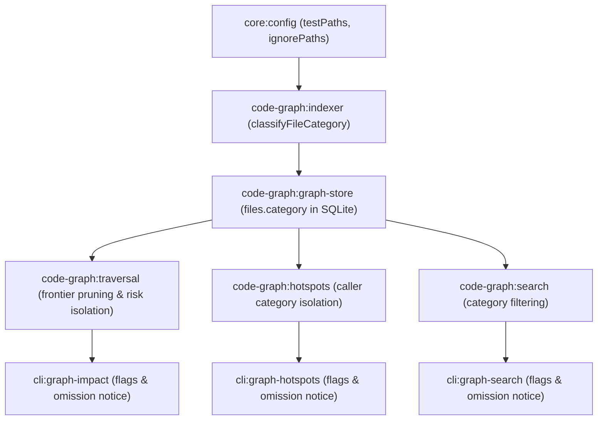

# Design: code-graph-file-categories

## Context & Scope

In SpecD's codebase intelligence engine (`code-graph`), every discovered file that is not explicitly blacklisted via `excludePaths` was previously indexed as an undifferentiated source file. In modern modular codebases, test files (`*.spec.ts`, `*_test.go`, `test/**`, etc.) and auxiliary assets (fixtures, mocks, scratch scripts) import production modules for test harness setup and assertion mocks.

Treating these files identically to production code severely distorted codebase analysis:

1. **Artificial Blast-Radius and Risk Inflation:** In `specd graph impact`, callers originating from unit tests were treated as production dependents. A function imported by 50 test files received a computed `riskLevel` of `CRITICAL` or `HIGH`, hiding that it had only 1 production caller.
2. **Transitive Bridge Contamination:** In bidirectional traversals or transitive walks, a test file importing multiple disparate modules acted as an artificial bridge, falsely reporting that changes to module A impacted module B.
3. **Hotspot Distortion:** In `specd graph hotspots`, caller counts and importer counts were inflated by test files, ranking test helpers and heavily tested utilities at the top of hotspots.
4. **Search Pollution:** In `specd graph search`, BM25 keyword matching returned mocks, test stubs, and test suites alongside production declarations.

Excluding these files entirely via `excludePaths` is unacceptable because test-to-code traceability, spec verification links (`COVERS_FILE`, `COVERS_SYMBOL`), and test dependency inspection would be lost.

This change introduces a three-tier semantic category model (`source`, `test`, `ignored`) for all indexed files, configured through language-neutral glob patterns in `specd.yaml`. Test and auxiliary files are fully parsed and indexed in SQLite, but are isolated from default graph calculations, traversals, hotspot rankings, and search queries, with prominent visibility notices when items are omitted and explicit flags to include or restrict categories.

## Architecture overview

The design preserves SpecD's hexagonal architecture across `@specd/core`, `@specd/code-graph`, and `@specd/cli`:

```
┌────────────────────────────────────────────────────────────────────────┐
│                              @specd/cli                                │
│   graph/impact.ts      graph/hotspots.ts       graph/search.ts        │
│   [--include-tests]    [--include-ignored]     [--all] [--category]    │
│   Omission notice rendering (text, JSON, TOON)                         │
└───────────────────────────────────┬────────────────────────────────────┘
                                    │ SDK calls
                                    ▼
┌────────────────────────────────────────────────────────────────────────┐
│                           @specd/code-graph                            │
│  ┌──────────────────────────────────────────────────────────────────┐  │
│  │ Domain Services & Value Objects                                  │  │
│  │   - FileNode: category ('source' | 'test' | 'ignored')           │  │
│  │   - classifyFileCategory() (language-agnostic glob classifier)   │  │
│  │   - analyzeImpact() & analyzeFileImpact() (risk/metric isolation)│  │
│  │   - computeHotspots() (caller & importer category filtering)     │  │
│  │   - ImpactResult & HotspotResult (omittedCounts)                 │  │
│  └─────────────────────────────────┬────────────────────────────────┘  │
│                                    │ Port contract                     │
│                                    ▼                                   │
│  ┌──────────────────────────────────────────────────────────────────┐  │
│  │ Ports & Infrastructure (SQLite)                                  │  │
│  │   - GraphStore.queryImpactFrontier (category admission filter)   │  │
│  │   - GraphStore.findSymbols / searchSymbols (category filter)     │  │
│  │   - SQLite schema: files.category column & idx_files_category    │  │
│  │   - queryImpactFrontierDirection: SQL join with category check   │  │
│  └──────────────────────────────────────────────────────────────────┘  │
└───────────────────────────────────┬────────────────────────────────────┘
                                    │ Uses config
                                    ▼
┌────────────────────────────────────────────────────────────────────────┐
│                              @specd/core                               │
│   - SpecdGraphConfig: testPaths, ignorePaths                           │
│   - SpecdWorkspaceGraphConfig: testPaths, ignorePaths                  │
│   - configLoader & Zod schemas with language-agnostic defaults         │
└────────────────────────────────────────────────────────────────────────┘
```

## Affected areas & Impact

### 1. `@specd/core`

- **File**: `packages/core/src/application/specd-config.ts`
  - **Construct**: `SpecdGraphConfig` and `SpecdWorkspaceGraphConfig`
  - **Changes**: Add optional `testPaths?: readonly string[]` and `ignorePaths?: readonly string[]`.
  - **Impact & Risk**: Additive, zero risk to existing configurations.
- **File**: `packages/core/src/application/ports/config-schema.ts`
  - **Construct**: `specdGraphConfigSchema` and `specdWorkspaceGraphConfigSchema`
  - **Changes**: Add validation schemas for `testPaths` and `ignorePaths` (arrays of strings).
  - **Impact & Risk**: Additive, backward-compatible.
- **File**: `packages/core/src/infrastructure/fs/config-loader.ts`
  - **Construct**: `ConfigLoader.load`
  - **Changes**: Provide default values for project `graph.testPaths` (`['**/*.spec.*', '**/*.test.*', '**/test/**', '**/tests/**', '**/__tests__/**', '*_test.*']`) and `graph.ignorePaths` (`[]`) when omitted.

### 2. `@specd/code-graph`

- **File**: `packages/code-graph/src/domain/value-objects/file-node.ts`
  - **Construct**: `FileCategory`, `FileNode`, `createFileNode`
  - **Changes**:

    ```typescript
    export type FileCategory = 'source' | 'test' | 'ignored'
    export const FILE_CATEGORIES: readonly FileCategory[] = ['source', 'test', 'ignored']

    export interface FileNode {
      readonly path: string
      readonly configRelativePath: string
      readonly language: string
      readonly contentHash: string
      readonly workspace: string
      readonly category: FileCategory
      readonly embedding?: Float32Array | undefined
      readonly content?: string | undefined
    }
    ```

  - **Impact & Risk**: Internal value object used across the code graph. `createFileNode` defaults `category` to `'source'` if omitted for backward compatibility.

- **File**: `packages/code-graph/src/domain/services/classify-file-category.ts` (NEW)
  - **Construct**: `classifyFileCategory(relativePath: string, testPatterns: readonly string[], ignorePatterns: readonly string[]): FileCategory`
  - **Changes**: Implements priority order: `ignorePaths` -> `testPaths` -> `'source'`.
- **File**: `packages/code-graph/src/domain/value-objects/impact-result.ts`
  - **Construct**: `ImpactResultFilter`, `ImpactResult`, `OmittedCounts`
  - **Changes**:

    ```typescript
    export interface OmittedCounts {
      readonly tests: number
      readonly ignored: number
    }

    export interface ImpactResultFilter {
      // ... existing fields
      readonly categories?: readonly FileCategory[]
      readonly includeTests?: boolean
      readonly includeIgnored?: boolean
    }

    export interface ImpactResult {
      // ... existing fields
      readonly omittedCounts: OmittedCounts
    }
    ```

- **File**: `packages/code-graph/src/infrastructure/sqlite/schema.ts`
  - **Construct**: `SQLITE_SCHEMA_VERSION`, `SQLITE_SCHEMA_DDL`
  - **Changes**: Increment `SQLITE_SCHEMA_VERSION`. Add `category TEXT NOT NULL DEFAULT 'source'` to `files` table and create index `CREATE INDEX IF NOT EXISTS idx_files_category ON files(category);`.
- **File**: `packages/code-graph/src/infrastructure/sqlite/sqlite-graph-database.ts`
  - **Construct**: `upsertFile`, `queryImpactFrontierDirection`, `findSymbols`, `getAllSymbols`, `bulkLoad`
  - **Changes**:
    - `upsertFile` persists `file.category`.
    - `queryImpactFrontierDirection`: Injects SQL `JOIN files f ON f.path = n.file_path WHERE f.category IN (...)` to halt frontier expansion at non-admitted file boundaries and track omitted item counts.
    - `findSymbols`: Filters symbols by joining `files f ON f.path = s.file_path` and matching `f.category`.
- **File**: `packages/code-graph/src/domain/services/analyze-impact.ts` & `analyze-file-impact.ts`
  - **Construct**: `analyzeImpact`, `analyzeFileImpact`
  - **Changes**: Isolate `directDependents`, `indirectDependents`, `transitiveDependents`, and `riskLevel` to admitted categories. Track `omittedCounts`.
- **File**: `packages/code-graph/src/domain/services/compute-hotspots.ts`
  - **Construct**: `computeHotspots`, `HotspotOptions`, `HotspotResult`
  - **Changes**: Add `categories`, `includeTests`, `includeIgnored` to `HotspotOptions`. Filter incoming caller edges and importer counts to admitted categories. Return `omittedCounts`.

### 3. `@specd/cli`

- **File**: `packages/cli/src/commands/graph/impact.ts`
  - **Construct**: `impactCommand`
  - **Changes**: Add `--include-tests`, `--include-ignored`, `--all`, `--category <source|test|ignored>`. Render omission notice in text mode and include `omittedCounts` in JSON/TOON.
- **File**: `packages/cli/src/commands/graph/hotspots.ts`
  - **Construct**: `hotspotsCommand`
  - **Changes**: Add `--include-tests`, `--include-ignored`, `--all`, `--category <source|test|ignored>`. Render omission notice and include `omittedCounts`.
- **File**: `packages/cli/src/commands/graph/search.ts`
  - **Construct**: `searchCommand`
  - **Changes**: Add `--tests`, `--include-tests`, `--include-ignored`, `--all`, `--category <source|test|ignored>`. Render omission notice and include `omittedCounts`.

## New constructs

### 1. `FileCategory` and Constants

Location: `packages/code-graph/src/domain/value-objects/file-node.ts`

```typescript
export type FileCategory = 'source' | 'test' | 'ignored'
export const FILE_CATEGORIES: readonly FileCategory[] = ['source', 'test', 'ignored']
```

### 2. `classifyFileCategory` Function

Location: `packages/code-graph/src/domain/services/classify-file-category.ts`

```typescript
import { FileCategory } from '../value-objects/file-node.js'
import { matchesExclude } from './matches-exclude.js'

/**
 * Classifies an indexed file path into 'source', 'test', or 'ignored'.
 *
 * Precedence rules:
 * 1. Matches ignorePatterns -> 'ignored'
 * 2. Matches testPatterns -> 'test'
 * 3. Default -> 'source'
 */
export function classifyFileCategory(
  relativePath: string,
  testPatterns: readonly string[],
  ignorePatterns: readonly string[],
): FileCategory {
  if (ignorePatterns.length > 0 && matchesExclude(relativePath, ignorePatterns)) {
    return 'ignored'
  }
  if (testPatterns.length > 0 && matchesExclude(relativePath, testPatterns)) {
    return 'test'
  }
  return 'source'
}
```

### 3. `OmittedCounts` Interface

Location: `packages/code-graph/src/domain/value-objects/impact-result.ts`

```typescript
export interface OmittedCounts {
  readonly tests: number
  readonly ignored: number
}
```

### 4. CLI Omission Notice Formatter

Location: `packages/cli/src/commands/graph/format-omission-notice.ts`

```typescript
import { OmittedCounts } from '@specd/code-graph'

export function formatOmissionNotice(counts: OmittedCounts): string | undefined {
  if (counts.tests === 0 && counts.ignored === 0) {
    return undefined
  }
  const parts: string[] = []
  if (counts.tests > 0) parts.push(`${counts.tests} test file${counts.tests === 1 ? '' : 's'}`)
  if (counts.ignored > 0)
    parts.push(`${counts.ignored} ignored file${counts.ignored === 1 ? '' : 's'}`)
  return `ℹ Excluded from results: ${parts.join(', ')}. Use --include-tests, --include-ignored, or --all to view them.`
}
```

## Data models & Contracts

### Physical SQLite Schema

In `packages/code-graph/src/infrastructure/sqlite/schema.ts`:

```sql
ALTER TABLE files ADD COLUMN category TEXT NOT NULL DEFAULT 'source';
CREATE INDEX IF NOT EXISTS idx_files_category ON files(category);
```

### Specd Configuration Contract

In `packages/core/src/application/specd-config.ts`:

```typescript
export interface SpecdGraphConfig {
  readonly includePaths?: readonly string[]
  readonly excludePaths?: readonly string[]
  readonly testPaths?: readonly string[]
  readonly ignorePaths?: readonly string[]
}

export interface SpecdWorkspaceGraphConfig {
  readonly respectGitignore?: boolean
  readonly allowedPaths?: readonly string[]
  readonly excludePaths?: readonly string[]
  readonly testPaths?: readonly string[]
  readonly ignorePaths?: readonly string[]
}
```

### Traversal and Impact Result Contracts

```typescript
export interface ImpactResultFilter {
  readonly types?: readonly ImpactResultType[]
  readonly kinds?: readonly SymbolKind[]
  readonly workspaces?: readonly string[]
  readonly excludeWorkspaces?: readonly string[]
  readonly categories?: readonly FileCategory[]
  readonly includeTests?: boolean
  readonly includeIgnored?: boolean
}

export interface ImpactResult {
  readonly target: string
  readonly directDependents: number
  readonly indirectDependents: number
  readonly transitiveDependents: number
  readonly riskLevel: RiskLevel
  readonly affectedFiles: readonly string[]
  readonly affectedSymbols: readonly AffectedSymbol[]
  readonly affectedSpecs: readonly string[]
  readonly affectedProcesses: readonly string[]
  readonly omittedCounts: OmittedCounts
}
```

### Hotspot Options and Result Contracts

```typescript
export interface HotspotOptions {
  readonly workspace?: string
  readonly kinds?: readonly SymbolKind[]
  readonly filePath?: string
  readonly excludePaths?: readonly string[]
  readonly excludeWorkspaces?: readonly string[]
  readonly limit?: number
  readonly minScore?: number
  readonly minRisk?: RiskLevel
  readonly includeImporterOnly?: boolean
  readonly categories?: readonly FileCategory[]
  readonly includeTests?: boolean
  readonly includeIgnored?: boolean
}

export interface HotspotResult {
  readonly entries: readonly HotspotEntry[]
  readonly totalSymbols: number
  readonly omittedCounts: OmittedCounts
}
```

## Approach & Execution flow

1. **Config Loading & Defaults**:
   When loading `specd.yaml`, `ConfigLoader` loads `graph.testPaths` and `graph.ignorePaths`. If `testPaths` is not set, it defaults to:
   `['**/*.spec.*', '**/*.test.*', '**/test/**', '**/tests/**', '**/__tests__/**', '*_test.*']`.
   `ignorePaths` defaults to `[]`.
   Workspace-level patterns merge additively with project-level patterns.

2. **File Discovery & Classification**:
   During graph indexing (`IndexProjectGraph`):
   - Files matching `excludePaths` or `.gitignore` are discarded before reading.
   - For every discovered file, its path relative to `codeRoot` (or project root) is tested against `ignorePaths`, then `testPaths`.
   - The resulting `FileNode` carries `category: 'source' | 'test' | 'ignored'`.
   - `upsertFile` saves `file.category` into the SQLite `files` table.

3. **Impact Analysis & Traversal Pruning**:
   - Caller specifies categories or accepts defaults (`['source']`).
   - Flags `--include-tests` or `--include-ignored` expand the admitted set.
   - In `SQLiteGraphDatabase.queryImpactFrontierDirection`, SQL queries filter incoming relations with:
     ```sql
     JOIN files f ON f.path = n.file_path
     WHERE f.category IN (${admittedPlaceholders})
     ```
   - BFS halts traversal at any symbol whose containing file does not match admitted categories.
   - Any reached non-admitted files increment `omittedCounts.tests` or `omittedCounts.ignored`.
   - `directDependents`, `indirectDependents`, `transitiveDependents`, and `riskLevel` are derived strictly from admitted items.
   - Exception: When the impact query root target itself is in a `test` or `ignored` file (e.g. `--file test/foo.spec.ts`), its outgoing dependencies are traversed because the root target was explicitly anchored.

4. **Hotspot Scoring Isolation**:
   - `computeHotspots` queries caller relations and file importers.
   - Callers from files not in admitted categories (`source` by default) are ignored in `directCallers` and `score`.
   - Files importing the symbol's file are ignored if their category is not admitted.
   - Symbols residing in non-admitted categories are excluded from hotspot candidate rankings by default.
   - `omittedCounts` records the excluded test and ignored files.

5. **Search Filtering**:
   - BM25 and symbol searches filter results by category.
   - Default query searches `f.category = 'source'`.
   - `--category test` queries `f.category = 'test'`.
   - `--category source,test` admits both categories.
   - `--include-tests`, `--include-ignored`, `--all` expand the admitted category set.
   - `omittedCounts` reports pruned matches.

6. **CLI Presentation & Notices**:
   - Commands parse `--include-tests`, `--include-ignored`, `--all`, and `--category`.
   - `--category` accepts a single category or comma-separated list of valid categories (`source`, `test`, `ignored`).
   - In text mode: If `omittedCounts` has non-zero items, an informational line is printed:
     `ℹ Excluded from results: 14 test files, 2 ignored files. Use --include-tests, --include-ignored, or --all to view them.`
   - In JSON and TOON modes: `omittedCounts: { tests: number, ignored: number }` is included in the output root.

## Error handling & Edge cases

- **Invalid `--category` flag argument**:
  If a user passes an invalid category name (e.g. `--category invalid` or `--category source,invalid`), CLI validation rejects the option with a usage error before opening the provider, stating that valid values are `source`, `test`, or `ignored`.
- **Target anchored in test/ignored file**:
  If a user runs `specd graph impact --file test/my.spec.ts`, the root target is explicitly analyzed. The anchor is admitted, and its outgoing dependencies are traversed regardless of target category.
- **Transitive BFS loops and bridges**:
  Halting BFS at non-admitted categories completely eliminates artificial bridge contamination where tests import unrelated production modules.
- **SQLite Schema Migration**:
  Incrementing `SQLITE_SCHEMA_VERSION` causes the provider to detect a schema mismatch and automatically rebuild or recreate the SQLite database on next index, avoiding runtime crashes.

## Key decisions

- **Three semantic categories instead of a boolean**:
  `source`, `test`, and `ignored` are distinct. Test files have specific verification semantics (`COVERS_FILE`, `COVERS_SYMBOL`, test discovery), whereas ignored files represent auxiliary non-test assets.
- **Language neutrality**:
  No hardcoding of `.ts`, `.js`, or `.go`. All classifications rely on gitignore-compatible glob patterns.
- **SQL-level pruning vs memory filtering**:
  Pruning non-admitted files directly in the SQLite query ensures large codebases do not load hundreds of test callers into Node.js heap memory, keeping traversals sub-millisecond.
- **Omission transparency**:
  Both human and machine outputs explicitly notify when results are pruned, preventing confusion when an expected caller is missing.

## Trade-offs

- **SQLite Schema Migration**: Incrementing the schema version requires rebuilding the graph store index.
  _Mitigation_: SpecD's incremental indexer handles rebuilding seamlessly and quickly.
- **Dual inclusion and category flags**: Adding `--include-tests`, `--include-ignored`, `--all`, and `--category <type>` gives users full flexibility while keeping common workflows simple.

## Spec impact

- Modified specs:
  - `core:config`: Adds `testPaths` and `ignorePaths` config fields.
  - `code-graph:graph-store`: Updates SQLite schema, `FileNode`, and query contracts.
  - `code-graph:traversal`: Isolates impact risk and metrics, prunes BFS through non-admitted categories.
  - `code-graph:hotspots`: Isolates caller and importer signals to admitted categories.
  - `cli:graph-impact`: Adds CLI flags, outputs omission notices.
  - `cli:graph-hotspots`: Adds CLI flags, outputs omission notices.
  - `cli:graph-search`: Adds CLI flags, outputs omission notices.
- Dependent specs evaluated:
  - `code-graph:indexer`: Uses `classifyFileCategory` during indexing.
  - No ripple breakage; all changes are additive and backward-compatible.

## Dependency map



```
┌──────────────────────────────────────────────┐
│ core:config (testPaths, ignorePaths)         │
└──────────────────────┬───────────────────────┘
                       │
                       ▼
┌──────────────────────────────────────────────┐
│ code-graph:graph-store (SQLite category col) │
└──────┬───────────────────────┬───────────────┘
       │                       │
       ▼                       ▼
┌──────────────┐       ┌──────────────┐
│ traversal    │       │ hotspots     │
└──────┬───────┘       └──────┬───────┘
       │                       │
       ▼                       ▼
┌──────────────┐       ┌──────────────┐
│ cli:impact   │       │ cli:hotspots │
└──────────────┘       └──────────────┘
```

## Migration / Rollback

- Additive database change: SQLite table column `category` with `DEFAULT 'source'`.
- Schema version bump: Triggers automatic recreation / re-indexing on first provider open.
- Rollback: Reverting code restores previous schema version; SQLite store recreates cleanly.

## Testing

### Automated tests

- **Unit tests**:
  - `classify-file-category.spec.ts`: Tests pattern precedence (`ignorePaths` > `testPaths` > `source`), language-neutral globs (`*.spec.ts`, `*_test.go`, `test/**`).
  - `analyze-impact.spec.ts`: Tests that test callers do not inflate risk level or direct/indirect counts, and `omittedCounts` accurately records pruned test files.
  - `compute-hotspots.spec.ts`: Tests that test callers are excluded from scoring unless `--include-tests` is passed.
  - `sqlite-graph-database.spec.ts`: Tests physical SQL join pruning in `queryImpactFrontierDirection`.
- **Integration tests**:
  - `cli/commands/graph/impact.spec.ts`: Tests `--include-tests`, `--category` (single and comma-separated), and omission notice text rendering.
  - `cli/commands/graph/hotspots.spec.ts`: Tests `--include-tests`, `--category` (single and comma-separated), and omission notice text rendering.
  - `cli/commands/graph/search.spec.ts`: Tests `--category test`, comma-separated `--category`, and omission notice text rendering.

### Documentation updates

- Update `docs/cli/cli-reference.md` documenting new flags (`--include-tests`, `--include-ignored`, `--all`, `--category`) for `specd graph impact`, `specd graph hotspots`, and `specd graph search`.
- Update `docs/guide/code-graph.md` explaining file categorization, defaults, and configuration options.

## Open questions

None. All architectural requirements and decisions were clarified and agreed upon during discovery.
