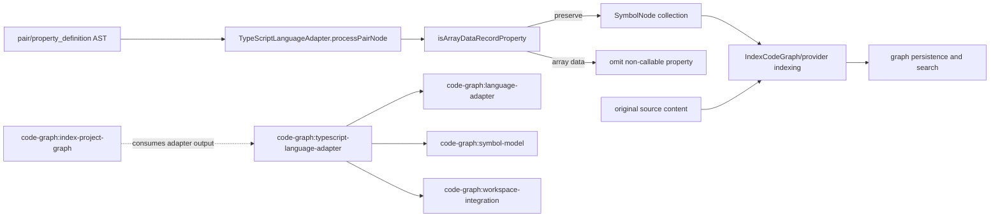

# Design: filter-typescript-array-data-symbols

## Non-goals

- Do not change file discovery, file-content indexing, graph persistence, SQLite batching, symbol identity, relation construction, or public adapter APIs.
- Do not suppress callable properties, object methods, class fields, properties outside an array-backed record path, or scalar properties owned by named object declarations.
- Do not introduce configurable filtering, generated-file heuristics, filename rules, or wall-clock performance thresholds.
- Do not modify other language adapters or the shared `SymbolKind` model.

## Affected areas

- `packages/code-graph/src/infrastructure/tree-sitter/typescript-language-adapter.ts`
  - Modify the private `TypeScriptLanguageAdapter.processPairNode` implementation.
  - Signature remains unchanged:

    ```ts
    private processPairNode(
      node: SgNode,
      filePath: string,
      addSymbol: (
        name: string,
        kind: SymbolKind,
        node: SgNode,
        selectionNode: SgNode | null | undefined,
        comment: string | undefined,
      ) => void,
    ): void;
    ```

  - Before: every pair whose value kind is `object`, `string`, `number`, or `boolean_literal` is emitted as `SymbolKind.Variable`; function-valued pairs are emitted as `SymbolKind.Method`.
  - After: function-valued pairs retain the existing method path; eligible non-callable pairs are emitted only when `isArrayDataRecordProperty(node)` is false.
  - `filePath` remains accepted for signature consistency with the other node processors; this change does not add file I/O.
  - `TypeScriptLanguageAdapter` is a public adapter, while `processPairNode` remains private. File-level graph impact reports 26 direct, 20 indirect, and 35 transitive dependents across 16 files, with CRITICAL risk. Affected consumers include provider composition, indexing, reference resolution, impact analysis, and their integration tests. No caller signature changes are required; compatibility is maintained by narrowing only the emitted symbol collection.

- `packages/code-graph/test/infrastructure/tree-sitter/typescript-language-adapter.spec.ts`
  - Extend the existing `extractSymbols` suite beside `extracts object literal methods and properties`.
  - Add table-driven or focused tests for named objects, supported wrappers, direct and nested anonymous array records, an array nested inside a named object, callable record members, ranges, determinism, and a high-cardinality structural count.
  - Existing tests remain unchanged and must continue passing. The test file is itself a broad test dependency hotspot; graph analysis reports CRITICAL risk, so new assertions must target exact symbol names and kinds rather than global snapshot output.

No other source, test, configuration, package, or documentation file is modified. The graph lists `code-graph:index-project-graph` as an affected covering spec because indexing consumes adapter output, but its forwarding and lifecycle contract does not prescribe individual TypeScript property symbols and therefore needs no code or spec change.

## New constructs

Add one private module-level helper in `packages/code-graph/src/infrastructure/tree-sitter/typescript-language-adapter.ts`:

```ts
/**
 * Determines whether an object-literal pair is non-callable data below an array boundary.
 * Traversal stops at a named variable declaration or an enclosing callable boundary.
 * @param node - The pair or property-definition node to classify.
 * @returns True when an array ancestor is reached before a preserving boundary.
 */
function isArrayDataRecordProperty(node: SgNode): boolean
```

The helper is pure and stateless. It reads only the supplied AST ancestry via `parent()`, `kind()`, and `field()` and performs no parsing, I/O, mutation, or allocation proportional to file size. Its runtime is O(h) and memory use is O(1), where `h` is the AST ancestor depth.

Add one module-level immutable set for callable traversal boundaries:

```ts
const CALLABLE_BOUNDARY_KINDS: ReadonlySet<string> = new Set([
  'arrow_function',
  'function',
  'function_expression',
  'generator_function',
  'generator_function_declaration',
  'method_definition',
])
```

This boundary prevents an array containing a callable property from classifying unrelated object literals inside that callable's executable body as record fields. No export or dependency injection is added; `processPairNode` calls the helper directly in the same module.

## Data models & Contracts

No persisted schema, API payload, configuration, domain value object, or storage model changes.

The behavioral contract for a visited `pair` or `property_definition` is:

| Value and ancestry                                                                                            | Output                                                                                                     |
| ------------------------------------------------------------------------------------------------------------- | ---------------------------------------------------------------------------------------------------------- |
| Function, arrow function, function expression, or generator function value                                    | Emit `SymbolKind.Method` using the complete pair node and key selection node, regardless of array ancestry |
| Object, string, number, or boolean value; array ancestor reached before a named variable or callable boundary | Emit no symbol                                                                                             |
| Object, string, number, or boolean value; named variable declaration reached before any array                 | Emit `SymbolKind.Variable` with existing comment and ranges                                                |
| Object, string, number, or boolean value; callable boundary reached before any array                          | Emit `SymbolKind.Variable` under existing behavior                                                         |
| Object, string, number, or boolean value; neither array nor preserving boundary found                         | Emit `SymbolKind.Variable` under existing behavior                                                         |
| Any currently unsupported value kind                                                                          | Emit no symbol, unchanged from current behavior                                                            |

Named object preservation includes a `variable_declarator` reached through `parenthesized_expression`, `as_expression`, `satisfies_expression`, or `type_assertion`. Traversal is ancestry-based, so these wrappers need no special unwrapping and do not alter ranges. An array encountered before the variable declarator wins: both `const rows = [{ id: 1 }]` and `const config = { rows: [{ id: 1 }] }` omit `id`, while `const config = ({ id: 1 } as const)` preserves `id`.

Filtering affects only `SymbolNode` creation. The original input string supplied to analysis and indexing remains unchanged; no content, offsets, or parser nodes are rewritten.

## Approach & Execution flow

1. `extractSymbols` parses source once and walks the existing AST in deterministic child order.
2. Existing dispatch sends each `pair` or `property_definition` node to `processPairNode`.
3. `processPairNode` obtains `key` and `value`. Missing nodes or an empty trimmed key return without output, unchanged.
4. Compute the value node kind.
5. If the value is `function`, `arrow_function`, `function_expression`, or `generator_function`, call `addSymbol` exactly as today with `SymbolKind.Method`, the pair as construct range, the key as selection range, and `extractComment(node)`. Return immediately; ancestry filtering never runs for callable values.
6. If the value is not one of `object`, `string`, `number`, or `boolean_literal`, return without output, unchanged.
7. Call `isArrayDataRecordProperty(node)`:
   1. Set `current` to `node.parent()`.
   2. While `current` exists, inspect `nodeKind(current)`.
   3. If the kind is `array`, return `true` immediately. This covers direct record elements and arbitrarily nested objects beneath the array.
   4. If the kind is `variable_declarator`, return `false`. A supported named declaration was reached before an array.
   5. If the kind belongs to `CALLABLE_BOUNDARY_KINDS`, return `false`. Outer array ancestry must not leak into a callable body.
   6. Otherwise assign `current = current.parent()` and continue. Object nodes, nested pairs, and the transparent expression wrappers are intentionally traversed without changing the candidate node.
   7. If the root is reached, return `false`; non-array behavior remains backward compatible.
8. If the helper returned `true`, return without calling `addSymbol`. Otherwise call the existing variable-symbol path unchanged.
9. Downstream analysis, relation building, indexing, persistence, and search consume the reduced symbol list normally. Source-content indexing continues receiving the original file content.

## Error handling & Edge cases

- Missing key or value nodes, empty keys, and unsupported value kinds keep the existing silent-omission behavior; no new error is thrown.
- AST ancestry ending at the root without an array is conservative and preserves the property.
- Parenthesized, asserted, `as const`, and `satisfies` named objects preserve properties because traversal continues to the variable declarator.
- Any array literal crossed before a named declaration classifies the descendant object property as array-record data, including multiple nested object levels and arrays stored inside named objects.
- A callable value on the candidate pair is always preserved before ancestry classification.
- A nested object literal inside a callable body stops at the callable boundary, preventing an outer record array from suppressing executable implementation details.
- Computed or otherwise unsupported keys and values retain current extraction behavior; this change does not broaden syntax support.
- Malformed or unsupported syntax remains governed by existing parser coverage behavior. The helper introduces no error class, code, message, fallback, or recovery path.
- Traversal is finite because every iteration moves to the parent. Equivalent ASTs therefore produce identical decisions and symbol ordering.

## Key decisions

- **Use structural AST ancestry, not filenames or generated-code markers.** The semantic distinction is visible in syntax and works for generated and handwritten files alike.
- **Let the nearest array boundary win over an outer named declaration.** This filters records in `const config = { rows: [...] }` as well as directly named arrays.
- **Preserve callable candidates before filtering.** Function-valued properties and object methods are meaningful executable declarations even when stored in records.
- **Stop traversal at callable boundaries.** Data-record context must not leak into a function or method body.
- **Preserve by default when classification is uncertain.** Root termination without an array maintains compatibility and avoids false-negative symbols.
- **Use symbol-count regression assertions instead of timing.** A generated in-memory fixture with many anonymous records can prove cardinality stays bounded without flaky CI wall-clock thresholds.

Rejected alternatives:

- Immediate `array > object > pair` parent checks miss nested record objects and wrapper nodes.
- Suppressing every property below any array would incorrectly remove callable declarations and executable-body symbols.
- Generated-file exclusions or filename patterns hide the symptom only for known catalogs and couple semantics to build layout.
- Changing persistence batching does not address the semantic noise and belongs to separate SQLite safety work.

## Trade-offs

- **Heuristic based on array syntax:** Some arrays intentionally model named record-like APIs whose scalar fields users may want as symbols. The explicit contract prefers lower graph noise; callable members remain discoverable and full text remains searchable.
- **Tree-sitter node-kind coupling:** Grammar node names can evolve. Focused tests for each supported wrapper and callable form detect drift.
- **CRITICAL downstream blast radius:** Fewer symbols can change graph query results for array-record fields. The behavior is intentional and bounded to non-callable fields; regression tests protect public adapter behavior, and no stored schema changes.
- **Existing persisted graphs retain old symbols until reindexed:** Normal incremental indexing updates changed files; users requiring immediate global cleanup must run a forced/full graph reindex. No migration script is required.

## Spec impact

The modified `code-graph:typescript-language-adapter` spec depends on `code-graph:language-adapter`, `code-graph:symbol-model`, and `code-graph:workspace-integration`; none of those contracts changes. The new behavior still returns deterministic shared symbols with valid ranges and workspace identity.

Graph impact identifies `code-graph:index-project-graph` as a downstream covering spec through indexing integration. Its contract only forwards prepared inputs and returns the provider's `IndexResult`; it does not require every object-literal scalar property to become a symbol. Its requirements remain satisfied and no delta is needed. Search also surfaced indexer, composition, and resolution consumers, but their contracts consume adapter facts generically and require no changes.

## Dependency map



```text
pair/property_definition
          |
          v
processPairNode [private]
     | callable ----------------------> preserve Method
     | non-callable
     v
isArrayDataRecordProperty(node)
     | array before boundary --------> omit symbol
     | named/callable/root boundary -> preserve Variable
          |
          v
existing index -> persistence/search

typescript-language-adapter spec
     +--> language-adapter
     +--> symbol-model
     +--> workspace-integration
     `--> index-project-graph (downstream consumer; no contract change)
```

## Migration / Rollback

No schema, configuration, API, or dependency migration is required. Deploy through the normal package build. A full reindex is optional to remove previously persisted low-value symbols from unchanged files; indexing changed files naturally replaces their old symbol sets.

Rollback consists of reverting the helper and `processPairNode` guard, rebuilding `@specd/code-graph`, and forcing a graph reindex if the previously omitted scalar property symbols must be restored. Stored data remains schema-compatible in both directions.

No user-facing documentation update under `docs/` is required because this is an internal extraction refinement with no CLI, configuration, or public API change. The normative spec delta and adapter JSDoc are the maintained documentation surfaces.

## Testing

Automated tests in `packages/code-graph/test/infrastructure/tree-sitter/typescript-language-adapter.spec.ts`:

1. Preserve the existing named-object test and add wrapped variants for parentheses, `<Type>` assertion, `as const`, and `satisfies`; assert scalar key names exist with `SymbolKind.Variable`.
2. Analyze `const rows = [{ id: 1, label: 'a', nested: { enabled: true } }]`; assert `id`, `label`, `nested`, and `enabled` are absent.
3. Analyze `const config = { version: '1', rows: [{ id: 1, nested: { enabled: true } }] }`; assert `version` remains and fields below `rows` are absent.
4. Analyze an anonymous array record containing an object-method syntax member, arrow-function property, function-expression property, generator-function property, and scalar fields; assert every callable name remains with `SymbolKind.Method` while scalar names are absent.
5. For representative preserved scalar and callable symbols, assert exact `line`, `column`, `endLine`, and `endColumn` containment: `selectionRange` starts and ends inside the complete pair/method construct range.
6. Run `extractSymbols` twice on the combined fixture and compare the complete ordered arrays for equality to prove determinism.
7. Build an in-memory source string containing at least 1,000 anonymous records with repeated scalar keys plus one named object and callable record member. Assert the scalar record keys contribute zero symbols and the result cardinality is bounded to the named declaration/property and callable symbols; do not assert elapsed time.
8. Include a callable property whose body contains a local object literal; assert its local object's eligible properties remain preserved because traversal stops at the callable boundary.

The source-content assertion is covered end to end without altering indexing code: index a temporary TypeScript file containing a uniquely searchable scalar value inside an anonymous array record, then use the existing file-content search path to assert the file is returned while symbol search does not return the filtered field. If the existing integration harness makes this assertion in `packages/code-graph/test/application/use-cases/index-project-graph-integration.spec.ts`, add the smallest focused test there; otherwise perform the manual check below and keep production changes limited to the adapter.

Run these commands from the repository root:

```bash
pnpm --filter @specd/code-graph test -- typescript-language-adapter.spec.ts
pnpm --filter @specd/code-graph typecheck
pnpm --filter @specd/code-graph lint
pnpm --filter @specd/code-graph build
```

Expected results: all adapter tests pass, TypeScript reports no errors, ESLint reports no violations, and the package build completes. For manual/E2E verification, index a temporary owned workspace containing a named object plus a large anonymous record array with a unique scalar value, then run graph symbol search for the field name and file-content search for the unique value. The field must not appear as a code symbol, the file-content result must still match, named scalar properties and callable record members must appear, and repeated indexing must return the same ordered symbol set.
