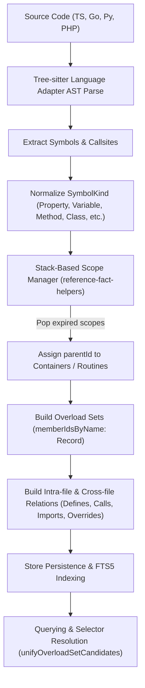
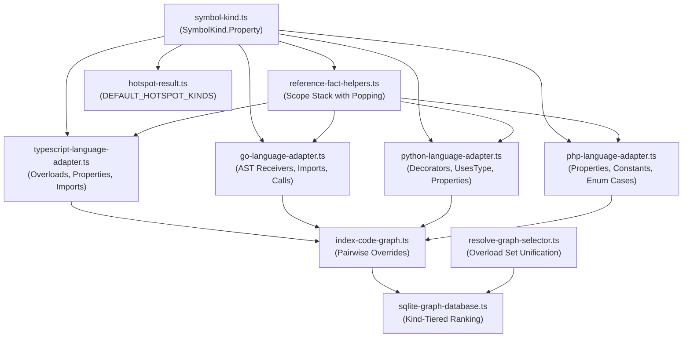

# Design: code-graph-complete-dependency-detection

## Non-goals

- Modifying the public signatures or return contract shapes of top-level use-cases (`LanguageAdapter`, `GraphStore`, `IndexCodeGraph`, `ResolveSymbolReference`, `computeHotspots`, and `resolveSymbolSelector`).
- Introducing runtime semantic type-checkers or compiler passes (such as running `tsc` or `mypy` processes) — AST and lexical extraction remains self-contained within Tree-sitter parsers and lightweight AST traversals.
- Changing the storage schema or table structure of SQLite database tables (`symbols`, `relations`, `reference_facts`); kind additions and ranking alterations fit within existing column formats (`symbols.kind TEXT`).
- Modifying symbol extraction rules or AST grammars for languages other than TypeScript, Go, Python, and PHP.

## Affected areas

### 1. Symbol Model and Enumeration

- **File path**: `packages/code-graph/src/domain/value-objects/symbol-kind.ts`
  - **Symbol / construct**: `SymbolKind`, `isSymbolKind`, `SYMBOL_KIND_VALUES`
  - **Changes**: Add `Property: 'property'` to `SymbolKind` object literal; update `SymbolKind` union type and backing `SYMBOL_KIND_VALUES` set.
  - **Signatures**:
    ```ts
    // Before:
    export const SymbolKind = {
      Function: 'function',
      Class: 'class',
      Method: 'method',
      Variable: 'variable',
      Type: 'type',
      Interface: 'interface',
      Enum: 'enum',
    } as const
    // After:
    export const SymbolKind = {
      Function: 'function',
      Class: 'class',
      Method: 'method',
      Variable: 'variable',
      Type: 'type',
      Interface: 'interface',
      Enum: 'enum',
      Property: 'property',
    } as const
    ```
  - **Impact & Risk**: 15 affected symbols across 10 files (adapters, store, mapper, selector resolver). Low risk; additive change that preserves backwards compatibility for all existing kinds.

### 2. Reference Fact Helpers and Lexical Scope Hierarchy

- **File path**: `packages/code-graph/src/infrastructure/tree-sitter/reference-fact-helpers.ts`
  - **Symbol / construct**: `withEnclosingTypeParents()`
  - **Changes**: Replace flat single-owner pointer with a stack-based lexical scope manager. Maintain enclosing container scopes (`Class`, `Interface`, `Type`, `Enum`) and routine scopes (`Function`, `Method`). Pop scopes when construct end line and column are exceeded by the incoming symbol position. Assign `parentId` for methods and properties to container scopes, and for variables and local functions to routine scopes.
  - **Signatures**:
    ```ts
    // Signature unchanged, internal algorithm replaced:
    export function withEnclosingTypeParents(symbols: readonly SymbolNode[]): SymbolNode[]
    ```
  - **Impact & Risk**: Used directly across language adapters. Eliminates parent ID bleed bugs when functions or classes follow one another. Risk: MEDIUM. Handled via comprehensive coordinate comparison unit tests.

### 3. TypeScript Language Adapter

- **File path**: `packages/code-graph/src/infrastructure/tree-sitter/typescript-language-adapter.ts`
  - **Symbol / construct**: `TsTypeDeclarationInfo`, `TypeScriptLanguageAdapter.prototype.addOverrideRelations`, `extractSymbols()`, dynamic import parsing, and call extraction.
  - **Changes**:
    1. Update `TsTypeDeclarationInfo` to use `memberIdsByName: Record<string, string[]>` instead of `Record<string, string>` to retain full overload sets without overwriting preceding signatures.
    2. Update `addOverrideRelations` to establish pairwise `RelationType.Overrides` edges between all submethod IDs and all supermethod overload IDs.
    3. Extract interface property signatures, class property definitions/field declarations, and enum members as `SymbolKind.Property`.
    4. Detect dynamic `import(...)` expressions with string literal arguments in AST and emit corresponding `FileImportFact` records.
    5. Recursively traverse nested call expressions (method chaining, property accesses) to discover embedded call sites.
  - **Signatures**:
    ```ts
    // Before:
    interface TsTypeDeclarationInfo {
      readonly name: string;
      readonly symbolId: string;
      readonly methodsByName: Record<string, string>;
      ...
    }
    // After:
    interface TsTypeDeclarationInfo {
      readonly name: string;
      readonly symbolId: string;
      readonly memberIdsByName: Record<string, string[]>;
      ...
    }
    ```
  - **Impact & Risk**: Core TypeScript indexing. Risk: MEDIUM. Covered by existing and new unit tests in `typescript-language-adapter.spec.ts`.

### 4. Go Language Adapter

- **File path**: `packages/code-graph/src/infrastructure/tree-sitter/go-language-adapter.ts`
  - **Symbol / construct**: `GoLanguageAdapter.prototype.collectMethodReceivers`, `GoLanguageAdapter.prototype.buildRelations`, struct field symbol extraction.
  - **Changes**:
    1. Replace regex-based `collectMethodReceivers` with AST inspection: inspect `method_declaration` node's `receiver` field (`parameter_list` -> `parameter_declaration` -> `pointer_type` / `type_identifier`).
    2. Extract struct field declarations in `struct_type` as `SymbolKind.Property`.
    3. In `buildRelations()`, emit `RelationType.Imports` for relative and package imports, and emit `RelationType.Calls` for intra-file and imported function/method invocations.
  - **Impact & Risk**: Closes Issue #52 Go relations debt. Risk: MEDIUM. Tested via `go-language-adapter.spec.ts`.

### 5. Python Language Adapter

- **File path**: `packages/code-graph/src/infrastructure/tree-sitter/python-language-adapter.ts`
  - **Symbol / construct**: `PythonLanguageAdapter.prototype.extractSymbols`, decorator call site detection, type annotation relations.
  - **Changes**:
    1. Extract class assignments, dataclass fields, and Protocol annotations as `SymbolKind.Property`.
    2. When analyzing `decorator` AST nodes, extract decorator invocations as `CallFact` instances with caller set to decorated function/class.
    3. Traverse field type annotations on dataclasses to emit `RelationType.UsesType` relations.
  - **Impact & Risk**: Python dependency detection accuracy. Risk: LOW. Tested in `python-language-adapter.spec.ts`.

### 6. PHP Language Adapter

- **File path**: `packages/code-graph/src/infrastructure/tree-sitter/php-language-adapter.ts`
  - **Symbol / construct**: `PhpLanguageAdapter.prototype.extractSymbols`
  - **Changes**:
    1. Update property declaration visitor: map `property_element` to `SymbolKind.Property` instead of `SymbolKind.Variable`.
    2. Extract class constants (`const`) and enum cases (`enum_case`) as `SymbolKind.Property` with enclosing class/enum `parentId`.
  - **Impact & Risk**: Risk: LOW. Tested in `php-language-adapter.spec.ts`.

### 7. Selector Resolver and Overload Unification

- **File path**: `packages/code-graph/src/application/services/resolve-graph-selector.ts`
  - **Symbol / construct**: `resolveSymbolSelector()`, `resolvedResult()`
  - **Changes**: In `resolvedResult()`, inspect candidate matches. If all returned candidate symbols belong to the same logical symbol or represent overload declarations of the same member signature within the same container, resolve cleanly as `status: 'resolved'` (selecting the implementation or first declaration) rather than classifying as ambiguous. True multi-symbol ambiguities continue to return `status: 'ambiguous'`.
  - **Impact & Risk**: Impacts CLI `--symbol` selectors and impact queries. Risk: MEDIUM. Fully backwards compatible.

### 8. Cross-File Override Derivation in Indexer

- **File path**: `packages/code-graph/src/application/use-cases/index-code-graph.ts`
  - **Symbol / construct**: `IndexCodeGraph.prototype.deriveCrossFileOverrideRelations` (line ~1907)
  - **Changes**: Iterate through all entries of `superMethods.get(name)` array instead of taking only index `[0]`. Generate `RelationType.Overrides` for all overload signatures in the target hierarchy.
  - **Impact & Risk**: Completes polymorphic inheritance graph edges. Risk: LOW.

### 9. Hotspot Ranking Defaults

- **File path**: `packages/code-graph/src/domain/value-objects/hotspot-result.ts`
  - **Symbol / construct**: `DEFAULT_HOTSPOT_KINDS`
  - **Changes**: Add `SymbolKind.Interface` to `DEFAULT_HOTSPOT_KINDS`. Exclude `Property`, `Variable`, and `Enum`.
  - **Signatures**:
    ```ts
    // Before:
    export const DEFAULT_HOTSPOT_KINDS: readonly SymbolKind[] = [
      SymbolKindEnum.Class,
      SymbolKindEnum.Method,
      SymbolKindEnum.Function,
    ] as const
    // After:
    export const DEFAULT_HOTSPOT_KINDS: readonly SymbolKind[] = [
      SymbolKindEnum.Class,
      SymbolKindEnum.Method,
      SymbolKindEnum.Function,
      SymbolKindEnum.Interface,
    ] as const
    ```
  - **Impact & Risk**: Used by `specd graph hotspots`. Risk: LOW.

### 10. SQLite Search Query Kind-Tiered Ranking

- **File path**: `packages/code-graph/src/infrastructure/sqlite/sqlite-graph-database.ts`
  - **Symbol / construct**: Symbol search query `ORDER BY` clause (~line 1549)
  - **Changes**: Append kind prominence tie-breaker expression to symbol candidate ordering:
    `CASE s.kind WHEN 'class' THEN 4 WHEN 'interface' THEN 4 WHEN 'function' THEN 3 WHEN 'method' THEN 3 WHEN 'type' THEN 2 WHEN 'enum' THEN 2 ELSE 1 END DESC, s.name ASC, s.line ASC`.
  - **Impact & Risk**: Deterministic search ordering when FTS/identity scores are tied. Risk: LOW.

---

## New constructs

### 1. Lexical Scope Frame Helper

- **Location**: `packages/code-graph/src/infrastructure/tree-sitter/reference-fact-helpers.ts`
- **Complete Type / Signature**:
  ```ts
  /**
   * Lexical scope frame tracked on the active scope stack during parent resolution.
   */
  export interface LexicalScopeFrame {
    readonly id: string
    readonly kind: SymbolKind
    readonly startLine: number
    readonly startColumn: number
    readonly endLine: number
    readonly endColumn: number
  }
  ```
- **Responsibility & Invariants**: Enforces strict lexical containment. A symbol is contained within a frame if and only if its coordinates fall strictly within `[startLine:startColumn, endLine:endColumn]`. When the walker advances past `endLine:endColumn`, the frame is popped immediately.
- **Wiring & Dependencies**: Private to `reference-fact-helpers.ts` and consumed by `withEnclosingTypeParents()`.

### 2. Overload Set Candidate Helper

- **Location**: `packages/code-graph/src/application/services/resolve-graph-selector.ts`
- **Complete Type / Signature**:
  ```ts
  /**
   * Evaluates whether a set of symbol matches represents a single logical overload set.
   * @param matches - Candidate symbol matches from query resolution.
   * @returns The primary representative match if unified, or undefined if truly ambiguous.
   */
  export function unifyOverloadSetCandidates(
    matches: readonly ResolvedSymbolSelector[],
  ): ResolvedSymbolSelector | undefined
  ```
- **Responsibility & Invariants**: Returns the primary declaration (or first occurrence) if all matches share the same container and member name, resolving overload ambiguity deterministically.
- **Wiring & Dependencies**: Called by `resolvedResult()` before determining ambiguous status.

---

## Data models & Contracts

### 1. Updated `SymbolKind` Enum Value

`SymbolKind.Property = 'property'`

### 2. Extended `DEFAULT_HOTSPOT_KINDS`

`DEFAULT_HOTSPOT_KINDS: readonly SymbolKind[] = ['class', 'method', 'function', 'interface']`

### 3. Normalization Contract Across Languages

| Language       | Construct                                  | Mapped `SymbolKind`   | Scope / `parentId`                |
| :------------- | :----------------------------------------- | :-------------------- | :-------------------------------- |
| **All**        | Module/File top-level constant or variable | `SymbolKind.Variable` | `parentId: undefined`             |
| **All**        | Routine-local variable declaration         | `SymbolKind.Variable` | `parentId: enclosingFunction.id`  |
| **TypeScript** | Class property / field definition          | `SymbolKind.Property` | `parentId: enclosingClass.id`     |
| **TypeScript** | Interface property signature               | `SymbolKind.Property` | `parentId: enclosingInterface.id` |
| **TypeScript** | Enum member                                | `SymbolKind.Property` | `parentId: enclosingEnum.id`      |
| **Go**         | Struct field declaration                   | `SymbolKind.Property` | `parentId: enclosingStruct.id`    |
| **Python**     | Class-level assignment / dataclass field   | `SymbolKind.Property` | `parentId: enclosingClass.id`     |
| **Python**     | Protocol property annotation               | `SymbolKind.Property` | `parentId: enclosingProtocol.id`  |
| **PHP**        | Class/Trait property declaration           | `SymbolKind.Property` | `parentId: enclosingClass.id`     |
| **PHP**        | Class constant (`const`)                   | `SymbolKind.Property` | `parentId: enclosingClass.id`     |
| **PHP**        | Enum case (`case`)                         | `SymbolKind.Property` | `parentId: enclosingEnum.id`      |

---

## Approach & Execution flow



### Algorithmic Steps:

1. **AST Parsing & Symbol Extraction**:
   - The respective `LanguageAdapter` (`TypeScript`, `Go`, `Python`, `Php`) parses source text into Tree-sitter AST.
   - Container members (fields, attributes, struct fields, enum cases) are tagged with `SymbolKind.Property`.
   - Routine variables and module variables retain `SymbolKind.Variable`.

2. **Lexical Scope Stack Resolution**:
   - In `withEnclosingTypeParents(symbols)`:
     - Sort symbols by line ascending, then column ascending.
     - Maintain `scopeStack: LexicalScopeFrame[]`.
     - For each incoming `symbol`:
       1. Pop all frames from `scopeStack` where `frame.endLine < symbol.line || (frame.endLine === symbol.line && frame.endColumn <= symbol.column)`.
       2. If `symbol.kind` is `Method` or `Property`: find top-most container frame (`Class`, `Interface`, `Type`, `Enum`) on stack. Assign `parentId = frame.id`.
       3. If `symbol.kind` is `Variable` or `Function`: find top-most routine frame (`Function`, `Method`) on stack. If found, assign `parentId = frame.id`.
       4. If `symbol` is a container or routine, push a new `LexicalScopeFrame` onto `scopeStack`.

3. **Language-Specific Relation Enrichments**:
   - **Go**: Traverse AST `method_declaration` for receiver type; emit `RelationType.Imports` for imported packages and `RelationType.Calls` for invocation sites.
   - **TypeScript**: Group member IDs in `TsTypeDeclarationInfo.memberIdsByName` as arrays; emit pairwise `RelationType.Overrides` across all overload signatures; extract dynamic `import()` arguments and chained calls.
   - **Python**: Extract `CallFact` for decorator expressions; extract `RelationType.UsesType` for dataclass field type annotations.
   - **PHP**: Extract class constants and enum cases as `SymbolKind.Property`.

4. **Selector Unification**:
   - In `resolveSymbolSelector`:
     - Query exact store matches.
     - When multiple matches exist for a selector, pass matches to `unifyOverloadSetCandidates()`.
     - If all matches belong to the same logical overload group, return `status: 'resolved'` targeting the primary match.
     - If matches span different files or different symbol identities, return `status: 'ambiguous'`.

5. **Search Ranking & Hotspot Aggregation**:
   - Append `CASE s.kind ...` prominence tie-breaker in `sqlite-graph-database.ts`.
   - Include `Interface` in `DEFAULT_HOTSPOT_KINDS`.

---

## Error handling & Edge cases

- **Malformed AST or Parse Failures**: When Tree-sitter encounters syntax errors or partial code, adapters gracefully skip unparseable nodes and preserve partial symbol trees without throwing exceptions.
- **Unclosed or Negative Coordinate Ranges**: `isValidSourceRange()` in `symbol-node.ts` validates all line/column coordinates. If coordinates are invalid or selection range exceeds construct range, `RangeError` is thrown during validation.
- **Overload Set with Zero Implementations**: If an overload set contains only ambient signatures (e.g., in a TypeScript `.d.ts` or interface), `unifyOverloadSetCandidates()` selects the first declared signature as the primary target.
- **Multiple Identical Receiver Names in Go**: Handled cleanly by AST parameter declaration type matching; pointer and value receivers on the same type name map to the same struct symbol ID.
- **Single-Line Container Declarations**: Handled by half-open column check (`frame.endColumn <= symbol.column`).

---

## Key decisions

- **Decision 1: Normalize all container state to `SymbolKind.Property` across all languages.**
  - _Rationale_: Establishes uniform cross-language semantics. Struct fields in Go, properties in PHP, class attributes in Python, and field declarations in TypeScript all represent encapsulated container properties.
  - _Alternatives rejected_: Keeping `Variable` for Go struct fields or PHP properties was rejected because it prevented accurate blast radius queries and caused false positives in variable searches.
- **Decision 2: Use Stack-Based Scope Resolution with Coordinate Popping in `withEnclosingTypeParents()`.**
  - _Rationale_: Eliminates scope bleed bugs where following functions or classes inherit prior owners. Stack-based popping ensures exact lexical containment.
  - _Alternatives rejected_: Regex-based indentation parsing (brittle across formatting styles) and AST re-parsing during parent resolution (incurs redundant computational overhead).
- **Decision 3: Unify Overload Sets in `resolveSymbolSelector()`.**
  - _Rationale_: When a developer or agent specifies a selector for an overloaded function or method, failing with `ambiguous` disrupts workflow automation. Unifying to the primary declaration with full candidate visibility solves ambiguity cleanly.
  - _Alternatives rejected_: Arbitrarily picking the first candidate without verifying logical symbol equivalence was rejected because it risked masking real symbol name collisions across different files.
- **Decision 4: Include `Interface` in `DEFAULT_HOTSPOT_KINDS`.**
  - _Rationale_: Interfaces are primary architectural boundary contracts. High coupling to an interface represents architectural hotspot risk that must be surfaced.

---

## Trade-offs

- `[Tree-sitter AST receiver extraction in Go]` $\rightarrow$ Slightly more verbose AST visitor logic compared to regex, but guarantees resilience against multiline signatures, comments, and generics.
- `[Overload pairwise override relations in Indexer]` $\rightarrow$ Generates $N \times M$ override relation edges when both supertype and subtype have multiple overloads, but accurately captures dependency completeness for every signature.

---

## Spec impact

- Modified Specs in Change Scope:
  1. `code-graph:symbol-model`
  2. `code-graph:language-adapter`
  3. `code-graph:typescript-language-adapter`
  4. `code-graph:go-language-adapter`
  5. `code-graph:python-language-adapter`
  6. `code-graph:php-language-adapter`
  7. `code-graph:resolve-symbol-reference`
  8. `code-graph:indexer`
  9. `code-graph:hotspots`
  10. `code-graph:sqlite-graph-store`
- Ripple Effect Analysis:
  - CLI commands (`specd graph search`, `specd graph impact`, `specd graph hotspots`) consume `code-graph` ports directly. All port return types and method signatures remain strictly unchanged.
  - No dependent workspace specs (`core`, `cli`, `sdk`) require modification.

---

## Dependency map



```
┌─────────────────────────────────────────────────────────────┐
│                       symbol-kind.ts                        │
│                  (SymbolKind.Property)                      │
└──────┬──────────────────────┬────────────────────────┬──────┘
       │                      │                        │
       ▼                      ▼                        ▼
┌──────────────┐       ┌──────────────┐         ┌──────────────┐
│  ref-facts   │       │   adapters   │         │ hotspot-res  │
│(Scope Stack) │       │(TS/Go/Py/PHP)│         │ (+Interface) │
└──────┬───────┘       └──────┬───────┘         └──────────────┘
       │                      │
       └───────────┬──────────┘
                   ▼
         ┌──────────────────┐
         │  index-code-     │
         │  graph / sqlite  │
         └──────────────────┘
```

---

## Migration / Rollback

- **Migration**:
  - The changes are internal to `@specd/code-graph`.
  - Re-index the codebase after deployment via `specd graph index` to update persisted symbol kinds and relation edges in SQLite storage.
- **Rollback**:
  - Purely in-code logic rollback via Git commit revert.
  - Database schema migrations are not required; running `specd graph index` on prior code regenerates the graph without `Property` kinds.

---

## Testing

### Automated Unit and Integration Tests

1. **`test/domain/value-objects/symbol-kind.spec.ts`**:
   - Verify `SymbolKind.Property === 'property'`.
   - Verify `isSymbolKind('property') === true`.
   - Verify `isSymbolKind('unknown') === false`.
   - Verify `createSymbolNode({ kind: 'property', ... })` creates valid node.

2. **`test/infrastructure/tree-sitter/reference-fact-helpers.spec.ts`**:
   - Scope stack popping test: class followed by a top-level function ensures function has `parentId: undefined`.
   - Nested routines test: function containing local variables assigns `parentId: function.id`.
   - Container property test: class containing properties and methods assigns `parentId: class.id`.

3. **`test/infrastructure/tree-sitter/typescript-language-adapter.spec.ts`**:
   - Overloaded method extraction: class with overloaded methods retains all signatures in `memberIdsByName`.
   - Override relations test: subclass overriding an overloaded method produces override relations to all supermethod overload signatures.
   - Property extraction: interface property signatures and class fields tagged as `SymbolKind.Property`.
   - Dynamic import test: `const m = await import('./module')` produces `FileImportFact`.
   - Nested call test: chained calls `a().b().c()` discover all intermediate call sites.

4. **`test/infrastructure/tree-sitter/go-language-adapter.spec.ts`**:
   - Struct fields extracted as `SymbolKind.Property` with struct `parentId`.
   - Multiline and pointer method receiver extraction via AST.
   - `buildRelations()` produces `RelationType.Imports` for imported packages.
   - `buildRelations()` produces `RelationType.Calls` for intra-file and imported calls.

5. **`test/infrastructure/tree-sitter/python-language-adapter.spec.ts`**:
   - Class variables, dataclass fields, Protocol annotations extracted as `SymbolKind.Property`.
   - Decorator `@decorator(arg)` extracted as `CallFact`.
   - Dataclass field type annotations produce `RelationType.UsesType` relations.

6. **`test/infrastructure/tree-sitter/php-language-adapter.spec.ts`**:
   - Class properties, class `const`, and enum `case` extracted as `SymbolKind.Property` with enclosing `parentId`.

7. **`test/application/services/resolve-graph-selector.spec.ts`**:
   - Selector matching overloaded method returns `status: 'resolved'` targeting primary declaration.
   - Selector matching different symbols across distinct files returns `status: 'ambiguous'`.

8. **`test/domain/services/compute-hotspots.spec.ts`**:
   - Default kinds include `Class`, `Method`, `Function`, `Interface`.
   - Properties, variables, and enums excluded by default unless explicitly specified.

9. **`test/infrastructure/sqlite/sqlite-graph-store.spec.ts`**:
   - Symbol search tie-breaker orders classes/interfaces before functions/methods, before types, before properties/variables.

### Manual / E2E Verification Commands

1. Re-index code-graph:

   ```bash
   node packages/cli/dist/index.js graph index --format toon
   ```

   _Expected output_: Clean index completion with zero errors.

2. Verify Property search and symbol extraction:

   ```bash
   node packages/cli/dist/index.js graph search "DEFAULT_HOTSPOT_KINDS" --symbols --format toon
   ```

   _Expected output_: Identified with kind `property` or `variable` according to scope.

3. Verify Hotspots ranking includes Interface:

   ```bash
   node packages/cli/dist/index.js graph hotspots --format toon
   ```

   _Expected output_: Hotspot entries include high-coupling interfaces and classes.

4. Verify Overload selector resolution:
   ```bash
   node packages/cli/dist/index.js graph impact --symbol "TypeScriptLanguageAdapter:parse" --direction dependents --format toon
   ```
   _Expected output_: Resolves cleanly without ambiguity error.

---

## Documentation Updates

As required by `rulesPost`, the following documentation updates in `docs/` must be performed during implementation:

1. **`docs/guide/code-graph.md`**:
   - Document `SymbolKind.Property` in the symbol model section.
   - Clarify normalisation rules for properties across TypeScript, Go, Python, and PHP.
   - Document search ranking tie-breaker hierarchy and `DEFAULT_HOTSPOT_KINDS` inclusion of interfaces.
2. **JSDoc documentation per `default:_global/docs`**:
   - Add/update complete JSDoc docstrings for all modified functions, methods, and interfaces in `packages/code-graph/src/`.

---

## Open questions

None. All technical decisions regarding `SymbolKind.Property` normalization, overload set unification, stack-based scope popping, and ranking weights have been agreed upon and validated against spec deltas.
