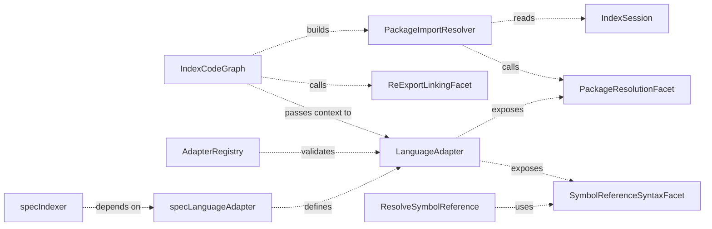

# Design: code-graph-cross-workspace-imports

## Non-goals

- No change to `declarationPolicy()` or `capabilities()` (`AdapterCapabilities`); they already declare behaviour and stay as they are.
- No semantic change to re-export linking: the logic of `linkReExports` moves behind the `reExportLinking` facet and runs earlier (see Approach), but its outputs are unchanged.
- No new graph store tables or columns. Existing `local_bindings.target_id`, `public_bindings`, `resolution_steps`, and `relations` hold all new facts. The only new data is a new `resolution_steps.kind` value, `import:package`.
- No compatibility shim for the old optional adapter methods. The project is in alpha and has no external adapters.
- No `tsconfig` `paths`/`baseUrl`/`imports` support, no Python `__all__` or star-import expansion, no Composer classmap/files, and no Go `go.work`. They stay unsupported coverage.
- No handling of the `UNGROUPED_LOGICAL_COLLISION` indexing warnings that the previous change left behind.
- No symbol-level resolution of Go qualified selectors (`pkg.Name`) across packages. Go keeps its file-level package dependency; selectors stay unsupported coverage.
- No change to the Python hierarchy check that calls `findSymbolsByName(baseName)` only to test whether an already-resolved id is an interface; it is not import resolution.
- No change to `code-graph-symbol-contracts` or `code-graph-file-outline`. They are re-evaluated against this contract after this change is archived.

## Affected areas

All paths are relative to the repository root. Impact numbers come from `graph impact` on the five core files below (risk **CRITICAL**: 67 direct dependents, 34 indirect, 57 transitive, 40 affected source files, plus 103 test files). Nearly all dependents reach these files through `index-code-graph.ts` and `language-adapter.ts`, which cli/sdk/composition code imports. Only the adapter contract and the indexer change behaviour; the wider dependents are recompiled, not edited, unless they construct adapters.

### `packages/code-graph/src/domain/value-objects/language-adapter.ts`

Symbols: `LanguageAdapter`, `ImportResolutionContext`, `ResolvedImports`.

- **Remove** from `LanguageAdapter`: `getPackageIdentity?`, `resolvePackageFromSpecifier?`, `resolveRelativeImportPath?`, `buildQualifiedName?`, `resolveQualifiedNameToPath?`, `parseSymbolReference?`, `renderSymbolReference?`, `linkReExports?`.
- **Add** to `LanguageAdapter` five optional readonly facet properties: `packageResolution?`, `relativeImportResolution?`, `qualifiedNameResolution?`, `symbolReferenceSyntax?`, `reExportLinking?` (types in "New constructs").
- **Extend `ImportResolutionContext`** (before and after below).
- **Extend `ResolvedImports`** with `steps` and `diagnostics`.

```ts
// Before
export interface ImportResolutionContext {
  readonly session: IndexSession
  readonly qualifiedNames: ReadonlyMap<string, string>
  readonly packageToWorkspace: ReadonlyMap<string, string>
  readonly codeRoot?: string
  readonly repoRoot?: string
}
export interface ResolvedImports {
  readonly importMap: ReadonlyMap<string, string>
  readonly fileImports: readonly string[]
}

// After
export interface ImportResolutionContext {
  readonly session: IndexSession
  readonly qualifiedNames: ReadonlyMap<string, string>
  readonly packageToWorkspace: ReadonlyMap<string, string>
  readonly workspaces: readonly PackageWorkspace[]
  readonly codeRoot?: string
  readonly repoRoot?: string
  readonly packageEntryFiles: (specifier: string) => PackageEntryResolution
  readonly resolvePackageExport: (request: PackageExportRequest) => PackageExportResolution
}
export interface ResolvedImports {
  readonly importMap: ReadonlyMap<string, string>
  readonly fileImports: readonly string[]
  readonly steps: readonly ResolutionStep[]
  readonly diagnostics: readonly ImportDiagnostic[]
}
```

Backwards compatibility: none (breaking change to a public type, accepted for alpha). Every adapter returns `steps: []` and `diagnostics: []` when it has nothing to report.

### `packages/code-graph/src/public.ts`

Exports the new facet, context, and diagnostic types next to the existing `LanguageAdapter` export (line ~84), each with full JSDoc: `PackageResolutionFacet`, `PackagePreparationContext`, `PackageWorkspace`, `PackageEntryRequest`, `PackageEntry`, `RelativeImportResolutionFacet`, `QualifiedNameResolutionFacet`, `SymbolReferenceSyntaxFacet`, `ReExportLinkingFacet`, `ReExportLinkContext`, `ReExportLinkResult`, `PackageEntryResolution`, `PackageExportRequest`, `PackageExportResolution`, `ImportDiagnostic`, `ImportUnresolvedReason`.

### `packages/code-graph/src/infrastructure/tree-sitter/adapter-registry.ts`

Symbol: `AdapterRegistry.register(adapter)`.

- Add registration-time validation (see "Error handling"). `register` validates before touching any map, so a failed call leaves the registry unchanged.
- New private `validateAdapter(adapter: LanguageAdapter): void` that throws `InvalidLanguageAdapterError`.
- Existing `capabilities()`/`declarationPolicy()` lookups remain.
- Risk: `register` is called at composition time only (built-in adapters). Low risk.

### `packages/code-graph/src/domain/errors/invalid-language-adapter-error.ts` (new, see New constructs).

### `packages/code-graph/src/domain/value-objects/index-session.ts` and `packages/code-graph/src/application/use-cases/in-memory-index-session.ts`

Symbol: `IndexSession`, `InMemoryIndexSession`.

Add three read methods used by the generic resolver:

```ts
/** Returns the public bindings stored under one surface for an exported name and symbol space. */
findPublicBindings(surface: string, exportedName: string, space: SymbolSpace): readonly PublicBinding[]
/** Returns the category of an indexed file, or undefined when the file is not indexed. */
getFileCategory(filePath: string): FileCategory | undefined
/** Returns the primary declaration symbol id of a logical symbol, or undefined. */
getPrimaryDeclarationSymbolId(logicalId: string): string | undefined
```

`InMemoryIndexSession` keeps a `Map<string, PublicBinding[]>` keyed by `surface\0exportedName\0space`, maintained next to `publicBindingsById` in `registerAnalysis`, `hydrateReferenceFacts`, and `addReferenceFacts`. `getFileCategory` reads the registered `FileNode.category` (default `'source'`). The primary declaration of a logical symbol is the occurrence with the lowest sorted `symbolId` whose `occurrenceForm` is `'definition'`, falling back to the lowest `symbolId` (deterministic). Risk: `IndexSession` has other implementers only in tests (mocks). Update those mocks.

### `packages/code-graph/src/application/use-cases/index-code-graph.ts`

Symbol: `IndexCodeGraph.execute` and private helpers.

1. Package map (~line 872, before Pass 1): replace `adapter.getPackageIdentity` with `adapter.packageResolution?.identity(ws.codeRoot, options.projectRoot)` inside try/catch. The project root bounds the manifest search so it never reads a manifest above the project. A throwing `identity` is recorded as an indexing error and the adapter joins `disabledPackageResolution` for the rest of the run (so it is also listed in `adaptersWithoutPackageResolution`); the run continues. The same applies when `link` throws. The first adapter that returns a non-`undefined` identity for a workspace wins and later adapters are not asked. Keep the collision error.
2. After Pass 1 and hydration (before the resolve-imports chunks, ~line 1160), add the preparation sequence: call `packageResolution.prepare` once per adapter for every configured workspace, including hydrated ones (try/catch: a failure is recorded as an error and the adapter joins `disabledPackageResolution`); call `reExportLinking.link` for every adapter that provides it; add the result with `session.addReferenceFacts`. Remove the post-Pass-2 `linkReExports` call (~line 1558) and its `reexports` timing; the `reexports` metric keeps measuring the moved call.
3. In the resolve-imports call (~line 1170), supply the new context members (`workspaces`, `packageEntryFiles`, `resolvePackageExport`) from a new service `PackageImportResolver` (see New constructs), and collect `resolvedImports.steps` into the session (`session.addReferenceFacts({ publicBindings: [], steps })`) and `resolvedImports.diagnostics` into the run diagnostics.
4. File-level `IMPORTS`: today derived from `fileImports`; unchanged. The new package-import entries are appended to `fileImports` by the adapters.
5. Local binding targets (~line 1667): unchanged. It already reads `importedSymbolByLocalName`; package imports are fed through `importMap`, so they gain targets automatically.
6. Closure (`collectAffectedFileClosure`): include `import:package` steps in the reverse traversal (see Approach step "Closure").
7. List each registered adapter that lacks `packageResolution` once in `importDiagnostics.adaptersWithoutPackageResolution`. This is not an unresolved import: `facet-absent` is never counted in `total`, `byReason`, or `samples`.
8. Closure: the importers of a changed entry are found from persisted steps and hydrated bindings only. The pre-existing addition-only fallback (a run that adds code files re-extracts existing code files) stays and is what makes a newly resolvable import resolve.

Callers/risk: `execute` is wrapped by `IndexCodeGraph` consumers in `code-graph/composition`, `cli`, `sdk`. Public signature unchanged. Risk: **CRITICAL** because of fan-in; the change is behavioural inside the use case.

### `packages/code-graph/src/application/use-cases/resolve-symbol-reference.ts`

Replace the use of `adapter.parseSymbolReference` and `adapter.renderSymbolReference` (lines ~7 references) with `adapter.symbolReferenceSyntax?.parse` / `.render`. If the facet is absent, treat the reference as unresolved (no other adapter is consulted). No change to resolution precedence. Add a provenance step handler: steps of kind `import:package` are followed like any other step kind; no language branch. Tests use mock adapters with loose methods; update them to facets.

### `packages/code-graph/src/application/use-cases/_shared/compute-graph-fingerprint.ts`

No behavioural change: it still reads `resolutionManifests()`. Add a test that guards against a hardcoded manifest list.

### `packages/code-graph/src/infrastructure/tree-sitter/typescript-language-adapter.ts`

Symbols: `resolveImports` (~1312), `packageEntryCandidates` (~2827), `resolveReExportSource` (~2796), `linkReExports` (~2676), `getPackageIdentity` (~2913 region), `resolvePackageFromSpecifier`, `resolveRelativeImportPath`, `resolveQualifiedNameToPath`, `parseSymbolReference`, `renderSymbolReference`.

- Add facet properties as readonly object fields delegating to private methods; the existing public methods become private (`private readonly`) or are folded into the facet objects.
- `packageResolution.prepare`: for each workspace, find the nearest bounded `package.json` (reuse the existing manifest reader), parse once, and `session.setAdapterState('ts:packages', PreparedPackages)` where `PreparedPackages = ReadonlyMap<workspaceName, { name; main?; exports?; codeRoot }>`.
- `packageResolution.entrySurface`: implement the algorithm "TypeScript entry surface" below. It generalises the existing `packageEntryCandidates`, which is reused by `reExportLinking.link` (same function, no duplicate logic).
- `resolveImports` non-relative branch (current lines ~1357-1378): delete the `findSymbolsByName` block. New logic: for a named/aliased import call `context.resolvePackageExport({ specifier, exportedName: imp.originalName, space })`; on `resolved`, set `importMap`, push `result.entryFile` into `fileImports`, push the step. Side-effect imports and namespace imports call `context.packageEntryFiles(specifier)` and push the entry files (the namespace import binds no declaration). A default import additionally binds the local name to the entry file's single default export declaration (none or several: file dependency only); it does not call `resolvePackageExport`. `main` is a fallback only when `exports` is absent. Keep the existing `qualifiedNames.get(imp.specifier)` shortcut and `resolveQualifiedNameToPath` fallback (the latter now through the facet).
- Remove `workspaceCodeRoots`-style lazy state if any remains; manifest facts now come only from `prepare`.

Callers & risk: adapter methods are called by the indexer and by tests only. Risk **HIGH** (largest file in the package, ~3.4k lines) but the touched surface is confined to the import and manifest functions.

### `packages/code-graph/src/infrastructure/tree-sitter/python-language-adapter.ts`

`resolveImports` (~838; heuristic at ~884-888), `getPackageIdentity` (~1909), `resolvePackageFromSpecifier` (~1886), `resolveRelativeImportPath`, `resolveQualifiedNameToPath`, `parseSymbolReference`, `renderSymbolReference`.

- Facets: `packageResolution`, `relativeImportResolution`, `qualifiedNameResolution` (only if the adapter keeps a real `resolveQualifiedNameToPath`; if it was a pass-through, omit the facet), `symbolReferenceSyntax`. No `reExportLinking`.
- Replace the heuristic with the shared helpers (algorithm "Python entry surface").
- `prepare` is a no-op: the package map from `identity` and the workspace code root are enough, and `entrySurface` performs no filesystem read. The `'py:packages'` state is not needed.

### `packages/code-graph/src/infrastructure/tree-sitter/go-language-adapter.ts`

`resolveImports` (~661; package branch ~684-692 and `goPackageFiles` ~206), `getPackageIdentity` (~1489), `resolvePackageFromSpecifier` (~1462), `parseSymbolReference`, `renderSymbolReference`.

- Facets: `packageResolution`, `symbolReferenceSyntax`. No relative or qualified-name facets and no `reExportLinking`.
- Go has no name heuristic today: `resolveImports` already maps an import path to the non-test files of the package directory through `goPackageFiles` (lazy `GO_PACKAGE_DIRECTORIES_KEY` session state). This change moves that logic behind `packageResolution.entrySurface` and makes `resolveImports` call `context.packageEntryFiles`, with the same file-level result.
- `prepare` only builds the directory index (no manifest read); the directory index of `goPackageFiles` is built in `prepare` (keep the existing key and its building loop), so no lazy mutation happens in Pass 2.
- Qualified selectors across packages are not resolved (see Non-goals).

### `packages/code-graph/src/infrastructure/tree-sitter/php-language-adapter.ts`

`resolveImports` (~854), `getPackageIdentity` (~2027), `resolvePackageFromSpecifier` (~477), `resolveRelativeImportPath`, `buildQualifiedName`, `resolveQualifiedNameToPath`, `parseSymbolReference`, `renderSymbolReference`, and the existing Composer preparation (~2040, `psr4Cache`).

- Facets: `packageResolution`, `relativeImportResolution`, `qualifiedNameResolution`, `symbolReferenceSyntax`.
- `prepare` absorbs the existing Composer metadata preparation: it must store, per workspace, `{ packageName; codeRoot; psr4: ReadonlyArray<{ prefix; dir }> }` sorted by prefix length descending, under `'php:packages'`.
- PHP has no name heuristic today: `resolveImports` uses the global `qualifiedNames.get(imp.specifier)` map (a fully qualified name is the language's symbol identity) and then `resolveQualifiedNameFromSession` for a file dependency. Keep the exact qualified-name lookup first, unchanged. Use the entry surface only when it has no exact match, to express the PSR-4 file dependency through the shared facet and to resolve the class declared in that file. See "PHP entry surface".

### `packages/code-graph/src/domain/services/scoped-binding-environment.ts`

Symbols: `SymbolLookup`, `resolveBindingTarget`, `buildScopedBindingEnvironment`.

- `SymbolLookup` gains an optional `findById(symbolId): SymbolNode | undefined`; `index-code-graph.ts` provides it from the new `IndexSession.findSymbolById`.
- `buildScopedBindingEnvironment` builds `importedTargets` (local name to declaration id; one scope-aware map per file, so two scopes binding the same name to different declarations do not collide) from the import binding facts and passes it to `resolveBindingTarget` and `resolveReceiverFacts`.
- `resolveBindingTarget` resolves a fact that carries `targetSymbolId` through `findById` when the declaration is not local to the file, and resolves a name bound by an import to its declaration before any same-name search. Without it a type imported from another workspace produced no `USES_TYPE`, and a same-name local symbol produced a wrong one.
- Risk: shared by every adapter; for same-workspace imports `findById` returns the symbol that the name search used to return, so results do not change.

### `packages/code-graph/src/domain/value-objects/import-declaration.ts`

`ImportDeclaration` gains the optional `typeOnly?: boolean`, set by the TypeScript extractor for `import type { X }` and `import { type X }`. A type-only name is looked up only in the type space.

### `packages/code-graph/src/domain/value-objects/index-result.ts`

`IndexResult` gains the required `importDiagnostics: ImportDiagnosticSummary` (shape in "Data models & Contracts") and the exported `IMPORT_DIAGNOSTIC_SAMPLE_LIMIT` constant. Every object literal of `IndexResult` in tests and mocks adds the field.

### TypeScript re-exports as file dependencies

In `typescript-language-adapter.ts`, `resolveImports` adds the source module of every re-export (a relative re-export that resolves to exactly one indexed file, or the entry files of a package) to `fileImports`. This gives the incremental closure an edge from a re-exported module to the barrel that republishes it, so a change in the module re-links the barrel and its importers. The graph gains `IMPORTS` edges from barrels to the modules they re-export.

### Tests

All files under `packages/code-graph/test` that reference the removed methods are updated to the facets: `composition/code-graph-provider.spec.ts`, `application/use-cases/resolve-symbol-reference.spec.ts`, and `infrastructure/tree-sitter/{typescript,python,go,php}-language-adapter.spec.ts`. New files are listed in "Testing".

### Documentation

- `docs/code-graph/index.md`: section "Identity and adapter contract" and the maintainer checklist: replace the loose-method wording with the facet model, remove duplicated rules, and link to the new page.
- `docs/code-graph/language-adapters.md` (new): self-contained guide (content in "New constructs").
- `docs/adr/NNNN-language-adapter-facets.md` (new): MADR ADR. Use the next sequential number found in `docs/adr/` at implementation time. Decision Outcome Confirmation and More Information link only the source specs (`code-graph:language-adapter`, `code-graph:workspace-integration`, `code-graph:indexer`).
- `docs/code-graph/use-cases.md`: if it documents `ImportResolutionContext` or `getPackageIdentity`, update it. The implementer MUST search the three docs files for the removed method names and fix every hit.
- Every exported symbol of the contract carries full JSDoc (global docs rule).
- Release notes follow the repository release mechanism: before implementing, list `.changeset` and root release files; if a changeset directory exists, add one marking `@specd/code-graph` as a breaking change (minor bump while `0.x`). If none exists, mention the break in the PR description only.

## New constructs

### Facet types

File: `packages/code-graph/src/domain/value-objects/language-adapter-facets.ts` (new). Re-exported by `language-adapter.ts` and `public.ts`.

```ts
import { type IndexSession } from './index-session.js'
import {
  type LogicalSymbol,
  type ParsedSymbolReference,
  type PublicBinding,
  type ResolutionStep,
  type SymbolSpace,
} from './symbol-reference.js'

/** One workspace taking part in package resolution. */
export interface PackageWorkspace {
  /** Workspace name as configured. */
  readonly name: string
  /** Absolute path of the workspace code root. */
  readonly codeRoot: string
}

/** Input of {@link PackageResolutionFacet.prepare}. */
export interface PackagePreparationContext {
  readonly session: IndexSession
  /** Every workspace of the run, including workspaces that were only hydrated. */
  readonly workspaces: readonly PackageWorkspace[]
  readonly repoRoot?: string
}

/** Input of {@link PackageResolutionFacet.entrySurface}. */
export interface PackageEntryRequest {
  /** Full specifier as written, including any subpath (for example `@specd/code-graph/internal`). */
  readonly specifier: string
  /** Package identity returned by `matchSpecifier`. */
  readonly packageName: string
  /** Name of the workspace that owns the package. */
  readonly workspace: string
  readonly session: IndexSession
}

/** One place from which a package publishes names. */
export interface PackageEntry {
  /** Workspace-prefixed project path of an indexed source file, for example `code-graph:src/public.ts`. */
  readonly filePath: string
  /** Public surface id under which the exports of this entry are stored. */
  readonly surface: string
}

/** Package identity, specifier matching, and published entry surface. */
export interface PackageResolutionFacet {
  /** Derives the package identity for a workspace. May perform I/O. Returns `undefined` when no manifest is found. */
  identity(codeRoot: string, repoRoot?: string): string | undefined
  /**
   * Reads manifest facts for all configured workspaces once per run and stores compact immutable data
   * in the session. May perform I/O and may be a no-op (Python reads nothing, Go only indexes directories).
   */
  prepare(context: PackagePreparationContext): void
  /**
   * Returns the known package a non-relative specifier refers to. Depends only on its arguments
   * and on the data `prepare` stored in the session; no I/O.
   */
  matchSpecifier(
    specifier: string,
    knownPackages: readonly string[],
    session: IndexSession,
  ): string | undefined
  /** Returns the ordered entries through which the package publishes the specifier. Reads only prepared data; no I/O. */
  entrySurface(request: PackageEntryRequest): readonly PackageEntry[]
}

/** Maps a relative module specifier to candidate files. */
export interface RelativeImportResolutionFacet {
  /** Pure. Returns the most likely candidate first. */
  resolve(fromFile: string, specifier: string): string | readonly string[]
}

/** Qualified-name addressing for namespace-based languages. */
export interface QualifiedNameResolutionFacet {
  /** Pure. */
  build(namespace: string, symbolName: string): string
  /** Reads the metadata `prepare` stored in the session; no filesystem probing and no absolute-path fallback. */
  resolveToPath(qualifiedName: string, codeRoot: string, session: IndexSession): string | undefined
}

/** Human symbol-reference syntax of a language. */
export interface SymbolReferenceSyntaxFacet {
  /** Pure. Zero, one, or many explicit candidates. */
  parse(text: string): ParsedSymbolReference
  /** Pure. `ownerPath` is the owner simple names from root to the immediate owner. */
  render(
    symbol: LogicalSymbol,
    ownerPath: readonly string[],
  ): { readonly generic: string; readonly native?: string }
}

/** Input of {@link ReExportLinkingFacet.link}. */
export interface ReExportLinkContext {
  readonly session: IndexSession
  readonly packageToWorkspace: ReadonlyMap<string, string>
}

/** Bindings and provenance contributed by re-export linking. */
export interface ReExportLinkResult {
  readonly publicBindings: readonly PublicBinding[]
  readonly steps: readonly ResolutionStep[]
}

/** Links re-export routes into public bindings. */
export interface ReExportLinkingFacet {
  /** No I/O. Runs after Pass 1 and before import resolution. */
  link(context: ReExportLinkContext): ReExportLinkResult
}

/** Why a package import stayed unresolved. */
export type ImportUnresolvedReason =
  | 'facet-absent'
  | 'package-unknown'
  | 'no-entry-surface'
  | 'not-exported'
  | 'ambiguous'

/** Non-persisted record of an unresolved import. */
export interface ImportDiagnostic {
  /** Workspace-prefixed path of the importing file. */
  readonly filePath: string
  readonly specifier: string
  /** Imported name, when the import names one. */
  readonly exportedName?: string
  readonly reason: ImportUnresolvedReason
}

/** Result of {@link ImportResolutionContext.packageEntryFiles}. */
export type PackageEntryResolution =
  | {
      readonly status: 'resolved'
      readonly packageName: string
      readonly workspace: string
      readonly entries: readonly PackageEntry[]
    }
  | { readonly status: 'unresolved'; readonly reason: ImportUnresolvedReason }

/** Input of {@link ImportResolutionContext.resolvePackageExport}. */
export interface PackageExportRequest {
  readonly specifier: string
  readonly exportedName: string
  /** Symbol spaces to consider, for example `['value', 'type']` for a plain named import and `['type']` for a type-only import. */
  readonly spaces: readonly SymbolSpace[]
  /** Workspace-prefixed path of the importing file. */
  readonly fromFile: string
  /** Id of the local binding that the import creates, used as the step source. */
  readonly localBindingId: string
}

/** Result of {@link ImportResolutionContext.resolvePackageExport}. */
export type PackageExportResolution =
  | {
      readonly status: 'resolved'
      /** Logical id of the target. */
      readonly targetLogicalId: string
      /** Symbol id of the primary declaration to place in `importMap`. */
      readonly targetSymbolId: string
      /** Entry file that published the name. */
      readonly entryFile: string
      readonly publicBindingId: string
      /** Step to return in `ResolvedImports.steps`: `localBindingId` → `publicBindingId`, kind `import:package`. */
      readonly step: ResolutionStep
    }
  | { readonly status: 'unresolved'; readonly reason: ImportUnresolvedReason }
```

`LanguageAdapter` gains:

```ts
readonly packageResolution?: PackageResolutionFacet
readonly relativeImportResolution?: RelativeImportResolutionFacet
readonly qualifiedNameResolution?: QualifiedNameResolutionFacet
readonly symbolReferenceSyntax?: SymbolReferenceSyntaxFacet
readonly reExportLinking?: ReExportLinkingFacet
```

Invariants: every member of a present facet is a function; facet objects are immutable after construction; facet methods are synchronous and deterministic; only `identity` and `prepare` may perform I/O.

### `InvalidLanguageAdapterError`

File: `packages/code-graph/src/domain/errors/invalid-language-adapter-error.ts` (new). Extends the package's `SpecdCodeGraphError` (which extends `SpecdError`). `code = 'INVALID_LANGUAGE_ADAPTER'`, `specd = true`. Constructor `(languageIds: readonly string[], rule: string, member?: string)`. Message: `Invalid language adapter [<languages or "unknown">]: <rule>` plus ` (member "<member>")` when `member` is given. Exported from `public.ts`.

### `PackageImportResolver`

File: `packages/code-graph/src/application/services/package-import-resolver.ts` (new). Pure application service, no I/O. Constructed once per run by `IndexCodeGraph`.

```ts
export interface PackageImportResolverDeps {
  readonly session: IndexSession
  readonly packageToWorkspace: ReadonlyMap<string, string>
}

export class PackageImportResolver {
  constructor(deps: PackageImportResolverDeps)
  /** Builds the two context helpers bound to one importing adapter. */
  forAdapter(adapter: LanguageAdapter): {
    packageEntryFiles: (specifier: string) => PackageEntryResolution
    resolvePackageExport: (request: PackageExportRequest) => PackageExportResolution
  }
}
```

Behaviour of `packageEntryFiles(specifier)`:

1. `facet = adapter.packageResolution`; if absent → `{ unresolved, 'facet-absent' }`.
2. `packageName = facet.matchSpecifier(specifier, [...packageToWorkspace.keys()], session)`; if `undefined` → `'package-unknown'`.
3. `workspace = packageToWorkspace.get(packageName)`.
4. `entries = facet.entrySurface({ specifier, packageName, workspace, session })`.
5. Keep entries whose `filePath` satisfies `session.getFileId(filePath) !== undefined` and `session.getFileCategory(filePath) !== 'test'`. Test files are never entries, without exception.
6. If none remain → `'no-entry-surface'`; otherwise `resolved`.

Behaviour of `resolvePackageExport(request)`:

1. `entriesResult = packageEntryFiles(request.specifier)`; propagate unresolved.
2. For each entry and each space in `request.spaces`: `bindings = session.findPublicBindings(entry.surface, request.exportedName, space)`; drop bindings with `targetId === undefined`.
3. If no entry and space yields a binding → `'not-exported'`.
4. Collect the distinct `targetId` values across all entries and spaces. More than one → `'ambiguous'`. Otherwise `targetLogicalId` is that value. If one entry yields several bindings that share the target, use the one with the lowest `id` as `publicBindingId`.
5. `targetSymbolId = session.getPrimaryDeclarationSymbolId(targetLogicalId)`; if `undefined` → `'not-exported'`.
6. Return `resolved` with `entryFile = entry.filePath` of the entry that produced the chosen binding, and `step = { fromId: request.localBindingId, toId: publicBindingId, kind: 'import:package' }`.

It never calls `findSymbolsByName`.

### `docs/code-graph/language-adapters.md`

Self-contained guide. Required sections, each stating the rules itself:

1. What an adapter is and where it plugs in (indexer passes, session).
2. The required core with signatures, purity, and I/O rules.
3. The facet model: what a facet is, presence is declaration, no optional members, what happens when a facet is absent, how facet failures are isolated.
4. One section per facet (`packageResolution`, `relativeImportResolution`, `qualifiedNameResolution`, `symbolReferenceSyntax`, `reExportLinking`): purpose, when to provide it, each member with types, purity/I/O, invariants, what the indexer does with the output.
5. Capability flags and `declarationPolicy()` versus facets.
6. A worked example of a minimal adapter (core only) and the same adapter extended with `packageResolution` for a made-up manifest.
7. Registration and `INVALID_LANGUAGE_ADAPTER`: each validation rule, an example message, how to fix it.
8. Step-by-step checklist for adding a language.
9. The unresolved reasons (`facet-absent`, `package-unknown`, `no-entry-surface`, `not-exported`, `ambiguous`) and what each means for an adapter author.

Front matter is not required for `docs/code-graph/` files; follow the existing files in that folder (inspect `index.md` heading style before writing).

### Stub test adapter

File: `packages/code-graph/test/helpers/stub-language-adapter.ts` (new). A minimal adapter for the made-up language `zig2` (extension `.z2`, manifest `zig2.pkg`), implementing the required core and `packageResolution`. Used by the "new language needs no indexer change" tests. Its `analyzeFile` extracts `export Name` and `import Name from "pkg"` lines using plain string splitting (test double, not a production parser).

## Data models & Contracts

### Resolution step kind

`resolution_steps.kind = 'import:package'`. `from_id` is a local binding id (belongs to the importing file). `to_id` is a public binding id (belongs to the entry surface). Steps are persisted only when both ids are known reference ids (existing filter in `index-code-graph.ts` ~line 1700). No schema change.

### Local binding

`local_bindings.target_id` is the logical id of the imported symbol, set from `importMap` exactly as for relative imports. Unresolved: `NULL`.

### Relations

`IMPORTS` from the importing file node to the entry file node for each resolved import (file-level). `USES_TYPE`, `CALLS`, and `CONSTRUCTS` are produced by the existing scoped-binding pipeline from the binding.

### Session adapter state keys (run-scoped, compact, plain data)

- `'ts:packages'`: `ReadonlyMap<string, { name: string; main?: string; exports?: unknown; codeRoot: string }>` keyed by workspace name.
- `'py:packages'`: `ReadonlyMap<string, { projectName: string; codeRoot: string }>`.
- `'go:packages'`: `ReadonlyMap<string, { modulePath: string; codeRoot: string }>`.
- `'php:packages'`: `ReadonlyMap<string, { packageName: string; codeRoot: string; psr4: readonly { prefix: string; dir: string }[] }>`.

Each map is built only from workspaces whose adapter manifest was found.

### Diagnostics

`IndexResult.importDiagnostics` is a summary, because the full list can be as large as the number of imports in the corpus: `{ total: number; byReason: Partial<Record<ImportUnresolvedReason, number>>; samples: readonly ImportDiagnostic[]; externalPackageImports: number }`. `total` counts unresolved package imports excluding external ones; `byReason` holds exact counts; `samples` keeps at most `IMPORT_DIAGNOSTIC_SAMPLE_LIMIT` (20) diagnostics per reason in discovery order. An import whose reason is `package-unknown` names a package that no workspace declares, which is an external dependency and not a failure: it is counted only in `externalPackageImports` and is excluded from `total`, `byReason`, and `samples`. The summary is never written to the store and never affects the graph fingerprint.

## Approach & Execution flow

### Run sequence (all phases)

1. Discover files; Pass 1 analyzes new/changed files per workspace and hydrates unchanged ones (unchanged).
2. **Package map.** For each workspace and each adapter with `packageResolution`, call `identity(codeRoot, repoRoot)`. First non-undefined identity wins per workspace. A repeated identity across two workspaces pushes the existing collision error.
3. **Prepare.** For each adapter with `packageResolution`, call `prepare({ session, workspaces: allWorkspaces, repoRoot })` once. `allWorkspaces` is the full configured workspace list (not only those being indexed in this run).
4. **Link re-exports.** For each adapter with `reExportLinking`, call `link({ session, packageToWorkspace })` and `session.addReferenceFacts(result)`.
5. **Pass 2.** For each file, in the existing chunking: `adapter.resolveImports(analysis, context)` where `context` includes `workspaces`, `packageEntryFiles`, `resolvePackageExport` from `PackageImportResolver.forAdapter(adapter)`. Record `importMap` into `importedSymbolByLocalName`; record `steps` with `session.addReferenceFacts`; append `diagnostics` to the run output. Then `buildRelations` as today.
6. Commit as today. `IMPORTS` derives from `fileImports` as today.

Step 4 moves earlier than today (it ran after Pass 2). It depends only on logical symbols, declarations, public bindings, and local same-file bindings, which `registerAnalysis` stores in Pass 1 (`in-memory-index-session.ts` lines ~159-200), plus prepared manifest facts. A test pins the order (see Testing). If any re-export input turns out to be produced only in Pass 2, the implementer MUST stop and escalate rather than reintroduce a late linking pass.

### TypeScript entry surface (`entrySurface`)

Input: `specifier`, `packageName`, `workspace`, `session`.

1. `prepared = session.getAdapterState<PreparedPackages>('ts:packages')?.get(workspace)`; if undefined → `[]`.
2. `subpath = '.' + specifier.slice(packageName.length)` (so `@specd/code-graph` → `.`; `@specd/code-graph/internal` → `./internal`).
3. If `prepared.exports` is defined: `target = exports[subpath]`; for `.`, also accept `exports` that is itself a string or a condition object (shorthand). If no entry matches → `[]`.
   Else (no `exports`): only `.` is valid, `target = main`; if `main` is also absent use `index.js`. A non-`.` subpath → `[]`.
4. Flatten `target` to a list of paths: a string yields itself; a condition object yields the `import` value, else `default`; `types` is used only if neither yields an indexed source. Nested condition objects are flattened recursively with the same order.
5. For each flattened path, compute source candidates with the existing `sourceCandidates` function: strip leading `./`; map `dist/…/x.js|.mjs|.cjs` to `src/…/x` with `.ts`, `.tsx`, then `/index.ts`, `/index.tsx`; also try the literal path. Prefix each with `workspace + ':'`.
6. Keep candidates for which `session.getFileId(candidate) !== undefined`. Deduplicate while keeping order. Return them as `{ filePath: candidate, surface: candidate }`.

`reExportLinking.link` calls the same function for non-relative re-export specifiers and keeps its existing "exactly one indexed entry" rule (unchanged behaviour).

### TypeScript `resolveImports` (non-relative branch)

For each import `imp` that is non-relative and not file-only:

1. If `qualifiedNames.get(imp.specifier)` exists, set `importMap` and continue (unchanged).
2. If `imp.kind` is Namespace, Default, or side-effect: `r = context.packageEntryFiles(imp.specifier)`. On `resolved`, push each entry `filePath` to `fileImports`; for Default, additionally resolve the entry's default export with `resolvePackageExport({ exportedName: 'default' marker as stored by the adapter's public bindings, ... })`. Namespace imports record only the file dependency.
3. Otherwise (named): `spaces` is `[SymbolSpace.Type]` for type-only imports and `[SymbolSpace.Value, SymbolSpace.Type]` otherwise. Call `resolvePackageExport({ specifier, exportedName: imp.originalName, spaces, fromFile: analysis.filePath, localBindingId })`. `localBindingId` is the `id` of the entry in `analysis.referenceFacts?.localBindings` with `scopeId === 'module'` and `localName === imp.localName` (the adapter creates it in `analyzeFile`, ~line 1252; the binding's own space is always `value`, independent of `spaces`). If no such local binding exists, treat the import as unresolved with a diagnostic and add no step.
4. On `resolved`: `importMap.set(imp.localName, result.targetSymbolId)`; `fileImports.push(result.entryFile)`; `steps.push(result.step)`.
5. On `unresolved`: `diagnostics.push({ filePath, specifier, exportedName, reason })`; add nothing else.
6. Fall back to `resolveQualifiedNameToPath` only for specifiers that look like qualified names for the language (unchanged).

### Python entry surface

Input: dotted absolute specifier (for example `acme_auth.models`).

1. The workspace comes from the request; no prepared state is read.
2. `parts = specifier.split('.')`; the first segment names the package (normalized with `-` ↔ `_`). The rest are module path segments `rest`.
3. Roots to search: `workspace:` + `src/<pkg>` and `workspace:` + `<pkg>`, where `<pkg>` is the first segment as written (underscored). Paths are relative to the workspace code root, expressed as workspace-prefixed project paths.
4. For `rest = []` the candidates are `<root>/__init__.py` and `<root>/__init__.pyi`. Otherwise `<root>/<rest joined by />.py`, `.pyi`, and `<root>/<rest>/__init__.py`, `.pyi`.
5. Keep indexed candidates; surface = file path. Return in the listed order.

`resolveImports`: for `from pkg.mod import X`, `entry = packageEntryFiles('pkg.mod')`; then `resolvePackageExport({ specifier: 'pkg.mod', exportedName: 'X', space: 'value' })`. If it is `not-exported`, test whether `X` is a submodule: call `packageEntryFiles('pkg.mod.X')`; if resolved, push the module file to `fileImports` only; no binding is created. For `import pkg.mod`, only `fileImports` is set. Aliased names use `originalName`.

### Go entry surface

1. The workspace comes from the request; the package name (module path) comes from the package map.
2. `dir = specifier.slice(packageName.length)` with a leading `/` removed (empty for the module root).
3. `dirPath = workspace + ':' + dir`; the entry files are the indexed files whose directory equals `dirPath`, whose extension is `.go`, and which do not end in `_test.go`. Read them from the per-run directory index (the existing `GO_PACKAGE_DIRECTORIES_KEY` state, built once in `prepare` from `session.getAllFilePaths()`).
4. If there are none → `[]`. Otherwise return one `PackageEntry` per file, each with `surface` = the Go package surface id of that directory (the same id the adapter uses for public bindings of that package; derived by the existing function that builds Go public surfaces).

`resolveImports`: `packageEntryFiles(imp.specifier)` gives the entries; push every `filePath` to `fileImports` (identical to today's `goPackageFiles` result). No symbol is requested, `importMap` stays empty for package imports, and no step is produced. A failed lookup adds a diagnostic with the reason.

### PHP entry surface

1. `all = session.getAdapterState('php:packages')`; the specifier is the fully qualified name without leading `\`.
2. `matchSpecifier(specifier, knownPackages, session)`: read the prepared `php:packages` state from `session`, pick among all workspaces' PSR-4 entries the longest `prefix` that the name starts with, and return that workspace's `packageName` when it is in `knownPackages`. The session parameter exists because a qualified name is not named after its Composer package, so the owner can only be found from the prepared autoload prefixes of every workspace.
3. `entrySurface`: `rel = specifier.slice(prefix.length)` with `\` replaced by `/`; the candidate is `workspace:` + `<dir>/<rel>.php` normalized relative to the workspace code root. Keep if indexed. Surface = file path.
4. `resolveImports`: for `use A\B\C;` first try `qualifiedNames.get('A\B\C')` (unchanged). If there is no exact match, call `packageEntryFiles('A\B\C')` and record the PSR-4 class file as a file dependency when it is indexed. The PHP adapter publishes no public bindings, so it does not call `resolvePackageExport` and returns no `import:package` step. For group uses expand to each class first. Existing framework-loader logic (CakePHP, CodeIgniter) and `resolveQualifiedNameFromSession` are untouched.

### Closure

`collectAffectedFileClosure` in `index-code-graph.ts` already walks reversed `resolution_steps`. Add `import:package` to the step kinds it follows: starting from the public binding ids owned by changed or removed files (and from files that changed manifests), collect the `from_id` local bindings and map them to their files through `local_bindings.file_path`. A changed manifest that is declared in `resolutionManifests()` is already part of the fingerprint, so it triggers a full rebuild (existing behaviour). New workspaces trigger a full rebuild when the workspace configuration hash changes (existing behaviour). For previously unresolved imports whose target becomes resolvable through a newly added file, the existing addition-only fallback re-extracts existing code files that may contain unresolved imports.

### Registration validation (`AdapterRegistry.register`)

Order: (1) check required core members, (2) `languages()` non-empty, (3) every `extensions()` value is in `languages()`, (4) each present facet property is an object whose members (from a static table `FACET_MEMBERS`) are all functions, Only after all checks pass is state mutated. A language or extension that is already registered is not an error: the new adapter replaces the previous one for that language (later registration wins), extension mappings it declares overwrite earlier ones, an earlier adapter keeps the languages the new one does not declare, and an adapter left with no language drops out of `getAdapters()`. This keeps `createCodeGraphProvider({ adapters })` able to substitute a built-in adapter.

`FACET_MEMBERS`:

```ts
const FACET_MEMBERS = {
  packageResolution: ['identity', 'prepare', 'matchSpecifier', 'entrySurface'],
  relativeImportResolution: ['resolve'],
  qualifiedNameResolution: ['build', 'resolveToPath'],
  symbolReferenceSyntax: ['parse', 'render'],
  reExportLinking: ['link'],
} as const
```

## Error handling & Edge cases

- **Invalid adapter**: `InvalidLanguageAdapterError` (`INVALID_LANGUAGE_ADAPTER`). Messages: `missing required member "analyzeFile"`, `languages() returned no language`, `extension ".rs" maps to undeclared language "rust"`, `facet "packageResolution" must be an object`, `facet "packageResolution" is missing member "entrySurface"`. Registry unchanged on failure.
- **Facet absent**: no error. The adapter is listed in `importDiagnostics.adaptersWithoutPackageResolution` (never in `total`); no package map entry; `symbolReferenceSyntax` absent → reference unresolved.
- **Facet throws**: caught by the existing per-file `try/catch` in Pass 2 (`errors.push({ filePath, message })`). For `identity`/`prepare`/`link`, the exception is caught per adapter, recorded as an error `{ filePath: '<adapter languages>:<facet>', message }`, and that adapter is treated as having no facet for the rest of the run.
- **Identity collision**: unchanged error text `Package identity collision: "<identity>" already mapped to workspace "<ws>"`.
- **Entry file not indexed** (excluded by config, ignored, parse-failed): filtered out; if none remain, `no-entry-surface`.
- **Entry classified as test**: filtered out unless the specifier addresses that file (TS: the resolved target path itself is a test path; practically never).
- **Two entries with different targets for a name**: `ambiguous`; no edge.
- **Name has several public bindings with the same target** (duplicate routes): resolved; lowest binding id.
- **Logical target without declaration** (hydrated but declarations missing): `not-exported`.
- **`exports` conditions only `types` mapping to `.d.ts`**: no indexed source; `no-entry-surface`.
- **Missing `workspaces` entry** (adapter state not prepared because `prepare` failed): `entrySurface` returns `[]` → `no-entry-surface`.
- **Incremental run, target workspace unchanged**: public bindings are hydrated (`hydrateReferenceFacts`) before step 4 and 5, so resolution is identical to a clean run.
- **Windows paths**: all file ids are project-relative with `/`; `entrySurface` builds ids with `/` regardless of platform.
- **Case sensitivity**: matching of file ids is exact (the session is case-sensitive); PHP/Go/Python do not fold case.

## Key decisions

1. **Facets, not flags plus loose methods.**
   - _Rationale_: a facet groups methods that make sense only together; presence is the single declaration; invalid combinations are unrepresentable; consumers get typed access without per-call guards.
   - _Rejected_: detection by method presence (cannot tell a deliberate omission from a gap, as today); a flag in `AdapterCapabilities` plus a loose method (the two can disagree and the call still needs a guard).
2. **Facet vocabulary distinct from `AdapterCapabilities`.** Capabilities describe what an adapter can prove; facets describe services it provides. _Rejected_: extending `AdapterCapabilities` with facet flags, because it would mix both meanings.
3. **Clean break, no shim.** Alpha, no external adapters. _Rejected_: a registry shim wrapping loose methods (extra code and a removal plan for no user).
4. **Generic name resolution in the indexer, entry surface in the adapter.** One implementation of "which public binding publishes this name" avoids four divergent copies and keeps the indexer language-free. _Rejected_: each adapter resolving the name itself (duplication, easy to bring the name heuristic back); the indexer parsing manifests (violates language independence).
5. **Resolution by public bindings, never by name search.** Satisfies "must not infer from a same-name match" and respects the export surface. _Rejected_: keeping the "exactly one candidate" heuristic (still ignores visibility and can pick a test or internal symbol).
6. **`prepare` step with I/O, `entrySurface` without I/O.** Keeps Pass 2 free of filesystem access and makes incremental runs deterministic (all workspaces prepared, even hydrated ones). _Rejected_: lazy manifest loading during analysis (failed in incremental runs).
7. **Re-export linking before Pass 2.** Imports need final public bindings. _Rejected_: resolving package imports after Pass 2 (relations such as `USES_TYPE` and `CALLS` are built in Pass 2 and need the binding target).
8. **New step kind `import:package`.** Keeps import provenance distinct from re-export provenance so the closure and the resolver can follow it. _Rejected_: reusing `re-export:*` kinds (would blur two different facts).
9. **File-level `IMPORTS` for package imports.** Matches relative imports; symbol-level reach comes from `USES_TYPE`/`CALLS`/`CONSTRUCTS`. _Rejected_: symbol-level `IMPORTS` (not part of the model).
10. **Test files are never entries.** The entry surface is the published API; test helpers are not part of it.
11. **Unresolved diagnostics are not persisted.** They are run output only, so the graph and fingerprint stay deterministic from source.
12. **Go imports depend on all non-test files of the package.** A package has no single entry file; file-level `IMPORTS` to each file keeps impact analysis correct. _Rejected_: one arbitrary file.

## Trade-offs

- Graph volume and the incremental closure grow with cross-workspace edges → measure on this repository before and after (`graph stats`, run time of an incremental run touching `code-graph:src/public.ts`); if the closure becomes too large, bound it by files, not by dropping edges.
- Go packages with many files add many `IMPORTS` edges → accepted; they reflect real dependencies.
- Python imports of names that `__init__.py` only re-imports stay unresolved (no `__all__`, no alias routes) → documented limitation; submodule imports still work.
- TypeScript conditions other than `import`/`default`/`types`, `tsconfig` paths, and package `imports` stay unresolved → `buildContext: false` continues to say so.
- Moving re-export linking earlier changes the phase order → covered by an ordering test; if impossible, escalate (see Approach).
- Breaking the public `LanguageAdapter` type → accepted for alpha; documented in the ADR and release notes.
- Validation at registration adds a few checks per adapter → negligible.
- Only TypeScript can be exercised live in this repository → Python, Go, and PHP use fixture workspaces in tests.

## Spec impact

Specs modified by this change: `code-graph:language-adapter`, `code-graph:workspace-integration`, `code-graph:typescript-language-adapter`, `code-graph:python-language-adapter`, `code-graph:go-language-adapter`, `code-graph:php-language-adapter`, `code-graph:resolve-symbol-reference`, `code-graph:indexer`.

Dependents traced through spec dependencies:

- `code-graph:language-adapter` is a dependency of the four adapter specs and of `code-graph:resolve-symbol-reference` and `code-graph:indexer`: all are in this change.
- `code-graph:workspace-integration` is a dependency of the four adapter specs, `resolve-symbol-reference`, and `indexer`: all in this change.
- Other active changes that also modify these specs: `code-graph-symbol-contracts` (designing) and `code-graph-file-outline` (designing); `file-outline` uses `parseSymbolReference`. Both are to be re-evaluated after this change is archived. No spec is added to this change from this analysis.
- Specs that merely depend on `code-graph:symbol-model`, `graph-store`, and `sqlite-graph-store` are not affected: no schema or store contract changes.

## Dependency map



```
┌──────────────────┐   builds    ┌───────────────────────┐   reads   ┌──────────────┐
│ IndexCodeGraph   │────────────▶│ PackageImportResolver │──────────▶│ IndexSession │
│   [CRITICAL]     │             └──────────┬────────────┘           └──────────────┘
└───────┬──────────┘                        │ calls
        │ passes context                    ▼
        ▼                          ┌──────────────────────┐
┌──────────────────┐   exposes    │ PackageResolutionFacet│
│ LanguageAdapter  │─────────────▶│ (4 adapters)         │
│ (4 built-in)     │              └──────────────────────┘
└───────▲──────────┘
        │ validates
┌───────┴──────────┐        ┌──────────────────────┐
│ AdapterRegistry  │        │ ResolveSymbolReference│── uses SymbolReferenceSyntaxFacet
└──────────────────┘        └──────────────────────┘
```

## Migration / Rollback

- **Graph data**: no schema change. The new `import:package` rows appear after the first run following the upgrade. Because the code-graph package version is part of the derivation fingerprint, the upgrade triggers a full rebuild automatically (existing behaviour); no manual migration is needed. Run `specd graph index --force` after upgrading to be certain.
- **Public API**: breaking for any adapter written against the old optional methods. There are none; document the break in the ADR and release notes.
- **Rollback**: revert the change and run `specd graph index --force`. Persisted `import:package` steps are removed by the rebuild. No data is lost because the graph is derived from source.

## Testing

Test layout mirrors `src`, files end in `.spec.ts`, use Given/When/Then wording, no snapshots, `os.tmpdir()` fixtures with cleanup for integration tests. Each scenario of the specs and verify artifacts maps to at least one test below.

### Unit tests

- `test/infrastructure/tree-sitter/adapter-registry.spec.ts`: missing core member; facet not an object; facet missing member; extension for undeclared language; replacement per language and idempotent re-registration; core-only adapter registers; registry unchanged after each failure. (Scenarios: missing core member, facet not object, extension undeclared, duplicate, core only, partial facet, absent facet registers.)
- `test/domain/errors/invalid-language-adapter-error.spec.ts`: code, `specd` flag, message format.
- `test/application/services/package-import-resolver.spec.ts` (mock `IndexSession`): resolves named export through entry; `not-exported` for unique internal symbol; `not-exported` when only a test file declares the name; `ambiguous` for conflicting targets; `package-unknown`; `facet-absent`; `no-entry-surface`; test entries filtered; entry not indexed filtered; duplicate routes with same target resolve; `step` shape; never calls `findSymbolsByName` (assert on the mock).
- `test/application/use-cases/in-memory-index-session.spec.ts`: `findPublicBindings`, `getFileCategory`, `getPrimaryDeclarationSymbolId` including hydration and `addReferenceFacts`.
- TypeScript adapter (`typescript-language-adapter.spec.ts`): `identity`; `matchSpecifier` pure; `prepare` reads each `package.json` once (spy on the reader); `entrySurface` for bare, subpath, unlisted subpath, `main` fallback, `dist`→`src`, condition object (`import`/`types`), alternatives to different sources, test file excluded; `resolveImports` for named, type-only, namespace, default, side-effect package imports, internal-only name, test-helper same name; no loose methods remain on the adapter; `resolutionManifests() == ['package.json']`; no I/O in `entrySurface` (spy on `fs`).
- Python adapter: normalization of hyphen/underscore; module, package `__init__`, stub candidates; `src` layout; submodule import; re-imported alias unresolved; unknown project; same-name elsewhere unused (name exists outside the entry file); submodule import is a file dependency with no binding; `entrySurface` reads no filesystem (manifests deleted after `identity`); `prepare` is a no-op.
- Go adapter: longest module prefix (`/v2`); package directory entries; `_test.go` excluded; module root; qualified selector across packages stays unresolved while the file dependency remains; unknown module; `prepare` builds only the directory index; `resolveImports` result equals today's `goPackageFiles` result for the same fixture.
- PHP adapter: longest PSR-4 prefix across workspaces; class file entry; same short name elsewhere not used; no match unresolved; `prepare` once; no filesystem reads in Pass 2.
- `resolve-symbol-reference.spec.ts`: uses `symbolReferenceSyntax`; absent facet → unresolved without consulting another adapter; follows `import:package` provenance without language branches; unresolved package import does not guess a same-name symbol.
- `test/application/use-cases/_shared/compute-graph-fingerprint.spec.ts`: manifests come only from `resolutionManifests()`; a changed `exports` changes the fingerprint (and `go.mod`, `pyproject.toml`, `composer.json` equivalents).

### Integration tests

All in `test/application/use-cases/index-code-graph.package-imports.spec.ts` using tmp workspaces and real adapters.

1. Cross-workspace type import (TS): `sdk` imports `SymbolNode` from a fixture `@fixture/graph` published through a two-level barrel. Assert local binding target, `IMPORTS` to the entry file, `USES_TYPE`, `import:package` step, and that `graph impact` on the symbol lists the `sdk` file.
2. Subpath export, `dist`→`src`, unknown package, internal-only name, test-helper same name, unique-name-not-enough.
3. Phase order: record a call log; assert `identity` < `prepare` < `link` < first `resolveImports`.
4. Incremental equivalence: index, change only the importing file, assert result equals a clean rebuild (normalized semantic state); remove an export from the entry and assert the edge disappears; add the target workspace later and assert the import resolves; change a barrel intermediate and assert importers are re-resolved; change `exports` and assert fingerprint mismatch.
5. Closure does not read unrelated files: spy on the file reader; only the changed entry's importers are read.
6. Persistence: unresolved imports leave no binding target, step, or relation; diagnostics are not in the store.
7. Stub adapter (`zig2`): index two workspaces with the unmodified `IndexCodeGraph`; assert the import resolves; assert no indexer source file contains `zig2`, `.z2`, or `zig2.pkg` (read the source files in the test).
8. Core-only adapter: files index normally; a diagnostic names the absent facet; nothing persisted for package imports.
9. Facet that throws in `identity`, `prepare`, or `link`: the run completes; an error is recorded; the adapter behaves as facet-absent. A facet that throws for one file in `resolveImports` records an error for that file only.
   9b. Two adapters returning an identity for one workspace: the first wins and the second is not asked. Hydrated workspaces are prepared. A new code file makes a previously unresolved import resolve (equals clean rebuild).
   9g. Exact `qualifiedNames` lookups skip symbols of test files (session `registerAnalysis` checks the file category). TS re-export linking drops test-category entries. Adapters disabled by an identity, prepare or link failure are not asked for `prepare` or `link` again; an adapter is listed once in `adaptersWithoutPackageResolution`.
   9h. TS `sourceCandidates` also tries JavaScript sources after the TypeScript ones; Python `entrySurface` drops a stub that has an indexed source; the `package-unknown` scenarios of Python/Go/PHP assert the external count.
   9f. Facet-level: `entrySurface` of TS/Python/PHP may return test files; the shared helper discards them. Identity or `link` throwing disables the adapter (assert `adaptersWithoutPackageResolution`). Identity collision names both workspaces. `import * as` of a package. Python name declared in `__init__.py` resolves. PHP uses workspace-prefixed file ids (not absolute paths) in `resolveToPath` and in the own-PSR-4 fallback; both only target indexed files.
   9c. PHP: after `prepare`, deleting `composer.json` does not change Pass 2 or `resolveToPath`; a `use` of an unmapped namespace reports `package-unknown`; no unindexed file is ever targeted.
   9d. TypeScript: `main` ignored when `exports` is defined without `.`; default package import binds the single default declaration; namespace import binds no declaration; `import type` looks up only the type space.
   9e. Package-import resolver: provenance path persisted; same-name decoy in another workspace not chosen.
10. Static check: no language identifier, extension, or manifest name of the built-in adapters appears in `index-code-graph.ts` or `package-import-resolver.ts` (scan the sources in the test).
11. Per-language fixtures for Python and PHP equivalents of integration test 1 (binding target, step, `IMPORTS`), and a Go fixture asserting the file-level `IMPORTS` to every non-test file of the package and no symbol-level relation.

### Tests added for the alignment

- `test/domain/services/scoped-binding-environment.spec.ts` (or a new sibling file when none exists): an import-bound name resolves to a declaration in another workspace through `findById`; a same-name local symbol is not chosen when an import binds the name; an unimported name keeps the workspace lookup.
- `test/application/use-cases/index-code-graph.package-imports.spec.ts`: external imports are counted in `externalPackageImports` and excluded from `total`, `byReason`, and `samples`; the summary keeps at most 20 samples per reason; `identity` receives the project root and a manifest above the project root is not read.
- `test/infrastructure/tree-sitter/typescript-language-adapter.spec.ts`: a re-export is a file dependency; type-only syntax is marked on the import.
- `test/infrastructure/tree-sitter/php-language-adapter.spec.ts`: an unindexed qualified name records the PSR-4 class file as a file dependency and returns no step.

### Docs check

- A test or script step compares the rules in `docs/code-graph/language-adapters.md` with the spec for the facet member names (member names in the page must match `FACET_MEMBERS`); at minimum, a unit test asserts every member in `FACET_MEMBERS` appears in the page.

### Manual / E2E verification

1. `pnpm build && pnpm test --filter @specd/code-graph` — all green.
2. `node packages/cli/dist/index.js graph index --format toon` — completes; note the printed diagnostics count.
3. `node packages/cli/dist/index.js graph impact --symbol SymbolNode --direction dependents --format toon` — expected: `sdk` and `cli` files that use `SymbolNode` now appear (before: only `run-index-project-graph.ts`).
4. `sqlite3 .specd/config/graph/code-graph.sqlite "select count(*) from relations where type='USES_TYPE' and source like 'sdk:%' and target like 'code-graph:%'"` — expected: greater than 0 (before: 0).
5. `sqlite3 ... "select count(*) from resolution_steps where kind='import:package'"` — expected: greater than 0.
6. `sqlite3 ... "select count(*) from local_bindings where file_path like 'sdk:%' and target_id is null and local_name in ('GraphSpecNotFoundError','CODE_GRAPH_VERSION','SymbolKind')"` — expected: 0.
7. Edit `packages/code-graph/src/public.ts` to stop exporting a symbol that `sdk` imports; run `graph index`; expected: the `sdk` edge disappears and the run is incremental (not a full rebuild). Revert.
8. Failure indicators: a cross-workspace `CALLS` edge whose target is a test file; an `import:package` step whose `to_id` is not a public binding; any `UNGROUPED_LOGICAL_COLLISION` increase.

### Coverage map: requirements to design

| Requirement (spec)                                                                                                                        | Where                                                      |
| ----------------------------------------------------------------------------------------------------------------------------------------- | ---------------------------------------------------------- |
| LanguageAdapter interface, Adapter facet model                                                                                            | Affected `language-adapter.ts`; New constructs facet types |
| Package resolution facet                                                                                                                  | New constructs; entry-surface algorithms; adapters         |
| Relative import resolution facet                                                                                                          | Facet types; TS/Python/PHP adapters                        |
| Qualified-name resolution facet                                                                                                           | Facet types; PHP adapter                                   |
| Symbol reference syntax facet                                                                                                             | Facet types; `resolve-symbol-reference.ts`                 |
| Re-export linking facet                                                                                                                   | Facet types; run sequence step 4                           |
| Package import resolution context                                                                                                         | `PackageImportResolver`; `ImportResolutionContext`         |
| Package identity extraction, Import specifier resolution, Re-export public bindings                                                       | Adapters; `index-code-graph.ts`                            |
| Adapter registry                                                                                                                          | `adapter-registry.ts`; registration validation             |
| Resolver capability declaration                                                                                                           | Key decision 2; docs                                       |
| Adding a language adapter                                                                                                                 | `language-adapters.md`; ADR; stub adapter test             |
| Cross-workspace import resolution; Canonical module and package resolution identity                                                       | Run sequence; `PackageImportResolver`; fingerprint tests   |
| TS / Python / Go / PHP imports and manifests                                                                                              | Per-language entry-surface algorithms                      |
| Package map, preparation, generic resolution; Two-pass extraction; Facet-driven language independence; Package import incremental closure | `index-code-graph.ts`; Closure; integration tests 3-10     |
| Package import bindings (resolver)                                                                                                        | `resolve-symbol-reference.ts`; resolver tests              |

## Open questions

None. Decisions that were open in the proposal are fixed here: step kind `import:package`; file-level `IMPORTS`; test files are never entries; the spec/docs terminology is "facet"; the old loose methods are removed without a shim; the new `AdapterCapabilities` flag is not added; `declarationPolicy()`/`capabilities()` unchanged.
