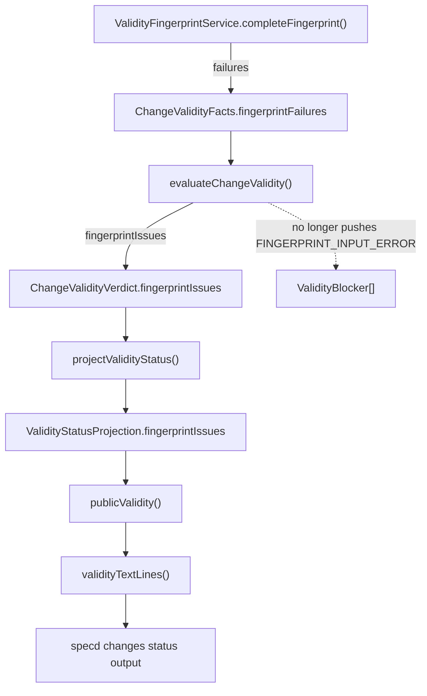

# Design: fingerprint-issues-non-blocking

## Overview

This change moves unreadable and missing fingerprint collection failures from unconditional progress blockers (`FINGERPRINT_INPUT_ERROR` in `ValidityBlocker`) to a non-blocking diagnostic field `validity.fingerprintIssues` exposed on `ValidityStatusProjection` (`core:get-status`), presented as diagnostic warnings in CLI `specd changes status` (`cli:change-status`), and documented in `docs/core/use-cases.md`.

In early lifecycle states (such as `drafting` and `designing`), changes have uncreated artifact files with status `missing`. Previously, `ValidityFingerprintService.completeFingerprint()` treated these missing files as collection failures and returned `null`, while `buildBlockers()` in `change-validity.ts` unconditionally converted any failure in `facts.fingerprintFailures` into a top-level progress blocker. This prematurely signaled that the change was broken, even though early states require no spec approval or verification evidence.

The design decouples input failure detection (which still invalidates stored approvals and verification) from lifecycle progress gating, preserving the invariant that only consumers requiring a complete fingerprint (`ApproveSpec`, `ApproveSignoff`, `StartVerification`, `CompleteVerification`) enforce its presence.

## Affected areas

### 1. `packages/core/src/domain/services/change-validity.ts`

- **`ValidityBlocker`**: Remove `'FINGERPRINT_INPUT_ERROR'` from `ValidityBlocker['code']` union.
  - Before:
    ```typescript
    export interface ValidityBlocker {
      readonly code:
        | 'ARTIFACT_DRIFT'
        | 'ARTIFACT_REVIEW_REQUIRED'
        | 'FINGERPRINT_INPUT_ERROR'
        | 'APPROVAL_REQUIRED'
        | ...
    ```
  - After:
    ```typescript
    export interface ValidityBlocker {
      readonly code:
        | 'ARTIFACT_DRIFT'
        | 'ARTIFACT_REVIEW_REQUIRED'
        | 'APPROVAL_REQUIRED'
        | 'APPROVAL_STALE'
        | 'APPROVAL_REVOKED'
        | 'SIGNOFF_REQUIRED'
        | 'SIGNOFF_STALE'
        | 'SIGNOFF_REVOKED'
        | 'VERIFICATION_REQUIRED'
        | 'VERIFICATION_IN_PROGRESS'
        | 'VERIFICATION_STALE'
      readonly message: string
      readonly details?: Readonly<Record<string, unknown>>
    }
    ```
- **`ChangeValidityVerdict`**: Add `fingerprintIssues` property.
  - Before:
    ```typescript
    export interface ChangeValidityVerdict {
      readonly artifactReviewRequired: boolean
      readonly affectedArtifacts: readonly ArtifactReviewTarget[]
      readonly projectionChanges: readonly ProjectionChange[]
      readonly specApproval: 'not-required' | 'absent' | ProjectionStatus
      readonly signoff: 'not-required' | 'absent' | ProjectionStatus
      readonly verification: 'not-required' | 'absent' | 'attempt-active' | 'valid' | 'stale'
      readonly blockers: readonly ValidityBlocker[]
      readonly recovery: AutomaticRecovery | null
    }
    ```
  - After:
    ```typescript
    export interface ChangeValidityVerdict {
      readonly artifactReviewRequired: boolean
      readonly affectedArtifacts: readonly ArtifactReviewTarget[]
      readonly projectionChanges: readonly ProjectionChange[]
      readonly specApproval: 'not-required' | 'absent' | ProjectionStatus
      readonly signoff: 'not-required' | 'absent' | ProjectionStatus
      readonly verification: 'not-required' | 'absent' | 'attempt-active' | 'valid' | 'stale'
      readonly fingerprintIssues: readonly FingerprintInputFailure[]
      readonly blockers: readonly ValidityBlocker[]
      readonly recovery: AutomaticRecovery | null
    }
    ```
- **`buildBlockers`**: Remove the blocker push for `facts.fingerprintFailures`.
  - Delete:
    ```typescript
    if (facts.fingerprintFailures.length > 0) {
      blockers.push({
        code: 'FINGERPRINT_INPUT_ERROR',
        message: 'Fingerprint inputs could not be read',
        details: { failures: facts.fingerprintFailures },
      })
    }
    ```
- **`evaluateChangeValidity`**: Populate `fingerprintIssues: facts.fingerprintFailures` on the returned verdict.

### 2. `packages/core/src/application/use-cases/get-status.ts`

- **`ValidityStatusProjection`**: Add `fingerprintIssues?: readonly FingerprintInputFailure[]`.
  - After:
    ```typescript
    export interface ValidityStatusProjection {
      readonly specApproval: ApprovalStatusProjection
      readonly signoff: ApprovalStatusProjection
      readonly verification: VerificationStatusProjection
      readonly automaticReturn: AutomaticRecovery | null
      readonly projectionChanges: readonly ProjectionChange[]
      readonly affectedArtifacts: readonly ArtifactReviewTarget[]
      readonly fingerprintIssues?: readonly FingerprintInputFailure[]
      readonly blockers: readonly ValidityBlocker[]
      readonly nextAction: NextAction
    }
    ```
- **`projectValidityStatus`**: Propagate `verdict.fingerprintIssues` to the returned `ValidityStatusProjection`.
  ```typescript
  return {
    specApproval: { ... },
    signoff: { ... },
    verification: { ... },
    automaticReturn: verdict.recovery,
    projectionChanges: verdict.projectionChanges,
    affectedArtifacts: verdict.affectedArtifacts,
    ...(verdict.fingerprintIssues.length > 0 ? { fingerprintIssues: verdict.fingerprintIssues } : {}),
    blockers: verdict.blockers,
    nextAction,
  }
  ```

### 3. `packages/cli/src/commands/change/_validity-present.ts`

- **`PublicFingerprintIssue`**: Define interface for presentation layer:
  ```typescript
  export interface PublicFingerprintIssue {
    readonly scope: string
    readonly key: string
    readonly reason: string
    readonly message: string
  }
  ```
- **`PublicValidity`**: Add `readonly fingerprintIssues?: readonly PublicFingerprintIssue[]`.
- **`publicValidity`**: Extract `fingerprintIssues` from the core validity projection when present.
- **`validityTextLines`**: Format `fingerprintIssues` under validity text lines as non-blocking diagnostics:
  ```typescript
  for (const issue of validity.fingerprintIssues ?? []) {
    lines.push(
      `issue:         fingerprint input ${issue.scope} '${issue.key}' ${issue.reason}: ${issue.message}`,
    )
  }
  ```

### 4. `packages/cli/src/commands/change/status.ts`

- Ensure text, JSON, and TOON formatters pass through `validity.fingerprintIssues`.
- Since top-level `blockers` array is formed by merging `verdict.blockers` with check blockers, removing `FINGERPRINT_INPUT_ERROR` from `buildBlockers()` automatically prevents it from appearing under `blockers:` in CLI text output and the top-level `blockers` array in JSON/TOON.

### 5. `docs/core/use-cases.md`

- Update section `ReconcileChangeValidity`: Replace line 495 statement that fingerprint failures are verdict blockers with the description that they are non-blocking diagnostic issues on the verdict and projection.

## New constructs

### `PublicFingerprintIssue` (in `packages/cli/src/commands/change/_validity-present.ts`)

```typescript
/** One unreadable or missing fingerprint input surfaced for status display. */
export interface PublicFingerprintIssue {
  readonly scope: string
  readonly key: string
  readonly reason: string
  readonly message: string
}
```

## Data models & Contracts

### `FingerprintInputFailure` (reused from `packages/core/src/domain/services/change-validity.ts`)

```typescript
export interface FingerprintInputFailure {
  readonly scope: 'artifact' | 'implementation'
  readonly key: string
  readonly reason: 'missing' | 'unreadable' | 'outside-project' | 'invalid-path'
  readonly message: string
}
```

### Structured Output Formats (`JSON` and `TOON`)

Within the `validity` object:

```json
{
  "validity": {
    "specApproval": { "required": false, "status": "absent" },
    "signoff": { "required": false, "status": "absent" },
    "verification": { "requiredAtCurrentBoundary": false, "freshness": "absent" },
    "fingerprintIssues": [
      {
        "scope": "artifact",
        "key": "proposal.md",
        "reason": "missing",
        "message": "Artifact file 'proposal.md' does not exist"
      }
    ],
    "blockers": []
  },
  "blockers": []
}
```

### CLI Text Output

```text
validity:
  issue:         fingerprint input artifact 'proposal.md' missing: Artifact file 'proposal.md' does not exist

blockers:
  (none)
```

## Approach & Execution flow

1. **Reconciliation Fact Collection (`reconcile-change-validity.ts`)**:
   - `ValidityFingerprintService.completeFingerprint()` runs during fact gathering.
   - If an artifact file or linked implementation file is missing or unreadable, `completeFingerprint()` returns `null` and populates `fingerprintFailures` (e.g. `[{ scope: 'artifact', key: 'proposal.md', reason: 'missing', message: '...' }]`).
   - `facts.fingerprintFailures` is passed into `evaluateChangeValidity()`.
2. **Validity Evaluation (`change-validity.ts`)**:
   - `evaluateChangeValidity()` evaluates approval, signoff, and verification projections.
   - `unreadableDifferences()` uses `facts.fingerprintFailures` to invalidate existing approvals or verification when inputs can no longer be read.
   - `buildBlockers()` checks for artifact drift, pending review, required approvals, and required verification, but NO LONGER checks `facts.fingerprintFailures`.
   - `evaluateChangeValidity()` sets `fingerprintIssues: facts.fingerprintFailures` on the `ChangeValidityVerdict`.
3. **Status Projection (`get-status.ts`)**:
   - `GetStatus` receives the `ChangeValidityVerdict`.
   - `projectValidityStatus()` builds `ValidityStatusProjection`, copying `verdict.fingerprintIssues`.
   - `this._mergeBlockers()` merges `verdict.blockers` (now free of `FINGERPRINT_INPUT_ERROR`) with predicate check blockers.
   - The final `GetStatusResult` has `blockers: []` (unless other blockers exist) and `validity.fingerprintIssues`.
4. **CLI Delivery Presentation (`_validity-present.ts` & `status.ts`)**:
   - `publicValidity()` maps `validity.fingerprintIssues` to `PublicFingerprintIssue[]`.
   - In text mode, `validityTextLines()` renders `issue: fingerprint input <scope> '<key>' <reason>: <message>` under `validity:`.
   - No `! FINGERPRINT_INPUT_ERROR` line appears in `blockers:`.
   - In JSON/TOON mode, `fingerprintIssues` is serialized under `validity`.

## Error handling & Edge cases

- **Missing Artifacts in Early States**: Fresh changes in `drafting` or `designing` have no artifacts on disk yet. `fingerprintIssues` lists the missing artifacts as diagnostics; no progress blockers are raised.
- **Missing Inputs During Verification or Approval**:
  - `ApproveSpec`, `ApproveSignoff`, `StartVerification`, and `CompleteVerification` each continue to call `ValidityFingerprintService` directly and throw `FingerprintInputError` if `fingerprint` is `null`.
  - Their existing error handling remains unchanged.
- **Unreadable Linked Implementation Files**:
  - If a file linked in implementation tracking cannot be read or is outside the project root, it appears in `fingerprintIssues` (scope: `'implementation'`).
  - Stored verification evidence is invalidated (`stale`), which in turn triggers `VERIFICATION_STALE` blocker only if at a verification-requiring boundary.
- **Empty Failures List**:
  - When all inputs are readable and present, `fingerprintIssues` is an empty array in the domain verdict, and omitted or empty in public projections.

## Key decisions

- **Remove `FINGERPRINT_INPUT_ERROR` completely from `ValidityBlocker`**:
  - _Rationale_: A missing or unreadable fingerprint input is not inherently a reason why a change cannot move between early lifecycle states. Gating belongs to the specific use cases and workflow checks that need a fingerprint.
  - _Alternatives rejected_:
    - State-gated blocker (only emitting the blocker in `verifying` or later): Rejected because consumers already fail when computing evidence, and adding state checks to `change-validity.ts` duplicates workflow rules in the domain service.
    - Dropping failure tracking completely: Rejected because `specs/core/get-status/spec.md` requires status to report missing/unreadable inputs.
- **Expose via `validity.fingerprintIssues`**:
  - _Rationale_: Preserves visibility for AI agents and developers to understand why a fingerprint could not be computed, fulfilling the spec requirement without blocking change workflow progression.

## Trade-offs

- _Diagnostic Visibility_: Surfacing issues under `validity:` in text output rather than `blockers:` means human users will not be startled by an exclamation mark `!`, but still have access to the diagnostic when inspecting change validity.
- _Compatibility_: Removing `FINGERPRINT_INPUT_ERROR` from `ValidityBlocker['code']` type is technically a narrowing of the blocker union, but codebase analysis confirmed no callers or tests match against `blocker.code === 'FINGERPRINT_INPUT_ERROR'`.

## Spec impact

- Direct dependents of `core:change`, `core:get-status`, and `cli:change-status`:
  - `core:change`: Updated to specify that unreadable fingerprint inputs do not synthesize unconditional progress blockers.
  - `core:get-status`: Updated to specify `fingerprintIssues` diagnostic field on `ValidityStatusProjection`.
  - `cli:change-status`: Updated to specify non-blocking presentation of `validity.fingerprintIssues`.
  - No downstream specs depend on `FINGERPRINT_INPUT_ERROR` being a blocker; all verified requirements remain satisfied.

## Dependency map



```
┌──────────────────────────────────────────────────────────────┐
│ ValidityFingerprintService.completeFingerprint()             │
│   returns null + fingerprintFailures                         │
└──────────────────────────────┬───────────────────────────────┘
                               │
                               ▼
┌──────────────────────────────────────────────────────────────┐
│ evaluateChangeValidity(facts)                                │
│   - populates verdict.fingerprintIssues                      │
│   - buildBlockers() omits FINGERPRINT_INPUT_ERROR            │
└──────────────────────────────┬───────────────────────────────┘
                               │
                               ▼
┌──────────────────────────────────────────────────────────────┐
│ projectValidityStatus(verdict)                               │
│   - returns ValidityStatusProjection.fingerprintIssues       │
└──────────────────────────────┬───────────────────────────────┘
                               │
                               ▼
┌──────────────────────────────────────────────────────────────┐
│ CLI presentation (_validity-present.ts & status.ts)          │
│   - text: issue: fingerprint input ...                       │
│   - json/toon: validity.fingerprintIssues                    │
│   - blockers: [] (free of false error)                       │
└──────────────────────────────────────────────────────────────┘
```

## Migration / Rollback

- Purely in-memory / projection change; no persistent schema migration or database migration required.
- Rollback can be performed cleanly by restoring `FINGERPRINT_INPUT_ERROR` in `buildBlockers()`.

## Testing

### Automated tests

1. **`packages/core/test/domain/services/change-validity.spec.ts`**:
   - Test that `evaluateChangeValidity()` with non-empty `fingerprintFailures`:
     - Returns `verdict.fingerprintIssues` containing the failures.
     - Does NOT include `FINGERPRINT_INPUT_ERROR` in `verdict.blockers`.
   - Test that unreadable differences continue to invalidate stored spec approval, signoff, and verification evidence.
2. **`packages/core/test/application/use-cases/get-status.spec.ts`**:
   - Test that a change with missing artifacts returns `validity.fingerprintIssues` populated and `blockers` without `FINGERPRINT_INPUT_ERROR`.
   - Test that drafted status and active status both project `fingerprintIssues` correctly.
3. **`packages/cli/test/commands/change-status.spec.ts`**:
   - Test that `specd changes status <name>` in text format renders `issue: fingerprint input ...` under `validity:`, and no `! FINGERPRINT_INPUT_ERROR` under `blockers:`.
   - Test that JSON and TOON formats include `validity.fingerprintIssues`.

### Manual / E2E verification

1. Run `node packages/cli/dist/index.js changes status fingerprint-issues-non-blocking --format text`.
   - Verify that `blockers:` does not display `FINGERPRINT_INPUT_ERROR`.
   - Verify that `validity:` displays `fingerprint input` diagnostic entries for missing artifacts.
2. Run `node packages/cli/dist/index.js changes status fingerprint-issues-non-blocking --format toon`.
   - Verify that `blockers` is empty.
   - Verify that `validity.fingerprintIssues` contains the expected artifact failure entries.

## Open questions

None.
