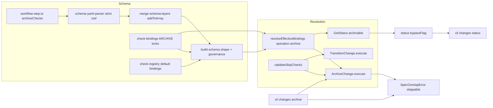

# Design: archive-schema-checks-and-skip-flag

## Non-goals

- No new built-in check and no change to which built-in archive checks are skippable by default. The only skippable archive checks stay `spec.overlap` and `impl.linksInScope`.
- No `onFailure` on archive declarations and no abort/collect distinction for archive predicates. `ArchiveChange` keeps evaluating every predicate and throwing the first mapped failure.
- No `remove`/`set` operations for `archiveChecks` in schema layering (`remove.workflow[]` only handles hooks today, and `checks`/`skipChecks` have no remove either). Only `append`/`prepend`/`create` add entries, with the existing collision rule.
- No change to hook behaviour (`hook.pre`, `hook.post`): they stay locked and governed only by `skipHookPhases`.
- No change to how `changes transition` evaluates checks, apart from sharing the new skip-validation helper (same behaviour, one reworded message).
- No fix to the Markdown serializer escaping (`DEPS_INCONSISTENT` → `DEPS\_INCONSISTENT`) that appears in merged specs. It is a separate defect.
- No data migration. No persisted state changes.

## Affected areas

### 1. `packages/core/src/domain/value-objects/workflow-step.ts`

- Add `WorkflowStepArchiveCheckDeclaration` (see New constructs).
- `WorkflowStep` gains `readonly archiveChecks?: readonly WorkflowStepArchiveCheckDeclaration[]`. Update the interface doc comment: the row "attaches extras (`requires`, `requiresTaskCompletion`, `hooks`, `checks`, `skipChecks`, `archiveChecks`)".
- No other symbol changes. Callers of `WorkflowStep` are unaffected because the field is optional.

### 2. `packages/core/src/domain/value-objects/index.ts`

- Export `type WorkflowStepArchiveCheckDeclaration` next to `WorkflowStepCheckDeclaration`. Do not export it from `public.ts` beyond what `WorkflowStep` already exposes (`public.ts` exports `WorkflowStep` only).

### 3. `packages/core/src/infrastructure/schema-yaml-parser.ts`

- New Zod schema, declared next to `WorkflowStepSkipCheckZodSchema` (line ~278):

  ```ts
  const WorkflowStepArchiveCheckZodSchema = z
    .object({
      id: z.string(),
      skippable: z.boolean().optional(),
      disabled: z.boolean().optional(),
      config: z.record(z.unknown()).optional(),
    })
    .strict()
  ```

  `.strict()` makes any other key (including `onFailure`, `from`, `along`) a Zod `unrecognized_keys` issue that the existing Zod→`SchemaValidationError` path already converts (the parser's path formatter near line 469).

- `WorkflowStepZodSchema` (line ~286): add `archiveChecks: z.array(WorkflowStepArchiveCheckZodSchema).optional()` and carry it through `.transform` exactly like `skipChecks`:
  `...(ws.archiveChecks !== undefined ? { archiveChecks: ws.archiveChecks as WorkflowStepArchiveCheckDeclaration[] } : {})`.
- `WorkflowStepRaw` (line ~423) gains `readonly archiveChecks?: readonly WorkflowStepArchiveCheckDeclaration[]`.
- Import `WorkflowStepArchiveCheckDeclaration` from the value object.
- Important limit: `OperationsZodSchema` types `append`/`prepend`/`create` as `z.record(z.unknown())`, so workflow entries added by `schemaOverrides` or schema plugins are NOT checked by this Zod schema. The authoritative shape validation therefore also lives in `buildSchema` (item 5).

### 4. `packages/core/src/domain/services/merge-schema-layers.ts`

- In `applyWorkflowMutations`, branch "existing step" (after the `skipChecks` block, line ~643), add:

  ```ts
  if (entry.archiveChecks) {
    step = {
      ...step,
      archiveChecks: addToArray(
        step.archiveChecks ?? [],
        entry.archiveChecks,
        'id',
        position,
        layer,
        `${opName}.workflow[${entry.step}].archiveChecks`,
      ),
    }
  }
  ```

  `addToArray` already throws `SchemaValidationError` (`'<id>' already exists`) when a later layer re-declares an id, which is the required collision behaviour.

- The "new step" branch adds the whole `entry` as a `WorkflowStep`, so `archiveChecks` rides along unchanged; shape and step-name validation happen in `buildSchema`.
- `RemoveWorkflowEntry` is NOT extended (non-goal).

### 5. `packages/core/src/domain/services/build-schema.ts`

- Workflow mapping (line ~701): add `...(step.archiveChecks !== undefined ? { archiveChecks: step.archiveChecks } : {})`.
- Fallback registry (line 795): `registry ?? new CheckRegistry(Object.values(DOMAIN_CHECKS), TRANSITION_BINDINGS)` must also include archive bindings so governance locks work when no registry is injected: `new CheckRegistry(Object.values(DOMAIN_CHECKS), [...TRANSITION_BINDINGS, ...ARCHIVE_BINDINGS])`. Import `ARCHIVE_BINDINGS` from `./check-bindings.js`.
- New validation block placed after the `skipChecks` loop inside the same `for (const step of workflow)` pass (or as its own loop after it), in this order for each `step` that has `archiveChecks !== undefined`:
  1. If `step.step !== 'archiving'` and `archiveChecks.length > 0`: throw `SchemaValidationError(ref, "workflow step '<step>' cannot declare archiveChecks; archiveChecks is only valid on 'archiving'")`. (An empty array on another step is also rejected for clarity: throw whenever `archiveChecks` is defined on a step other than `archiving`.)
  2. For each declaration `chk`:
     1. Shape (authoritative, covers merged layers): `chk` must be a non-null non-array object; allowed keys exactly `id`, `skippable`, `disabled`, `config`; `id` a non-empty string; `skippable` and `disabled` booleans when present; `config` a plain object (not array, not null) when present. Violation → `SchemaValidationError(ref, "workflow step 'archiving': archiveChecks[<index>] <reason>")` with `<reason>` such as `has unsupported key 'onFailure'` or `must have a string id`.
     2. `if (!activeRegistry.has(chk.id)) throw new UnknownCheckError(chk.id)`.
     3. Coordinate uniqueness: key `${chk.id}::archive`; reuse `checkCoordinateSet`; on repeat throw `DuplicateCheckBindingError(chk.id, 'scope: archive')`.
     4. `governance = activeRegistry.getGovernance(chk.id)`; `matchingBinding = activeRegistry.bindings().find(b => b.check.id === chk.id && b.applicability.some(a => a.scope === 'archive'))`; `isOwnCoordinate = matchingBinding !== undefined`.
     5. Placement: `if (!isOwnCoordinate && governance?.allowSchemaEmbedding === false) throw new CheckEmbeddingForbiddenError(chk.id, step.step)`.
     6. Policy: `ownBinding = isOwnCoordinate ? matchingBinding : undefined`; if `ownBinding?.allowBindingOverride === false && chk.skippable !== undefined && chk.skippable !== ownBinding.skippable` throw `CheckBindingOverrideForbiddenError(chk.id, 'skippable', 'scope: archive')`. (A declaration that repeats the code-defined value is accepted.)
     7. Disable: `if (chk.disabled === true && (governance?.allowDisable === false || ownBinding?.allowDisable === false)) throw new CheckDisableForbiddenError(chk.id, step.step)`.
     8. Config: `if (chk.config !== undefined && Object.keys(chk.config).length > 0 && (governance?.allowConfigOverride === false || ownBinding?.allowConfigOverride === false)) throw new CheckConfigOverrideForbiddenError(chk.id, "workflow step 'archiving'")`.
- To avoid a fourth copy of steps 5-8, extract a module-private function used by the existing `checks`/`skipChecks` loops and the new loop:

  ```ts
  function assertDeclarationGovernance(args: {
    readonly chk: {
      readonly id: string
      readonly onFailure?: 'abort' | 'collect'
      readonly skippable?: boolean
      readonly disabled?: boolean
      readonly config?: Readonly<Record<string, unknown>>
    }
    readonly stepName: string
    readonly governance: CheckGovernance | undefined
    readonly ownBinding: CheckBinding | undefined
    readonly isOwnCoordinate: boolean
    readonly coordinate: string
  }): void
  ```

  It throws exactly the errors the current loops throw (same classes, same messages, same order: embedding → policy(onFailure then skippable) → disable → config). The refactor MUST keep every existing `build-schema.spec.ts` assertion green. If the extraction turns out to alter an existing message, keep the existing inline code and only add the archive loop calling a copy; do not change existing messages.

- `BEDROCK_STATES` already includes `archiving`, so `archiving` can never be disabled or optional; no extra rule needed.
- Interaction with disabled steps: the existing rule rejects `skipChecks` on disabled steps; there is no equivalent for `archiveChecks` because `archiving` cannot be disabled.

### 6. `packages/core/src/domain/services/check-bindings.ts`

`ARCHIVE_BINDING_SPECS` rows (line 151). Exact target values (only the three rows marked CHANGED differ from today):

| id                           | allowBindingOverride | allowConfigOverride | allowDisable | skippable |
| ---------------------------- | -------------------- | ------------------- | ------------ | --------- |
| `schema.nameMatch`           | false                | (omitted)           | false        | false     |
| `archive.archivable`         | false                | (omitted)           | false        | false     |
| `spec.overlap`               | true                 | true                | true         | true      |
| `workspace.readOnly` CHANGED | **false**            | **false**           | **false**    | false     |
| `deps.consistent` CHANGED    | **false**            | **false**           | **false**    | false     |
| `impl.filesResolved` CHANGED | **false**            | **false**           | **false**    | false     |
| `impl.linksInScope`          | true                 | true                | true         | true      |
| `workflow.taskCompletion`    | false                | (omitted)           | false        | false     |
| `verification.current`       | false                | (omitted)           | false        | false     |
| `hook.pre`                   | false                | (omitted)           | false        | (omitted) |
| `hook.post`                  | false                | (omitted)           | false        | (omitted) |

`TRANSITION_BINDING_SPECS` is untouched: the same three checks keep `allowBindingOverride: true`, `allowConfigOverride: true`, `allowDisable: true` there. Update the JSDoc of `ARCHIVE_BINDING_SPECS` with the archive exception and the reason (security boundary; valid archive requirements).

`ARCHIVE_BINDINGS` (materialized with `applyBindingSpecs`) is derived, so it follows automatically.

### 7. `packages/core/src/domain/services/check-registry.ts`

- Default constructor argument `defaultBindings: readonly CheckBinding[] = TRANSITION_BINDINGS` becomes `[...TRANSITION_BINDINGS, ...ARCHIVE_BINDINGS]` (import `ARCHIVE_BINDINGS`). `createCompositionRegistryView` (`composition-registries.ts:222`) already passes both tables, so production behaviour is unchanged; this makes the default consistent.
- No other change. `getGovernance` and `bindings()` are used as is. The registry-level governance for the three locked checks stays Category C (`allowSchemaEmbedding`, `allowBindingOverride`, `allowConfigOverride`, `allowDisable` all true) because transition coordinates still need it; archive locks live on the archive binding rows only.

### 8. `packages/core/src/domain/services/transition-checks.ts` — `resolveEffectiveBindings`

Current symbol: `resolveEffectiveBindings(input: ResolveEffectiveBindingsInput): readonly CheckBinding[]` (line ~604). Callers (direct, non-test): `transition-change.ts` (execute), `evaluate-transition-candidate.ts`, and, new, `archive-change.ts` and `get-status.ts`. Graph impact (`specd graph impact --symbol resolveEffectiveBindings --direction dependents`): CRITICAL, 67 direct dependents, 286 affected files, but nearly all are tests and the check implementation modules that import types from the same file. The change is purely additive (new optional input field and a third overlay), so existing call sites keep compiling and behave identically when `operation` is absent.

Signature change:

```ts
export interface ResolveEffectiveBindingsInput {
  readonly baseBindings: readonly CheckBinding[]
  readonly schema: Schema
  readonly targetStep?: ChangeState | undefined
  readonly bypassedSteps?: readonly ChangeState[] | undefined
  readonly from?: ChangeState | undefined
  readonly along?: TransitionAlong | undefined
  readonly registry?: CheckRegistry | undefined
  /** Selects the archive operation (scope 'archive'). Mutually exclusive with `targetStep` and `bypassedSteps`. */
  readonly operation?: 'archive' | undefined
}
```

Behaviour changes:

1. At the start: `if (operation === 'archive' && (targetStep !== undefined || bypassedSteps.length > 0)) throw new InvalidInputError("resolveEffectiveBindings: 'operation: archive' cannot be combined with 'targetStep' or 'bypassedSteps'")`.
2. The three overlay passes share one private helper (see New constructs, `overlayDeclarations`). The existing transition and step-skip passes are rewritten as calls to it with the same parameters, preserving their outputs byte-for-byte (existing `transition-checks.spec.ts` stays the regression suite).
3. New pass for `operation === 'archive'`: declarations = `schema.workflowStep('archiving')?.archiveChecks ?? []`, `rowsOf = b => b.applicability.filter(a => a.scope === 'archive')`, `concrete = { scope: 'archive' }`, `declMatches` always true.
4. Synthesized archive bindings use `skippable: chk.skippable ?? false`, governance flags from `registry?.getGovernance(chk.id)` (default false), `onFailure: 'abort'`, `effectiveConfig` from the cascade, and are appended after the base bindings in declaration order.
5. Result order: base bindings (in input order, with overlays applied) followed by synthesized bindings, as today.
6. Without a `registry`, a declaration that names a check no base archive row serves is dropped (nothing can be synthesized) and raises no error; declarations that overlay base rows still apply. In production the registry is always supplied, and `buildSchema` has already rejected unknown ids.

### 9. `packages/core/src/application/use-cases/archive-change.ts`

Symbols and edits:

- `ArchiveChangeInput` (line ~70): remove `allowOverlap` and `allowOutOfScope`; add

  ```ts
  /**
   * Canonical ids of archive checks to bypass (for example `spec.overlap` or `impl.linksInScope`).
   * Validated against the resolved archive bindings before anything runs. Defaults to empty.
   */
  readonly skipChecks?: readonly string[]
  ```

  Update the interface JSDoc: bypasses are supplied only through `skipChecks`; delivery mechanisms translate their aliases.

- Class `ArchiveChange`: add `private readonly _checkRegistry?: CheckRegistry`. Constructor: append a last optional parameter `checkRegistry?: CheckRegistry` after `resolveChangeSchema?: ResolveChangeSchema`; store it when defined. Update the constructor JSDoc `@param`. Add imports: `CheckRegistry` (type), `resolveEffectiveBindings`, `validateSkipChecks`, `UnknownCheckError`/`CheckNotSkippableError` are thrown by the helper (no import needed here).
- `execute` (line ~280), new order after the state guard (`change.state` is `archivable` or `archiving`) and `workspaces` load:
  1. `const effectiveBindings = resolveEffectiveBindings({ baseBindings: this._archiveBindings, schema, operation: 'archive', ...(this._checkRegistry !== undefined ? { registry: this._checkRegistry } : {}) })`.
  2. `const skipChecks = validateSkipChecks({ skipChecks: input.skipChecks ?? [], effectiveBindings, ...(this._checkRegistry !== undefined ? { checkRegistry: this._checkRegistry } : {}) })` — throws `UnknownCheckError` / `CheckNotSkippableError` before any predicate, hook, or write. Returns the deduplicated list.
  3. `const overlapBypassed = skipChecks.includes('spec.overlap') && effectiveBindings.some(b => b.check.id === 'spec.overlap')`.
  4. Replace the removed `effectiveSkipChecks` block (lines 316-322) with the validated `skipChecks`.
  5. First predicate run (line ~324): pass `effectiveBindings` instead of `this._archiveBindings`, `skipChecks` in context and options.
  6. `needsOverlapScan = failedPredicates.some(c => c.id === 'spec.overlap') || (failedPredicates.length === 0 && overlapBypassed)`.
  7. Invalidation (line ~352): `if (overlapBypassed && relevantOverlap.length > 0)`.
  8. `throwMappedArchiveFailure(check, change, schema, relevantOverlap, workspaceMap, effectiveBindings)`: new last parameter used by the `spec.overlap` case (see item 10) and the default case (plugin/embedded checks throw `CheckPredicateFailedError` with the resolved `skippable`).
  9. Before-persist effects (line ~366): `matchingEffects(effectiveBindings, archiveAttempt, 'before-persist')`; remove `allowOverlap`/`allowOutOfScope` from the `buildCheckExecutionContext` call.
  10. Re-run predicates after hooks (line ~416): `effectiveBindings` and `skipChecks`; the failure path maps with the same argument.
  11. After-persist effects (line ~624): `matchingEffects(effectiveBindings, archiveAttempt, 'after-persist')`; remove the two deprecated fields from the context call.
  12. The `_archiveBindings` field remains (base table input to the resolver).
- `throwMappedArchiveFailure` (line 1463): add parameter `bindings: readonly CheckBinding[]`.
  - Case `spec.overlap`: `throw new SpecOverlapError(overlapEntries, { skippable: bindings.find(b => b.check.id === 'spec.overlap')?.skippable === true })`.
  - Default case (checks without a dedicated mapping: plugin and schema-embedded checks): throw
    `new CheckPredicateFailedError(check.id, check.label, check.code ?? 'CHECK_FAILED', check.message ?? \`Check '${check.id}' failed\`, check.command, check.details, bindings.find(b => b.check.id === check.id)?.skippable === true)`instead of`ArchiveImplementationStateError`. Import `CheckPredicateFailedError`from`../../domain/errors/check-predicate-failed-error.js`. All built-in ids keep their dedicated errors (explicit `case` branches are unchanged), so only non-built-in ids reach the default branch.
- Remove now-dead references: the `allowOverlap`-based `needsOverlapScan` logic.

Callers of `ArchiveChange` (graph: 7 direct dependents, 95 affected files, CRITICAL by fan-out): `composition/use-cases/archive-change.ts` (constructor call), `packages/core/test/application/use-cases/archive-change.spec.ts`, `packages/core/test/application/use-cases/helpers.ts`, kernel wiring, and the CLI/SDK through the use case type. Only the constructor call and the input shape change; both are updated in this change.

### 10. `packages/core/src/domain/errors/spec-overlap-error.ts`

- Constructor becomes `constructor(entries: readonly OverlapEntry[], options: { readonly skippable?: boolean } = {})`. New getter `get skippable(): boolean` (default `true` to keep the previous bypass-hint behaviour when constructed without options).
- Message (neutral, delivery-agnostic): `Cannot archive: specs [<specId> (<peer>, <peer>), ...] are also targeted by other active changes.` It names each overlapping spec with the peer changes (`entry.changes[].name`) and MUST NOT contain any CLI flag text (`--skip-checks`, `--allow-overlap`). Hosts compose their own bypass hint from `skippable`; the CLI does so in `archive.ts` (item 16). Update the class JSDoc ("and `spec.overlap` is not bypassed") and drop the `allowOverlap` wording.
- Review round 1 decision (with the user): the core error is neutral; an earlier draft embedded `Use --skip-checks spec.overlap to proceed.` in the message. Rejected: keeping the CLI text in core (the use case accepts only `skipChecks` and must not know delivery flags).
- Public API: `SpecOverlapError` stays exported from `public.ts` and the SDK; the constructor change is backward compatible (optional second argument).

### 11. `packages/core/src/application/services/execute-matching-predicates.ts`

- `BuildCheckExecutionContextInput`: remove the two `@deprecated` fields `allowOverlap` and `allowOutOfScope` (lines 54-56). They are not copied into the context today; their only producer was `ArchiveChange`. Check `execute-matching-predicates.spec.ts` and `helpers.ts` for usages and delete them.
- No behaviour change: `skipChecks` handling (`outcome: 'skip'`, `details: { bypassedByUser: true }`) is reused as is for archive.

### 12. `packages/core/src/application/use-cases/transition-change.ts`

- Replace the inline skip-validation loop (lines ~294-312) with a call to the new `validateSkipChecks` helper using the same inputs (`skipChecksList`, `effectiveBindings`, `this._checkRegistry`). Behaviour is identical; the only observable difference is the hook reason message (item New constructs, constant).
- `evaluate-transition-candidate.ts` is not touched.

### 13. `packages/core/src/application/use-cases/get-status.ts`

- Archive predicate evaluation (line ~646): when `change.state === 'archivable'`, compute once
  `const effectiveArchiveBindings = resolveEffectiveBindings({ baseBindings: this._archiveBindings, schema, operation: 'archive', ...(this._checkRegistry !== undefined ? { registry: this._checkRegistry } : {}) })`
  and run `executeMatchingPredicates(effectiveArchiveBindings, ...)` with an empty `skipChecks` (unchanged: status never applies a user bypass).
- `_mergeBlockers` (line ~946): add parameter `archiveBindings: readonly CheckBinding[]` and use it instead of `this._archiveBindings` for archive candidates (line ~960); pass `effectiveArchiveBindings` (or `this._archiveBindings` when state is not `archivable`, where no archive checks exist anyway).
- `_nextActionAfterArchiveOverlap` (line ~1018): currently `const bypass = overlap.bypassFlag ?? '--skip-checks spec.overlap'`. Change to: if `overlap.bypassFlag === undefined`, return the next action with `reason: overlap.message` and no "Use ... to archive anyway." suffix; otherwise keep today's logic with `bypass = overlap.bypassFlag`.
- Constructor dependencies and `resolveGetStatusDeps`: `GetStatus` receives optional `checkRegistry?: CheckRegistry` from `resolveWorkflowCheckRegistry` so embedded and plugin `archiveChecks` resolve identically in status and archive.
- Risk: `GetStatus` fan-out is high (kernel, CLI status, SDK). The change is internal to the `archivable` branch.

### 13b. `packages/core/src/domain/services/lifecycle-verdict.ts`

- `LifecycleVerdictInput` gains optional `readonly resolvedBindings?: readonly CheckBinding[]`.
- `blockersFromFailedChecks` derives `isSkippable` and `bypassFlag` (`--skip-checks <checkId>` when skippable, omitted otherwise) from the resolved binding of the failing check (using `options.resolvedBindings` when provided, or resolving effective transition and archive bindings from `schema` against the built-in binding tables when omitted) instead of hardcoding `spec.overlap` and `impl.linksInScope`.

### 14. `packages/core/src/composition/use-cases/archive-change.ts`

- `ArchiveChangeDeps` gains `readonly checkRegistry?: CheckRegistry` (import the type). `resolveArchiveChangeDeps` returns `...(registry.checkRegistry !== undefined ? { checkRegistry: registry.checkRegistry } : {})` from the already computed `registry` (line ~137). `createArchiveChangeFromNormalized` destructures it and passes it as the new last constructor argument. `isArchiveChangeDeps` is unchanged (optional field).

### 15. `packages/core/test/**` fixtures

- `archive-change.spec.ts` (14 references to `allowOverlap`/`allowOutOfScope`) and `helpers.ts` (`newArchiveChange`) are updated; see Testing.

### 16. `packages/cli/src/commands/change/archive.ts`

- Options (line ~60): add
  `.option('--skip-checks <ids>', 'comma-separated check identifiers to bypass (e.g. spec.overlap,impl.linksInScope)')`;
  re-describe `--allow-overlap`: `'alias of --skip-checks spec.overlap'` and `--allow-out-of-scope`: `'alias of --skip-checks impl.linksInScope'`.
- `action` option type adds `skipChecks?: string`.
- Parsing (same rules as `transition.ts` lines 345-359): split `opts.skipChecks` by `,`, trim, drop empty entries, add to a `Set<string>`; `--allow-out-of-scope` adds `impl.linksInScope`; `--allow-overlap` adds `spec.overlap`. Pass `skipChecks: [...set]` only when non-empty (omit the key when empty). Remove `allowOverlap`/`allowOutOfScope` from the `execute` input.
- Pass `skipChecks` (the Set) to `createCheckProgressPresenter` options so bypassed checks render as skipped by `--skip-checks` (the presenter already supports `options.skipChecks`, see `_check-progress-presenter.ts:52,71`).
- `catch`:
  - `SpecOverlapError` branch builds its text from the error: after the specs list print `Use --skip-checks spec.overlap to proceed despite overlap.\n` only when `err.skippable` is true; when false print nothing about bypass. Exit code stays 1 (`process.exit(1)`), as today.
  - New `CheckPredicateFailedError` branch: in text mode write to stderr `error: <err.message>\n`, then `  check:   <label> (<checkId>)\n`, then `  command: <command>\n` when `err.command` is defined, then, only when `err.skippable === true`, `  bypass:  Retry with --skip-checks <checkId> if an exception is granted\n`; exit code 1. In `json`/`toon` it goes through `handleError` (structured error record with `err.code`, message, exit code 1). Import `CheckPredicateFailedError` from `@specd/sdk` (already re-exported by the SDK; add the re-export if missing).
- Help text (`addHelpText`) is unchanged except it must list the new flag through Commander automatically.
- Check progress/`CheckNotSkippableError`/`UnknownCheckError` use the generic `handleError` path (exit 1, structured error record in json/toon).

### 17. `packages/cli/src/commands/change/status.ts` (and presenters)

No code change expected: status renders `bypassFlag` provided by `GetStatus`. Verify by test that the rendered flag equals the projected one. If the text renderer composes a local default bypass (search `bypass` in `packages/cli/src/commands/change/status*.ts` while implementing), remove it so the CLI never builds a bypass locally.

### 18. Documentation and guides (see Documentation section below) and skills templates

- `packages/skills/templates/skills/specd-archive/SKILL.md.tpl` (lines 28-29, 167, 217-226), `specd-design/SKILL.md.tpl` (lines 45-46), `specd-implement/SKILL.md.tpl` (line 25), `specd-new/SKILL.md.tpl` (line 137), `specd-verify/SKILL.md.tpl` (line 26) and `packages/skills/test/template-workflow.spec.ts`.

## New constructs

### N1. `WorkflowStepArchiveCheckDeclaration`

```ts
// packages/core/src/domain/value-objects/workflow-step.ts
/**
 * Declaration tuning a check of the archive operation in schema.yaml
 * (`scope: 'archive'`). Valid only on the `archiving` workflow entry.
 * There is deliberately no `onFailure`: archive predicate failures have no
 * abort/collect distinction.
 */
export interface WorkflowStepArchiveCheckDeclaration {
  /** Canonical check identifier (must be registered in CheckRegistry). */
  readonly id: string
  /** Permission to bypass via `--skip-checks`, subject to governance locks. */
  readonly skippable?: boolean
  /** Whether this check is disabled for the archive operation, subject to governance locks. */
  readonly disabled?: boolean
  /** Check configuration merged over check and binding defaults. */
  readonly config?: Readonly<Record<string, unknown>>
}
```

### N2. `validateSkipChecks`

```ts
// packages/core/src/application/services/validate-skip-checks.ts
import { type CheckRegistry } from '../../domain/services/check-registry.js'
import { isEffectCheck, type CheckBinding } from '../../domain/services/transition-checks.js'
import {
  CheckNotSkippableError,
  UnknownCheckError,
} from '../../domain/errors/check-registry-errors.js'

/** Reason shown when a hook check is passed to `--skip-checks`. */
export const HOOK_CHECK_NOT_SKIPPABLE_REASON =
  'Effect checks (hooks) are governed exclusively by skipHookPhases (CLI: --skip-hooks)'

export interface ValidateSkipChecksInput {
  /** Requested bypass ids, in caller order. */
  readonly skipChecks: readonly string[]
  /** Effective bindings resolved for this attempt or operation. */
  readonly effectiveBindings: readonly CheckBinding[]
  /** Registry used to recognize ids that have no binding for this attempt. */
  readonly checkRegistry?: CheckRegistry | undefined
}

/**
 * Validates bypass ids against the resolved bindings and returns them deduplicated, order preserved.
 *
 * Rules, per id:
 * - neither bound for this attempt nor registered → `UnknownCheckError`
 * - bound and an effect (hook) → `CheckNotSkippableError(id, HOOK_CHECK_NOT_SKIPPABLE_REASON)`
 * - bound and `skippable` is false → `CheckNotSkippableError(id)`
 * - registered but not bound for this attempt (for example disabled by the schema) → accepted, no effect
 *
 * @throws {UnknownCheckError}
 * @throws {CheckNotSkippableError}
 */
export function validateSkipChecks(input: ValidateSkipChecksInput): readonly string[]
```

Invariants: the function is pure; ids are compared with `===` (case-sensitive); it validates every id before returning (the whole request is rejected on the first invalid id, in input order); the first thrown error wins.

Wiring: called by `ArchiveChange.execute` and `TransitionChange.execute`.

### N3. `overlayDeclarations` (private helper in `transition-checks.ts`)

```ts
interface OverlayDeclaration {
  readonly id: string
  readonly disabled?: boolean | undefined
  readonly skippable?: boolean | undefined
  readonly onFailure?: EffectOnFailure | undefined
  readonly config?: Readonly<Record<string, unknown>> | undefined
}

interface OverlayPlan<D extends OverlayDeclaration> {
  readonly declarations: readonly D[]
  /** Whether a declaration applies to this attempt (transition from/along narrowing); defaults to always. */
  readonly declMatches?: (decl: D) => boolean
  /** Rows of a base binding this plan overlays. */
  readonly rowsOf: (binding: CheckBinding) => readonly CheckApplicability[]
  /** Concrete applicability carried by overlaid clones and synthesized bindings. */
  readonly concrete: CheckApplicability
  /** Bypassed step for step-skip plans (used to keep wildcard remainders concrete). */
  readonly step?: ChangeState
}
```

`resolveEffectiveBindings` builds up to one plan (transition + bypassed steps, or archive) and runs each through the shared loop that records `BindingEdit`s and synthesizes bindings. Assembly step 3 (split by edited rows, residual rows, wildcard step-skip remainder) is unchanged.

### N4. Shared constant

`HOOK_CHECK_NOT_SKIPPABLE_REASON` (N2).

### N5. `SpecOverlapError` option (see Affected areas 10).

## Data models & Contracts

### Schema grammar (`schema.yaml`)

```yaml
workflow:
  - step: archiving # the only step that accepts archiveChecks
    archiveChecks: # optional array; [] equals omitted
      - id: spec.overlap # required string; canonical check id
        skippable: false # optional boolean
        disabled: false # optional boolean
        config: {} # optional plain object
```

Validation constraints: array; each entry an object with only the keys `id`, `skippable`, `disabled`, `config`; `id` registered and unique within the array; step must be `archiving`; governance locks as specified below. `onFailure`, `from`, `along` and any other key → `SchemaValidationError`.

### Governance table on the archive operation

| Check                                                                                                                | Skippable by default | Schema may disable | Schema may change `skippable`   | Schema may set `config` |
| -------------------------------------------------------------------------------------------------------------------- | -------------------- | ------------------ | ------------------------------- | ----------------------- |
| `spec.overlap`                                                                                                       | yes                  | yes                | yes                             | yes                     |
| `impl.linksInScope`                                                                                                  | yes                  | yes                | yes                             | yes                     |
| `schema.nameMatch`, `archive.archivable`, `workflow.taskCompletion`, `verification.current`, `hook.pre`, `hook.post` | no                   | no                 | no                              | no                      |
| `workspace.readOnly`, `impl.filesResolved`, `deps.consistent`                                                        | no                   | no                 | no                              | no                      |
| plugin check bound to `{ scope: 'archive' }`                                                                         | per its binding      | per its governance | per its governance              | per its governance      |
| registered check with no archive binding                                                                             | n/a (embedding)      | n/a                | via declaration (default false) | per its governance      |

Embedding (a declaration for a check with no archive binding) requires the check's `allowSchemaEmbedding` to be true; Category A/B built-ins (for example `approval.spec`) have it false and are rejected with `CheckEmbeddingForbiddenError`.

### `ArchiveChangeInput` (after)

```ts
export interface ArchiveChangeInput {
  readonly name: string
  readonly skipHookPhases?: ReadonlySet<ArchiveHookPhaseSelector>
  readonly skipChecks?: readonly string[]
}
```

### `ArchiveChange` constructor (after, parameter list)

`changes, listWorkspaces, archive, archiveBindings, actor, parsers, schemaProvider, materializeMetadata, extractorTransforms = new Map(), workspaceRoutes = [], projectRoot = process.cwd(), batchSnapshot = noop, hasher | undefined, reconcile, resolveChangeSchema?, checkRegistry?`.

### Skip result

A bypassed check yields `{ id, label, kind: 'predicate', outcome: 'skip', details: { bypassedByUser: true } }` (existing `executeMatchingPredicates` behaviour, reused).

### CLI contract

```
specd changes archive <name> [--skip-hooks <phases>] [--skip-checks <ids>] [--allow-overlap] [--allow-out-of-scope] [--format text|json|toon]
specd change archive  <name> ...same
```

Parsing: `--skip-checks` is a single string option (like `transition`); a repeated `--skip-checks` is supported through Commander's repeated-option behaviour by accumulating (see Approach step C2). Exit codes: success 0; any `SpecdError` (including `UnknownCheckError`, `CheckNotSkippableError`, state errors) 1; post-hook failure 2; unexpected 3.

### Status contract

`blocker.bypassFlag` is `--skip-checks <checkId>` exactly when the resolved binding of the failing check is skippable; otherwise absent.

## Approach & Execution flow

### A. Schema build (`buildSchema`)

1. Parse YAML (`schema-yaml-parser`): Zod `.strict()` rejects unknown archive keys for a plain `schema.yaml`.
2. Merge layers (`merge-schema-layers`): `archiveChecks` entries from plugins/overrides are added with `addToArray` (collision → `SchemaValidationError`).
3. `buildSchema`: map `archiveChecks` into `WorkflowStep`; run the new validation block (shape, step name, registry, duplicate, governance) against the registry that includes archive bindings.
4. Result: a `Schema` whose `workflowStep('archiving').archiveChecks` is the validated list.

### B. Binding resolution

`resolveEffectiveBindings({ baseBindings: archiveBindings, schema, operation: 'archive', registry })`:

1. Guard exclusivity (`InvalidInputError`).
2. `decls = schema.workflowStep('archiving')?.archiveChecks ?? []`. If empty, skip to step 5.
3. For each decl, find base bindings with the same check id that have an `archive` row. For each, record an edit with `rows`, `applicability: [{ scope: 'archive' }]`, `decl`. If none matched and `!decl.disabled` and the registry knows the check, synthesize a binding.
4. For `disabled: true` the matching base binding is dropped; with no matching binding and `disabled: true` nothing is synthesized.
5. Assemble: iterate base bindings in order; unedited ones get cascaded `effectiveConfig` (check default → binding config); edited ones become clones (skippable overridden when the declaration provides it, else base; config cascade applies the declaration's config as the third layer; `onFailure` kept from base); synthesized bindings appended in declaration order.

### C. `ArchiveChange.execute` (after)

1. Load change (`ChangeNotFoundError`), resolve sovereign schema (`ResolveChangeSchema`), reconcile validity (the canonical reconciler may persist validity effects here; that is not an archive write); guard `archivable`/`archiving` (as today).
2. Load workspaces map.
3. Resolve `effectiveBindings` (B).
4. `skipChecks = validateSkipChecks(...)`: invalid ids abort here, before any predicate, hook, or archive publication write. The only state written earlier is the reconciler's validity effects.
5. `overlapBypassed` computed.
6. Evaluate predicates over `effectiveBindings` with `failFastOn: 'schema.nameMatch'` and `skipChecks`.
7. If overlap scan needed (failed `spec.overlap`, or no failures and `overlapBypassed`): `_loadArchiveOverlap`.
8. For each failed predicate: `throwMappedArchiveFailure(..., effectiveBindings)` (first wins).
9. If `overlapBypassed && relevantOverlap.length > 0`: invalidate peers (`_invalidateOverlappingChanges`).
10. before-persist effects from `effectiveBindings`; reconcile; re-run predicates (same bindings and `skipChecks`); prepare plan; commit; after-persist effects; post-processing unchanged.

### D. `GetStatus` for `archivable`

Resolve `effectiveArchiveBindings` once; evaluate predicates with no user bypass; merge blockers using those bindings for skippability; build the overlap next-action without inventing a bypass.

### E. CLI `changes archive`

1. Parse `--skip-hooks`, `--skip-checks` (split/trim/filter), merge aliases into a `Set`.
2. `kernel.changes.archive.execute({ name, skipHookPhases, skipChecks? }, onProgress)`.
3. Presenter receives `skipChecks` so bypassed checks render as skipped by `--skip-checks`.
4. Errors: `SpecOverlapError` branch prints specs list and, if `err.skippable`, the `--skip-checks spec.overlap` hint, exit 1; everything else through `handleError`.

### F. Skills and docs

Skills teach `--skip-checks <checkId>` using the id shown by status; aliases are mentioned only as aliases. Docs updated as listed below.

## Error handling & Edge cases

| Situation                                                                                                                             | Behaviour                                                                                                                                                                          |
| ------------------------------------------------------------------------------------------------------------------------------------- | ---------------------------------------------------------------------------------------------------------------------------------------------------------------------------------- |
| `skipChecks` contains an unregistered id                                                                                              | `UnknownCheckError` before any predicate/hook/write; change stays `archivable`/`archiving`.                                                                                        |
| Contains a hook id (`hook.pre`/`hook.post`)                                                                                           | `CheckNotSkippableError(id, HOOK_CHECK_NOT_SKIPPABLE_REASON)`.                                                                                                                     |
| Contains a non-skippable bound id (for example `workspace.readOnly`, `impl.filesResolved`, `deps.consistent`, `verification.current`) | `CheckNotSkippableError(id)`.                                                                                                                                                      |
| Contains a registered id with no archive binding (for example `approval.spec`, or a check the schema disabled)                        | Accepted, no effect.                                                                                                                                                               |
| Mixed valid and invalid ids                                                                                                           | The whole request is rejected on the first invalid id (input order); nothing is bypassed.                                                                                          |
| Duplicate ids                                                                                                                         | Collapse to one.                                                                                                                                                                   |
| Case differences (`Spec.Overlap`)                                                                                                     | `UnknownCheckError` (ids are exact).                                                                                                                                               |
| Empty array                                                                                                                           | Same as omitted.                                                                                                                                                                   |
| State not `archivable`/`archiving`                                                                                                    | `InvalidStateTransitionError` first, before skip validation.                                                                                                                       |
| Schema/provider identity mismatch                                                                                                     | `SchemaProviderIdentityMismatchError` first, before skip validation.                                                                                                               |
| Bypassing `spec.overlap` while nothing overlaps                                                                                       | Archive proceeds, `invalidatedChanges` empty, no peer invalidation.                                                                                                                |
| Bypassing one failing check                                                                                                           | Other failing checks still block; the first mapped failure is thrown.                                                                                                              |
| Retry from `archiving`                                                                                                                | Same validation and bypass behaviour.                                                                                                                                              |
| Schema disables `spec.overlap`                                                                                                        | Not evaluated; no peer scan; `GetStatus` shows no overlap blocker; passing `spec.overlap` in `skipChecks` is accepted with no effect.                                              |
| Schema sets `spec.overlap` `skippable: false`                                                                                         | `skipChecks: ['spec.overlap']` → `CheckNotSkippableError`; status shows `OVERLAP_CONFLICT` without `bypassFlag`; `SpecOverlapError.skippable` is false and the CLI prints no hint. |
| Schema declares `archiveChecks` on a step other than `archiving`                                                                      | `SchemaValidationError` naming the step (even for an empty array).                                                                                                                 |
| `archiveChecks` not an array, entry not an object, missing/invalid `id`, wrong field types, extra keys (including `onFailure`)        | `SchemaValidationError` (Zod for direct `schema.yaml`; `buildSchema` shape check for merged layers).                                                                               |
| Same id twice in one `archiveChecks`                                                                                                  | `DuplicateCheckBindingError`.                                                                                                                                                      |
| Same id introduced by two layers                                                                                                      | `SchemaValidationError` from `addToArray`.                                                                                                                                         |
| Same id in `checks` and `archiveChecks` of the `archiving` row                                                                        | Allowed: different coordinates.                                                                                                                                                    |
| Locked check disabled / made skippable / configured                                                                                   | `CheckDisableForbiddenError` / `CheckBindingOverrideForbiddenError` / `CheckConfigOverrideForbiddenError`.                                                                         |
| Locked check redeclared with its existing values (for example `skippable: false` on `workspace.readOnly`)                             | Accepted.                                                                                                                                                                          |
| Check not served by an archive binding and `allowSchemaEmbedding` false (for example `approval.spec`)                                 | `CheckEmbeddingForbiddenError`.                                                                                                                                                    |
| `resolveEffectiveBindings` with `operation: 'archive'` and `targetStep`/`bypassedSteps`                                               | `InvalidInputError`.                                                                                                                                                               |
| `resolveEffectiveBindings` with `operation: 'archive'`, no registry, and a declaration for a check no base row serves                 | Declaration dropped silently; overlays on base rows still apply.                                                                                                                   |
| `ArchiveChange` built without `checkRegistry`                                                                                         | Embedded (synthesized) checks are not produced and only ids bound to archive are recognized; composition always supplies it.                                                       |
| CLI `--skip-checks` without value                                                                                                     | Commander usage error, exit 1, nothing archived.                                                                                                                                   |
| CLI `--skip-checks " , "`                                                                                                             | Parsed to an empty set; behaves as omitted.                                                                                                                                        |
| `--allow-overlap` + `--skip-checks spec.overlap`                                                                                      | One id.                                                                                                                                                                            |
| `--allow-overlap` when the schema made `spec.overlap` non-skippable or disabled                                                       | Non-skippable → `CheckNotSkippableError`; disabled → accepted, no effect.                                                                                                          |
| Concurrency                                                                                                                           | Unchanged: `ArchiveChange` reconciles validity through the single reconciler; the resolver and validator are pure.                                                                 |

Recovery: all failures above occur before any write, so there is nothing to roll back; the change keeps its state.

## Key decisions

1. **Aliases in the host, not in the use case.** `ArchiveChangeInput` drops `allowOverlap`/`allowOutOfScope` and the CLI translates. Rationale: `TransitionChange` already works this way and its spec forbids ad-hoc bypass booleans; one contract for every bypass; the CLI is the only caller. Rejected: keeping the booleans in core as aliases (two ways to express one thing, asymmetry with transition); the cost is a breaking change for SDK callers of `ArchiveChangeInput`, accepted and recorded in the changeset.
2. **`archiveChecks` on the `archiving` row.** Rationale: symmetric with `checks`/`skipChecks`, reuses merge identity, governance and `schemaOverrides`. Rejected: top-level `archive:` block (breaks symmetry), `scope: archive` on `checks` (ambiguous with `from`/`along`).
3. **No `onFailure` on archive declarations; reject it explicitly.** Rationale: archive predicates have no abort/collect distinction, and Zod silently strips unknown keys, so an accepted `onFailure` would be a no-op that misleads authors. Rejected: accepting and ignoring it; implementing `abort`/`collect` for archive (would change archive error reporting and collide with the overlap-reporting work in progress).
4. **Lock `workspace.readOnly`, `impl.filesResolved` and `deps.consistent` on the archive rows only.** Rationale: readOnly is a security boundary; unresolved implementation or inconsistent dependencies would produce an invalid archive. Transition rows keep their current Category C policy. Rejected: locking them for transitions too (separate behaviour change), keeping them configurable on archive.
5. **One shared `validateSkipChecks`.** Rationale: transition and archive must apply identical rules; avoids two copies drifting. Rejected: copying the loop.
6. **One shared overlay implementation in the resolver.** Rationale: the spec requires cascade, governance and coordinate splitting to behave identically for the three surfaces. Rejected: a fourth hand-copied block.
7. **`checkRegistry` is an optional trailing constructor parameter.** Rationale: parity with `TransitionChange`/`GetStatus`, no breakage of positional callers. Rejected: required parameter inserted after `archiveBindings` (rewrites every caller and test constructor call for no safety gain because composition always passes it).
8. **Status uses the same resolver as archive.** Rationale: the hint must equal what `changes archive` accepts. Rejected: keeping base bindings in status (hints could advertise a flag archive rejects).
9. **`SpecOverlapError` carries `skippable` and a neutral message.** Rationale: the CLI must not print a bypass hint that would be rejected and cannot see the bindings, and the use case is delivery-agnostic so the hint text belongs to the host. Rejected: CLI re-resolving bindings (layering violation), always printing the hint, embedding `--skip-checks` in the core message.
10. **Plugin check failures on archive throw `CheckPredicateFailedError` (decided with the user).** Rationale: it is the error `TransitionChange` already uses for the same case, carries id, label, code and the resolved `skippable`, and lets the CLI suggest `--skip-checks <id>`. Rejected: keeping `ArchiveImplementationStateError` for non-built-in ids (wrong meaning, no check id, cannot signal a bypass).
11. **Fallback registry in `buildSchema` and the `CheckRegistry` default include archive bindings.** Rationale: governance for archive declarations must work without an injected registry (unit tests, tooling). Rejected: leaving the fallback with transition bindings only (archive locks silently absent).

## Trade-offs

- Breaking change for SDK callers using `allowOverlap`/`allowOutOfScope` → documented in the changeset; the only in-repo caller is updated; migration is `skipChecks: ['spec.overlap']`.
- External schemas that disable or make skippable the three now-locked archive checks stop building → listed in the changeset; repository schemas and configs do not do this (the only matches are archived deltas).
- `build-schema.ts` gains another governance block → mitigated by extracting a shared helper while keeping existing messages.
- The graph impact of `resolveEffectiveBindings` is CRITICAL by fan-out → mitigated by an additive signature, a regression suite (`transition-checks.spec.ts`, `transition-change.spec.ts`, `get-status.spec.ts`), and no behaviour change when `operation` is absent.
- Markdown serializer escaping produces incidental diffs (`DEPS\_INCONSISTENT`, `_what_` → `*what*`) in merged specs → harmless, out of scope.

## Spec impact

Modified specs in this change (12): `core:archive-change`, `core:check-registry`, `core:schema-format`, `core:transition-checks`, `cli:change-archive`, `cli:change-status`, `core:workflow-model`, `core:change`, `core:kernel`, `core:get-status`, `core:lifecycle-engine`, `skills:skill-templates-source`.

Direct dependents of the modified specs (from the spec dependency lists) and assessment:

- `core:transition-change` (depends on `transition-checks`, `workflow-model`, `check-registry`): its requirements still hold; it already forbids bypass booleans and now shares `validateSkipChecks`. No spec change needed; its tests stay as regression.
- `cli:change-transition`: unchanged contract; aliases already translate to `skipChecks`.
- `core:workflow-topology`, `core:compile-context`, `core:get-hook-instructions`: do not consume archive declarations. No impact.
- `schema-std:standard-schema`: declares no `archiveChecks`; its requirements are unaffected. (Confirm no requirement enumerates the exact set of workflow-row keys.)
- `core:schema-merge`: its spec describes generic array merging by identity; `archiveChecks` follows the existing rule. No change needed.
- `skills:workflow-automation`: templates reference `--allow-*` only in the five templates listed; the skills spec updated here covers the overlap teaching. If `workflow-automation` asserts specific archive flags, update it during implementation.
- New dependency edges added in review rounds: `core:archive-change` → `core:check-registry` (governance locks and the overlaid archive bindings), `core:check-registry` → `core:schema-format` (the workflow row options its locks apply to), and `core:transition-checks` → `core:archive-change` and `core:get-status`. None introduces a new cycle beyond pre-existing mutual doc links.
- Transitive dependents (via `core:archive-change` → `cli:change-archive` → docs) are covered by the docs list.

No additional specs need to be added to the change beyond the 12 already included.

## Dependency map



```
┌────────────────┐   ┌───────────────┐   ┌──────────────────────┐
│ workflow-step  │──▶│ yaml parser   │──▶│ merge-schema-layers  │
│ archiveChecks  │   │ strict zod    │   │ addToArray by id     │
└────────────────┘   └───────────────┘   └──────────┬───────────┘
                                                     ▼
┌────────────────┐   ┌───────────────┐   ┌──────────────────────┐
│ check-bindings │──▶│ build-schema  │──▶│ Schema.workflowStep  │
│ archive locks  │   │ governance    │   │ ('archiving')        │
└────────────────┘   └───────────────┘   └──────────┬───────────┘
                                                     ▼
          ┌───────────────────────────────────────────────────────┐
          │ resolveEffectiveBindings (operation: 'archive') [HIGH] │
          └──────┬───────────────────────────┬────────────────────┘
                 ▼                           ▼
        ┌──────────────────┐        ┌──────────────────┐
        │ ArchiveChange    │        │ GetStatus        │
        │ + validateSkip   │        │ archivable hints │
        └───────┬──────────┘        └────────┬─────────┘
                ▼                            ▼
        ┌──────────────────┐        ┌──────────────────┐
        │ cli changes      │        │ cli changes      │
        │ archive          │        │ status           │
        └──────────────────┘        └──────────────────┘
```

## Migration / Rollback

- Breaking input change: callers of `ArchiveChange.execute` replace `allowOverlap: true` with `skipChecks: ['spec.overlap']` and `allowOutOfScope: true` with `skipChecks: ['impl.linksInScope']`.
- Tighter archive locks: schemas or `schemaOverrides` that disabled or made skippable `workspace.readOnly`, `impl.filesResolved`, or `deps.consistent` on archive (not possible via `archiveChecks` before this change, so such schemas can only exist if an out-of-tree plugin appended to archive bindings) must drop those declarations.
- No stored data changes; manifests, archives, and specs are untouched.
- Changesets: add `.changeset/20261021-archive-schema-checks-and-skip-flag.md` with `"@specd/core": minor`, `"@specd/cli": minor`, `"@specd/skills": patch`, and `.changeset/20261021-archive-schema-checks-and-skip-flag-specd.md` with `"@specd/specd": patch`, following the existing pair convention (body: `20261021 - archive-schema-checks-and-skip-flag: <summary>`, then `Specs affected:` and, for the metapackage file, `Modified packages:`). The summary states the breaking removal of `ArchiveChangeInput.allowOverlap`/`allowOutOfScope`.
- Rollback: revert the commit; no persisted state depends on it. Schemas that adopted `archiveChecks` would fail to parse on an older version (strict unknown key), which is the intended failure mode.

## Testing

### Automated

Each group lists the file and the verify scenarios it covers.

1. `packages/core/test/domain/services/transition-checks.spec.ts`: `resolveEffectiveBindings` with `operation: 'archive'`:
   - disable removes the archive binding only; skippable overlays base; embedded plugin check synthesizes a non-skippable binding by default and honours `skippable: true`; synthesized order after base and in declaration order; base `onFailure` kept; config cascade once (array concatenation not duplicated); redundant declaration keeps policy; `InvalidInputError` when combined with `targetStep`/`bypassedSteps`; empty or absent `archiveChecks` returns base bindings with cascaded config; `checks` + `archiveChecks` on `archiving` are independent coordinates. Regression: existing transition/step-skip cases unchanged.
2. `packages/core/test/domain/services/build-schema.spec.ts` and `check-registry.spec.ts`:
   - `archiveChecks` valid on `archiving`, rejected elsewhere (even empty); shape errors (not array, no id, wrong types, extra keys including `onFailure`); unknown id; duplicate id; embedding lock (`approval.spec`); policy lock (`impl.filesResolved` skippable, `schema.nameMatch` skippable); disable lock (the six Category A checks and the three locked policy checks); config lock (`deps.consistent`); redundant declaration accepted; `spec.overlap`/`impl.linksInScope` tunable; plugin lock variants (binding policy, config, disable); plugin default archive binding tunable without embedding; plugin config merges over `defaultConfig`; fallback registry includes archive bindings.
3. `packages/core/test/domain/services/merge-schema-layers.spec.ts`: `archiveChecks` append to an entry that has none; collision across layers → `SchemaValidationError`; plugin layer adds `archiveChecks`; both layers keep distinct ids.
4. `packages/core/test/infrastructure/schema-yaml-parser.spec.ts`: `archiveChecks` parsed; `onFailure` and unknown keys rejected (not stripped); wrong types rejected; empty array equals omitted; `schema-std` loads without `archiveChecks`; options `skipChecks`/`checks` still accepted.
5. `packages/core/test/application/services/validate-skip-checks.spec.ts` (new): unknown id; hook id with `HOOK_CHECK_NOT_SKIPPABLE_REASON`; non-skippable; registered-unbound accepted; disabled-by-schema accepted; case sensitivity; duplicates collapse; empty; mixed valid/invalid rejects whole request.
6. `packages/core/test/application/use-cases/archive-change.spec.ts` and `helpers.ts`: update the 14 references; scenarios: input contract has no `allowOverlap`/`allowOutOfScope`; `skipChecks` default; bypass `spec.overlap` equals former `allowOverlap` (archives, invalidates peers through the reconciler); disabled `spec.overlap` performs no peer scan; non-skippable `spec.overlap`; bypass with no overlap; bypass does not bypass `workspace.readOnly`/`impl.filesResolved`/other failures; retry from `archiving`; unknown/hook/locked ids; registered-unbound id; state guard and schema-mismatch precede validation; plugin check after built-ins; embedded checks in declaration order; no `archiveChecks` equals base order; constructor receives `CheckRegistry`; composition returns `checkRegistry`; result shape unchanged; plugin/embedded check failure throws `CheckPredicateFailedError` with id, label, code (`CHECK_FAILED` default), command, details and the resolved `skippable`; built-in failures keep their dedicated errors. Also `archive-change-batch-restore.spec.ts` stays green.
7. `packages/core/test/application/use-cases/transition-change.spec.ts`: regression for skip validation through the helper (messages for unknown/hook/non-skippable).
8. `packages/core/test/application/use-cases/get-status.spec.ts`: archivable change with overlap: disabled → no blocker; `skippable: false` → blocker without `bypassFlag` and reason without hint; locked `workspace.readOnly` → no flag; plugin archive check follows skippability; archive predicates run with empty `skipChecks`.
9. `packages/core/test/domain/errors/spec-overlap-error.spec.ts` (or the existing errors suite): `skippable` default true, message names the specs and peer changes and contains no CLI flag text for either value of `skippable`.
10. `packages/core/test/**` kernel conformance for the override-field table (search tests that assert `Allowed runtime override inputs`) and `execute-matching-predicates.spec.ts` after removing the deprecated fields.
11. `packages/cli/test/commands/change/archive.spec.ts` (13 references): flag parsing (comma list, repeated, whitespace/empty, case, duplicates with aliases, singular alias command), aliases translate to ids, CLI performs no skippability check, `--skip-checks` without value → usage error exit 1, combination with `--skip-hooks all`, error cases (unknown, non-skippable, hook id, invalid state with flags, json error record, alias on non-skippable), overlap error text with and without the hint, `invalidatedChanges` output with `--skip-checks spec.overlap`, help lists flags, plugin check failure in text (check/command lines, bypass line only when skippable), no bypass line when not skippable, structured error record in json.
12. `packages/cli/test/commands/change/status.spec.ts`: bypass hints shown for skippable overlap, several blockers each with a flag, none for locked or hardened ones, plugin check follows skippability, structured output matches text, disabled overlap no blocker, rendered flag accepted by archive.
13. `packages/cli/test/commands/change/transition.spec.ts`: unchanged behaviour (7 references to aliases) as regression.
14. `packages/skills/test/template-workflow.spec.ts`: archive template teaches `--skip-checks <checkId>` with aliases as aliases and names the never-bypassable checks; design/implement/verify/new templates do not teach the overlap bypass for `spec-overlap-conflict`.

### Manual / E2E (built CLI: `node packages/cli/dist/index.js`)

1. Build: `pnpm -r build`; then in a scratch project with two active changes sharing a spec and one archivable change:
   - `... changes status <name> --format text` → blocker `OVERLAP_CONFLICT`, bypass `--skip-checks spec.overlap`.
   - `... changes archive <name>` → exit 1, stderr ends with `Use --skip-checks spec.overlap to proceed despite overlap.`
   - `... changes archive <name> --skip-checks spec.overlap` → exit 0, `invalidated 1 overlapping changes` section.
   - `... changes archive <name> --allow-overlap` → same as above.
   - `... changes archive <name> --skip-checks workspace.readOnly` → exit 1, `CheckNotSkippableError`.
   - `... changes archive <name> --skip-checks nope.check` → exit 1, `UnknownCheckError`.
   - `... changes archive <name> --skip-checks hook.pre` → exit 1, message mentions `--skip-hooks`.
2. Schema variants via `schemaOverrides` in `specd.yaml`: `archiveChecks: [{ id: spec.overlap, skippable: false }]` → status shows `OVERLAP_CONFLICT` without a flag, archive error without hint, `--allow-overlap` → `CheckNotSkippableError`; `disabled: true` → no blocker; `archiveChecks: [{ id: workspace.readOnly, disabled: true }]` → schema load fails with `CheckDisableForbiddenError`; `onFailure: collect` → `SchemaValidationError`; `step: implementing` with `archiveChecks` → `SchemaValidationError`.
3. Failure indicators: any run that archives although a locked check failed; any hint printed for a non-skippable binding; `Executing:`-style progress changes (should be none).
4. Quality gates: `pnpm lint`, `pnpm typecheck`, `pnpm test` (core, cli, skills, guide); `pnpm --filter @specd/guide run bundle:guides` after the docs change so `packages/guide/src/infrastructure/generated/guides.ts` (tracked) is regenerated.

## Documentation to update

- `docs/schemas/schema-format.md`: add `archiveChecks` to the workflow row options (fields, `archiving`-only, no `onFailure`), extend the "Workflow topology rules" or a new subsection "Archive operation checks" with the YAML examples (schema tune, embed plugin check, rejected declarations).
- `docs/core/custom-checks.md`: section 4.1 archive exception for the three locked checks; section 5 registration example with `{ scope: 'archive', skippable: true }`; a new subsection "Archive checks" with the host registration + schema embedding example; update the Category C text.
- `docs/guide/custom-schemas.md` and `docs/guide/workflow.md`: archive as the third check surface next to `checks` and `skipChecks`; what the schema can and cannot do on archive; the governance table.
- `docs/cli/cli-reference.md`: add the `bypass:` line under skippable blockers in the `changes status` example, and the `changes archive` options table (`--skip-checks`, `--allow-*` as aliases), the two paragraphs near lines 594-596, error messages and exit codes.
- `docs/guide/cli.md`: add an archive example next to the transition example (line ~112).
- `docs/adr/0030-open-check-registry-and-hook-failure-policies.md`: addendum "Archive operation under the shared cascade": `archiveChecks`, aliases in the host, archive locks, removal of `ArchiveChangeInput.allowOverlap`/`allowOutOfScope`.
- `packages/guide`: regenerate bundled guides (`bundle:guides`).
- JSDoc: `ArchiveChangeInput`, `SpecOverlapError`, `ARCHIVE_BINDING_SPECS`, `WorkflowStep`, `resolveEffectiveBindings`, `validateSkipChecks`, constructor `@param` lines (per `default:_global/docs`).
- Skills templates (listed in Affected areas 18).
