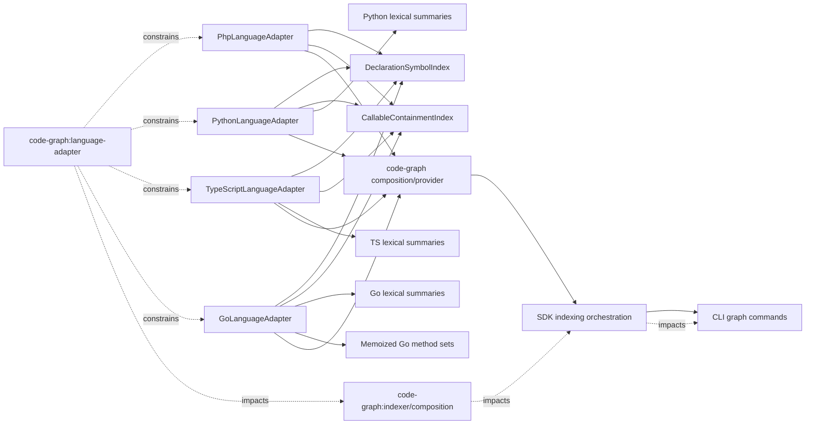

# Design: optimize-language-adapter-ast-traversals

## Non-goals

- This change does not alter `@ast-grep/napi` root ownership, the run-wide `napi-keepalive` array, native finalizer behavior, worker batching or recycling, cancellation cleanup, RSS guards, or progress IPC. Those concerns belong exclusively to `bound-indexer-ast-resource-lifecycle`.
- This change does not change file discovery, ignore rules, ICCMS configuration, vendor/generated-file policy, incremental invalidation, graph-store schemas, relation schemas, logical-symbol IDs, or package resolution.
- This change does not restore source-line regular expressions as semantic evidence. AST nodes remain authoritative for modifiers, decorators, owners, ranges, lexical bindings, and interface embeddings.
- This change does not introduce concurrent AST traversal. Per-file analysis remains synchronous and deterministic.
- This change does not create a generalized grammar abstraction. Shared code is limited to declaration identity, callable containment, and deterministic work observation; grammar-specific indexing remains in each adapter.
- This change does not add a wall-clock service-level objective. Timing is diagnostic evidence; deterministic bounds on traversals and lookups are the acceptance mechanism.

## Affected areas

### Production code

#### `packages/code-graph/src/infrastructure/tree-sitter/reference-fact-helpers.ts`

- Existing `findContainingCallableSymbol` remains source- and binary-compatible:

  ```ts
  export function findContainingCallableSymbol(
    symbols: readonly SymbolNode[],
    position: SourcePosition,
    policy: CallableContainmentPolicy,
  ): SymbolNode | undefined
  ```

- Its half-open containment and tie-break behavior remains exactly: `start <= position < end`; select latest start, then earliest end, then lexicographically smallest `SymbolNode.id`.
- Add package-internal, named exports `createCallableContainmentIndex`, `createDeclarationSymbolIndex`, and their supporting types. They are imported directly by the built-in adapter modules and tests, but are not re-exported from `packages/code-graph/src/index.ts` or `packages/code-graph/src/public.ts`; therefore the curated package API does not change.
- `findContainingCallableSymbol` delegates to the same interval-index implementation for semantic consistency. Built-in adapters must not call it repeatedly; each fact-extraction phase creates one index and reuses it.
- Risk: `MEDIUM` at symbol level. Direct consumers are PHP, Python, TypeScript/JavaScript, and Go adapters. The aggregate file impact reaches composition and public indexing indirectly, so exact semantic parity is mandatory.

#### `packages/code-graph/src/infrastructure/tree-sitter/php-language-adapter.ts`

- Change `phpMemberSemantics` from recursively searching an owner to classifying one already-associated direct member:

  ```ts
  // Before
  function phpMemberSemantics(symbol: SymbolNode, ownerNode: SgNode): MemberSemantics

  // After
  function phpMemberSemantics(symbol: SymbolNode, memberNode: SgNode): MemberSemantics
  ```

  The function checks `__construct` first, then inspects only direct children of the supplied `method_declaration` for `static_modifier`.

- Keep the signature of `PhpLanguageAdapter.collectPhpTypeInfo(root, filePath, symbols)` unchanged. Replace `symbols.find`, the full-symbol member loop, and per-member recursive owner traversal with one declaration-symbol index and one shallow `declaration_list` pass per class-like owner.
- Keep `extractBindingFactsFromData` and `extractCallFactsFromData` signatures unchanged. Each method creates one reusable callable-containment index before walking facts; all position queries use that index.
- Remove the unused `PhpScopeInfo` construct, remove `scopes` from `PhpParserState`, remove the `walkScopes` traversal, and remove all routine-body `node.text()` retention:

  ```ts
  // Before
  interface PhpParserState {
    readonly kind: 'php'
    readonly typeInfos: readonly SerializedPhpTypeInfo[]
    readonly requireRelations: readonly Relation[]
    readonly dynamicLoaders: readonly DynamicLoaderFact[]
    readonly scopes: readonly PhpScopeInfo[]
  }

  // After
  interface PhpParserState {
    readonly kind: 'php'
    readonly typeInfos: readonly SerializedPhpTypeInfo[]
    readonly requireRelations: readonly Relation[]
    readonly dynamicLoaders: readonly DynamicLoaderFact[]
  }
  ```

- `analyzeFile` retains the existing public method signature and output fields other than the unconsumed parser-state field. No reader exists for `scopes`; hydrated older parser states may contain the extra property and it remains harmless under structural typing.
- Risk: `CRITICAL` at file blast-radius level because `PhpLanguageAdapter` feeds code-graph composition, SDK orchestration, and CLI graph commands. Backwards compatibility is preserved by leaving adapter interfaces, emitted semantic facts, and public exports unchanged.

#### `packages/code-graph/src/infrastructure/tree-sitter/python-language-adapter.ts`

- Change `pythonMemberSemantics` to consume precomputed direct-member evidence rather than recursively collecting every function below the class:

  ```ts
  // Before
  function pythonMemberSemantics(symbol: SymbolNode, classNode: SgNode): MemberSemantics

  // After
  function pythonMemberSemantics(
    symbol: SymbolNode,
    member: PythonDirectMemberEvidence,
  ): MemberSemantics
  ```

- Keep `PythonLanguageAdapter.collectClassInfo(root, filePath, symbols)` unchanged externally. Internally, build the declaration-symbol index once, enumerate class nodes once, and inspect only direct entries of each class `block`. A `decorated_definition` contributes its directly wrapped `function_definition`; nested function and nested-class bodies are not traversed as outer members.
- Replace repeated owner and inner-class `symbols.find`/`symbols.some` operations with exact declaration lookup and an explicit nearest-owner association produced during the class walk.
- Change the internal shadowing query to accept a reusable lexical index:

  ```ts
  // Before
  function isPythonShadowedByEnclosingScope(node: SgNode, name: string): boolean

  // After
  function isPythonShadowedByEnclosingScope(
    node: SgNode,
    name: string,
    bindings: PythonLexicalBindingIndex,
  ): boolean
  ```

- `extractCallFactsFromData` creates one callable-containment index and one `PythonLexicalBindingIndex` for the file. A function/lambda binding summary is built at most once, excludes nested functions and classes, and is reused by every bare call in that scope.
- Risk: `HIGH` for semantic owner/decorator correctness, with aggregate `CRITICAL` propagation through indexing. Public signatures and output formats remain unchanged.

#### `packages/code-graph/src/infrastructure/tree-sitter/typescript-language-adapter.ts`

- Keep `typeScriptMemberSemantics(node, name)` and `TypeScriptLanguageAdapter.collectTypeDeclarations(root, symbols)` signatures unchanged.
- Replace global `memberNodes` collection plus nested `symbols.find`/`memberNodes.find` scans with a declaration-symbol index and direct owner-member groups built during the existing AST collection. Exact identity is `(SymbolKind, declared name, 1-based start line, 0-based start column)`.
- Preserve the existing recognized member syntax set. `method_definition`, `method_signature`, property/accessor declarations, constructors, and supported JavaScript equivalents must use the same node-kind decisions already used by symbol extraction; the implementation must centralize this set in one constant so extraction and indexing cannot drift.
- Change TypeScript/JavaScript shadowing to accept a reusable lexical index:

  ```ts
  // Before
  function isShadowedByEnclosingScope(node: SgNode, name: string): boolean

  // After
  function isShadowedByEnclosingScope(
    node: SgNode,
    name: string,
    bindings: TsLexicalBindingIndex,
  ): boolean
  ```

- `extractCallFactsFromData` builds one callable-containment index and one lexical-binding index. Function parameters, direct block lexical/variable declarations, and catch parameters are summarized once per exact scope and reused.
- In `buildReferenceFacts`, replace `typeDeclarations.find` inside per-symbol processing with `typeDeclarationById: ReadonlyMap<string, TsTypeDeclarationInfo>`. This removes another repeated collection scan while preserving signature/implementation decisions.
- Risk: `HIGH` because wrong overload or accessor association silently changes logical declarations. Public adapter interfaces and emitted ordering remain unchanged.

#### `packages/code-graph/src/infrastructure/tree-sitter/go-language-adapter.ts`

- Keep `collectTypeInfo`, `collectMethodReceivers`, `buildReferenceFacts`, and `buildRelations` external/private method signatures unchanged.
- Build one `DeclarationSymbolIndex` in `analyzeFile` and pass it to package-internal indexed helpers. Because private method signatures are implementation details, the concrete implementation may add the index parameter to private methods, but the final signatures are fixed as:

  ```ts
  private collectTypeInfo(
    root: SgNode,
    filePath: string,
    symbols: readonly SymbolNode[],
    symbolIndex: DeclarationSymbolIndex,
  ): GoTypeInfo[]

  private collectMethodReceivers(
    root: SgNode,
    content: string,
    filePath: string,
    symbols: readonly SymbolNode[],
    symbolIndex: DeclarationSymbolIndex,
  ): GoReceiverFacts
  ```

  `symbols` remains available only where range/ownership evidence beyond an exact declaration is required; owner and receiver-method identity lookup must use `symbolIndex`.

- Build `interfaceSignatureIds: ReadonlySet<string>` once in `buildReferenceFacts`; replace `typeInfos.some(...)` for each method with set membership.
- Memoize complete embedded-interface method sets once per interface in `buildRelations`. Cache entries distinguish known sets from conservative unknown sets.
- Change Go shadowing to accept `GoLexicalBindingIndex`, and create one lexical index plus one callable-containment index for call extraction.
- Preserve the semantically necessary struct-by-interface comparison. Only its inputs are indexed; no implementation relation is emitted for an empty or unknown method set.
- Risk: `HIGH` for conservative interface satisfaction and receiver ownership. Public adapter interfaces, parser-state serialization, and relation schemas remain unchanged.

### Tests

- `packages/code-graph/test/infrastructure/tree-sitter/reference-fact-helpers.spec.ts`: interval-index parity, half-open boundaries, tie-breaking, eligible-ID filtering, empty/invalid ranges, and structural work counters.
- `packages/code-graph/test/infrastructure/tree-sitter/php-language-adapter.spec.ts`: large direct-member owner, nested declarations, same-name methods, static/constructor semantics, no parser-state routine text, and normalized output parity.
- `packages/code-graph/test/infrastructure/tree-sitter/python-language-adapter.spec.ts`: direct/decorated members, multiline decorators, nested owners/functions, same-name declarations, reusable scope binding summaries, and output parity.
- `packages/code-graph/test/infrastructure/tree-sitter/typescript-language-adapter.spec.ts`: many types/members, overload order, constructors, static/accessors, interface signatures, nested owners, lexical summaries, and output parity.
- `packages/code-graph/test/infrastructure/tree-sitter/go-language-adapter.spec.ts`: indexed named types/receivers, pointer receivers, interface signature membership, embedded-interface memoization, cycles, external embeds, and conservative unknown results.
- `packages/code-graph/test/infrastructure/tree-sitter/language-adapter-conformance.spec.ts`: complete cross-language facts/relations and full versus incremental/hydrated equivalence.

No documentation file under `docs/` is modified. This is an internal performance refactor with no public API, configuration, command, output, or user workflow change. Existing `docs/code-graph/` semantic documentation remains accurate. If implementation discovers a public contract change, it is scope drift: return the change to `designing`, add the required documentation explicitly, and do not implement it opportunistically.

### Blast radius summary

The combined five-file impact reports `CRITICAL`, 103 direct dependents, 40 indirect dependents, 48 transitive dependents, and 29 affected production files. Propagation reaches `@specd/code-graph` composition/public barrels, `@specd/sdk` host and graph orchestration, and CLI graph/search/impact/status paths. This is propagation risk, not a planned edit list: consumers continue receiving identical contracts. Verification therefore covers public provider construction, adapter conformance, graph relation output, and SDK-level indexing behavior in addition to local unit tests.

## New constructs

All constructs below are package-internal. Every exported construct receives full JSDoc and explicit return types. None is added to `src/index.ts` or `src/public.ts`.

### Shared declaration and work contracts

Location: `packages/code-graph/src/infrastructure/tree-sitter/reference-fact-helpers.ts`.

```ts
/** Work categories observable by deterministic complexity tests. */
export type StructuralWorkKind =
  | 'declaration-symbol-indexed'
  | 'declaration-symbol-lookup'
  | 'callable-symbol-indexed'
  | 'callable-interval-visited'
  | 'owner-member-node-visited'
  | 'lexical-scope-node-visited'
  | 'interface-method-set-expanded'

/** Optional package-internal observer used only to count structural work. */
export interface StructuralWorkObserver {
  record(kind: StructuralWorkKind): void
}

/** Exact declaration lookup over extracted symbols. */
export interface DeclarationSymbolIndex {
  readonly size: number
  find(kind: SymbolKind, name: string, line: number, column: number): SymbolNode | undefined
}

/** Creates one exact declaration index; duplicate exact keys resolve by stable symbol id. */
export function createDeclarationSymbolIndex(
  symbols: readonly SymbolNode[],
  observer?: StructuralWorkObserver,
): DeclarationSymbolIndex

/** Reusable half-open interval lookup for innermost callable ownership. */
export interface CallableContainmentIndex {
  readonly size: number
  find(position: SourcePosition): SymbolNode | undefined
}

/** Builds one callable interval tree for one immutable symbol collection and policy. */
export function createCallableContainmentIndex(
  symbols: readonly SymbolNode[],
  policy: CallableContainmentPolicy,
  observer?: StructuralWorkObserver,
): CallableContainmentIndex
```

`DeclarationSymbolIndex` uses the collision-safe key `${kind}\u0000${line}\u0000${column}\u0000${name}`. Parser identifiers cannot contain NUL. Symbols with the same exact key are stored in stable `id` order and `find` returns the first, matching deterministic existing behavior rather than insertion-order accident.

`StructuralWorkObserver` is optional and file-local. Production calls omit it. It must not be stored in `IndexSession`, parser state, or module-level mutable state. Tests supply a counter implementation directly to package-internal builders. Observer calls must not affect branches, ordering, errors, or returned data.

### Callable interval tree

Location: `reference-fact-helpers.ts`; private to the module.

```ts
interface CallableInterval {
  readonly symbol: SymbolNode
  readonly start: SourcePosition
  readonly end: SourcePosition
}

interface CallableIntervalNode {
  readonly interval: CallableInterval
  readonly minStart: SourcePosition
  readonly maxEnd: SourcePosition
  readonly left?: CallableIntervalNode
  readonly right?: CallableIntervalNode
}
```

Eligible symbols are filtered once by `callableKinds`, optional `eligibleSymbolIds`, and complete end coordinates. Intervals are sorted by start ascending, end descending, then ID ascending and formed into a balanced tree. `minStart` and `maxEnd` prune subtrees. Querying visits only subtrees whose minimum start is not after the position and whose maximum end is after the position; it evaluates matching intervals without allocating a candidates array. Among matches it applies the existing latest-start, earliest-end, ID tie-break. Build cost is `O(S log S)` and lookup is `O(log S + K)` for `K` overlapping eligible intervals; parser-produced callable ranges are normally nested or disjoint, so `K` is lexical depth.

### PHP evidence

Location: `php-language-adapter.ts`; private except the builder may be a direct-module named export for tests.

```ts
interface PhpDirectMemberEvidence {
  readonly ownerSymbolId: string
  readonly symbol: SymbolNode
  readonly node: SgNode
  readonly semantics: MemberSemantics
}

export function collectPhpDirectMemberEvidence(
  ownerNode: SgNode,
  ownerSymbol: SymbolNode,
  symbols: DeclarationSymbolIndex,
  observer?: StructuralWorkObserver,
): readonly PhpDirectMemberEvidence[]
```

The builder visits the owner's direct `declaration_list` entries once. It never descends into a method body. Methods are matched as `SymbolKind.Method`; parser-extracted properties are matched using the exact kinds already emitted by PHP symbol extraction. Missing exact matches are omitted conservatively. Output preserves source order.

### Python evidence and lexical summaries

Location: `python-language-adapter.ts`.

```ts
interface PythonDirectMemberEvidence {
  readonly ownerSymbolId: string
  readonly symbol: SymbolNode
  readonly definitionNode: SgNode
  readonly decorators: readonly string[]
}

interface PythonLexicalBindingIndex {
  isBound(node: SgNode, name: string): boolean
}

export function createPythonLexicalBindingIndex(
  observer?: StructuralWorkObserver,
): PythonLexicalBindingIndex
```

Decorator strings are normalized exactly as today by removing the leading `@` plus adjacent whitespace and trimming. The array retains source order. The lexical index is lazy: on the first query for a function or lambda, it collects parameters and body bindings once and caches the immutable `ReadonlySet<string>` by exact scope key `kind:start.index:end.index`. It excludes descendant `function_definition`, `lambda`, and `class_definition` bodies. A call walks only its ancestor chain and tests cached sets; no enclosing body is rescanned.

### TypeScript/JavaScript evidence and lexical summaries

Location: `typescript-language-adapter.ts`.

```ts
interface TsDirectMemberEvidence {
  readonly ownerSymbolId: string
  readonly symbol: SymbolNode
  readonly node: SgNode
  readonly semantics: MemberSemantics
}

interface TsLexicalBindingIndex {
  isBound(node: SgNode, name: string): boolean
}

export function createTsLexicalBindingIndex(
  observer?: StructuralWorkObserver,
): TsLexicalBindingIndex
```

The type/member builder groups only direct members under the nearest class/interface body. Member evidence is ordered by source start, then symbol ID. The lexical index caches: parameters per function scope; directly declared lexical/variable names per `statement_block`; and the catch parameter per `catch_clause`. Cache keys are exact node kind/start/end indices. Existing semantics intentionally treat a name declared anywhere in the enclosing block as shadowing; indexing preserves that behavior and does not introduce order-sensitive resolution.

### Go indexes and method-set cache

Location: `go-language-adapter.ts`.

```ts
interface GoLexicalBindingIndex {
  isBound(node: SgNode, name: string): boolean
}

interface GoMethodSetCache {
  get(name: string): readonly string[] | null | undefined
  set(name: string, methods: readonly string[] | null): void
}

export function createGoLexicalBindingIndex(
  observer?: StructuralWorkObserver,
): GoLexicalBindingIndex

function completeGoInterfaceMethodSet(
  name: string,
  typeByName: ReadonlyMap<string, GoTypeInfo>,
  interfaceMethods: Readonly<Record<string, readonly string[]>>,
  cache: GoMethodSetCache,
  visiting: ReadonlySet<string>,
  observer?: StructuralWorkObserver,
): readonly string[] | null
```

`undefined` cache lookup means not computed; `null` means computed but unknown/unprovable. A cycle, absent embedded type, non-interface embedded type, or package-qualified/external embed yields `null` for every interface whose closure depends on it. Known method arrays are deduplicated and lexicographically sorted before caching so repeated struct comparisons are deterministic. The Go lexical index caches receiver/parameter names for routine scopes and short-variable, `var`, and `const` bindings for each block, preserving current whole-block shadowing behavior.

## Data models & Contracts

### Lifetime

- All AST-backed indexes are created after `parse(...)` and destroyed when `analyzeFile` returns.
- No new AST node, wrapper, source text, observer, or index is written to `IndexSession`, `FileAnalysis.parserState`, graph storage, or a module-level cache.
- Serializable parser state remains compact. PHP specifically drops routine source text. Python, TypeScript, and Go parser-state shapes remain unchanged.
- The separate existing `napi-keepalive` root remains untouched by this change.

### Declaration identity

- Identity fields are exact parser-derived `SymbolKind`, declared name, 1-based start line, and 0-based start column.
- Name-only, line-only, and regex-based fallback matches are forbidden.
- If exact evidence is missing, the optimized phase skips the association and preserves conservative unresolved behavior. It must not select a nearby declaration.
- Equal exact keys break ties by `SymbolNode.id` ascending.

### Member semantics

- PHP: `__construct` is `Constructor`; otherwise a direct `static_modifier` proves static method dispatch; absence proves instance method dispatch. Direct properties retain existing property semantics.
- Python: `__init__` and `__new__` are constructors; exact decorator `staticmethod` or `classmethod` proves static dispatch; decorator suffix `.setter` proves property setter; exact `property` proves property getter; otherwise method dispatch is instance. Setter takes precedence over getter, matching current order.
- TypeScript/JavaScript: `constructor` is a constructor; `method_signature` is a signature; leading parser tokens before the name determine `static`, `get`, and `set`; all supported property/member node kinds retain existing classifications.
- Go: interface method symbol IDs constitute signature membership; receiver methods are owned by the exact named receiver type; pointer receiver IDs remain separately serialized.

### Callable containment

- Input coordinates remain 1-based line and 0-based column.
- Ranges remain half-open.
- Missing `endLine` or `endColumn` excludes a symbol from the index.
- `eligibleSymbolIds` is applied during build and is immutable for the index lifetime.
- Empty indexes return `undefined` for every query.
- The existing `findContainingCallableSymbol` output must equal `createCallableContainmentIndex(...).find(position)` for every input.

### Lexical bindings

- Summaries store names only, never source text or AST nodes beyond the owning file analysis lifetime.
- Python function summaries exclude nested function, lambda, and class bodies.
- TypeScript/JavaScript block summaries include only declarations directly belonging to that block; nested blocks have independent summaries. Function parameters and catch parameters use independent scope summaries.
- Go block summaries include only declarations belonging to the block; nested blocks and routine literals have independent summaries.
- Module/package declarations continue not to shadow same-file resolution where current behavior treats them as ordinary targets.

### Semantic output invariants

Given identical file content and context, normalized results must preserve all symbol fields and order, imports, binding facts, call facts, reference facts, coverage diagnostics, public bindings, logical declarations, parser-state facts other than removed PHP `scopes`, and every relation plus metadata. Full rebuild, incremental rebuild, and hydrated-file paths must be equivalent. Unsupported or ambiguous syntax must remain unresolved.

## Approach & Execution flow

### Shared per-file preparation

1. The adapter parses content exactly once and retains the existing root according to current NAPI behavior.
2. Existing symbol extraction runs and preserves insertion/source order.
3. `createDeclarationSymbolIndex(symbols)` indexes each extracted symbol once.
4. Fact phases that need caller ownership call `createCallableContainmentIndex(symbols, policy)` once per distinct policy and reuse it for every position.
5. Language-specific owner/member and lexical indexes are built eagerly when one bounded pass is cheaper than repeated lookup, or lazily once per exact scope when only queried scopes should be visited.
6. Output construction uses the existing order of owners, members, facts, and relations. Any set/map-derived array is explicitly sorted by the existing semantic ordering before serialization.
7. All AST-local indexes become unreachable at `analyzeFile` return; only compact existing parser state and semantic facts survive.

### PHP

1. Extract symbols and create the declaration index.
2. Walk the root once to encounter class, interface, enum, and trait owners in source order.
3. Look up each owner by exact identity; if absent, skip it.
4. Extract base/interface clauses and trait uses exactly as today.
5. Locate the direct `declaration_list`; iterate each direct entry once.
6. For a direct method, exact-lookup its symbol, inspect only its direct modifiers, and append its ID/semantics.
7. For a direct property/variable symbol recognized by existing extraction, exact-lookup and append it with existing property semantics.
8. Never descend into a direct method body while collecting owner metadata. A nested class is processed by the outer root traversal as its own owner and never contributes members to the outer owner.
9. Build binding and call facts using one callable index per phase. Preserve fact deduplication keys and ordering.
10. Serialize parser state without `scopes`; do not call `node.text()` for entire routines.

### Python

1. Collect class nodes once in source order and create the declaration index.
2. Maintain a class-owner stack keyed by parser ranges while visiting class declarations; this supplies nearest enclosing class IDs without repeated symbol searches.
3. For each class, exact-lookup the owner and parse base names/ranges.
4. Iterate only direct class-block children. Unwrap one direct `decorated_definition` to its direct definition. Record decorator strings from the wrapper only.
5. Exact-lookup direct methods/properties, classify them from `PythonDirectMemberEvidence`, and preserve source order. Nested classes and nested functions are not traversed as outer members.
6. During call extraction, create one lexical index and callable index.
7. For a bare call, walk ancestors. For each enclosing function/lambda, request its cached bound-name set; the first request scans that scope body while pruning nested lexical scopes, later calls use set membership.
8. If any enclosing scope binds the name, omit the unresolved outer/import call exactly as today; otherwise emit the fact with caller ID from the callable index.

### TypeScript/JavaScript

1. During the existing AST collection, collect type owners and supported member nodes once.
2. Exact-lookup owner and member symbols through the declaration index.
3. Assign each direct member to the nearest class/interface body using an owner stack over ranges; never infer ownership from name alone.
4. Sort each owner's records by source start then ID and build `memberIdsByName`, `memberSymbolIds`, and `memberSemanticsById` in that order.
5. Preserve heritage extraction and exact ranges.
6. Build `typeDeclarationById` once before reference-fact mapping and use it for signature/implementation checks.
7. During call extraction, reuse one callable index and one lexical index. Lazily summarize each encountered function, block, or catch scope once.
8. Preserve free/member/constructor call forms, arity, static-receiver detection, deduplication, and all unresolved branches.

### Go

1. Extract top-level symbols and create the declaration index.
2. `collectTypeInfo` exact-lookups named struct/interface owners and direct interface methods. It records embeds in source order.
3. `collectMethodReceivers` exact-lookups each receiver method and preserves pointer-receiver IDs.
4. Build owner maps and `interfaceSignatureIds` once. Logical declaration mapping uses constant-time set membership.
5. During call extraction, reuse one callable index and one lexical index. Each routine/block summary is populated at most once.
6. In relation building, initialize an empty method-set cache. For each interface requested, recursively expand embeds once with a per-call `visiting` set.
7. On a cycle or unresolved embed, cache `null`; otherwise cache a sorted union of direct and embedded method names.
8. For each struct/interface pair, read the cached set. Skip `null` and empty sets. Emit `IMPLEMENTS` only when every required name exists in the receiver method map.
9. Preserve `EXTENDS` ordering metadata and relation deduplication.

## Error handling & Edge cases

- No new user-facing error class or code is introduced. This refactor is internal and must preserve existing parse, range-validation, and adapter failure behavior.
- `createDeclarationSymbolIndex` accepts an empty array and returns size zero. Invalid query coordinates simply miss; it does not throw.
- Duplicate exact declaration keys are deterministic by symbol ID. The index does not merge symbols or mutate IDs.
- Callable symbols lacking complete end coordinates are ignored, matching current containment eligibility. A position exactly at end is outside; exactly at start is inside.
- Malformed parser nodes with no name, body, declaration list, or exact symbol match are skipped through existing conservative branches. No textual fallback is allowed.
- Observer exceptions are not swallowed. Test observers must be total and non-throwing; production passes no observer.
- PHP absent declaration lists produce owner info with no members and retain hierarchy evidence. Nested classes, anonymous classes, and functions inside methods cannot leak members to an outer owner.
- Python decorated definitions without a direct function, qualified decorators other than the explicitly recognized forms, and syntax-error nodes retain conservative/default semantics. Nested lexical scopes are pruned even when they bind the same name.
- TypeScript overloads sharing a name remain distinct by position and preserve source order. Equal ranges use symbol ID. Computed/dynamic names that existing extraction cannot prove remain unresolved.
- Go embedded-interface cycles and external/qualified embeds produce cached unknown (`null`), never partial `IMPLEMENTS`. Empty interfaces continue to prove no relation under the existing rule. Pointer receiver facts remain independent of method-set name membership.
- Indexes are immutable after construction except language-local lazy caches confined to one synchronous analysis. No concurrency synchronization is required.
- Older hydrated PHP parser state may contain `scopes`; it is ignored. Newly produced state omits it. No migration error is raised.

## Key decisions

- **Use parser-backed direct-member indexing.** It removes repeated traversal while preserving multiline syntax and exact owners. Rejected: returning to line regexes, because comments, same-line declarations, and multiline modifiers/decorators are not reliably represented by one source line.
- **Use exact declaration identity.** Kind, name, line, and column prevent same-name and nested-owner collisions. Rejected: name-only or name-plus-line association, because same-line constructs and repeated names remain ambiguous.
- **Use an augmented balanced interval tree for callable containment.** It preserves arbitrary overlapping ranges and output-sensitive lookup. Rejected: filtering/sorting per query; rejected: a nesting-only stack as the sole query structure, because malformed or overlapping ranges need deterministic behavior rather than an undocumented well-nested assumption.
- **Cache lexical summaries per exact scope.** This converts body rescans into one scan plus ancestor-depth lookups. Rejected: one file-wide name set, because it destroys lexical boundaries; rejected: changing shadowing to declaration-before-use semantics, because this change must preserve current behavior.
- **Memoize unknown Go method sets.** `null` distinguishes a proven-unresolvable closure from absence in the cache, avoiding both repeated recursion and unsafe partial relations. Rejected: treating unresolved embeds as empty, because that can falsely prove implementation.
- **Keep work observers explicit and local.** Optional observer parameters enable deterministic complexity tests without global mutation. Rejected: timing-only assertions and module-level counters, which are respectively flaky and concurrency-prone.
- **Remove PHP routine-text state.** Repository search shows no consumer, and it duplicates potentially huge bodies. Rejected: keeping it for hypothetical future use; future consumers must define a compact, consumed fact.
- **Do not mix native-root lifetime into this design.** Per-file operation count and cross-file root retention are independent axes with additive remedies. Combining them would make rollback and causality harder to verify.
- **Do not add an ADR.** The implementation remains within the established infrastructure adapter boundary, changes one package, and applies existing parser-authority and deterministic-output constraints. It does not establish a new cross-package architecture.

## Trade-offs

- Additional small maps, sets, and interval nodes are allocated per file → They replace far larger repeated wrapper/string allocation and become unreachable at file-analysis completion.
- The interval tree is more code than a linear scan → It is centralized, fully parity-tested, and retains the old public helper as a compatibility facade.
- Lazy lexical indexes still walk the ancestor chain for each call → Cost is proportional to lexical depth, while each body/block is scanned once; this preserves precise nested-scope semantics.
- Exact matching may omit a fact if symbol extraction and AST node kinds drift → Conservative omission is safer than fuzzy misassociation; shared constants and parity tests detect drift.
- Go still performs struct × interface comparisons → Those comparisons correspond to distinct semantic candidates; memoized method sets and indexed receiver maps remove only redundant prerequisites.
- Work observer branches add negligible optional checks in internal builders → Production supplies `undefined`; no counters or test state are retained.
- Aggregate graph impact is `CRITICAL` despite an internal API shape → Full conformance, relation parity, provider/SDK integration, and real-project validation mitigate silent semantic regressions.

## Spec impact

The modified `code-graph:language-adapter` spec has `CRITICAL` dependent impact: 7 direct, 9 indirect, and 17 transitive dependents, covering 33 specs and 92 files. Direct/transitive consumers include code-graph composition, indexer, project indexing, graph store and traversal; CLI graph/search/impact/status; SDK host/composition/index orchestration; and public web API-reference coverage.

No dependent spec requires a delta because the new requirement is an additive implementation bound: adapters must reuse structural evidence while preserving every existing semantic contract. There is no public API, persistence, CLI, SDK, document-model, or output change. The existing downstream requirements remain satisfied by semantic-equivalence and full/incremental/hydrated tests.

The language-specific spec impacts are `LOW` and local according to graph tracing:

- PHP: adapter implementation and its test; no dependent spec.
- Python: adapter implementation and its test; no dependent spec.
- TypeScript/JavaScript: adapter implementation, its test, and package-resolution test; no dependent spec.
- Go: adapter implementation and its test; no dependent spec.

Active overlaps with `code-graph-file-outline`, `code-graph-symbol-contracts`, and, for Python/Go, `go-selectors-python-reexports` are accepted. This change modifies only bounded-analysis requirements. Merged previews must be reconciled before archive so no newer symbol, outline, selector, re-export, or hierarchy requirement is lost.

Global constraints are satisfied:

- Architecture: all changes stay in infrastructure adapters/helpers; no domain/application dependency inversion or I/O is introduced.
- Conventions: ESM named exports, strict/exact optional typing, no `any`, immutable/read-only contracts, and explicit return types for exported functions.
- Testing: Vitest files mirror source paths, use explicit assertions rather than snapshots, and generated fixtures are in-memory and platform-neutral.
- Documentation: every new function, interface, and type receives JSDoc including all parameters/returns; no public documentation update is required because no public behavior changes.

## Dependency map



```text
                         ┌─────────────────────────────┐
                         │ DeclarationSymbolIndex      │
                         │ exact kind/name/line/column │
                         └──────────────┬──────────────┘
                                        │
        ┌─────────────────┬─────────────┼─────────────┬─────────────────┐
        ▼                 ▼             ▼             ▼                 │
┌──────────────┐  ┌──────────────┐ ┌──────────────┐ ┌──────────────┐   │
│ PHP adapter  │  │ Python       │ │ TypeScript   │ │ Go adapter   │   │
│ direct body  │  │ direct block │ │ owner groups │ │ decl/receiver│   │
└──────┬───────┘  └──────┬───────┘ └──────┬───────┘ └──────┬───────┘   │
       │                 │                │                │           │
       └─────────────────┴────────┬───────┴────────────────┘           │
                                  ▼                                    │
                         ┌────────────────────┐                         │
                         │ Callable interval  │◀────────────────────────┘
                         │ index + scope sets │
                         └─────────┬──────────┘
                                   ▼
                         ┌────────────────────┐
                         │ FileAnalysis facts │
                         │ unchanged contract │
                         └─────────┬──────────┘
                                   ▼
                ┌─────────────────────────────────────┐
                │ code-graph composition [CRITICAL]   │
                └──────────────────┬──────────────────┘
                                   ▼
                        ┌────────────────────┐
                        │ SDK → CLI consumers│
                        └────────────────────┘
```

## Migration / Rollback

No database, file-format, configuration, protocol, or public API migration exists.

Deployment steps:

1. Build and typecheck `@specd/code-graph`.
2. Run focused adapter/helper tests and complete code-graph tests.
3. Run cross-package build/test checks for SDK/CLI consumers implicated by blast radius.
4. Rebuild the CLI before manual ICCMS indexing.
5. Run a full ICCMS graph index with its current configuration and confirm progress passes the former blocking file and completes.

PHP parser-state compatibility is one-way tolerant: older hydrated data may contain an extra `scopes` property and new code ignores it; new data omits the property. Existing relation building never reads it. No forced graph-store migration is needed, although the manual acceptance run is a full index to exercise the fixed path.

Rollback consists of reverting the five production files and their tests. No persisted schema rollback is required. The old implementation can consume parser state without `scopes` because it has no reader; a subsequent full reindex restores the old transient shape if desired. Rollback does not touch or resolve NAPI root-retention behavior.

## Testing

### Automated tests

#### Shared callable and declaration indexes

In `reference-fact-helpers.spec.ts`:

- Compare `findContainingCallableSymbol` and a reused `CallableContainmentIndex` across empty inputs, siblings, deeply nested callables, equal ranges, missing ends, policy kind filters, and eligible-ID filters.
- Assert start inclusion and end exclusion at same-line and multiline boundaries.
- Assert latest start, earliest end, then ID tie-breaking.
- Assert declaration index exact matching for same names on different lines/columns and stable ID choice for duplicate exact keys.
- Supply `StructuralWorkObserver`; build an index of `S` symbols and execute `Q` queries. Assert `callable-symbol-indexed === eligible S` and that queries do not increment it. Assert no per-query sort/rebuild category exists.

#### PHP

In `php-language-adapter.spec.ts`:

- Generate a class with 400 methods and nontrivial bodies. Assert all methods exist, constructor/static/instance semantics are correct, and `owner-member-node-visited` grows with direct members rather than `methods × body nodes`.
- Cover multiline modifiers/comments, same-line methods where grammar permits, duplicate method names in distinct owners, nested/anonymous classes, trait/interface/enum owners, properties, trait uses, extends/implements ranges.
- Normalize the complete `FileAnalysisDraft` and compare it with a small-fixture slow reference implementation of the pre-change semantics.
- Assert `parserState.kind === 'php'`, `scopes` is absent, and no serialized parser-state value contains a complete routine body marker.
- Assert binding/call caller IDs at callable start/end boundaries and nested routines.

#### Python

In `python-language-adapter.spec.ts`:

- Generate one class with 400 decorated/direct methods. Assert direct-member visits are linear and every semantic form is correct.
- Cover `__init__`, `__new__`, multiline `@staticmethod`/`@classmethod`, comments, `@property`, qualified `.setter`, repeated names in sibling/nested classes, and nested functions.
- Generate one function with many assignments and 400 candidate calls. Assert each exact function body contributes `lexical-scope-node-visited` only once and call count does not multiply body visits.
- Assert nested function/class bindings do not shadow outer calls, while parameters, assignments, augmented assignments, loop targets, aliases, and named expressions do.
- Compare complete normalized analysis against a test-local slow reference on safe fixtures.

#### TypeScript/JavaScript

In `typescript-language-adapter.spec.ts`:

- Generate 80 classes and 1,600 members. Assert each symbol/member is indexed once and association does not grow as types × symbols or members × all-member-nodes.
- Cover overload ordering, abstract/interface signatures, constructors, static methods, getters/setters, properties, nested classes, same-name members, and heritage ranges.
- Generate functions/blocks/catch clauses with many calls. Assert each lexical scope is summarized once and existing whole-block shadow behavior is preserved.
- Assert `typeDeclarationById` produces the same signature/implementation logical facts as the slow reference.
- Compare normalized TypeScript, TSX, JavaScript, and JSX analysis on representative fixtures.

#### Go

In `go-language-adapter.spec.ts`:

- Generate many named structs/interfaces and receiver methods. Assert exact owner/receiver association, pointer receiver IDs, signature membership, and source ordering.
- Construct an embedded-interface diamond referenced by many structs. Assert `interface-method-set-expanded` is at most once per local interface, not once per struct/interface pair.
- Cover cycles, missing local embeds, package-qualified embeds, empty interfaces, duplicate method names, and known closures. Assert cycles/unknowns emit no `IMPLEMENTS`; known complete sets do.
- Generate many calls in one routine/block and assert each scope summary is built once.
- Compare normalized parser state, facts, and relations with a test-local slow reference on bounded fixtures.

#### Cross-language and integration

In `language-adapter-conformance.spec.ts` and existing indexing integration suites:

- Run all built-in adapters through shared parser-authority, deterministic-order, callable-boundary, and conservative-unresolved assertions.
- Assert full index, incremental reindex, and hydrated-file flows produce identical normalized symbols/facts/relations.
- Exercise `createCodeGraphProvider` and the existing SDK index orchestration tests because blast radius reaches composition and SDK.
- Do not use snapshots. Assertions compare explicit normalized structures and exact counts.
- Generated sources are in-memory strings; no proprietary ICCMS source is committed. Tests use no platform-specific absolute paths or shell behavior.

### Commands and expected results

```bash
pnpm --filter @specd/code-graph typecheck
pnpm --filter @specd/code-graph lint
pnpm --filter @specd/code-graph test -- reference-fact-helpers.spec.ts php-language-adapter.spec.ts python-language-adapter.spec.ts typescript-language-adapter.spec.ts go-language-adapter.spec.ts language-adapter-conformance.spec.ts
pnpm --filter @specd/code-graph test
pnpm --filter @specd/code-graph build
pnpm --filter @specd/sdk test
pnpm --filter @specd/cli test
```

Every command must exit zero. Focused tests must report exact semantic parity and bounded structural counts; the full suites must show no changed public output.

Manual real-project validation, after building from the `specd` repository:

```bash
pnpm --filter @specd/code-graph build
pnpm --filter @specd/cli build
cd ../iccms
node ../specd/packages/cli/dist/index.js graph index --config specd.yaml --format toon
```

Expected result: indexing progresses beyond `articles_importers_controller.php` and the former 550/3234 visible plateau, reaches completion, and exits zero with the current ICCMS configuration. Capture elapsed time and peak RSS as diagnostic evidence only. Failure indicators are a long CPU-bound stall on one file, unbounded memory growth, a crash, missing method/member counts, changed graph relations, or a nonzero exit.

For a bounded synthetic complexity diagnostic, tests or a local benchmark generate 50/100/200/400 methods or calls and print work counts. Expected structural counts scale approximately linearly in indexed declarations/nodes; doubling query count without changing the indexed structure must not rebuild owner, lexical, or callable indexes.

## Open questions

None. All behavior, compatibility, ownership, algorithms, failure handling, verification, migration, and scope boundaries required for implementation are fixed above.
