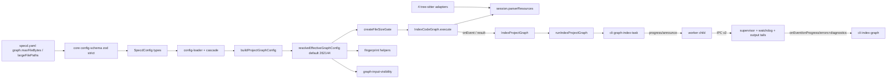

# Design: bound-indexer-ast-resource-lifecycle

This document is the complete implementation contract. It restates every requirement, scenario and decision it implements. Paths are relative to the repository root. TypeScript is strict ESM (NodeNext), named exports only, no `any`, explicit return types on exported functions, and full JSDoc on every exported symbol.

## Non-goals

- No change to the persisted graph schema (`index_coverage` keeps `file_path, content_hash, status, reason, capabilities_json`), to graph identity, or to the SQLite worker protocol.
- No asynchronous analysis, no `worker_threads` analysis, no splitting of large files into pieces, no recycling of the worker process by budget. Process isolation already keeps a future long-lived host responsive.
- No upgrade of `@ast-grep/napi` (stays at the installed 0.42.x; 0.51.0 was measured and behaves identically).
- No new import-diagnostic reason (`ImportUnresolvedReason` is unchanged).
- No per-run command-line or SDK override of `maxFileBytes`; no new CLI command; no automatic edit of `specd.yaml`.
- No cancellation token in `IndexOptions`. Hosts cancel by terminating the isolated child (signal forwarding already exists) or by throwing from a callback; the per-file `finally` and the run-level `finally` defined here release resources in both cases.
- No optimisation of the adapters' analysis cost (a separate, already merged change handled traversals); this change bounds how long and how many parser resources are retained and what is analysed at all.
- No design of an HTTP host; only the event contracts are made presentation-neutral so such a host can consume them later.

## Affected areas

Risk summary from `graph impact --direction dependents` over the full planned file set (`index-code-graph.ts`, `index-session.ts`, `in-memory-index-session.ts`, `index-options.ts`, `resolve-effective-graph-config.ts`, `compute-graph-fingerprint.ts`, `supervisor.ts`, `protocol.ts`, `isolated-index-worker-child.ts`, `isolated-graph-index-runner.ts`, `config-schema.ts`, `specd-config.ts`, `run-index-project-graph.ts`, `index-graph.ts`, `graph-index-task.ts`): risk **CRITICAL**, 315 direct, 311 indirect and 465 transitive dependents, 352 affected files (the count includes tests). The graph index was marked stale when queried, so treat the numbers as a lower bound and re-run `graph impact` on the final file set during implementation. The reach covers the code-graph composition, the SDK orchestration (`run-index-project-graph`, `run-graph-*`, `host-context`), the CLI graph commands, every `plugin-agent-*` through the shared config type, and the SQLite worker protocol. Every change below is additive or compatible, except the IPC protocol version bump (parent and child ship together) and the removal of the `napi-keepalive` convention.

### code-graph — domain

1. `packages/code-graph/src/domain/value-objects/index-session.ts` — `IndexSession` interface.
   - Add one readonly member:
     ```ts
     // Before: interface IndexSession { registerFile(...); ...; getAdapterState<T>(key: string): T | undefined; setAdapterState<T>(key: string, state: T): void; ... }
     // After:  interface IndexSession { ...unchanged...; readonly parserResources: ParserResourceScope }
     ```
   - `IndexCoverageStatus` is unchanged. `IndexCoverage` is unchanged (no size or limit field).
   - Callers: the only implementer is `InMemoryIndexSession`; `packages/code-graph/test/application/services/package-import-resolver.spec.ts` builds a partial object cast to `IndexSession` and must add `parserResources` (a no-op scope) only if the type check requires it. Risk: CRITICAL for the type (every adapter and the indexer take an `IndexSession`), but the change is one additive member.
2. `packages/code-graph/src/domain/value-objects/index-options.ts`
   - `ProjectGraphConfig` gains `readonly maxFileBytes?: number` and `readonly largeFilePaths?: readonly string[]`; each entry of `ProjectGraphConfig.workspaces` gains the same two optional members.
   - `IndexOptions` gains `readonly onEvent?: IndexEventReceiver`.
   - `IndexProgressCallback` is unchanged. Backwards compatibility: every new member is optional.
3. `packages/code-graph/src/domain/value-objects/index-result.ts` — `IndexResult` gains the three required members `filesSkippedForSize: number`, `largestSkippedForSize: readonly SizeSkippedFile[]`, `sizeExemptAnalysed: readonly SizeExemptFile[]` (types defined under New constructs). Because they are required, every literal that builds an `IndexResult` must be updated (the compiler lists them: the two return sites in `index-code-graph.ts`, test fixtures, and any provider stub). Consumers that only read the result are unaffected.
4. `packages/code-graph/src/domain/errors/isolated-graph-index-errors.ts` — all seven worker error classes (`GraphIndexWorkerStartError`, `GraphIndexTaskContractError`, `GraphIndexTaskExecutionError`, `GraphIndexWorkerProtocolError`, `GraphIndexWorkerExitError`, `GraphIndexWorkerSignalError`, `GraphIndexProgressHandlerError`) change their base class from `SpecdCodeGraphError` to the new `GraphIndexWorkerError` (which extends `SpecdCodeGraphError`), keeping their codes, constructors and getters. Backwards compatible: `instanceof SpecdCodeGraphError` still holds.
5. `packages/code-graph/src/domain/index.ts` and `domain/value-objects/index.ts` (barrels): export the new types.

### code-graph — application

6. `packages/code-graph/src/application/use-cases/in-memory-index-session.ts` — `InMemoryIndexSession`: add a private `readonly parserResourceScope: ParserResourceScope = new InMemoryParserResourceScope()` and a read-only accessor `get parserResources(): ParserResourceScope { return this.parserResourceScope }` (an accessor and not a public field, because the project lint rule `no-restricted-syntax` forbids public fields in classes; there is no setter, so the scope of a session cannot be replaced). `getAdapterState`/`setAdapterState` (lines ~662-672) stay for compact adapter caches; nothing in the codebase may store parser objects in them after this change.
7. `packages/code-graph/src/application/use-cases/index-code-graph.ts` — `IndexCodeGraph.execute` (hotspot, CRITICAL; the whole file is one run). Exact modifications are listed in "Approach and execution flow". Summary:
   - New size gate after discovery; removal of oversized files from the working set; coverage entries; `file-skipped` events.
   - Per-file loop: `file-activity` event at the top; `try { ... } catch { ... } finally { closeParserResourceEpoch(session, ...); yield every 50 files }`.
   - Chunk grouping reuses the sizes already obtained (`groupIntoChunks` takes a size lookup).
   - Deletion detection treats size-skipped paths as known, and removes previously indexed ones.
   - The run-level `finally` closes the session's scope as a safety net; the `session.setAdapterState('napi-keepalive', null)` at line 2031 is deleted.
   - The result gains the three new fields; `filesDiscovered` keeps counting every discovered file.
8. `packages/code-graph/src/application/use-cases/_shared/resolve-effective-graph-config.ts` — `EffectiveWorkspaceGraphConfig` and `EffectiveGraphConfig` gain the size settings; `resolveEffectiveGraphConfig` resolves them (the single place where the default is applied). `DEFAULT_MAX_FILE_BYTES` is exported from here.
9. `packages/code-graph/src/application/use-cases/_shared/compute-graph-fingerprint.ts` — `NormalizedWorkspaceFingerprint`, `computeGraphFingerprint`, `computeWorkspaceFingerprint`, `computeRootFingerprint` include the effective size settings (exact payloads below). `detectFingerprintMismatch` and `get-graph-health.ts` call these helpers and need no change of their own. Consequence: the first run after the upgrade sees a fingerprint mismatch for every project and rebuilds (the code-graph version in the fingerprint changes at release anyway).
10. `packages/code-graph/src/application/services/build-project-graph-config.ts` — `buildProjectGraphConfig` maps `config.graph?.maxFileBytes`, `config.graph?.largeFilePaths` and the same two fields of every `workspace.graph`, copying arrays. It applies no default.
11. `packages/code-graph/src/application/services/bootstrap-graph-config.ts` — no code change: the bootstrap `SpecdConfig` has no `graph` block, so the effective resolution (item 8) supplies the default. A test pins this.
12. `packages/code-graph/src/application/services/graph-input-visibility.ts` — `buildGraphInputVisibilitySnapshot`: files that the size gate would skip are excluded from `currentInputs` and from `isVisible`, so that a changed oversized file does not make the graph look permanently stale (it is never indexed, so re-indexing could never clear the staleness). It builds the gate with `createFileSizeGate` and the same effective config.
13. `packages/code-graph/src/application/use-cases/index-project-graph.ts` — `IndexProjectGraph.execute`: forwards `input.onEvent` into `IndexOptions.onEvent`; `IndexProjectGraphInput` gains `readonly onEvent?: IndexEventReceiver`. Composition (`create-index-project-graph`) is unchanged.
14. `packages/code-graph/src/application/ports/isolated-graph-index-runner.ts`
    ```ts
    // Before
    export type GraphIndexTask<TInput, TProgress, TResult> = (
      input: TInput,
      emitProgress: GraphIndexTaskProgressEmitter<TProgress>,
    ) => Promise<TResult>
    export interface RunIsolatedGraphIndexInput<TInput, TProgress> {
      readonly storageRoot: string
      readonly taskModule: URL | string
      readonly taskInput: TInput
      readonly onProgress?: (progress: TProgress) => void
      readonly onWarning?: (message: string) => void
    }
    // After
    export type GraphIndexTask<TInput, TProgress, TResult> = (
      input: TInput,
      emitProgress: GraphIndexTaskProgressEmitter<TProgress>,
      announce: GraphIndexTaskAnnouncer,
    ) => Promise<TResult>
    export interface RunIsolatedGraphIndexInput<TInput, TProgress> {
      /* unchanged members */
      readonly onEvent?: (event: GraphIndexWorkerEvent) => void
    }
    ```
    Backwards compatibility: a task that declares only two parameters still type-checks and runs (the third argument is ignored); `onEvent` is optional.

### code-graph — infrastructure

15. Adapters — replace the keepalive block with one registration:
    - `packages/code-graph/src/infrastructure/tree-sitter/typescript-language-adapter.ts` (block at ~lines 979-989 inside `analyzeFile`, after `const sgRoot = parse(lang, content)`)
    - `.../python-language-adapter.ts` (~668-678), `.../go-language-adapter.ts` (~580-590), `.../php-language-adapter.ts` (~795-805)
    ```ts
    // Before
    let keepAlive = context.session.getAdapterState<unknown[]>('napi-keepalive')
    if (!keepAlive) {
      keepAlive = []
      context.session.setAdapterState('napi-keepalive', keepAlive)
    }
    keepAlive.push(sgRoot)
    // After
    context.session.parserResources.register(sgRoot)
    ```
    The registration is placed immediately after the `parse(...)` call and before any traversal of `sgRoot`, so that the resource is released at the end of the file's epoch even when the analysis throws afterwards (this is the placement each adapter spec requires). The long comment about V8 finalizers is replaced by a short comment pointing at the resource scope. No other line of the adapters changes. The built-in library has no disposal method, so no disposal function is passed. The PHP adapter must additionally keep working from parser-derived facts only in Pass 2 (`buildRelations`), because no parsed syntax tree is available after `analyzeFile` returns.
16. `packages/code-graph/src/infrastructure/isolated-index-worker/protocol.ts` — `GRAPH_INDEX_PROTOCOL` becomes `'specd.graph-index.v2'`; `ChildMessage` gains the `activity` envelope; `isChildMessage` validates it with an exact key set. Existing envelopes are unchanged apart from the identifier.
17. `packages/code-graph/src/infrastructure/isolated-index-worker/isolated-index-worker-child.ts` — builds the announcer and passes it as the third argument of `runGraphIndexTask`; `sendActivity` helper. The existing `sendProgress` is unchanged.
18. `packages/code-graph/src/infrastructure/isolated-index-worker/supervisor.ts` — `runIsolatedGraphIndexWithRuntime`: fork options (`execArgv`, `stdio` with pipes), output capture, activity and silence tracking, cause classification and diagnostics attachment, `onEvent` delivery, cleanup of the new listeners and timer. `IsolatedGraphIndexRuntime` gains an optional `timers` member for tests (below).
19. `packages/code-graph/src/composition/run-isolated-graph-index.ts` — no change (the input type changed in item 14 and flows through). `packages/code-graph/src/public.ts`, `packages/code-graph/src/index.ts` — export the new public types and values (list under New constructs).

### core

20. `packages/core/src/application/ports/config-schema.ts` — `WorkspaceGraphZodSchema` (line ~156) and `ProjectGraphZodSchema` (line ~166), both `.strict()`:
    ```ts
    // add to both object shapes
    maxFileBytes: z.number().int().nonnegative().optional(),
    largeFilePaths: z.array(z.string()).optional(),
    ```
    The `.strict()` modifier stays, so these two are the only new accepted keys. A negative number, a fractional number or a non-number fails parsing and surfaces as the existing `ConfigValidationError` that names the key path.
21. `packages/core/src/application/specd-config.ts` — `SpecdWorkspaceGraphConfig` (~line 58) and `SpecdGraphConfig` (~line 90) gain `readonly maxFileBytes?: number` and `readonly largeFilePaths?: readonly string[]`, each with complete JSDoc stating unit (bytes), `0` semantics, base directory of the patterns, and that an omitted value means "built-in default applied by the code graph". These JSDoc blocks feed the generated API reference.
22. `packages/core/src/infrastructure/fs/config-loader.ts` — the two mapping blocks (workspace `graph`, ~lines 457-471; project `graph`, ~lines 627-636) gain two conditional spreads each, in the style of the existing fields:
    ```ts
    ...(ws.graph.maxFileBytes !== undefined ? { maxFileBytes: ws.graph.maxFileBytes } : {}),
    ...(ws.graph.largeFilePaths !== undefined ? { largeFilePaths: ws.graph.largeFilePaths } : {}),
    // project block: same with data.graph?.maxFileBytes / data.graph?.largeFilePaths
    ```
    No default is applied here. `packages/core/src/infrastructure/fs/config-cascade.ts` performs the generic layer merge (scalars later wins, arrays append) and is expected to need no change; a test pins the behaviour.

### sdk

23. `packages/sdk/src/orchestration/run-index-project-graph.ts` — `RunIndexProjectGraphInput` gains `readonly onEvent?: IndexEventReceiver`; `executeIndex` forwards it to `indexProjectGraph.execute` (`...(input.onEvent !== undefined ? { onEvent: input.onEvent } : {})`). `RunIndexProjectGraphResult = IndexResult & {...}` needs no edit (it inherits the new result fields). `onProgress` is unchanged.
24. `packages/sdk/src/index.ts` — extend the existing re-export lists from `@specd/code-graph`: values `GraphIndexWorkerError`; types `IndexEvent`, `FileActivityEvent`, `FileSkippedEvent`, `ResourceDisposalFailedEvent`, `IndexEventReceiver`, `SizeSkippedFile`, `SizeExemptFile`, `GraphIndexTaskAnnouncer`, `GraphIndexWorkerEvent`, `GraphIndexFailureCause`, `GraphIndexWorkerDiagnostics`. Each must carry full JSDoc (the curated surface feeds the generated API docs).

### cli

25. `packages/cli/src/graph-index-task.ts`
    ```ts
    // Before
    export interface CliGraphIndexProgress { readonly percent: number; readonly phase: string }
    export const runGraphIndexTask: GraphIndexTask<CliGraphIndexTaskInput, CliGraphIndexProgress, RunIndexProjectGraphResult> = async (input, emitProgress) => { ... onProgress: (percent, phase) => emitProgress({ percent, phase }) }
    // After
    export type CliGraphIndexProgress =
      | { readonly percent: number; readonly phase: string }
      | { readonly event: IndexEvent }
    export const runGraphIndexTask: GraphIndexTask<..., CliGraphIndexProgress, ...> = async (input, emitProgress, announce) => {
      ...
      onProgress: (percent, phase) => emitProgress({ percent, phase }),
      onEvent: (event) => {
        if (event.kind === 'file-activity') announce(event.filePath, { mandatory: (event.sizeBytes ?? 0) >= LARGE_FILE_ANNOUNCE_BYTES })
        else emitProgress({ event })
      },
    }
    ```
    `LARGE_FILE_ANNOUNCE_BYTES = 32768`. The task module still owns no process, IPC, lock or formatting concern.
26. `packages/cli/src/commands/graph/index-graph.ts`
    - The `onProgress` handler distinguishes the two shapes: `'event' in progress` routes to the event renderer, otherwise it renders `Indexing: N% phase` as today.
    - New `onEvent` passed to `runIsolatedGraphIndex` (text mode only renders; structured modes ignore): `worker-silent` writes a warning to standard error; `activity` is ignored; `stale-lock-recovered` is already reported through `onWarning` and is ignored here.
    - `formatTextIndexResult` appends the size-skip section (exact text below) after the coverage lines.
    - The `catch` block builds `cliError(message, format, 3, 'CLI_ERROR', { detail, metadata })` with the failure diagnostics.
    - The `--help` text "JSON/TOON output schema" lists the three new result fields.
    - The `--exclude-path` and other flags are unchanged.
27. `packages/cli/test/configuration-coverage.spec.ts` introspects `SpecdYamlZodSchema`, `ProjectGraphZodSchema` and `WorkspaceGraphZodSchema` and requires every key to appear in `docs/guide/configuration.md`. Adding the keys without documenting them fails this test, which enforces the documentation task below.

### Documentation (all under `docs/`, see the Documentation section for exact content)

`docs/guide/configuration.md`, `docs/guide/configuration-examples.md`, `docs/guide/workspaces.md`, `docs/guide/code-graph.md`, `docs/cli/graph.md`, `docs/cli/cli-reference.md`, `docs/sdk/index.md` (and the SDK pages that document `runIndexProjectGraph`), `docs/code-graph/index.md`, `docs/code-graph/use-cases.md`, `docs/code-graph/language-adapters.md`, `docs/core/ports.md`. `packages/guide/generated/*.json` and `apps/public-web/.generated/**` are generated and are not edited by hand.

### Changeset

Add `.changeset/<yyyymmdd>-bound-indexer-ast-resource-lifecycle.md` listing `@specd/core`, `@specd/code-graph`, `@specd/sdk`, `@specd/cli` as `minor` (the default size limit changes what is indexed) and `@specd/specd` as `minor`, following the format of the existing files in `.changeset/` (front matter with package names and bump, then a dated one-line summary, then a "Modified packages" list and a "Specs affected" list with the twelve spec ids).

## New constructs

### `packages/code-graph/src/domain/value-objects/parser-resource-scope.ts`

```ts
/** Releases a parser-owned resource whose library requires explicit release. */
export type ParserResourceDisposer = () => void

/** One failure raised by a disposal function while an epoch was closed. */
export interface ParserResourceDisposalFailure {
  /** Zero-based registration index of the resource whose disposal failed. */
  readonly index: number
  /** Message of the thrown value (`String(error)` for non-Error values). */
  readonly message: string
}

/** Outcome of closing an epoch. */
export interface ParserResourceCloseResult {
  /** Number of resources that were registered in the closed epoch. */
  readonly registered: number
  /** Failures raised by disposal functions, in the order the disposals were attempted. */
  readonly failures: readonly ParserResourceDisposalFailure[]
}

/**
 * Holds the parser-owned resources of the file currently being analysed.
 * A resource is kept strongly reachable from registration until the epoch is closed.
 */
export interface ParserResourceScope {
  /** Number of resources registered in the current epoch. */
  readonly size: number
  /**
   * Registers a resource in the current epoch.
   * @param resource - Opaque parser-owned object that must stay reachable until the epoch closes.
   * @param dispose - Optional disposal function, required only when the library demands explicit release.
   */
  register(resource: unknown, dispose?: ParserResourceDisposer): void
  /**
   * Closes the current epoch: runs every disposal in reverse registration order, then drops every reference.
   * Never throws; disposal failures are returned. Closing an empty or already closed epoch is a no-op.
   * @returns The closed epoch's counters and disposal failures.
   */
  close(): ParserResourceCloseResult
}
```

Invariants: `close` runs each disposal inside its own `try/catch` and attempts all of them even when earlier ones throw; the internal arrays are cleared in a `finally` so no reference survives an exception; after `close` the scope is immediately reusable (the next `register` starts a new epoch); `register` after `close` never resurrects released resources. The domain file has no I/O and no dependency on any parsing library.

### `packages/code-graph/src/application/use-cases/in-memory-parser-resource-scope.ts`

`export class InMemoryParserResourceScope implements ParserResourceScope` with a private `entries: Array<{ resource: unknown; dispose?: ParserResourceDisposer }>`; `size` returns `entries.length`; `register` pushes; `close` implements the invariants above:

```ts
close(): ParserResourceCloseResult {
  const closing = this.entries
  this.entries = []
  const failures: ParserResourceDisposalFailure[] = []
  for (let i = closing.length - 1; i >= 0; i--) {
    const entry = closing[i]!
    if (entry.dispose === undefined) continue
    try { entry.dispose() } catch (error) { failures.push({ index: i, message: error instanceof Error ? error.message : String(error) }) }
  }
  return { registered: closing.length, failures }
}
```

(`this.entries = []` before iterating makes the scope reusable even if a disposer re-enters `register`.) Wiring: instantiated by `InMemoryIndexSession`.

### `packages/code-graph/src/application/services/close-parser-resource-epoch.ts`

```ts
/** Result of closing an epoch including the garbage-collection request. */
export function closeParserResourceEpoch(
  scope: ParserResourceScope,
  onDisposalFailure?: (failure: ParserResourceDisposalFailure) => void,
): ParserResourceCloseResult
```

Behaviour: if `scope.size === 0` return `{ registered: 0, failures: [] }` without requesting a collection (adapters without resources stay a no-op). Otherwise call `scope.close()`, report each failure to `onDisposalFailure`, then call `requestGarbageCollection()`, then return the result.

### `packages/code-graph/src/application/services/request-garbage-collection.ts`

```ts
/** Asks the host runtime for a garbage collection when it exposes one; otherwise does nothing. */
export function requestGarbageCollection(): void {
  const gc = (globalThis as { gc?: () => void }).gc
  if (typeof gc === 'function') gc()
}
```

The cast is the only way to read the optional global; it is confined to this file, which carries an `eslint-disable-next-line` justification comment only if the project lint configuration rejects the cast (prefer a `declare global` ambient declaration in this file instead of a disable comment).

### `packages/code-graph/src/domain/value-objects/index-event.ts`

```ts
/** The file the indexer is about to process, emitted for every file including files it will skip. */
export interface FileActivityEvent {
  readonly kind: 'file-activity'
  readonly filePath: string // workspace-prefixed path
  readonly sizeBytes: number | null // null when the size could not be read
  readonly index: number // 1-based position among the files to process
  readonly total: number // number of files to process in this run
}
/** A file that was not indexed because it exceeds the effective size limit. */
export interface FileSkippedEvent {
  readonly kind: 'file-skipped'
  readonly filePath: string
  readonly projectRelativePath: string
  readonly sizeBytes: number
  readonly limitBytes: number
  readonly reason: 'file-too-large'
}
/** A parser-resource disposal function threw while an epoch was closed. */
export interface ResourceDisposalFailedEvent {
  readonly kind: 'resource-disposal-failed'
  readonly filePath: string
  readonly message: string
}
/** Presentation-neutral, JSON-serializable indexing event. */
export type IndexEvent = FileActivityEvent | FileSkippedEvent | ResourceDisposalFailedEvent
/** Receives indexing events synchronously, in emission order. */
export type IndexEventReceiver = (event: IndexEvent) => void

/** A file skipped for size, as listed in the index result. */
export interface SizeSkippedFile {
  readonly filePath: string
  readonly projectRelativePath: string
  readonly sizeBytes: number
  readonly limitBytes: number
}
/** A file that exceeds the effective limit but was analysed because it is exempt. */
export interface SizeExemptFile {
  readonly filePath: string
  readonly projectRelativePath: string
  readonly sizeBytes: number
}
```

All fields are JSON primitives so events cross the IPC boundary unchanged. A receiver that throws is ignored by the indexer (the exception is logged at `debug` and swallowed) because events are observability only and must never alter the run.

### `packages/code-graph/src/application/services/file-size-gate.ts`

```ts
export type FileSizeDecision =
  | { readonly kind: 'within-limit'; readonly sizeBytes: number | null }
  | { readonly kind: 'exempt'; readonly sizeBytes: number }
  | { readonly kind: 'skip'; readonly sizeBytes: number; readonly limitBytes: number }

export interface FileSizeGateInput {
  /** `'root'` for project-global discovery, otherwise the workspace name. */
  readonly workspaceName: string
  /** Path relative to the workspace code root (or to the project root for `'root'`), forward slashes. */
  readonly relativeToCodeRoot: string
  /** Path relative to the project root, forward slashes, no leading `./`. */
  readonly projectRelativePath: string
  readonly absolutePath: string
}

export interface FileSizeGate {
  /** Decides once per file; the caller keeps the size from the decision. */
  decide(input: FileSizeGateInput): FileSizeDecision
}

export function createFileSizeGate(
  effective: EffectiveGraphConfig,
  readSize?: (absolutePath: string) => number | null, // default: statSync(path).size, null on error
): FileSizeGate
```

Rules: the limit is `effective.workspaces.get(name)?.maxFileBytes` or `effective.rootMaxFileBytes` for `'root'`; a limit of `0` or a size not greater than the limit gives `within-limit`; an unreadable size gives `within-limit` with `null` (the normal read later reports the I/O error, as today); otherwise the exemption is evaluated with `ignore` (already a dependency of this package): a file is exempt when the project-level matcher accepts `projectRelativePath` (skipped when that path starts with `../`, because `ignore` rejects such paths and an external workspace has no project-relative identity) or the workspace-level matcher accepts `relativeToCodeRoot`. Each list is evaluated on its own, so a `!` negation only affects its own list. Matchers are built lazily and cached per workspace. The size is compared as `size > limit` (a file exactly at the limit is indexed).

### `packages/code-graph/src/infrastructure/isolated-index-worker/worker-diagnostics.ts` and the public failure types

```ts
export type GraphIndexFailureCause =
  | 'start-failed'
  | 'task-contract'
  | 'task-error'
  | 'protocol'
  | 'cancelled'
  | 'native-crash'
  | 'resource-limit'
  | 'exited'

export interface GraphIndexWorkerDiagnostics {
  readonly cause: GraphIndexFailureCause
  /** Last announced item and how long before the failure it was announced; null if none. */
  readonly lastActivity: { readonly item: string; readonly agoMs: number } | null
  /** Most recent standard output, at most 16 KiB, UTF-8 with invalid sequences replaced. */
  readonly stdoutTail: string
  /** Most recent standard error, at most 16 KiB, same decoding. */
  readonly stderrTail: string
}

export type GraphIndexWorkerEvent =
  | { readonly kind: 'activity'; readonly item: string }
  | { readonly kind: 'worker-silent'; readonly item: string | null; readonly silentForMs: number }
  | {
      readonly kind: 'stale-lock-recovered'
      readonly reason: 'process-not-running' | 'pid-reused' | 'malformed'
      readonly lockPath: string
      readonly pid?: number
      readonly startedAt?: string
    }

export type GraphIndexTaskAnnouncer = (
  item: string,
  options?: { readonly mandatory?: boolean },
) => void
```

`GraphIndexFailureCause`, `GraphIndexWorkerDiagnostics`, `GraphIndexWorkerEvent` and `GraphIndexTaskAnnouncer` live in `domain/value-objects/graph-index-worker-types.ts` (types only) so that the application port and the domain errors can reference them without importing infrastructure. `GraphIndexWorkerError` is added to `isolated-graph-index-errors.ts`:

```ts
export abstract class GraphIndexWorkerError extends SpecdCodeGraphError {
  /** Diagnostics attached by the supervisor; absent before the child started. */
  get diagnostics(): GraphIndexWorkerDiagnostics | undefined
  /** Attaches diagnostics once; later calls are ignored. @returns this */
  withDiagnostics(diagnostics: GraphIndexWorkerDiagnostics): this
}
```

### `packages/code-graph/src/infrastructure/isolated-index-worker/classify-failure.ts`

```ts
export function classifyWorkerFailure(input: {
  readonly error: Error // typed worker error produced by the supervisor
  readonly exitCode: number | null
  readonly signal: string | null
  readonly forwardedSignal: string | undefined
  readonly stderrTail: string
}): GraphIndexFailureCause
```

Order of evaluation (first match wins): `GraphIndexWorkerStartError` → `start-failed`; `GraphIndexTaskContractError` → `task-contract`; `GraphIndexTaskExecutionError` → `task-error`; `GraphIndexWorkerProtocolError` or `GraphIndexProgressHandlerError` → `protocol`; `forwardedSignal !== undefined` → `cancelled`; stderr matches `/FATAL ERROR:.*(heap out of memory|Allocation failed)|JavaScript heap out of memory|Reached heap limit/i` → `resource-limit`; signal in `SIGSEGV|SIGBUS|SIGILL|SIGABRT` or exit code `3221225477` (Windows access violation) or `134` (shell-reported abort) → `native-crash`; anything else → `exited`.

### `packages/code-graph/src/infrastructure/isolated-index-worker/output-tail.ts`

`export class OutputTail { constructor(maxBytes = 16384); push(chunk: Buffer): void; toString(): string; dispose(): void }`. `push` appends and keeps only the last `maxBytes` bytes; `toString` decodes with `new TextDecoder('utf-8', { fatal: false })`; `dispose` drops the buffer.

### Protocol addition (`protocol.ts`)

```ts
// added member of the ChildMessage union
| { readonly protocol: typeof GRAPH_INDEX_PROTOCOL; readonly type: 'activity'; readonly item: string }
```

`isChildMessage` accepts it only when the key set is exactly `protocol`, `type`, `item` and `item` is a non-empty string of at most 4096 characters. The child truncates longer items to 4096 characters before sending.

### Child announcer (`isolated-index-worker-child.ts`)

```ts
const ACTIVITY_MIN_INTERVAL_MS = 250 // at most four ordinary announcements per second
let lastActivitySentAt = Number.NEGATIVE_INFINITY
function announce(item: string, options?: { readonly mandatory?: boolean }): void {
  if (
    item === '' ||
    sentTerminal ||
    !childProcess.connected ||
    typeof childProcess.send !== 'function'
  )
    return
  const now = performance.now()
  if (options?.mandatory !== true && now - lastActivitySentAt < ACTIVITY_MIN_INTERVAL_MS) return
  lastActivitySentAt = now
  try {
    childProcess.send(
      { protocol: GRAPH_INDEX_PROTOCOL, type: 'activity', item: item.slice(0, 4096) },
      (error) => {
        if (error) failDelivery()
      },
    )
  } catch {
    /* observability only; a broken channel is detected by the next progress or terminal send */
  }
}
```

and `module.runGraphIndexTask(message.taskInput, sendProgress, announce)`.

### Runtime timers (supervisor, for testability)

`IsolatedGraphIndexRuntime` gains `readonly timers?: { readonly setInterval: (fn: () => void, ms: number) => unknown; readonly clearInterval: (handle: unknown) => void; readonly now: () => number }`; when absent the supervisor uses the global `setInterval`, `clearInterval` and `Date.now`.

## Data models and contracts

### Effective graph configuration (`resolve-effective-graph-config.ts`)

```ts
export const DEFAULT_MAX_FILE_BYTES = 262144

export interface EffectiveWorkspaceGraphConfig {
  readonly allowedPaths?: readonly string[]
  readonly excludePaths: readonly string[]
  readonly respectGitignore: boolean
  /** Effective per-file limit in bytes; 0 means no limit. Workspace value, else project value, else DEFAULT_MAX_FILE_BYTES. */
  readonly maxFileBytes: number
  /** Project-level exemption patterns, evaluated relative to the project root. */
  readonly projectLargeFilePaths: readonly string[]
  /** Workspace-level exemption patterns, evaluated relative to the workspace code root. */
  readonly workspaceLargeFilePaths: readonly string[]
}
export interface EffectiveGraphConfig {
  /* existing members unchanged */
  /** Limit applied to `root:` project-global files: the project value, else the default. */
  readonly rootMaxFileBytes: number
  /** Exemption patterns for `root:` files (the project-level ones). */
  readonly rootLargeFilePaths: readonly string[]
}
```

`resolveEffectiveGraphConfig`: `rootMaxFileBytes = graphConfig.maxFileBytes ?? DEFAULT_MAX_FILE_BYTES`; per workspace `maxFileBytes = workspaceGraph?.maxFileBytes ?? graphConfig.maxFileBytes ?? DEFAULT_MAX_FILE_BYTES`; arrays are copied. Validation of the number lives in the zod schema; this function trusts its input but a test feeds `0`, `1` and a large integer.

### Fingerprint payloads

- `NormalizedWorkspaceFingerprint` (used by `computeGraphFingerprint` and `computeWorkspaceFingerprint`) gains `maxFileBytes: number` and `largeFilePaths: { project: string[]; workspace: string[] }` taken from the effective workspace config, in declared order.
- `computeGraphFingerprint` payload `g` gains `rootMaxFileBytes` and `rootLargeFilePaths`.
- `computeRootFingerprint` payload `root` gains `maxFileBytes: effective.rootMaxFileBytes` and `largeFilePaths: effective.rootLargeFilePaths`.
- The fingerprints of two runs differ iff some effective value differs; a project that declares the default only at project level and one that repeats the same value in every workspace produce equal fingerprints because the effective values are equal.

### `IndexResult` additions

```ts
readonly filesSkippedForSize: number
readonly largestSkippedForSize: readonly SizeSkippedFile[]   // descending sizeBytes, then ascending filePath; at most SIZE_SKIP_LIST_LIMIT = 25 entries
readonly sizeExemptAnalysed: readonly SizeExemptFile[]       // every exempt file that exceeded its limit and was analysed; descending sizeBytes, then filePath
```

`filesDiscovered` keeps counting every discovered file including size-skipped ones; the per-workspace `filesDiscovered` already counts them (computed from the discovery output). `filesSkipped` keeps its meaning (hash matched). `filesRemoved` counts previously indexed files that became size-skipped (they are removed from the store).

### Coverage record for a size skip

`{ filePath, contentHash: undefined, status: IndexCoverageStatus.Unsupported, reason: 'file-too-large', capabilities: [] }`. Nothing else is persisted.

### IPC

Child to parent: existing `progress`, `result`, `failure` plus `activity`. Parent to child: `start` (unchanged except the protocol identifier). Version: `specd.graph-index.v2`.

### Configuration reference

```yaml
graph:
  maxFileBytes: 262144 # integer >= 0, bytes; omitted -> 262144; 0 -> no limit
  largeFilePaths: [...] # gitignore syntax, relative to the project root
workspaces:
  <name>:
    graph:
      maxFileBytes: 1048576 # replaces the project value for files owned by this workspace
      largeFilePaths: [...] # relative to the workspace codeRoot; added to the project list
```

### Constants

`DEFAULT_MAX_FILE_BYTES = 262144`; `SIZE_SKIP_LIST_LIMIT = 25`; `LARGE_FILE_ANNOUNCE_BYTES = 32768` (CLI task); `ACTIVITY_MIN_INTERVAL_MS = 250`; `ACTIVITY_ITEM_MAX_CHARS = 4096`; `OUTPUT_TAIL_MAX_BYTES = 16384`; `SILENCE_THRESHOLD_MS = 10000`; `SILENCE_CHECK_INTERVAL_MS = 1000`; `CLI_SIZE_SKIP_LIST_MAX = 10`.

## Approach and execution flow

### A. `IndexCodeGraph.execute` (the run)

1. Resolve `effectiveGraphConfig` as today (it now carries the size settings).
2. Create the gate: `const sizeGate = createFileSizeGate(effectiveGraphConfig)`; declare `const fileSizes = new Map<string, number | null>()`, `const sizeSkipped = new Map<string, SizeSkippedFile>()`, `const sizeExempt = new Map<string, SizeExemptFile>()`.
3. Workspace discovery and project-global discovery run exactly as today. `wsBreakdowns.filesDiscovered` and the count used for `filesDiscovered` keep counting everything discovered. In each of the two loops that currently do `allDiscoveredPaths.push(prefixed); absolutePaths.set(...); projectRelativePaths.set(...)`, call `sizeGate.decide({ workspaceName, relativeToCodeRoot: relPath, projectRelativePath, absolutePath })` first:
   - `within-limit`: `fileSizes.set(prefixed, sizeBytes)` and continue as today.
   - `exempt`: `fileSizes.set(prefixed, sizeBytes)`, `sizeExempt.set(prefixed, { filePath: prefixed, projectRelativePath, sizeBytes })`, continue as today.
   - `skip`: do NOT push into `allDiscoveredPaths` or `absolutePaths`; set `projectRelativePaths` (needed by the result); `sizeSkipped.set(prefixed, { filePath: prefixed, projectRelativePath, sizeBytes, limitBytes })`; emit `file-skipped`.
     The stat therefore happens exactly once per file, before any content read or hash.
4. After discovery, for every entry of `sizeSkipped` set the coverage entry (`coverageByFilePath.set(path, {...})`, declaration of `coverageByFilePath` is hoisted above this point) on every run, so incremental runs keep the row (the row is rewritten, not duplicated). `existingCoverage` is queried with `allDiscoveredPaths` as today; additionally query the skipped paths so a stale `indexed` row for a path that just became oversized is replaced.
5. Fingerprint, forced and mismatch branches are unchanged. In the incremental branch ("Computing diff"), change the deletion detection:
   ```ts
   const sizeSkippedPaths = new Set(sizeSkipped.keys())
   for (const existingPath of existingPaths) {
     const workspace = workspaceIdentityName(existingPath)
     if (!indexedWorkspaceNames.has(workspace)) continue
     if (discoveredSet.has(existingPath)) continue
     const skippedForSize = sizeSkippedPaths.has(existingPath)
     if (skippedForSize && !existingArtifactHashes.has(existingPath)) continue // coverage-only row: keep, it is rewritten in step 4
     deletedFiles.push(existingPath) // indexed file or document that became oversized: remove its nodes
   }
   ```
   `existingArtifactHashes` holds the hashes of indexed files and documents, so "has" means the path currently has nodes in the graph. Previously indexed files that became oversized are therefore removed by the existing cleanup and counted in `filesRemoved` and in the workspace breakdown. A path that is coverage-only and still oversized does not enter `deletedFiles`, which prevents a perpetual semantic refresh.
6. "Checking files" hashing (incremental branch) iterates `allDiscoveredPaths`, which no longer contains oversized files, so no oversized file is read or hashed.
7. `groupIntoChunks(fileTuples, chunkBudget, (abs) => sizeLookup)` receives a lookup built from `fileSizes` keyed by absolute path (build `sizeByAbsolutePath` from `fileSizes` and `absolutePaths`); it falls back to `statSync` only when a size is missing (size `null`).
8. Session creation: `const session = new InMemoryIndexSession()` assigned also to a run-level variable `activeSession` declared before the outer `try`.
9. Per-file loop (replace the current structure; line numbers refer to the current file):
   ```ts
   for (const [prefixedPath, absPath] of chunk) {
     processed++
     emitEvent({ kind: 'file-activity', filePath: prefixedPath, sizeBytes: fileSizes.get(prefixedPath) ?? null, index: processed, total: totalToProcess })
     if (processed % 50 === 0 || processed === 1) progress(...)      // unchanged
     try {
       ...existing body, including every `continue`...
     } catch (err) {
       ...existing error collection and ParseFailed coverage...
     } finally {
       const closed = closeParserResourceEpoch(session.parserResources, (failure) => emitEvent({ kind: 'resource-disposal-failed', filePath: prefixedPath, message: failure.message }))
       void closed
       if (processed % 50 === 0) await new Promise<void>((resolve) => setImmediate(resolve))   // moved here from after the try
     }
   }
   ```
   The yield moves into `finally` so that (a) it also runs for files that exit early through `continue` (the original block was skipped by them, which is why long runs of skipped files produced no yield and no progress), and (b) it always runs after the epoch is closed, so no parser resource is alive across a yield of the event loop.
10. After each file the epoch is closed, so at any moment at most one file's parser resources are retained. There is no chunk-level or run-level collection.
11. Everything else in Pass 1, between the passes, Pass 2 and bulk loading is unchanged. Pass 2 reads only compact facts from the session; this was verified end to end by indexing a large existing project with per-file release and comparing the graph (identical counts of files, symbols and relations).
12. Result assembly: `filesSkippedForSize: sizeSkipped.size`; `largestSkippedForSize`: values sorted by `sizeBytes` descending then `filePath` ascending, sliced to `SIZE_SKIP_LIST_LIMIT`; `sizeExemptAnalysed`: values sorted the same way. Both return sites of `execute` (the normal one and any early-return for an empty run) must provide the three fields (empty values).
13. Run-level `finally` (the existing one that removes the stage directory): add `if (activeSession !== undefined) closeParserResourceEpoch(activeSession.parserResources)` before the stage cleanup. This is the safety net for errors raised outside the per-file loop (bulk-load or persistence failures after analysis, and errors thrown by callbacks). Delete `session.setAdapterState('napi-keepalive', null)`.
14. `emitEvent(event)`: `try { options.onEvent?.(event) } catch (error) { Logger.debug(...) }`.

### B. Adapters

`analyzeFile` calls `context.session.parserResources.register(sgRoot)` right after `parse(...)`. Nothing else in the adapters depends on the keepalive. The `FileAnalysisDraft` returned by `analyzeFile` is plain data (already required by the full-file analysis contract); a conformance test asserts it contains no registered resource (the draft is serialised with `structuredClone` and no registered object is identity-equal to any nested value).

### C. Supervisor

1. Fork options: `{ serialization: 'json', stdio: ['ignore', 'pipe', 'pipe', 'ipc'], execArgv: gcExecArgv(runtime.process), env: {...} }` where `gcExecArgv` returns `[...process.execArgv, '--expose-gc']` without duplicating the flag (the real `process.execArgv` of the host is preserved, so host arguments such as loaders are not removed). The `runtime.process` type is widened by `execArgv`.
2. After fork: `const outTail = new OutputTail(); const errTail = new OutputTail(); child.stdout?.on('data', c => outTail.push(c)); child.stderr?.on('data', c => errTail.push(c))`. Data events must always be consumed so the pipe never blocks the child. Captured output is never written to the host's streams.
3. State: `lastMessageAt = now()`, `lastActivity: { item: string; at: number } | undefined`, `lastSilentWarnAt = -Infinity`.
4. Timer: after a successful fork, `const handle = timers.setInterval(check, SILENCE_CHECK_INTERVAL_MS)`; `check`: `const t = timers.now(); if (t - lastMessageAt >= SILENCE_THRESHOLD_MS && t - lastSilentWarnAt >= SILENCE_THRESHOLD_MS) { lastSilentWarnAt = t; deliver({ kind: 'worker-silent', item: lastActivity?.item ?? null, silentForMs: t - lastMessageAt }) }`. The interval handle is cleared in `finalize` before listener removal. The timer runs in the supervisor, so it fires while the child is blocked in synchronous analysis. The watchdog never kills the child.
5. `onMessage`: every valid message first sets `lastMessageAt = now()`. `activity` sets `lastActivity` and delivers `{ kind: 'activity', item }`. `progress` and terminal handling are unchanged. A throwing `onEvent` produces the same terminal failure as a throwing progress handler (`GraphIndexProgressHandlerError`, message `The graph-index event handler threw.`) and terminates the child.
6. Stale-lock recovery: the existing callback also delivers `{ kind: 'stale-lock-recovered', reason, lockPath, ...(pid) , ...(startedAt) }` through `onEvent`, in addition to the text `onWarning`.
7. Failure construction: wherever the supervisor currently settles with an error (`onError`, `onExit`, `protocolFailure`, `mapTaskFailure`, progress-handler failure), it first calls `attach(error)`:
   ```ts
   const attach = (error: Error): Error => {
     if (error instanceof GraphIndexWorkerError)
       error.withDiagnostics({
         cause: classifyWorkerFailure({
           error,
           exitCode,
           signal,
           forwardedSignal,
           stderrTail: errTail.toString(),
         }),
         lastActivity:
           lastActivity === undefined
             ? null
             : { item: lastActivity.item, agoMs: now() - lastActivity.at },
         stdoutTail: outTail.toString(),
         stderrTail: errTail.toString(),
       })
     return error
   }
   ```
   (`exitCode` and `signal` are the values seen by `onExit`, otherwise `null`.) Failures raised before the fork (lock busy, invalid input) carry no diagnostics. `finalize` disposes both tails after the diagnostics were built.
8. `finalize` additionally removes the stdout/stderr listeners and clears the timer; cleanup stays idempotent and completes before the promise settles.

### D. Child

`runTask` passes `announce` as the third argument. `sendProgress` keeps its validation. The child does not call `process.exit` itself; the existing exit-code handling is unchanged.

### E. SDK

`runIndexProjectGraph` forwards `onEvent`. Nothing else changes. The typed worker events are produced by the isolated runner, which the CLI calls directly through `runIsolatedGraphIndex`; the SDK function runs inside the child through the CLI task module, where only the indexer events exist.

### F. CLI

1. `graph-index-task.ts` as in Affected areas item 25.
2. `index-graph.ts` `onProgress`:
   ```ts
   onProgress: (progress) => {
     if ('event' in progress) {
       renderIndexEvent(progress.event)
       return
     }
     process.stdout.write(
       `\rIndexing: ${Math.round(progress.percent)}% ${progress.phase}${' '.repeat(20)}`,
     )
   }
   ```
   `renderIndexEvent` handles only `resource-disposal-failed` in text mode (one warning line to standard error: `warning: could not release a parser resource while processing <file>: <message>`) and ignores the other kinds (the size skips are summarised at the end).
3. `onEvent` (text mode only): `worker-silent` →
   `process.stderr.write(`\nwarning: no progress for ${Math.round(e.silentForMs / 1000)}s${e.item ? ` while processing ${e.item}` : ''}. If that file is not needed, add it to graph.excludePaths or lower graph.maxFileBytes.\n`)`.
   In `json` and `toon` modes no `onProgress` or `onEvent` is registered (the standard output must contain only the final result, as today).
4. `formatTextIndexResult` appends, only when `result.filesSkippedForSize > 0 || result.sizeExemptAnalysed.length > 0`:
   ```text
     size limit: 3 file(s) skipped (larger than graph.maxFileBytes, 262144 bytes)
       app/controllers/big_controller.php   576 KB
       src/generated/schema.ts              412 KB
       ... and 1 more
     to index them anyway, add to specd.yaml:
       graph:
         largeFilePaths:
           - app/controllers/big_controller.php
           - src/generated/schema.ts
     or raise graph.maxFileBytes (0 disables the limit).
     large files cost roughly 3 KB of memory per source byte while they are analysed.
     size-exempt files analysed:
       app/controllers/legacy_controller.php   801 KB
   ```
   Rules: the first block (skipped files, snippet, hints) appears only when `filesSkippedForSize > 0`; it lists at most `CLI_SIZE_SKIP_LIST_MAX` (10) entries of `largestSkippedForSize`, then `... and N more` where `N = filesSkippedForSize - listed`; the limit shown is the `limitBytes` of the first listed entry (when several limits apply because of workspace overrides, list the distinct limits comma separated); sizes are formatted `formatSize(bytes)`: `< 1024` → `N B`, otherwise `Math.round(bytes / 1024) KB` (use `MB` with one decimal from 1 MiB); the snippet uses `projectRelativePath` and escapes with a backslash the characters `\`, `*`, `?`, `[`, `]`, `!` at the start of the path and `#` at the start, and a leading space or trailing space; the "size-exempt files analysed" block appears only when `sizeExemptAnalysed` is not empty and lists every entry (these are explicit user choices). When neither condition holds the text output is byte-for-byte what it was before.
5. Failure: in the `catch`, when `err instanceof GraphIndexWorkerError && err.diagnostics !== undefined`:
   ```ts
   const d = err.diagnostics
   const detail =
     fmt === 'text'
       ? [
           `cause: ${d.cause}`,
           d.lastActivity
             ? `last file: ${d.lastActivity.item} (${Math.round(d.lastActivity.agoMs / 1000)}s before the failure)`
             : null,
           d.stderrTail !== '' ? `--- worker stderr (tail) ---\n${d.stderrTail}` : null,
         ]
           .filter(Boolean)
           .join('\n')
       : undefined
   cliError(err.message, opts.format, 3, 'CLI_ERROR', {
     ...(detail ? { detail } : {}),
     metadata: {
       cause: d.cause,
       lastActivity: d.lastActivity,
       stdoutTail: d.stdoutTail,
       stderrTail: d.stderrTail,
     },
   })
   ```
   The exit code (3), the `fatal:` prefix and the structured `result: 'error'` payload stay as they are; `metadata` is the existing structured extension point of `cliError`.

### G. Fingerprint and visibility

`computeGraphFingerprint`, `computeWorkspaceFingerprint` and `computeRootFingerprint` read the new effective values. `buildGraphInputVisibilitySnapshot` creates the gate and drops `skip` decisions from `currentInputs` (`exempt` and `within-limit` stay visible).

## Error handling and edge cases

- **Stat failure** (race, permission): the size is `null`, the decision is `within-limit`; the later read reports the error through the existing per-file error path. `file-activity.sizeBytes` is `null`.
- **Symlinks**: `statSync` follows links (consistent with `readFileSync` and the previous chunk grouping). A dangling link yields a stat failure as above.
- **Empty file / `maxFileBytes` very large**: never skipped. `maxFileBytes` accepts any non-negative integer; values above `Number.MAX_SAFE_INTEGER` are rejected by `z.number().int()`.
- **External workspace** (`codeRoot` outside the project root): `projectRelativePath` starts with `../`; the project-level matcher is skipped for it (documented: use the workspace-level list for such workspaces).
- **Invalid pattern in `largeFilePaths`**: handled by the `ignore` package like `excludePaths` (invalid entries are ignored by `ignore`; a pattern that throws is reported as a configuration error at gate creation: wrap the matcher construction in `try/catch` and throw `SpecdCodeGraphError`-based `InvalidGraphConfigurationError` with code `INVALID_GRAPH_CONFIG`? No new error class is introduced: invalid patterns are dropped silently exactly as `excludePaths` entries are by `ignore`, and a test pins that behaviour).
- **Disposal failure**: collected, reported as `resource-disposal-failed`, never fails the run, never masks the original error (the original error is the one the `catch` already recorded).
- **Callback throws**: a throwing `onEvent` receiver is swallowed in the indexer; a throwing `onProgress` keeps today's behaviour (propagates; the `finally` blocks still release resources).
- **No garbage-collection request available** (in-process SDK run without `--expose-gc`): the epoch still closes and drops references; the collection simply is not requested.
- **Protocol mismatch**: a child that sends another protocol identifier fails the run as a protocol failure (`cause: protocol`). Parent and child are one package, so this only occurs with a stale build.
- **Child blocked synchronously**: the supervisor watchdog still fires (it runs in the parent's event loop).
- **Child crash with no output**: `cause: exited` or `native-crash` per signal; diagnostics carry empty tails.
- **Huge stderr**: only the last 16 KiB is kept.
- **Stale incremental state**: a file that grows beyond the limit loses its nodes (step 5); a file that shrinks or becomes exempt is indexed next run because it re-enters `allDiscoveredPaths` and has no hash in the store (a "new" file); a limit change alters the fingerprint and triggers the mismatch rebuild of the affected workspaces.
- **Concurrency**: no new shared mutable state beyond per-run locals; the scope belongs to the session of one run.
- **Windows**: `statSync` and paths are already normalised to forward slashes by `toPortableGraphPath`; the access-violation exit code `3221225477` is classified as `native-crash`; `SIGBREAK` forwarding is unchanged.

## Key decisions

1. **Library-neutral resource scope in the session, not a typed `SgRoot` owner.** Rationale: the indexer must stay independent of the parsing library (adding a language must not touch the indexer). Rejected: an `AstGrepRootOwner`, which would couple the application layer to one binding.
2. **Release after every file with a collection request, not per chunk or per N files.** The spike indexed a large project with chunk, 50-file and per-file release: all safe and with identical graphs; chunk-level release barely bounds memory because a byte-budget chunk may hold more than a thousand files. Rejected: coarser intervals and a retained-bytes budget (no measured benefit).
3. **Yield only after the epoch is closed (`finally`).** Rationale: the original native crash is attributed to a finalizer running during an event-loop yield with live roots; with the epoch closed first, no root is alive at a yield. Rejected: keeping roots until the run ends (run-wide memory growth).
4. **`--expose-gc` through the fork execution arguments.** Rationale: deterministic and supported; the spike's runtime-flag trick is a hack. Rejected: toggling V8 flags at runtime.
5. **Size gate between discovery and any read, using `stat` once.** Rationale: the change-detection phase otherwise loads every file in full as a string (`readFileSync(..., 'utf-8')` at the hashing step). Rejected: gating only at analysis time.
6. **Skipped files are recorded as `unsupported` / `file-too-large`; size and limit travel in the result and events, not in storage.** Rationale: no schema change; graph health reports `complete-with-warnings` for such gaps (see Post-verification corrections). Rejected: a new status (changes `byStatus` and the persisted vocabulary) and new columns (schema bump).
7. **The limit applies to documents too.** Rationale: documents are read whole and stored whole in the graph and its search index. Rejected: code-only limit.
8. **Exemption by patterns, not by a per-file size override.** Rationale: users know which files matter, not which byte count. The exemption is only from the size limit, never from discovery rules.
9. **Watchdog in the supervisor with child announcements; mandatory announcements for large files.** Rationale: analysis is synchronous so the child cannot run timers while blocked, and rate-limited announcements could otherwise drop the one that matters. Rejected: asynchronous analysis or worker threads (breaks the synchronous adapter contract and re-introduces yields with live parser resources), and a heartbeat thread inside the child (more machinery for the same information).
10. **Protocol version bump (v1 to v2) instead of a compatible extension.** The protocol validates exact key sets and is internal; parent and child ship together.
11. **Typed events as an additional channel next to the unchanged `onProgress`.** `(percent, phase)` mixes a name with human detail and is a public SDK signature. Rejected: changing it.
12. **Default `maxFileBytes` resolved only in `resolveEffectiveGraphConfig`.** Rationale: one place, shared by the indexer, the fingerprint, the health computation and the bootstrap path. The zod schema and the config types do not default.
13. **Cause classification is a closed set derived from exit code, signal, forwarded signal and the stderr tail.** `resource-limit` requires evidence in the output; otherwise a kill is `exited`.
14. **Documentation and a changeset are part of the change** (project documentation rules); `configuration-coverage.spec.ts` enforces the configuration page.

## Trade-offs and risks

- **Behaviour change on upgrade** (intentional): files above 256 KB stop being indexed and the first run rebuilds. Mitigation: the summary lists what was skipped and prints a ready-to-paste `largeFilePaths` snippet; `maxFileBytes: 0` restores the previous behaviour; the changeset is `minor`.
- **Native safety is evidence-based, not proven.** Mitigation: a regression test with the real binding and a forced collection at every file boundary, run on all CI platforms; the exploration kept process recycling as a documented fallback if a crash is ever reproduced.
- **A garbage collection per file costs time on very large heaps.** The measured run with a collection per file took 346 s against 386 s for the original on the same project, so the cost is within noise; if a measurable cost appears, the policy lives in one function (`closeParserResourceEpoch`).
- **The visibility snapshot now stats files.** `buildGraphInputVisibilitySnapshot` runs for freshness checks; one `stat` per discovered file is added. Mitigation: it uses the same cached sizes inside one call; if a project measures a regression, add a size cache keyed by path and mtime in a follow-up.
- **`filesRemoved` now includes files that became oversized.** Documented in the CLI reference.
- **RSS is not a reliable metric on macOS** (paging and compression); tests assert counts and behaviour, never RSS or wall time.
- **Exempt files can still cost GBs.** By design the user takes responsibility; the summary lists them with sizes.
- **A stalled file can be mislabelled by up to the rate bound** when it is small and its announcement was dropped; announcements for files of 32 KiB or more are never dropped, and the warning says "last announced".
- **Overlap with active changes** (`code-graph-symbol-contracts`, `fs-decouple-03c-graph-spec-indexing-via-repository`, `code-graph-file-outline`, `fs-decouple-04-config-loader-opaque-bindings`, `cli-graph-index-import-diagnostics`): the edits here are additive in the same files; whichever change archives second rebases its deltas.

## Spec impact

Modified specs (all edited through deltas of this change): `code-graph:indexer`, `code-graph:isolated-index-worker`, `code-graph:language-adapter`, `code-graph:typescript-language-adapter`, `code-graph:python-language-adapter`, `code-graph:php-language-adapter`, `code-graph:go-language-adapter`, `code-graph:index-project-graph`, `core:config`, `core:config-loader`, `sdk:run-index-project-graph`, `cli:graph-index`. Dependents traced from the dependency lists:

- `cli:graph-index` depends on `sdk:run-index-project-graph`, `code-graph:isolated-index-worker`, `core:config`, `core:config-loader`: all four are in this change, so the contract chain is consistent.
- `sdk:run-index-project-graph` depends on `code-graph:index-project-graph` (in this change) and `sdk:with-open-graph-provider` (unaffected; it only manages the provider lifecycle).
- `code-graph:index-project-graph` depends on `code-graph:composition`, `code-graph:indexer`, `code-graph:graph-store`, `core:config`: `code-graph:composition` documents `CodeGraphProvider`, `IndexOptions` and `IndexResult`; the additive optional/result members do not contradict it, but implementers must re-read it and, if it enumerates the `IndexResult` fields exhaustively, add the three new ones in a delta (the specs phase found no enumeration; confirm with `specd specs show code-graph:composition`).
- `code-graph:sqlite-graph-store` is unaffected (no schema change); `code-graph:staleness-detection` is unaffected because staleness uses the fingerprint helpers and the visibility snapshot updated above.
- The per-language adapter specs (`code-graph:typescript-language-adapter`, `code-graph:python-language-adapter`, `code-graph:php-language-adapter`, `code-graph:go-language-adapter`) are modified by this change. The TypeScript, Python and PHP specs allowed "run-scoped keepalive state" and the PHP spec said Pass 2 visits "the retained AST"; those statements are replaced. All four specs now state that the adapter registers the parse result in `session.parserResources` inside `analyzeFile`, immediately after parsing and before any traversal, and keeps nothing else, each with verification scenarios. The shared conformance suite in `code-graph:language-adapter` gains the registration scenarios.
- `core:config` consumers (`core:config-loader`, `cli:*` commands reading `graph`) are unaffected by two optional fields.

## Dependency map



```text
config chain:  yaml -> zod(strict) -> SpecdConfig -> loader -> ProjectGraphConfig -> EffectiveGraphConfig -> {gate, fingerprint, visibility}
run chain:     IndexCodeGraph -> size gate -> (skip: coverage+event | analyse) -> adapters register -> finally close+gc -> yield
worker chain:  CLI task -> announce/emitProgress -> child -> IPC v2 -> supervisor -> {onEvent, onProgress, failure+diagnostics} -> CLI render
blast radius:  index-session.ts, index-options.ts, index-result.ts (CRITICAL, additive)  |  config-schema.ts/specd-config.ts (CRITICAL, additive) | supervisor/protocol (internal, version bump)
```

## Migration and rollback

- **Upgrade**: no data migration. The first run after upgrading sees a fingerprint mismatch (new fingerprint inputs and new code-graph version) and rebuilds affected workspaces through the existing path; files above 256 KB are then absent from the graph and appear in the size-skip summary. The graph schema version is unchanged, so a downgrade opens the same database; the older version rebuilds because its fingerprint differs.
- **Rollback**: revert the change. Because coverage rows with reason `file-too-large` are ordinary `unsupported` rows, older versions read them without error; the fingerprint mismatch makes the older version rebuild.
- **Configuration**: existing `specd.yaml` files stay valid. A project that wants the old behaviour sets `graph.maxFileBytes: 0`.

## Testing

Every scenario of the verify artifact maps to at least one test below. Tests use Vitest, mirror the `src` tree, use Given/When/Then comments, no snapshots, unique `os.tmpdir()` directories for filesystem tests, and generated fixtures only. Garbage collection in tests uses a helper `forceGarbageCollection()` (`v8.setFlagsFromString('--expose-gc')` followed by `vm.runInNewContext('gc')()`) so no runner flag is required. No test asserts RSS or wall time.

### code-graph unit tests

- `packages/code-graph/test/application/use-cases/in-memory-parser-resource-scope.spec.ts` — register/close ordering (reverse), all disposals attempted when some throw, failures returned with indices, references dropped after throw, reuse after close, re-entrant register during close, empty close no-op. Maps to: lifecycle scenarios "Epoch is closed after every analysed file" (unit part), "A failing disposal does not mask the original error or stop the others", "Adapters without parser-owned resources are unaffected".
- `packages/code-graph/test/application/services/close-parser-resource-epoch.spec.ts` — GC requested after disposals only when `globalThis.gc` is a function (stubbed), not requested for an empty scope, failure callback invoked per failure. Maps to "Garbage collection is requested when available", "Missing garbage-collection request is harmless".
- `packages/code-graph/test/application/services/file-size-gate.spec.ts` — default limit 262144 boundary (262145 skipped, 262144 allowed), limit `0`, workspace replaces project, bytes not characters (multibyte fixture), stat failure gives `within-limit`/`null`, project exemption from project root, workspace exemption from code root, both lists combined, `!` negation per list, `../` project path skips the project matcher, exemption does not apply when the size is within the limit (no exempt entry). Maps to the per-file size limit scenarios.
- `packages/code-graph/test/application/use-cases/resolve-effective-graph-config.spec.ts` (new) — default, project, workspace override, `0`, root limit, exemption bases, bootstrap-shaped config (no `graph`) gets 262144. Maps to "Effective size limit resolution" scenarios including "No other call site applies the default" (a grep-style test asserting `262144` appears only in this module's constant, via importing `DEFAULT_MAX_FILE_BYTES` everywhere else).
- `packages/code-graph/test/application/use-cases/compute-graph-fingerprint.spec.ts` (extend) — differing limit, differing exemption lists, equal effective values give equal fingerprints however declared, root fingerprint sensitivity. Maps to the three fingerprint scenarios.
- `packages/code-graph/test/application/services/build-project-graph-config.spec.ts` (extend) — maps config fields and arrays are copied, no default applied. `bootstrap-graph-config.spec.ts` (extend) — no `graph` block.
- `packages/code-graph/test/application/services/graph-input-visibility.spec.ts` (new or extend) — oversized non-exempt files are not visible; exempt and within-limit are.

### code-graph integration tests (real filesystem, real registry)

- `index-code-graph.parser-resources.spec.ts` (new, `test/application/use-cases/`) with a test adapter that registers a counting resource and disposal: epoch closed after each file; files that exit early after entering processing (documents, undecodable content) leave no residue and files skipped for size never open a scope; parse failure closes it and the error is collected; a callback that throws mid-run still closes it; a persistence failure (store stub whose bulk load throws) leaves no resource reachable (`session.parserResources.size === 0` via a spy on the session factory); disposal failures produce `resource-disposal-failed` events and do not fail the run; adapters without resources are unaffected; a fake-library adapter with a disposal function is disposed without the indexer naming any library; no `napi-keepalive` key exists after a run (`getAdapterState('napi-keepalive')` is `undefined` and no adapter source file contains the string — a source-scanning assertion over `src/infrastructure/tree-sitter/*.ts`). Maps to every "Parser resource lifecycle" scenario and "Retention is bounded across files and chunks" (the test adapter records the maximum `scope.size` observed at registration, which must be 1 across chunks).
- `index-code-graph.size-limit.spec.ts` (new) — default limit; exactly-at-limit indexed; `0` disables; workspace override; documents over the limit create no document node; category-independent skipping (test and ignored files); project-level and workspace-level exemptions; exemption does not bypass `excludePaths` or the binary filter; coverage row `unsupported`/`file-too-large` with no size persisted (store stub inspected), present again after a second incremental run (no duplication, no perpetual `deletedFiles`/semantic refresh: assert `filesRemoved === 0` on the second run); no file node, symbol or relation for skipped files; oversized file neither read nor hashed (instrument `node:fs` through the existing injectable seams or a spy on `readFileSync` for that path) including in the incremental change-detection phase; one `stat` per file for the size decision; result fields (`filesSkippedForSize`, ordering and cap of `largestSkippedForSize`, `sizeExemptAnalysed`); empty result when nothing exceeds. Maps to every "Per-file size limit" scenario and "Index result" scenarios.
- `index-code-graph-incremental.spec.ts` (extend) — a file grows beyond the limit and is removed (counted in `filesRemoved`); a skipped file shrinks and is indexed; raising the limit triggers the fingerprint rebuild; an import of a skipped module stays unresolved, no relation is created, and the skipped file has the coverage reason and appears in the result list. Maps to "Size skip in incremental runs and dependents".
- `index-code-graph.events.spec.ts` (new) — `file-activity` is emitted once per file that enters processing, before the read, with `sizeBytes`, including files then skipped by the analysis (documents, undecodable content) and counted in progress, while an oversized file produces `file-skipped` and no `file-activity`; no throttle in the indexer; `file-skipped` payload; a receiver that throws does not alter the result; with and without `onEvent` identical results and identical `onProgress` calls; events are plain JSON (`structuredClone`/`JSON.stringify` round trip). Maps to "Typed indexing events".
- `packages/code-graph/test/application/use-cases/index-project-graph.spec.ts` (extend) — `onEvent` forwarded into `IndexOptions`.
- Real-binding regression: `packages/code-graph/test/infrastructure/tree-sitter/parser-resource-lifecycle.integration.spec.ts` (new) — generates a corpus of at least 200 small files per built-in language, runs the real indexer with real adapters, forces a garbage collection at every file boundary (`closeParserResourceEpoch` does it), asserts no crash, `scope.size <= 1` at every registration, and that the resulting symbols equal those of an equivalent run that keeps the previous behaviour (computed once per test by analysing each file with a fresh session and no release). Maps to "Retention is bounded across files and chunks" and the native-safety evidence.
- Adapter conformance (`language-adapter-conformance.spec.ts`, extend; plus one scenario block in each of `typescript-language-adapter.spec.ts`, `python-language-adapter.spec.ts`, `go-language-adapter.spec.ts` and `php-language-adapter.spec.ts` for the four per-adapter requirements "Supported languages/files and deterministic analysis"): each built-in adapter registers exactly its parse result in `session.parserResources` right after parsing and before the first traversal step (record the order through a wrapped scope against a spy on the first traversal), releases it when a fixture makes the traversal throw after parsing, holds no run-wide keepalive state, keeps nothing in instance fields or `getAdapterState` after the epoch closes (check with a `WeakRef` plus forced collection, tolerant of timing by retrying a bounded number of times), and returns a draft that contains no registered resource (identity scan). Maps to all "Parser-owned resource registration" scenarios (a test adapter on a fake library covers "A new adapter on another parser library fits the contract").

### isolated worker tests (`packages/code-graph/test/infrastructure/isolated-index-worker/`)

- `protocol.spec.ts` (extend) — `activity` accepted with exact keys, rejected with extra fields, empty item and over-long items; identifier `specd.graph-index.v2`; v1 identifier is a protocol failure.
- `supervisor.spec.ts` (extend, injected runtime and fake `timers`) — activity messages become `activity` events in order and are not progress; stale-lock text warning plus typed event; fork called with `execArgv` containing `--expose-gc` and the host's own arguments exactly once, and `stdio` pipes; captured stdout/stderr never reach the host's streams, only the diagnostics; tails bounded to 16 KiB and invalid UTF-8 replaced; buffers and listeners released after the run; silence: `worker-silent` after 10 s with the last item and duration, repeated at most every further 10 s, reset by any message, never terminates the child, still fires while the fake child never yields (timer driven by the injected clock); `onEvent` throwing yields `GraphIndexProgressHandlerError`.
- `classify-failure.spec.ts` (new) — table test: `SIGSEGV`, `SIGBUS`, `SIGILL`, `SIGABRT`, exit `3221225477` and `134` give `native-crash`; forwarded `SIGINT` gives `cancelled`; stderr with `FATAL ERROR: ... JavaScript heap out of memory` gives `resource-limit`; unknown exit gives `exited`; start/contract/task/protocol errors map to their causes; precedence order.
- `output-tail.spec.ts` (new) — bound, ordering, multibyte boundary replacement, dispose.
- `child.activity.spec.ts` (new, uses the existing child test seam or a forked child fixture) — at most four ordinary announcements per second, mandatory announcements always sent and last, empty items ignored, items truncated to 4096, announce after the terminal message is ignored.
- `dist.spec.ts` (extend) — the built worker responds with the v2 identifier and a built forced index of a generated project completes with exit code 0 and a `--expose-gc`-capable child (`typeof globalThis.gc === 'function'` observed by a test task module).
- Diagnostics attachment: failures carry `cause`, `lastActivity` (item and elapsed time) and tails; failures before fork have none.

### core tests

- `packages/core/test/infrastructure/fs/config-loader.spec.ts` (extend) — fields exposed as declared at project and workspace level; undeclared fields absent (no default); negative, fractional and non-number values rejected with `ConfigValidationError` naming `maxFileBytes` and its location; unknown key still rejected; cascade: later scalar wins, arrays append (`config-cascade`).
- A schema-level test for `ProjectGraphZodSchema` and `WorkspaceGraphZodSchema` (strict, bounds, `0` accepted) next to the existing schema tests (`packages/core/test/application/` – place beside the existing config schema spec if one exists, otherwise create `config-schema-graph.spec.ts`).
- `packages/core/test/barrel.spec.ts` / `barrel-kernel-coverage.spec.ts` need no change unless new public core exports are added (none are).

### sdk tests

- `packages/sdk/test/orchestration/run-index-project-graph.spec.ts` (extend) — `onEvent` forwarded to `IndexProjectGraph`; omission changes nothing; `onProgress` unchanged; result passthrough carries `filesSkippedForSize`, `largestSkippedForSize`, `sizeExemptAnalysed`; the event types are exported from the SDK entry point (a type-level test importing them from `@specd/sdk`).

### cli tests

- `packages/cli/test/graph-index-task.spec.ts` (extend) — `file-activity` goes to `announce` with `mandatory` true at 32768 bytes and above and false below; other events go to `emitProgress({ event })`; progress shape unchanged; values are JSON-serializable.
- `packages/cli/test/commands/graph/index-graph.spec.ts` (new or extend) — text output: size-skip section content (count, limit, ten largest, `... and N more`, YAML snippet with project-relative paths and escaping, hints, memory-cost line), separate exempt list, section absent when nothing applies (output equals the previous output, assert against the stored previous format), `json`/`toon` carry the new fields and no hint text, `specd.yaml` untouched, `worker-silent` warning to standard error with the file and a suggestion in text mode and absent from structured modes (standard output is exactly one result document), failure rendering for `native-crash` with cause, last file and stderr tail, exit code 3, structured `metadata` with the cause and tails.
- `packages/cli/test/configuration-coverage.spec.ts` passes only after `docs/guide/configuration.md` documents the new keys; `documentation-coverage.spec.ts` is unaffected.

### Manual verification (after implementation)

1. `pnpm build && pnpm typecheck && pnpm test` — all green on the current platform.
2. Generate a project: 300 small TypeScript files plus one 600 KB file, `specd.yaml` without `graph.maxFileBytes`. Run `node packages/cli/dist/index.js graph index --force`. Expected text output ends with `size limit: 1 file(s) skipped (larger than graph.maxFileBytes, 262144 bytes)`, the file with `586 KB`, a `largeFilePaths` snippet containing its project-relative path, and the memory-cost line; exit code 0.
3. Paste the snippet into `specd.yaml`, rerun without `--force`. Expected: the file is indexed (its symbols appear in `graph search`), listed under `size-exempt files analysed`, and no skip section.
4. Set `graph.maxFileBytes: 0` and rerun: no skip section and the large file stays indexed.
5. Set `graph.maxFileBytes: -1`: the command fails during configuration loading with an error naming `graph.maxFileBytes`.
6. `graph index --format json | jq '.filesSkippedForSize, .largestSkippedForSize[0]'` shows the count and an object with `filePath`, `projectRelativePath`, `sizeBytes`, `limitBytes`; the output contains no hint text.
7. Slow-file warning: create a task fixture or a 200 KB generated file under a debugger pause, or run with a throttled child (`kill -STOP <child pid>` for 15 s) and observe `warning: no progress for 1Xs while processing <file>...` on standard error in text mode and nothing extra in `--format json`; `kill -CONT` resumes.
8. Failure rendering: `kill -SEGV <child pid>` during an index run. Expected: exit code 3, `fatal:` line, then `cause: native-crash`, the last file and the stderr tail; with `--format json` the payload contains `metadata.cause: "native-crash"`.
9. Memory behaviour (informational, not asserted): run the indexer over a large existing project and compare against the previous release; peak parser-resource count stays at one file, and no run hangs without a `worker-silent` warning.

## Documentation

Each item is part of the change and has an explicit task:

- `docs/guide/configuration.md` — document `graph.maxFileBytes` and `graph.largeFilePaths` for the project `graph` section and the workspace `graph` block: type, unit, default 262144 (256 KiB), `0` disables, workspace replaces the project value, `largeFilePaths` syntax (gitignore, project root base at project level, `codeRoot` base at workspace level, additive), the exemption applies only to the size limit, and that `maxFileBytes` applies to documents as well as code. The page must literally contain both key names (`configuration-coverage.spec.ts`).
- `docs/guide/configuration-examples.md` — an example with both fields at both levels.
- `docs/guide/workspaces.md` — per-workspace override and the code-root base of workspace patterns.
- `docs/guide/code-graph.md` — what a size-skipped file is, why the limit exists (memory per source byte), how it is reported, and how to index a specific large file anyway.
- `docs/cli/graph.md` and `docs/cli/cli-reference.md` (`graph index` section) — new result fields in the JSON/TOON schema, the size-skip summary and hint format, the worker warning, the failure causes and diagnostics, the exit codes (unchanged), and an example indexing a large file through `largeFilePaths`.
- `docs/sdk/` — the typed `onEvent` channel of `runIndexProjectGraph`, the event kinds and fields, the new result fields, and `GraphIndexWorkerEvent` / `GraphIndexFailureCause` for hosts using `runIsolatedGraphIndex`.
- `docs/code-graph/index.md`, `docs/code-graph/use-cases.md` — the size gate in the indexing flow, the parser-resource lifecycle and the per-file epoch.
- `docs/code-graph/language-adapters.md` — the adapter obligation: register parser-owned resources (with an optional disposal function) in `session.parserResources`, keep nothing else, return plain data; it must state the same rules as the spec's "Parser-owned resource registration" and the "Adding a language adapter" guide.
- `docs/core/ports.md` — the shape of `SpecdGraphConfig` and `SpecdWorkspaceGraphConfig` with the two new fields.
- Public symbols introduced here need complete JSDoc so that `apps/public-web/.generated/**` regenerates correctly; do not edit generated files or `packages/guide/generated/*.json` by hand (rebuild the guide bundle through the normal build).

## Global specs cross-check

- `default:_global/architecture`: domain stays free of I/O (`parser-resource-scope.ts`, `index-event.ts`, worker types, errors); `requestGarbageCollection` and the gate (filesystem metadata) live in application services (the gate takes an injectable `readSize`, default uses `node:fs`, the same layer already uses `node:fs` in discovery); the supervisor, output capture and timers are infrastructure; the CLI imports only `@specd/sdk`; the SDK re-exports from code-graph; no new cross-package dependency; no circular import (the application port references domain types only).
- `default:_global/conventions`: named exports only, kebab-case file names, no `any` (the only global access is a typed cast confined to `request-garbage-collection.ts`), `exactOptionalPropertyTypes` respected by the conditional spreads shown, `noUncheckedIndexedAccess` respected (non-null assertions only after bounds are known, as in `close`), expected failures use `SpecdError`-family classes with stable codes (`GraphIndexWorkerError` subclasses keep their codes).
- `default:_global/testing`: Vitest, test tree mirrors source, Given/When/Then, no snapshots, filesystem tests use unique temp directories with cleanup, fixtures generated, cross-platform paths and line endings (tests build paths with `node:path`; the Windows exit code is covered by a unit test).
- `default:_global/docs`: documentation tasks above; full JSDoc on every new public type.
- `default:_global/error-handling-conventions` and `default:_global/logging`: no new user-facing error class; debug logging only through the existing `Logger` for swallowed event-receiver errors.

## Post-verification corrections

The compliance audit of the first implementation produced the corrections below. They refine the contracts above; where this section and an earlier one differ, this section prevails.

### Contract corrections (specs and verify)

1. **`file-activity` scope.** The event is emitted for every file that enters per-file processing, before its content is read, including files that processing then skips (no language adapter, undecodable content). Files skipped for size or excluded by discovery never enter processing: size skips are reported by `file-skipped` only, and no parser scope is ever opened for them. The progress counters count the files that enter processing. The first sentence of flow step "Emit `file-activity`" and the test list entries that said "including binary/unsupported/oversized files" are superseded by this rule; the tests assert that an oversized file produces `file-skipped` and no `file-activity`.
2. **Absence and coverage completeness.** `code-graph:get-graph-health` already states that `unsupported` and `excluded` outcomes do not make aggregate coverage incomplete, so `coverageComplete` keeps its meaning (`true` with size skips). Graph health gains two additive fields:
   ```ts
   export type CoverageCompleteness = 'complete' | 'complete-with-warnings' | 'incomplete' | 'unknown'
   export interface CoverageWarning { readonly code: 'file-too-large'; readonly count: number }
   // GetGraphHealthResult adds:
   readonly coverageCompleteness: CoverageCompleteness
   readonly coverageWarnings: readonly CoverageWarning[]
   ```
   Derivation, in `get-graph-health.ts` where the coverage facts are assessed (`assessCoverage`, near the `complete` computation): `incomplete` when the existing rule makes coverage incomplete (parse-failed or partial targets, or the integrity mismatch); `unknown` when coverage cannot be assessed (`complete === null`); otherwise count the facts with status `unsupported` and reason `file-too-large`: a count above zero gives `complete-with-warnings` with one warning `{ code: 'file-too-large', count }`, zero gives `complete` and an empty list. Other `unsupported` reasons (for example no language adapter) and `excluded` outcomes raise no warning. The health text projection and the SDK/CLI snapshot types forward the two fields unchanged.
3. **`graph stats` presentation.** In text mode, `complete-with-warnings` prints `coverage: complete with warnings (N file(s) skipped: file-too-large)` and a hint line: `files above graph.maxFileBytes are not indexed; exempt them with graph.largeFilePaths`. `complete` prints no warning; `incomplete` and `unknown` keep the existing diagnostics. JSON and TOON carry `coverageCompleteness` and `coverageWarnings` unchanged and no hint.
4. **SDK `onEvent` scope.** `RunIndexProjectGraphInput.onEvent` is typed `IndexEventReceiver` and carries only `file-activity`, `file-skipped` and `resource-disposal-failed`. The isolated-worker events and failure diagnostics reach hosts through `runIsolatedGraphIndex({ onEvent })`. The SDK exports the types of both families with member-level JSDoc (`GraphIndexWorkerEvent` members, `GraphIndexWorkerDiagnostics` members, `FileActivityEvent` members, and so on).
5. **Worker spec wording.** Captured stdout/stderr appears only in failure diagnostics, never in events (`worker-silent` carries the last announced item and the silent duration). The task entrypoint receives a third argument, the activity announcer (`GraphIndexTaskAnnouncer`), which a task may ignore.
6. **`graphConfig` forwarded to the indexer** carries `maxFileBytes` and `largeFilePaths` exactly as declared, project and workspace lists kept separate; `resolveEffectiveGraphConfig` resolves them.

### Implementation corrections

7. **Snippet anchoring.** In the `graph index` size-skip hint, a path without a slash is printed with a leading `/` (`- /big.ts`) so that it matches only the root-level file; paths containing a slash are already anchored to the project root. Entries that contain ` #`, `: `, a leading `-`, or start with a YAML indicator are emitted as single-quoted YAML scalars (a single quote is doubled).
8. **Worker output ordering.** The supervisor builds its failure diagnostics and classification only after the child's `close` event (all stdio streams flushed), with a safety timer of 1000 ms after `exit` so that a stream that never closes cannot hold the run. The exit code and signal are recorded on `exit`. Success and failure settlement are decided after `close`, with the same typed outcomes as before.
9. **Watchdog hygiene.** The silence interval handle is unref'd when the runtime supports it and cleared as soon as a terminal message is recorded (not only at finalize). A throwing `onEvent` inside the timer never overwrites an existing `terminal`. A throwing event handler produces a `GraphIndexProgressHandlerError` whose message says "event handler"; it is classified `protocol` like the progress-handler failure.
10. **Classifier details.** Add the Windows abort exit code `3221226505` to the native-crash exit codes. The resource-limit pattern is anchored to V8's fatal-error report lines (`FATAL ERROR:` followed by `Reached heap limit` or `heap out of memory`, or `JavaScript heap out of memory` at the start of a line) so that ordinary output of a task cannot trigger it.
11. **`filesRemoved` accuracy.** A size-skipped path counts as removed only when the store holds a file or document node for it (`indexedResourceKinds.has(path)`), not when it only has a coverage row; this uses the resource-kind map and not `existingArtifactHashes`, which also holds hashes from coverage rows.
12. **Run-level `finally`.** Disposal failures raised while closing the scope in the run-level `finally` are logged at `debug` level (they can no longer be emitted as events at that point).
13. **Tie-break.** `largestSkippedForSize` and `sizeExemptAnalysed` break ties by plain code-unit comparison of `filePath` (`a < b ? -1 : a > b ? 1 : 0`) instead of `localeCompare`, so ordering does not depend on the host locale.
14. **Documentation fixes.** `docs/cli/graph.md`, `docs/cli/cli-reference.md`, `docs/sdk/index.md` and `docs/code-graph/use-cases.md` must use the real names and types: the closed failure causes `start-failed`, `task-contract`, `task-error`, `protocol`, `cancelled`, `native-crash`, `resource-limit`, `exited`; `largestSkippedForSize` is an array of `{ filePath, projectRelativePath, sizeBytes, limitBytes }` and `sizeExemptAnalysed` an array of `{ filePath, projectRelativePath, sizeBytes }`; the `worker-silent` warning text is `warning: no progress for Ns while processing <file>. If that file is not needed, add it to graph.excludePaths or lower graph.maxFileBytes.`; the `graph stats` page documents `coverageCompleteness` and `coverageWarnings`. The changesets mention the one-time rebuild after upgrading and the new health fields.
15. **Test additions.** (a) a throwing `onProgress` mid-run closes the epoch (the cancellation scenario); (b) a disposal failure together with an analysis error reports the original error; (c) `root:` namespace files are gated and removed when they grow past the limit; (d) forced and fingerprint-mismatch runs with a file that is over the limit; (e) supervisor-level tests for `cancelled` and `native-crash` diagnostics and for the `onError`, send-failure and no-IPC failure paths; (f) a real duplicate-terminal and a protocol-version-mismatch test at supervisor level, replacing the two tests that send `v1` messages; (g) a test that captured output never reaches the host streams and that the watchdog never terminates the child; (h) JSON and TOON failure payload tests and a TOON size-skip test for `graph index`, and a test that `specd.yaml` is unchanged after a run with skips; (i) escape and anchoring tests for root-level and YAML-significant paths; (j) a `structuredClone` check that the draft returned by each built-in adapter holds no `SgNode`; (k) tests for the completeness derivation and for the `graph stats` rendering.
16. **Verification round 2 (specs aligned with code).** Compliance audit run 20261027-030006 found no HIGH items. Spec deltas clarified: the size decision uses one metadata request per file while other phases may request their own (indexer); the fingerprint keeps the project and workspace `largeFilePaths` as two lists; closing an epoch that held no resource performs no garbage-collection request; captured output is exposed only through failure diagnostics; an event receiver that throws ends the run with `GraphIndexProgressHandlerError` after terminating the child; `coverageWarnings` is empty unless the graph is complete. Code fix: `graph stats` must not print a plain "complete" label next to the warning line (the boolean `coverageComplete` is unchanged). Tests: assert that label absence, the `incomplete` and `unknown` completeness values in the stats rendering, and a project plus workspace `largeFilePaths` exemption in one workspace.
17. **Verification round 3 (remaining audit findings).** Spec deltas: the SDK recovery rule now states the implemented behaviour (a non-forced run rebuilds a `SCHEMA_INCOMPATIBLE` store, and a derivation mismatch recreates the closed store once); a receiver that throws on `stale-lock-recovered` or the warning receiver during lock acquisition is a host failure mapped to `GraphIndexProgressHandlerError`; the indexer states that it has no cooperative abort and that every early exit closes the epoch; the lookup scenario for a size-skipped file is worded in terms of the missing file node. Code: wrap the receivers called during lock acquisition, per-member TSDoc for the `activity` and `worker-silent` variants and `lastActivity`, a `formatSize` that never shows a file above the limit as equal to it, a single `cliError` path for diagnostics in `graph index`, `allowedPaths` in the `cli-reference` exemption list, and a `graph stats` guard for `complete-with-warnings` with an empty warning list. Tests: receivers throwing on the silence tick and on lock recovery, a real child silent past the threshold, invalid UTF-8 and 1 MiB output through a real child, retention across several chunks with a resource-registering adapter, a `graph stats` TOON test, the rejection message of `maxFileBytes` naming key and location, and a type-level check of the exported event types. The upper bound for very large `maxFileBytes` values is intentionally left out.
18. **Verification round 4 (size skips versus the freshness comparison).** A run in a scratch project with one file above the limit reported `Graph state: stale` with `FILESET_CHANGED` right after `graph index --force`; the same project with the limit at `0` did not. Cause: the membership comparison in `get-graph-health.ts` builds the indexed side from coverage records, which include the `unsupported`/`file-too-large` rows, while the visible side (`graph-input-visibility.ts`) now excludes size-skipped files. Decision: the indexed side ignores `file-too-large` coverage rows, so a fresh index with skips is current and a file that grows past the limit afterwards (indexed, no longer visible) still counts as a membership change. The spec of `get-graph-health` and its verify scenarios state it; no other spec changes.
19. **Verification round 5 (diagnostics, failures, and freshness).** In a real repository whose workspaces declare the same package identity, every index finished with `errors` holding three `Package identity collision` entries. The indexer captured observations and cleared the stale latches only when `errors` was empty, so the graph stayed stale for good although every file had been indexed, and any file that fails on every run would do the same. Decisions: (a) freshness and processing outcome are separate axes: observation capture and the latch reset are gated by the commit of the generation, not by `errors`; a failed file is reported in `errors` and as `parse-failed` coverage (incomplete coverage), has no observation, and shows as unknown (`OBSERVATION_MISSING`) until it is indexed successfully; (b) a normal incremental run retries every target whose last outcome is a failure (`parse-failed` coverage, or an error with no observation), because the persisted hashes would otherwise mark it unchanged; (c) the package-resolution and re-export-linking messages (`<manifest>`, `<packageResolution>`, `<reExportLinking>`) move to a new `IndexResult.diagnostics` list so that a warning is not presented as a failure; the CLI prints them as warnings under a heading with the count and keeps the exit code, and the SDK passes the field through. `diagnostics` is a required field of `IndexResult`, so the fixtures that build a result gain it.
20. **Verification round 6 (audit findings).** (a) `sdk:run-index-project-graph`: the requirement "Repair lifecycle passthrough" still described the recovery as force-only; it now states the implemented rule (with `force` any typed recoverable open failure, without it only `SCHEMA_INCOMPATIBLE`), matching the rewritten orchestration requirement, and `docs/sdk/index.md` follows. (b) `code-graph:indexer`: a spec that fails is recorded in `errors` under its spec identifier so that the observation filter matches (the error used to carry the bare name); a hashing or inspection failure marks the file `parse-failed` and leaves one `errors` entry; observations on forced and fingerprint-mismatch runs carry the hash of the content read in that run, which means filling the run's hash map on those paths as well (today it stays empty and observations fall back to the old hash or are skipped). (c) Tests and small items: TSDoc for the `kind` member of the stale-lock event, the `diagnostics` passthrough in the SDK result, a pass-2 failure, a failing spec, a forced run with a failing file, a run that does not commit and keeps the latches, and the hashing-failure branch.

## Open questions

None.
