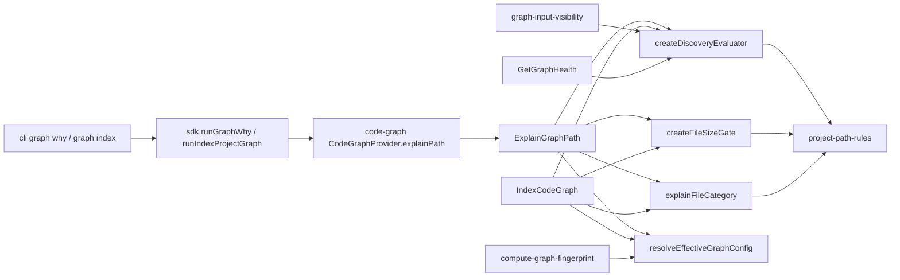

# Design: project-relative-graph-paths

## Non-goals

- No transition mechanism: no `graph.pathBase` key, no dual semantics, no startup warning for patterns that stop matching. The project is alpha; existing configs are reinterpreted and the index is rebuilt by the fingerprint.
- No change to `.gitignore` semantics (hierarchical, relative to each `.gitignore` file, absolute priority).
- No change to what is indexed for a physical file owned by several workspaces: it is still persisted once per owning workspace identity. Only a warning is added.
- No change to the handling of built-in defaults in `resolveEffectiveGraphConfig`/`buildProjectGraphConfig` (the defaults still live in the global layer when the project does not declare `graph.excludePaths`).
- No MCP exposure of `graph why` (the MCP package has no graph command surface yet).
- No change to `codeRoot`, specs `path` or `storage.*.config.path` semantics (already relative to the directory containing `specd.yaml`).
- No change to package-identity collisions, `COVERAGE_NOT_APPLICABLE`, or the cross-workspace implementation-link restriction (separate work).

## Affected areas

All paths below are from the repository root. Impact figures come from the code graph (dependents direction).

Impact summary: `discoverFiles` CRITICAL (7 direct dependents, 16 indirect, 82 affected files), `classifyFileCategory` CRITICAL (3 direct, 13 indirect, 76 files), `resolveEffectiveGraphConfig` CRITICAL (8 direct, 14 indirect, 80 files), `createFileSizeGate` HIGH (2 direct, 4 indirect, 10 files), `index-code-graph.ts` CRITICAL (7 direct, 29 files). The large file counts come from the CLI/SDK importers of the `@specd/code-graph` barrel; the behavioural surface is the five files below plus their four direct consumers. Every change to an exported signature is additive (optional fields), except the removal of `EffectiveWorkspaceGraphConfig.excludePaths`, which is internal to `packages/code-graph` (four consumers, listed below).

### 1. `packages/code-graph/src/application/use-cases/discover-files.ts`

Symbols: `DiscoverFilesOptions`, `discoverFiles`, new `createDiscoveryEvaluator`.

- `DiscoverFilesOptions` gains two optional fields (existing fields unchanged):
  ```ts
  /**
   * Project-relative directory of the discovery root, forward slashes, no leading `./`
   * or `/`. `''` (default) means the root is the project root. A value starting with
   * `../`, equal to `..`, or absolute means the root is outside the project.
   */
  readonly pathBase?: string
  /**
   * Workspace exclusion layer. Evaluated after `excludePaths` (the global layer) and
   * unable to re-include anything the global layer excluded.
   */
  readonly workspaceExcludePaths?: readonly string[]
  ```
- Behavioural change: `excludePaths` (global layer), `workspaceExcludePaths` and `allowedPaths` are matched against the **subject** of each entry, defined as `pathBase === '' ? relPath : pathBase + '/' + relPath`, instead of `relPath`. The `.gitignore` layer keeps using `relPath` and its own scoping. When `pathBase` is outside the project, the subject is `relPath` and every root-anchored pattern is removed from the three lists (see `project-path-rules.ts` below).
- The inline function `isIgnored` and the `allowedIg` test inside `discoverFiles` are extracted into `createDiscoveryEvaluator(root, options)` (new export, same file). `discoverFiles` keeps its signature and return type and uses the evaluator for every entry, so indexing and explanation share one implementation. Binary-extension skipping and the `hasAdapter` predicate stay in the walk.
- Before: `isIgnored(relPath, isDir)` returned `boolean`; after: the evaluator returns a `DiscoveryDecision` (see New constructs) and `discoverFiles` treats `kind === 'excluded'` as ignored.
- `.gitignore` files between the VCS root and the discovery root are loaded too: the evaluator walks every directory from the VCS root down to the root, loading each `.gitignore` once (scoped to its directory, matched against the path below that directory), matching git. In addition, `.gitignore` above the discovery root (VCS root above `codeRoot`): the evaluator scopes each `.gitignore` to its directory, and for a directory that is an ancestor of `root` the scoped path is `relative(thatDirectory, join(root, relPath))` (so a repository-level `*.log` applies to `packages/core/a.log`). Before this fix such a file was loaded with a `../` base that could never match, a pre-existing gap that `graph why` would otherwise inherit. `gitignoreSource.file` stays project-relative.
- Callers (all in `packages/code-graph/src/application`): `use-cases/index-code-graph.ts`, `use-cases/get-graph-health.ts`, `services/graph-input-visibility.ts`. Risk CRITICAL by barrel fan-out; backwards compatibility: both new options are optional and default to the previous behaviour for project-root discovery (`pathBase` empty, no workspace layer). Workspace callers must pass `pathBase` and `workspaceExcludePaths` (changed below).
- `DiscoverFilesOptions.excludePaths` JSDoc is updated: "global exclusion layer, matched against the project-relative subject".

### 2. `packages/code-graph/src/application/use-cases/_shared/resolve-effective-graph-config.ts`

Symbols: `EffectiveWorkspaceGraphConfig`, `EffectiveGraphConfig`, `resolveEffectiveGraphConfig`.

- `EffectiveWorkspaceGraphConfig`: remove `excludePaths`; add:
  ```ts
  /** Project-relative directory of the workspace code root (`''` when equal to the project root). */
  readonly pathBase: string
  /** Global exclusion layer: project excludes (or built-in defaults) plus synthetic spec-root exclusions. */
  readonly globalExcludePaths: readonly string[]
  /** Workspace exclusion layer: the workspace's own `excludePaths`. */
  readonly workspaceExcludePaths: readonly string[]
  /** Project-level test patterns (built-in defaults when the project declares none). */
  readonly projectTestPaths: readonly string[]
  /** Workspace-level test patterns. */
  readonly workspaceTestPaths: readonly string[]
  /** Project-level ignore patterns (built-in defaults when the project declares none). */
  readonly projectIgnorePaths: readonly string[]
  /** Workspace-level ignore patterns. */
  readonly workspaceIgnorePaths: readonly string[]
  ```
  `allowedPaths`, `respectGitignore`, `maxFileBytes`, `projectLargeFilePaths`, `workspaceLargeFilePaths` keep their names; the JSDoc of every pattern field now says "project-relative". `projectTestPaths` falls back to `DEFAULT_GRAPH_TEST_PATHS` and `projectIgnorePaths` to `DEFAULT_GRAPH_IGNORE_PATHS` (both imported from `@specd/core`, as `build-project-graph-config.ts` does).
- `EffectiveGraphConfig` is unchanged except for JSDoc (`rootLargeFilePaths` is project-relative as before). Whether a category list came from built-in defaults is not stored there: `ExplainGraphPath` derives origin `default` from `config.graph?.testPaths === undefined` / `config.graph?.ignorePaths === undefined`.
- `resolveEffectiveGraphConfig` builds, per workspace: `pathBase = computePathBase(projectRoot, workspace.codeRoot)`; `globalExcludePaths = [...globalExcludePaths, ...syntheticSpecExcludePaths]` (the top-level `rootExcludePaths` value); `workspaceExcludePaths = workspaceGraph?.excludePaths ?? []`; the four category lists from `graphConfig` and `workspaceGraph`.
- Callers (4): `index-code-graph.ts`, `get-graph-health.ts`, `graph-input-visibility.ts`, `compute-graph-fingerprint.ts`, plus `file-size-gate.ts` (types only). Risk CRITICAL by fan-out; the removal of `excludePaths` is a compile-time break confined to these files.

### 3. `packages/code-graph/src/application/use-cases/index-code-graph.ts`

- Workspace discovery (~line 549): replace
  ```ts
  discoverFiles(ws.codeRoot, undefined, {
    respectGitignore: wsGraph?.respectGitignore ?? true,
    vcsRoot: options.vcsRoot,
    ...(wsGraph?.excludePaths !== undefined ? { excludePaths: wsGraph.excludePaths } : {}),
    ...(wsGraph?.allowedPaths ? { allowedPaths: wsGraph.allowedPaths } : {}),
  })
  ```
  with a call passing `excludePaths: wsGraph.globalExcludePaths`, `workspaceExcludePaths: wsGraph.workspaceExcludePaths`, `pathBase: wsGraph.pathBase`, and `allowedPaths` as before. The same three options are passed by the other two workspace callers (below).
- Project-global discovery (~line 614) is unchanged (`pathBase` empty, `excludePaths: rootExcludePaths`).
- Categorization (~line 1322-1335): replace the `effectiveTestPatterns`/`effectiveIgnorePatterns`/`classifyFileCategory(relPath, ...)` block with `explainFileCategory(subject, ...)`'s `category` (see New constructs) where `subject` is produced by the workspace's `PathSubjectResolver` from `relPath`, and the lists come from `effectiveGraphConfig.workspaces.get(wsName)` (`projectTestPaths`/`workspaceTestPaths`/`projectIgnorePaths`/`workspaceIgnorePaths`). For `root:` files the lists are the project-level ones (`options.graphConfig.testPaths ?? DEFAULT_GRAPH_TEST_PATHS`, same for ignore) and `pathBase` is `''`. Behaviour change: matching is against the project-relative path instead of the `relPath` below `codeRoot`.
- Size gate: no call-site change; `FileSizeGateInput` keeps both paths.
- Overlap detection (new, after the workspace loop and the `root:` loop): build `Map<projectRelativePath, string[]>` from every file kept by discovery in the current run (a file counts as kept when it was returned by `discoverFiles`, before the size gate), keyed by `projectRel` and collecting `ws.name` in configuration order. Entries with 2 or more workspaces become `WorkspaceOverlap` records. The `root:` namespace is never part of an overlap (root discovery already skips files under any workspace `codeRoot`). Result fields are added to `IndexResult` (see Data models).
- Risk: `index-code-graph.ts` is CRITICAL (7 direct dependents, 29 affected files; the symbol hotspots in the file are inner closures, no exported symbol changes).

### 4. `packages/code-graph/src/application/services/graph-input-visibility.ts` (`buildGraphInputVisibilitySnapshot`)

Workspace `discoverFiles` call (~line 48) passes `excludePaths: workspaceGraph.globalExcludePaths`, `workspaceExcludePaths`, `pathBase`, and `allowedPaths` (all previously `excludePaths: workspaceGraph.excludePaths`). The `root:` call (~line 80) is unchanged. No signature change.

### 5. `packages/code-graph/src/application/use-cases/get-graph-health.ts` (`compareIndexedContent`, ~line 650-690)

Same change as above for the workspace `discoverFiles` call. The `root:` call is unchanged. `compareIndexedContent` MUST also apply the same `createFileSizeGate` decision as the indexer and `graph-input-visibility.ts`: a file skipped for size is not counted as discovered content (otherwise `discovered.size !== indexed.size` reports content as not fresh).

### 6. `packages/code-graph/src/application/services/file-size-gate.ts`

- `createFileSizeGate` matches both `rootLargeFilePaths` and the workspace's `workspaceLargeFilePaths` against the **project-relative** path: subject = `projectRelativePath` when it is inside the project; when it is outside (`starts with '../'`, equals `..`, or is absolute) subject = `relativeToCodeRoot` and root-anchored patterns are dropped. The previous `relativeToCodeRoot` matching of the workspace matcher is removed.
- `FileSizeDecision` `exempt` variant gains an optional field:
  ```ts
  | { readonly kind: 'exempt'; readonly sizeBytes: number; readonly exemptionRule?: PathRuleMatch }
  ```
  populated with the matching pattern and negation flag (so `graph why` can name the rule). All other variants are unchanged. `FileSizeGateInput` is unchanged.
- Callers: `index-code-graph.ts`, `graph-input-visibility.ts`, the new `explain-graph-path.ts`. Risk HIGH (2 direct dependents, 10 files). Backwards compatible: new field optional.

### 7. `packages/code-graph/src/domain/services/classify-file-category.ts`

- `classifyFileCategory(relativePath, testPatterns, ignorePatterns)` keeps its signature and behaviour (public API, exported from `packages/code-graph/src/public.ts` and `domain/services/index.ts`); it is now a thin wrapper kept for compatibility and no longer used by the indexer.
- New exported `explainFileCategory` is added next to it (see New constructs). Neither strips `ws:` prefixes: `explainFileCategory` receives a ready subject.

### 8. `packages/code-graph/src/application/use-cases/_shared/compute-graph-fingerprint.ts`

- `NormalizedWorkspaceFingerprint` replaces `excludePaths` with:
  ```ts
  readonly globalExcludePaths: readonly string[]
  readonly workspaceExcludePaths: readonly string[]
  readonly testPaths: { readonly project: readonly string[]; readonly workspace: readonly string[] }
  readonly ignorePaths: { readonly project: readonly string[]; readonly workspace: readonly string[] }
  ```
  `codeRoot` (already project-relative via `normalizeRelativePath(projectRoot, ws.codeRoot)`) stays. `largeFilePaths` keeps its two lists.
- The `g` object of the payload gains `pathSemantics: PATH_SEMANTICS_MARKER` where `export const PATH_SEMANTICS_MARKER = 'project-relative-v1'` is declared in this file. Changing any reference root in the future requires bumping the marker.
- Consequence: every existing index differs in fingerprint (new fields, new marker) and is fully rebuilt on the next `graph index`; `graph stats`/health report the usual fingerprint mismatch beforehand (`FULL_REBUILD_FINGERPRINT_REASON`, `GRAPH_STATS_FINGERPRINT_WARNING` keep their text).

### 9. `packages/code-graph/src/domain/value-objects/index-result.ts` and its builders

- `IndexResult` gains `workspaceOverlaps` and `workspaceOverlapCount` (see Data models). The existing `IndexResult` builders/mocks in `packages/code-graph/src` and test helpers that construct a full `IndexResult` literal must add both fields (`[]` and `0`).
- `SIZE_SKIP_LIST_LIMIT` pattern is mirrored by a new `WORKSPACE_OVERLAP_LIST_LIMIT = 25`.

### 10. `packages/code-graph/src/application/ports/code-graph-host-port.ts`

Add optional `getFile?(path: string): Promise<FileNode | undefined>` and `getDocument?(path: string): Promise<DocumentNode | undefined>` (both already exist on `CodeGraphProvider`, so no provider change); `ExplainGraphPath` uses them for `inGraph`.

### 11. `packages/code-graph/src/composition/code-graph-provider.ts` and `create-code-graph-provider.ts`

- `CodeGraphProvider` interface gains `explainPath(path: string): Promise<ExplainGraphPathResult>`; `CodeGraphProviderImpl` implements it by delegating to the injected use case with `{ ...explainPathInput, provider: this, path }`.
- `CodeGraphProviderImpl` constructor gains an optional `explainPath?: { useCase: ExplainGraphPath; input: Omit<ExplainGraphPathInput, 'provider' | 'path'> }` parameter placed after `onWarning`. `createCodeGraphProvider` builds it in the same `isSpecdConfig(options)` branch as `graphHealth`, reusing the same `config` and the same `WorkspaceIndexTarget[]` list. When absent (bootstrap mode without a `SpecdConfig`), `explainPath` throws `SpecdError` coded `GRAPH_WHY_REQUIRES_CONFIG` ("path explanation requires a specd.yaml configuration").
- Factory call: `createExplainGraphPath()` (new).

### 12. Barrels

- `packages/code-graph/src/application/index.ts`, `composition/index.ts`, `index.ts`, `public.ts`: export `ExplainGraphPath`, `ExplainGraphPathInput`, `ExplainGraphPathResult` and the result sub-types listed under New constructs, `createExplainGraphPath`, `explainFileCategory`, `PATH_SEMANTICS_MARKER`, `WorkspaceOverlap`. (`public.ts` follows how `GetGraphHealth` types are exported.)

### 13. `packages/sdk`

- `src/orchestration/run-graph-why.ts` (new), exported from `src/orchestration/index.ts` and `src/index.ts`; types re-exported from `@specd/code-graph` through the existing curated re-export file used for other result types.
- `src/orchestration/run-index-project-graph.ts` and its result type: the `IndexResult` passes through unchanged, so no code change is needed beyond type propagation; verify at build.

### 14. `packages/cli`

- `src/commands/graph/why.ts` (new); registered in the same place that registers `registerGraphStats` (the graph command group file under `packages/cli/src/commands/graph/`, imported from `packages/cli/src/program.ts`).
- `src/commands/graph/index-graph.ts`: text rendering of the overlap warning section next to the size-skip section (~line 333-360).
- `--exclude-path` handling in `index-graph.ts`/`graph-index-task.ts` is unchanged (patterns flow through `buildProjectGraphConfig` into the global layer); only help text and docs change.

### 15. Documentation

- `docs/cli/graph.md` and `docs/cli/cli-reference.md` (section `## graph`): add `graph why`, update `graph index` (project-relative semantics, `--exclude-path`, overlap warning). Update `docs/cli/index.md` if it lists graph subcommands.
- `docs/guide/configuration.md`, `docs/guide/configuration-examples.md`, `docs/guide/code-graph.md`, `docs/guide/workspaces.md`: replace every statement that workspace graph patterns are relative to `codeRoot` with the project-relative rule, add the global-layer rule and a nested-workspace example, and document the overlap warning and `graph why`.
- `docs/code-graph/use-cases.md`: document `ExplainGraphPath` and the `pathBase`/`workspaceExcludePaths` options of `discoverFiles` (section `## discoverFiles`), and the `IndexResult` additions.
- `docs/sdk/` code-graph collection page(s) that document `run*` orchestrations (frontmatter required): add `runGraphWhy`.
- ADR: none required (no architectural boundary changes).
- `../iccms/specd.yaml` workaround rules (outside this repository) can be reduced after landing; not part of this change.

## New constructs

### 1. `packages/code-graph/src/domain/services/project-path-rules.ts` (domain, pure)

```ts
import ignore, { type Ignore } from 'ignore'

/** One pattern that decided a test, as reported by the `ignore` library. */
export interface PathRuleMatch {
  /** Pattern text exactly as written (including a leading `!`). */
  readonly pattern: string
  /** Whether the pattern is a negation (`!`). */
  readonly negated: boolean
}

/** Outcome of testing one subject against one ordered pattern list. */
export interface PathRuleResult {
  /** True when the last matching pattern is not a negation. */
  readonly ignored: boolean
  /** True when the last matching pattern is a negation. */
  readonly unignored: boolean
  /** The last matching pattern, or null when none matched. */
  readonly rule: PathRuleMatch | null
}

/** Ordered pattern list that can be tested against subjects. */
export interface PathRuleSet {
  test(subject: string, isDirectory: boolean): PathRuleResult
}

/**
 * Whether a project-relative path denotes a location outside the project root.
 * @param path - Portable path as produced by `relative(projectRoot, target)`.
 * @returns True when the path is `..`, starts with `../`, or is absolute (including a Windows drive path).
 */
export function isOutsideProject(path: string): boolean

/**
 * Computes the portable project-relative directory of a code root.
 * @param projectRoot - Absolute project root.
 * @param codeRoot - Absolute workspace code root.
 * @returns `''` when equal; otherwise the forward-slash relative path with no leading `./`, possibly starting with `../`.
 */
export function computePathBase(projectRoot: string, codeRoot: string): string

/**
 * Whether a gitignore-syntax pattern is anchored to the project root.
 * A pattern is root-anchored when, after removing a leading `!` and a trailing `/`, it contains `/`
 * and does not start with `**` followed by `/`.
 * Examples: `/app/vendors/*` yes, `app/tmp/` yes, `src/**` yes, `node_modules/` no, `*.spec.ts` no, and a pattern starting with a double-star followed by a slash (the built-in test patterns) no.
 * @param pattern - Pattern text.
 * @returns True when root-anchored.
 */
export function isRootAnchoredPattern(pattern: string): boolean

/**
 * Builds the subject (the string patterns are tested against) for an entry.
 * @param pathBase - Project-relative directory of the discovery root (`computePathBase`).
 * @param relativePath - Path below the discovery root, forward slashes.
 * @returns `relativePath` when `pathBase` is `''` or outside the project; otherwise `pathBase + '/' + relativePath`.
 */
export function buildPathSubject(pathBase: string, relativePath: string): string

/**
 * Creates a testable pattern list.
 * @param patterns - Ordered gitignore-syntax patterns. Invalid patterns are dropped, as the existing code already does.
 * @param pathBase - Project-relative directory of the discovery root. When it is outside the project, root-anchored patterns are removed.
 * @returns A rule set whose `test` returns the last matching pattern.
 */
export function createPathRuleSet(patterns: readonly string[], pathBase: string): PathRuleSet
```

Invariants and behaviour:

- `createPathRuleSet` builds one `ignore()` instance, adds the patterns one by one inside `try/catch` (invalid ones dropped silently), and `test` calls `ig.test(isDirectory ? subject + '/' : subject)` and maps `{ ignored, unignored, rule }`. For an `ignored` result `rule.pattern` (provided by `ignore` 7.0.5) becomes a non-negated `PathRuleMatch`. `ignore` 7.0.5 reports NO rule when the last matching pattern is a negation (`matchedRule` is cleared for negative rules), so for an `unignored` result `createPathRuleSet` finds the deciding negation itself by replaying the accepted `!` patterns from last to first, each in its own single-pattern `ignore()` instance, and returning the first one that matches the subject. The replay is computed lazily (`rule` is a getter), because discovery only needs the booleans and the rule is read by `graph why` alone. An empty list returns `{ ignored:false, unignored:false, rule:null }`.
- `test` MUST NOT be called with a subject that starts with `../` or is absolute; `buildPathSubject` guarantees this by never prefixing an outside `pathBase`. A subject that is the empty string returns the empty result.
- `isRootAnchoredPattern` is a pure string function with no I/O.

### 2. `explainFileCategory` in `packages/code-graph/src/domain/services/classify-file-category.ts`

```ts
/** Pattern list with the level it comes from. */
export interface CategoryPatternSource {
  readonly level: 'project' | 'workspace'
  readonly key: 'graph.ignorePaths' | 'graph.testPaths'
  readonly patterns: readonly string[]
}

/** Category decision plus the rule that decided it. */
export interface FileCategoryExplanation {
  readonly category: FileCategory
  /** Null when the category is `source` because nothing matched. */
  readonly rule:
    | (PathRuleMatch & {
        readonly level: 'project' | 'workspace'
        readonly key: CategoryPatternSource['key']
      })
    | null
}

/**
 * Classifies a file using project-relative matching and reports the deciding rule.
 * Precedence: ignore patterns (project list then workspace list), then test patterns (project then workspace), else source.
 * @param subject - Subject from `buildPathSubject` (never workspace-prefixed).
 * @param pathBase - Project-relative directory of the discovery root (decides whether anchored patterns apply).
 * @param ignoreSources - Ignore lists in order [project, workspace].
 * @param testSources - Test lists in order [project, workspace].
 * @returns Category and deciding rule.
 */
export function explainFileCategory(
  subject: string,
  pathBase: string,
  ignoreSources: readonly CategoryPatternSource[],
  testSources: readonly CategoryPatternSource[],
): FileCategoryExplanation
```

Behaviour: within one level the list is a gitignore list (a `!` can cancel earlier patterns of the same list). The decision is "ignored" when any ignore source yields `ignored === true` (project list evaluated first, then workspace; the first source whose result is `ignored` supplies the rule); the same for test. Today project and workspace patterns are concatenated into one list; to preserve behaviour exactly, the implementation MUST concatenate `ignoreSources` patterns in order into a single `createPathRuleSet` call and attribute the rule's level by the index of the winning pattern (the winning `PathRuleMatch.pattern` is looked up in the concatenation from the end to find which source contributed it). This keeps the previous semantics (a workspace `!` can cancel a project-level ignore pattern) and `classifyFileCategory` remains consistent.

### 3. `DiscoveryDecision` and `createDiscoveryEvaluator` in `discover-files.ts`

```ts
/** Matched exclusion or filter. */
export type DiscoveryDecision =
  | { readonly kind: 'included' }
  | {
      readonly kind: 'excluded'
      readonly stage: 'gitignore' | 'global-exclude' | 'workspace-exclude' | 'allowed-paths'
      /** The deciding pattern, or null for `allowed-paths` when no pattern matched. */
      readonly rule: PathRuleMatch | null
      /** For `gitignore`: the project-relative `.gitignore` file and line (1-based) of the pattern. */
      readonly gitignoreSource?: { readonly file: string; readonly line: number | null }
      /** Set when an ancestor directory (not the entry itself) was excluded; project-relative directory path. */
      readonly viaDirectory?: string
    }

/** Evaluator bound to one discovery root and one set of options. */
export interface DiscoveryEvaluator {
  /** Decides for a single entry. Loads the `.gitignore` files of the entry's ancestor directories on demand. */
  evaluateEntry(relativePath: string, isDirectory: boolean): DiscoveryDecision
  /** Decides for a path as the walk would: ancestors from the top first, then the entry. */
  evaluatePath(relativePath: string): DiscoveryDecision
}

export function createDiscoveryEvaluator(
  root: string,
  options?: DiscoverFilesOptions,
): DiscoveryEvaluator
```

Rules:

- `evaluateEntry` order (identical to the walk today): (1) gitignore layer when `respectGitignore !== false`: scoped ignore instances in load order, `ignored` sets true, `unignored` resets to false, exactly as in the existing `isIgnored`; if finally ignored return `excluded/gitignore`. (2) global layer `createPathRuleSet(excludePaths ?? DEFAULT_EXCLUDE_PATHS, pathBase)`: `ignored` → `excluded/global-exclude`; `unignored` → continue to step 3 (a global negation does not disable the workspace layer). (3) workspace layer `createPathRuleSet(workspaceExcludePaths ?? [], pathBase)`: `ignored` → `excluded/workspace-exclude`. (4) for files only (not directories): when `allowedPaths` is non-empty, `createPathRuleSet(allowedPaths, pathBase).test(subject,false).ignored === false` → `excluded/allowed-paths` (the `ignore` result is inverted: a match means allowed, same as the existing `allowedIg.test(relPath).ignored`).
- Because the global layer is checked before the workspace layer and each returns on `ignored`, a workspace `!` can never re-include a globally excluded entry; a workspace `!` still cancels earlier workspace patterns because both are in the same `ignore` instance.
- `gitignoreSource.line`: found by reading the `.gitignore` file already loaded for that scope and locating the **last** line whose trimmed text equals `rule.pattern`; `null` when not found. The evaluator keeps, for each scoped `.gitignore`, its absolute directory, its text split into lines, and the `ignore` instance.
- `evaluatePath(relativePath)`: split into segments; for each proper ancestor directory path (top-down) call `ensureGitignoreLoaded(dir)` and `evaluateEntry(dir, true)`; if excluded return that decision with `viaDirectory = <project-relative ancestor path>` (computed as `buildPathSubject(pathBase, dir)`); then `evaluateEntry(relativePath, false)`. `ensureGitignoreLoaded(dir)` loads each missing ancestor `.gitignore` once, with the same loading rules as the walk (git root and `root` loaded at construction when `respectGitignore !== false`; subdirectory files loaded on demand; `dir !== root && dir !== gitRoot`).
- The walk in `discoverFiles` calls `evaluateEntry` with the loading it already performs at directory entry, so behaviour is unchanged for existing configs apart from the subject.

### 4. `packages/code-graph/src/application/use-cases/explain-graph-path.ts`

```ts
import { type SpecdConfig, type VcsAdapter } from '@specd/core'
import { type CodeGraphHostPort } from '../ports/code-graph-host-port.js'
import { type WorkspaceIndexTarget } from '../../domain/value-objects/index-options.js'
import { type FileCategory } from '../../domain/value-objects/file-node.js'
import { type LanguageAdapter } from '../../domain/value-objects/language-adapter.js'

export type ExplainStage =
  | 'binary-extension'
  | 'gitignore'
  | 'global-exclude'
  | 'workspace-exclude'
  | 'allowed-paths'
  | 'size-limit'
  | 'category'
  | 'adapter'

export type ExplainOutcome = 'matched' | 'passed' | 'not-applicable'

export type ExplainRuleLayer =
  | 'gitignore'
  | 'global'
  | 'spec-root'
  | 'workspace'
  | 'default'
  | 'builtin'

export interface ExplainRuleOrigin {
  readonly layer: ExplainRuleLayer
  /** Workspace the rule belongs to, when it is a workspace rule. */
  readonly workspace?: string
  /** Configuration key, e.g. `graph.excludePaths`, `workspaces.backend.graph.testPaths`. */
  readonly key?: string
  /** Project-relative file the rule was read from (`.gitignore`), when applicable. */
  readonly sourceFile?: string
  /** 1-based line within `sourceFile`, or null when it could not be located. */
  readonly line?: number | null
}

export interface ExplainRule {
  readonly pattern: string
  readonly negated: boolean
  readonly origin: ExplainRuleOrigin
  /** Set when an ancestor directory was excluded rather than the path itself; project-relative. */
  readonly viaDirectory?: string
}

export interface ExplainStep {
  readonly stage: ExplainStage
  readonly outcome: ExplainOutcome
  readonly rule?: ExplainRule
  /** Stage-specific facts. */
  readonly detail?: {
    readonly sizeBytes?: number | null
    readonly limitBytes?: number
    readonly exempt?: boolean
    readonly category?: FileCategory
    readonly kind?: 'file' | 'document'
    readonly language?: string
  }
}

export type CandidateVerdict = 'indexable' | 'excluded' | 'not-allowed' | 'too-large'
export type ExplainVerdict = 'indexable' | 'not-indexed' | 'not-in-scope'
export type ExplainDiagnosticCode =
  | 'PATH_NOT_FOUND'
  | 'CODE_ROOT_OUTSIDE_PROJECT'
  | 'PATH_OUTSIDE_PROJECT'
  | 'MULTIPLE_OWNERS'

export interface ExplainCandidate {
  /** Workspace name, or null for the project-global (`root:`) evaluation. */
  readonly workspace: string | null
  /** Graph identity the indexer would give the file. */
  readonly identity: string
  readonly verdict: CandidateVerdict
  readonly category: FileCategory | null
  readonly kind: 'file' | 'document' | null
  readonly steps: readonly ExplainStep[]
  /** Whether the store holds a node for `identity`; null when the store cannot be read. */
  readonly inGraph: boolean | null
}

export interface ExplainDiagnostic {
  readonly code: ExplainDiagnosticCode
  readonly message: string
  /** Workspace the diagnostic refers to, when it is per candidate. */
  readonly workspace?: string
}

export interface ExplainGraphPathResult {
  /** Input exactly as received. */
  readonly input: string
  readonly projectRelativePath: string
  readonly verdict: ExplainVerdict
  /** Names of candidates whose verdict is `indexable`; `'root'` for the project-global evaluation. */
  readonly owners: readonly string[]
  readonly candidates: readonly ExplainCandidate[]
  readonly diagnostics: readonly ExplainDiagnostic[]
}

export interface ExplainGraphPathInput {
  /** Project-relative path, absolute path, or `workspace:path`. */
  readonly path: string
  readonly config: SpecdConfig
  readonly workspaces: readonly WorkspaceIndexTarget[]
  readonly provider: CodeGraphHostPort
  readonly adapters?: readonly LanguageAdapter[]
}

export class ExplainGraphPath {
  constructor(private readonly createVcsAdapter: (projectRoot: string) => Promise<VcsAdapter>) {}
  execute(input: ExplainGraphPathInput): Promise<ExplainGraphPathResult>
}
```

`adapters` is only used for the `adapter` step (`adapter.extensions` through a helper: the step consults the same `AdapterRegistry`-based predicate the indexer uses; see Approach). `ExplainStep.rule.origin.layer` values: `gitignore` (a `.gitignore` file), `global` (project-level `graph.*` key), `spec-root` (synthetic exclusion), `workspace` (workspace `graph.*` key), `default` (built-in default list because the project declares none), `builtin` (the built-in binary-extension filter).

The factory `createExplainGraphPath(): ExplainGraphPath` in `packages/code-graph/src/composition/use-cases/explain-graph-path.ts`:

```ts
import { createVcsAdapter } from '@specd/core'
import { ExplainGraphPath } from '../../application/use-cases/explain-graph-path.js'
/** Constructs a stateless `ExplainGraphPath` use case. */
export function createExplainGraphPath(): ExplainGraphPath {
  return new ExplainGraphPath(createVcsAdapter)
}
```

### 5. `WorkspaceOverlap`

```ts
// packages/code-graph/src/domain/value-objects/index-result.ts
/** A physical file kept by more than one workspace in the same run. */
export interface WorkspaceOverlap {
  /** Project-relative path of the physical file. */
  readonly projectRelativePath: string
  /** Owning workspaces in configuration order (at least two). */
  readonly workspaces: readonly string[]
}
export const WORKSPACE_OVERLAP_LIST_LIMIT = 25
```

### 6. `packages/sdk/src/orchestration/run-graph-why.ts`

```ts
import { type CodeGraphProvider, type ExplainGraphPathResult } from '@specd/code-graph'
import { type SdkHostContext } from '../composition/host-context.js'
import { withOpenGraphProvider } from '../composition/with-open-graph-provider.js'

/** Input for {@link runGraphWhy}. */
export interface RunGraphWhyInput {
  /** Project-relative path, absolute path, or `workspace:path`. */
  readonly path: string
  /** Optional pre-opened graph provider. When provided, lifecycle is caller-owned. */
  readonly provider?: CodeGraphProvider
}

/** Structured result: the code-graph explanation, unchanged. */
export type RunGraphWhyResult = ExplainGraphPathResult

/**
 * Explains why a path is excluded, classified or indexed.
 * @param ctx - SDK host context.
 * @param input - Path and optional provider.
 * @returns The explanation produced by the code-graph use case.
 */
export async function runGraphWhy(
  ctx: SdkHostContext,
  input: RunGraphWhyInput,
): Promise<RunGraphWhyResult> {
  if (input.provider !== undefined) return input.provider.explainPath(input.path)
  let result: RunGraphWhyResult | undefined
  await withOpenGraphProvider(ctx, async (provider) => {
    result = await provider.explainPath(input.path)
  })
  return result as RunGraphWhyResult
}
```

(`withOpenGraphProvider` callback style matches `runGraphHotspots`; use the same non-null handling that file uses for its result instead of the cast if one exists.) The result paths are already project-relative; the SDK adds no projection.

### 7. `packages/cli/src/commands/graph/why.ts`

`registerGraphWhy(parent: Command): void` registering `why <path>` with `.allowExcessArguments(false)`, options `--config <path>`, `--path <path>`, `--format <fmt>` (default `text`), following `registerGraphStats` exactly for context resolution (`resolveGraphCliContext`, mutual-exclusion error `--config and --path are mutually exclusive`, `withProvider`). Action: `const result = await runGraphWhy(host, { path, provider })` where `provider` is the one `withProvider` opens; then `output(...)` with `parseFormat`. Text rendering (`renderGraphWhyText(result): string`, pure function in the same file, unit-tested):

```
<projectRelativePath>
verdict: <verdict>   owners: <name[, name]|none>

<identity>  [<verdict>]  category: <cat|->  kind: <file|document|->  inGraph: <yes|no|unknown>
  - <stage>: <outcome>[ — <pattern> (<negation>) from <layer>[ <workspace>][ <key>][ <file>:<line>][ via <dir>]]
  ...

[diagnostic lines, after all candidates: "! <CODE>: <message>"]
```

One block per candidate, same format and order, no block marked primary. When a `global-exclude` step has `detail.workspaceNegationBlocked === true` (see Data models) the block adds the line `a global exclusion prevented a workspace pattern from re-including this path`; the CLI does no pattern matching itself. Staleness: after rendering (text mode), call the existing `warnGraphStaleness` helper used by `graph stats`/`search` (`packages/cli/src/commands/graph/warn-graph-staleness.ts`), unchanged.

Exit status: normal completion exits 0 for any verdict. Errors go through `withProvider` → `handleError`, which already prints `SpecdError` code and exits non-zero.

## Data models & Contracts

### `ExplainStep` addition (blocked negation)

```ts
readonly detail?: {
  ...
  /** On `global-exclude`: true when the workspace layer holds a negation that matches the path but could not re-include it. */
  readonly workspaceNegationBlocked?: boolean
}
```

Computed by `ExplainGraphPath` using the same `createPathRuleSet` over the workspace list: when the global layer excluded the path and `createPathRuleSet(workspaceExcludePaths, pathBase).test(subject, false).unignored === true`.

### `IndexResult` additions

```ts
/** Up to {@link WORKSPACE_OVERLAP_LIST_LIMIT} files kept by more than one workspace, sorted by `projectRelativePath` ascending. */
readonly workspaceOverlaps: readonly WorkspaceOverlap[]
/** Total number of overlapping files, including those omitted from `workspaceOverlaps`. */
readonly workspaceOverlapCount: number
```

Default values for runs with no overlap: `[]` and `0`. Serialization through JSON/TOON is automatic (plain data). They are not persisted and not part of the fingerprint.

### Result JSON example (`graph why app/webroot/iccomp.php`)

```json
{
  "input": "app/webroot/iccomp.php",
  "projectRelativePath": "app/webroot/iccomp.php",
  "verdict": "indexable",
  "owners": ["backend", "backoffice"],
  "candidates": [
    {
      "workspace": "backend",
      "identity": "backend:webroot/iccomp.php",
      "verdict": "indexable",
      "category": "source",
      "kind": "file",
      "inGraph": true,
      "steps": [
        { "stage": "binary-extension", "outcome": "passed" },
        { "stage": "gitignore", "outcome": "passed" },
        { "stage": "global-exclude", "outcome": "passed" },
        { "stage": "workspace-exclude", "outcome": "passed" },
        { "stage": "allowed-paths", "outcome": "not-applicable" },
        {
          "stage": "size-limit",
          "outcome": "passed",
          "detail": { "sizeBytes": 1200, "limitBytes": 262144, "exempt": false }
        },
        { "stage": "category", "outcome": "passed", "detail": { "category": "source" } },
        { "stage": "adapter", "outcome": "passed", "detail": { "kind": "file", "language": "php" } }
      ]
    },
    {
      "workspace": "backoffice",
      "identity": "backoffice:iccomp.php",
      "verdict": "indexable",
      "category": "source",
      "kind": "file",
      "inGraph": true,
      "steps": []
    }
  ],
  "diagnostics": [
    {
      "code": "MULTIPLE_OWNERS",
      "message": "The same file is indexed by workspaces backend, backoffice"
    }
  ]
}
```

(`steps` for the second candidate has the same eight entries in practice.)

### Stage/outcome rules

- Per candidate, steps are always emitted in this order: `binary-extension`, `gitignore`, `global-exclude`, `workspace-exclude`, `allowed-paths`, `size-limit`, `category`, `adapter`.
- `outcome: 'matched'` only on the stage that excludes the path (with `rule`) and on `size-limit` (`exempt: true`, `rule` = exemption) and `category` (rule when a pattern matched; none for plain `source`). All later stages after an exclusion are `not-applicable`.
- `gitignore` is `not-applicable` when the candidate workspace has `respectGitignore === false`. `allowed-paths` is `not-applicable` when the workspace has no `allowedPaths`.
- `size-limit` and `adapter` are `not-applicable` when the path does not exist on disk (`PATH_NOT_FOUND`) or the path is a directory.
- `ExplainRuleOrigin.key` values: global layer from the project list → `graph.excludePaths`; synthetic → layer `spec-root`, no key, `sourceFile` = the project-relative spec root; default list → layer `default`, key `graph.excludePaths`; workspace layer → layer `workspace`, key `workspaces.<name>.graph.excludePaths`; category and size rules likewise for `graph.testPaths|ignorePaths|largeFilePaths` (layer `global` for the project list, `workspace` for the workspace list; layer `default` for the built-in `DEFAULT_GRAPH_TEST_PATHS`/`DEFAULT_GRAPH_IGNORE_PATHS` when the project config does not declare the list).
- Rule layer attribution within the global layer: the evaluator returns the deciding `PathRuleMatch`; `ExplainGraphPath` attributes it by searching the deciding pattern from the end of the concatenated list `[...projectOrDefaultExcludes, ...syntheticSpecExcludes]` (project part declared in `config.graph.excludePaths`, otherwise `DEFAULT_EXCLUDE_PATHS`, plus the `--exclude-path` overrides are not available to `graph why`, which uses `config.graph` only); a pattern that appears only in the synthetic tail is layer `spec-root`.

### Diagnostics

| Code                        | Condition                                                                                    | Message                                                                                                      |
| --------------------------- | -------------------------------------------------------------------------------------------- | ------------------------------------------------------------------------------------------------------------ |
| `PATH_NOT_FOUND`            | no filesystem entry at the absolute path                                                     | `Path does not exist on disk: <projectRelativePath>`                                                         |
| `CODE_ROOT_OUTSIDE_PROJECT` | a candidate's `pathBase` is outside the project (workspace field set)                        | `Workspace <name> has its code root outside the project root; root-anchored patterns cannot match its files` |
| `PATH_OUTSIDE_PROJECT`      | path resolves outside the project root and there are no candidates and no includePaths match | `Path is outside the project root: <projectRelativePath>`                                                    |
| `MULTIPLE_OWNERS`           | `owners.length > 1`                                                                          | `The same file is indexed by workspaces <a>, <b>`                                                            |

### Errors

- `SpecdError` coded `UNKNOWN_WORKSPACE` (message `Unknown workspace '<name>' in path '<input>'`) when a `workspace:path` names an unconfigured workspace. Defined in `packages/code-graph/src/domain/errors/` following the existing error classes there (extend `SpecdError` from `@specd/core`, `code` as UPPER_SNAKE_CASE, `specd = true`).
- `SpecdError` coded `GRAPH_WHY_REQUIRES_CONFIG` as described under Affected areas 11.
- `SpecdError` coded `INVALID_GRAPH_WHY_PATH` for an empty input or a `workspace:path` whose path escapes that workspace's `codeRoot`.

## Approach & Execution flow

### A. Project-relative matching (indexing, visibility, health)

1. `resolveEffectiveGraphConfig` computes per workspace `pathBase = computePathBase(projectRoot, codeRoot)`, the global layer, the workspace layer, category lists and large-file lists.
2. The caller invokes `discoverFiles(codeRoot, undefined, { respectGitignore, vcsRoot, excludePaths: globalExcludePaths, workspaceExcludePaths, allowedPaths?, pathBase })`.
3. `discoverFiles` builds a `DiscoveryEvaluator`. For each directory entry `relPath` under the root it evaluates `evaluateEntry(relPath, isDir)`; a directory whose decision is `excluded` is not walked (pruning uses the project-relative subject).
4. For files that pass, the indexer persists identity `ws:relPath` and `projectRelativePath = relative(projectRoot, join(codeRoot, relPath))` as before.
5. Categorization uses `explainFileCategory(buildPathSubject(pathBase, relPath), pathBase, ignoreSources, testSources).category`. For `root:` files `pathBase` is `''` and sources are project-only.
6. The size gate matches exemptions against the project-relative path as described.

### B. Layered exclusions

Global layer first (project excludes or defaults + synthetic), workspace layer second. The first layer that yields `ignored` decides. A `!` in the workspace list affects only the workspace list because the lists are separate `ignore` instances.

### C. Outside-project `codeRoot`

`computePathBase` returns a value starting with `../` (or an absolute path when `relative` cannot express it, e.g. a different Windows drive). `buildPathSubject` returns `relPath` unchanged. `createPathRuleSet(patterns, pathBase)` removes root-anchored patterns when `isOutsideProject(pathBase)`; unanchored patterns remain and match the path below the code root. `allowedPaths` is subject to the same filtering (so a workspace outside the project with anchored `allowedPaths` indexes nothing; the `graph why` diagnostic `CODE_ROOT_OUTSIDE_PROJECT` explains it). No error is thrown.

### D. Fingerprint

`computeGraphFingerprint`/`computeWorkspaceFingerprint` serialize the new fields and `pathSemantics: 'project-relative-v1'`. The first run after upgrade reports `fullRebuild: true` with `FULL_REBUILD_FINGERPRINT_REASON`, destructively rebuilding through the existing path.

### E. Workspace overlap diagnostic

During `IndexCodeGraph.execute`, after the workspace discovery loop, group kept discovered files by `projectRel`. Build `workspaceOverlaps` = groups with at least two workspaces sorted by `projectRelativePath`, truncated to `WORKSPACE_OVERLAP_LIST_LIMIT`; `workspaceOverlapCount` is the untruncated count. This runs on every run (including incremental) because discovery runs every time. Forced single-workspace runs (workspace subset) only see the workspaces included in the run.

### F. `ExplainGraphPath.execute`

1. **Normalize input.** Reject empty. If it matches `^[A-Za-z]:[/\\]` or is absolute (`path.isAbsolute`), `abs = resolve(input)`. Else if it contains `:` before the first `/` (and is not a drive path) split `workspace`/`rest`; if `workspace` is not in `input.workspaces` throw `UNKNOWN_WORKSPACE`; `abs = join(thatWorkspace.codeRoot, rest)`. Else `abs = resolve(projectRoot, input)`. Convert separators to `/`, strip leading `./`.
2. **Project-relative path.** `projectRelativePath = toPortableGraphPath(relative(projectRoot, abs))` (strip `./`). If `isOutsideProject(projectRelativePath)` keep the `../` form.
3. **VCS root.** `vcsRoot = (await createVcsAdapter(projectRoot)).rootDir()` in `try/catch`, `null` on failure (same as `GetGraphHealth`).
4. **Effective config.** `graphConfig = buildProjectGraphConfig(config)`; `effective = resolveEffectiveGraphConfig(projectRoot, workspaces, graphConfig)`; adapters list from `input.adapters` (the provider passes `registry.getAdapters()`).
5. **Candidates.** If the input was `workspace:path`, candidates = that workspace only. Otherwise candidates = every workspace (configuration order) for which `isWithinCodeRoot(abs, codeRoot)` holds (the same predicate `index-code-graph.ts` uses: the portable relative path from `codeRoot` is `''` or neither `..` nor starts with `../`).
6. **Per-candidate evaluation.** For each candidate with effective config `w`:
   a. `rel = toPortableGraphPath(relative(codeRoot, abs))`.
   b. Step `binary-extension`: `DEFAULT_BINARY_EXTENSIONS.has(extname(rel).toLowerCase())` → `matched`, rule `{ pattern: '<ext>', negated: false, origin: { layer: 'builtin' } }`, verdict `excluded`, all later steps `not-applicable`. Otherwise `passed`. (A directory input skips this step as `not-applicable`.)
   c. Create `createDiscoveryEvaluator(codeRoot, { respectGitignore: w.respectGitignore, vcsRoot, excludePaths: w.globalExcludePaths, workspaceExcludePaths: w.workspaceExcludePaths, ...(w.allowedPaths ? { allowedPaths: w.allowedPaths } : {}), pathBase: w.pathBase })` and call `evaluatePath(rel)`.
   d. Map the `DiscoveryDecision` onto steps: `excluded/gitignore` → `gitignore` matched with `origin { layer:'gitignore', sourceFile, line }`; the later stages `not-applicable`. `excluded/global-exclude` → `global-exclude` matched (origin by attribution), set `detail.workspaceNegationBlocked`; later stages `not-applicable`; earlier stages `passed` (or `not-applicable` for `gitignore` when disabled). `excluded/workspace-exclude` and `excluded/allowed-paths` likewise. `included` → `gitignore` (passed or not-applicable), `global-exclude` passed, `workspace-exclude` passed, `allowed-paths` passed or not-applicable. Verdicts: gitignore/global/workspace/binary → `excluded`; allowed-paths → `not-allowed`.
   e. If still included: if `abs` does not exist → add `PATH_NOT_FOUND` once and mark `size-limit`/`adapter` `not-applicable`; `category` is still evaluated on the path text. Else `size-limit`: `createFileSizeGate(effective).decide({ workspaceName, relativeToCodeRoot: rel, projectRelativePath, absolutePath: abs })` → `skip` ⇒ verdict `too-large` (`detail { sizeBytes, limitBytes, exempt:false }`) and later steps `not-applicable`; `exempt` ⇒ `matched` with exemption rule (layer by which list contained the pattern); `within-limit` ⇒ `passed` with size.
   f. `category`: `explainFileCategory(buildPathSubject(w.pathBase, rel), w.pathBase, [project ignore, workspace ignore], [project test, workspace test])`; rule origin as per Data models. Step outcome `matched` when a rule matched, otherwise `passed` with `detail.category = 'source'`.
   g. `adapter`: language adapters are asked as the indexer does (`registry.getLanguageForFile(rel)` equivalent: any adapter in `input.adapters` whose `extensions` includes the extension; `getLanguageForFile` is the existing registry behaviour and the explain use case receives the adapters list, builds a throwaway `AdapterRegistry` from it, and calls `getLanguageForFile(rel)`). Found ⇒ `kind: 'file'`, `language`; not found ⇒ `kind: 'document'` (textual decoding is not attempted; `detail.kind` is `document` and the CLI note says "subject to text decoding at index time").
   h. `inGraph`: `await (kind === 'file' ? provider.getFile?.(identity) : provider.getDocument?.(identity))`; if the optional method is missing or throws → `null`; otherwise `node !== undefined`. When the verdict is not `indexable`, still check both `getFile` and `getDocument`.
7. **Project-global fallback.** If there are no candidates: evaluate `includePaths` with `createPathRuleSet`-free glob logic identical to the indexer (`discoverFiles` with `allowedPaths: effective.includePaths`, `excludePaths: effective.rootExcludePaths`, `pathBase: ''`, root = projectRoot) via `createDiscoveryEvaluator(projectRoot, ...).evaluatePath(projectRelativePath)`; if the path is inside the project and matches `includePaths` → one candidate `workspace: null`, identity `root:<projectRelativePath>`, steps as above (without `workspace-exclude`, `not-applicable`, using project-level category lists), reported even when a step excludes it (top-level verdict then `not-indexed`). Whether the path matches `includePaths` is decided with `createPathRuleSet(includePaths, '')` separately from the evaluation, so binary or excluded files outside `includePaths` do not produce a root candidate. Else if `isOutsideProject(projectRelativePath)` add `PATH_OUTSIDE_PROJECT`. Else verdict `not-in-scope`.
8. **Aggregate.** `owners` = names of candidates with verdict `indexable` (`'root'` for the project-global one), in configuration order. Top-level `verdict` = `indexable` if owners non-empty; else `not-indexed` if candidates non-empty; else `not-in-scope`. `MULTIPLE_OWNERS` added when `owners.length > 1`. `CODE_ROOT_OUTSIDE_PROJECT` added (with `workspace`) for each candidate whose `pathBase` is outside the project.

### G. `graph why` CLI flow

1. Parse options, resolve CLI graph context, open provider via `withProvider`.
2. `runGraphWhy(host, { path, provider })` → `provider.explainPath(path)`.
3. `output(format, result)` for `json`/`toon` (the object is returned untouched); `renderGraphWhyText(result)` for text.
4. Exit status 0 unless an error is thrown.

## Error handling & Edge cases

- Empty `path`: commander reports a missing argument; the use case throws `SpecdError` `INVALID_GRAPH_WHY_PATH` if called with an empty string.
- Windows drive paths (`C:/...`, `C:\...`) are absolute paths, never `workspace:path`; `C:` alone is also absolute. On POSIX hosts `ExplainGraphPath` converts backslashes of relative inputs to `/` and treats a drive-letter path as absolute and outside the project (it is not resolved against the working directory).
- `workspace:path` where `path` begins with `/`: treated as relative to `codeRoot` after stripping the leading `/`.
- A path that is a directory: allowed; `size-limit`, `category` and `adapter` are `not-applicable`; verdict `indexable` means "its files would be traversed" and `kind`/`category` are `null`. Evaluation uses `evaluateEntry(path, true)` after ancestors.
- Symlink: discovery skips symlinks, so right after step b `ExplainGraphPath` calls `lstatSync`; a symlink path yields `binary-extension` stage `matched` with rule `{ pattern: 'symlink', negated: false, origin: { layer: 'builtin' } }` and verdict `excluded` (the stage name covers all built-in non-discoverable entries).
- Case: pattern `ignore` case sensitivity is the library default (case-insensitive disabled), as in current code.
- Stale graph: rule evaluation reads configuration and the filesystem only; `inGraph` may be out of date, which the CLI note explains.
- Store unreadable / provider closed: `inGraph = null`; the use case never throws for this.
- Patterns that `ignore` rejects (e.g. a pattern that normalizes to nothing): dropped silently, same as before; no diagnostic.
- Windows: all subjects use `/`; `computePathBase` replaces `\\` with `/`.
- Concurrency: `ExplainGraphPath` is stateless and reads the filesystem synchronously within `evaluatePath`; no locks.
- The `.gitignore` line lookup (`gitignoreSource.line`) is best effort and may be `null`.

## Key decisions

1. **Single subject (`pathBase` + `relPath`) rather than passing project-relative paths through the walk.** `discoverFiles` keeps walking from the `codeRoot` so identities stay `codeRoot`-relative and the walk cost is unchanged. Rejected: walking from the project root (re-reads excluded trees) and evaluating both paths (undefined for negations).
2. **Two `ignore` instances (global, workspace) instead of one concatenated list.** It makes the "workspace cannot override global" rule structural. Rejected: keep concatenation and forbid `!` in workspace lists (breaks legitimate workspace-local re-inclusions of workspace-excluded paths).
3. **Anchored detection by pattern text (`isRootAnchoredPattern`) for outside-project roots.** Needed because `ignore` throws on `../` subjects. Rejected: using a fake base (would make anchored patterns match the wrong files) or failing the run.
4. **Evaluator extracted from the walk (`createDiscoveryEvaluator`) so `graph why` and indexing share code.** Rejected: duplicating `isIgnored` in the new use case (can drift).
5. **Fingerprint marker string instead of bumping `codeGraphVersion`.** The marker is a local, testable constant and independent of the package version. Rejected: relying on the new fingerprint fields alone (a later semantic change with identical shape would not be detected).
6. **`graph why` returns one evaluation per candidate with no primary.** Matches the confirmed rule that no owner is preferred; `owners` is just the subset that indexes.
7. **Overlap is a warning in `IndexResult`, not an error.** Confirmed with the user; legitimate nested layouts exist (for example the repository's own `default` workspace with `./` and partitioning excludes).
8. **`explainPath` lives on `CodeGraphProvider`**, because the provider already owns the config-bound health input and the registry; the SDK stays a thin pass-through as the architecture requires. Rejected: building the use case from SDK code (SDK must not import infrastructure/composition internals).
9. **Binary-extension and symlink exclusions are reported as `builtin` rules** under the stage `binary-extension` so every non-indexed file has an explanation. The stage list and the origin layers of the explain spec include them (amended in the specs artifact).

## Trade-offs

- Every workspace-level pattern in existing configs changes meaning (reinterpreted, no warning). Mitigation: alpha; documented; `graph why` and the overlap warning surface mistakes; the fingerprint forces a rebuild so stale expectations are not preserved silently.
- `explainFileCategory` attributes the deciding pattern's level by searching the concatenated list; a pattern duplicated at both levels is attributed to the later (workspace) occurrence, which equals the last-match-wins semantics. Documented in code comments.
- `graph why` evaluates configuration, not store contents, so it explains what the next index will do; `inGraph` compares with the last index.
- Workspaces outside the project root lose anchored `allowedPaths` matching (nothing is indexed under anchored `allowedPaths`). Documented and surfaced via `CODE_ROOT_OUTSIDE_PROJECT`.
- Overlap detection only sees the workspaces included in a run (forced run for one workspace shows no overlap with excluded workspaces). Acceptable; a full run reports all overlaps.
- The result list for overlaps is capped at 25 for output size; the count is exact.

## Spec impact

- `core:config` (modified): dependents by `specDependsOn`: `code-graph:indexer`, `code-graph:workspace-integration`, `cli:graph-index`, `code-graph:explain-graph-path`, `cli:graph-why`, plus transitive context consumers; no downstream requirement contradicts the project-relative rule. The verify scenario "Exemptions are combined" is rewritten.
- `code-graph:indexer` (modified): adds `Project-relative path evaluation` and `Workspace overlap diagnostic`; depends-on specs `code-graph:index-project-graph` (passes `IndexResult` through) and `sdk:run-index-project-graph` (pass-through) need no text change; their result shapes gain two fields.
- `code-graph:workspace-integration` (modified): consumed by `code-graph:explain-graph-path`.
- `cli:graph-index` (modified): consumes `IndexResult` through `runIndexProjectGraph`.
- Not affected but related: `code-graph:get-graph-health` (health discovery uses the shared evaluator, covered by the indexer requirement), `core:get-spec-metadata` (unrelated).
- Overlapping active changes (to reconcile before archive): `bound-indexer-ast-resource-lifecycle` (core:config, code-graph:indexer, cli:graph-index), `fs-decouple-04-config-loader-opaque-bindings` (core:config), `code-graph-symbol-contracts`, `code-graph-symbol-semantic-context`, `fs-decouple-03c-graph-spec-indexing-via-repository` (code-graph:indexer, code-graph:workspace-integration), `cli-graph-index-import-diagnostics` (cli:graph-index).

## Dependency map



```
cli:graph-why ──> sdk:run-graph-why ──> code-graph:explain-graph-path ──> core:config
                                                      │                  code-graph:indexer
                                                      │                  code-graph:workspace-integration
index path:  IndexCodeGraph ─┬─ discoverFiles/createDiscoveryEvaluator ─ project-path-rules
                             ├─ createFileSizeGate ─────────────────────┘
                             └─ explainFileCategory ────────────────────┘
```

Cross-workspace edges: `cli → sdk → code-graph`; `code-graph → core` (types, `createVcsAdapter`, default pattern constants). No new workspace dependency.

## Migration / Rollback

- Migration: none for users. After upgrade, the first `specd graph index` detects the fingerprint mismatch and performs a destructive full rebuild (existing mechanism); `graph stats` shows `fingerprintMismatch: true` before that. Users who relied on `codeRoot`-relative workspace patterns must rewrite them as project-relative; `graph why <path>` shows the effect.
- Repository config: `specd.yaml` of this repository needs no change (its workspace `default` excludes use unanchored directory names and project-relative `packages/`, `apps/`, ...). Verify with `graph why` on a path under `packages/core/src/` after implementing. `../iccms/specd.yaml` workarounds become redundant (outside this repository).
- Rollback: revert the commits; the previous fingerprint differs from the new one, so the next `graph index` rebuilds again. No persisted schema change (no store migration): `workspaceOverlaps` is not persisted.

## Testing

Framework: Vitest, `*.spec.ts` mirroring `src`, Given/When/Then style, temp directories under `os.tmpdir()` with cleanup, no snapshots. Each test lists the verify scenario it covers.

### `packages/code-graph/test/domain/services/project-path-rules.spec.ts` (new)

- `isRootAnchoredPattern`: `/app/vendors/*`, `app/tmp/`, `src/**`, `!/a/b` → true; `node_modules/`, `*.spec.ts`, `**/*.test.*`, `dist/` → false. (core:config "Unanchored patterns keep matching at any depth")
- `computePathBase`: equal roots → `''`; child → `app`; sibling outside → `../shared`; Windows-style separators normalized.
- `buildPathSubject`: `''` base → rel; `app` + `x/y` → `app/x/y`; outside base → rel.
- `createPathRuleSet`: returns last matching rule with `negated`; anchored patterns dropped when base outside; invalid patterns dropped. (core:config "Code root outside the project root")

### `packages/code-graph/test/domain/services/classify-file-category.spec.ts` (extend)

- `explainFileCategory` with project-relative subjects: `app/fixtures/a.php` + project ignore `app/fixtures/**` → `ignored` with level `project`; workspace ignore `packages/core/fixtures/**` → `ignored` level `workspace`; default test patterns on `packages/core/src/a.spec.ts` and `packages/core/test/b.ts` → `test`; workspace `!` cancels project ignore pattern. (core:config "Workspace testPaths and ignorePaths are project-relative"; indexer "Categorization uses the project-relative path", "Default test patterns behave as before")
- `classifyFileCategory` legacy wrapper still returns the same results (regression).

### `packages/code-graph/test/application/use-cases/discover-files.spec.ts` (extend)

- Fixture tree under tmp: `app/vendors/iccms/utils.php`, `app/vendors/other/x.php`, `app/tmp/c.dat`, `app/webroot/js/astrack/a.js`.
  - With `pathBase: 'app'`, `excludePaths: ['/app/vendors/*','!/app/vendors/iccms','!/app/vendors/iccms/**']` → `vendors/iccms/utils.php` found, `vendors/other/x.php` not. (core:config "Same pattern means the same file…"; indexer "Anchored global pattern excludes inside a nested workspace")
  - `excludePaths: ['/vendors/*']` with `pathBase:'app'` does not exclude `vendors/iccms/utils.php`. (core:config "Coderoot-relative form no longer matches")
  - `app/tmp/` excludes the directory and the walk never calls `readdirSync` on it (spy on `fs`). (indexer "Directory pruning uses the project-relative path")
  - Global `app/vendors/*` + workspace `workspaceExcludePaths: ['!app/vendors/iccms']` → still excluded. (core:config "Global exclusion cannot be re-included by a workspace negation"; indexer "Global layer wins over workspace negation")
  - Workspace list `['app/gen/**','!app/gen/keep.php']`: keep.php found, other.php not. (core:config "Workspace negation only reverses earlier workspace patterns")
  - `allowedPaths: ['packages/core/src/**']` with `pathBase:'packages/core'`. (core:config "allowedPaths are project-relative globs")
  - Nested `pathBase: 'app/webroot'` with `app/webroot/js/astrack/`. (core:config "Nested workspaces and the same project-relative pattern")
  - `respectGitignore: true`, `.gitignore` ignoring `build.log`, negation `!app/build.log` in both layers → still excluded. (core:config "gitignore keeps absolute priority")
  - `pathBase: '../shared'`, anchored patterns do not match, `*.log` unanchored matches path below root, no throw. (core:config and indexer "Code root outside the project root")
  - Default excludes still exclude `packages/core/node_modules/x/index.js`. (indexer "Built-in default exclusions behave as before")
- `createDiscoveryEvaluator.evaluatePath`: gitignore decision carries `gitignoreSource.file` and `line`; ancestor exclusion sets `viaDirectory`; `excluded/allowed-paths` has `rule: null`.

### `packages/code-graph/test/application/services/file-size-gate.spec.ts` (extend)

- Project and workspace `largeFilePaths` both match project-relative paths (`packages/api/generated/schema.ts`). (indexer "A workspace-level exemption applies from the project root"; core:config "Exemptions are combined")
- Outside-project path falls back to `relativeToCodeRoot` and skips anchored patterns; `exempt` carries `exemptionRule`.

### `packages/code-graph/test/application/use-cases/_shared/resolve-effective-graph-config.spec.ts` (extend or new)

- `pathBase`, split global/workspace layers, category lists with defaults when project declares none; synthetic exclusions live in the global layer.

### `packages/code-graph/test/application/use-cases/_shared/compute-graph-fingerprint.spec.ts` (extend)

- Changing workspace `testPaths` or `ignorePaths` changes the fingerprint; changing a workspace `codeRoot` project-relative path changes it; payload contains `pathSemantics` (compare against a fixture computed with the marker replaced → differs). (indexer "Path-semantics marker forces a rebuild of an older index", "Changing a workspace testPaths or ignorePaths changes the fingerprint", "Changing a workspace codeRoot path changes the fingerprint")

### `packages/code-graph/test/application/use-cases/index-code-graph.spec.ts` (extend; integration with real fs and the store used by neighbouring tests)

- Nested workspace fixture mirroring iccms (`default ./`, `backend app`, `backoffice app/webroot`) with project-relative excludes: asserts `backend:vendors/iccms/utils.php` indexed and `backend:tmp/...` absent. (indexer "Anchored global pattern excludes inside a nested workspace")
- Spec-root synthetic exclusion not negatable by workspace `!`. (indexer "Synthetic spec-root exclusion cannot be negated by a workspace")
- Categorization identity stays `backend:fixtures/a.php` with category `ignored` from project-relative `app/fixtures/**`. (indexer "Categorization uses the project-relative path")
- Overlap: file kept by two workspaces yields one `WorkspaceOverlap` with both names, run succeeds, both identities persisted; partitioning excludes yields none; more than 25 overlaps truncated with exact `workspaceOverlapCount`; unchanged overlapping file on an incremental run still reported and skipped as usual. (indexer "Workspace overlap diagnostic" scenarios; workspace-integration "Overlapping owners do not fail indexing", "Nested code roots are not ranked", "Shared code root partitioned by excludes")
- Visibility/health: `buildGraphInputVisibilitySnapshot` and `compareIndexedContent` exclude a file excluded only by a project-relative pattern. (indexer "Visibility and health agree with indexing")
- Equivalence test: over a fixture with exclusions, `allowedPaths`, oversized file, categories, run `index` and `ExplainGraphPath` for every file and assert `indexable` ⇔ indexed in that workspace with the same category. (indexer "Explained decision equals indexing decision"; explain "Verdict equals indexing")
- Workspace-integration: `discoverFiles` is called with `pathBase: 'app'` for workspace `backend` (spy). (workspace-integration "discoverFiles receives the project-relative base"; "Workspace filters match the project-relative path")

### `packages/code-graph/test/application/use-cases/explain-graph-path.spec.ts` (new)

- Input forms: project-relative, absolute (converted), absolute outside project (`PATH_OUTSIDE_PROJECT`), `workspace:path` pinning a candidate, unknown workspace → `UNKNOWN_WORKSPACE`, drive-letter path not parsed as workspace, missing file → `PATH_NOT_FOUND` and `size-limit`/`adapter` `not-applicable`, no writes (fs/store spies). (explain "Use case contract" scenarios)
- Candidates: single owner; two owners with `MULTIPLE_OWNERS` and no primary; shared code root partitioned; excluded everywhere → `not-indexed`; root path via `includePaths` → `workspace: null`, identity `root:`; out of scope; `CODE_ROOT_OUTSIDE_PROJECT`. (explain "Candidates and owners")
- Steps: eight stages in order; stop at first exclusion; gitignore origin file/line; `respectGitignore:false` → `not-applicable`; spec-root origin; default origin; workspace negation blocked (`workspaceNegationBlocked: true`); negation rule reported; size gate and exemption; category rule and level; document without adapter; directory input; symlink `builtin` rule; binary extension `builtin` rule. (explain "Ordered steps")
- Verdicts: `not-allowed`, `excluded`, `too-large`, top-level verdict triplet; diagnostics do not change the verdict. (explain "Verdicts and category", "Diagnostics")
- `inGraph`: true/false/null via a fake `CodeGraphHostPort` implementing `getFile`/`getDocument`. (explain "Observed graph state")

### `packages/code-graph/test/composition/code-graph-provider.spec.ts` (extend)

- `explainPath` delegates with provider injected; without `SpecdConfig` throws `GRAPH_WHY_REQUIRES_CONFIG`.

### `packages/sdk/test/orchestration/run-graph-why.spec.ts` (new)

- Transient provider opened/closed via `withOpenGraphProvider`; caller-owned provider not closed; delegation (result identical to the provider's); errors propagate unchanged; no extra fields. (sdk verify scenarios)
- Export test: `@specd/sdk` exports `runGraphWhy`, `RunGraphWhyInput`, `RunGraphWhyResult`.

### `packages/cli/test/commands/graph/why.spec.ts` (new) and `index-graph.spec.ts` (extend)

- `why`: path required; `--config`/`--path` exclusive; text output contains verdict, rule, origin, `.gitignore` file:line, global-beat-workspace sentence when `workspaceNegationBlocked`, both owners with equal prominence and `MULTIPLE_OWNERS`; `json`/`toon` equal the SDK result; exit 0 for excluded path; unknown workspace → non-zero with `UNKNOWN_WORKSPACE`; missing config error; stale notice. Static test: the command file imports `@specd/sdk` and not `@specd/code-graph`/`@specd/core` for evaluation. (cli:graph-why verify scenarios)
- `index-graph`: overlap section for 3 files; 14 overlaps → ten listed plus "4 more"; none → no section; `json`/`toon` contain `workspaceOverlaps`; `--exclude-path 'app/tmp/'` lands in the global layer and a workspace `!app/tmp/` does not re-include. (cli:graph-index verify scenarios)

### Manual / E2E verification (after build: `pnpm build`)

1. In this repository: `node packages/cli/dist/index.js graph index --format text` → expect a full rebuild with the fingerprint-mismatch reason, no overlap section.
2. `node packages/cli/dist/index.js graph why packages/core/src/index.ts --format toon` → verdict `indexable`, owner `core`, candidates also lists `default` as `excluded` with the `packages/` rule from `workspaces.default.graph.excludePaths`... (default's `excludePaths` contains `packages/`, so `default` candidate verdict `excluded`, owners `[core]`).
3. `node packages/cli/dist/index.js graph why packages/core/dist/x.js --format text` → excluded by `dist/` (global layer or workspace layer) with its origin.
4. `node packages/cli/dist/index.js graph why nope:src/a.ts --format text` → non-zero exit, `UNKNOWN_WORKSPACE`.
5. With a temporary config copy where two workspaces share a path without partitioning excludes, `graph index` prints the overlap warning and `graph why <path>` reports `MULTIPLE_OWNERS`.
6. `pnpm -r typecheck && pnpm -r test && pnpm lint` all green.

### Documentation tasks (also listed under Affected areas 15)

Update `docs/cli/graph.md`, `docs/cli/cli-reference.md`, `docs/guide/{configuration,configuration-examples,code-graph,workspaces}.md`, `docs/code-graph/use-cases.md`, `docs/sdk/` code-graph collection; add JSDoc to every new exported symbol per `default:_global/docs`; run the docs link/frontmatter checks the repository already uses.

## Open questions

None. Decisions confirmed with the user: input forms (relative, absolute converted, `ws:path`), nested workspace candidates/owners without ranking, overlap as an indexing warning (files are still indexed under every owning workspace), `codeRoot` outside the project root as an explicit diagnostic, no MCP exposure.

## Audit follow-ups (round 3)

- `createDiscoveryEvaluator` accepts an optional `projectRoot`. `gitignoreSource.file` is then computed from real paths (`relative(realpath(projectRoot), realpath(dir)/.gitignore)`, forward slashes), so symlinked code roots or VCS roots and `.gitignore` files above the project (`../.gitignore`) are reported consistently. The deciding line is the first line whose trimmed text equals the pattern (the `ignore` library keeps the first matching positive rule). `loadedDirs` is keyed by real path so one file is never loaded twice.
- A `.gitignore` negation never re-includes below an excluded parent directory: `evaluateEntry` is only authoritative for the entry itself; `evaluatePath` and the walk already stop at the excluded ancestor, and a unit test pins this for nearer-negates-farther files.
- The lazy `rule` getter of `createPathRuleSet` results is defined non-enumerable so spreading or serializing a result never triggers the replay.
- `ExplainGraphPath` decides the `includePaths` match with the on-disk kind of the path, and the adapter stage reads the content of a file without an adapter through the indexer's textual-content check (shared exported helper `isTextualContent`/`decodeTextualContent`), reporting non-text content as `excluded` with the built-in rule `non-text-content`.
- CLI: a single helper `createGraphHostContext(config, kernel)` in `packages/cli/src/commands/graph/` replaces the host-context assembly duplicated in `search`, `hotspots`, `impact` and `why`.
- Documentation: `docs/cli/cli-reference.md` states that `--exclude-path` values are project-relative, comma-separated values are accepted, and a workspace `!` cannot re-include them; the excluded-path example of `graph why` shows its output.
