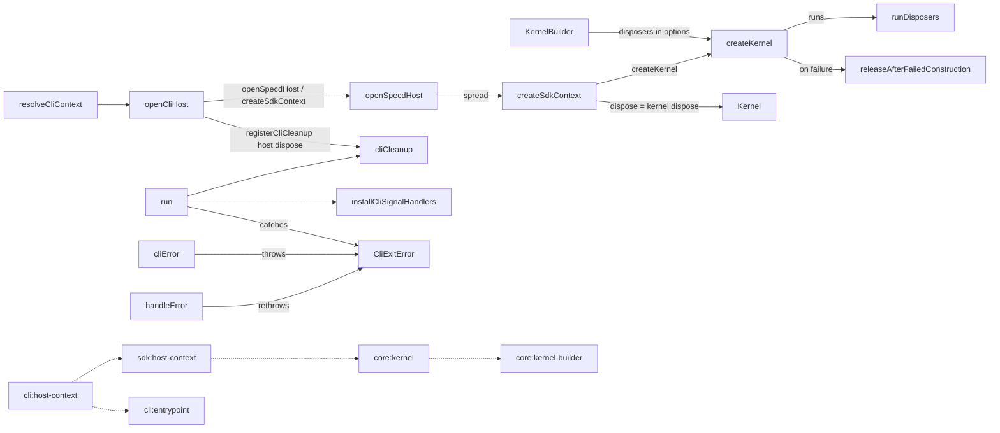

# Design: host-lifecycle-dispose

## Non-goals

- No plugin loading, `plugin-manager` change, `CheckServices` or `plugins.checks` config. Those belong to the follow-up change `check-plugins-runtime`. This change only provides the generic disposer mechanism those plugins will use.
- No change to `createSdkContext` to use `createKernelBuilder`. It keeps calling `createKernel(config, options?.kernel)`; the builder adoption belongs to `check-plugins-runtime`.
- No simplification of `CliContext` or removal of its wrapper role (the user wants the CLI to delegate everything to the SDK, but deferred that cleanup to a separate change). `CliContext` stays an interface owned by the CLI; it only grows to extend `SdkHostContext`.
- No re-export of `KernelDisposer` from `@specd/sdk` (the type is used structurally through `KernelOptions`); therefore `sdk:composition` is not modified.
- No closing of `CodeGraphProvider` instances created through `createGraphProvider()`; callers own what they create (`withOpenGraphProvider` already closes in `finally`).
- No new `process.on('exit')`, no `FinalizationRegistry`, no MCP work (`@specd/mcp` is a stub with no specs).
- No lowering of the Node floor below 22 and no CI matrix change (CI already installs Node 22).

## Affected areas

Risk summary from the code graph (computed on `kernel.ts`, `kernel-builder.ts`, `host-context.ts`, `cli-context.ts`, `handle-error.ts`, `cli/src/index.ts` together): **CRITICAL**, 178 affected files, almost all CLI commands and their tests through `resolveCliContext` and `handle-error`. The core and SDK changes are purely additive, so the blast radius is concentrated in the CLI exit-path refactor and in test fixtures.

### core

- `createKernel()` and `Kernel` in `packages/core/src/composition/kernel.ts`
  - Before: `export async function createKernel(config: SpecdConfig, options?: KernelOptions): Promise<Kernel>` builds everything inline and returns a plain object literal; `export interface Kernel { registry; schemas; changes; specs; project }`; `KernelOptions extends CompositionResolutionOptions { readonly additionalDestinations?: readonly LogDestination[] }`.
  - After:

    ```ts
    export interface KernelOptions extends CompositionResolutionOptions {
      readonly additionalDestinations?: readonly LogDestination[]
      /** Named cleanup work the kernel runs on dispose (reverse order). */
      readonly disposers?: readonly KernelDisposer[]
    }

    export interface Kernel extends AsyncDisposable {
      // ...existing members unchanged...
      /** Releases everything registered through `KernelOptions.disposers`. Idempotent. */
      dispose(): Promise<void>
    }

    export async function createKernel(
      config: SpecdConfig,
      options?: KernelOptions,
    ): Promise<Kernel>
    ```

  - Behaviour: the current body of `createKernel` moves unchanged into a private `buildKernel(config, options, disposers)`. `createKernel` becomes the wrapper described in **Approach**. The returned literal gains `dispose` and `[Symbol.asyncDispose]: dispose`.
  - Callers & risk: `Kernel` is referenced by the whole CLI and SDK (graph: CRITICAL). Backwards compatibility: `disposers` is optional; existing callers compile. Anything that **constructs a `Kernel` literal by hand** must add the two members: `packages/cli/test/commands/helpers.ts` (`makeMockKernel`, `MockKernel` type) and any `as Kernel` fixture in `packages/core/test` (one hit found).

- `createKernelBuilder()` / `KernelBuilder` / `KernelBuilderState` / `cloneOptions` / `toKernelOptions` in `packages/core/src/composition/kernel-builder.ts`
  - `KernelBuilderState` gains `readonly disposers: KernelDisposer[]`.
  - `cloneOptions(base)` copies `disposers: [...(base?.disposers ?? [])]`.
  - `toKernelOptions(state)` adds `...(state.disposers.length > 0 ? { disposers: [...state.disposers] } : {})`.
  - `KernelBuilder` gains `registerDisposer(name: string, dispose: () => void | Promise<void>): this`, implemented in the builder object next to `registerCheck`.
  - `build()` is unchanged (`createKernel(config, toKernelOptions(options))`), which is what makes a failed `build()` release the disposers.
  - Risk: CRITICAL by fan-out, but additive. Existing `kernel-builder.spec.ts` stays valid.
- `packages/core/src/composition/index.ts` and `packages/core/src/public.ts`: export the new type `KernelDisposer` wherever `KernelOptions` is exported today (type only).
- Kernel spec wording: `packages/core/test/composition/kernel.spec.ts` currently asserts "Kernel has no methods or lifecycle" (no `dispose()`); that test is inverted (see Testing).

### sdk

- `SdkHostContext`, `createSdkContext`, `openSpecdHost` in `packages/sdk/src/composition/host-context.ts`
  - Before: `interface SdkHostContext { readonly kernel: Kernel; readonly createGraphProvider: () => CodeGraphProvider }` and `createSdkContext` returns `{ kernel, createGraphProvider }`.
  - After:
    ```ts
    export interface SdkHostContext extends AsyncDisposable {
      readonly kernel: Kernel
      readonly createGraphProvider: () => CodeGraphProvider
      readonly dispose: () => Promise<void>
    }
    ```
    `createSdkContext` returns `{ kernel, createGraphProvider: () => createCodeGraphProvider(config, options?.graph), dispose, [Symbol.asyncDispose]: dispose }` with `const dispose = (): Promise<void> => kernel.dispose()`.
  - `openSpecdHost` already spreads the context into its result (`{ config, configFilePath, ...ctx }`). Object spread copies own enumerable symbol-keyed properties, so `[Symbol.asyncDispose]` carries over; `OpenSpecdHostResult extends SdkHostContext` inherits both members. No change in its body is required (verify with a test).
  - Four functions take `ctx: SdkHostContext` and only read `kernel` / `createGraphProvider`: `withOpenGraphProvider` (`with-open-graph-provider.ts`), `runIndexProjectGraph`, `buildProjectStatusSnapshot`, `buildImplementationReview`. Their signatures do not change. Every **test literal** of an `SdkHostContext` must add `dispose` and `[Symbol.asyncDispose]` (12 references in `packages/sdk/test`).
  - Risk: HIGH (graph). Backwards compatibility: breaking for anyone who constructs an `SdkHostContext` by hand (accepted, nothing is released).

### cli

- `packages/cli/src/helpers/cli-context.ts` (`resolveCliContext`) and `cli-context-types.ts` (`CliContext`)
  - Before: `CliContext { config; configFilePath; kernel }`; `resolveCliContext` calls `openSpecdHost` directly and returns a three-field object.
  - After: `export interface CliContext extends SdkHostContext { readonly config: SpecdConfig; readonly configFilePath: string | null }`. `resolveCliContext` calls `openCliHost({ ...configPath, options: { kernel: buildCliKernelOptions({ onLog }) } })` and returns the host as is, after emitting config warnings once (unchanged logic). 61 source files import `resolveCliContext`; they destructure `{ config, kernel }` and keep compiling. 66 test files reference `resolveCliContext` / `CliContext` and mock it: their mocked return values must now be a full host (see `makeMockHost`).
- `packages/cli/src/helpers/sdk-host.ts` (`resolveSdkHostContext`): **deleted**. Its two callers (`commands/change/implementation.ts:178`, `commands/change/status.ts:208`) pass the `CliContext` they already have to `enrichImplementationTracking` / the implementation helpers, whose parameter is `SdkHostContext` (a `CliContext` satisfies it).
- `packages/cli/src/commands/graph/with-provider.ts` (`withProvider`): remove the hand-built `{ kernel, createGraphProvider }` literal. New contract:
  ```ts
  export async function withProvider(
    config: SpecdConfig,
    format: string,
    fn: (provider: Provider) => Promise<void>,
    options?: {
      readonly beforeOpen?: (provider: Provider) => Promise<void>
      readonly host?: SdkHostContext // a host already opened through resolveCliContext / openCliHost
    },
  ): Promise<void>
  ```
  The removed `kernel?: Kernel | null` option is replaced by `host`; when `host` is absent (bootstrap mode, no `specd.yaml`) it calls `openCliHost({ config, options: { kernel: buildCliKernelOptions() } })`. Callers that used to pass `kernel` (via `commands/graph/resolve-graph-cli-context.ts` and the graph commands) pass the `CliContext` as `host`.
- `commands/project/status.ts`, `commands/project/dashboard.ts` (two call sites), `commands/graph/with-provider.ts`: replace direct `openSpecdHost` / `createSdkContext` with `openCliHost`.
- `packages/cli/src/graph-index-task.ts` (`runGraphIndexTask`): keeps calling `openSpecdHost` / `createSdkContext` directly (separate worker process, no registry) and wraps `runIndexProjectGraph(host, …)` in `try { return await … } finally { await host.dispose() }`.
- `packages/cli/src/handle-error.ts` (`cliError`, `handleError`)
  - `cliError(...)` keeps its signature and `never` return type, but replaces `process.exit(exitCode)` with `throw new CliExitError(exitCode)` after writing its output.
  - `handleError(err, format?)` keeps `never`; first statement becomes `if (err instanceof CliExitError) throw err` (a `CliExitError` raised by a nested `cliError` and caught by a command's own `catch (err) { handleError(err, …) }` must pass through untouched — without this guard it would be reformatted as a generic error and printed twice). The two `process.exit(3)` become `throw new CliExitError(3)`.
- `process.exit(` call sites outside `handle-error.ts` (24 total in `packages/cli/src`; 21 outside), each replaced by `throw new CliExitError(<same code>)`:
  `commands/change/archive.ts:181,193` (1), `commands/change/run-hooks.ts:235` (2), `commands/change/transition.ts:416,434` (1), `commands/change/create.ts:74` (1), `commands/plugins/install.ts:137` (1), `commands/plugins/uninstall.ts:70` (1), `commands/plugins/update.ts:120` (1), `commands/graph/index-graph.ts:137` (0), `commands/project/init.ts:125 (1), 181, 194, 204, 214, 225 (0), 265 (1)`, `commands/project/update.ts:64` (1), `commands/schema/validate.ts:120` (1). Exit code 0 is a valid `CliExitError` code (early successful exits).
- `commands/spec/optimizations.ts`: `isProcessExitError` (matches the mocked `process.exit(N)` sentinel) is replaced by `error instanceof CliExitError`; its `catch` rethrows it unchanged.
- Every other `catch` block in the files above (and any command that catches generically around `cliError`/`handleError`) must rethrow `CliExitError`; this is an audit task with a grep rule (see Testing).
- `packages/cli/src/index.ts`: the top-level `program.parseAsync(...).catch(handleError)` is replaced by the new `run()` flow; `createProgram` stays exported and side-effect free.
- `README.md:226` ("Node.js >= 20") and `docs/adr/0003-esm-only.md` (states a Node >= 20 target) are updated or annotated (see Docs).

### toolchain and manifests

- `tsconfig.base.json`: `"lib": ["ES2022"]` → `"lib": ["ES2022", "ESNext.Disposable"]` (provides `AsyncDisposable`, `Symbol.asyncDispose` types). `target` stays `ES2022`; `tsup@8.5.1` (esbuild 0.27) and `vitest@4` lower `using` / `await using` where needed.
- `engines.node: ">=22"` added to the `package.json` of the 15 published packages (`private: false`): `cli`, `code-graph`, `core`, `guide`, `mcp`, `plugin-agent-claude`, `plugin-agent-codex`, `plugin-agent-copilot`, `plugin-agent-opencode`, `plugin-agent-standard`, `plugin-manager`, `schema-std`, `sdk`, `skills`, `specd`. `apps/public-web` is private and is left alone.
- `.changeset/`: a pair of files following the existing convention (package file + `-specd` metapackage file).

## New constructs

### `packages/core/src/composition/kernel-disposal.ts`

```ts
import { Logger } from '../observability/logger.js'
import { RegistryConflictError } from '../application/errors/registry-conflict-error.js'
import { InvalidDisposerError } from '../application/errors/invalid-disposer-error.js'
import { DisposerFailedError } from '../application/errors/disposer-failed-error.js'

/** A named, opaque cleanup action owned by the kernel after construction. */
export interface KernelDisposer {
  readonly name: string
  readonly dispose: () => void | Promise<void>
}

/** Fixed upper bound for one disposer. */
export const KERNEL_DISPOSER_TIMEOUT_MS = 5000

/**
 * Validates a disposers array.
 *
 * @throws {InvalidDisposerError} When an entry has an empty or non-string name, or a non-function `dispose`
 * @throws {RegistryConflictError} With registry `'disposers'` when two entries share a name
 */
export function validateDisposers(disposers: readonly KernelDisposer[]): void

/**
 * Runs disposers in reverse order, one at a time, with failure isolation and a per-disposer timeout.
 *
 * @returns Resolves when all disposers ran, or when none failed
 * @throws {AggregateError} When at least one disposer failed (errors are `DisposerFailedError`, execution order)
 */
export async function runDisposers(disposers: readonly KernelDisposer[]): Promise<void>

/** Returns the memoized `dispose` function for a disposer list (first call starts, later calls share the promise). */
export function createDispose(disposers: readonly KernelDisposer[]): () => Promise<void>

/**
 * Releases the well-formed entries of an array after a failed construction, never throwing.
 * Well-formed means a non-empty string name and a callable `dispose`.
 */
export async function releaseAfterFailedConstruction(disposers: readonly unknown[]): Promise<void>
```

Responsibilities and invariants:

- `runDisposers(list)`:
  1. `for (const d of [...list].reverse())`.
  2. Start the disposer inside `Promise.resolve().then(() => d.dispose())` so a synchronous throw becomes a rejection (no member of the public API throws synchronously).
  3. Race it against a `setTimeout(KERNEL_DISPOSER_TIMEOUT_MS)` timer that is `unref()`'d and always cleared in a `finally`.
  4. On timeout: `Logger.warn("Disposer '<name>' did not finish within 5000 ms; abandoning it", { disposer: d.name, timeoutMs: KERNEL_DISPOSER_TIMEOUT_MS })`, attach `.catch(() => {})` to the abandoned promise so a late rejection is not an unhandled rejection, and continue. A timeout is **not** added to the error list.
  5. On rejection: push `new DisposerFailedError(d.name, cause)` and continue.
  6. After the loop: if the list is non-empty, `throw new AggregateError(errors, "<n> disposer(s) failed: <name1>, <name2>")`; otherwise resolve.
- `createDispose(list)`: `let disposal: Promise<void> | undefined; return () => (disposal ??= runDisposers(list))`. The same promise is returned to every caller, so each disposer runs at most once and concurrent callers share it.
- `validateDisposers` runs before anything else in `createKernel`.

### `packages/core/src/application/errors/invalid-disposer-error.ts`

```ts
/** Thrown when a kernel disposer entry is malformed. */
export class InvalidDisposerError extends SpecdError {
  get code(): string {
    return 'INVALID_DISPOSER'
  }
  constructor(detail: string) {
    super(`Invalid kernel disposer: ${detail}`)
  }
}
```

### `packages/core/src/application/errors/disposer-failed-error.ts`

```ts
/** Wraps the failure of one disposer; `cause` holds the original failure. */
export class DisposerFailedError extends SpecdError {
  get code(): string {
    return 'DISPOSER_FAILED'
  }
  readonly disposerName: string
  constructor(disposerName: string, cause: unknown) {
    super(`Disposer '${disposerName}' failed`)
    this.disposerName = disposerName
    this.cause = cause // `SpecdError` constructor takes only a message, so `cause` is assigned after `super`
  }
}
```

Both errors are exported where `RegistryConflictError` is exported.

### `packages/cli/src/helpers/cli-exit-error.ts`

```ts
import { SpecdCliError } from '../errors/index.js'

/**
 * Control-flow signal carrying a process exit code. Thrown instead of calling `process.exit`
 * so that the entrypoint can await cleanup before ending the process. It is not a user-facing
 * failure: `handleError` rethrows it before any classification, so its `SpecdError`-like shape
 * is never reformatted or printed.
 */
export class CliExitError extends SpecdCliError {
  get code(): string {
    return 'CLI_EXIT'
  }

  readonly exitCode: number

  constructor(exitCode: number) {
    super(`CLI exit ${exitCode}`)
    this.exitCode = exitCode
  }
}
```

`SpecdCliError` is the CLI package base error (`packages/cli/src/errors/specd-cli-error.ts`, extends `SpecdError`), as required by the error-handling conventions. Because `handleError` checks `err instanceof CliExitError` as its first statement, extending the `SpecdError` hierarchy cannot cause a double print.

### `packages/cli/src/helpers/cli-cleanup.ts`

```ts
type CliCleanup = () => void | Promise<void>

export function registerCliCleanup(cleanup: CliCleanup): void
export function runCliCleanup(): Promise<void>
/** Test-only: clears registrations and the memoized run. */
export function resetCliCleanupForTests(): void
```

- `registerCliCleanup` appends to an array. If `runCliCleanup` already started, the cleanup is invoked immediately (fire and forget) with its failure reported like any other.
- `runCliCleanup` memoizes one promise: it runs `[...registered].reverse()` sequentially; each `await cleanup()` is wrapped in `try/catch`; a failure writes one `warning: cleanup failed: <message>` line to stderr (for an `AggregateError`, one line per inner error) and never changes the exit code or throws.

### `packages/cli/src/helpers/cli-host.ts`

```ts
export function openCliHost(input?: OpenSpecdHostInput): Promise<OpenSpecdHostResult>
export function openCliHost(input: {
  readonly config: SpecdConfig
  readonly options?: SdkContextOptions
}): Promise<SdkHostContext>
```

- Discriminates on `'config' in input` (an `OpenSpecdHostInput` has no `config`). The first form calls `openSpecdHost(input)`, the second `createSdkContext(input.config, input.options)`.
- Immediately after the SDK call resolves: `registerCliCleanup(() => host.dispose())`, then returns the host. The CLI kernel options are passed in by the caller (`buildCliKernelOptions()` stays in `cli-context.ts`; this avoids an import cycle).

### `packages/cli/src/helpers/cli-signals.ts`

```ts
/** Installs SIGINT/SIGTERM handlers; returns a function that removes them. */
export function installCliSignalHandlers(): () => void
```

- Handled signals: `SIGINT` → 130, `SIGTERM` → 143.
- First signal: `received = code; void runCliCleanup().finally(() => process.exit(code))`.
- Second signal while `received !== undefined`: `process.exit(code)` immediately.
- Handlers are registered with `process.on`, never at import time, and never by `createProgram()`.

### `packages/cli/src/run.ts`

```ts
/** Runs the CLI against an argv; the only place (with cli-signals.ts) that ends the process. */
export async function run(argv: readonly string[]): Promise<void>
```

`packages/cli/src/index.ts` becomes `export { createProgram } from './program.js'` plus `void run(process.argv)` (shebang kept). Moving the flow into `run.ts` makes the exit behaviour testable without executing the program on import.

### Test support (not shipped)

- `packages/cli/test/commands/helpers.ts`: `makeMockHost(overrides?)` returning a complete `CliContext` (`config`, `configFilePath`, `kernel` from `makeMockKernel`, `createGraphProvider: vi.fn()`, `dispose: vi.fn(async () => {})`, `[Symbol.asyncDispose]`), and `runCommand(program, argv)` that mimics the entrypoint (awaits `parseAsync`, catches `CliExitError`, calls the mocked `process.exit(code)`). `makeMockKernel` and `MockKernel` gain `dispose` / `[Symbol.asyncDispose]`.
- A repo script `dev/scripts/check-engines.js` (see Testing).

## Data models & Contracts

| Contract                                   | Fields / shape                                                                                   | Rules                                                                                            |
| ------------------------------------------ | ------------------------------------------------------------------------------------------------ | ------------------------------------------------------------------------------------------------ |
| `KernelDisposer`                           | `name: string` (non-empty), `dispose: () => void \| Promise<void>`                               | Opaque to core. Names unique per kernel. Array order = registration order; execution is reverse. |
| `KernelOptions.disposers`                  | `readonly KernelDisposer[]`, optional                                                            | Ownership transfers to the kernel when `createKernel` succeeds.                                  |
| `Kernel.dispose()`                         | `() => Promise<void>`                                                                            | Never throws synchronously. Same promise on every call. Rejects only with `AggregateError`.      |
| `Kernel[Symbol.asyncDispose]`              | same function as `dispose`                                                                       |                                                                                                  |
| `AggregateError` from dispose              | `errors: DisposerFailedError[]` in execution order; `message: "<n> disposer(s) failed: <names>"` | Timeouts are never included.                                                                     |
| `DisposerFailedError`                      | `code = 'DISPOSER_FAILED'`, `message = "Disposer '<name>' failed"`, `disposerName`, `cause`      |                                                                                                  |
| `InvalidDisposerError`                     | `code = 'INVALID_DISPOSER'`                                                                      | Empty/non-string name or non-callable `dispose`.                                                 |
| `RegistryConflictError('disposers', name)` | existing class                                                                                   | Duplicate name (options array and `registerDisposer`).                                           |
| `KERNEL_DISPOSER_TIMEOUT_MS`               | `5000`                                                                                           | Fixed, not configurable.                                                                         |
| `SdkHostContext`                           | `kernel`, `createGraphProvider`, `dispose`, `[Symbol.asyncDispose]`                              | `dispose` delegates to `kernel.dispose()`.                                                       |
| `CliContext`                               | `SdkHostContext & { config, configFilePath }`                                                    |                                                                                                  |
| `CliExitError`                             | `exitCode: number` (0, 1, 2, 3, or any code a command chose)                                     | Control-flow only.                                                                               |
| Exit codes                                 | 0, 1, 2, 3, 130 (`SIGINT`), 143 (`SIGTERM`)                                                      | 130/143 only after a signal.                                                                     |
| Cleanup registry                           | reverse-order, sequential, memoized, failures → `warning:` lines on stderr                       | Never alters the exit code.                                                                      |
| `engines.node`                             | `">=22"` in every published package                                                              | Single common value, equals the Node version installed by CI.                                    |

## Approach & Execution flow

### `createKernel` (core)

1. `const disposers = options?.disposers ?? []`.
2. `try { validateDisposers(disposers); return await buildKernel(config, options, disposers) }`.
3. `catch (err) { await releaseAfterFailedConstruction(disposers); throw err }` — the original error is always rethrown; if releasing throws, `releaseAfterFailedConstruction` catches the `AggregateError` and logs `Logger.warn('Failed to release disposers after kernel construction failure', { errors })` (the global `Logger` is a no-op until `buildKernel` installs the default logger, which is the "when a logger is available" rule).
4. `buildKernel` is the current `createKernel` body unchanged, plus `const dispose = createDispose(disposers)` and the two new members in the returned literal.

### `Kernel.dispose()`

1. First call: `runDisposers(disposers)` is started and memoized; the call returns that promise.
2. Later or concurrent calls: the same promise.
3. Order, isolation, timeout and aggregation exactly as in `runDisposers`.
4. After the first call the kernel is closed; other members are unspecified (not guarded).

### `KernelBuilder.registerDisposer(name, dispose)`

1. `if (name === '') throw new InvalidDisposerError('name must be a non-empty string')`.
2. `if (options.disposers.some((d) => d.name === name)) throw new RegistryConflictError('disposers', name)`.
3. `options.disposers.push({ name, dispose })`; `return builder`.
4. `build()` forwards the accumulated list through `toKernelOptions`. On success the kernel owns the disposers (the builder never runs them); on failure `createKernel` releases them.

### SDK

1. `createSdkContext`: `const kernel = await createKernel(config, options?.kernel)`; `const dispose = () => kernel.dispose()`; return the context literal with `dispose` and `[Symbol.asyncDispose]: dispose`.
2. `openSpecdHost`: unchanged body; it spreads the context, so `await using host = await openSpecdHost(input)` closes the kernel at scope exit.

### CLI run flow (`run.ts`)

```ts
export async function run(argv: readonly string[]): Promise<void> {
  const removeSignals = installCliSignalHandlers()
  let exitCode: number | undefined // undefined = natural completion
  try {
    await createProgram().parseAsync([...argv])
  } catch (err) {
    exitCode = toExitCode(err) // CliExitError → its code; otherwise handleError path → 3
  }
  await runCliCleanup()
  removeSignals()
  if (exitCode !== undefined) process.exit(exitCode)
  // natural completion: leave process.exitCode as set by commands (default 0), let the loop drain,
  // but arm the exit grace period (below) in case an open handle keeps the process alive
  armExitGracePeriod(process.exitCode ?? 0)
}

/** Constants exported from run.ts so tests can reference them. */
export const CLI_EXIT_HINT_MS = 1000
export const CLI_EXIT_FORCE_MS = 5000

function armExitGracePeriod(exitCode: number): void {
  // Both timers are unref'd: they only fire when something else keeps the event loop alive.
  setTimeout(() => {
    const open = process.getActiveResourcesInfo?.() // may be absent on older runtimes
    process.stderr.write(
      `warning: waiting for open handles to close${open ? ` (${[...new Set(open)].join(', ')})` : ''}; forcing exit in ${(CLI_EXIT_FORCE_MS - CLI_EXIT_HINT_MS) / 1000} s\n`,
    )
  }, CLI_EXIT_HINT_MS).unref()
  setTimeout(() => {
    process.stderr.write('warning: process did not exit after cleanup; forcing exit\n')
    process.exit(exitCode)
  }, CLI_EXIT_FORCE_MS).unref()
}

function toExitCode(err: unknown): number {
  if (err instanceof CliExitError) return err.exitCode
  try {
    handleError(err)
  } catch (inner) {
    if (inner instanceof CliExitError) return inner.exitCode
    return 3 // the error handler itself failed: still clean up and end with the system-error code
  }
  return 3
}
```

- Natural completion deliberately does **not** call `process.exit` so piped stdout can finish flushing and `process.exitCode` set by commands (`validate.ts` sets 1) is respected; explicit exits keep the previous forced-termination behaviour (they used to call `process.exit` directly).
- Exit grace period: a handle left open after cleanup (for example by an abandoned disposer) would otherwise hang the CLI. The `unref`'d timers cost nothing on a clean exit (they never fire); at 1 s a stderr hint names the open resource types, at 5 s the exit is forced with the original code. Warnings only, never a different exit code. A leaked handle is a defect of its owner; the forced exit is a safety net, not a design goal.
- Signal path (`cli-signals.ts`): first signal → cleanup → `process.exit(130|143)`; second signal → immediate `process.exit` with the **first** signal's code (`received`), so SIGINT then SIGTERM exits 130. (Implementation fix: the handler currently uses the second signal's code.)
- Prompts: `@clack/prompts` reads Ctrl-C as a raw-mode key event, not as `SIGINT`, so the handlers do not interfere with prompt cancellation; no listener of the prompt library is removed.
- Windows has no real `SIGTERM`; the handler is still installed on every platform (no platform branch), the OS never delivers the signal there, and only `SIGINT` is relied upon.

### Exit-site conversion

For each of the 21 `process.exit(n)` sites outside `handle-error.ts`, replace with `throw new CliExitError(n)` (keeping the preceding output). Code that sat inside `try { … process.exit(0) } catch (err) { handleError(err, fmt) }` now has its `CliExitError` caught by its own `catch`, passed to `handleError`, which rethrows it first thing. Audit every other `catch` in the touched files.

## Error handling & Edge cases

| Case                                                                          | Behaviour                                                                                                                                                                |
| ----------------------------------------------------------------------------- | ------------------------------------------------------------------------------------------------------------------------------------------------------------------------ |
| `disposers` with empty/non-string name or non-function `dispose`              | `createKernel` rejects with `InvalidDisposerError`; well-formed sibling entries are released once.                                                                       |
| Duplicate disposer name (options or `registerDisposer`)                       | `RegistryConflictError('disposers', name)`; first registration kept; at `createKernel` the other well-formed entries are released once.                                  |
| Disposer throws synchronously                                                 | Converted to a rejection by `Promise.resolve().then(...)`; isolated like any failure.                                                                                    |
| Disposer rejects                                                              | `DisposerFailedError` in the `AggregateError`; remaining disposers still run; kernel `dispose()` rejects at the end.                                                     |
| Disposer hangs                                                                | After 5000 ms: `Logger.warn` naming it, promise abandoned (late rejection swallowed), next disposer runs, not part of the `AggregateError`, timer `unref`'d and cleared. |
| `dispose()` twice or concurrently                                             | Same promise; each disposer runs once; a rejected disposal stays rejected for later callers.                                                                             |
| Use of the kernel after `dispose()`                                           | Unspecified (not guarded).                                                                                                                                               |
| Kernel with no disposers                                                      | `dispose()` resolves immediately.                                                                                                                                        |
| Failure of `createKernel` before/after the logger is installed                | Disposers are released; if releasing fails the failure is logged when a logger exists and swallowed otherwise; the original error is the rejection.                      |
| `build()` fails                                                               | Same as `createKernel` failing.                                                                                                                                          |
| `SdkHostContext.dispose()` while graph providers are open                     | Providers are not touched; callers close them (`withOpenGraphProvider`).                                                                                                 |
| CLI cleanup throws                                                            | One `warning:` line on stderr per failure; other cleanups still run; exit code unchanged.                                                                                |
| Cleanup registered after cleanup started                                      | Invoked immediately; failure reported the same way.                                                                                                                      |
| Second `SIGINT`/`SIGTERM` during cleanup                                      | Immediate `process.exit` with the first signal's code.                                                                                                                   |
| Handle left open after cleanup                                                | 1 s: stderr hint with open resource types; 5 s: warning and forced `process.exit` with the original code. Timers are `unref`'d, silent on clean exit.                    |
| Command catches generically and swallows `CliExitError`                       | Forbidden; audit + grep rule; `handleError` rethrows it.                                                                                                                 |
| Nested `cliError` inside a command's `try`/`catch (err) { handleError(err) }` | `CliExitError` passes through `handleError` untouched, output is not printed twice.                                                                                      |
| `process.exitCode` set by a command that then returns                         | Natural completion: cleanup awaited, process ends with that code.                                                                                                        |
| Unhandled error                                                               | `handleError` prints `fatal:` and throws `CliExitError(3)`; entrypoint cleans up, then `process.exit(3)`.                                                                |
| Error handler itself throws something other than `CliExitError`               | `toExitCode` returns 3 instead of rethrowing, so `run()` never rejects: cleanup is awaited and the process exits with 3 (no unhandled rejection).                        |
| Node < 22                                                                     | Declared unsupported by `engines`; `Symbol.asyncDispose` exists from Node 20.4 but 22 is the tested floor.                                                               |

## Key decisions

- **Generic named disposers in core, plugin knowledge elsewhere.** Core knows only `{ name, dispose }`. _Rejected:_ a plugin list in the SDK (reimplements plugin lifecycle that `plugin-manager` owns); a kernel-only registry without builder support (plugins are initialised before the kernel exists, so a failed `build()` would leak).
- **Disposers travel in `KernelOptions`; the builder only accumulates.** Keeps `build()` equivalent to `createKernel`. _Rejected:_ a post-construction `kernel.registerDisposer` (kernel stays immutable; leak window on failure).
- **Release on failed construction inside `createKernel`.** One place covers `createKernel` and `build()`. _Rejected:_ the SDK wrapping `build()` in `try/catch`.
- **Reverse, sequential execution.** Matches resource dependency order. _Rejected:_ parallel (cannot guarantee order).
- **`AggregateError` of `DisposerFailedError`s.** `SuppressedError` is not in the ES2022 lib. `DisposerFailedError` extends `SpecdError` to satisfy the conventions on error types; `cause` is assigned after `super` because `SpecdError`'s constructor takes only a message.
- **Fixed 5000 ms timeout, abandon and warn.** Keeps exit predictable; no configuration surface. _Rejected:_ configurable timeout, or failing on timeout (a hanging plugin must not block exit or turn into an error).
- **`dispose()` is idempotent via a memoized promise; use after dispose is unspecified.** No guard on 100+ kernel members.
- **`CliExitError` instead of `process.exit` in helpers.** The only way to await async cleanup from code typed `never`. It extends `SpecdCliError` (error-handling conventions) and `handleError` rethrows it as its first statement, so it is never reformatted. _Rejected:_ keep `process.exit` and accept skipped cleanup (wrong once plugins have async `destroy()`); `process.on('exit')` (synchronous).
- **Natural completion does not call `process.exit`.** Avoids truncating piped stdout and honours `process.exitCode`.
- **Registry fed by `openCliHost` (below all call sites).** One place for five bootstrap sites. The graph worker owns its own `finally` because it is a separate process.
- **`CliContext extends SdkHostContext`; `resolveSdkHostContext` and the `withProvider` literal removed.** The CLI never fabricates an SDK host. Making `CliContext` an alias of the SDK result is deferred to a separate change.
- **`engines.node: ">=22"` everywhere, enforced by a script.** Matches CI; Node 20 is end-of-life. _Rejected:_ `>=20.4` (needs a Node 20 CI leg).

## Trade-offs

- A hanging disposer is abandoned, not killed → bounded 5 s delay per hanging disposer and a possible background leak until process exit; mitigated by the warning and `unref`'d timer.
- `Kernel` and `SdkHostContext` gain required members → breaking for hand-built literals; mitigated by `makeMockKernel`/`makeMockHost` and the fact that nothing is released yet.
- Converting 21 `process.exit` sites and `cliError` to throws touches many CLI files and ~54 test files that mock `process.exit` → mitigated by the shared `runCommand` helper and by a grep guard; main source of churn and review effort.
- A command that swallows `CliExitError` would hide an exit → mitigated by the audit task and a source-scan test.
- Disposal order relies on registration order → documented; plugin-manager registers one disposer.
- Calling `process.exit` after cleanup can truncate large piped output for explicit-exit paths → same as before this change (they already called `process.exit`).
- Unspecified use-after-dispose may surface confusing errors from closed resources → acceptable; documented as unspecified.

## Spec impact

Modified specs: `core:kernel`, `core:kernel-builder`, `sdk:host-context`, `cli:host-context`, `cli:entrypoint`, `default:_global/conventions`.

- Graph impact: `core:kernel` CRITICAL (13 direct, 66 indirect dependents), `core:kernel-builder` CRITICAL, `cli:entrypoint` CRITICAL, `sdk:host-context` HIGH, `cli:host-context` HIGH. All edits are additive or narrow rewrites of one requirement, so dependent requirements stay valid.
- `core:kernel`: the requirement "Kernel is a plain object, not a class" is rewritten (it said the kernel has no `dispose()`); no dependent spec relies on the absence of a lifecycle method.
- `sdk:composition` describes the public barrel and lists `SdkHostContext`; the type stays exported with new members, `KernelDisposer` is intentionally not re-exported → no delta needed.
- `sdk:build-project-status-snapshot`, `sdk:run-index-project-graph`, `sdk:build-implementation-review`, and the `withOpenGraphProvider` description take an `SdkHostContext`; they only read `kernel`/`createGraphProvider`, so their requirements remain satisfied.
- `cli:entrypoint` "Exit codes": the statement "No other exit codes are used" is replaced; no other CLI command spec asserts the absence of 130/143.
- `check-plugins-runtime` (planned) overlaps on `core:kernel-builder` and `sdk:host-context`; its deltas must be written against the text this change leaves, so this change is archived first.
- No dependent spec was found that needs to enter this change's scope.

## Dependency map



```
core                      sdk                          cli
┌──────────────┐          ┌──────────────────┐         ┌────────────────────┐
│ KernelBuilder│─options─▶│ createSdkContext │◀────────│ openCliHost        │
│ registerDisp.│          │  dispose()       │         │  registerCliCleanup│
└──────┬───────┘          └────────▲─────────┘         └─────────┬──────────┘
       ▼                           │ spread                      ▼
┌──────────────┐          ┌────────┴─────────┐         ┌────────────────────┐
│ createKernel │          │ openSpecdHost    │         │ run() ─ signals    │
│  dispose()   │          └──────────────────┘         │  cleanup → exit    │
│  [CRITICAL]  │                                       │  CliExitError      │
└──────────────┘                                       └────────────────────┘
```

## Migration / Rollback

- No persisted data or schema changes. The Node floor change takes effect for consumers on publish; the changeset states the new floor.
- Suggested order: (1) core disposal + builder, (2) SDK host, (3) CLI helpers (`cli-exit-error`, `cli-cleanup`, `cli-host`, `cli-signals`, `run`), (4) exit-site conversion and `handleError` guard, (5) test migration, (6) `tsconfig` and `engines`, (7) docs and changeset.
- Rollback: revert the commit(s). Every change is source-only. If only the CLI exit refactor misbehaves, it can be reverted independently of the core/SDK disposal (the CLI then simply does not call `dispose`).

## Testing

All scenarios below come from the verify artifact of this change.

### Automated

**`packages/core/test/composition/kernel-disposal.spec.ts` (new, unit, fake timers):**

- "Disposers run in reverse registration order" (a, b, c → c, b, a, each awaited before the next).
- "A failing disposer does not stop the others" → `AggregateError`, one `DisposerFailedError` for `b` with message `Disposer 'b' failed` and `cause`.
- "A hanging disposer is abandoned after the timeout" (`vi.useFakeTimers()`, advance 5000 ms) → `Logger.warn` called with the disposer name, next disposer runs, not in the `AggregateError`.
- "The timeout does not keep the process alive" → the created timer object has `unref()` called (spy on `setTimeout`).
- "No disposers" → resolves without work.
- `validateDisposers`: empty name → `InvalidDisposerError`; duplicate → `RegistryConflictError` with registry `disposers`.

**`packages/core/test/composition/kernel.spec.ts`:**

- Replace "Kernel has no methods or lifecycle" with "Kernel exposes dispose as its only lifecycle operation" (has `dispose` and `[Symbol.asyncDispose]`, no `initialize`/`shutdown`, no emitter); keep "Use cases are immutable after creation".
- "Symbol.asyncDispose is an alias" (`kernel[Symbol.asyncDispose] === kernel.dispose`, and `await using` runs the disposer).
- "Repeated and concurrent calls share one disposal" (three calls return the same promise; disposer ran once).
- "Disposers are accepted in order", "Empty name is rejected", "Duplicate name is rejected".
- "Disposers run when construction fails" (force a failure, e.g. an invalid repository option), "The original error is preserved" (second disposer rejects; warning logged), "Conflicting entries still release well-formed ones".

**`packages/core/test/composition/kernel-builder.spec.ts`:**

- "registerDisposer is chainable"; "Disposers reach the kernel options in call order"; "Empty name is rejected"; "Duplicate name is rejected" with first registration intact; "The kernel runs the disposers after a successful build" and the builder did not run them; "A failed build releases the disposers"; "Builder and options produce the same disposal".

**`packages/sdk/test/composition/host-context.spec.ts`:**

- "Context exposes kernel, provider factory and disposal only"; "Context is async-disposable" (`await using`); "Context disposal delegates to the kernel"; "dispose shares the kernel disposal" (two calls, same promise); "await using releases the host" through `openSpecdHost`; "openSpecdHost result carries disposal members" (symbol survives the spread); "Graph providers are not closed by dispose"; "No API wraps a foreign kernel" (assert the SDK barrel exports no such function). Update the 12 `SdkHostContext` literals in `packages/sdk/test` with `dispose`/`[Symbol.asyncDispose]`.

**`packages/cli/test/helpers/cli-cleanup.spec.ts` (new):**

- "Cleanups run in reverse order"; "Idempotent and concurrent"; "A failing cleanup does not stop the others or the exit code" (stderr contains a `warning:` line, no throw).

**`packages/cli/test/helpers/cli-host.spec.ts` (new):**

- "Helper registers the host for cleanup"; "Helper forwards the caller input unchanged" (assert the exact argument reaches the SDK function); "A failed open registers nothing" (after `openCliHost`, `runCliCleanup()` calls `host.dispose`); "Helper covers both bootstrap forms" (`{ config }` form goes through `createSdkContext` and registers).

**`packages/cli/test/helpers/cli-context.spec.ts` (update):**

- "Host bootstrap uses SDK through the helper" (returns `config`, `configFilePath`, `kernel`, `createGraphProvider`, `dispose`); the existing verbosity and warning scenarios stay; "CliContext carries dispose" (two calls release once); "Commands do not need to call dispose" (process exit path runs the registry); "No hand-built host context" and "No direct SDK bootstrap in commands" as source-scan tests (grep over `packages/cli/src` excluding `graph-index-task.ts` and tests for `openSpecdHost(`, `createSdkContext(` and an object literal pairing `kernel` with `createGraphProvider`; `resolveSdkHostContext` no longer exists).

**`packages/cli/test/run.spec.ts` (new; fake `process.exit`, mocked `createProgram`):**

- "Cleanup runs after normal completion"; "Helpers throw CliExitError instead of exiting" (also in `handle-error.spec.ts`); "Cleanup runs before an error exit" (CliExitError(1)); "A failing error handler still cleans up and exits 3" (mock `handleError` to throw a plain `Error`); "Unhandled errors still clean up" (code 3, `fatal:` on stderr); "process.exitCode is respected" (natural completion, no `process.exit` call); "Only the entrypoint terminates the process" (source scan: `process.exit(` appears only in `run.ts` and `helpers/cli-signals.ts`).

**`packages/cli/test/helpers/cli-signals.spec.ts` (new):**

- "First SIGINT runs cleanup" (emit `SIGINT`, expect cleanup awaited then exit 130); "Second signal forces exit" (143 immediately, without waiting); "createProgram installs no handlers" (`process.listenerCount('SIGINT')` unchanged after `createProgram()`); "Prompts keep their own cancellation" (the handlers do not call `removeAllListeners` and a pre-existing listener count is preserved).

**`packages/cli/test/handle-error.spec.ts` (update):** every `expect(process.exit).toHaveBeenCalledWith(n)` becomes an assertion that a `CliExitError` with `exitCode: n` is thrown; add "handleError rethrows CliExitError unchanged and prints nothing". "Commands do not swallow CliExitError": a table test running each command that has a generic `catch` with a nested `cliError`.

**Test migration (54 files that mock `process.exit` through `mockProcessExit` in `packages/cli/test/commands/helpers.ts`, plus the 66 files that mock `resolveCliContext`):**

- Route `program.parseAsync(...)` through `runCommand` and assert `process.exit` calls as before, or assert `CliExitError` where they call the action directly.
- Mocked `resolveCliContext` return values use `makeMockHost`; `makeMockKernel` includes `dispose`.
- Grep guard: no `process.exit(` in `packages/cli/src` outside `run.ts` and `helpers/cli-signals.ts`.

**Conventions scenarios (`default:_global/conventions`):** `dev/scripts/check-engines.js` reads every `packages/*/package.json` and `apps/*/package.json`, asserts `engines.node === '>=22'` for all with `"private": false` (and equality across them), and reads the `node-version` of `.github/workflows/ci.yml` to assert it satisfies `>=22`; it exits 1 listing offenders. Wire it into the `preflight:check` script in the root `package.json` and call it from `dev/scripts/preflight-check.js`. Scenarios covered: "Published packages declare the floor", "One common value", "Floor matches CI", "Private packages may omit it".

### Manual / E2E

1. `pnpm build && pnpm typecheck && pnpm test` — all green.
2. `node packages/cli/dist/index.js project status --format text` — exits 0 and prints no `warning: cleanup failed`.
3. `node packages/cli/dist/index.js changes status does-not-exist` — prints `error:` once, exit code 1 (`echo $?`).
4. Start a long command (e.g. `graph index`) and press Ctrl-C — exits 130 and leaves no lock file; press Ctrl-C twice quickly — immediate exit.
5. `kill -TERM <pid>` on the same command — exit 143 (POSIX only).
6. Small script using the SDK: `await using host = await openSpecdHost(); …` — at scope exit a registered test disposer logs once; calling `host.dispose()` again is a no-op.
7. `node dev/scripts/check-engines.js` — exits 0; remove one `engines` field temporarily — exits 1 naming the package.

- Failure indicators: duplicated `error:` lines (a `CliExitError` reformatted), commands that exit 0 after a failure (swallowed `CliExitError`), hung processes after completion.

## Documentation to update (`docs/`)

- `README.md:226`: "Node.js >= 20" → "Node.js >= 22".
- `docs/adr/0003-esm-only.md`: add a short note that the supported floor is now Node.js >= 22 (the historical text is not rewritten).
- New ADR in `docs/adr/` (next free number after 0030; check with `ls docs/adr`): host lifecycle and kernel disposers (named opaque disposers in core, release on failed construction, CLI `CliExitError` and single exit point, Node floor 22).
- `docs/core/overview.md`: kernel section — add `dispose()`, `[Symbol.asyncDispose]`, `KernelOptions.disposers`, `KernelBuilder.registerDisposer`.
- `docs/core/errors.md`: add `InvalidDisposerError` (`INVALID_DISPOSER`) and `DisposerFailedError` (`DISPOSER_FAILED`).
- `docs/sdk/index.md`: `SdkHostContext.dispose`, `await using host = await openSpecdHost()`, graph providers are closed by their creator.
- `docs/cli/cli-reference.md`: exit codes 130 and 143, and that Ctrl-C triggers cleanup.
- `docs/guide/configuration.md` / getting-started text that states the Node version, if any (`grep -rn "Node" docs/guide`).

## Cross-check against global specs

- **architecture**: disposal logic lives in the core composition layer with no I/O beyond timers; the SDK and CLI only delegate; the CLI reaches core functionality only through `@specd/sdk` (no new direct dependency).
- **conventions**: named exports only, no `any`, explicit return types, ESM; every new error extends `SpecdError` (core errors) or `SpecdCliError` (`CliExitError`); `CliExitError` is documented as a control-flow signal that `handleError` rethrows before classification.
- **testing**: unit tests with mocked ports and fake timers in core; CLI tests mock `process.exit` through shared helpers; the engines script runs on every OS in CI.
- **error-handling-conventions**: new core errors carry machine-readable codes and actionable messages; cleanup failures are reported as `warning:` lines and never change exit codes.
- **continuous-integration**: no matrix change; the engines script keeps `engines` equal to the CI Node version.

## Open questions

None.
