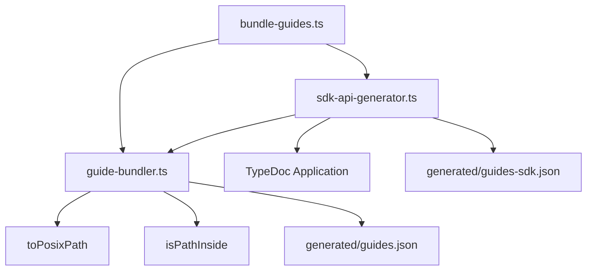

# Design: cross-platform-guide-bundler

## Non-goals

- No change to `src/` runtime code of `@specd/guide` (domain, application, infrastructure): the fix is confined to build-time scripts under `packages/guide/scripts/`.
- No change to the catalog JSON schema or to the `GuideTopic` shape.
- No escaping of glob metacharacters (`[ ] { } * ? !`) in the checkout path. TypeDoc treats entry points as globs, so such a path fails on every OS; this is pre-existing and documented as a known limitation.
- No attempt to make the out-of-repository `sourcePath` fallback machine-independent (it is an absolute path); it is only normalized to `/`.
- No new runtime dependencies.

## Affected areas

Impact analysis (`specd graph impact --file ... --direction dependents`) reports `CRITICAL`, but that is driven by many symbols inside the same two files. The real blast radius is three build scripts (`bundle-guides.ts`, `guide-bundler.ts`, `sdk-api-generator.ts`) and four test files; nothing under `src/` or in another workspace imports these scripts. Effective risk: LOW, with the build output (`generated/*.json`) as the observable contract.

### `packages/guide/scripts/guide-bundler.ts`

- **New export `toPosixPath`** and **new export `isPathInside`** (see New constructs).
- **`compileGuide(collection, filePath, relativePath, content): GuideTopic`** (line ~184)
  - Signature unchanged.
  - Before: `const topic = relativePath.replace(/\.md$/, '').toLowerCase()` and `sourcePath: relativePath`.
  - After: first statement computes `const posixRelativePath = toPosixPath(relativePath)`; `topic` is `posixRelativePath.replace(/\.md$/, '').toLowerCase()`, `sourcePath` is `posixRelativePath`, and the `':'` error message uses `posixRelativePath`.
  - Backwards compatibility: POSIX inputs are returned unchanged (idempotent).
- **`collectMarkdownFiles(root)`** (line ~257)
  - Before: `return results.sort()` over native absolute paths.
  - After: `results.sort((a, b) => compareStrings(toPosixPath(path.relative(root, a)), toPosixPath(path.relative(root, b))))` where `compareStrings` is `(x, y) => (x < y ? -1 : x > y ? 1 : 0)` (code-unit order, locale-independent, same on every host). Return type unchanged (`string[]` of native absolute paths).
- **`compileCollections(collections)`** (line ~284): keeps `path.relative(config.root, file).split(path.sep).join('/')`, replaced by `toPosixPath(path.relative(config.root, file))` for a single normalization rule.

### `packages/guide/scripts/sdk-api-generator.ts`

Imports `toPosixPath` and `isPathInside` from `./guide-bundler.js` (it already imports `extractSections` from there).

- **`generateSdkApiTopics(repoRoot)`** (line ~1231)
  - Before: `entryPoints: [entryPath]`.
  - After: `entryPoints: [toPosixPath(entryPath)]`. `entryPath` itself stays native because `packageRoot = path.dirname(path.dirname(entryPath))` and the other path functions need native semantics; `packageRoot` is normalized only at comparison time.
  - The topic is assembled as `${spec.directory}/${reflection.name}` (both parts are `/`-free of backslashes by construction); no extra normalization needed.
- **`isDeclaredInWorkspace(reflection, packageRoots)`** (line ~1183)
  - Before: `fullFileName.startsWith(`${root}${path.sep}`)`.
  - After: `packageRoots.some((root) => isPathInside(root, fullFileName))`. `fullFileName === undefined` still returns `true`.
- **`buildTopicNameIndex(converted)`** (line ~1346)
  - Before: `prefix = `${packageRoot}${path.sep}``and`fullFileName.startsWith(prefix)`.
  - After: remove `prefix`; `declared: fullFileName !== undefined && isPathInside(packageRoot, fullFileName)`.
- **`resolveSourcePath(reflection, repoRoot)`** (line ~1154) — must be exported (`export function`) for unit testing.
  - Before: `if (relative.startsWith('..') || path.isAbsolute(relative)) return fullFileName`; `return relative.split(path.sep).join('/')`.
  - After:
    ```ts
    const relative = toPosixPath(path.relative(repoRoot, path.resolve(repoRoot, fullFileName)))
    if (
      relative === '..' ||
      relative.startsWith('../') ||
      path.isAbsolute(relative) ||
      /^[A-Za-z]:\//.test(relative)
    ) {
      return toPosixPath(fullFileName)
    }
    return relative
    ```
    The drive-letter test covers `path.relative` returning an absolute path on another drive when running under Windows (`path.isAbsolute` already covers it there; the regex keeps the logic correct when the function is exercised with Windows-style strings on a POSIX host).
- **`isDeclaredInWorkspace`** and **`buildTopicNameIndex`** stay module-private except where a test needs them; they are covered through `isPathInside`.

### `packages/guide/scripts/bundle-guides.ts`

Audited, no change (main guard compares `path.resolve` on both sides; collection roots use `path.join`).

### Documentation

No `docs/` page documents these build scripts, so no docs update is required. `docs/guide` describes user usage only (`default:_global/docs`).

## New constructs

```typescript
// packages/guide/scripts/guide-bundler.ts

/**
 * Normalizes any filesystem path to POSIX forward slashes.
 *
 * Every backslash is replaced with `/`. Required before passing paths to TypeDoc (which
 * parses entry points as globs and rejects `\`) and before building deterministic topic
 * identifiers and source paths. Idempotent; returns `''` for `''`.
 *
 * @param filePath - Path to normalize.
 * @returns The path with all backslashes converted to forward slashes.
 */
export function toPosixPath(filePath: string): string {
  return filePath.replace(/\\/g, '/')
}

/**
 * Tells whether `file` lies inside `root`, independently of the host path separator.
 *
 * Both arguments are normalized with {@link toPosixPath}. Repeated slashes are collapsed
 * except for a leading `//` (UNC). The match requires a path-segment boundary: the root
 * itself and any descendant match, a sibling sharing the root as a name prefix does not.
 * When both paths start with a drive letter (`X:/`), the comparison is case-insensitive;
 * otherwise it is case-sensitive.
 *
 * @param root - Package or directory root, absolute.
 * @param file - Absolute path to test.
 * @returns `true` when `file` equals `root` or is a descendant of it.
 */
export function isPathInside(root: string, file: string): boolean {
  const normalize = (value: string): string => {
    const posix = toPosixPath(value)
    const unc = posix.startsWith('//')
    const collapsed = posix.replace(/\/{2,}/g, '/')
    const base = unc ? `/${collapsed}` : collapsed
    return base.length > 1 && base.endsWith('/') ? base.slice(0, -1) : base
  }
  const drive = /^[A-Za-z]:(\/|$)/
  let r = normalize(root)
  let f = normalize(file)
  if (drive.test(r) && drive.test(f)) {
    r = r.toLowerCase()
    f = f.toLowerCase()
  }
  if (r === '') return f === ''
  if (f === r) return true
  const prefix = r.endsWith('/') ? r : `${r}/`
  return f.startsWith(prefix)
}
```

Invariants: pure, no I/O, no dependency on `node:path`; behaves identically on every host, which is what makes it unit-testable with Windows-style strings on macOS/Linux. A drive root (`C:/`) normalizes to `C:` after trailing-slash trimming only when longer than one char, so the prefix becomes `C:/` and never `C://`.

Wiring: exported from `guide-bundler.ts`, imported by `sdk-api-generator.ts`. Not re-exported from the package barrels (build-time only).

## Data models & Contracts

- **`GuideTopic` invariants (unchanged shape, new guarantees)**
  - `topic`: contains no `\`; subdirectories and kind categories separated solely by `/`.
  - `sourcePath`: contains no `\`; uses `/` for every separator, including the out-of-repository fallback.
  - `collection`: unchanged.
- **Catalog output**: `generated/guides.json` and `generated/guides-sdk.json` are byte-identical across Windows, macOS and Linux for the same sources, except for out-of-repository absolute `sourcePath` fallbacks (not expected in practice since dependencies resolve inside `node_modules`).

## Approach & Execution flow

1. `bundle-guides.ts` compiles hand-written collections via `compileCollections`.
   1. `collectMarkdownFiles(root)` walks the tree (sorted by `localeCompare` per directory) and returns native absolute paths ordered by their POSIX-relative path in code-unit order.
   2. For each file, `toPosixPath(path.relative(root, file))` yields `relativePath`; `compileGuide` re-applies `toPosixPath` (idempotent) and derives `topic`/`sourcePath`.
2. `generateSdkApiTopics(repoRoot)`:
   1. `entryPath = path.resolve(appRoot, entryPoint.entryPoint)` (native).
   2. `packageRoot = path.dirname(path.dirname(entryPath))` (native).
   3. `typedoc.Application.bootstrapWithPlugins({ ...baseOptions, entryPoints: [toPosixPath(entryPath)] })` — TypeDoc receives `D:/a/.../index.ts` and parses it as a valid glob.
   4. `application.convert()`; for each reflection, `withoutInheritedMembers` keeps members for which `isPathInside(root, fullFileName)` holds for some workspace root.
   5. `buildTopicNameIndex` marks a symbol `declared` when `isPathInside(packageRoot, fullFileName)`.
   6. `resolveSourcePath` returns the repo-relative POSIX path, or the POSIX-normalized absolute fallback.
   7. Topics are assembled and sorted (`localeCompare('en')`).
3. Both catalogs are written as JSON.

```
entryPath (native) ──toPosixPath──▶ TypeDoc entryPoints
fullFileName (TS: always "/") ┐
packageRoot (native)          ┴─▶ isPathInside (both normalized) ─▶ declared / own members
fullFileName ─▶ resolveSourcePath ─▶ POSIX sourcePath
```

## Error handling & Edge cases

- **Mixed separators** (`C:/repo\packages//sdk`): normalized to `C:/repo/packages/sdk`.
- **Empty string**: `toPosixPath('')` is `''`; `isPathInside('', x)` is `true` only when `x` is also `''` (an explicit guard prevents an empty root from matching everything); callers never pass an empty root in practice since roots come from `path.resolve`.
- **Prefix boundary**: `isPathInside('packages/sdk', 'packages/sdk-extra/a.ts')` is `false`; `isPathInside('packages/sdk', 'packages/sdk')` is `true`.
- **Root ending in `/`** (`C:/`): no `//` is produced when building the prefix.
- **Drive-letter case** (`d:/a/x` vs `D:/a/x/y.ts`): case-insensitive only when both start with a drive letter; POSIX paths stay case-sensitive.
- **UNC** (`\\srv\share\pkg` → `//srv/share/pkg`): leading `//` preserved; inner duplicate slashes collapsed.
- **Declaration without `sources`**: `isDeclaredInWorkspace` returns `true` (unchanged); `declared` is `false` in the index (unchanged).
- **Declaration outside the repo / other drive**: `resolveSourcePath` returns `toPosixPath(fullFileName)`; no throw.
- **Directory literally named `..foo`**: not treated as outside the repo thanks to the `=== '..' || startsWith('../')` check.
- **Backslash in a POSIX filename**: `compileGuide` would treat it as a separator. Documented limitation; no error is raised.
- **Errors**: no new error classes. Existing failures (`Collection '...' contains no Markdown documents`, `TypeDoc could not convert API entrypoint: ...`) are unchanged.

## Key decisions

- **Decision**: String-based normalization with `replace(/\\/g, '/')` and a pure `isPathInside`.
  - **Why**: zero runtime dependencies, host-independent, unit-testable on any OS.
  - **Alternatives rejected**: `path.posix`/`path.win32` switching (output depends on host, cannot simulate Windows on Linux); `path.relative` for containment (host-dependent and returns absolute paths across drives); `url.pathToFileURL` (heavier, changes the format).
- **Decision**: Normalize `packageRoot`/`fullFileName` at comparison time rather than normalizing `entryPath` globally.
  - **Why**: `path.dirname`/`path.resolve` need native semantics; only TypeDoc and string comparisons need POSIX.
- **Decision**: Case-insensitive match only for drive-letter paths.
  - **Why**: Windows drive letters can differ in case between tsconfig-derived and resolved paths; POSIX filesystems are case-sensitive.
- **Decision**: Intermediate file ordering by POSIX-relative code-unit order.
  - **Why**: `\` (0x5C) and `/` (0x2F) order differently against characters like `0`; the final order is already fixed by `order` + `localeCompare`, this removes host dependence from the intermediate step.

## Trade-offs

- [Windows-only behaviour (TypeDoc handling of `D:/...`, `fs.globSync`) cannot be reproduced on macOS/Linux] → pure helpers are unit-tested with Windows-style inputs; end-to-end confirmation is the `windows-latest` CI job, which can only run after the change is archived, committed and pushed, so it is a post-merge follow-up outside this change's tasks.
- [`resolveSourcePath` fallback stays machine-specific] → normalized only; rare in practice.
- [Glob metacharacters in the checkout path] → known pre-existing limitation, out of scope.
- [Backslash-in-filename on POSIX hosts] → documented, not rejected.
- [`resolveSourcePath` becomes exported] → build-script-only module, not part of the package surface.

## Spec impact

- `guide:bundle-guides` is modified: POSIX entry points, POSIX topics/`sourcePath`, separator-independent workspace-membership, out-of-repo `sourcePath` normalization, host-independent file ordering.
- Dependents: `guide:list-guides`, `guide:get-guide`, `guide:search-guides` consume pre-bundled `GuideTopic` records; their requirements are unaffected (topics were already `/`-separated on POSIX hosts, now guaranteed everywhere). No additional specs need to join the change.

## Dependency map



```
┌──────────────────┐    ┌────────────────────────┐
│ bundle-guides.ts │───▶│ sdk-api-generator.ts   │──▶ TypeDoc
└────────┬─────────┘    └───────────┬────────────┘
         │                          │ toPosixPath / isPathInside
         ▼                          ▼
┌──────────────────────────────────────────┐
│ guide-bundler.ts (pure path helpers)     │
└──────────────────────────────────────────┘
```

## Migration / Rollback

Pure build-time fix; no data migration. Rollback is reverting the commit; the catalogs regenerate on the next build.

## Testing

### Automated tests

1. **`packages/guide/test/unit/scripts/path-normalization.spec.ts`** (new; `.spec.ts` per `default:_global/testing`, Given/When/Then, no snapshots)
   - `toPosixPath`: `'C:\\path\\to\\file.ts'` → `'C:/path/to/file.ts'`; POSIX input unchanged; `'C:\\path/mixed\\separators/file.ts'` → `'C:/path/mixed/separators/file.ts'`; `''` → `''`; idempotent.
   - `isPathInside`: Windows root with forward-slash file (declared); backslash file (declared); `d:/` vs `D:/` (declared); `packages/sdk` vs `packages/sdk-extra/x.ts` (not declared); root equals file (declared); root `C:/` (no `//`); UNC `\\srv\share\pkg` vs `//srv/share/pkg/a.ts` (declared); POSIX case-sensitivity (`/a/B` vs `/a/b/x` not declared).
   - Maps to verify scenarios: _Workspace membership is independent of the path separator_, _Sibling directory sharing a root prefix is not a member_.
2. **`resolveSourcePath`** (same file or `resolve-source-path.spec.ts`): out-of-repo Windows path (`E:\\other\\x.d.ts`) returns `E:/other/x.d.ts` without backslashes; in-repo path returns repo-relative POSIX; directory named `..foo` is treated as in-repo. Maps to _Source path outside the repository is normalized_.
3. **`compileGuide`** with `relativePath = 'examples\\Implementing-A-Port.md'` yields `topic === 'examples/implementing-a-port'` and `sourcePath === 'examples/Implementing-A-Port.md'`. Maps to _Emitted topic identifiers and source paths strictly use POSIX forward slashes_ and _Nested subdirectories are traversed recursively_.
4. **Integration `packages/guide/test/integration/sdk-catalog.spec.ts`**: unchanged assertions; additionally assert that no topic in the emitted SDK and user catalogs has `\` in `topic` or `sourcePath`. Maps to _TypeDoc entrypoint paths are normalized to POSIX format_ (symbols converted, `sdk:interfaces/Kernel` resolves) and _Each documented symbol becomes an addressable topic_.

### Manual / E2E

- `pnpm --filter @specd/guide build` → exit 0, `generated/guides-sdk.json` populated, no TypeDoc `escapes a non-special character` message.
- `pnpm --filter @specd/guide test` → all tests pass.
- Post-merge follow-up (not a task of this change; it requires archive, commit and push): confirm the `windows-latest` CI job for `@specd/guide` passes. It is the only real Windows validation; if it fails, open a new change.

## Open questions

None.
