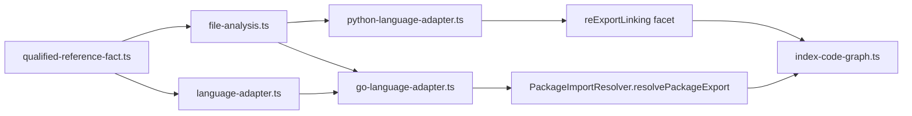

# Design: go-selectors-python-reexports

## Non-goals

- No new language-neutral resolver logic. `PackageImportResolver` (`packages/code-graph/src/application/services/package-import-resolver.ts`) and the `ImportResolutionContext` helpers `packageEntryFiles` and `resolvePackageExport` are used unchanged.
- No support for Go dot imports as a namespace, Go method/value selectors on non-package receivers, Go build tags, `go.work`, or interface dispatch.
- No support for Python star-import expansion, namespace package aggregation, `import x.y as z` routes, runtime module mutation, or `from . import submodule` as a route.
- No change to persisted symbol IDs, relation IDs, or the SQLite schema. No change to the TypeScript, PHP, or any other adapter beyond the additive optional fields below.
- The existing Go `CallFact` of form `Constructor` for composite literals (which keeps only the member name) is left as is. The new qualified reference fact is additive and does not replace it.

## Affected areas

All paths are under `packages/code-graph/` (workspace `code-graph`).

1. `src/domain/value-objects/file-analysis.ts`, `FileAnalysisDraft`
   - Add one optional field. Before: no such field. After:
     ```ts
     /** Optional syntactic evidence of `qualifier.name` references (see QualifiedReferenceFact). */
     readonly qualifiedReferenceFacts?: readonly QualifiedReferenceFact[]
     ```
   - `FileAnalysis extends FileAnalysisDraft` inherits it. Backwards compatible: every existing adapter and test builds drafts without it.
2. `src/domain/value-objects/language-adapter.ts`, `ResolvedImports`
   - Add one optional field:
     ```ts
     /** Resolved targets of qualified reference facts, keyed by `qualifiedReferenceKey(fact)`; value is the target symbol id. */
     readonly qualifiedTargets?: ReadonlyMap<string, string>
     ```
   - Backwards compatible: other adapters return `{ importMap, fileImports, steps, diagnostics }` unchanged.
3. `src/domain/value-objects/index.ts`, `src/index.ts`, `src/public.ts`: export `QualifiedReferenceKind`, `QualifiedReferenceFact`, `qualifiedReferenceKey` next to the existing `CallForm`/`CallFact` exports (`public.ts` and `index.ts` list `./domain/value-objects/call-fact.js` exports; add a sibling block for `./domain/value-objects/qualified-reference-fact.js`). `test/barrel.spec.ts` enumerates exports and must be updated.
4. `src/application/use-cases/index-code-graph.ts`
   - Where `resolvedImports.steps` is persisted (around line 1504) nothing changes: qualified steps travel in `ResolvedImports.steps`. The indexer does not need to read `qualifiedTargets`; adapters consume it themselves in `buildRelations` through `RelationBuildContext.resolvedImports`. Confirm by running the indexer tests; no edit is expected here.
5. `src/infrastructure/tree-sitter/go-language-adapter.ts`
   - `GoParserState` (line ~388): add `packageName?: string` and `explicitAliases?: readonly { readonly specifier: string; readonly alias: string }[]`. Both are plain data.
   - `analyzeFile`: read the `package` clause name; record explicit aliases from import specs; call new private method `extractQualifiedReferences`; include `qualifiedReferenceFacts` in the returned draft and the two fields in `parserState`.
   - `resolveImports` (line ~914): after the existing import loop, build namespaces and fill `qualifiedTargets` (algorithm below). The existing returns `{ importMap, fileImports, steps: [], diagnostics }` become `{ importMap, fileImports, steps, diagnostics, qualifiedTargets }`.
   - `buildRelations` (line ~944): after the existing `CALLS` loop, add relations from `qualifiedTargets`.
   - Callers and risk: `GoLanguageAdapter` is HIGH (3 direct dependents, 20 affected files, 22 tests), but dependents are the registry/barrel/composition chain; the class interface does not change.
6. `src/infrastructure/tree-sitter/python-language-adapter.ts`
   - `PythonParserState` (line ~498): add `reExports?: readonly PythonReExportInfo[]` and `allExport?: PythonAllInfo`.
   - `analyzeFile`: when the file is a package entry (`/(^|\/)__init__\.pyi?$/`), collect routes and `__all__` info.
   - Add getter `reExportLinking` returning a `ReExportLinkingFacet`, mirroring `typescript-language-adapter.ts` lines ~886-894.
   - `entrySurface` and `resolveImports` need no change: the new public bindings live under the same surface (`filePath.replace(/(?:\/__init__)?\.pyi?$/, '')`) that `entrySurface` already returns and `resolvePackageExport` already reads.
   - Extract the candidate list that `entrySurface` builds (lines ~520-545) into a module-level pure function `pythonModuleCandidates(root: string, modulePath: string): string[]` so linking reuses it (root is `workspace:src/<top>` or `workspace:<top>`). Behavior unchanged.
7. Tests (extend): `test/infrastructure/tree-sitter/go-language-adapter.spec.ts`, `test/infrastructure/tree-sitter/python-language-adapter.spec.ts`, `test/barrel.spec.ts`, `test/domain/value-objects/` (new spec for the fact). Integration: `test/integration/` cross-package fixtures (see Testing).
8. Docs: `docs/code-graph/language-adapters.md` (Go and Python sections, fact list, `ResolvedImports`) and `docs/code-graph/index.md` if it lists supported resolution. Update any statement that says Go qualified selectors or Python re-exports are unsupported.

Impact summary: symbol `GoLanguageAdapter`/`PythonLanguageAdapter` HIGH; `PackageImportResolver` MEDIUM (8 files, unchanged by this design); specs `go-language-adapter`/`python-language-adapter` LOW. Dependency-direction analysis of the adapter files is CRITICAL because they depend on shared value objects (`call-fact`, `binding-fact`, `file-analysis`, `language-adapter-facets`, `index-session`); this design touches only `file-analysis` and `language-adapter` additively.

## New constructs

### `src/domain/value-objects/qualified-reference-fact.ts`

```ts
import { type SourceLocation } from './source-location.js'

/** Position in which a qualified reference occurs. */
export const QualifiedReferenceKind = {
  Call: 'call',
  Construct: 'construct',
  Type: 'type',
} as const

/** Union of valid qualified reference kinds. */
export type QualifiedReferenceKind =
  (typeof QualifiedReferenceKind)[keyof typeof QualifiedReferenceKind]

/**
 * Syntactic evidence of a name written as `qualifier.name`. It names no target.
 */
export interface QualifiedReferenceFact {
  /** Workspace-prefixed path of the file containing the reference. */
  readonly filePath: string
  /** Identifier before the dot, as written. */
  readonly qualifier: string
  /** Identifier after the dot, as written. */
  readonly name: string
  /** Position of the reference. */
  readonly kind: QualifiedReferenceKind
  /** Innermost declaration whose parser range contains the reference, when one exists. */
  readonly sourceSymbolId: string | undefined
  /** Parser-derived location of the reference. */
  readonly location: SourceLocation
}

/**
 * Stable identity of a fact within one file analysis.
 * @param fact - Fact to identify.
 * @returns `kind`, start line/column and `qualifier.name`, separated by NUL characters.
 */
export function qualifiedReferenceKey(fact: QualifiedReferenceFact): string {
  return [
    fact.kind,
    `${fact.location.line}:${fact.location.column}`,
    `${fact.qualifier}.${fact.name}`,
  ].join('\u0000')
}
```

Invariants: immutable plain data; no parser objects; `qualifier` and `name` are non-empty identifiers. Wiring: created only by adapters in `analyzeFile`; read only by the emitting adapter in `resolveImports`/`buildRelations`.

### Go: private types and methods in `go-language-adapter.ts`

```ts
interface GoNamespaceBinding {
  readonly name: string // namespace name used in selectors
  readonly specifier: string // import path as written
  readonly localBindingId: string // id of the file-scope Namespace local binding, or '' when none
}
```

- `private extractQualifiedReferences(root: SgNode, filePath: string, symbols: readonly SymbolNode[], lexicals: GoLexicalBindingIndex): QualifiedReferenceFact[]` (`GoLexicalBindingIndex` is the type returned by the existing `createGoLexicalBindingIndex`).
- `private goNamespaceBindings(analysis: FileAnalysis, context: ImportResolutionContext): ReadonlyMap<string, GoNamespaceBinding>`.
- `private declaredPackageName(entries: readonly PackageEntry[], session: IndexSession): string | undefined`.

### Python: types in `python-language-adapter.ts`

```ts
interface PythonReExportInfo {
  /** Number of leading dots; 0 for an absolute import. */
  readonly level: number
  /** Dotted module text after the dots; empty for `from . import x`. */
  readonly module: string
  /** Name imported from the module. */
  readonly importedName: string
  /** Name bound in the entry file (alias when present, otherwise importedName). */
  readonly boundName: string
}

interface PythonAllInfo {
  /** `absent`: no `__all__`; `static`: literal list/tuple of strings; `dynamic`: anything else. */
  readonly kind: 'absent' | 'static' | 'dynamic'
  /** Listed names when kind is `static`; empty otherwise. */
  readonly names: readonly string[]
}
```

Private methods: `extractReExports(root: SgNode, filePath: string): { reExports: PythonReExportInfo[]; allExport: PythonAllInfo }` and `linkReExports(session: IndexSession): ReExportLinkResult`.

## Data models & Contracts

- `FileAnalysisDraft.qualifiedReferenceFacts`: optional; absent equals `[]`. Facts are ordered by source position (ascending line, then column) for determinism.
- `ResolvedImports.qualifiedTargets`: optional `ReadonlyMap<string, string>`; key = `qualifiedReferenceKey(fact)`, value = target symbol id (`PackageExportResolution.targetSymbolId`). Absent equals empty.
- `GoParserState.packageName`: text of the `package_identifier` in the file's `package_clause`; undefined if absent.
- `GoParserState.explicitAliases`: one entry per import spec that wrote an alias identifier (not `_`, not `.`).
- `PythonParserState.reExports`/`allExport`: present only for files matching `/(^|\/)__init__\.pyi?$/`; otherwise omitted.
- Symbol spaces used with `resolvePackageExport`: kind `call` -> `['value']`; kinds `construct` and `type` -> `['type']`. Go publishes `Class`, `Interface`, `Type` symbols in the `type` space and the rest in the `value` space.
- Public binding emitted by Python linking: `createPublicBinding({ surface, exportedName, space, targetId })` where `surface` is the entry file path with `/__init__` and the extension removed, `exportedName` is `boundName`, `targetId` is a logical id. Step: `{ fromId: binding.id, toId: targetId, kind: 're-export:named' }`.

## Approach & Execution flow

### Go: Pass 1 (`analyzeFile`)

1. Parse once (existing). Register parse result (existing).
2. Read `packageName`: find the `package_clause` child of the root and take its `package_identifier` text.
3. While extracting import specs (`extractGoImportSpec`, line ~1297) record `{ specifier: pathLiteral, alias }` when `alias` is defined and is neither `_` nor `.`.
4. `extractQualifiedReferences` walks the tree once:
   - `call_expression` whose `function` is a `selector_expression` whose `operand` is an `identifier`, or an explicit instantiation (`index_expression`/`type_instantiation_expression`, matching the grammar's node name) whose operand is such a selector (`models.Map[int](x)`): kind `call`, `qualifier` = operand text, `name` = `field` text.
   - Shadowing (audit R2-1) is computed by one scope-aware helper replacing the current name lookup. A qualifier is shadowed at node N when an enclosing function (or its receiver) binds the name via: receiver, named parameter, named result (these three scope to the function BODY only, so signature type expressions still resolve the package), `var`/`const`/`type` declarations including grouped specs and `type` specs, short variable declarations, `range` clauses, `if`/`for`/`switch` initializers, and type-switch bindings; and the binding's declaration ends before N's start inside a block that contains N (a use that precedes the declaration is not shadowed). Verify node names with a real tree-sitter-go parse before coding.
   - Shadowing applies to **every** kind: skip a candidate when `isGoShadowedByEnclosingScope(node, qualifier, lexicals)` is true (audit D1; previously only `call`). A shadowed qualifier therefore never resolves as the package.
   - `composite_literal` whose `type` is a `qualified_type` (or a `generic_type` whose `type` field is a `qualified_type`): kind `construct`, `qualifier` = the `package` field text, `name` = the `name` field text. The qualified type child is consumed here and MUST NOT also emit kind `type`.
   - any other `qualified_type` node: kind `type`. This covers parameter, result, field, `var`, `const`, `type` declaration and type-argument positions.
   - `sourceSymbolId`: the innermost symbol in `symbols` whose range contains the node start, using ONE containment index for all three kinds (audit D3): the widened kind set that `type` facts already use (functions, methods, classes/structs, interfaces, types, variables, constants, properties/fields). A call or composite literal in a package-level `var x = models.New()` therefore gets the variable as source. The existing `callerSymbolId` of ordinary call facts keeps the callable-only index. Undefined when no symbol contains the node.
   - `location`: `locationOf(node, filePath)` (existing helper).
5. Return the facts sorted by `(line, column)`.

### Go: Pass 2 (`resolveImports`)

1. Run the existing import loop unchanged.
2. Build the namespace map with `goNamespaceBindings`: for each import in `analysis.imports` that is not `Blank`, not `Namespace` (dot), not `SideEffect`/`Dynamic`/`Require`, call `context.packageEntryFiles(imp.specifier)`; skip when unresolved. Compute the name:
   a. If `(imp.specifier, imp.localName)` is in `GoParserState.explicitAliases`, the name is `imp.localName`.
   b. Else `declaredPackageName(entries, session)`: for each entry read `session.getAnalysis(entry.filePath)?.parserState` (kind `go`) `.packageName`. Return the name only if every entry has a defined `packageName` and they are all equal.
   c. Else the last path segment (`imp.originalName`).
   If two imports produce the same name, remove that name from the map (ambiguous; Go would not compile).
   `localBindingId` (audit R2-2) = id of the file-scope `LocalBinding` of THIS import: the Namespace-space binding whose original specifier is `imp.specifier` (match on the import's own local name, i.e. the alias or last path segment that Pass 1 bound), NOT on the chosen namespace `name`. A declared-name import (`.../go-auth` -> `auth`) or a `/v2` import therefore still contributes its step. `''` when none exists.
3. For each fact in `analysis.qualifiedReferenceFacts ?? []`:
   a. `ns = namespaces.get(fact.qualifier)`; if undefined, continue.
   b. If `fact.name` does not match `/^\p{Lu}/u`, continue.
   c. Call `context.resolvePackageExport({ specifier: ns.specifier, exportedName: fact.name, spaces, fromFile: analysis.filePath, localBindingId: ns.localBindingId })` with `spaces` as in Data models.
   d. If `status === 'resolved'`: `qualifiedTargets.set(qualifiedReferenceKey(fact), result.targetSymbolId)`; if `ns.localBindingId !== ''` and the step was not yet added (dedupe by `fromId|toId|kind`), push `result.step` to `steps`.
   e. If unresolved: do nothing (no diagnostic, no failure).
4. Return `{ importMap, fileImports, steps, diagnostics, qualifiedTargets }`.

### Go: `buildRelations`

After the existing loops, for each fact in `analysis.qualifiedReferenceFacts ?? []`:

1. `target = context.resolvedImports.qualifiedTargets?.get(qualifiedReferenceKey(fact))`; continue if undefined.
2. `kind` call/construct requires `fact.sourceSymbolId`; otherwise continue. Kind type uses `sourceSymbolId`; if undefined, continue.
3. Relation type: call -> `RelationType.Calls`, construct -> `RelationType.Constructs`, type -> `RelationType.UsesType`.
4. Dedupe with the existing `seen` set using key `${source}:${type}:${target}`; push `createRelation({ source, target, type })`.

### Python: Pass 1 (`analyzeFile`)

For entry files only, in one pass over the root's direct children:

1. `import_from_statement` direct children of the module root (not inside `if`, `try`, function, or class): skip wildcard imports; for each imported name (plain or `aliased_import`) push `{ level, module, importedName, boundName }`. `level` is the count of leading dots of the `relative_import` module node; `module` is the dotted text after the dots.
2. `__all__`: scan the whole tree for every identifier `__all__`. Classify:
   - `absent` if never referenced.
   - `static` if every reference is the left side of a module-level `assignment` (also annotated) or `augmented_assignment` with operator `+=` whose right side is a `list` or `tuple` of `string` nodes without interpolation, or a `+` `binary_operator` of such literals.
   - `dynamic` otherwise (any other reference, including read-only uses such as `"X" in __all__`, `.extend`, `.append`, comprehensions, nested/conditional assignment, non-literal elements). Reads disqualify on purpose (audit D7): the public list cannot be proven.
     For `static`, `names` is the union of all string values in source order.
3. Store `reExports` and `allExport` in `PythonParserState`.

### Python: re-export linking (`linkReExports(session)`)

1. Collect entry files: for each `filePath` in `session.getAllFilePaths()` with `session.getAnalysis(filePath)?.parserState` of kind `python` and non-empty `reExports`. Skip files whose `allExport.kind === 'dynamic'`.
2. Allowed names of file F: all `boundName`s when kind `absent`; the intersection with `allExport.names` when `static`.
3. Resolve each route's source file S (workspace-prefixed path) to exactly one indexed file:
   - relative (`level > 0`): call the adapter's `relativeImportResolution.resolve(F, '.'.repeat(level) + module)` (audit D4) and keep the returned candidates. An empty `module` (`from . import x`) yields no source (skip; audit D6).
   - absolute (`level === 0`): call `packageResolution.entrySurface` with the package map and owning workspace for the module's first segment (audit D4), the same call `resolveImports` uses, and take the returned entries' `filePath`s. Keep only candidates under the **top-level package directory that contains F** (audit D5): the directory `<root>/<firstSegment>` where `<root>` is the workspace code root or its `src/`. A sub-package entry may therefore re-export a sibling module. Absolute imports whose first segment is a different package, or that match no known package, are not routes.
   - Keep candidates with `session.getFileId(candidate) !== undefined`; drop a `.pyi` whose `.py` sibling is also a candidate; require exactly one remaining, else skip the route.
4. surface(S) = `S.replace(/(?:\/__init__)?\.pyi?$/, '')`; surface(F) likewise.
5. Repeat up to `entryFileCount + 1` passes until no new binding appears: for each allowed route, for each space in `[SymbolSpace.Value, SymbolSpace.Type]`, read `session.findPublicBindings(surface(S), importedName, space)` plus bindings created earlier in this call (kept in a local map keyed `surface\0name\0space`). Keep those with a defined `targetId`. If their targets are not all equal, skip. Otherwise create the binding on surface(F) with `exportedName = boundName` and add a step. Chains converge because each pass can read what the previous pass created; cycles never gain a target and therefore produce nothing.
6. Return only bindings that did not exist before (`{ publicBindings, steps }`).
7. The indexer runs this facet after Pass 1 and before imports are resolved (existing behavior). `resolveImports` then finds the binding with `resolvePackageExport` unchanged.

## Error handling & Edge cases

- No new error classes. Unresolved qualified references are silently dropped (no diagnostic, no `ImportDiagnostic`, no counters).
- Missing `package` clause (partial parse): `packageName` undefined; naming falls back to the last path segment.
- Entries with different declared package names (for example a `main` file in the directory): fallback to last segment.
- Qualified reference whose `sourceSymbolId` is undefined: no relation for any kind (spec now says so explicitly).
- Shadowed qualifier (any kind): no fact emitted.
- Lowercase `name`: no resolution (the Go public bindings only exist for uppercase identifiers anyway).
- Go file importing the same namespace name twice: name removed from the map; nothing resolves.
- Python: `.pyi` entries and `src/` layouts follow the facets; `__all__` dynamic -> no routes for that file; `__all__` lists a name with no route -> nothing; wildcard import -> ignored; `from . import x` -> ignored; nested imports -> ignored; route target ambiguous or non-unique source file -> ignored; stub and source both present -> source wins; cycles -> nothing.
- Determinism: iterate files and routes in sorted order of path then source position; sort emitted bindings by `id` before returning.
- Large repos: Python linking is O(routes x passes) with indexed lookups; Go resolution is one helper call per qualified fact with a per-file cache of namespace bindings.

## Key decisions

1. **New additive `qualifiedReferenceFacts` (user decision 1)** instead of extending `CallFact`/`BindingFact`: it covers type positions, which no existing fact covers, and keeps old facts untouched. Rejected: deriving from call/binding facts (cannot represent types in declarations).
2. **Resolution in `resolveImports`, relations in `buildRelations`**: the helpers `packageEntryFiles` and `resolvePackageExport` exist only on `ImportResolutionContext`; `RelationBuildContext` does not have them. Passing results through `ResolvedImports.qualifiedTargets` avoids changing `RelationBuildContext`. Rejected: adding the helpers to `RelationBuildContext` (touches every adapter and the indexer).
3. **Go namespace name = explicit alias, else declared package name, else last segment (user decision 4)**. Alias detection uses `explicitAliases` in parser state because `ImportDeclaration.localName` equals the last segment when no alias is written, so it cannot distinguish `models "x/models"` from `"x/models"`.
4. **Python routes through the existing `reExportLinking` facet**, not through a new mechanism: the language-adapter spec already defines when and how the indexer runs it.
5. **Python `__all__` filters only re-export routes (decision 2)**, never declarations: `from pkg import X` works at runtime regardless of `__all__`, so the filter is applied only where a route would otherwise be inferred from an import. A dynamic `__all__` blocks routes because the public list cannot be proven.
6. **Python absolute routes require the target inside the entry file's top-level package directory (decision 3, refined by audit D5)**: deterministic definition of "same package" without reading manifests; sibling sub-package imports qualify. Route resolution reuses the `relativeImportResolution` and `packageResolution` facets (audit D4) instead of private candidate builders, so layout support cannot diverge.
7. Step `fromId` uses the file-scope Namespace local binding of the import itself (anchored by import, not by the chosen namespace name; audit R2-2). When none exists the step is not added, because the indexer drops steps whose `fromId` is not a retained id. Python follows the same rule for `import:package` (audit R2-6): the spec now says the step is returned when a retained file-scope local binding exists.

## Trade-offs

- Python `__all__` filtering can hide a legitimately public name when `__all__` is stale; mitigation: only routes are filtered, declarations never are, and the behavior is documented.
- Go declared-name lookup depends on entry files being indexed; mitigation: documented fallback to the last segment.
- The existing Go `Constructor` call fact for `models.User{}` can still match a same-named local or imported symbol by bare name `User`; this predates the change and is out of scope, but the new `CONSTRUCTS` relation is deduplicated against it by source and target.
- Overlap: `code-graph-file-outline`, `code-graph-symbol-contracts` and `code-graph-symbol-semantic-context` also change `symbol-model`, `language-adapter` and the adapter specs. Deltas are additive requirements to minimize merge friction; re-read the specs before archiving.

## Spec impact

- `code-graph:symbol-model`: one added requirement (Qualified reference facts); nothing else changes. Dependents: both adapter specs.
- `code-graph:language-adapter`: one added requirement (Qualified reference resolution). The TypeScript, PHP and Python adapter specs are unaffected because the field is optional.
- `code-graph:go-language-adapter`: two modified requirements (Package identity, exports, and imports; Scoped bindings, selectors, construction, and types). `graph impact --spec` reports LOW.
- `code-graph:python-language-adapter`: two modified requirements (Imports and package resolution; Public surface and stub behavior). LOW.
- No downstream spec requirement is broken: no other spec states that Go selectors or Python re-exports are unsupported (verified by reading the four specs).

## Dependency map



```
analyzeFile (Pass 1)  -> qualifiedReferenceFacts, GoParserState.packageName/explicitAliases, PythonParserState.reExports/allExport
all files done        -> reExportLinking.link (Python) -> public bindings on __init__ surfaces
resolveImports (P2)   -> namespaces -> resolvePackageExport -> ResolvedImports.qualifiedTargets
buildRelations (P2)   -> CALLS / CONSTRUCTS / USES_TYPE
```

## Migration / Rollback

- No data migration. Graphs indexed before this change simply lack the new edges. Bump the code-graph indexing generation constant if the repository uses one to force reindex (`packages/sdk/src/shared/code-graph-version.ts`); implementer checks whether adapter output changes require it and, if so, increments it in the same commit.
- Rollback: revert the commit; the added fields are optional, so older persisted data is unaffected.

## Testing

Unit tests (Vitest, Given/When/Then names, no snapshots, mock-free adapter tests with in-memory sessions as in the existing spec files):

`test/infrastructure/tree-sitter/go-language-adapter.spec.ts`

- Alias is the namespace name; declared package name wins over path segment (`go-auth` -> `auth`); `/v2` path uses declared name; last-segment fallback when entries are not indexed or declare different names; blank and dot imports bind nothing.
- Qualified call produces `CALLS` (also asserts the fact fields); composite literal keeps qualifier and produces `CONSTRUCTS`; `var`/parameter/result/field types produce `USES_TYPE`; unexported name stays unresolved; shadowed call qualifier (parameter `models` and `models.NewUser()`) emits no fact; value-receiver selector (`u.Save()`) produces no qualified relation; unresolved/unknown package produces no relation and counts as external; cross-workspace target.
- Replace the existing test for "Qualified selector across packages stays unresolved" with the resolved-selector tests.

`test/infrastructure/tree-sitter/python-language-adapter.spec.ts`

- Relative route; absolute same-package route; absolute outside-package import is not a route; alias publishes the alias; chain keeps the final target; cycle and nested/conditional imports publish nothing; wildcard ignored; static `__all__` filters routes while declarations remain; literal concatenation and `+=` are static; dynamic `__all__` publishes nothing; listed name without route creates no binding; plain import is not a route; `from acme_auth import User` resolves with an `import:package` step.
- Replace the existing tests for "Re-imported alias is not a public route" and "Module visibility is not inferred from naming convention".

`test/domain/value-objects/qualified-reference-fact.spec.ts` (new): `qualifiedReferenceKey` is stable and distinguishes kind and position; absent collection equals empty; fact is plain serializable data.

`test/infrastructure/tree-sitter/` language-adapter contract tests: a Go resolution step for a qualified reference is added only when a namespace local binding exists; `ResolvedImports` without `qualifiedTargets` still works for the TypeScript, PHP and Python adapters.

`test/barrel.spec.ts`: new exports present.

Integration (`test/integration/`): a two-workspace fixture with Go modules `github.com/acme/auth` (exports `User`, `NewUser`) and `app` using them, and a Python fixture `acme_auth/__init__.py` re-exporting `User`. Index both, then assert the persisted `CALLS`, `CONSTRUCTS`, `USES_TYPE` edges and the resolved Python import.

Manual verification:

1. `pnpm --filter @specd/code-graph build && pnpm --filter @specd/code-graph test`
2. `pnpm --filter @specd/code-graph typecheck` and `pnpm lint`
3. `node packages/cli/dist/index.js graph index --force --format toon` then `graph impact --symbol User --direction dependents --format toon` on the Go fixture: dependents include the `app` caller.

## Documentation

Update `docs/code-graph/language-adapters.md`: Go (namespace naming rule, supported selector positions, resolution through `resolvePackageExport`), Python (re-export routes, `__all__` rules), the `qualifiedReferenceFacts` field, and `ResolvedImports.qualifiedTargets`. All new exported symbols need full JSDoc (global docs spec).

## Open questions

None.

## Audit follow-ups (compliance report 20261102-001143)

- D1/D3: single widened containment index and uniform shadowing for Go facts (above).
- D2: instantiated generic calls emit `call` facts.
- D4/D5: Python route resolution through the language facets; same-package means same top-level package directory. The module-level `pythonModuleCandidates` helper stays for `entrySurface` only; `pythonGraphDirUp` and `splitWorkspaceIdentity` usage in linking is removed if no longer needed.
- D6/D7/D8/D10: spec wording only (see deltas).
- D9: remove the orphan `/** Parser state representation for Python. */` docblock above `PythonReExportInfo`.
- D11: rename `test/infrastructure/tree-sitter/qualified-reference-contract.spec.ts` to follow the source-mirroring convention (merge its cases into `language-adapter-conformance.spec.ts` or the fact spec).
- Missing tests listed in the report (items 1-14) are added by the follow-up tasks.

## Audit follow-ups round 2 (compliance report 20261102-audit, second pass)

Decisions taken (spec deltas and verify scenarios already updated):

- R2-1 (code bug): complete Go shadowing, position-aware and with all binding forms; parameter/result names scope to the body only. Hotspot: `isGoShadowedByEnclosingScope` in `go-language-adapter.ts`; check dependents before editing.
- R2-2 (code bug): anchor the resolution step on the import's own file-scope Namespace binding.
- R2-3 (spec): missing `sourceSymbolId` blocks every kind; relations deduplicated per source/target. Code already blocks all kinds; add tests.
- R2-4 (spec): two imports yielding one namespace name bind neither. Code already does it; add test.
- R2-5 (code): Python unparenthesized tuple `__all__ = "A", "B"` must be static (`expression_list`); bytes literals must make `__all__` non-static; annotated assignment stays static.
- R2-6 (spec): `import:package` only with a retained file-scope local binding; code unchanged, add test.
- R2-7 (spec): `X.py` + `X/__init__.py` under one root stay ambiguous; code unchanged, add test.
- R2-8 (code): when `__init__.py` and `__init__.pyi` are both indexed only the source file is linked as an entry (also covers the `.py`/`.pyi` twin case in route targets).
- R2-9 (no change): cycle detection stays name-lookup based; relative imports of re-exported names are out of scope (documented, not specified).
- R2-10 (tests only): strengthen weak tests listed in tasks 8.x.
