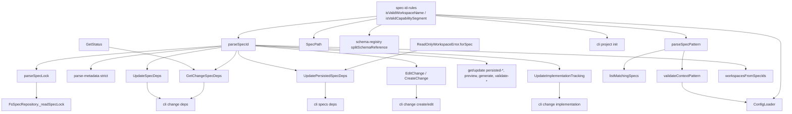
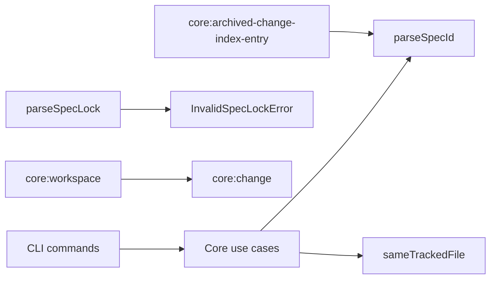
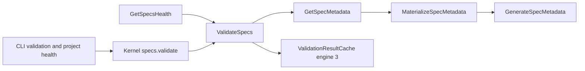

# Design: support-commas-in-names

## Non-goals

- No repair command for invalid persisted locks (a broader `doctor` that also finds missing dependencies, links to missing files, and missing symbols is a separate change). Reads of `spec-lock.json` stay strict by default; the only exception is the lenient `dependsOn` read used by `remove`/`set`/`clear` of `UpdatePersistedSpecDeps`, so that invalid dependency entries can be repaired with the existing `specs deps` commands.
- No generic or quote-aware splitter, no escape syntax, no CSV parsing, no `--files-from -` stdin list, no deprecation path for `--file a,b` (alpha product: the comma form is removed).
- No change to closed-vocabulary comma lists whose values can never contain a comma: `graph impact --type`, graph file categories (`--category`), `--status` (`parseCommaSeparatedValues`), `graph search/hotspots --kind`.
- No change to how the VCS adapter detects files (it already reads git with `-z` and splits on `\0`).
- No new `--yes` flag; the existing `--force` is reused for confirmation bypass.
- No change to the schema reference grammar (`#workspace:name`, `#name`, `@scope/pkg`, paths) beyond how its workspace part is validated.

## Affected areas

Risk summary from SpecD graph analysis (`graph impact --direction dependents` on the planned files `parse-spec-id.ts`, `spec-path.ts`, `parse-spec-lock.ts`, `parse-metadata.ts`, `update-spec-deps.ts`, `edit-change.ts`, `create-change.ts`, `update-implementation-tracking.ts`, `change/implementation.ts`, `change/deps.ts`, `helpers/spec-path.ts`): risk **CRITICAL**, 130 direct dependents, 387 indirect, 343 affected files across `core`, `code-graph`, `sdk`, `cli`, plugins. The cause is `SpecPath` and `parseSpecId`, which almost every use case imports. The mitigation is that exported names and the shapes of existing inputs do not change; only validation behavior inside them tightens, and `parseSpecId`'s second parameter changes from a string to an options object (all callers are updated in this change).

### `@specd/core` — domain

- `packages/core/src/domain/services/parse-spec-id.ts` — `parseSpecId`
  - Before:
    ```ts
    export function parseSpecId(
      specId: string,
      defaultWorkspace = 'default',
    ): { workspace: string; capPath: string }
    ```
    Splits on the first `:`; validates nothing.
  - After:
    ```ts
    export interface ParseSpecIdOptions {
      readonly workspaces?: Iterable<string | { readonly name: string }>
      readonly defaultWorkspace?: string
    }
    export interface ParsedSpecId {
      readonly workspace: string
      readonly capPath: string
      readonly specId: string // always `${workspace}:${capPath}`
    }
    export function parseSpecId(specId: string, options?: ParseSpecIdOptions): ParsedSpecId
    export function isFullyQualifiedSpecId(value: string): boolean
    ```
  - Behavior: strict validation (see "Approach"). Throws `InvalidSpecIdError` and, when `options.workspaces` is given, `WorkspaceNotFoundError`.
  - Callers: about 45 call sites (list below). Risk: CRITICAL. Backwards compatibility: the destructuring `{ workspace, capPath }` keeps working. The two call sites that pass a string second argument change to `{ defaultWorkspace }` (see below). Inputs that were previously accepted and are malformed now throw; all 1189 `dependsOn` entries and 300 spec IDs in this repository are already valid.
- `packages/core/src/domain/value-objects/spec-path.ts` — `SpecPath._validateSegments`
  - Before: rejects `.`, `..`, Windows device names, and any segment containing `\ : * ? " < > |`.
  - After: for every segment, rejects `.` and `..` (message `segment '<s>' is not allowed`), device names (message `segment '<s>' is a Windows device name`), and any segment that does not satisfy `isValidCapabilitySegment` (message `segment '<s>' contains invalid characters`). `parse` keeps trimming the input and dropping empty segments (it is a normalizing value object); `parseSpecId` is the strict boundary and rejects empty segments itself. Exported API unchanged. Callers: about 35 `SpecPath.parse` sites; all feed capability paths produced by `parseSpecId` or by the repository.
- `packages/core/src/domain/services/parse-spec-lock.ts` — `specIdString`, `specLockSchema`, `parseSpecLock`
  - Before: private `WORKSPACE_RE`/`CAP_SEGMENT_RE` and a refine that accepts bare or qualified IDs; `parseSpecLock(content)` throws raw `SyntaxError`/`ZodError`.
  - After: `specIdString = z.string().refine(isFullyQualifiedSpecId, { message: 'must be a fully-qualified valid spec ID (workspace:capabilityPath)' })`; the private regexes are deleted; `parseSpecLock(content: string, context?: SpecLockContext): SpecLockData` where
    ```ts
    export interface SpecLockContext {
      readonly specId: string
      readonly location: string
    }
    ```
    converts any `SyntaxError` or `ZodError` into `InvalidSpecLockError` (never leaks the library error).
- `packages/core/src/domain/services/parse-metadata.ts` — `specIdString` in the strict (persistence) schema only
  - After: the strict schema uses `isFullyQualifiedSpecId`; the private regexes are deleted. The lenient read schema is unchanged (metadata is a regenerable cache).
- `packages/core/src/domain/errors/index.ts` and `packages/core/src/domain/services/index.ts` — export the new errors and functions.
- `packages/core/src/public.ts:598` and `packages/sdk/src/core-reexports.ts:551` — `parseSpecId` re-exports; add re-exports of `isFullyQualifiedSpecId`, `isValidWorkspaceName`, `isValidCapabilitySegment`, `parseSpecPattern`, `InvalidSpecIdError`, `InvalidSpecLockError`, `WorkspaceNotFoundError` (type-level API break on `parseSpecId`'s second parameter and return type, accepted in alpha).
- `packages/core/src/application/errors/workspace-not-found-error.ts` — `WorkspaceNotFoundError`
  - Moves to `packages/core/src/domain/errors/workspace-not-found-error.ts` (the domain parser must raise it and domain must not import application). The application path becomes a one-line re-export (`export { WorkspaceNotFoundError } from '../../domain/errors/workspace-not-found-error.js'`) so existing imports keep compiling.

### `@specd/core` — application (every use case that accepts a spec ID validates and normalizes with `parseSpecId`)

Call sites of `parseSpecId` in `packages/core/src` (all must be reviewed; behavior per category):

1. **Input boundaries** — use `parseSpecId(id, { workspaces })` and use the returned `specId`/`capPath`:
   `use-cases/create-change.ts` (`specIds`), `use-cases/edit-change.ts` (`addSpecIds`; `removeSpecIds` normalized only when valid), `use-cases/update-spec-deps.ts` (`specId`, `add`, `set`; `remove` not validated), `use-cases/update-persisted-spec-deps.ts` (`specId`, `add`, `set`), `use-cases/update-persisted-spec-implementation.ts`, `use-cases/update-persisted-spec-optimizations.ts`, `use-cases/update-persisted-spec-schema.ts`, `use-cases/get-persisted-spec-deps.ts`, `use-cases/get-persisted-spec-implementation.ts`, `use-cases/get-persisted-spec-optimizations.ts`, `use-cases/get-persisted-spec-schema.ts`, `use-cases/preview-spec.ts`, `use-cases/generate-spec-metadata.ts`, `use-cases/validate-specs.ts:133` (`input.specPath`), `use-cases/validate-artifacts.ts:270` (`input.specPath`), `use-cases/update-implementation-tracking.ts:163` (`input.specId`), `use-cases/initialize-persisted-spec-state.ts`, `use-cases/materialize-spec-metadata.ts`, `use-cases/get-artifact-instruction.ts`, `use-cases/compile-context.ts` (`specId` inputs).
2. **Internal, already persisted or already normalized IDs** — keep calling `parseSpecId(id)` without `workspaces` (syntax only; they fail loudly on malformed data): `use-cases/archive-change.ts` (5 sites), `use-cases/refresh-implementation-tracking.ts:208`, `use-cases/resolve-initial-persisted-depends-on.ts`, `use-cases/_shared/load-persisted-spec-schema.ts`, `use-cases/_shared/load-persisted-spec-depends-on.ts`, `use-cases/_shared/spec-reference-resolver.ts`, `use-cases/compile-context.ts` (dependency IDs at L356, L481), `domain/entities/change.ts:376`, `domain/services/artifact-filename.ts:34`, `infrastructure/fs/change-repository.ts:921`, `infrastructure/fs/archive-batch-snapshot.ts:300`, `composition/composition-resolver.ts:416`, `composition/extractor-transforms/resolve-spec-path.ts:42`, `use-cases/validate-specs.ts:592` (`args.label` is a qualified label produced by the use case itself).
3. **Contextual default workspace** — pass the owner explicitly:
   - `use-cases/_shared/depends-on-traversal.ts:155`: `parseSpecId(dep, workspace)` becomes `parseSpecId(dep, { defaultWorkspace: workspace })`. A bare `dependsOn` entry means "same workspace as the spec that declares it". Persisted `dependsOn` is already qualified, so this only affects legacy bare entries coming from change drafts or extraction.
4. **Not spec IDs** — stop using `parseSpecId`:
   - `use-cases/_shared/spec-pattern-matching.ts:45`: replace `parseSpecId(pattern, defaultWorkspace)` with `parseSpecPattern(pattern, { defaultWorkspace })` (new). The `unknown-workspace` warning path stays.
   - `infrastructure/fs/schema-registry.ts:96`: replace `parseSpecId(inner)` with a local `splitSchemaReference(inner)` (new, below).

Other application changes:

- `packages/core/src/application/use-cases/update-spec-deps.ts` — `UpdateSpecDeps`
  - Before: `constructor(changes: ChangeRepository)`; input `{ name, specId, add?, remove?, set? }`; `validateDepIds` calls lenient `parseSpecId` and discards the result.
  - After:
    ```ts
    export interface UpdateSpecDepsInput {
      readonly name: string
      readonly specId: string
      readonly add?: readonly string[]
      readonly remove?: readonly string[]
      readonly set?: readonly string[]
      readonly clear?: boolean
    }
    constructor(changes: ChangeRepository, workspaces: Iterable<string | { readonly name: string }>)
    ```
    Behavior: validate and normalize `specId`, `add`, `set` with `parseSpecId(id, { workspaces })`; do not validate `remove` syntax (normalize only valid entries; compare invalid ones as given); `clear` uses `applyDependsOnMutation` with `clear: true`; mutual exclusion enforced here (see Approach). Callers: `composition/use-cases/update-spec-deps.ts`, `cli/src/commands/change/deps.ts`, tests. Risk: LOW-MEDIUM (3 callers).
- `packages/core/src/composition/use-cases/update-spec-deps.ts` — `resolveUpdateSpecDepsDeps(resolver)` also resolves `workspaces` (names from the resolver's configured workspaces) and passes them to the constructor.
- `packages/core/src/application/use-cases/edit-change.ts` — `EditChange.execute`: before any mutation, normalize `addSpecIds` with `parseSpecId(id, { workspaces })` where `workspaces` comes from `await this._listWorkspaces.execute()` (already used at L100); then ownership check (`ProjectWorkspace.ownership === 'readOnly'` ⇒ collect offenders; throw `ReadOnlyWorkspaceError`); `removeSpecIds` normalized only when valid.
- `packages/core/src/application/use-cases/create-change.ts` — same validation and ownership check using `this._listWorkspaces`.
- `packages/core/src/application/use-cases/update-persisted-spec-deps.ts` — validate `specId`, `add`, `set` with `parseSpecId(id, { workspaces: this._specs.keys() })` (the `specs` map keyed by workspace is already injected); existence check of each `add`/`set` target through `repo.get(SpecPath.parse(capPath))` ⇒ `SpecNotFoundError` when `null`; all before any `readPersistedState`/`writePersistedState`.
- `packages/core/src/application/use-cases/update-implementation-tracking.ts` — `UpdateImplementationTracking`: normalize `input.specId` with `parseSpecId(input.specId, { workspaces })` inside the `mutate` callback before any entity mutation; the use case already validates every file in a sequential `for` loop (`await this._validateMutation(...)` per entry, in input order) before any mutation, so multi-file batches are all-or-nothing and the first failing entry in input order is the one reported (a test locks this in). The second-pass audit changes (original-value error quoting, `file` plus `files` union, `InvalidInputError` for a missing `specId`, mandatory spec repositories) are specified in "Audit hardening", finding L1. New: every `file`/`files` entry first goes through `toLogicalFilePath(file, platform)`, which on a Windows host converts `\` to `/` so the manifest stores forward-slash paths, the same form the code graph uses (graph file identities are `workspace:forward/slash/path`, built with `relative(...).replaceAll('\\', '/')` at index time, and implementation review passes the stored `file` to symbol resolution as an exact graph path). Archive-time conversion to the lock's `workspace:path` (`toPortableRelativePath` in `archive-change.ts`) already yields forward slashes through `path.relative`, so it needs no change. The use case must never `trim`, split, or case-fold names: the existing `[...new Set(input.files)]` stays (deduplication by exact string).
- `packages/core/src/application/ports/config-schema.ts` — `validateContextPattern`: reimplemented on top of `parseSpecPattern`; wraps `InvalidSpecIdError`/pattern errors into `ConfigValidationError`; the private regexes are deleted.
- `packages/core/src/infrastructure/fs/config-loader.ts` (~L391): workspace-name validation uses `isValidWorkspaceName` (keeps the `isWindowsDeviceName` check that is now inside the shared rule) and `ConfigValidationError`; pattern validation delegates to `validateContextPattern`.
- `packages/core/src/infrastructure/fs/spec-repository.ts:785,796` — `_readSpecLock(spec)`: `parseSpecLock(content, { specId: <workspace>:<capPath>, location: <lock path as shown to users> })`.
- `packages/core/src/infrastructure/fs/change-repository.ts` / `manifest-change-loader.ts`: when loading a manifest, validate `specIds` and `specDependsOn` keys/values with `isFullyQualifiedSpecId`; failure raises the existing `CorruptedManifestError` quoting the value and field path. (Implementation: locate the manifest decode step in `manifest-change-loader.ts`; no new class.)

### `@specd/cli`

- `packages/cli/src/helpers/spec-path.ts` — deleted. Its 15 importers (14 commands plus tests) no longer qualify or validate IDs: `commands/change/validate.ts:367`, `change/edit.ts:72,92`, `change/create.ts:47`, `spec/schema.ts:26,49`, `spec/init.ts:55`, `spec/implementation.ts:67,95,129`, `spec/context.ts:118`, `spec/generate-metadata.ts:62`, `spec/outline.ts:56`, `spec/validate.ts:55`, `spec/optimizations.ts:214,272,306`, `spec/metadata.ts:99`, `spec/deps.ts:16`, `spec/show.ts:35`. Each passes the raw positional/option string to the use case. Where a command currently uses the returned `parsed.workspace`/`capabilityPath` for repository lookups (`spec/show.ts`, `spec/context.ts`, `spec/outline.ts`, `spec/validate.ts`, `change/validate.ts`), it instead calls the use case with the raw ID and uses the fully-qualified `specId` the use case returns; where a use case does not return it, the use case result is extended with `specId` (all those use cases already take `specId`/`specPath`).
- `packages/cli/src/commands/change/create.ts`, `change/edit.ts`: delete the `config.workspaces.find(...)` ownership block (`create.ts:52-60`, `edit.ts:77-86`); map `ReadOnlyWorkspaceError`, `InvalidSpecIdError`, `WorkspaceNotFoundError` through `handleError` (exit code 1, `error:` prefix, multi-line message preserved).
- `packages/cli/src/commands/change/implementation.ts:290` — remove `f.split(',').map((p) => p.trim())`; use `input.files` as given (the option is `--file <paths...>`, variadic, plus repeatable). `--spec` forwarded raw.
- `packages/cli/src/commands/change/deps.ts` — add `--clear` and `--force`; pass `clear: true`; confirmation via the new helper; text lists unchanged (`deps.join(', ')` is safe because spec IDs cannot contain commas). Display mode (`changes deps <name> <specId>` with no flags) no longer calls `parseSpecId`: it forwards the raw `<specId>` to the new `GetChangeSpecDeps` use case (see "Audit hardening", finding M1) and renders the fully-qualified `specId` and `dependsOn` it returns. The `import { parseSpecId } from '@specd/sdk'` line and the `kernel.project.listWorkspaces` call are deleted.
- `packages/cli/src/commands/spec/deps.ts` — `clear` subcommand gains `--force` and confirmation; `<spec-id>` and `--dep` values raw; mutation output renders the `initialized` value returned by the use case instead of hard-coding it (see finding M3).
- `packages/cli/src/commands/graph/index-graph.ts:75` — `argParser((val, prev: string[]) => (prev ?? []).concat(val))` (no split).
- `packages/cli/src/helpers/confirm.ts` — new (below).
- `packages/cli/src/commands/change/_implementation-tracking.ts` and `commands/change/implementation.ts` list rendering — text output prints one name per line.
- Documentation: `docs/cli/cli-reference.md` (`--exclude-path` row at ~L1279 says "comma-separated values"; `changes deps` section needs `--clear`/`--force`; `changes implementation` section needs the repeated/listed `--file` forms; `specs deps clear` needs `--force`), `docs/guide/` pages that mention these commands, and `docs/` entries for the new error codes if the errors guide lists codes. `packages/cli/test/documentation-coverage.spec.ts` enforces that every option is documented; the new `--clear`/`--force` options must be documented or that test fails.

### `@specd/skills`

- `packages/skills/templates/skills/specd-archive/SKILL.md.tpl` lines 112 and 117, `packages/skills/templates/skills/specd-implement/SKILL.md.tpl` lines 185 and 197: replace `--file <path1>,<path2>[,...]` with `--file <path1> --file <path2>`. Also sweep `packages/skills/templates` for any other `--file` list with commas (`grep -rnE "\-\-file[ =][^ ]*,|<path1>," packages/skills/templates` must return nothing afterwards). Installed skill copies are regenerated by the plugin install flow; this repository's `.claude/skills` copies are regenerated after the build.
- `skills:workflow-automation` spec text (already in the change deltas).

### Audit hardening (compliance audit 20261104-103701) — affected areas

Every finding of the third audit is resolved here; nothing is deferred. Graph blast radius of the files below (`graph impact --direction dependents` over `update-persisted-spec-deps.ts`, `update-persisted-spec-implementation.ts`, `update-persisted-spec-schema.ts`, `archived-change-index-entry.ts`, `edit-change.ts`, `cli/.../spec/deps.ts`, `cli/.../change/deps.ts`, `cli/.../project/init.ts`): risk **CRITICAL**, 42 direct dependents, 129 indirect, 297 affected files. The cause is the composition barrel and the CLI program, which import every use case; no exported name or input shape changes except the additions listed (new `initialized` result field, new `GetChangeSpecDeps` use case), so existing callers keep compiling. The ID in brackets is the audit finding.

**M1 — `change deps` display path calls `parseSpecId` in the CLI** (`packages/cli/src/commands/change/deps.ts`, symbol `registerChangeDeps` action; MEDIUM)

- Before (display branch):
  ```ts
  const workspaces = await kernel.project.listWorkspaces.execute()
  const normalizedSpecId = parseSpecId(specId, { workspaces }).specId
  const change = statusResult.change ?? statusResult.draftView
  if (change && !change.specIds.includes(normalizedSpecId)) {
    cliError(`spec '${normalizedSpecId}' is not in the scope of change '${name}'`, opts.format)
  }
  const deps = specDependsOn[normalizedSpecId] ?? []
  ```
- After:
  ```ts
  const shown = await kernel.changes.getSpecDeps.execute({ name, specId })
  // render shown.specId and shown.dependsOn in text / json / toon
  ```
  Delete the `parseSpecId` import from `@specd/sdk`, the `listWorkspaces` call, the `statusResult` lookup for this branch and the in-command membership check. The listing branch (no `<specId>`) keeps `kernel.changes.status.execute({ name })`. The SDK already re-exports the kernel, so `kernel.changes.getSpecDeps` is available to the CLI with no extra SDK wiring beyond the re-export of the new types (see "New constructs", `GetChangeSpecDeps`). Decision: a dedicated read use case is created (no existing SDK or core operation returns a change's declared dependencies for one spec with validation); `GetStatus` stays untouched because it returns every spec's dependencies and has no ID parameter.
- Callers and risk: one caller (`change/deps.ts`); LOW. Backwards compatibility: output formats are unchanged; the text and JSON `specId` now always show the fully-qualified ID (spec requirement "Output shows the normalized spec ID").
- Errors: invalid ID ⇒ `InvalidSpecIdError`; unknown workspace ⇒ `WorkspaceNotFoundError`; ID not in `change.specIds` ⇒ `InvalidInputError("spec '<id>' is not in the scope of change '<name>'")` (same message as today); unknown change ⇒ `ChangeNotFoundError`. All map through `handleError` to exit 1.

**M2 — `project init` keeps its own workspace-name regex** (`packages/cli/src/commands/project/init.ts`; MEDIUM)

- Before (wizard prompt, ~L188): `validate: (value) => /^[a-z][a-z0-9-]*$/.test(value.trim()) ? undefined : 'Use lowercase letters, numbers, and hyphens only.'`, and `--workspace <id>` (default `'default'`) is not validated at all in non-interactive mode; the wizard result is passed on as `String(workspace)` after the trimmed test.
- After:

  ```ts
  import { isValidWorkspaceName } from '@specd/sdk' // already re-exported by sdk/src/core-reexports.ts

  const WORKSPACE_RULE =
    'use two or more of a-z, 0-9 and "-", starting with a letter, and not a Windows device name'
  function invalidWorkspaceMessage(value: string): string {
    return `Invalid workspace id '${value}': ${WORKSPACE_RULE}`
  }
  // wizard:
  validate: (value) => (isValidWorkspaceName(value) ? undefined : invalidWorkspaceMessage(value)),
  // non-interactive, before anything is written (before the existing-config check writes files):
  if (!isValidWorkspaceName(opts.workspace)) cliError(invalidWorkspaceMessage(opts.workspace), opts.format)
  ```

  The value is never trimmed, lowercased or otherwise altered; the wizard validates the string it will use. No second copy of the expression remains in the CLI (a guard test greps `packages/cli/src` for `a-z][a-z0-9-]`).

- Callers and risk: leaf command, LOW. Backwards compatibility: ids `a`, `Core`, `nul` that were accepted by the wizard are now rejected (they were already rejected later by `ConfigLoader`, so no working project changes).

**M3 — `specs deps` renders a hard-coded `initialized: true`; `remove` on an uninitialized spec never reports a no-op; clear error cites `--clear`; repair hint carries `--force`** (MEDIUM, with LOW items)

- Core `packages/core/src/application/use-cases/update-persisted-spec-deps.ts` — `UpdatePersistedSpecDepsResult` gains `initialized`:
  ```ts
  export interface UpdatePersistedSpecDepsResult {
    readonly specId: string
    readonly dependsOn: readonly string[]
    readonly created: boolean
    /** `true` when persisted state exists after the call; `false` only for the no-op of `remove` (or an empty `add`) on a spec with no persisted state. */
    readonly initialized: boolean
  }
  ```
  `execute` existing-state return becomes `{ specId, dependsOn: nextDependsOn, created: false, initialized: true }`; `_createMissingState` no-op return becomes `{ specId: input.specId, dependsOn: [], created: false, initialized: false }` and its created return `{ …, created: true, initialized: true }`.
- Core `_createMissingState` (audit D4, a code bug): `remove` combined with a non-empty `add` against a spec with no state now applies `remove` to the derived base before merging `add`:
  ```ts
  // Before:
  applyDependsOnMutation(initialDependsOn, {
    ...(input.add !== undefined ? { add: input.add } : {}),
  })
  // After:
  applyDependsOnMutation(initialDependsOn, {
    ...(input.remove !== undefined ? { remove: input.remove } : {}),
    ...(input.add !== undefined ? { add: input.add } : {}),
  })
  ```
  (`applyDependsOnMutation` already applies `remove` before `add`.) The `initial` patch base stays `initialDependsOn`; the final list is the patch `dependsOn`. A dependency named in `remove` that the derived base contains does not survive unless it is also in `add`. `remove` alone, or `add: []`, still returns the no-op (no `writePersistedState`).
- CLI `packages/cli/src/commands/spec/deps.ts`:
  - Before: `renderDepsResult({ ...result, initialized: true }, fmt)` in `add`, `remove`, `set` and `clear`.
  - After: `renderDepsResult(result, fmt)` everywhere (the result now carries `initialized`). For `remove`, `renderDepsResult(result, fmt, 'nothing was removed')`: when `result.initialized === false` text prints `spec <specId> is not initialized — nothing was removed`; for the other subcommands the existing text `spec <specId> is not initialized — run specs init first` is kept; JSON/TOON always include `initialized`.
  - `clear` confirmation message: before `nonInteractiveMessage: '--clear requires confirmation; pass --force to skip it'`; after `'clearing requires confirmation; pass --force to skip it'` (this command has no `--clear` option). `change deps --clear` keeps the `--clear requires confirmation; pass --force to skip it` wording.
- `packages/cli/src/handle-error.ts` lines 196-209 (`InvalidSpecLockError` branch): before the appended hint ended with `(use --force to skip confirmation on clear)`; after the hint is exactly `\nRepair with: specd specs deps remove <spec-id>, specd specs deps set <spec-id>, or specd specs deps clear <spec-id>`; added only when `fieldPath === 'dependsOn'` or starts with `dependsOn.`; nothing else is appended.
- Callers and risk: `UpdatePersistedSpecDeps` has 2 callers (composition factory, `specs deps`); adding a result field is additive; LOW.

**M4 — schema reassignment does not verify that artifacts parse under the target schema** (`packages/core/src/application/use-cases/update-persisted-spec-schema.ts`, `_extractDependsOn`; MEDIUM, code bug)

- Before: `_extractDependsOn` returns `undefined` immediately when `schema.metadataExtraction()?.dependsOn === undefined`, so artifacts are never parsed in the common case, and a parse failure never aborts.
- After: `execute` calls a new private `_loadParsedArtifacts(spec, repo, schema)` after the same-schema no-op return and before the dependency comparison:
  ```ts
  private async _loadParsedArtifacts(
    spec: Spec, repo: SpecRepository, schema: Schema,
  ): Promise<readonly MetadataArtifactInput[]> {
    const artifacts: MetadataArtifactInput[] = []
    for (const artifactType of schema.artifacts()) {
      if (artifactType.scope !== 'spec') continue
      const filename = path.basename(artifactType.output)
      const format = artifactType.format ?? inferFormat(filename) ?? 'plaintext'
      const parser = this.resolveDepsDeps.parsers.get(format)
      if (parser === undefined) continue // no parser registered: nothing to verify
      const artifact = await repo.artifact(spec, filename)
      if (artifact === null) continue
      try {
        parser.parse(artifact.content)
      } catch (error) {
        throw error instanceof SpecdError
          ? error
          : new ArtifactParseError(format, error instanceof Error ? error.message : String(error))
      }
      artifacts.push({ artifactId: artifactType.id, filename, format, content: artifact.content })
    }
    return artifacts
  }
  ```
  `_extractDependsOn` then receives the already-loaded artifacts and still returns `undefined` when the target schema declares no dependency extraction. A parse failure throws `ArtifactParseError` (`ARTIFACT_PARSE_ERROR`) before any write, so persisted state is untouched. Only an artifact whose format has no registered parser is skipped. The order is: validate ID ⇒ read-only guard ⇒ `SpecNotFoundError` ⇒ `SpecNotInitializedError` ⇒ resolve target schema ⇒ same-schema no-op ⇒ parse verification ⇒ dependency comparison ⇒ write.
- Callers and risk: one caller (composition); LOW. Backwards compatibility: reassignments that previously succeeded over unparseable artifacts now fail with the typed error (intended).

**M5 — codeRoot boundary check is a string prefix test and skips `ws:path` inputs** (`packages/core/src/application/use-cases/update-persisted-spec-implementation.ts`, `_normalizeFile`; MEDIUM, code bug)

- Before: `absolute.startsWith(path.resolve(codeRoot))` for unqualified input; for input containing `:` only the workspace name is compared and the path part is never confined; any `:` (including `C:\x`) is read as a qualifier.
- After:
  ```ts
  private async _normalizeFile(file: string, workspace: string): Promise<{ canonical: string; relative: string }> {
    const colon = file.indexOf(':')
    const qualifier = colon > 0 && isValidWorkspaceName(file.slice(0, colon)) ? file.slice(0, colon) : null
    if (qualifier !== null && qualifier !== workspace) {
      throw new ImplementationWorkspaceBoundaryError(file, workspace)
    }
    const rawPath = qualifier !== null ? file.slice(colon + 1) : file
    const codeRoot = path.resolve(await this._codeRoot(workspace))
    const absolute = path.resolve(codeRoot, rawPath)
    const relative = path.relative(codeRoot, absolute)
    if (relative === '' || relative === '..' || relative.startsWith(`..${path.sep}`) || path.isAbsolute(relative)) {
      throw new ImplementationWorkspaceBoundaryError(file, workspace)
    }
    return { canonical: `${workspace}:${relative.split(path.sep).join('/')}`, relative: relative.split(path.sep).join('/') }
  }
  ```
  Because workspace names have two or more characters, a leading single letter plus `:` (a Windows drive such as `C:\x`) is not a qualifier and falls through to the absolute-path branch, where `path.relative` yields a path that is absolute or starts with `..` and is rejected. The sibling-prefix case (`/repo/core-evil/x` next to `/repo/core`) yields `../core-evil/x` and is rejected; `core:../x` and `core:../../etc/passwd` resolve against the codeRoot and are rejected.
- Execution order (D9, decided): `parseSpecId` ⇒ read-only guard ⇒ `SpecNotFoundError` ⇒ confinement (`_normalizeFile`) ⇒ for `add`, existence check of `path.resolve(codeRoot, relative)` ⇒ `readPersistedState` ⇒ mutate. The existence check therefore runs only on a path that passed confinement and before any persisted-state read. The existence check uses the `relative` returned by `_normalizeFile` instead of re-splitting the canonical string on `:`.
- Callers and risk: one caller (composition); LOW. `ImplementationFileNotFoundError(input.file)` keeps quoting the original value.

**M6 — no fs-level test for the lenient `dependsOn` read and the lenient revision check** (`core:spec-lock`, `core:spec-repository-port`; MEDIUM, test gap plus port documentation)

- No production change: `FsSpecRepository.readPersistedState(spec, { lenientDependsOn: true })` and the lenient read inside `writePersistedState` (spec-repository.ts ~L559) already exist. The tests that pin them are listed in the Testing matrix (rows T-LOCK-1 … T-LOCK-4).
- Port documentation (`packages/core/src/application/ports/spec-repository.ts`, `readPersistedState` JSDoc): state that the optional `{ lenientDependsOn?: boolean }` argument tolerates invalid `dependsOn` entries only (every other field stays strictly validated, the file is never rewritten by a read), and that `writePersistedState` reads the existing lock leniently because it only needs the revision hash, so a repair write over an invalid `dependsOn` succeeds. Docs: `docs/core/` page for `SpecRepository` (see Documentation).

**L1 — `UpdateImplementationTracking`** (`packages/core/src/application/use-cases/update-implementation-tracking.ts`; LOW, code deviates from the amended spec in four places)

- Error quoting on Windows. Before: `files` are mapped through `toLogicalFilePath` and every error is thrown with the converted value, so `a\b.ts` is reported as `a/b.ts` on win32. After: the use case keeps both forms per entry:
  ```ts
  interface TrackedInput {
    readonly original: string
    readonly logical: string
  }
  const rawFiles = [
    ...(input.file !== undefined ? [input.file] : []),
    ...(input.files !== undefined ? input.files : []),
  ]
  const seen = new Set<string>()
  const entries: TrackedInput[] = []
  for (const original of rawFiles) {
    const logical = toLogicalFilePath(original, this._platform)
    if (!seen.has(logical)) {
      seen.add(logical)
      entries.push({ original, logical })
    }
  }
  ```
  Lookups, comparisons and storage use `logical`; every `ImplementationFileNotFoundError` is constructed with `original` (so `a\b.ts` is quoted as `a\b.ts` on every host). Duplicates collapse by logical form; the first original wins.
- `file` plus `files`. Before: `files` wins and `file` is silently ignored. After: the effective list is `file` followed by `files` (as in the snippet), duplicates collapsed, neither ignored.
- Missing `specId`. Before: `add`/`remove` without `specId` throws `ChangeNotFoundError(change.name)` from `_validateMutation`, `_applyAdd` and `_applyRemove`. After: a single guard at the top of `execute`, before `mutate`: `if ((input.action === 'add' || input.action === 'remove') && input.specId === undefined) throw new InvalidInputError('specId is required for action "' + input.action + '"')`; the three `ChangeNotFoundError(change.name)` throws are deleted. The change is untouched because the guard runs before `mutate`.
- Spec repositories mandatory. Before: `specRepositories?: ReadonlyMap<string, SpecRepository>` with a branch that skips workspace validation. After: the parameter is required (`specRepositories: ReadonlyMap<string, SpecRepository>`, placed before the optional `platform`), the `parseSpecId(input.specId)` branch without `workspaces` and the `this._specRepositories !== undefined` guard in `_validateMutation` are deleted. Callers: `composition/use-cases/update-implementation-tracking.ts` (already passes it) and tests (updated to pass a map). `specId` is validated whenever it is supplied, for every action except `start`.
- Order of failure for a batch: validation is sequential in input order, so the first failing entry in input order is reported.
- Risk: 1 production caller + tests; LOW-MEDIUM (constructor signature change; semver-alpha accepted).

**L2 — `EditChange`** (`packages/core/src/application/use-cases/edit-change.ts`; LOW)

- Input contract: `EditChangeInput` documentation lists `invalidationPolicy` (the field already exists; the TSDoc and the spec's Input contract now mention it).
- Duplicate removals. Before: `removeSpecIds` is mapped one to one, so `['default:a', 'default:a']` removes the first occurrence and then throws `SpecNotInChangeError` for the second. After: `const removeSpecIds = removeNormalized === undefined ? undefined : [...new Set(removeNormalized)]`, so duplicate entries collapse to one removal (after normalization, so `a` and `default:a` collapse).
- Actor resolution. Before: `const actor = await this._actor.identity()` runs for every non-no-op request. After: resolved lazily and once, only when an edit will be applied:
  ```ts
  // `Actor` is the identity type returned by `ActorResolver.identity()`
  let actor: Awaited<ReturnType<ActorResolver['identity']>> | undefined
  const resolveActor = async (): Promise<Awaited<ReturnType<ActorResolver['identity']>>> =>
    (actor ??= await this._actor.identity())
  ```
  used inside the mutation callback only in the branch that calls `freshChange.updateSpecIds(...)`, `setDescription` or the policy update; an idempotent add (no effective change) never resolves the actor.
- Risk: one caller (composition), LOW.

**L3 — `CreateChange`** (`packages/core/src/application/use-cases/create-change.ts`; LOW, no production change)

- Already correct: duplicate-name check runs first (`ChangeAlreadyExistsError` before spec ID validation), duplicate IDs collapse after normalization (`[...new Set(...)]`), and the readOnly message lists only the readOnly specs of a mixed list. Tests lock these behaviors in (T-CREATE-\*); JSDoc `@throws` adds `InvalidSpecIdError`, `WorkspaceNotFoundError`, `ReadOnlyWorkspaceError`.

**L4 — read-only error argument convention** (audit D12; LOW) — `packages/core/src/domain/errors/read-only-workspace-error.ts` gains a static factory and the four persisted-state use cases plus `initialize-persisted-spec-state.ts` stop passing a bare workspace name as the message:

```ts
static forSpec(specId: string, workspace: string): ReadOnlyWorkspaceError {
  return new ReadOnlyWorkspaceError(`Cannot modify spec "${specId}" — workspace "${workspace}" is readOnly.`)
}
```

Before: `throw new ReadOnlyWorkspaceError(workspace)` (message is just `core`). After: `throw ReadOnlyWorkspaceError.forSpec(specId, workspace)` in `update-persisted-spec-deps.ts:128`, `update-persisted-spec-implementation.ts:90`, `update-persisted-spec-optimizations.ts:174`, `update-persisted-spec-schema.ts:82`, `initialize-persisted-spec-state.ts:168`. `EditChange`, `CreateChange`, `ArchiveChange` and `FsSpecRepository` keep their own full messages. The CLI maps the error to exit 1 without a configuration workaround.

**L5 — `GetPersistedSpecSchema` dead branch** (audit D10; LOW) — `get-persisted-spec-schema.ts`: remove the `if (repo === undefined) throw new WorkspaceNotFoundError(workspace)` branch (`parseSpecId` with `workspaces` already throws it) and use `this.specRepositories.get(workspace)!` like the sibling use cases; drop the then-unused `WorkspaceNotFoundError` import. Same cleanup of the unreachable `WorkspaceNotFoundError` after `parseSpecId` in `update-persisted-spec-deps.ts` (`targetRepo === undefined`).

**L6 — `workspacesFromSpecIds`** (`packages/core/src/domain/archived-change-index-entry.ts`; LOW)

- Before: `id.indexOf(':')` and `substring`, no validation (a bare ID yields no prefix; `a:b:c` yields `a`).
- After:
  ```ts
  export function workspacesFromSpecIds(specIds: readonly string[]): readonly string[] {
    const set = new Set<string>()
    for (const id of specIds) set.add(parseSpecId(id).workspace)
    return [...set]
  }
  ```
  `@throws {InvalidSpecIdError}` in the JSDoc; unique prefixes in encounter order. The only consumers are the re-exports (`domain/index.ts`, `public.ts`, `sdk/core-reexports.ts`) and archive path templating; archived `specIds` are valid because the manifest rejects anything else on load, and a bare ID now yields `default` through `parseSpecId`. `core:archived-change-index-entry` gains a dependency on `core:spec-id-format` (registered in the change).

**L7 — `GetPersistedSpecOptimizations` missing-field shape** (audit D13; LOW, no behavior change) — the code already returns `{ freshness: 'missing', reasons: ['missing'] }` with no `value` for a requested field that is absent. The result type is updated to say so:

```ts
export interface PersistedOptimizationFieldResult<T> {
  readonly value?: T // absent when freshness is 'missing'
  readonly freshness: 'fresh' | 'stale' | 'missing'
  readonly reasons: readonly string[]
}
```

The existing test at `get-persisted-spec-optimizations.spec.ts` that asserts this is kept; TSDoc updated.

**L8 — `UpdatePersistedSpecOptimizations` input contradiction** (audit D5; LOW, no behavior change) — the spec now says: input shape errors (missing/non-string `specId`, unknown keys, exclusivity) raise `InvalidInputError`; the content of a present `specId` string, including `''`, raises `InvalidSpecIdError`. The Zod schema keeps `specId: z.string()` (no `.min(1)`); the test at `update-persisted-spec-optimizations.spec.ts:330` stays and a `specId: undefined` ⇒ `InvalidInputError` case is added.

**L9 — `cli:change-edit` / `cli:change-create` signatures and ordering** (LOW)

- `packages/cli/src/commands/change/edit.ts` (~L55-66): the "no edit flags" usage check moves above `resolveCliContext`. Before: `const { kernel } = await resolveCliContext(...)` then the `hasChanges` check. After: compute `hasChanges` and call `cliError('at least one of --add-spec, --remove-spec, --description, or --invalidation-policy must be provided', opts.format)` before resolving the context, so a missing or broken config yields the usage error. The synopsis in the spec and `docs/cli/` lists `--invalidation-policy <policy>` and `--config <path>` for both `change edit` and `change create`.
- Name format of `change create` is validated by core (`CreateChange`), not by the CLI; no CLI regex is added.
- `cli:change-edit` spec wording: the command derives no workspaces; the `workspaces:` line printed on success comes from the `EditChange` result (`change.workspaces`).

**L10 — `cli:change-implementation`** (LOW) — `packages/cli/src/commands/change/implementation.ts`: delete the private `collectString` and import `collect` from `helpers/collect.ts` for `--symbol`; the spec's signature block lists all eight subcommands (`list`, `add`, `resolve`, `unresolve`, `ignore`, `remove`, `review`, `start`) and the "Subcommands are reachable" scenario asserts them via `--help`.

**L11 — `PreviewSpec`, `GenerateSpecMetadata`, `ValidateSpecs`** (LOW) — TSDoc `@throws` additions only: `InvalidSpecIdError`, `WorkspaceNotFoundError` on `preview-spec.ts` (`execute`), `generate-spec-metadata.ts`, `validate-specs.ts`; runtime behavior is unchanged (already validated with `parseSpecId`).

**L12 — `core:spec-metadata` wording** (LOW, spec drift) — the requirement bullets are rewritten to match `strictSpecMetadataSchema` in `parse-metadata.ts` (keywords regex, sha256 content-hash format, scenario optionality, `context`, `generatedBy`, `implementation` entries, passthrough). No code change; the tests listed under T-META-\* assert the schema.

**L13 — `core:config` pattern errors** (LOW) — a malformed pattern passed programmatically to `listMatchingSpecs`/`parseSpecPattern` raises `InvalidSpecPatternError` (code `INVALID_SPEC_PATTERN`); `validateContextPattern` converts it to `ConfigValidationError` at load. Already the designed behavior; tests T-CONFIG-\* lock it in.

**L14 — `skills:workflow-automation` and `cli:graph-index`** — no production change beyond what the first design already prescribes; missing tests are listed in the matrix (T-GRAPH-1, T-SKILL-1).

## New constructs

### `packages/core/src/domain/services/spec-id-rules.ts`

```ts
import { isWindowsDeviceName } from './windows-device-name.js'

const WORKSPACE_NAME_RE = /^[a-z][a-z0-9-]+$/
const CAPABILITY_SEGMENT_RE = /^[a-z0-9_][a-z0-9_-]*$/

/** True when `name` is a valid workspace name (two or more characters, never a Windows device name). */
export function isValidWorkspaceName(name: string): boolean {
  return WORKSPACE_NAME_RE.test(name) && !isWindowsDeviceName(name)
}

/** True when `segment` is a valid capability path segment (a folder name). */
export function isValidCapabilitySegment(segment: string): boolean {
  return CAPABILITY_SEGMENT_RE.test(segment) && !isWindowsDeviceName(segment)
}
```

Invariants: these two expressions are the only copies in the codebase. `isWindowsDeviceName` is the existing helper (`windows-device-name.ts`). Exported from `domain/services/index.ts` and `public.ts`.

### `packages/core/src/domain/services/parse-spec-id.ts` (rewrite; complete)

```ts
import { InvalidSpecIdError } from '../errors/invalid-spec-id-error.js'
import { WorkspaceNotFoundError } from '../errors/workspace-not-found-error.js'
import { isValidCapabilitySegment, isValidWorkspaceName } from './spec-id-rules.js'
import { isWindowsDeviceName } from './windows-device-name.js'

export interface ParseSpecIdOptions {
  /** Configured workspaces. When given, the workspace must be one of them. */
  readonly workspaces?: Iterable<string | { readonly name: string }>
  /** Workspace used for an ID without `:` (default `'default'`). */
  readonly defaultWorkspace?: string
}

export interface ParsedSpecId {
  readonly workspace: string
  readonly capPath: string
  readonly specId: string
}

export function parseSpecId(specId: string, options: ParseSpecIdOptions = {}): ParsedSpecId {
  if (specId.trim() === '') throw new InvalidSpecIdError(specId, 'must not be empty or blank')
  const colon = specId.indexOf(':')
  const explicit = colon >= 0
  const workspace = explicit ? specId.slice(0, colon) : (options.defaultWorkspace ?? 'default')
  const capPath = explicit ? specId.slice(colon + 1) : specId
  if (explicit && !isValidWorkspaceName(workspace)) {
    throw new InvalidSpecIdError(
      specId,
      `workspace '${workspace}' is invalid (use two or more of a-z, 0-9 and '-', starting with a letter, and not a Windows device name)`,
    )
  }
  if (capPath === '') throw new InvalidSpecIdError(specId, 'capability path must not be empty')
  if (capPath.includes(':'))
    throw new InvalidSpecIdError(specId, "capability path must not contain ':'")
  for (const segment of capPath.split('/')) {
    if (segment === '')
      throw new InvalidSpecIdError(specId, 'capability path has an empty segment', segment)
    if (isWindowsDeviceName(segment)) {
      throw new InvalidSpecIdError(specId, `segment '${segment}' is a Windows device name`, segment)
    }
    if (segment.includes('\\')) {
      throw new InvalidSpecIdError(
        specId,
        `segment '${segment}' contains a backslash; use '/' as the only path separator`,
        segment,
      )
    }
    if (!isValidCapabilitySegment(segment)) {
      throw new InvalidSpecIdError(
        specId,
        `segment '${segment}' is invalid (use a-z, 0-9, '_' and '-', not starting with '-')`,
        segment,
      )
    }
  }
  if (options.workspaces !== undefined) {
    const names = new Set<string>()
    for (const w of options.workspaces) names.add(typeof w === 'string' ? w : w.name)
    if (!names.has(workspace))
      throw new WorkspaceNotFoundError(workspace, { specId, known: [...names] })
  }
  return { workspace, capPath, specId: `${workspace}:${capPath}` }
}

/** True when `value` is a syntactically valid, fully-qualified (`workspace:capabilityPath`) spec ID. */
export function isFullyQualifiedSpecId(value: string): boolean {
  if (!value.includes(':')) return false
  try {
    parseSpecId(value)
    return true
  } catch {
    return false
  }
}
```

Invariants: pure, synchronous, no I/O; never returns a bare ID; the explicit workspace is validated for syntax even when `workspaces` is absent; `defaultWorkspace` is not syntax-checked (the caller owns it) but is existence-checked against `workspaces` when given. JSDoc on every export (project convention).

### `packages/core/src/domain/services/parse-spec-pattern.ts`

```ts
export type SpecPatternKind = 'all' | 'prefix' | 'exact'

export interface ParsedSpecPattern {
  /** Workspace named by the qualifier, or `null` when the pattern had none. */
  readonly workspace: string | null
  /** `'all'` for `*`; `'prefix'` for `<prefix>/*`; `'exact'` otherwise. */
  readonly kind: SpecPatternKind
  /** `'*'` for `all`; the prefix without `/*` for `prefix`; the capability path for `exact`. */
  readonly path: string
}

export interface ParseSpecPatternOptions {
  readonly defaultWorkspace?: string
}

export function parseSpecPattern(
  pattern: string,
  options?: ParseSpecPatternOptions,
): ParsedSpecPattern
```

Behavior: `*` alone ⇒ `{ workspace: null, kind: 'all', path: '*' }`. Split on the first `:`; a qualifier must satisfy `isValidWorkspaceName` else `InvalidSpecPatternError`. The remainder is `*` (kind `all`), or ends with `/*` (kind `prefix`, prefix validated segment by segment with `isValidCapabilitySegment`), or is an exact path (segments validated); a `*` anywhere else, an empty remainder, or an empty segment throws. The `workspace` field is the qualifier when present, else `options.defaultWorkspace` when given, else `null`. Errors: `InvalidSpecPatternError` (`SpecdError`, code `INVALID_SPEC_PATTERN`, message `Invalid spec pattern '<p>': <reason>`) in `domain/errors/invalid-spec-pattern-error.ts`. This keeps the parser's own failures typed; `validateContextPattern` converts them to `ConfigValidationError`.

### `packages/core/src/domain/errors/invalid-spec-id-error.ts`

```ts
export class InvalidSpecIdError extends SpecdError {
  override get code(): string {
    return 'INVALID_SPEC_ID'
  }
  constructor(
    readonly value: string,
    readonly reason: string,
    readonly segment?: string,
  ) {
    super(`Invalid spec ID '${value}': ${reason}`)
  }
}
```

### `packages/core/src/domain/errors/workspace-not-found-error.ts` (moved, extended)

```ts
export interface WorkspaceNotFoundContext {
  readonly specId?: string
  readonly known?: readonly string[]
}
export class WorkspaceNotFoundError extends SpecdError {
  override get code(): string {
    return 'WORKSPACE_NOT_FOUND'
  }
  constructor(name: string, context: WorkspaceNotFoundContext = {}) {
    const where = context.specId !== undefined ? ` in spec ID '${context.specId}'` : ''
    const known =
      context.known !== undefined ? ` (known workspaces: ${context.known.join(', ')})` : ''
    super(`Workspace '${name}' not found${where}${known}`)
  }
}
```

The message prefix `Workspace '<name>' not found` is unchanged so existing assertions keep passing.

### `packages/core/src/domain/errors/invalid-spec-lock-error.ts`

```ts
export class InvalidSpecLockError extends SpecdError {
  override get code(): string {
    return 'INVALID_SPEC_LOCK'
  }
  constructor(
    readonly specId: string | undefined,
    readonly location: string | undefined,
    readonly fieldPath: string, // e.g. 'dependsOn.0', '' for invalid JSON
    readonly reason: string,
  ) {
    super(
      `Invalid spec-lock${specId ? ` for '${specId}'` : ''}${location ? ` at ${location}` : ''}: ` +
        `${fieldPath ? `field '${fieldPath}' ` : ''}${reason}. Correct that field in the file.`,
    )
  }
}
```

`parseSpecLock` builds it from the first Zod issue (`issue.path.join('.')`, `issue.message`) or, for invalid JSON, with `fieldPath: ''` and `reason: 'is not valid JSON'`.

### Schema reference split, `packages/core/src/infrastructure/fs/schema-registry.ts`

```ts
function splitSchemaReference(inner: string): { workspace: string; name: string } {
  const colon = inner.indexOf(':')
  if (colon < 0) return { workspace: 'default', name: inner }
  const workspace = inner.slice(0, colon)
  if (!isValidWorkspaceName(workspace)) throw new SchemaValidationError(/* existing signature */)
  return { workspace, name: inner.slice(colon + 1) }
}
```

Replaces the `parseSpecId(inner)` call at L96. The `name` is not validated here (the schema repository validates and reports not found as today). An unknown workspace keeps returning `null` from `resolveRaw`. The implementer reuses the error type that `resolveRaw` already uses for malformed references; if none exists, return `null` for an invalid workspace qualifier so behavior stays "not found".

### `packages/core/src/domain/services/to-logical-file-path.ts`

```ts
/**
 * Converts a user-supplied project-relative file path to its logical, forward-slash form.
 * On a Windows host `\` is a separator and becomes `/`; on every other host `\` is a valid
 * file name character and the name is returned unchanged.
 */
export function toLogicalFilePath(
  file: string,
  platform: NodeJS.Platform = process.platform,
): string {
  return platform === 'win32' ? file.replaceAll('\\', '/') : file
}
```

Invariants: the only alteration applied to a file name (no trim, split, or case folding); the platform is a parameter so tests do not depend on the host (same pattern as `git/exec.ts`, `hg/exec.ts`, `svn/exec.ts`); platform detection stays in this one helper per `_global/cross-platform`. `UpdateImplementationTracking` takes an optional trailing constructor parameter `platform?: NodeJS.Platform` and calls the helper with it; composition passes nothing (default `process.platform`).

### `packages/cli/src/helpers/confirm.ts`

```ts
export interface ConfirmOptions {
  readonly message: string
  /** Error shown when there is no interactive terminal and `force` is absent. Each caller names its own wording. */
  readonly nonInteractiveMessage: string
  readonly force?: boolean
  readonly format: string
  readonly isInteractive?: boolean // default: process.stdin.isTTY && process.stdout.isTTY
  readonly prompt?: (message: string) => Promise<boolean> // injected in tests; default wraps @clack/prompts `confirm`
}
export async function confirmOrExit(options: ConfirmOptions): Promise<boolean>
```

Behavior: `force === true` ⇒ `true` without prompting. Not interactive and not forced ⇒ `cliError(options.nonInteractiveMessage, format)` (exit 1; `change deps --clear` passes `--clear requires confirmation; pass --force to skip it`, `specs deps clear` passes `clearing requires confirmation; pass --force to skip it` because that command has no `--clear` option). Interactive ⇒ ask via `prompt`; `isCancel`/`false` ⇒ return `false`. The caller prints `cancelled` and returns (exit 0) when `false`. `@clack/prompts` is already a CLI dependency (used by `project init`).

### `packages/core/src/application/use-cases/get-change-spec-deps.ts` (new; finding M1)

```ts
import { parseSpecId } from '../../domain/services/parse-spec-id.js'
import { InvalidInputError } from '../errors/invalid-input-error.js'
import { type GetStatus } from './get-status.js'

/** Input for {@link GetChangeSpecDeps}. */
export interface GetChangeSpecDepsInput {
  /** Change name. */
  readonly name: string
  /** Raw spec ID typed by the caller; bare (`auth/login`) or fully qualified. */
  readonly specId: string
}

/** Result of {@link GetChangeSpecDeps}. */
export interface GetChangeSpecDepsResult {
  /** Change name. */
  readonly name: string
  /** Fully-qualified spec ID, e.g. `default:auth/login`. */
  readonly specId: string
  /** Declared dependencies of the spec in this change (`change.specDependsOn`), in stored order; empty when none are declared. */
  readonly dependsOn: readonly string[]
}

/**
 * Returns the declared dependencies of one spec within a change.
 *
 * Validates and normalizes the spec ID with the configured workspaces, requires the
 * spec to belong to the change (active change or draft), and returns the normalized ID
 * so delivery adapters never parse or qualify spec IDs themselves.
 */
export class GetChangeSpecDeps {
  /**
   * @param getStatus - Use case that loads the change or draft and its `specDependsOn`
   * @param workspaces - Configured workspace names used to validate the ID
   */
  constructor(
    private readonly getStatus: GetStatus,
    private readonly workspaces: Iterable<string | { readonly name: string }>,
  ) {}

  /**
   * @param input - Change name and raw spec ID
   * @returns The normalized spec ID and its declared dependencies
   * @throws {InvalidSpecIdError} If `specId` is empty, blank, or malformed
   * @throws {WorkspaceNotFoundError} If the workspace is not configured
   * @throws {ChangeNotFoundError} If the change does not exist
   * @throws {InvalidInputError} If the spec is not in the change's `specIds`
   */
  async execute(input: GetChangeSpecDepsInput): Promise<GetChangeSpecDepsResult> {
    const { specId } = parseSpecId(input.specId, { workspaces: this.workspaces })
    const status = await this.getStatus.execute({ name: input.name }) // throws ChangeNotFoundError
    const scope = status.change ?? status.draftView
    if (scope === undefined || scope === null || !scope.specIds.includes(specId)) {
      throw new InvalidInputError(`spec '${specId}' is not in the scope of change '${input.name}'`)
    }
    return { name: input.name, specId, dependsOn: [...(status.specDependsOn[specId] ?? [])] }
  }
}
```

Invariants: pure read; validation happens before any repository access; the raw `specId` is never echoed in the result. Wiring: `packages/core/src/composition/use-cases/get-change-spec-deps.ts` mirrors `update-spec-deps.ts` (`GetChangeSpecDepsDeps { getStatus: GetStatus; workspaces }`, `resolveGetChangeSpecDepsDeps(resolver)`, overloaded `createGetChangeSpecDeps(deps | config, options?)`); `kernel.ts` adds `getSpecDeps: GetChangeSpecDeps` to `kernel.changes` (built from the same `getStatus` instance already in the kernel and `[...resolver.getSpecRepositories().keys()]`); exports added to `composition/use-cases/index.ts`, `application/use-cases/index.ts`, `public.ts` and `sdk/src/core-reexports.ts`. `docs/core/` (use-case list) and `docs/sdk/` mention the new operation (see Documentation). If `GetStatusResult` types `change`/`draftView` as `null` instead of `undefined`, the guard handles both (shown above).

### `ReadOnlyWorkspaceError.forSpec` (finding L4)

```ts
// packages/core/src/domain/errors/read-only-workspace-error.ts
static forSpec(specId: string, workspace: string): ReadOnlyWorkspaceError {
  return new ReadOnlyWorkspaceError(`Cannot modify spec "${specId}" — workspace "${workspace}" is readOnly.`)
}
```

Invariant: the message names the spec and the workspace and suggests no configuration workaround (per the workspace readOnly error-message convention).

## Data models & Contracts

- Spec ID grammar (single source: `core:spec-id-format`):
  - `specId := workspace ':' capPath | capPath` (bare form only at input boundaries; never persisted)
  - `workspace := ^[a-z][a-z0-9-]+$` and not a Windows device name
  - `capPath := segment ('/' segment)*`; `segment := ^[a-z0-9_][a-z0-9_-]*$` and not a Windows device name; no `:`; no commas, spaces, dots, uppercase, empty segments.
  - Windows device names: `con prn aux nul com1–com9 lpt1–lpt9`, compared case-insensitively on the whole segment.
- `ParsedSpecId` and `ParseSpecIdOptions`: as defined above.
- `UpdateSpecDepsInput`: as defined above; `clear` is mutually exclusive with `set`, `add`, `remove`; `set` is mutually exclusive with `add`/`remove`.
- `UpdateImplementationTrackingInput`: unchanged shape; documented semantics: every `file`/`files` entry is a whole name, matched by exact string.
- `spec-lock.json` `dependsOn`: array of fully-qualified valid IDs; invalid ⇒ `InvalidSpecLockError`.
- `UpdatePersistedSpecDepsResult`: `{ specId, dependsOn, created, initialized }`; `initialized` is `true` whenever persisted state exists after the call and `false` only for the no-op of `remove` (or empty `add`) on a spec with no persisted state. JSON/TOON of `specs deps` mutations carry this value.
- `GetChangeSpecDepsInput` `{ name, specId }` and `GetChangeSpecDepsResult` `{ name, specId, dependsOn }` as defined under New constructs; `specId` in the result is always fully qualified.
- `UpdateImplementationTrackingInput.file`/`files`: effective list is `file` then `files`, duplicates collapsed by logical form; errors quote the caller's original value. `add`/`remove` require `specId` (`InvalidInputError` otherwise).
- `PersistedOptimizationFieldResult.freshness`: `'fresh' | 'stale' | 'missing'`; `value` is absent when `missing`.
- Dependencies of `GetChangeSpecDeps`/`ReadOnlyWorkspaceError.forSpec`: none beyond core.
- Error codes introduced: `INVALID_SPEC_ID`, `INVALID_SPEC_PATTERN`, `INVALID_SPEC_LOCK`; reused: `WORKSPACE_NOT_FOUND`, `READ_ONLY_WORKSPACE`, `SPEC_NOT_FOUND`, `IMPLEMENTATION_FILE_NOT_FOUND`.
- ReadOnly message (one line per offending spec, then one closing sentence, no remediation):
  ```text
  Cannot add spec "<specId>" to change — workspace "<workspace>" is readOnly.
  ReadOnly workspaces are protected: their specs and code cannot be modified by changes.
  ```
- CLI options: `changes deps --clear`, `changes deps --force`, `specs deps clear --force`. `--file <paths...>` of `changes implementation add|remove` stays single; of `resolve|unresolve|ignore` stays variadic and repeatable.

## Approach & Execution flow

### A. `parseSpecId`

1. Reject blank input. 2. Split at the first `:`. 3. Validate an explicit workspace with `isValidWorkspaceName`. 4. Reject empty or `:`-containing capability path. 5. Validate every `/` segment (empty ⇒ error; device name ⇒ error; regex ⇒ error). 6. If `workspaces` was supplied, require the workspace (explicit or default) to be in it, else `WorkspaceNotFoundError`. 7. Return the qualified `specId`.

### B. `UpdateSpecDeps.execute(input)`

1. Load the change (`ChangeNotFoundError` if missing). 2. Enforce exclusivity before touching anything: reject `set` with any of `add|remove|clear`, and `clear` with `add|remove`; reject when none of the four is present. 3. Normalize `specId` with `parseSpecId(specId, { workspaces })`; require it in `change.specIds`. 4. For `add` and `set`, map each entry through `parseSpecId(entry, { workspaces }).specId`; any throw aborts with nothing stored. 5. For `remove`, map each entry with `tryNormalize` (valid ⇒ qualified; invalid ⇒ as given) and require existence in the current list. 6. Compute the new list through `applyDependsOnMutation` (`clear: true` ⇒ `[]`). 7. `ChangeRepository.mutate(name, fn)` ⇒ `change.setSpecDependsOn(specId, list)`. 8. Return `{ specId, dependsOn }`. Dependency targets are NOT checked for existence.

### C. `UpdatePersistedSpecDeps.execute(input)`

1. Validate exclusivity (existing). 2. Validate/normalize `specId`, `add`, `set` with `parseSpecId(id, { workspaces: this._specs.keys() })`. 3. For each `add`/`set` target: `repo = this._specs.get(workspace)`; `repo.get(SpecPath.parse(capPath))` must return a spec, else throw `SpecNotFoundError(target)`. 4. Continue with the existing flow (read persisted state, apply patch, conditional write). 5. `readPersistedState` raises `InvalidSpecLockError` for an invalid lock; it is not caught.

### D. `EditChange` / `CreateChange`

1. `const workspaces = await this._listWorkspaces.execute()`. 2. Normalize every added/created spec ID with `parseSpecId(id, { workspaces })` (typed errors). 3. `offenders = normalized.filter(p => workspaces.find(w => w.name === p.workspace)?.ownership === 'readOnly')`; if any ⇒ throw `ReadOnlyWorkspaceError(lines.join('\n') + '\n\nReadOnly workspaces are protected: their specs and code cannot be modified by changes.')` with one `Cannot add spec "<specId>" to change — workspace "<workspace>" is readOnly.` line per offender; nothing persisted. 4. Continue with the existing flow using the normalized IDs. `EditChange` normalizes `removeSpecIds` with `tryNormalize` and skips ownership checks.

### E. `UpdateImplementationTracking.execute(input)`

1. If `input.specId !== undefined`, `specId = parseSpecId(input.specId, { workspaces }).specId`. 2. Build `files` from `input.files` or `[input.file]`, map every entry through `toLogicalFilePath(entry, this._platform)`, then deduplicate by exact string (`Set`). 3. Existing flow: validate every entry before mutating, apply. No trimming, no splitting; the separator conversion on Windows hosts is the only alteration.

### F. CLI commands (all spec ID commands)

1. Commander collects raw values (`collect` for repeatable options, variadic for `--file <paths...>`). 2. Resolve the CLI context, call the use case with raw strings. 3. Map typed errors with `handleError`. 4. Format output; text lists of names (implementation files) one per line.

- `changes deps --clear`: reject unless `<specId>` given; reject combination with `--add|--remove|--set` (fast-fail); `await confirmOrExit({ message: 'Clear all dependencies of <specId>?', force: opts.force, format })`; on `false` print `cancelled` and return; else `updateSpecDeps.execute({ name, specId, clear: true })`.
- `specs deps clear <spec-id> [--force]`: same confirmation, then `updatePersistedDeps.execute({ specId, clear: true })`.

### G. Pattern matching and configuration

1. `ConfigLoader` calls `validateContextPattern` for every include/exclude pattern at load; `validateContextPattern` calls `parseSpecPattern` and converts `InvalidSpecPatternError` into `ConfigValidationError` (message keeps `field` and the pattern). 2. `listMatchingSpecs` calls `parseSpecPattern(pattern, { defaultWorkspace })` and uses `.workspace ?? defaultWorkspace`, `.kind`, `.path`; the existing `unknown-workspace` and `missing-spec` warnings are unchanged.

### H. Lock reading

`FsSpecRepository._readSpecLock(spec)` reads the file, then `parseSpecLock(content, { specId, location })`; the thrown `InvalidSpecLockError` propagates through `readPersistedState` to every caller; the CLI's `handleError` prints its message (no stack, no pino `fatal` dump because it is a `SpecdError`).

## Error handling & Edge cases

- Empty/blank/malformed spec IDs ⇒ `InvalidSpecIdError` (`INVALID_SPEC_ID`), message quotes the full original value: `''`, `' '`, `':'`, `'ws:'`, `':path'`, `'a//b'`, `'/a'`, `'a/'`, `'a/./b'`, `'a/../b'`, `'Auth/Login'`, `'auth/log in'`, `'auth/a,b'`, `'auth\login'`, `'ws:section\other\id'` (backslash is never a separator; message says `/` is the only separator), `'a:foo/bar'` (one-letter workspace), `'ws:section/nul/id'` (device name), `'core:a:b'`.
- Unknown workspace ⇒ `WorkspaceNotFoundError` (`WORKSPACE_NOT_FOUND`); a project without `default` rejects bare IDs the same way.
- Several IDs, one invalid ⇒ nothing stored, nothing created, nothing persisted.
- `remove` of an invalid stored ID succeeds; `remove` of an absent ID keeps its existing "not found" error.
- `changes deps --set ""` ⇒ `InvalidSpecIdError` quoting `''`, exit 1, store nothing; `--clear` is the way to empty.
- `--clear` without TTY and without `--force` ⇒ exit 1 with `--clear requires confirmation; pass --force to skip it`; `specs deps clear` without TTY and without `--force` ⇒ exit 1 with `clearing requires confirmation; pass --force to skip it` (never mentions `--clear`); user declines ⇒ nothing changes, prints `cancelled`, exit 0.
- `specs deps remove` (or an empty `add`) on a spec with no persisted state ⇒ exit 0, `initialized: false`, text `spec <specId> is not initialized — nothing was removed`, no state created. `remove` combined with a non-empty `add` on such a spec creates state from the derived base minus the removed IDs plus the added ones.
- Parse failure of a declared artifact during schema reassignment ⇒ `ArtifactParseError` (`ARTIFACT_PARSE_ERROR`), nothing written, even when the target schema extracts no dependencies. An artifact whose format has no registered parser is skipped.
- Implementation file confinement (`specs implementation add|remove`): any path whose `path.relative(codeRoot, resolved)` is empty, `..`, starts with `..` plus separator, or absolute ⇒ `ImplementationWorkspaceBoundaryError`, including `core:../x`, `core:../../etc/passwd`, an absolute path, a sibling directory sharing the codeRoot prefix, and a foreign qualifier (`other:src/x.ts`). `C:\x` is never read as a qualifier (workspace names have two or more characters).
- `add`/`remove` in `UpdateImplementationTracking` without `specId` ⇒ `InvalidInputError` (`INVALID_INPUT`) with the change untouched; a `specId` that is not in the change and not in any spec repository ⇒ `SpecNotFoundError`.
- Read-only workspace in the persisted-state use cases ⇒ `ReadOnlyWorkspaceError` with `Cannot modify spec "<specId>" — workspace "<workspace>" is readOnly.`.
- Dependency target missing: allowed at change level, `SpecNotFoundError` at persisted level.
- Invalid lock ⇒ `InvalidSpecLockError` naming spec, location, field path (`dependsOn.0`), reason; invalid JSON ⇒ same error with empty field path; reads never rewrite the file or drop entries.
- Names with commas, leading/trailing spaces, quotes, backslashes, non-ASCII, `—`: stored and matched byte-for-byte; a missing name error quotes the full name (`Implementation file "a,b.md" does not exist`).
- Concurrency: unchanged (`ChangeRepository.mutate`, `expectedRevision` conflicts remain `ArtifactConflictError`).
- Windows: all rules reject characters that are invalid in Windows names; paths in IDs are `/`-separated regardless of OS (`_global/cross-platform`).

## Key decisions

- **One validator, `parseSpecId`, strict, with optional workspaces.** Rejected: a second `validateSpecId` (two entry points drift) and a lenient `splitSpecId` (reintroduces a function that accepts `""`).
- **Two-or-more-character workspace names.** Prevents `c:foo` from being read as a Windows drive path. Rejected: keeping one-character names (ambiguity) and a special-case rule only on Windows.
- **Lowercase-only segments, no dots, no commas.** Matches the format the lock already enforced, avoids case collisions on Windows/macOS, and makes every ID a valid folder name.
- **The core normalizes bare IDs to `default`.** It is the only place where the rule exists for MCP, SDK, and CLI alike. A caller passes `defaultWorkspace` explicitly when "bare" means "same workspace" (dependency traversal, patterns). Rejected: CLI-side qualification (rules duplicated per host).
- **Dedicated parsers for patterns and schema references.** Their grammars differ from spec IDs. Rejected: reusing `parseSpecId` (rejects `*`) or a generic splitter.
- **Names never split anywhere; no compatibility path.** Rejected: exact-match-first with comma fallback, escapes, quote-aware splitting (ambiguous, costly across shells).
- **`remove` skips syntax validation.** An invalid stored value must always be removable.
- **ReadOnly check moves into `EditChange`/`CreateChange`.** Without a CLI-side parser the CLI cannot resolve a workspace, and the rule was missing for MCP/SDK callers.
- **`--clear` confirmation lives in the CLI, with `--force`.** Interaction is delivery; the use case is deterministic. Rejected: a new `--yes`, or confirmation inside the use case.
- **Normalize `\` to `/` in implementation file paths on Windows hosts only.** Graph identities and archived locks use forward slashes, so a backslash path stored from an active change would never match them. Rejected: normalizing on every host (alters a valid POSIX file name containing `\`), and rejecting backslashes (a Windows user typing a native path must work).
- **Strict reads by default, one narrow lenient read, no doctor now.** `readPersistedState(spec, { lenientDependsOn: true })` (and `parseSpecLock(content, ctx, { lenientDependsOn: true })`) tolerates invalid `dependsOn` entries only, still validates every other field, and never rewrites the file. `UpdatePersistedSpecDeps` uses it for `remove`, `set`, and `clear` (not `add`), then fails with `InvalidSpecLockError` naming `dependsOn.<i>` if an invalid entry would remain; `writePersistedState`'s revision check also reads leniently since it only needs the hash. `remove` entries that are valid IDs are normalized like `add`. The CLI appends exactly one repair hint line naming `specd specs deps remove`, `set` and `clear` to `InvalidSpecLockError` when the field is under `dependsOn` (core messages do not embed CLI flags; the hint has no parenthetical and never mentions `--force`). Rejected: lenient reads for everything (would let invalid data live on) and a dedicated repair/doctor command (separate change).
- **Reuse `WorkspaceNotFoundError`** instead of a new `UnknownWorkspaceError`; it moves to the domain layer.
- **A dedicated `GetChangeSpecDeps` use case for `changes deps` display (finding M1).** No existing operation returns one spec's declared dependencies with validation, and the CLI must not call `parseSpecId`. It delegates to `GetStatus` for change/draft loading so there is one place that knows about drafts. Rejected: letting the CLI keep a display-only `parseSpecId` (violates "adapters do not normalize"), extending `GetStatus` with an optional `specId` (couples a broad status read to one command's needs), and carving a display exception into the specs (the spec now forbids it).
- **`UpdatePersistedSpecDeps` applies `remove` to the derived base before `add` when creating state (D4).** The derived base can contain the dependency the user asked to remove; dropping `remove` silently would resurrect it. Rejected: documenting the drop as spec drift.
- **Confinement by `path.relative`, not string prefix (M5).** A prefix test accepts `/repo/core-evil` next to `/repo/core`. Qualified inputs are confined against the codeRoot of the named workspace too. Rejected: normalizing `..` away (silently coerces an out-of-boundary path).
- **Parse verification of artifacts for every target schema (M4).** The spec requirement is unconditional; only a missing parser skips an artifact. Rejected: relaxing the spec to schemas that extract `dependsOn` (leaves reassignment over broken artifacts possible).
- **`ReadOnlyWorkspaceError.forSpec` (D12).** One message convention for the persisted-state use cases instead of passing a bare workspace name as the message. Rejected: changing the error constructor to take structured arguments (touches `EditChange`, `CreateChange`, `ArchiveChange`, `FsSpecRepository` messages that are already complete).
- **File existence for `specs implementation add` runs after confinement and before `readPersistedState` (D9).** Failing input does no persisted-state I/O.

## Trade-offs

- Strict `parseSpecId` makes a previously silent malformed ID fail loudly everywhere. Mitigation: all 300 spec IDs and 1189 lock dependencies in this repository already conform; the full test suite and `specd specs list`/`validate` run in verification.
- `SpecPath` tightening may reject paths from external workspaces whose folders use uppercase, dots, or spaces. Mitigation: error names the segment; the verification step runs `specd specs list` on every workspace of this repository; external workspaces with nonconforming folders must rename them.
- Public API change (`parseSpecId` signature, new exports, moved error). Accepted in alpha; re-exports keep the application error path.
- Removing the comma form breaks scripts using `--file a,b`. Accepted (alpha); the error shows the full value, making the cause visible.
- Moving ownership checks into core slightly changes message construction; the existing CLI scenarios still match because the line format is preserved.
- Metadata read stays lenient while writes are strict: a stale bare entry in an existing cache is tolerated until regeneration.
- Making `UpdateImplementationTracking`'s `specRepositories` mandatory changes its constructor for direct users. Mitigation: composition already supplies it; tests are updated; alpha API.
- Unconditional artifact parse verification on schema reassignment can make a previously possible reassignment fail when an artifact is malformed under the target schema. Mitigation: the typed `ArtifactParseError` names the format and reason; fix the artifact first.
- Adding `initialized` to `UpdatePersistedSpecDepsResult` is additive; hosts that ignore it keep working but cannot distinguish a no-op from a mutation.

## Spec impact

- Direct (modified in this change): `core:spec-id-format`, `core:workspace`, `core:config`, `core:config-loader`, `core:spec-lock`, `core:spec-metadata`, `core:update-spec-deps`, `core:update-persisted-spec-deps`, `core:edit-change`, `core:create-change`, `core:update-implementation-tracking`, `core:generate-metadata`, `core:validate-specs`, `core:preview-spec`, `core:get-persisted-spec-{deps,implementation,optimizations,schema}`, `core:update-persisted-spec-{implementation,optimizations,schema}`, `cli:change-deps`, `cli:spec-deps`, `cli:change-edit`, `cli:change-create`, `cli:change-implementation`, `cli:graph-index`, `skills:workflow-automation`, and (added by the audit) `cli:project-init` (workspace id validated with `isValidWorkspaceName`), `core:spec-repository-port` (documents `lenientDependsOn` and the lenient revision read), `core:archived-change-index-entry` (`workspacesFromSpecIds` through `parseSpecId`; depends on `core:spec-id-format`).
- Transitive (spec dependents of those, unchanged but relying on the rules): `core:compile-context`, `core:archive-change`, `core:initialize-persisted-spec-state`, `core:refresh-implementation-tracking`, `core:get-artifact-instruction`, `core:materialize-spec-metadata`, `core:validate-artifacts`, `core:resolve-initial-persisted-depends-on`, `core:resolve-context-specs`, `core:schema-registry-port`, and the read-only CLI specs (`cli:spec-show`, `cli:spec-context`, `cli:spec-metadata`, `cli:change-spec-preview`). Their requirements are unaffected: they accept IDs that were already valid, and they now receive normalization from the core instead of the CLI. No requirement text in them contradicts the new rules (`fully-qualified spec ID` in `cli:spec-*` positional descriptions remains true of the value the use case handles).
- Overlaps with other designing changes (`implementation-snapshot`, `create-change-spec-metadata`, `cli-graph-index-import-diagnostics`, `fs-decouple-04-config-loader-opaque-bindings`, `fs-decouple-02-storage-owned-metadata-path`, `graph-exclude-paths-project-relative`) are resolved at archive time.

## Dependency map



```text
CLI (raw strings only) ─▶ use case ─▶ parseSpecId / parseSpecPattern ─▶ spec-id-rules
                                  └▶ repositories (existence, ownership via ListWorkspaces)
persisted data ─▶ parseSpecLock / manifest loader ─▶ isFullyQualifiedSpecId ─▶ parseSpecId
```

Cross-workspace edges: `core` ⇒ `sdk` (re-exports) ⇒ `cli`; `skills` templates are text only (no code edge).

## Migration / Rollback

- No data migration: all persisted IDs in this repository already satisfy the format. Run `specd specs list`, `specd specs validate`, and read every `spec-lock.json` (via `specd specs deps list <id>` for a sample, plus the unit test that parses every lock under `specs/`) before merging.
- Skill templates: after merging, rebuild and regenerate installed skills (`.claude/skills`) so agents stop emitting `--file a,b`.
- Rollback: revert the change commit(s). No persisted state is rewritten by this change, so there is nothing to undo on disk. The only external effect is a new error code set; reverting restores the lenient behavior.

## Testing

Unit (vitest, `packages/core/test`, ports mocked per `_global/testing`):

- `test/domain/services/spec-id-rules.spec.ts` (new): workspace rule table (`ab`, `plugin-agent-claude`, `con-foo` valid; `a`, `Core`, `1core`, `my_ws`, `nul` invalid); segment rule table (`api-v2`, `_global`, `2fa` valid; `Login`, `a b`, `a,b`, `v1.2`, `-bad`, `nul` invalid).
- `test/domain/services/parse-spec-id.spec.ts` (rewrite): nested path; bare ⇒ `default`; `defaultWorkspace` override; every invalid input listed in Error handling (including the backslash cases `auth\login`, `ws:auth\login`, `ws:section\other\id`, rejected with the `/`-only hint and identical on every OS); `workspaces` as array, `Set`, `Map.keys()`, and `ProjectWorkspace`-like objects; missing `default`; error messages quote the value; `isFullyQualifiedSpecId`.
- `test/domain/services/parse-spec-pattern.spec.ts` (new): `*`, `core:*`, `_global/*`, `core:team/*`, exact; misplaced `*`; one-letter qualifier; uppercase segment; qualifier-less with `defaultWorkspace`.
- `test/domain/value-objects/spec-path.spec.ts`: uppercase segment rejected; digit-leading accepted.
- `test/domain/services/parse-spec-lock.spec.ts`: `[""]`, bare, malformed ⇒ `InvalidSpecLockError` with `dependsOn.0`; invalid JSON; qualified valid entries; never a `ZodError`.
- `test/domain/services/parse-metadata.spec.ts`: strict schema rejects bare/empty `dependsOn`; lenient read still accepts.
- `test/application/use-cases/update-spec-deps.spec.ts`: `clear`; exclusivity matrix (`set+clear`, `clear+add`, `clear+remove`, `add+remove` allowed); `set ['']`/`add [' ']` reject and store nothing; unknown workspace; non-existent target accepted; bare stored qualified; invalid entry among valid ⇒ nothing stored; `remove` of an invalid stored value; SDK-style call without CLI.
- `test/application/use-cases/update-persisted-spec-deps.spec.ts`: invalid ID before I/O (`writePersistedState` not called); missing target ⇒ `SpecNotFoundError`; bare stored qualified; `remove` of an invalid stored value; `InvalidSpecLockError` propagates; `clear`.
- `test/application/use-cases/edit-change.spec.ts` and `create-change.spec.ts`: invalid, comma, unknown workspace, bare normalization, partial invalid, non-existent spec accepted, readOnly rejection (line format, one line per spec, nothing applied), removal skips ownership, removal normalization.
- `test/application/use-cases/update-implementation-tracking.spec.ts`: comma name matched exactly (`SpecD — Análisis de identidad LogicalSymbol, dependencias y casos de uso.md`); missing `a,b.md` quoted whole; leading/trailing spaces preserved; quote/backslash/non-ASCII; `files` array through SDK; with `platform: 'win32'` `packages\core\x.ts` matches the tracked `packages/core/x.ts` and is stored as `packages/core/x.ts`, with `platform: 'linux'` a file named `back\slash.md` is stored unchanged, a Windows comma name `docs\Análisis, dependencias.md` keeps its comma, and batches are normalized entry by entry; four-file batch with a missing fourth leaves the first three `open`; invalid `specId`; bare `specId` normalized.
- Use-case tests for `get-persisted-spec-*`, `update-persisted-spec-*`, `preview-spec`, `generate-spec-metadata`, `validate-specs`: invalid `specId` rejected before any repository call; bare resolved to `default`; unknown workspace; qualified accepted.
- `test/application/use-cases/_shared/spec-pattern-matching.spec.ts` and `test/application/ports/config-schema.spec.ts` (existing locations; adjust to actual file names): patterns via `parseSpecPattern`; contextual default; unknown workspace warning; leading-digit segment accepted; one-letter qualifier rejected.
- `test/infrastructure/fs/config-loader.spec.ts`: workspace `a`, `Core`, `nul` rejected; prefix segment `Team` rejected.
- `test/infrastructure/fs/schema-registry.spec.ts`: `#billing:my-schema`, `#my-schema`; unknown workspace ⇒ not found.
- `test/infrastructure/fs/spec-repository.spec.ts` (integration, real temp fs): a lock with `dependsOn: [""]` ⇒ `InvalidSpecLockError` naming spec, location, `dependsOn.0`; file unchanged after the failed read.
- Manifest loader test: manifest with `specIds: [""]` ⇒ `CorruptedManifestError` quoting the value.
- Guard test: a repository-wide test (in `packages/core/test` or a `dev/scripts` check) that parses every `spec-lock.json` under `specs/` and fails on any invalid entry; and a grep-style test asserting the workspace and segment expressions exist only in `spec-id-rules.ts`.

CLI (`packages/cli/test/commands`):

- `change/deps.spec.ts`: `--clear` with confirm injected (accept, decline ⇒ exit 0 + `cancelled`, `--force`, no TTY ⇒ exit 1 with the message); `--clear` with `--add|--remove|--set` ⇒ exit 1; `--clear` without `<specId>` ⇒ exit 1; `--set ""` ⇒ exit 1 and nothing stored; `--set "core:a,b"` ⇒ one ID rejected; raw forwarding assertion (`updateSpecDeps.execute` receives `auth/login` untouched).
- `spec/deps.spec.ts`: `clear` confirmation matrix as above; `--dep ""` rejected; missing dependency ⇒ exit 1; invalid lock ⇒ exit 1 with message, no stack.
- `change/implementation.spec.ts`: `resolve --file f1.ts --file f2.ts` and `--file f1.ts f2.ts`; `ignore --file "Análisis, dependencias y casos de uso.md"` ignores one file; `ignore --file f3.ts,f4.ts` fails with the whole name quoted; `resolve`/`unresolve` with a comma name; spec ID forwarded raw; list text prints one name per line, JSON keeps arrays.
- `change/create.spec.ts`, `change/edit.spec.ts`: raw forwarding, comma ID, invalid ID, unknown workspace; the three existing readOnly scenarios still pass through `ReadOnlyWorkspaceError` mapping (`stderr` contains the exact line); assertion that the commands do not import `helpers/spec-path`.
- `graph/index-graph` test: `--exclude-path '{a,b}/**'` stays one pattern; repeated and variadic forms.
- A test asserting `packages/cli/src/helpers/spec-path.ts` no longer exists and no CLI file imports it.
- `documentation-coverage.spec.ts` passes with the new options documented.

Skills: a test (existing template tests in `packages/skills/test`) asserting no template contains a comma-joined `--file` list.

Manual / E2E (expected outputs):

1. `node packages/cli/dist/index.js changes deps <change> <spec> --set ""` ⇒ exit 1, `Invalid spec ID '': must not be empty or blank`, stored list unchanged.
2. `... changes deps <change> <spec> --clear --force` ⇒ `dependsOn: (none)`; without `--force` in a non-TTY shell ⇒ exit 1 with the confirmation message.
3. Create a file `a, b.md`, track it, then `... changes implementation ignore <change> --file "a, b.md"` ⇒ moves to `ignored`; `--file a.md,b.md` ⇒ `Implementation file "a.md,b.md" does not exist`.
4. Edit a copy of a lock to `"dependsOn": [""]` and run `... specs deps list <id>` ⇒ exit 1, message with spec, file location, `dependsOn.0`, no stack.
5. `... changes edit <change> --add-spec Core/Foo` ⇒ exit 1 `Invalid spec ID 'Core/Foo': segment 'Core' is invalid ...`; and `--add-spec 'core:auth\login'` ⇒ exit 1 with `contains a backslash; use '/' as the only path separator`.
6. `... specs show _global/cross-platform` ⇒ still works (bare ⇒ `default`).
7. Full checks: `pnpm -r build`, `pnpm -r test`, `pnpm lint`, and `node packages/cli/dist/index.js specs validate` on all workspaces.

### Compliance-audit revisions (second pass; superseded where the third pass below says otherwise)

- **Removal promise narrowed.** Removing an invalid stored ID is guaranteed only for spec-lock `dependsOn` (and draft spec dependencies). A change manifest with an invalid or bare `specIds` entry fails to load as corrupted (`loadChangeFromManifest`); `EditChange.removeSpecIds` therefore reports `SpecNotInChangeError` for entries that are not stored and never `InvalidSpecIdError`. The manifest loader stays strict.
- **`UpdatePersistedSpecDeps` guards up front.** Run the same mutual-exclusivity and minimum-operation checks as `UpdateSpecDeps` at the top of `execute()`, before `repo.get` and `readPersistedState`, so a missing persisted state can never turn invalid input into a silent no-op.
- **One repair instruction.** `InvalidSpecLockError` no longer says to correct the field by hand; the message states spec, location, field path and violated rule only. The CLI (`handle-error.ts`) adds the single hint naming `specd specs deps remove`, `set` and `clear`.
- **Display mode of `changes deps`.** The positional `<specId>` is forwarded raw to `GetChangeSpecDeps` (finding M1), which normalizes it with `parseSpecId` and checks membership against `change.specIds`; the command never calls `parseSpecId` (this replaces the earlier wording that had the command normalize through the shared parser).
- **Skill templates.** `specd-archive` and `specd-implement` templates drop the claim that files with confirmed links cannot be ignored; `ignore` preserves links.
- **Cheap cleanups.** Replace generic `Error` throws in `get-persisted-spec-optimizations.ts` and `update-persisted-spec-deps.ts` (`_createMissingState`) with typed errors per error-handling conventions; remove the unreachable `WorkspaceNotFoundError` branches after `parseSpecId`; add `InvalidSpecIdError` to the `@throws` JSDoc of the persisted-state use cases; make `UpdateImplementationTracking` report the first failing entry in input order (sequential result selection instead of `Promise.all` timing); de-duplicate IDs after normalization in `CreateChange`; resolve the actor in `EditChange` lazily, only when an effective edit is applied (third pass, finding L2).

### Compliance-audit revisions (third pass, audit 20261104-103701): test matrix

Every missing-test item of the audit and every new `verify` scenario group maps to a test file below (paths under `packages/core/test` or `packages/cli/test`; all tests follow `_global/testing`: Given/When/Then, ports mocked with full interfaces, temp dirs for fs, `path.win32`/injected `platform` for Windows rules, no snapshots).

| ID            | Spec / scenario group                                                                                                                                                           | Test file                                                                                                                                                              | Assertions                                                                                                                                                                                                                                                                                                                                                                                                                                                                                                             |
| ------------- | ------------------------------------------------------------------------------------------------------------------------------------------------------------------------------- | ---------------------------------------------------------------------------------------------------------------------------------------------------------------------- | ---------------------------------------------------------------------------------------------------------------------------------------------------------------------------------------------------------------------------------------------------------------------------------------------------------------------------------------------------------------------------------------------------------------------------------------------------------------------------------------------------------------------- |
| T-IMPL-1      | `core:update-implementation-tracking` — equivalent array input through the SDK                                                                                                  | `core/test/application/use-cases/update-implementation-tracking.spec.ts`                                                                                               | `files: ['a.md', 'b, c.md']` handles exactly two files; the manifest holds `a.md` and `b, c.md`                                                                                                                                                                                                                                                                                                                                                                                                                        |
| T-IMPL-2      | quote, backslash, non-ASCII                                                                                                                                                     | same                                                                                                                                                                   | three separate calls/entries `"quoted".md`, `back\slash.md` (linux), `ñandú.md` stored byte for byte                                                                                                                                                                                                                                                                                                                                                                                                                   |
| T-IMPL-3      | comma names unaffected by normalization                                                                                                                                         | same                                                                                                                                                                   | win32 `ignore` with `docs\Análisis, dependencias.md` ⇒ stored `docs/Análisis, dependencias.md`                                                                                                                                                                                                                                                                                                                                                                                                                         |
| T-IMPL-4      | normalization applies to every action                                                                                                                                           | same                                                                                                                                                                   | win32 `ignore/resolve/unresolve/remove` batches `['a\\b.ts','c\\d.ts']` ⇒ `a/b.ts`, `c/d.ts`                                                                                                                                                                                                                                                                                                                                                                                                                           |
| T-IMPL-5      | all-or-nothing and one mutation                                                                                                                                                 | same                                                                                                                                                                   | `ignore` of two files calls `ChangeRepository.mutate` once and both end `ignored`                                                                                                                                                                                                                                                                                                                                                                                                                                      |
| T-IMPL-6      | duplicate collapse and `file`+`files` union                                                                                                                                     | same                                                                                                                                                                   | `files: ['a','a']` ⇒ one entry; `file: 'x'` + `files: ['y']` ⇒ `x` then `y`                                                                                                                                                                                                                                                                                                                                                                                                                                            |
| T-IMPL-7      | win32 error quotes the original                                                                                                                                                 | same                                                                                                                                                                   | missing `a\b.ts` on win32 ⇒ message contains `a\b.ts`, not `a/b.ts`                                                                                                                                                                                                                                                                                                                                                                                                                                                    |
| T-IMPL-8      | `add`/`remove` without `specId`                                                                                                                                                 | same                                                                                                                                                                   | `InvalidInputError`, change untouched, `ChangeNotFoundError` not thrown                                                                                                                                                                                                                                                                                                                                                                                                                                                |
| T-IMPL-9      | `toLogicalFilePath`                                                                                                                                                             | `core/test/domain/services/to-logical-file-path.spec.ts` (new)                                                                                                         | win32 converts `\` to `/`; linux/darwin unchanged; comma and spaces untouched                                                                                                                                                                                                                                                                                                                                                                                                                                          |
| T-EDIT-1      | `core:edit-change` — empty ID, removal of `Bad Id`, bare removal                                                                                                                | `core/test/application/use-cases/edit-change.spec.ts`                                                                                                                  | `['']` ⇒ `InvalidSpecIdError`; `removeSpecIds: ['Bad Id']` ⇒ `SpecNotInChangeError` quoting `Bad Id`; `['auth/login']` removes `default:auth/login`                                                                                                                                                                                                                                                                                                                                                                    |
| T-EDIT-2      | mixed owned/readOnly; duplicate removal; lazy actor                                                                                                                             | same                                                                                                                                                                   | message lists only readOnly specs and nothing is added; `['a','default:a']` removal collapses; idempotent add does not call `ActorResolver.identity`                                                                                                                                                                                                                                                                                                                                                                   |
| T-EDIT-3      | scaffold cleanup scenarios                                                                                                                                                      | same                                                                                                                                                                   | `unscaffold` called with removed IDs; not called on add                                                                                                                                                                                                                                                                                                                                                                                                                                                                |
| T-CREATE-1    | `core:create-change` — empty ID, mixed owned/readOnly, duplicate IDs, name-first                                                                                                | `core/test/application/use-cases/create-change.spec.ts`                                                                                                                | `ChangeAlreadyExistsError` before `InvalidSpecIdError`; duplicates collapse; only readOnly lines in message                                                                                                                                                                                                                                                                                                                                                                                                            |
| T-ID-1        | `core:spec-id-format` — unknown workspace with and without a set                                                                                                                | `core/test/domain/services/parse-spec-id.spec.ts`                                                                                                                      | `WorkspaceNotFoundError` quoting `nope:auth/login` and listing known workspaces; without a set returns workspace `nope`; one error class from either import path (`instanceof` both)                                                                                                                                                                                                                                                                                                                                   |
| T-WS-1        | `core:workspace`, `core:config-loader` — two-character workspace, `core:Auth/*`                                                                                                 | `core/test/infrastructure/fs/config-loader.spec.ts` and `core/test/domain/services/spec-id-rules.spec.ts`                                                              | `ab` accepted; `core:Auth/*` rejected with the segment named                                                                                                                                                                                                                                                                                                                                                                                                                                                           |
| T-CONFIG-1    | `core:config` — `InvalidSpecPatternError`                                                                                                                                       | `core/test/domain/services/parse-spec-pattern.spec.ts`                                                                                                                 | programmatic `a*b` ⇒ `InvalidSpecPatternError` (`INVALID_SPEC_PATTERN`); `validateContextPattern` wraps it into `ConfigValidationError`                                                                                                                                                                                                                                                                                                                                                                                |
| T-DEPS-1      | `core:update-spec-deps` — empty `set`, no prior state, clear on empty, `INVALID_INPUT` code, remove normalization                                                               | `core/test/application/use-cases/update-spec-deps.spec.ts`                                                                                                             | `set: []` clears; absent `specDependsOn` entry handled; `clear` on empty list ok; error `.code === 'INVALID_INPUT'`; `remove: ['auth/jwt']` removes `default:auth/jwt`                                                                                                                                                                                                                                                                                                                                                 |
| T-DEPS-2      | `core:update-spec-deps` factory                                                                                                                                                 | `core/test/composition/use-cases/update-spec-deps.spec.ts` (new)                                                                                                       | `resolveUpdateSpecDepsDeps` returns the repository and workspace names; `createUpdateSpecDeps(config)` builds the use case                                                                                                                                                                                                                                                                                                                                                                                             |
| T-PDEPS-1     | `core:update-persisted-spec-deps` — remove-before-add, hash, conflict, readOnly, missing state                                                                                  | `core/test/application/use-cases/update-persisted-spec-deps.spec.ts`                                                                                                   | overlap `remove[a] add[a,c]` ⇒ `[b,a,c]`; `expectedRevision` is `originalHash`; `ArtifactConflictError` propagates without retry; `ReadOnlyWorkspaceError` message from `forSpec` before any I/O; missing state: `clear` ⇒ `created:true`, `set` skips derivation (spy not called), `add` derives base, `remove` + non-empty `add` drops the removed ID from the derived base (D4), `remove` alone and `add: []` ⇒ `initialized:false`, no `writePersistedState`; existing state ⇒ `initialized:true`, `created:false` |
| T-LOCK-1      | `core:spec-lock` — `INVALID_SPEC_LOCK` code and message                                                                                                                         | `core/test/domain/services/parse-spec-lock.spec.ts`                                                                                                                    | `error.code === 'INVALID_SPEC_LOCK'`; message names spec, location, field path and has no repair advice                                                                                                                                                                                                                                                                                                                                                                                                                |
| T-LOCK-2      | lenient read at repository level                                                                                                                                                | `core/test/infrastructure/fs/spec-repository.spec.ts`                                                                                                                  | `readPersistedState(spec, { lenientDependsOn: true })` returns a lock with `dependsOn: [""]`; `implementation.0.file` invalid still throws; file bytes unchanged                                                                                                                                                                                                                                                                                                                                                       |
| T-LOCK-3      | repair write over an invalid `dependsOn`                                                                                                                                        | same                                                                                                                                                                   | `writePersistedState` over a lock with `dependsOn: ["", "core:ok"]` succeeds (lenient revision read, line ~559)                                                                                                                                                                                                                                                                                                                                                                                                        |
| T-LOCK-4      | one valid plus one invalid entry never rewritten                                                                                                                                | same                                                                                                                                                                   | read throws `InvalidSpecLockError`; file unchanged                                                                                                                                                                                                                                                                                                                                                                                                                                                                     |
| T-GET-1       | `core:get-persisted-spec-deps/-implementation/-optimizations/-schema` — order, `SpecNotFoundError`, `Bad Id` quoting, only `readPersistedState` used, no state created, factory | `core/test/application/use-cases/get-persisted-spec-*.spec.ts` and `core/test/composition/use-cases/get-persisted-spec-*.spec.ts`                                      | stored order and duplicates kept; unknown spec ⇒ `SpecNotFoundError` (and before `SpecNotInitializedError` for schema); `Bad Id` quoted; `writePersistedState`/metadata never called; resolver-derived deps asserted                                                                                                                                                                                                                                                                                                   |
| T-GET-2       | optimizations — filter, freshness reasons, aggregate, missing shape                                                                                                             | `core/test/application/use-cases/get-persisted-spec-optimizations.spec.ts`                                                                                             | field filter with both present/absent; reasons added/removed/changed/lastModified-only/schema-changed; aggregate fresh true/false/filtered; absent field ⇒ `{ freshness:'missing', reasons:['missing'] }` with no `value`                                                                                                                                                                                                                                                                                              |
| T-UIMPL-1     | `core:update-persisted-spec-implementation` — confinement (M5)                                                                                                                  | `core/test/application/use-cases/update-persisted-spec-implementation.spec.ts`                                                                                         | table: `../x`, absolute outside, prefix sibling `core-evil/x`, `core:../x`, `core:../../etc/passwd`, foreign qualifier `other:src/x.ts` ⇒ `ImplementationWorkspaceBoundaryError`, state untouched; `C:\x` not treated as a qualifier; nested path stored with `/`                                                                                                                                                                                                                                                      |
| T-UIMPL-2     | links, state creation, conflicts                                                                                                                                                | same                                                                                                                                                                   | add symbols to a file-level link; remove symbols / last symbol / whole entry; lock-less `add` ⇒ `created:true` with derived base; `remove` on missing state ⇒ no write; `expectedRevision` hash/`null`; `ArtifactConflictError`; `SpecNotFoundError`; read-only message via `forSpec`; existence check runs before `readPersistedState` (spy order)                                                                                                                                                                    |
| T-UOPT-1      | `core:update-persisted-spec-optimizations` — input matrix, baselines, creation, conflict                                                                                        | `core/test/application/use-cases/update-persisted-spec-optimizations.spec.ts`                                                                                          | `specId: undefined` ⇒ `InvalidInputError`; `''` ⇒ `InvalidSpecIdError`; strict-input rejection matrix touches no port; set captures baseline per field; effective schema recorded on create; `created:true`/`expectedRevision:null`; `ArtifactConflictError`; result omits `optimizations` after last clear                                                                                                                                                                                                            |
| T-USCH-1      | `core:update-persisted-spec-schema` — parse verification (M4), happy path, no-op                                                                                                | `core/test/application/use-cases/update-persisted-spec-schema.spec.ts`                                                                                                 | malformed artifact under a target schema without `dependsOn` extraction ⇒ `ArtifactParseError`, no write; format without parser skipped; success `changed:true` preserving implementation/optimizations; same schema ⇒ `changed:false`, no write; ref-mode `getActiveSchema`; extraction differs ⇒ `PersistedSchemaDependencyConflictError`; optimizations become `schema-changed` stale; `expectedRevision`; `ArtifactConflictError`; `SpecNotFoundError` before `SpecNotInitializedError`                            |
| T-META-1      | `core:spec-metadata`, `core:generate-metadata`, `core:validate-specs`, `core:preview-spec`                                                                                      | `core/test/domain/services/parse-metadata.spec.ts`, `core/test/application/use-cases/generate-spec-metadata.spec.ts`, `validate-specs.spec.ts`, `preview-spec.spec.ts` | empty and malformed `dependsOn` entry rejected at `PersistSpecMetadata` level; `Bad Id` and `''` rejected, quoted, `auth/a,b` quoted whole; `ws:` rejected; bare ID resolves to `default:...` in results; preview rejects an ID outside the change; schema field formats (keywords, sha256, optional scenarios, `context`, `generatedBy`)                                                                                                                                                                              |
| T-ARCH-1      | `core:archived-change-index-entry`                                                                                                                                              | `core/test/domain/archived-change-index-entry.spec.ts`                                                                                                                 | `['core:a','default:b','core:c']` ⇒ `['core','default']`; a bare ID yields `default`; `['a:b:c']` and `['']` ⇒ `InvalidSpecIdError`                                                                                                                                                                                                                                                                                                                                                                                    |
| T-RO-1        | `ReadOnlyWorkspaceError.forSpec`                                                                                                                                                | `core/test/domain/errors/read-only-workspace-error.spec.ts` (new)                                                                                                      | message `Cannot modify spec "core:x" — workspace "core" is readOnly.`; `code === 'READ_ONLY_WORKSPACE'`                                                                                                                                                                                                                                                                                                                                                                                                                |
| T-GCSD-1      | `GetChangeSpecDeps` (M1)                                                                                                                                                        | `core/test/application/use-cases/get-change-spec-deps.spec.ts` (new) and `core/test/composition/use-cases/get-change-spec-deps.spec.ts` (new)                          | bare `auth/login` ⇒ `default:auth/login` with its deps; `''`/`Bad Id` ⇒ `InvalidSpecIdError` quoting the value, no `GetStatus` call; unknown workspace ⇒ `WorkspaceNotFoundError`; spec outside `specIds` ⇒ `InvalidInputError`; unknown change ⇒ `ChangeNotFoundError`; draft change works; empty deps ⇒ `[]`; factory wiring                                                                                                                                                                                         |
| T-CLI-DEPS-1  | `cli:change-deps` display and flags                                                                                                                                             | `cli/test/commands/change-deps.spec.ts`                                                                                                                                | display mode calls `getSpecDeps.execute` with the raw typed value and prints the returned `default:...` ID in text, JSON and TOON; source inspection: `change/deps.ts` has no `parseSpecId` import and no `listWorkspaces` call; help text lists `--clear`/`--force`; blank value rejected; unknown workspace error mapped                                                                                                                                                                                             |
| T-CLI-SDEPS-1 | `cli:spec-deps`                                                                                                                                                                 | `cli/test/commands/spec-deps.spec.ts`                                                                                                                                  | `remove` on an uninitialized spec prints `not initialized — nothing was removed` / JSON `initialized:false`; mutations render the returned `initialized`; comma dependency `--dep "a,b"` rejected as one invalid ID; `clear` non-interactive error is `clearing requires confirmation; pass --force to skip it` and does not contain `--clear`; `ArtifactConflictError` ⇒ exit 1 with retry advice; `ReadOnlyWorkspaceError` ⇒ exit 1                                                                                  |
| T-CLI-ERR-1   | repair hint                                                                                                                                                                     | `cli/test/handle-error.spec.ts`                                                                                                                                        | hint equals the three commands exactly; contains no `--force` and no parenthesis; absent for non-`dependsOn` field paths                                                                                                                                                                                                                                                                                                                                                                                               |
| T-CLI-IMPL-1  | `cli:change-implementation`                                                                                                                                                     | `cli/test/commands/change-implementation.spec.ts`                                                                                                                      | `resolve --file "a, b.md"`; `resolve --file a --file b` and `--file a b`; `unresolve` repeated plus comma name; `--file " spaced.md "` forwarded with spaces; `--format json` file names as array entries; `remove --symbol "A.b,c"` forwarded raw; `--help` lists all eight subcommands; start idempotent on second run                                                                                                                                                                                               |
| T-CLI-EDIT-1  | `cli:change-edit`, `cli:change-create`                                                                                                                                          | `cli/test/commands/change-edit.spec.ts`, `change-create.spec.ts`                                                                                                       | `"Bad Id"` ⇒ exit 1 with the quoted value; `auth/a,b` message quotes the whole value; `--remove-spec` forwarded raw; usage error precedes config resolution (config unresolved, still the usage message); source inspection: no `SpecdConfig`/ownership read; create: invalid name mapped from core, mixed owned/readOnly and multiple-readOnly lines                                                                                                                                                                  |
| T-INIT-1      | `cli:project-init` (M2)                                                                                                                                                         | `cli/test/commands/project-init.spec.ts`                                                                                                                               | `--workspace a`, `Core`, `nul` ⇒ exit 1, message quotes the value and names the rule, no file written; wizard validator rejects the same and accepts `default`/`ab`; value never trimmed; source inspection: no `a-z][a-z0-9-]` regex in `cli/src`                                                                                                                                                                                                                                                                     |
| T-GRAPH-1     | `cli:graph-index`                                                                                                                                                               | `cli/test/commands/graph-index.spec.ts`                                                                                                                                | `--exclude-path 'a' 'b'` (listed form) yields `['a','b']`; `{a,b}/**` stays one pattern                                                                                                                                                                                                                                                                                                                                                                                                                                |
| T-SKILL-1     | `skills:workflow-automation`                                                                                                                                                    | `skills/test` template test                                                                                                                                            | no template contains a comma-joined `--file` list (existing; extend the assertion to `--spec`/`--add`)                                                                                                                                                                                                                                                                                                                                                                                                                 |

Manual checks added by the audit (expected output):

8. `node packages/cli/dist/index.js changes deps <change> auth/login` ⇒ text `spec dependencies for default:auth/login in change <change>:`.
9. `node packages/cli/dist/index.js specs deps remove <uninitialized-spec> --dep core:storage` ⇒ exit 0, `spec <id> is not initialized — nothing was removed`.
10. `node packages/cli/dist/index.js specs deps clear <spec>` in a non-TTY shell ⇒ exit 1, `clearing requires confirmation; pass --force to skip it`.
11. `node packages/cli/dist/index.js init --workspace nul` in a temp dir ⇒ exit 1, `Invalid workspace id 'nul': ...`, no `specd.yaml`.
12. `node packages/cli/dist/index.js specs implementation add core:storage --file ../x` style input is rejected with `ImplementationWorkspaceBoundaryError` (through the SDK use case; the CLI command passes the raw value).

### Documentation to update (`docs/`, per `_global/docs`)

- `docs/cli/cli-reference.md` and the per-command pages under `docs/cli/` (`changes.md`, `spec-deps.md`, plus the `project init`, `changes edit`, `changes create`, `changes deps`, `changes implementation`, `graph index` entries): `--clear`/`--force`, repeated and variadic `--file`, `--exclude-path` without comma splitting, `--invalidation-policy`/`--config` in the `edit`/`create` synopsis, `specs deps` `initialized` output and the not-initialized no-op text for `remove`, the `clear` confirmation wording, the init workspace-id rule. `packages/cli/test/documentation-coverage.spec.ts` must pass.
- `docs/core/overview.md`, `docs/core/services.md`, `docs/core/errors.md`: `parseSpecId` strict contract and options, `parseSpecPattern`, `isValidWorkspaceName`, `GetChangeSpecDeps`, `UpdatePersistedSpecDeps` result `initialized`, `ReadOnlyWorkspaceError.forSpec`, `ArtifactParseError` on schema reassignment, `InvalidSpecIdError`/`InvalidSpecPatternError`/`InvalidSpecLockError`/`WorkspaceNotFoundError` (moved to domain), `SpecRepository.readPersistedState` `lenientDependsOn`.
- `docs/sdk/`: the new kernel operation `kernel.changes.getSpecDeps` and the `parseSpecId`/`isFullyQualifiedSpecId` re-exports.
- `docs/guide/configuration.md`, `docs/guide/specs.md`, `docs/guide/workspaces.md`: canonical spec ID format, two-or-more-character workspace names, bare IDs resolve to `default`. No SDK internals in the guide.
- `docs/skills/`: the repeated `--file` guidance. The generated `guides.ts` diff is expected noise.

### Post full-verify fix (20261105, compliance F1)

Full verification found that **modification** mode of `changes deps` still prints the raw positional `<specId>` in **text** output while JSON/TOON already use `UpdateSpecDepsResult.specId`. The spec requirement "Output shows the normalized spec ID" applies to every output format and branch (display and modify). Fix: `packages/cli/src/commands/change/deps.ts` text branch uses `result.specId`; `change-deps.spec.ts` expects the fully-qualified ID. No spec delta change — verify scenario already states this.

## Open questions

None. Every question raised by the third audit is decided in this design: `changes deps` display goes through a new `GetChangeSpecDeps` use case (no display exception for the CLI); `remove` plus non-empty `add` on a spec without state applies `remove` to the derived base; confinement uses `path.relative`; artifact parse verification is unconditional; `ReadOnlyWorkspaceError.forSpec` is the message convention for persisted-state use cases; file existence runs after confinement and before the persisted-state read. Settled with the user: repair of invalid locks is out of scope (future `doctor`); the CLI holds no spec ID rule (option B); core `parseSpecId` is strict because persisted data is expected to be well formed; dependency targets may be missing at change level and must exist at persisted level; `--clear` confirms via the existing pattern (`--force`); the comma form of `--file` is removed with no compatibility path; overlaps with other designing changes are resolved at archive.

## Audit hardening (compliance audit 20261106-175354)

The full-mode audit of the implemented change produced the decisions recorded in the proposal. Design for each:

### Invalidation policy validation (core)

- `EditChange` and `CreateChange` validate `invalidationPolicy` against `['none', 'surgical', 'downstream', 'global']` before any mutation and throw `InvalidInputError` quoting the original value and listing the allowed values. The allowed list is one exported constant in the domain next to the `Change` policy type, reused by both use cases; the CLI casts in `change/create.ts` and `change/edit.ts` stay as plain pass-through of the string (typed as `string`, no `as` union cast).
- Validation runs before the actor is resolved, so a rejected request neither mutates nor resolves identity.

### Last-spec rule removed

- No code. `cli:change-edit` has no invariant requirement; `EditChange` may leave `specIds` empty, as `CreateChange` may start with none.

### Case-aware file name comparison (`UpdateImplementationTracking`)

- A small pure helper `sameTrackedFile(a, b, platform)` (domain service, platform passed in like the separator helper) compares names case-insensitively when `platform` is `win32` or `darwin` and exactly otherwise. Lookups of tracked files and links by name go through it; the manifest keeps the first recorded spelling. Names are never lower-cased when stored or reported.

### `UpdateImplementationTracking.start`

- The early return for `start` still skips file work but runs `specId` validation first when `specId` is supplied.

### `EditChange` no-op

- When the resulting `specIds`, description and policy equal the persisted values the use case returns the unchanged change with `invalidated: false` without calling `ChangeRepository.mutate`.

### Schema compatibility (deferred)

- Not changed here. Reading `compat` from the change's own schema, validating an explicit schema override and the legacy-spec rule are handled in `feat/lifecycle-transitions-ux` through `ResolveChangeSchema`. The schema-compatibility blocks of `CreateChange` and `EditChange` stay as they are, to avoid rewriting that branch's work.

### `UpdatePersistedSpecDeps`

- `remove` entries are matched against both the raw string and its normalized form, so a bare entry stored in a lock can be removed by that same string. The post-mutation `InvalidSpecLockError` stays as is (no location when computed, per the spec).

### Lock-error hint scope (CLI)

- The repair hint moves out of the global `handleError` into the `specs deps` command layer: a small `withLockRepairHint(err)` used by those commands only. In JSON and TOON output the hint is not folded into `message`.

### `change implementation start` output

- Text prints the change name, tracking active and the start timestamp; JSON and TOON carry `name`, `trackingActive: true`, `startedAt`.

### Blast radius

- Touched symbols: `EditChange`, `CreateChange`, `UpdateImplementationTracking`, `UpdatePersistedSpecDeps`, `handleError`, `change/implementation.ts`. Impact is re-checked with `graph impact` before implementation; none of them is a new hotspot beyond what the change already touches.

## Final verification corrections (2026-11-09)

The following corrections complete the implementation contract. They change only the named behavior and preserve the APIs and algorithms defined above. `CM4`, `CLI-S2`, `CLI-I1`, and `CP1`–`CP8` were deferred to the repository-root exploration file. The 2026-11-13 metadata decision below brings CP2 and CP3 into scope; the other findings remain deferred.

### Affected areas and execution flow

1. `packages/core/src/application/use-cases/update-implementation-tracking.ts`, `UpdateImplementationTracking.execute`: keep the existing `toLogicalFilePath` normalization and `_recordedSpelling(change, logical)` lookup. When building the new batch of `{ original, logical }` entries, compare a candidate against already accepted entries with the existing `sameTrackedFile(a, b, platform)` helper. A match reuses the accepted entry's logical spelling and skips the duplicate. This comparison happens before `_validateMutation` and all entity writes. A pre-existing tracked or linked spelling still wins through `_recordedSpelling`; otherwise the first occurrence in the batch wins. On `darwin` and `win32`, `Docs/Notes.md` and `docs/notes.md` in one new batch yield one tracked file and one link. On Linux they remain distinct. Keep the original input for error messages and perform one `ChangeRepository.mutate` call.
2. `packages/core/src/domain/services/parse-spec-id.ts`, `parseSpecId(specId: string, options?: ParseSpecIdOptions): ParsedSpecId`: validate the resolved `workspace` with `isValidWorkspaceName` for both explicit `workspace:path` syntax and bare paths resolved through `options.defaultWorkspace ?? 'default'`. Invalid names, including empty, one-character, uppercase/space-containing and Windows-device names, throw `InvalidSpecIdError` before optional configured-workspace membership checking. Valid but unconfigured names still throw `WorkspaceNotFoundError` when `options.workspaces` is supplied. Do not duplicate the workspace regex or change the returned canonical ID shape.
3. `packages/core/src/application/use-cases/update-spec-deps.ts`, `UpdateSpecDeps` constructor: keep `Iterable<string | { readonly name: string }>` as the public input. Materialize it once with `[...workspaces]` and store a reusable `readonly (string | { readonly name: string })[]`; `execute` passes that array to every `parseSpecId` call. Never re-spread a possibly one-shot iterable in `execute`. Repeated `execute` calls on an instance constructed with `Map.keys()` must both validate membership normally.
4. `packages/core/src/domain/services/parse-spec-lock.ts`, `parseSpecLock`, and `packages/core/src/domain/errors/invalid-spec-lock-error.ts`, `InvalidSpecLockError`: on a strict Zod validation failure whose issue path identifies a `dependsOn` array entry and whose parsed value is a string, include that rejected string in the typed error message using unambiguous quoted rendering (`JSON.stringify`). Keep the existing owner ID, lock location, field path, violated rule and `INVALID_SPEC_LOCK` code. Invalid JSON and non-dependency structural failures retain their current message shape. No repair command belongs in this domain error. Preserve strict versus explicitly lenient read behavior and existing constructor callers.
5. Spec deltas for `core:workspace`, `core:spec-id-format`, and `core:archived-change-index-entry`: a change has no singular workspace. `change.workspaces` is a computed plural set of its specs' workspaces. Remove the old primary-workspace requirement and its two verification scenarios; archive paths do not use `{{change.workspace}}`. The archived list entry contains `specIds`, not a workspace field; any derivation is per spec through `parseSpecId`. In `core:workspace`, replace the removed `saveMetadata()` read-only rule with `save()` and `writePersistedState()` as canonical write guards. `writeMetadataSnapshot()` may persist a disposable cache even for a read-only source workspace. These are spec/scenario corrections; no new runtime change-workspace field or archive token is introduced.
6. `packages/cli/test/commands/change-deps.spec.ts` and the `cli:change-deps` verify delta: Core returns fully-qualified dependency IDs. The CLI mutation text uses `result.dependsOn.join(', ')`, so add/remove/set examples show `default:auth/shared`, `default:auth/jwt`, and `default:auth/session`, including the `default:` prefix. Complete the add scenario's missing output expectation. Change mocked Core results to canonical values and assert the rendered values; include one integration assertion using actual Core dependency normalization through the CLI. Do not add CLI-owned normalization.
7. Help metadata in `packages/cli/src/commands/change/implementation.ts`, `packages/cli/src/commands/spec/deps.ts`, `packages/cli/src/commands/project/init.ts`, and `packages/cli/src/commands/change/create.ts`: the eight `changes implementation` leaves, five `specs deps` leaves, and `init` command that support JSON/TOON must each append `JSON/TOON output schema:` followed by their actual structured result fields in TypeScript-style notation using `addHelpText('after', ...)`. The `changes create` block must add its existing `changePath: string` output field. Reuse the command's actual response shape for conditional fields and existing formatting helpers where suitable; do not alter command execution or values. Focused tests must call the built command tree's `--help` for the affected leaves and assert the schema header and representative fields, including `changePath`.

### Error handling, compatibility and risk

- These corrections do not migrate persisted data or change public option syntax. `InvalidSpecLockError` remains the same typed code; its message gains a quoted offending dependency value. Existing consumers that inspect `code` remain compatible.
- The file-batch and parser changes affect highly reused Core boundaries. Graph impact on the four target files (`update-implementation-tracking.ts`, `parse-spec-id.ts`, `update-spec-deps.ts`, `parse-spec-lock.ts`) is CRITICAL: 64 direct dependents and 325 affected files, dominated by the shared ID parser. `core:workspace` has 14 direct spec dependents and CRITICAL aggregate impact. Keep tests focused on the new branches, then run Core/CLI suites, TypeScript checks, build and lint for touched files.
- Do not use a metadata-cache fallback in `CreateChange` or `EditChange` for this change. An existing spec without a lock is a separate follow-up. The index cache remains an intentional speed optimization; archive's optional legacy cache fallback is not altered here.

### Verification and documentation

- `packages/core/test/application/use-cases/update-implementation-tracking.spec.ts`: assert case-alias collapse for `darwin` and `win32`, first spelling retained, and distinct entries on Linux. Verify one persisted mutation and no duplicate links.
- `packages/core/test/domain/services/parse-spec-id.spec.ts`: test invalid `defaultWorkspace` overrides with and without configured workspaces, including the empty string, `a`, `Bad Id`, and `nul`. Assert `InvalidSpecIdError`; test a valid but absent workspace still produces `WorkspaceNotFoundError` when membership is configured.
- `packages/core/test/application/use-cases/update-spec-deps.spec.ts`: construct with `Map.keys()`, execute twice, assert both normalized results and successful persistence.
- `packages/core/test/domain/services/parse-spec-lock.spec.ts`: parse `dependsOn: ['Bad Id']` with owner and location and assert typed code, field path, quoted value, location and rule. Preserve assertions for invalid JSON and lenient repair reads.
- `packages/cli/test/commands/change-deps.spec.ts` plus a focused CLI integration test: canonical mock outputs and real Core normalization. Help assertions belong in the corresponding CLI command test files, with any shared command-tree check placed in existing help coverage.
- User-facing docs under `docs/cli/` and `docs/guide/` must remain accurate for whole file names, canonical dependency output, and changed help shapes. Update only pages whose examples or stated outputs conflict with the final behavior; no canonical `specs/` file is edited directly.
- Run `node packages/cli/dist/index.js changes spec-preview support-commas-in-names <specId>` for amended specs, validate each delta, then run focused tests, package typechecks/build, lint and `git diff --check`. New Linux/Windows execution remains the CI gate; local platform tests stub host identity.

### Dependency map



```text
CLI help and change-deps output -> Core use cases -> canonical IDs and file identity
spec-lock reader -> typed diagnostic with offending value
spec workspace -> plural change.workspaces; no change.workspace archive token
```

### Migration, rollback and open questions

No persisted schema migration or deployment step is required. If a new branch fails, revert that branch's code and its associated delta/test together; existing manifests and locks remain readable. There are no open implementation questions for these corrections.

## Metadata authority correction (2026-11-13)

### Decision and scope

`ValidateSpecs` accepts the usable metadata projection returned by `GetSpecMetadata`.
It does not own a second model of dependencies. In particular, the absence of a lock
does not imply empty dependencies: materialization can obtain them through the
schema's extraction rules. Remove the consumer's repeated extraction and persisted
dependency comparison. Keep the metadata authority's behavior unchanged, including
its rejection of dependency conflicts and its self-healing cache behavior.

This correction implements CP3's agreed contract and CP2's warning propagation.
It does not change the independent persisted-optimization requirement (CP1), the
existing composition contract discrepancy (CP6), or any other deferred finding.

### Affected areas and compatibility

- `packages/core/src/application/use-cases/validate-specs.ts`: replace private
  `_validateMetadataConsistency` with `_validateMetadataMaterialization`, remove
  `_extractDependsOn`, the dependency-overwrite error import and metadata-extraction
  imports that become unused. Remove the private `_extractorTransforms` and
  `_workspaceRoutes` fields, which only serve the deleted extraction path.
- Keep `ValidateSpecs.execute(input: ValidateSpecsInput): Promise<ValidateSpecsResult>`,
  `SpecValidationEntry`, the factory overloads and constructor argument positions
  compatible. The existing optional extractor-transform and workspace-route
  constructor arguments remain accepted as unused compatibility parameters (prefix
  their parameter names with `_`); do not retain private fields for them. Keep the
  content hasher because schema fingerprinting still uses it. No composition,
  kernel, SDK or CLI signature change is required.
- `packages/core/src/application/use-cases/_shared/validate-specs-cache-fingerprints.ts`:
  change `VALIDATE_SPECS_ENGINE_VERSION` from `2 as const` to `3 as const`. Leave the
  schema fingerprint and cache fingerprint algorithms unchanged.
- `packages/core/test/application/use-cases/validate-specs.spec.ts`: update the old
  consumer-owned mismatch tests and add delegation, warning, lock-less and failure
  coverage. Preserve structural, cross-artifact, ID, discovery and cache tests.
- `packages/core/test/application/use-cases/_shared/validate-specs-cache-fingerprints.spec.ts`
  and `packages/core/test/infrastructure/fs/fs-validation-result-cache.spec.ts`:
  assert engine version 3 and prove that a version-2 bucket cannot supply a hit.
- `docs/core/use-cases.md`, `ValidateSpecs` section: describe accepted metadata from
  `GetSpecMetadata`, delegated conflicts/failures and non-failing warnings. Preserve
  the documented public input/result shapes and constructor compatibility.
- `EXPLORATION_VERIFY_FOLLOWUPS.md`: mark CP2/CP3 as brought into this change by the
  2026-11-13 decision, then record their actual implementation/test status when
  completed. Do not mark them fixed from artifact validation alone.

### Algorithm and data contracts

Full per-spec validation still parses and validates artifacts, evaluates eligible
cross-artifact rules, and accumulates `failures` and `warnings`. After those checks,
call this private async method once:

```ts
private async _validateMetadataMaterialization(args: {
  readonly label: string
  readonly failures: ValidationFailure[]
  readonly warnings: ValidationWarning[]
}): Promise<void>
```

1. Call `this._getMetadata.execute({ specId: args.label })`, where `label` is the
   fully-qualified ID already resolved for this validation entry.
2. If the call throws, derive `reason` as `error instanceof Error ? error.message :
String(error)` and append exactly one failure:
   `{ artifactId: 'metadata', description: "Metadata for '<label>' could not be materialized: <reason>" }`.
   Return from this helper without independently reading the lock or extracting
   dependencies. The surrounding validation continues assembling its result.
3. On success, accept `result.metadata` as usable. Do not compare `dependsOn` with
   another read, extraction or empty fallback, and do not validate freshness again.
4. For each returned warning, append
   `{ artifactId: 'metadata', description: "<kind> for '<specId>': <error>" }`.
   The existing warning shape is `{ readonly kind: 'metadata-cache-write-failed';
readonly specId: string; readonly error: string }`. Use its exact values in the
   description. Do not log again; materialization already logs the cache-write
   problem. Do not introduce a logger dependency or an output-schema change.
5. Return the entry with the already accumulated arrays and
   `passed: failures.length === 0`. Metadata success must not clear structural
   failures. A warning alone leaves an otherwise valid entry passing.

Result-cache hits keep bypassing full validation, including metadata materialization.
Misses execute the new helper and store the resulting failures/warnings using the
existing cache port. Version 3 separates old outcomes, which may contain obsolete
dependency mismatches or missing materialization warnings, from current outcomes.
No direct cache-file edits or schema-fingerprint redesign is required.

Dependency conflict checks remain inside the metadata authority. If
`GetSpecMetadata` rejects a conflicting extracted/persisted set, the existing
materialization-failure diagnostic carries the reason. If it returns successfully,
the consumer does not second-guess that result, including on a lock-less spec or
when the schema omits dependency extraction. Repository reads needed for artifact
validation and result-cache freshness remain valid; the removed reads are those
used to reconstruct metadata dependency semantics.

### Tests and acceptance mapping

In `validate-specs.spec.ts`, use a mocked `GetSpecMetadata` and a complete repository
port stub whose independent metadata/dependency methods throw if called. Run the
full-validation path without a cache entry and assert:

| Case                          | Assertions                                                                                                                                                  |
| ----------------------------- | ----------------------------------------------------------------------------------------------------------------------------------------------------------- |
| Qualified delegation          | Bare `auth/login` yields one call with `default:auth/login`; no direct metadata-snapshot read decides validity.                                             |
| Self-healed cache             | A successful metadata result is accepted for missing, invalid and stale prior caches.                                                                       |
| Lock-less extraction          | Metadata containing `dependsOn: ['core:storage']` passes without reading a lock to establish an empty baseline.                                             |
| Second observation            | A repository that would return conflicting dependencies is not consulted for metadata dependency comparison.                                                |
| No extraction declaration     | A successful metadata result is accepted even without `metadataExtraction.dependsOn`.                                                                       |
| Materialization failure       | An `Error` and a non-Error rejection each produce one metadata failure preserving the reason.                                                               |
| Delegated dependency conflict | A rejected conflict produces the materialization failure; no repeated extraction or comparison occurs.                                                      |
| Warning propagation           | The entry's warning description includes `metadata-cache-write-failed`, the spec ID and storage error; no failure or duplicate logging is introduced.       |
| Existing artifact failure     | Successful metadata leaves structural/cross-artifact failures intact and `passed` false.                                                                    |
| Cache compatibility           | Old version-2 results miss under version 3; a new full-validation result stores and reuses warnings. Existing hard-hit behavior still skips metadata calls. |

Replace tests expecting `ValidateSpecs` itself to compare dependency sets with tests
expecting acceptance of a successful metadata result. Keep the test where the
metadata authority throws a conflict, asserting the same reason through the failure
wrapper. Include an integration case in the same use-case test file using real
`GetSpecMetadata`/materialization/generation wiring with stubbed ports and schema
extraction for a lock-less spec, proving that extracted dependencies survive the
entire validation path. Do not change the generator or materializer to make that
test pass.

Run the focused Core validation, fingerprint, cache, metadata and health tests, then
Core/CLI suites, `pnpm typecheck`, `pnpm build`, lint on changed TypeScript files and
`git diff --check`. Inspect generated CLI/project-health results for warning
propagation where the existing result consumers are exercised. Execution on Linux
and Windows remains the CI gate; local checks do not establish those platform runs.

### Risk, dependency map and migration

Graph analysis of `validate-specs.ts` is CRITICAL: 69 affected files, including
`GetSpecsHealth`, project summary and kernel/SDK consumers. The spec impact query
reports 2 direct dependents and a broad transitive set. Preserve public signatures
and result shapes; Core and CLI regression suites cover the consumers. No downstream
requirement is changed by accepting the metadata authority's result. The existing
independent optimization and composition findings remain separately tracked.



```text
CLI / SDK / GetSpecsHealth -> ValidateSpecs -> GetSpecMetadata -> materialize/generate
                                  |
                                  +-> result-cache engine 3
```

There is no lock, manifest or metadata schema migration. Old validation-cache
outcomes are disposable and invalidated through the engine bucket. If the behavior
is rolled back after results have been written, use a new engine version for the
rollback rather than reusing version 3 with different semantics. No new public
construct, domain I/O or cross-layer dependency is introduced. No implementation
question remains open for this correction.

### Verification-format repairs

The current schema requires explicit WHEN list items. Preserve existing expectations
while supplying triggers for `core:config`'s agent-plugin scenario,
`core:update-persisted-spec-schema`'s revision/conflict scenario and
`core:spec-repository-port`'s omitted-includeMeta scenario. Normalize the existing
excludeActors clauses to the same list format. These are verification artifact
repairs and prescribe no production behavior change.
