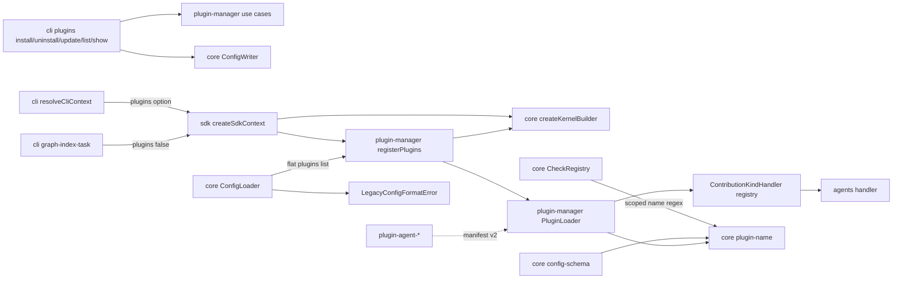

# Design: plugin-architecture

## Non-goals

- Implementing any contribution kind other than `agents`. `checks`, `cliCommands`, `skills`, `skillInjections`, storage/VCS/actor/parser/transform kinds, code-graph adapters/stores and `host:cli`/`host:mcp` are reserved extension points only; their handlers belong to their owners (`check` arrives with `check-plugins-runtime`).
- Data extensions (plugin-namespaced sections in the change manifest), per-contribution config/`init`/entry, and `exclude`/`enabled` flags on contributions.
- An automatic rewrite of `specd.yaml` or a `migrate` command. Only the detection and the printed migration snippet are in scope.
- Reinstalling agent files automatically when a skill-contributing plugin changes (no such contribution kind exists yet).
- Changing how checks are registered or governed beyond the plugin-name grammar and canonical id construction in `core:check-registry`.

## Affected areas

Risk figures come from `specd graph impact --direction dependents` over the files below (index refreshed before analysis): the combined set is **CRITICAL** (~233 non-test files), dominated by `check-registry.ts` (141 direct dependents) and `config-loader.ts` (149 affected files). Per file: `specd-plugin.ts` CRITICAL (24), `agent-plugin.ts` CRITICAL (19), `config-cascade.ts` HIGH (16), `config/show.ts` CRITICAL (15 direct dependents), `get-declared-plugins.ts` HIGH (14), `project/init.ts` HIGH (11), `project/update.ts` HIGH (9), the install/uninstall/update/list use cases MEDIUM. The index reported `CONTENT_KNOWN_STALE` for some template files, so figures may be slightly low.

All paths are from the repository root. Because nothing from this branch has been released, breaking changes are accepted: no compatibility shims are kept except the legacy-format error message.

### `@specd/plugin-manager`

- `packages/plugin-manager/src/domain/types/specd-plugin.ts`
  - Removes `PLUGIN_TYPES`, `PluginType`, `ConfigSchemaEntry`; removes `type` and `configSchema` from `SpecdPlugin`.
  - Before: `interface SpecdPlugin { name; type: PluginType; version; configSchema: Record<string, ConfigSchemaEntry>; init(ctx); destroy() }`.
  - After:
    ```ts
    export interface SpecdPlugin {
      readonly name: string
      readonly version: string
      init(context: PluginContext): Promise<void>
      destroy(): Promise<void>
      install?(context: PluginInstallContext): Promise<unknown>
      uninstall?(context: PluginInstallContext): Promise<void>
      contribution?(kind: string, id: string): unknown
    }
    ```
  - `PluginContext` gains `pluginConfig`. `isSpecdPlugin` drops the `type`/`configSchema` checks and adds the name rule and the optional-function checks (see New constructs).
  - Callers: `plugin-loader.ts`, `agent-plugin.ts`, all five `plugin-agent-*`, cli `plugins/*`. Risk CRITICAL; the break is deliberate and compile errors enumerate every site.
- `packages/plugin-manager/src/domain/types/agent-plugin.ts`
  - `AgentPlugin` loses `type: 'agent'`; `install`/`uninstall` take a context:
    ```ts
    // Before
    install(config: SpecdConfig, options?: AgentInstallOptions): Promise<AgentInstallResult>
    uninstall(config: SpecdConfig, options?: AgentInstallOptions): Promise<void>
    // After
    install(context: AgentInstallContext): Promise<AgentInstallResult>
    uninstall(context: AgentInstallContext): Promise<void>
    ```
  - `isAgentPlugin` checks only that `install` and `uninstall` are functions.
- `packages/plugin-manager/src/application/ports/plugin-loader.ts`
  - Before: `load(pluginName: string): Promise<SpecdPlugin>`. After: `load(pluginName: string): Promise<LoadedPlugin>` where `LoadedPlugin = { plugin: SpecdPlugin; manifest: SpecdPluginManifest }`.
- `packages/plugin-manager/src/application/ports/plugin-repository.ts`
  - `PluginRepository` loses the `type` parameter and gains `contributions` (see Data models). `DeclaredPlugin` gains `contributions?: readonly string[]`.
- `packages/plugin-manager/src/infrastructure/loader/plugin-loader.ts`
  - `manifestSchema` is replaced by the v2 schema (no `pluginType`, `schemaVersion: z.literal(2)`, `contributes`, `configSchema`, `defaultConfig`). `createPluginLoader(options)` gains `handlers?: readonly ContributionKindHandler[]`; the built-in `agentsContributionHandler` is always included. `load()` returns `LoadedPlugin`, validates the manifest before `import()`, validates blocks with each handler's `blockSchema`, cross-checks `name`/`version` with the manifest, and requires `plugin.contribution` when any declared kind's handler has `activate`.
  - `validateRuntimePlugin` no longer takes `pluginType`; the agent check moves to the use cases (the `agents` kind declared in the manifest requires `isAgentPlugin`, enforced in `load()` via the agents handler's `validatePlugin` hook, see New constructs).
- `packages/plugin-manager/src/application/use-cases/{install-plugin,uninstall-plugin,update-plugin,list-plugins,load-plugin}.ts`
  - Kind-agnostic per the specs. New inputs/outputs: `contributions`, `InstallPluginOutput.contributions`, `InstallPluginOutput.defaultConfig`, `LoadPluginOutput.manifest`, `ListPluginsOutput.plugins[].manifest/contributions`. `InstallPlugin` and friends call `plugin.install?.({ config, contributions, options })`; for plugins whose manifest declares `agents` they first assert `isAgentPlugin`.
- `packages/plugin-manager/src/domain/errors/` — new error classes (see Error handling).
- `packages/plugin-manager/src/index.ts` and sub-barrels export the new symbols.
- `packages/plugin-manager/package.json` — no new dependency (`zod` and `@specd/core` already present).

### `@specd/core`

- `packages/core/src/application/specd-config.ts` (line ~265): `plugins?: { agents?: ... }` becomes
  ```ts
  readonly plugins?: readonly {
    readonly name: string
    readonly config?: Readonly<Record<string, unknown>>
    readonly contributions?: readonly string[]
  }[] | undefined
  ```
- `packages/core/src/application/ports/config-schema.ts`
  - `PluginEntryZodSchema` becomes `{ name: z.string().regex(PLUGIN_NAME_REGEX), config: z.record(z.unknown()).optional(), contributions: z.array(z.string()).min(1).optional() }`; `PluginsZodSchema` becomes `z.array(PluginEntryZodSchema).refine(uniqueNames)`; the top-level schema gains `configVersion: z.number().int().positive().optional()`.
  - `PLUGIN_NAME_REGEX = /^@[a-z0-9][a-z0-9_-]*\/[a-z0-9][a-z0-9_-]*$/` is defined once in `packages/core/src/domain/` (new file `plugin-name.ts`, see New constructs) and imported by both `config-schema.ts` and `check-registry.ts`; `@specd/plugin-manager` imports it from `@specd/core`.
- `packages/core/src/infrastructure/fs/config-loader.ts` (line ~656): maps `data.plugins` as the flat list (preserving `name`, `config`, `contributions`). A new step `assertCurrentConfigFormat(raw, layerPath)` runs on each parsed layer before the strict Zod parse.
- `packages/core/src/infrastructure/fs/config-cascade.ts`
  - `LayerRemovalZodSchema.plugins`: `z.array(z.object({ name: z.string() })).optional()` (before: `z.object({ agents: z.array(...) })`).
  - `applyRemovals`: removes by `name` from the flat `accumulated.plugins` list (error `remove.plugins: no plugins in inherited config` / `remove.plugins: '<name>' not found`, both `ConfigValidationError`).
  - `deepMergeRawConfig`: `plugins` arrays are merged by `name` (same name replaces in place, new names appended in layer order), all other array behaviour unchanged.
  - `mergeActiveLayers`: after merging, a layer whose `configVersion` differs from the root layer's raises `ConfigValidationError`; the merged object keeps the root value.
- `packages/core/src/application/ports/config-writer.ts` and `packages/core/src/infrastructure/fs/config-writer.ts`
  - Before: `addPlugin(configPath, type, name, config?)`, `removePlugin(configPath, type, name)`, `listPlugins(configPath, type?)`.
  - After:
    ```ts
    addPlugin(configPath: string, name: string, options?: AddPluginOptions): Promise<void>
    removePlugin(configPath: string, name: string): Promise<void>
    listPlugins(configPath: string): Promise<DeclaredPluginEntry[]>
    ```
  - `parsePlugins` now parses an array; `initProject` writes `configVersion: 2` as the first key.
- `packages/core/src/composition/config-loader.ts`, `packages/core/src/composition/config-writer.ts`: signatures follow the port; no logic.
- `packages/core/src/domain/services/check-registry.ts` (CRITICAL, 141 direct dependents)
  - `PLUGIN_NAME_REGEX` is replaced by the shared scoped regex; JSDoc fixed to match.
  - `register()`: `const canonicalId = `@${pluginName}.${check.id}`becomes`const canonicalId = `${pluginName}.${check.id}` ``(the`@`is part of the scoped name; the old form would produce`@@scope/name.id`). Callers that pass unscoped names (tests, `check-plugins-runtime`work in progress) must pass scoped names.`workflow-check-registry.ts`discrimination by`id.startsWith('@')` stays valid.
  - Overlap: `check-plugins-runtime` targets the same spec and file; this change only touches the name grammar and id construction; both changes must be reconciled at archive (see Open questions).
- New error classes `LegacyConfigFormatError`, `UnsupportedConfigVersionError` (see Error handling).
- Test files updated in step with the above: `packages/core/test/infrastructure/fs/{config-loader,config-loader-root-containment,config-writer}.spec.ts`, `packages/core/test/composition/config-writer.spec.ts`, check-registry tests.

### `@specd/sdk`

- `packages/sdk/src/composition/host-context.ts` (`createSdkContext`, `SdkContextOptions`): see Approach. Before: `createKernel(config, options?.kernel)`. After: `createKernelBuilder(config, options?.kernel)` + conditional `registerPlugins` + `await builder.build()`.
- `packages/sdk/src/index.ts`, `packages/sdk/src/composition/index.ts`: export `SdkContextOptions`, `ContributionKindHandler`, `ContributionActivationContext`.
- `packages/sdk/package.json`: add `"@specd/plugin-manager": "workspace:*"`; `packages/sdk/tsconfig.json`: add the project reference if the repo uses references; verify with `pnpm -r build` that the graph stays acyclic (`plugin-manager → core` only).
- `createKernelBuilder` is exported by `@specd/core/extensions` (not the `"."` barrel); plugin-manager imports `KernelBuilder` as a type from `@specd/core/extensions`, the SDK imports `createKernelBuilder` from the same subpath.

### `@specd/cli`

- `packages/cli/src/commands/plugins/install.ts`, `uninstall.ts`, `update.ts`, `list.ts`, `show.ts`
  - Install: name validation with the shared regex, `--contributions <ids>` flag (single plugin only), flat-list already-installed detection, `addPlugin(configPath, name, options)`; all five call `resolveCliContext({ plugins: false })`.
  - Uninstall: resolves the plugin's entry from `config.plugins`, passes its allowlist, `removePlugin(configPath, name)`; errors per-name when not declared.
  - Update: iterates `config.plugins` (or the named subset) with each entry's allowlist.
  - List: drops `--type`; rows `{ name, contributions: { declared, selected }, version, status, detail? }`.
  - Show: prints name, version, contributions (`kind`, `id`, `address`), `configSchema`, `defaultConfig`, and agent capabilities.
- `packages/cli/src/commands/plugins/get-declared-plugins.ts`: replaced by `getDeclaredPlugins(config): readonly DeclaredPluginEntry[]` (no `type` param) and `findDeclaredPlugin(config, name)`; `DeclaredPluginEntry` gains `contributions?`.
- `packages/cli/src/commands/project/init.ts`, `project/update.ts`, `config/show.ts`: flat-list reads/writes; `config show` prints `<name>  (present)  [contributions: a, b]`.
- `packages/cli/src/helpers/cli-context.ts` (`resolveCliContext`): new option `plugins?: boolean` forwarded as `options.plugins` in `OpenSpecdHostInput` (kernel options unchanged).
- `packages/cli/src/graph-index-task.ts`: both `openSpecdHost(...)` and `createSdkContext(...)` calls pass `{ kernel, plugins: false }`.
- `packages/cli/src/helpers/cli-host.ts`: unchanged (the option rides in `options`).

### Agent plugins (`plugin-agent-{claude,copilot,codex,opencode,standard}`)

- Each `specd-plugin.json`: `schemaVersion: 2`, drop `pluginType`, add `"contributes": { "agents": { "<id>": {} } }` with id `claude`/`copilot`/`codex`/`opencode`/`standard`.
- Each `src/index.ts` `create()` and `src/domain/types/*-plugin.ts`: drop the `type` getter; `install(context)`/`uninstall(context)` read `context.config`/`context.options`. Install/uninstall use cases (`InstallSkills`/`UninstallSkills`) keep their `(config, options)` signatures; only the plugin class adapts the context.
- Tests updated accordingly.

### Repository files

- `specd.yaml` (end of file, `plugins:` block): becomes
  ```yaml
  configVersion: 2
  plugins:
    - name: '@specd/plugin-agent-claude'
    - name: '@specd/plugin-agent-copilot'
    - name: '@specd/plugin-agent-standard'
    - name: '@specd/plugin-agent-codex'
    - name: '@specd/plugin-agent-opencode'
  ```
  (`configVersion: 2` goes at the top of the file, next to `schema:`.)
- Docs: `docs/guide/configuration.md`, `docs/guide/configuration-examples.md`, `docs/guide/installation.md`, `docs/core/config.md` (replace `plugins.agents` with the flat list, document `configVersion`, `contributions`, scoped names, the legacy error). Add `docs/guide/plugins.md` documenting the manifest (`contributes`, `configSchema`, `defaultConfig`), addressing, lifecycles, `plugins: false`, and the CLI commands (per `default:_global/docs`, guide parity with core). `packages/guide/src/infrastructure/generated/guides.ts` is regenerated by the build; its diff is expected churn.

## New constructs

### `packages/core/src/domain/plugin-name.ts` (exported from `@specd/core`)

```ts
/** Scoped plugin name: `@scope/name`, lowercase, no `.`. */
export const PLUGIN_NAME_REGEX = /^@[a-z0-9][a-z0-9_-]*\/[a-z0-9][a-z0-9_-]*$/
export function isPluginName(value: string): boolean
```

### `packages/core/src/domain/errors/` — config errors

```ts
export class LegacyConfigFormatError extends ConfigValidationError {
  // code: 'LEGACY_CONFIG_FORMAT'
  constructor(configPath: string, readonly suggestedSnippet: string)
}
export class UnsupportedConfigVersionError extends ConfigValidationError {
  // code: 'UNSUPPORTED_CONFIG_VERSION'
  constructor(configPath: string, readonly found: number, readonly supported: number)
}
export const CURRENT_CONFIG_VERSION = 2
```

`ConfigValidationError.code` is currently a single value; the subclasses override `code` as readonly literals. Both are exported from the `@specd/core` barrel and re-exported by the SDK's explicit error list.

### `packages/plugin-manager/src/domain/types/specd-plugin.ts` (additions)

```ts
export interface PluginContext {
  readonly config: SpecdConfig
  /** This plugin's own config, validated against `configSchema` with defaults applied; `{}` when no schema. */
  readonly pluginConfig: Readonly<Record<string, unknown>>
}
export interface PluginInstallContext {
  readonly config: SpecdConfig
  /** Selected contribution ids (all declared ids when no allowlist). */
  readonly contributions: readonly string[]
}
export const CONTRIBUTION_ID_REGEX = /^[a-z0-9][a-z0-9_-]*$/
export function buildContributionAddress(pluginName: string, id: string): string // `${pluginName}.${id}`
export function parseContributionAddress(address: string): { pluginName: string; id: string } // throws PluginValidationError unless exactly one '.'
export function isSpecdPlugin(value: unknown): value is SpecdPlugin
```

`isSpecdPlugin` returns true iff `value` is a non-null object, `name` and `version` are strings, `isPluginName(name)`, `init`/`destroy` are functions, and `install`/`uninstall`/`contribution` are each absent or functions.

### `packages/plugin-manager/src/domain/types/plugin-manifest.ts`

```ts
export type ContributionBlocks = Readonly<Record<string, Readonly<Record<string, unknown>>>> // kind -> id -> block
export interface SpecdPluginManifest {
  readonly schemaVersion: 2
  readonly name: string
  readonly version: string
  readonly description?: string
  readonly minCoreVersion: string // default '*'
  readonly contributes: ContributionBlocks // default {}
  readonly configSchema?: PluginConfigSchema
  readonly defaultConfig?: Readonly<Record<string, unknown>>
}
export type PluginConfigSchema = {
  readonly type: 'object'
  readonly properties?: Readonly<Record<string, ConfigSchemaNode>>
  readonly required?: readonly string[]
  readonly additionalProperties?: boolean
}
export type ConfigSchemaNode = {
  readonly type: 'string' | 'number' | 'integer' | 'boolean' | 'array' | 'object'
  readonly enum?: readonly (string | number | boolean)[]
  readonly default?: unknown
  readonly items?: ConfigSchemaNode
  readonly properties?: Readonly<Record<string, ConfigSchemaNode>>
  readonly required?: readonly string[]
  readonly additionalProperties?: boolean
}
```

### `packages/plugin-manager/src/domain/types/contribution-kind-handler.ts`

```ts
import type { ZodType } from 'zod'
import type { KernelBuilder } from '@specd/core/extensions'

export interface ContributionActivationContext {
  readonly pluginName: string
  readonly kind: string
  readonly plugin: SpecdPlugin
  readonly pluginConfig: Readonly<Record<string, unknown>>
  /** Selected contributions of this kind: id -> parsed manifest block (output of `blockSchema`). */
  readonly contributions: ReadonlyMap<string, unknown>
  readonly builder: KernelBuilder
}
export interface ContributionKindHandler {
  readonly kind: string
  readonly blockSchema: ZodType
  /** Optional extra validation of the runtime plugin object for this kind; throws PluginValidationError. */
  validatePlugin?(plugin: SpecdPlugin, pluginName: string): void
  activate?(ctx: ContributionActivationContext): void | Promise<void>
}
```

### `packages/plugin-manager/src/domain/services/plugin-config-schema.ts` (pure)

```ts
export const SUPPORTED_SCHEMA_KEYWORDS: readonly string[] // type, properties, required, items, enum, default, additionalProperties
/** Throws UnsupportedSchemaKeywordError (naming plugin and keyword) for any other keyword at any depth; also enforces root type 'object'. */
export function assertSupportedConfigSchema(
  pluginName: string,
  schema: unknown,
): asserts schema is PluginConfigSchema
/** Converts the subset to a Zod schema: object -> z.object (strict when additionalProperties === false, passthrough otherwise), required -> non-optional, default -> .default(), enum -> z.enum/z.union of literals, integer -> z.number().int(). */
export function configSchemaToZod(schema: PluginConfigSchema): ZodType
/** Applies defaults and validates. Throws InvalidPluginConfigError(pluginName, issues) with one `path: message` per issue. A plugin without schema: config === undefined -> {}; config !== undefined -> InvalidPluginConfigError(['config provided but plugin declares no configSchema']). */
export function resolvePluginConfig(
  pluginName: string,
  schema: PluginConfigSchema | undefined,
  config: Readonly<Record<string, unknown>> | undefined,
): Readonly<Record<string, unknown>>
```

### `packages/plugin-manager/src/domain/handlers/agents-handler.ts`

```ts
export const agentsContributionHandler: ContributionKindHandler = {
  kind: 'agents',
  blockSchema: z.record(z.string().regex(CONTRIBUTION_ID_REGEX), z.object({}).strict()),
  validatePlugin(plugin, pluginName) {
    if (!isAgentPlugin(plugin))
      throw new PluginValidationError(pluginName, ['install', 'uninstall'])
  },
  // no activate: install-time only, no-op at runtime
}
```

### `packages/plugin-manager/src/application/use-cases/register-plugins.ts`

```ts
export interface RegisterPluginsOptions {
  readonly handlers: readonly ContributionKindHandler[]
  readonly loader?: PluginLoader
}
export function registerPlugins(
  builder: KernelBuilder,
  config: SpecdConfig,
  options: RegisterPluginsOptions,
): Promise<PluginRegistration>

export interface PluginRegistration {
  /** Destroys initialized plugins in reverse order; idempotent; same function as the registered disposer. */
  readonly dispose: () => Promise<void>
}
```

Invariants: validates everything before the first `init`; `init` in list order; exactly one disposer named `specd-plugins` registered on success; none on failure; idempotent disposer; `destroy` in reverse order with aggregation.

### Contribution selection helper — `packages/plugin-manager/src/domain/services/resolve-contributions.ts`

```ts
export function declaredContributionIds(manifest: SpecdPluginManifest): readonly string[] // order: kinds in manifest order, ids in order
export function resolveContributions(
  pluginName: string,
  manifest: SpecdPluginManifest,
  allowlist: readonly string[] | undefined,
): readonly string[] // allowlist undefined -> all declared; unknown id -> UnknownContributionError
```

## Data models & Contracts

### Manifest `specd-plugin.json` (v2)

```json
{
  "schemaVersion": 2,
  "name": "@scope/name",
  "version": "1.0.0",
  "description": "optional",
  "minCoreVersion": "*",
  "configSchema": {
    "type": "object",
    "properties": {
      "severity": { "type": "string", "enum": ["warn", "error"], "default": "error" }
    },
    "required": ["severity"],
    "additionalProperties": false
  },
  "defaultConfig": { "severity": "error" },
  "contributes": { "agents": { "claude": {} } }
}
```

Zod boundary schema (infrastructure): `schemaVersion: z.literal(2)`, `name: z.string().regex(PLUGIN_NAME_REGEX)`, `version: z.string().min(1)`, `description: z.string().optional()`, `minCoreVersion: z.string().default('*')`, `contributes: z.record(z.record(z.unknown())).default({})`, `configSchema: z.unknown().optional()` (then `assertSupportedConfigSchema`), `defaultConfig: z.record(z.unknown()).optional()`, `.strict()` so `pluginType` and unknown fields are rejected. Ids are validated against `CONTRIBUTION_ID_REGEX` and uniqueness across all kinds; `defaultConfig` is validated with `resolvePluginConfig`. A non-object `contributes[kind]` (array/string) fails with `PluginValidationError(['contributes.<kind>'])`.

### `specd.yaml`

```yaml
configVersion: 2 # optional integer; absent accepted; > 2 -> UNSUPPORTED_CONFIG_VERSION
plugins: # optional flat list
  - name: '@scope/name' # required, PLUGIN_NAME_REGEX, unique
    config: {} # optional object, validated by plugin-manager against the manifest configSchema
    contributions: [id] # optional non-empty allowlist of declared ids
```

Cascade: `plugins` merged by `name` (replace in place / append); `remove: { plugins: [{ name }] }` removes inherited entries; `configVersion` is read from the root layer and an extending layer with a different value is rejected.

### Legacy detection and migration message

`assertCurrentConfigFormat(raw, path)`: if `raw.plugins` is a non-array object (`typeof === 'object'`, not `Array`) and has an `agents` key, throw `LegacyConfigFormatError(path, snippet)` with the message

```text
<path>: 'plugins.agents' is no longer supported (LEGACY_CONFIG_FORMAT).
Replace the 'plugins' section with:

configVersion: 2
plugins:
  - name: '@specd/plugin-agent-claude'
  - name: '@specd/plugin-agent-copilot'
```

(the list is generated from `plugins.agents`, preserving `config` blocks). A `plugins` object without `agents` (e.g. `{ other: [] }`) falls through to the strict schema error. If `configVersion` is a number greater than `CURRENT_CONFIG_VERSION`, throw `UnsupportedConfigVersionError(path, found, 2)` ("specd.yaml configVersion N is newer than supported (2); upgrade specd"). The version check runs first, legacy detection second, strict Zod parse third. The same detection runs for every cascade layer file.

### Plugin install context for agents

```ts
export interface AgentInstallContext extends PluginInstallContext {
  readonly options?: AgentInstallOptions
}
```

### Use case I/O (final)

```ts
interface InstallPluginInput { pluginName: string; config: SpecdConfig; contributions?: readonly string[]; options?: Record<string, unknown> }
interface InstallPluginOutput { success: boolean; message: string; contributions: readonly string[]; defaultConfig?: Readonly<Record<string, unknown>>; data?: unknown }
interface UninstallPluginInput { pluginName: string; config: SpecdConfig; contributions?: readonly string[]; options?: Record<string, unknown> }
type UninstallPluginOutput = void
interface UpdatePluginInput = InstallPluginInput-shaped; UpdatePluginOutput = Omit<InstallPluginOutput, 'defaultConfig'>
type LoadPluginOutput = { plugin: SpecdPlugin; manifest: SpecdPluginManifest } // loader errors are thrown, never returned
interface ListPluginsOutput { plugins: Array<{ name; status: 'loaded'|'not_found'|'error'; plugin?; manifest?; contributions?: readonly string[]; error?: string }> }
interface DeclaredPlugin { name: string; config?: Record<string, unknown>; contributions?: readonly string[] }
interface AddPluginOptions { config?: Record<string, unknown>; contributions?: readonly string[] }
```

### SDK

```ts
interface SdkContextOptions {
  readonly kernel?: KernelOptions
  readonly graph?: CodeGraphCompositionOptions
  readonly plugins?: boolean // default true
  readonly pluginHandlers?: readonly ContributionKindHandler[] // extra handlers supplied by the host
}
```

## Approach & Execution flow

### A. Loading a plugin (`createPluginLoader(...).load(name)`)

1. Resolve the package (project-local resolver first, then the CLI runtime resolver) — unchanged. Not found → `PluginNotFoundError`.
2. Read and JSON-parse `specd-plugin.json` — unchanged errors (`PluginValidationError(['specd-plugin.json'])`).
3. Parse with the strict v2 manifest schema (name regex, `schemaVersion: 2`, no `pluginType`).
4. `assertSupportedConfigSchema` when `configSchema` is present; validate every contribution id (`CONTRIBUTION_ID_REGEX`), uniqueness across all kinds (`DuplicateContributionError`); validate `defaultConfig` with `resolvePluginConfig`.
5. For every kind in `contributes`: look up the handler (`UnknownContributionKindError` if absent), parse the block with `handler.blockSchema` (failure → `PluginValidationError(['contributes.<kind>'...])`).
6. Only now `import(entryPath)`; resolve `create`; call `create({ config })`.
7. `isSpecdPlugin` (failure → `PluginValidationError(['name','version','init','destroy'])`); `plugin.name`/`version` must equal the manifest's (`PluginValidationError(['name'])`/`['version']`); for each kind run `handler.validatePlugin?`; if any declared kind's handler has `activate`, require `typeof plugin.contribution === 'function'` (`PluginValidationError(['contribution'])`).
8. Return `{ plugin, manifest }`. The loader never calls `init`, `install` or `destroy`.

### B. `registerPlugins(builder, config, options)`

1. `entries = config.plugins ?? []`; if empty return (no disposer).
2. Duplicate names → `PluginValidationError(name, ['name'])`. Build `loader = options.loader ?? createPluginLoader({ config, handlers: options.handlers })`; a duplicate handler `kind` among `options.handlers` plus built-ins → `PluginValidationError('<handlers>', ['kind'])`.
3. Phase 1 (no side effects): for each entry in order `loaded = await loader.load(name)`; `selected = resolveContributions(...)`; `pluginConfig = resolvePluginConfig(name, manifest.configSchema, entry.config)`.
4. Phase 2: for each entry in order `await plugin.init({ config, pluginConfig })`; on throw `e`: `await destroyReverse(initializedSoFar)` (errors collected), then throw `e` if it is a `SpecdError`, else `new PluginInitError(name, e)`. Plugins already initialized are those with a completed `init`; the failing plugin is not destroyed.
5. Phase 3: for each entry, group selected ids by kind; for each kind with `handler.activate`: `await handler.activate({ pluginName, kind, plugin, pluginConfig, contributions: Map(id → parsed block), builder })`. Any failure → `destroyReverse(all initialized)` then rethrow (wrapped in `PluginInitError` when not a `SpecdError`).
6. `dispose = () => destroyReverse(initialized)`; `builder.registerDisposer('specd-plugins', dispose)`; return `{ dispose }`. `destroyReverse(list)` iterates from the last element, awaiting each `destroy()` inside try/catch, collecting errors; after all ran, throws `AggregateError(errors, 'plugin destroy failed')` when any; guarded by a `disposed` flag so a second call is a no-op. If `registerDisposer` itself throws, destroy everything and rethrow.

### C. `createSdkContext(config, options)`

1. `builder = createKernelBuilder(config, options?.kernel)`.
2. If `options?.plugins !== false`: `await registerPlugins(builder, config, { handlers: options?.pluginHandlers ?? [] })` (the loader adds the built-in `agents` handler).
3. `try { kernel = await builder.build() } catch (e) { await registration?.dispose(); throw e }` where `registration` is the value returned by `registerPlugins` (undefined when plugins are disabled). This guarantees initialized plugins are destroyed when the kernel cannot be built.
4. Return the context as before (`dispose` delegates to `kernel.dispose()`, which runs the plugin disposer).

`openSpecdHost` is unchanged apart from forwarding `input.options` (already done).

### D. CLI `plugins install <plugin>... [--contributions ids]`

1. Reject `--contributions` with more than one plugin (usage error, exit 1).
2. `ctx = resolveCliContext({ configPath, plugins: false })`; `configPath = ctx.configFilePath`.
3. For each name: `isPluginName(name)` else error entry `{ name, status: 'error', detail }`; already in `ctx.config.plugins` → warning `... already installed; use 'specd plugins update'`, status `skipped`.
4. `new InstallPlugin(createPluginLoader({ config })).execute({ pluginName, config, contributions? })`; on success `createConfigWriter().addPlugin(configPath, name, { ...(defaultConfig ? { config: defaultConfig } : {}), ...(contributions given ? { contributions } : {}) })`.
5. Per-name failure → record error, continue; exit code 1 if any failed.

### E. `uninstall` / `update` / `list` / `show`

- `uninstall`: for each name, `entry = findDeclaredPlugin(config, name)` else error; `UninstallPlugin.execute({ pluginName, config, contributions: entry.contributions })`; then `removePlugin(configPath, name)`; hook before removal (existing order).
- `update`: names or all of `config.plugins`; per entry `UpdatePlugin.execute({ pluginName, config, contributions: entry.contributions })`; never writes config.
- `list`: for every entry, `ListPlugins.execute({ pluginNames })`; rows built from `manifest` ids and the entry allowlist.
- `show`: `LoadPlugin` then print; JSON output `{ name, version, contributions: [{ kind, id, address }], configSchema?, defaultConfig?, capabilities? }`. All run with `plugins: false`.
- `project init`: `initProject` (writes `configVersion: 2`), then `plugins install` for `--plugin` selections. `project update`: same logic as `plugins update` with no filter, opened with `plugins: false`.

### F. Config load path

`FsConfigLoader` per layer: read YAML → `assertCurrentConfigFormat` → strict Zod parse → cascade merge (`plugins` by name, `configVersion` root-only) → map to `SpecdConfig.plugins` flat list. The loader never loads plugins and never validates `config` against plugin schemas.

### G. Agent plugin classes

`ClaudeAgentPlugin` etc.: remove `readonly type = 'agent'`; `install(context: AgentInstallContext)` delegates to `this.installSkills(context.config, context.options)`; `uninstall` likewise; `create()` unchanged except return type.

## Error handling & Edge cases

New plugin-manager errors (all extend `SpecdError`, carry `pluginName`, message names the plugin):

| Class                                                    | `code`                       | Raised when                                                                      |
| -------------------------------------------------------- | ---------------------------- | -------------------------------------------------------------------------------- |
| `DuplicateContributionError(pluginName, contributionId)` | `DUPLICATE_CONTRIBUTION_ID`  | same id twice across kinds in the manifest                                       |
| `UnknownContributionError(pluginName, contributionId)`   | `UNKNOWN_CONTRIBUTION`       | allowlist id not declared by the manifest (register, install, uninstall, update) |
| `UnknownContributionKindError(pluginName, kind)`         | `UNKNOWN_CONTRIBUTION_KIND`  | manifest kind has no registered handler                                          |
| `InvalidPluginConfigError(pluginName, issues)`           | `INVALID_PLUGIN_CONFIG`      | `config`/`defaultConfig` violates schema, or config given without schema         |
| `UnsupportedSchemaKeywordError(pluginName, keyword)`     | `UNSUPPORTED_SCHEMA_KEYWORD` | keyword outside the supported subset, at any depth                               |
| `PluginInitError(pluginName, cause)`                     | `PLUGIN_INIT_FAILED`         | `init` throws a non-`SpecdError`                                                 |

Existing `PluginValidationError(pluginName, fields)` covers invalid manifest, invalid name, `pluginType` present, `schemaVersion` other than 2, name/version mismatch, base-contract violation, duplicate plugin entries, `agents` declared without `install`/`uninstall`, install/uninstall/update hook failures (wrapped). Core: `LegacyConfigFormatError`, `UnsupportedConfigVersionError` (both `ConfigValidationError`), `InvalidPluginNameError` (existing, for the check registry).

Edge cases:

- Empty/absent `plugins` → no loader, no handlers, no disposer.
- `plugins: false` → `registerPlugins` not called; `kernel.dispose()` has no plugin disposer.
- Allowlist with an id of another plugin → `UnknownContributionError` (ids are per-plugin).
- `contributions: []` in `specd.yaml` → `ConfigValidationError` (min 1).
- Plugin with `contributes: {}` → valid; only `init`/`destroy` run.
- `destroy` throws for one plugin → remaining destroyed; `AggregateError` surfaces from `kernel.dispose()` (already isolated by the kernel's disposer machinery).
- `init` of plugin N fails → plugins 1..N−1 destroyed in reverse before the error propagates; no disposer registered.
- Package unresolved → `PluginNotFoundError` (a `SpecdError`) fails startup naming the plugin; `plugins list` still lists it as `not_found` because it runs with `plugins: false`.
- Dotted names, uppercase, unscoped → rejected by the single shared regex in config, manifest, `isSpecdPlugin`, CLI install and check registry.
- Stale `configVersion` in an extending layer → `ConfigValidationError`.
- Windows: no path logic added; existing resolver code unchanged.

## Key decisions

- **Plugin = feature with N contributions** declared statically in the manifest; **kinds are an open handler registry**. Rejected: one plugin per kind (breaks shared namespace/config/state), a closed `PLUGIN_TYPES` enum, per-kind `specd.yaml` buckets, a separate `namespace` field or `<npm-name>:<id>` ids.
- **Scoped name is the namespace; address = `<name>.<id>`.** The regex rejects `.` so the single-dot split is unambiguous. Consequence: the check registry's canonical id is `${pluginName}.${id}` (no extra `@`), a behavioural change versus today.
- **Config schema in the manifest as a bounded JSON Schema subset** (own converter to Zod; `ajv` not a direct dependency, zod 3.25 has no converter). Static data lets `install`/`list`/`show` and config validation run without executing plugin code and lets `defaultConfig` be validated at load. Rejected: schema in plugin code (needs code execution to validate), Zod or a flat custom type as the format.
- **Allowlist-only selection** (`contributions`), no `exclude`: an update never activates a new contribution unnoticed; selection is persisted in YAML because uninstall/update/list need it.
- **`init`/`destroy` once per process for every configured plugin, config only.** Explicit methods instead of a phase switch. Contributions have no lifecycle; handlers activate them.
- **Failure policy: strict.** Any load/validation/`init` failure fails startup naming the plugin; mitigated by `plugins: false` for repair commands and the graph worker.
- **Layering:** core validates only shape (flat list, scoped name, `configVersion`, legacy detection). Anything needing the manifest (config vs schema, unknown ids) lives in plugin-manager. Core cannot import plugin-manager.
- **`registerPlugins` lives in plugin-manager and is called by `createSdkContext`** (not `openSpecdHost`), through `createKernelBuilder`. `sdk → plugin-manager` is the only new edge.
- **The `agents` kind is install-time only**; its handler has no `activate`. Agent plugins keep their `install`/`uninstall` implementations behind a context parameter.
- **Config versioning:** optional `configVersion` (introduced as 2), legacy format detected by shape before strict parsing; no automatic rewrite (YAML comments), no `migrate` command. Rejected: making the version mandatory (breaks every existing config without a benefit now), inferring legacy only from the version.
- **PluginContext gains `pluginConfig`** so plugins receive validated per-plugin config with defaults instead of reading raw project config.

## Verification audit decisions

The compliance audit of attempt `verification-attempt-1` compared specs, code and tests. Each discrepancy was resolved in one direction; the spec-side items are applied in the deltas, the code-side items are tasks in group 12.

**Spec corrected to match the (intended) code**

- `LoadPlugin` throws loader errors instead of returning `{ error }`.
- Manifest: `description` and `minCoreVersion` are optional; the schema is strict (any unknown top-level field is rejected, not only `pluginType`).
- `PluginLoaderOptions` has an optional `handlers` list; the built-in `agents` handler is always registered by the loader; `ContributionKindHandler` has an optional `validatePlugin` hook.
- `install`/`uninstall`/`update` pass a `SpecdError` from the hook through unchanged and wrap other errors in `PluginValidationError` (with `cause`).
- `registerPlugins`: the manifest is validated before plugin code is imported; plugin config and the contribution allowlist are validated before any `init`. A failing rollback must not mask the startup error.
- `PluginRepositoryPort` is documentation of what `ConfigWriter` already exposes; there is no separate adapter.
- Codex, OpenCode and Standard use tagged, reference-counted `AGENTS.md` blocks (`injectSpecdBlock(path, prompt, id)` / `removeSpecdBlock(path, id)`); legacy markers are purged on uninstall (and on OpenCode install). OpenCode writes flat `.opencode/agents/<name>.md` files and agent entries may carry `allowed_tools`.
- `core:config-writer-port`: init creates `{specdPath}/tmp/.gitignore`; runtime repositories ensure `{configPath}/tmp/.gitignore` lazily.
- `cli:project-update` exits 1 when a plugin update reports an error (after processing all plugins); warnings keep exit 0.

**Delta defect fixed**: the five `plugin-agent-*` deltas used paragraph-level `modified` operations that do not apply, so the merged specs still said `type` is hardcoded to `'agent'`. They now modify the containing sections.

**Code corrected to match the spec** (group 12): `plugins update` for an undeclared plugin is an error; `plugins list`/`show` text output show everything JSON shows; `show` capabilities reflect the plugin; `AgentInstallContext.contributions` carries only `agents` ids; install/uninstall/update wrap with `cause`; rollback failures do not mask `PluginInitError`; errors always name the plugin; `FsConfigWriter` never overwrites an invalid `plugins` value; Codex TOML escaping; Copilot and Standard uninstall cleanup; Standard `allowed-tools` uses `Bash(node *)`.

## Trade-offs

- A broken configured plugin blocks every host-based command → `plugins: false` for `plugins *`, `project update` and the graph-index worker; documented in `docs/guide/plugins.md`.
- Breaking changes (manifest v2, `specd.yaml` list, `ConfigWriter` signatures, `SpecdPlugin` shape) → no release has shipped; the legacy-format error gives users the exact replacement.
- The check-registry id change is a behavioural break for the in-progress `check-plugins-runtime` work → called out here and in the proposal; reconcile at archive (see Open questions).
- Writing our own schema converter is more code than adopting a library → bounded keyword set, unit tests per keyword, and an explicit unsupported-keyword error make it predictable.
- Agent files can become stale once `skills`/`skillInjections` exist → deferred with those kinds.

## Spec impact

Specs modified by this change and their dependents (via `specd graph impact --spec ... --direction dependents` and the dependency declarations in the change):

- `core:config`, `core:config-loader`, `core:config-writer-port` (direct dependents: `cli:project-init`, `cli:project-update`, `cli:config-show`, `cli:plugins-*`, `plugin-manager:*`, `sdk:host-context`). All of these are in scope. Transitive dependents that mention `plugins.agents` textually: none beyond the ones already in scope (grep of specs for `plugins.agents` found only `core:config`, `core:config-loader`, `cli:*` plugin/project/config specs, `plugin-manager:*`).
- `core:check-registry` dependents (`core:transition-checks`, `core:schema-format`, workflow check specs) reference the `@<plugin>.<id>` form only as illustrative examples in a few scenarios of `core:check-registry` itself that were not rewritten (retrieval of `@security.code-scan`, `@nonexistent.check`). These scenarios only exercise `get`/`has` with arbitrary strings and remain valid; they will be tidied by `check-plugins-runtime`.
- `plugin-manager:*` use case specs and the five `plugin-agent-*` specs: all in scope.
- `sdk:composition`/`sdk:host-context` dependents `cli:host-context` (in scope) and `cli:entrypoint`, which only consumes the host and is unaffected.
- `code-graph:isolated-index-worker` is unaffected: the worker lives in the CLI (`graph-index-task.ts`, covered by `cli:host-context`).

## Dependency map



```
 cli plugins *  ──► plugin-manager use cases ──► PluginLoader ──► handler registry (agents)
      │                                              ▲
      ├──► core ConfigWriter (flat list)             │ manifest v2 (contributes, configSchema)
      │                                              │
 resolveCliContext(plugins) ─► sdk createSdkContext ─┴─► registerPlugins ─► KernelBuilder
 graph-index-task(plugins:false) ─┘                         │  init all → activate → build
                                                            └─ one disposer: destroy reverse
 core ConfigLoader ─► legacy detection / configVersion ─► SpecdConfig.plugins (flat)
 core CheckRegistry / config-schema / plugin-manager ─► shared PLUGIN_NAME_REGEX (core)
```

## Migration / Rollback

- This repo: edit `specd.yaml` as shown (flat list + `configVersion: 2`); bump the five plugin manifests to `schemaVersion: 2` with `contributes`.
- Users on previously released versions: loading the old `plugins.agents` shape fails with `LEGACY_CONFIG_FORMAT` and a copy-pasteable replacement; no data is lost and nothing is rewritten.
- Already-generated agent files are unaffected (same install output).
- Rollback: revert the change commit(s); `configVersion` is optional so a reverted loader would reject the unknown key (strict schema), hence rollback requires reverting `specd.yaml` too (both are in the same change).
- Sequencing in the PR: core first (shared regex, config format, errors), then plugin-manager, then sdk, then agent plugins, then cli, then docs, because each layer's types gate the next.

## Testing

All new tests use Vitest per `default:_global/testing` (unit tests mock ports; integration uses `os.tmpdir()`; POSIX+Windows-safe paths; no snapshots).

### Automated — plugin-manager (`packages/plugin-manager/test/`)

- `domain/specd-plugin.spec.ts`: name regex accepts `@specd/plugin-agent-claude`, `@acme/specd-compliance`; rejects `my-plugin`, `@acme/my.plugin`, `@ac.me/plugin`, `@Acme/Plugin`; `buildContributionAddress`/`parseContributionAddress` (single dot, invalid with 0 or 2 dots, id containing a dot rejected); `isSpecdPlugin` rejects unscoped name, non-function `install`, accepts plugin without install hooks.
- `domain/plugin-config-schema.spec.ts`: each supported keyword; unsupported (`$ref`, `oneOf`, `patternProperties`) → `UnsupportedSchemaKeywordError` naming plugin and keyword at nested depth; defaults applied; `additionalProperties: false` strict; no schema + config → `InvalidPluginConfigError`; no schema + undefined → `{}`.
- `domain/resolve-contributions.spec.ts`: all by default; allowlist subset; unknown id → `UnknownContributionError`.
- `infrastructure/plugin-loader.spec.ts` (extends existing): manifest validated before import (spy: import not called on invalid manifest); `pluginType` rejected; `schemaVersion: 1` rejected; unscoped name; duplicate id across kinds; unregistered kind; invalid block; unsupported keyword; `defaultConfig` violating schema; name/version mismatch; missing `contribution` accessor when a handler has `activate`; no lifecycle calls.
- `application/register-plugins.spec.ts`: `init` order; validation before any `init`; handlers receive only selected contributions; `init` called for plugins with only `agents`; exactly one disposer; destroy reverse order; destroy error isolation + aggregate; idempotent disposer; partial init failure destroys prior plugins, `PluginInitError` names the failing one, no disposer; load failure; config defaults applied to `init`; unknown allowlist id; invalid config; config without schema; duplicate plugin entry; empty list registers nothing.
- `application/{install,uninstall,update,list,load}-plugin.spec.ts` (update existing): selection defaults/allowlist/unknown id; `defaultConfig` returned not written; plugin without hooks is a no-op; `init` never called; `agents` declaration without agent contract → `PluginValidationError`; update preserves selection and errors when a selected id disappeared; list reports manifest and contributions and keeps going after an invalid manifest; load returns manifest.
- `domain/agents-handler.spec.ts`: block accepted `{}`; unknown field rejected; no `activate`.

### Automated — core

- `config-loader.spec.ts`: flat list mapped with `contributions`; unscoped and duplicate names; legacy `plugins.agents` → `LegacyConfigFormatError` before strict parse with snippet containing `configVersion: 2` and the agent names (and `config` blocks); `configVersion: 3` → `UnsupportedConfigVersionError`; absent version accepted; plugins not loaded; cascade replace-in-place/append; `remove.plugins` by name; extending-layer version mismatch.
- `config-writer.spec.ts` (+ composition): `addPlugin` flat list with config/contributions, no duplicate; `removePlugin`; `removePlugin` of absent name no-op; `listPlugins` flat/empty; `initProject` writes `configVersion: 2` and keeps existing scenarios.
- `check-registry.spec.ts`: scoped names accepted; unscoped, dotted, uppercase rejected with `InvalidPluginNameError`; `register('@acme/compliance', check)` returns `@acme/compliance.audit` and the id has a single leading `@`; duplicate; built-ins never shadowed.

### Automated — sdk (`packages/sdk/test/`)

- `host-context.spec.ts`: builder created from config; `registerPlugins` completes before `build()`; `plugins: false` skips load/init/disposer; default enables; `openSpecdHost` forwards `options.plugins`; broken plugin rejects with `PluginInitError` and prior plugins destroyed; `pluginHandlers` forwarded; `dispose` destroys plugins in reverse; existing disposal scenarios unchanged. `composition.spec.ts`: dependencies are exactly core, code-graph, plugin-manager; barrel exports `ContributionKindHandler`, `SdkContextOptions`.

### Automated — cli (`packages/cli/test/`)

- `plugins-install.spec.ts`: unscoped name rejected; `--contributions` forwarded and persisted; with several plugins rejected; already-installed from flat list; default config persisted only when declared; no empty `config`; `init` never called; host opened with `plugins: false` even if a configured plugin is broken. `plugins-uninstall.spec.ts`, `plugins-update.spec.ts`, `plugins-list.spec.ts` (no `--type`, allowlist shown, broken plugin tolerated), `plugins-show.spec.ts` (contributions with addresses, JSON shape), `project-init.spec.ts` (`configVersion: 2`, plugin recorded in list), `project-update.spec.ts`, `config-show.spec.ts` (flat list, `contributions:` suffix), `cli-context.spec.ts` (`plugins` option forwarded), `graph-index-task.spec.ts` (passes `plugins: false`).

### Automated — agent plugins

- Per package: manifest test (schemaVersion 2, no `pluginType`, `contributes.agents.<id>`), `create()` result has no `type`, `install({ config, options, contributions })` and `uninstall(...)` delegate with `context.config`/`context.options`; existing install/uninstall behaviour tests untouched.

### Manual / E2E

1. `pnpm build && pnpm test` (all workspaces) — expect green; `pnpm lint` and `pnpm -r typecheck` — expect no cycles/errors.
2. In a temp project with the old `plugins:\n  agents:\n    - name: '@specd/plugin-agent-claude'` run `node packages/cli/dist/index.js config show` — expect exit 1 and a `LEGACY_CONFIG_FORMAT` message containing the flat list and `configVersion: 2`.
3. Fix the file as printed; run `... plugins list` — expect the plugin as `installed` with contribution `claude`; `... plugins show @specd/plugin-agent-claude --format json` — expect `contributions: [{ kind: 'agents', id: 'claude', address: '@specd/plugin-agent-claude.claude' }]`.
4. `... plugins uninstall @specd/plugin-agent-claude` then `... plugins install @specd/plugin-agent-claude` — expect the entry removed then re-added with no `config` key; `... plugins install my-plugin` — expect a name-rule error.
5. Create a local fixture plugin with `init` that throws, declare it in `specd.yaml`: `... project status` fails naming the plugin (`PLUGIN_INIT_FAILED`); `... plugins list` and `... plugins uninstall <fixture>` still work.
6. Fixture plugin with a `checks`-like kind and no handler registered: `... project status` fails with `UNKNOWN_CONTRIBUTION_KIND`.
7. `specd graph index` with the broken fixture still succeeds (worker uses `plugins: false`).
8. Docs: open `docs/guide/plugins.md`, `docs/guide/configuration.md`, `docs/guide/configuration-examples.md`, `docs/guide/installation.md`, `docs/core/config.md` and confirm no `plugins.agents` remains (`rg "plugins\.agents|plugins:\s*\n\s*agents" docs specd.yaml` returns nothing).

### Verify-scenario coverage map

Every scenario of the 30 verify artifacts maps to the tests above: specd-plugin-type → `specd-plugin.spec`, `plugin-config-schema.spec`, `plugin-loader.spec`, `register-plugins.spec`; plugin-errors → class tests; plugin-loader/load-plugin → loader and load specs; agent-plugin-type → `agents-handler.spec` + per-agent manifest tests; register-plugins-use-case → `register-plugins.spec`; install/uninstall/update/list/repository-port → use case specs plus `config-writer.spec`; core:config/config-loader/config-writer-port → core specs; core:check-registry → `check-registry.spec`; sdk:_ → sdk specs; cli:_ → cli specs; plugin-agent-\* → per-package tests.

## Audit follow-up round 2 (verification-attempt-2)

The full compliance audit of attempt 2 found no critical issue, 11 major findings (3 distinct for the agent plugins) and about 125 minor ones. Every finding is resolved in the specs/verify of this change; the code and test work is in `tasks.md` section 13. Binding decisions:

### Shared folder ownership (`@specd/skills`, all five agent plugins)

Problem: the five agent plugins share `<configPath>/skills/shared`. A full uninstall of any one of them removed `shared.md` and every managed `<agent>.agent.md`, leaving the other installed agents without the file their skills reference; `rm(sharedDir)` without `recursive` always threw `ERR_FS_EISDIR` and the swallowing `catch` hid it, so the folder itself never went away.

Design (new spec `skills:shared-folder-owners`):

- Marker `<sharedFolder>/.owners.json` = `{ "owners": [sorted unique agent ids] }`, same idea as the reference-counted `agents="<id>"` prompt block.
- `@specd/skills` exports `addSharedOwner`, `removeSharedOwner` (returns `{ remaining, hadMarker }`), `removeSharedFolderIfEmpty` (`fs.rmdir`, swallows only `ENOTEMPTY`/`ENOENT`).
- Install registers the owner after writing any shared file. Full uninstall releases it and deletes shared files only when a marker existed and no owner remains; it then tries `rmdir`, which succeeds only when no foreign file was added by hand. A missing/corrupt marker (installs made before this change) deletes nothing shared; the next install or `plugins update` creates the marker. Filtered uninstall never touches marker or shared files.
- Rejected alternatives: counting in `plugin-manager` (couples the manager to a filesystem detail of one plugin family and changes the plugin contract) and never deleting shared files (leaves orphans).

### Contract and wording decisions

- `DuplicateHandlerKindError` and `InvalidContributionAddressError` are documented in `plugin-errors` (host wiring errors, no plugin name). The loader and `registerPlugins` raise the former when set up.
- `PluginRepositoryPort` is kept and aligned with `ConfigWriter` (`configPath` first, `DeclaredPlugin` = core `ConfigDeclaredPlugin`) with a type-level conformance test, instead of deleting an unused port.
- `registerPlugins`: a `SpecdError` from `init` propagates unchanged, any other error is wrapped in `PluginInitError`; `activate` failures roll back identically; the exported options type is `RegisterPluginsInput`.
- Loader: `export default create` is accepted; `configSchema` node shape is validated; `validatePlugin(plugin, pluginName)`; base-contract failures name the failing fields.
- Mixed-kind plugins: install/uninstall/update receive agents ids only when `agents` is declared, and `InstallPluginOutput.contributions` equals what the hook received.
- `createSdkContext`: when `build()` rejects, the build error wins; dispose failures go on `rollbackErrors`. `@specd/sdk` re-exports the plugin error classes.
- Config writer: `addPlugin` validates the scoped name; `removePlugin` of an absent name leaves the file byte-identical; `listPlugins` throws on legacy/invalid shapes like add/remove; init creates `<configPath>/tmp/.gitignore`.
- CLI: JSON of install/update/project update is `{ plugins, hasErrors }`; `skipped` is removed from `plugins update`; `plugins show` prints capabilities only when relevant; `project init` prints the banner only in the wizard, detects interactivity from provided flags (commander option source) and validates `--plugin` names before writing; `project update` is rewritten around plugins (no skills); `config show --help` schema matches `SpecdConfig`.
- OpenCode: agent frontmatter key is the singular `permission` map (`bash: { "node *": allow }`); the exact mapping for a bare tool listed together with patterns must be confirmed against the OpenCode docs while implementing (task 13.9).
- Claude: agent `model` is read from `specd-agent.meta.json` when present. Claude/codex/opencode/copilot choose the agents directory from declared `capabilities`; `standard` keeps its unconditional fallback.
- Standard: `allowed-tools` uses the space style everywhere.

Blast radius: the changes are confined to the five `plugin-agent-*` uninstall/install use cases, `@specd/skills` (new module, additive export), plugin-manager use cases/loader, and the CLI plugin commands already touched by this change. `@specd/skills` is a dependency of the five plugins only (plugin-\* → skills → core), so no new edge is created.

## Open questions

None blocking. Resolved during design:

- **`build()` failure after `registerPlugins`**: `registerPlugins` returns `PluginRegistration { dispose }` and `createSdkContext` calls it when `builder.build()` rejects, so initialized plugins are never leaked.

Tracked for archive time:

1. **`check-registry` overlap with `check-plugins-runtime`**: the canonical-id construction change (`${pluginName}.${id}`, previously `@${pluginName}.${id}`) and the scoped-name grammar land here; `check-plugins-runtime` must be reconciled (its tests and any unscoped `register()` callers) when the first of the two changes is archived.
2. **Staleness of skill-derived agent files** and **handlers for other kinds** are deferred to their owning changes, as agreed.

## Audit follow-up (verification-attempt-3)

Decisions taken after the compliance audit; all are covered by tasks 14.x:

- **Config writer**: `initProject` creates the tmp `.gitignore` under the resolved `configPath` (`<configPath>/tmp/.gitignore`), the same location the repositories use. `parseDocument` never throws on syntax errors, so the writer checks `doc.errors` and raises `ConfigValidationError` for malformed YAML in `addPlugin`, `removePlugin` and `listPlugins`; an absent file raises `ConfigValidationError` for `addPlugin`/`removePlugin`.
- **Config loader**: format checks (`configVersion`, legacy plugins) run on every layer **before** `mergeActiveLayers`, so the typed `UnsupportedConfigVersionError` / `LegacyConfigFormatError` win over generic cascade errors.
- **registerPlugins**: the handler merge (built-in first, duplicates rejected) runs before the empty-list short-circuit, so host wiring errors surface with no plugins configured.
- **Loader**: the manifest `name` is also compared with the requested plugin name; `PluginInstallContext.options` is typed `Readonly<Record<string, unknown>>`; `install`/`uninstall` resolve to `Promise<unknown>` (agent plugins return `AgentInstallResult`).
- **CLI**: `project init` asks the overwrite confirmation at the start of the wizard; `config show --help` is generated from the full `SpecdConfig` field set.
- **Agent plugins**: the five copies of `shared-folder.ts` move to a single module in `@specd/skills`, which already owns `skills:shared-folder-owners`.
- **SDK barrel**: `isPluginName`, `PLUGIN_NAME_REGEX` and `createConfigWriter` are documented public re-exports from core.

## Audit follow-up round 4 (verification-attempt-4)

The delegated compliance audit of attempt 4 found no critical issue, four major findings and 40 minor ones. The four majors are resolved in the specs/verify of this change; the code and test work is in `tasks.md` section 15. Binding decisions:

- **`enum` shape (`plugin-manager:specd-plugin-type`)**: `assertSupportedConfigSchema` validates `enum` as a non-empty array and rejects anything else with the same typed error as the other node-shape violations, so `resolvePluginConfig` never meets a malformed `enum` (no untyped `TypeError`, no silently ignored empty `enum`).
- **`registerPlugins` failure channel (`plugin-manager:register-plugins-use-case`)**: the function is `async`, so `DuplicateHandlerKindError` (and every other failure) is always a rejection of the returned promise, with or without a caller-supplied `loader`. Rejected alternative: documenting the synchronous throw, which breaks `.catch()` callers.
- **CLI dependencies (`sdk:composition`)**: the import policy is loosened instead of widening the SDK. A delivery host must not list `@specd/core` or `@specd/code-graph`, but may list `@specd/plugin-manager`, `@specd/schema-std`, `@specd/guide` and the concrete `@specd/plugin-agent-*` packages. Rejected alternative: re-exporting the plugin install/uninstall/update/list use cases and `createPluginLoader` from the SDK, which would put plugin management operations (not runtime composition) in the SDK barrel and force `sdk → plugin-agent-*` knowledge. Impact: no code change in the CLI; only the spec and scenario text change.
- **Owner marker timing (`skills:shared-folder-owners`)**: agent plugins call `addSharedOwner` before writing the first shared file, so an install that fails midway still leaves a valid marker and a later uninstall can release the owner. The helper is the shared module in `@specd/skills`, so the change is one call-order edit per plugin `install()`.

Additional decisions from the minor findings of attempt 4:

- **Spec text aligned with code**: `uninstall` resolves to `Promise<void>`; `PluginValidationError.fields` and `ListPluginsInput.pluginNames` are `readonly string[]`; `AgentInstallContext` extends `Omit<PluginInstallContext, 'options'>`; shape violations raise `UnsupportedSchemaKeywordError` with the offending keyword; the plugin-loader scenario says the factory receives `config` only; the Copilot and Codex specs no longer claim a different skill access path; `core:config` and `core:config-writer-port` cite the name grammar owned by core instead of `plugin-manager:specd-plugin-type` (no cyclic spec reference); `config show` warnings are printed by the CLI helper; the owners helpers use `node:fs/promises` and `node:path`.
- **Behaviour decisions**: a manifest that is missing or not JSON keeps its cause on `PluginValidationError`; the install hooks are still called with `contributions: []` when no `agents` id is selected; `minCoreVersion` stays recorded but not enforced.
- **Not adopted**: a package-level base error class for plugin-manager (the global rule is a SHOULD and every error already extends `SpecdError`); enforcing `minCoreVersion` (separate change).
- **Specd-compatible errors**: plugin-manager lets only `SpecdError` instances escape. Two paths broke this: the disposer threw a plain `AggregateError` on destroy failures, and a failing `import()` or `create()` of plugin code surfaced raw. A new `PluginDestroyError` (code `PLUGIN_DESTROY_FAILED`, `errors` in destroy order) replaces the `AggregateError`; import and factory failures become `PluginValidationError` (`entry` / `create`) with the original as `cause`; a `SpecdError` from plugin code propagates unchanged. The plugin-errors spec states the rule, and `@specd/sdk` re-exports the new class.
- **Build error identity (`sdk:host-context`)**: the spec stands: the build error is the error that propagates. The SDK no longer wraps primitive or `null` build errors; their rollback errors are logged at `warn` because they cannot be attached. Also specified now: `plugins install --contributions ""` is rejected with exit code 1 before any context is resolved, and cancelling the `project init` wizard or declining the overwrite exits 0, is documented in the help, and the overwrite confirmation names the config path and what is replaced.

## Audit follow-up round 5 (verification-attempt-5)

The delegated audit of attempt 5 found no critical issue, one major (`cli:config-show` help text out of sync with `SpecdConfig`) and about 25 minors, plus roughly 40 scenarios without a test or with a weak one. All of it is resolved in this change; the work is in `tasks.md` section 16. Binding decisions:

- **`config show --help`**: the spec's list of "fields that no longer exist" was wrong (`specsPath`, `isExternal` and `changesPath` are real `SpecdConfig` fields). The rule becomes: no key at a level where `SpecdConfig` does not define it, every key of the workspace, storage and context-entry shapes documented, and a test that compares the documented keys with the type.
- **Empty `contributions`**: invalid everywhere. The loader already rejected it; `addPlugin` now rejects it before writing instead of producing a file no later command can load.
- **Specd-compatible errors, completed**: failures from handler hooks, base-contract accessors and caller-supplied loaders are wrapped like failures from the plugin code itself; `resolvePluginConfig` validates its own input; a `PluginValidationError` that wraps a cause includes the cause message.
- **Schema subset**: `type` is mandatory on every node; `enum` entries are strings, numbers or booleans; a strict-manifest violation names the offending key.
- **Agent plugin specs**: wording aligned with `skills:shared-folder-owners` (register the owner before the first shared write; a filtered uninstall may remove the selected agent file that lives in the shared folder when the runtime lacks the `agents` capability); each plugin has the "owner registered before the first shared write" scenario.
- **SDK**: the spec now states what happens with a non-object build error (propagates unchanged, rollback errors logged at `warn`).
- **CLI uninstall/update wording**: `contributions` is passed only when the entry has an allowlist; the use case selects every declared id otherwise.
- **Known gaps closed before re-verifying**: `fields` for a throwing accessor is `plugin`; a `configVersion` above the supported version reports `UnsupportedConfigVersionError` (a `ConfigValidationError`); `addPlugin` argument checks run before the file is read; a filtered uninstall evaluates `capabilities` like install. Tests cover them and an independent review compares the code written since attempt 5 with the merged specs.
- **Independent review before attempt 6**: five divergences found and fixed (loader failures in install/uninstall/update/load, the issue text literal, the reason in shape errors, unpacking `PluginDestroyError` in the SDK rollback, non-mapping roots in `removePlugin`/`listPlugins`). The CLI registers only the built-in `agents` handler; any other kind fails with `UnknownContributionKindError` until a host wires a handler.

## Audit follow-up round 6 (verification-attempt-6)

The delegated audit of attempt 6 found no critical issue, one major (duplicate plugin names inside one extending layer collapsed silently) and about 37 minors plus 16 test gaps. All is resolved in this change; the work is in `tasks.md` section 17. Binding decisions:

- **Duplicates and removals in the cascade**: a plugin name appears at most once within any single layer, extending layers included, and a layer can only remove entries inherited from below.
- **Check ids**: plugin check ids match `^[a-z0-9][a-z0-9_-]*$` (no dots) because `<plugin>.<id>` is the canonical address; `InvalidCheckIdError` is the typed rejection. The verify scenarios of `core:check-registry` use scoped plugin names.
- **Config writer**: an empty or comment-only document is invalid for `addPlugin` (it would produce a config without `schema`); `removePlugin`/`listPlugins` treat it as declaring nothing; a path that is not a readable file is a `ConfigValidationError`; an explicit `undefined` option is a type error and is treated as omitted at runtime. The CLI imports `createConfigWriter` from `@specd/sdk`, which re-exports core's function.
- **Specd-compatible errors, hostile inputs**: throwing getters, malformed loader results, handler schemas transforming to non-objects, non-string project roots and `throw undefined` all surface a typed error; an original error that cannot carry `rollbackErrors` (frozen) keeps its identity and the failures are logged. `PluginDestroyError` carries `pluginNames`. Schemas nest at most 32 levels deep.
- **SDK rollback**: same frozen-error rule; the warning goes through the ambient logger and is not emitted when no logger is configured yet (documented limit).
- **Agent plugins**: an empty `skills`/`agents` array counts as not provided; duplicate owners in a marker are tolerated on read and removed on the next write; `plugins list` text starts with `Installed plugins:`.
- **Decisions fixed after implementing round 6**: schema depth counts the root as level 0 (32 levels below it are accepted); a non-string `projectRoot` is `PluginValidationError` (`projectRoot`); each agent plugin's `create()` reads `name`/`version` from the resolved `specd-plugin.json` and throws `PluginValidationError` when either is missing; `addSharedOwner` rewrites an unsorted or duplicated marker even when the id is already present; the Copilot frontmatter contract is scoped to skills, and agent `allowed_tools` becomes the `tools` YAML list of the agent file.

## Audit follow-up round 7 (verification-attempt-7)

The delegated audit of attempt 7 found no critical issue, one major (C1: a filtered uninstall deleted any name it was given, including `..`) and about 47 minors. All is resolved in this change; the work is in `tasks.md` section 18. Binding decisions:

- **Safe filtered uninstall (C1)**: selected skill/agent names are validated against the specd-managed names before touching the filesystem; anything else (unknown names, path separators, `..`) is skipped and reported. A full uninstall removes managed agent files from every location regardless of `capabilities` (C2).
- **Claude skill frontmatter (C3)**: Claude Code reads hyphenated keys (`disable-model-invocation`, `user-invocable`, `allowed-tools`, `argument-hint`); the plugin used snake_case, which Claude Code ignores, so the manual-only fast-track skill was model-invocable. The rendered YAML now uses hyphenated keys; the internal value collection keeps its property names. Already installed skills stay as written until the plugin is updated (`specd plugins update` / `specd project update`).
- **Core cascade**: duplicates are rejected per layer including the root before merging; a removed-then-re-declared plugin is appended; an absent root `configVersion` means the current version; read errors are `ConfigValidationError`.
- **Hostile inputs**: every `instanceof SpecdError` is guarded and the original thrown value is kept as `cause`; a malformed manifest or loader result is a load failure in every use case; relative or empty `projectRoot`, garbage `safeParse` results, async `validatePlugin` and a `__proto__` kind are handled; `ListPlugins` never reports `loaded` for a result without `plugin`.
- **CLI**: `plugins list` text order is name, status, version, then the selected contribution ids; `uninstall` processes a repeated name once and removes the declaration of a plugin whose package is missing (reporting that only the declaration was removed).
- **Spec wording**: Copilot agent key is `allowed-tools`; the repository-port note says the CLI reads declarations from the config snapshot; the install verify scenarios use the `agents="..."` shared block markers; opencode no longer requires an observable `removeSpecdBlock` before injecting.
- **Reporting skipped names**: unmanaged names rejected by a filtered uninstall are reported by `uninstallWithResult()` on the plugin classes; `uninstall()` keeps the `Promise<void>` contract of `AgentPlugin`. Nothing is deleted for them either way.
- **Where the temp gitignore lives**: `.specd/config/tmp/.gitignore` (inside the resolved config directory), also in the `cli:project-init` scenarios.

## Audit follow-up round 8 (verification-attempt-8) — bounded

The attempt-8 audit found no critical or major issue and about 37 minors. Because each full audit costs several million tokens and the findings had become mostly test-strength and exotic-input items, this round fixes only real behaviour and safety defects (tasks 19.1-19.4) and accepts the rest as known. Decisions:

- **Uninstall of a broken plugin**: a declared plugin that cannot be loaded at all (missing, invalid manifest, import failure) has its declaration removed and the result says only the declaration was removed; a failing uninstall hook still retains the declaration.
- **Shared folder paths**: the shared folder is always a directory strictly inside the project root; the project root itself is rejected. A symlinked `.owners.json` is replaced, never followed; a shared folder that is not a directory is left alone by `rmdir`.
- **Large manifests**: contribution ids are collected with a loop, so very large manifests are handled and every walk of the manifest stays inside the guarded path.
- **Spec exception**: the plugin-manager domain may import `zod` (accepted exception to the global architecture rule).
- **Accepted as known minors (not fixed)**: the `operation` default-binding scope in `check-registry` (pre-existing), versions of `list`/`show` coming from the runtime plugin (equal to the manifest), one-level flattening of `AggregateError` in the cleanup registry, hanging plugin hooks without timeout (no spec requires one), mocked-use-case tests of some CLI scenarios, type-level-only conformance tests, `removePlugin`/`listPlugins` on a file with an unsupported `configVersion` and no `plugins` key, and the inputs that violate the TypeScript contract.

## Closing round (verification-attempt-9)

The scoped audit of attempt 9 found no critical or major issue. The closing round adds the verify scenarios that were missing for behaviour already implemented and tested (symlinked owners marker, `ENOTDIR`, shared-folder rejection and `..foo`; `__proto__` in a schema; wrapped manifest walk; `registerDisposer` failure naming the plugins; concurrent dispose) and the small reinforcing tests of task 20.1. No behaviour changes.

## Known minors fixed (user request)

The accepted minors of attempt 8 were fixed afterwards at the user's request (tasks 21.1-21.3) except three that are not defects of this change: the `operation` default-binding scope of `check-registry` (pre-existing), plugin hooks without timeout (no spec asks for one) and inputs that violate the TypeScript contract. Spec wording aligned on the way: `MaterializeSpecMetadata` family exported as types, `createKernelBuilder` from `@specd/core/extensions`, plugin version equals the manifest version, writer behaviour on a file with an unsupported `configVersion`.

- Core `createKernelBuilder` now forwards `additionalDestinations` (state, clone and `toKernelOptions`), so the SDK host delivers the CLI `onLog` callback logs. Covered by a core regression test and a real-host CLI test.

- Attempt-10 minors fixed: `sdk:host-context` and `sdk:composition` deltas updated; `core:kernel-builder` is not part of this change, so its spec stays silent on `additionalDestinations`. `describeFailure` no longer swallows an empty `AggregateError`.
