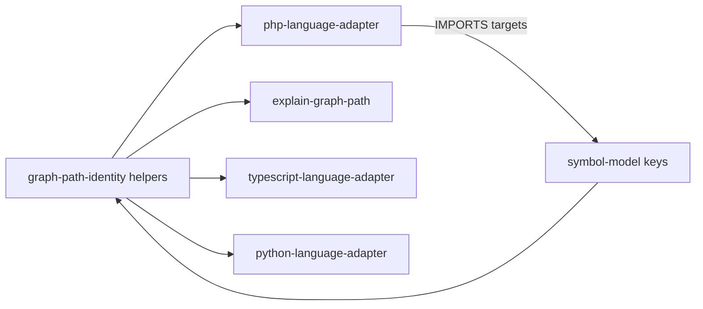

# Design: windows-graph-path-portability

## Non-goals

- No monorepo-wide path framework beyond the code-graph domain helpers.
- No change to workspace-prefixed indexing identity format (`workspace:relative` with `/`).
- No Windows ACL/`icacls` unreadability harness; `chmod(0o000)` remains Unix-only for hash-failed coverage.
- No Go relative filesystem require resolution (Go uses module paths).

## Affected areas

- `packages/code-graph/src/domain/services/split-workspace-identity.ts`
  - Add/export `isUncPath`, `isAbsoluteGraphFilesystemPath`, `resolveGraphPath`; keep `toPortableGraphPath`, `isDriveLetterPath`, `splitWorkspaceIdentity`.
  - Internal `graphFsPath` / `portableWindowsAbsolute` choose win32 for UNC/drive/`\`, else posix.
  - Risk: CRITICAL hub (many dependents via adapters, explain, indexer, SDK). Behaviour for workspace-prefixed posix relatives MUST stay unchanged.

- `packages/code-graph/src/infrastructure/tree-sitter/php-language-adapter.ts`
  - Require/include resolution uses `resolveGraphPath` (inlined former `resolveFromFilePath`).
  - Cake/CI absolute candidates use `isAbsoluteGraphFilesystemPath` + `resolveGraphPath(file, '../'+candidate)`.
  - `splitWorkspacePath` treats absolute FS (incl. UNC) before workspace split.
  - Composer PSR-4 absolute dirs, `canonicalCodeRoot`, and `resolveQualifiedNameCandidates` outputs are `toPortableGraphPath`-normalized; `path.relative` results portableized before workspace id construction.
  - Risk: CRITICAL; Windows CI IMPORTS empty without portable targets.

- `packages/code-graph/src/application/use-cases/explain-graph-path.ts`
  - Drive-letter input outside project → `projectRelativePath = toPortableGraphPath(abs)` on every host (including win32 same-volume temps); non-drive outsides keep `../`.
  - Risk: HIGH via `graph why` / SDK; diagnostic string shape change on Windows only for drive outsides.

- `packages/code-graph/src/infrastructure/tree-sitter/typescript-language-adapter.ts` / `python-language-adapter.ts`
  - `resolveRelativeImportPath` portable-normalizes file + specifier before `/` segment walks.
  - Risk: MEDIUM; workspace-prefixed tests already used `/`.

- Tests: `test/domain/services/split-workspace-identity.spec.ts` (matrix), PHP require drive/UNC cases, explain drive scenario, failed-targets `skipIf(win32||root)` for chmod.

## New constructs

```ts
// packages/code-graph/src/domain/services/split-workspace-identity.ts
export function isUncPath(value: string): boolean
export function isAbsoluteGraphFilesystemPath(value: string): boolean
export function resolveGraphPath(fromFile: string, target: string): string
// existing:
export function isDriveLetterPath(value: string): boolean
export function splitWorkspaceIdentity(
  value: string,
): { workspace: string; relativePath: string } | null
export function toPortableGraphPath(value: string): string
```

`resolveGraphPath` algorithm:

1. Absolute Windows-shaped `target` (UNC, drive, `\foo`, win32-absolute with `\`) → `portableWindowsAbsolute(target)`.
2. Else `target` starts with `/` (posix absolute, not already handled as UNC) → `toPortableGraphPath(target)`.
3. Split `fromFile` with `splitWorkspaceIdentity`; `rawPath` is relativePath or full fromFile.
4. If `rawPath` is absolute FS → `graphFsPath(rawPath).resolve(dirname, portable target)` then portableize; empty target → dirname.
5. Else posix join/normalize of portable dirname(from) + portable target; preserve `workspace:` prefix; empty target → portable dirname under prefix.

New capability spec `code-graph:graph-path-identity` owns these contracts; adapters and explain depend on it.

## Data models & Contracts

- Graph file keys / relation targets / `createSymbolNode.filePath`: always `/` separators.
- Explain `projectRelativePath` for outside drive-letter: `C:/...` portable absolute; non-drive outside: `../...`.
- No persisted schema migration; index regeneration optional after adapter path fixes.

## Approach & Execution flow

1. Domain helpers emit portable resolves.
2. PHP require/include and absolute Cake/CI candidates call `resolveGraphPath` before `getFileId` matching.
3. Composer-prepared abs dirs stored portable so `path.relative` + workspace id stays consistent on Windows.
4. Explain: after `relative(projectRoot, abs)`, if drive-letter input and `isOutsideProject(rel)` → keep portable abs.
5. TS/Python/PHP relative import helpers normalize `\` before segment math.
6. Tests cover workspace, drive, UNC, `\foo`, empty target, and PHP absolute importer IMPORTS on any host.

## Error handling & Edge cases

- UNC + posix `resolve` collapse → forbidden; win32 API required for UNC bases.
- Empty `target` → importer directory (portable), including `ws:` for file at workspace root.
- Drive-letter must not parse as workspace (`isDriveLetterPath` / `splitWorkspaceIdentity`).
- Hash-failed via chmod: skip on win32/root; product path unchanged.

## Key decisions

- Shared `resolveGraphPath` over test-only skips for path identity.
- Dedicated `code-graph:graph-path-identity` rather than burying rules only in PHP.
- Drive-letter outsides keep absolute portable spelling on all hosts (clarifies prior POSIX-only wording vs absolute-outside `../` rule).
- Rejected: large path abstraction; skipping Windows path tests.

## Trade-offs

- CRITICAL blast radius of identity helpers → keep workspace-prefixed behaviour byte-stable; expand matrix tests.
- Overlap with other adapter changes → archive may need coordination.
- Windows hash-failed still not FS-proven (ESM cannot spy `readFileSync`).

## Spec impact

- New: `code-graph:graph-path-identity` → depends `symbol-model`.
- Modified: php / explain / typescript / python adapters (+ dep on graph-path-identity).
- Downstream SDK/CLI `graph why` sees clearer Windows drive diagnostics; no API break.

## Dependency map



## Migration / Rollback

- No data migration. Rollback = revert helpers + call sites; re-run Windows CI.
- After merge, Windows CI must pass `@specd/code-graph` tests that previously failed on run 41575757097.

## Testing

Automated (already present / required):

- `packages/code-graph/test/domain/services/split-workspace-identity.spec.ts` — matrix including UNC, drive, `\foo`, empty target, workspace `\`.
- PHP adapter require/include host-absolute + UNC cases; explain drive-letter outside; failed-targets chmod skipIf.
- Full suites: php/ts/python adapters + explain + failed-targets.

Manual / CI:

```bash
pnpm --filter @specd/code-graph test
# confirm Windows GHA check green for code-graph
```

## Open questions

None.
