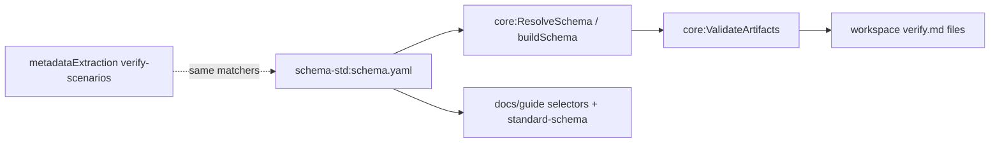

# Design: verify-scenario-gwt-list-validation

## Non-goals

- No Core / CLI / parser engine changes (nested `list-item` validation already works).
- No post-extraction “empty given/when/then” metadata validator.
- Do not make GIVEN required.
- Do not rewrite `templates/verify.md` (already correct list scaffolding).
- Do not mass-fix historical `specs/**/verify.md` in this change; if repo-wide validation fails after the schema tighten, fix or track separately.
- Do not redesign `deltaValidations` unless merged full-file validation proves insufficient during testing.

## Affected areas

### `packages/schema-std/schema.yaml`

1. **Root `version` field** (currently `version: 1`)
   - Change: **keep `version: 1` unchanged** (still closing the current schema version; no version bump).
   - Compatibility: package major and schema `version` remain unchanged; stricter validation may reject previously accepted malformed verify files (intentional).

2. **`artifacts[id=verify].instruction` Format requirements bullet (~lines 254–257)**
   - Before (problematic wording):
     > Each scenario: `#### Scenario: <name>` with optional GIVEN, then WHEN / THEN lines. … Scenarios use exactly four hashtags. Never three, never bullets.
   - After (exact intended wording):
     > Each scenario: `#### Scenario: <name>` whose body uses Markdown list items for optional GIVEN, then WHEN / THEN (each clause MAY be followed by AND or OR list items). Scenario headings MUST use exactly four hashtags — never three, and never a bullet title for the scenario name. “Never bullets” applies only to scenario titles; GWT clauses MUST be list items so metadata extraction and structural validation can read them.

3. **`artifacts[id=verify].validations` → `has-scenario` children (~lines 339–348)**
   - Before: `has-scenario` ends after Scenario section cardinality/uniqueness (no GWT children).
   - After: append children under `has-scenario`:

```yaml
- id: has-scenario
  type: section
  matches: '^Scenario:'
  required: true
  count:
    min: 1
    unique:
      by:
        from: label
        strip: '^Scenario:\s*'
  children:
    - id: has-when
      type: list-item
      matches: '^WHEN\b'
      required: true
      count:
        min: 1
    - id: has-then
      type: list-item
      matches: '^THEN\b'
      required: true
      count:
        min: 1
    - id: has-given
      type: list-item
      matches: '^GIVEN\b'
      required: false
```

- Matcher alignment: same `^WHEN\b` / `^THEN\b` / `^GIVEN\b` as `metadataExtraction.scenarios` (`verify-scenarios`). List-item labels strip Markdown emphasis, so `- **WHEN** …` continues to match.
- Severity: WHEN/THEN hard-required (`required: true`); GIVEN warning-or-absent allowed (`required: false`).

4. **`deltaValidations` / `deltaInstruction` / extractors / templates**
   - No change in this implementation pass.
   - Merged-artifact structural validations enforce GWT after deltas apply; existing `verify-requirement-delta-has-scenario` continues to require `#### Scenario:` presence only.

### `packages/schema-std/templates/verify.md`

- No file change.

### `packages/schema-std` test suite (dev-only, excluded from npm tarball)

- Keep `"files": ["schema.yaml", "templates/"]` in `packages/schema-std/package.json` so `test/`, `vitest.config.ts`, and `tsconfig.json` are **never packaged** when `@specd/schema-std` is published.
- Keep `dependencies` empty in `packages/schema-std/package.json` (zero runtime dependencies).
- Add `"@specd/core": "workspace:^"` and `"vitest": "^4.1.10"` to `devDependencies`, plus `"test": "vitest run"` (and `"typecheck": "tsc --noEmit"`). Because `@specd/core` does not depend on `@specd/schema-std`, there is no workspace dependency cycle.
- Add `packages/schema-std/vitest.config.ts` (`environment: 'node'`) and `packages/schema-std/tsconfig.json` (`extends: "../../tsconfig.base.json"`, `include: ["test"]`).
- Add three Vitest suites in `packages/schema-std/test/` using `@specd/core` (`buildSchema`, `parseArtifact`, structural validator, and `extractMetadata`) against the real `schema.yaml` and `templates/`:
  - `packages/schema-std/test/standard-schema.spec.ts`: covers all requirements of `schema-std:standard-schema` (root schema & `buildSchema`, artifact DAG & acyclicity, proposal/specs/verify/design/tasks contracts, `crossArtifactValidations`, `metadataExtraction`, `workflow` steps & transitions, and pure-ESM package distribution without build).
  - `packages/schema-std/test/templates.spec.ts`: covers all requirements of `schema-std:templates` (`proposal.md`, `spec.md`, `verify.md`, `design.md`, `tasks.md` sections/guidance, and `{{variable}}` / `<!-- ... -->` placeholder invariants).
  - `packages/schema-std/test/verify-gwt-validation.spec.ts`: end-to-end structural validation & `verify-scenarios` metadata extraction for GWT list items (with/without `GIVEN`, bold `- **WHEN**`/`- **THEN**`, and prose-only failure on `has-when`/`has-then`).
- Add `--filter=@specd/schema-std` to root `package.json` `"test"` script so `pnpm test` runs the new suites.

### Documentation (required by global docs rules when public schema behaviour changes)

Update user-facing guides that currently stop at “Scenario subsection exists” so they document GWT list-item enforcement:

| File                                                                        | Change                                                                                                                                                |
| --------------------------------------------------------------------------- | ----------------------------------------------------------------------------------------------------------------------------------------------------- |
| `docs/guide/selectors.md`                                                   | In “Asserting nested structure”, extend the standard-schema-shaped example so each Scenario requires WHEN/THEN `list-item` children (GIVEN optional). |
| `docs/guide/standard-schema.md`                                             | Under verify conventions, state that scenario bodies MUST use GWT list items and that validation enforces WHEN/THEN list items.                       |
| `docs/guide/schemas.md` / `docs/guide/specs.md` / `docs/guide/artifacts.md` | Only if they claim validations end at Scenario headings; align one sentence to mention WHEN/THEN list-item enforcement.                               |

After editing guide markdown sources, regenerate guide packages if the project’s usual docs→guide pipeline requires it for this package (follow existing `packages/guide` generation practice used by other doc edits; if regeneration is a separate package script, run it as part of implementation).

### Callers / risk

- Schema YAML is loaded by Core schema resolution (`ResolveSchema` / `buildSchema` / `SchemaYamlData`). No TypeScript signature changes.
- Risk: MEDIUM for content authors — existing verify files without WHEN/THEN list items will fail validation after adopt.
- Backwards compatibility within major package: constraint “backwards-compatible within same major version” means schema package API/format remains; stricter validation of author content is an accepted tightening for correctness.

## New constructs

_none_

## Data models & Contracts

No new TypeScript types. Schema contract surface:

- Validation rule IDs: `has-when`, `has-then`, `has-given` (nested under existing `has-scenario`).
- Matchers: string regexes `^WHEN\b`, `^THEN\b`, `^GIVEN\b`.
- Schema `version` integer: remains `1` (unchanged).

## Approach & Execution flow

1. Edit `packages/schema-std/schema.yaml`:
   - Keep `version: 1` unchanged.
   - Replace the verify Format-requirements bullet that ends with “Never three, never bullets.” with the clarified wording above.
   - Insert the three nested list-item children under `has-scenario` exactly as specified.
2. Confirm YAML indentation/structure still parses (`node packages/cli/dist/index.js` schema load path — e.g. project status or a change validate that loads the active schema).
3. Update the guide markdown files listed above so documentation matches the new validations.
4. Regenerate guide artifacts if required by the repo’s docs pipeline for `@specd/guide`.
5. Add `packages/schema-std/test/verify-gwt-validation.spec.ts` (with dev-only Vitest/TS config and `@specd/core` in `devDependencies`) and wire `--filter=@specd/schema-std` into root `package.json` `"test"`.
6. Run `pnpm --filter @specd/schema-std test` and CLI smoke-test validation behaviour (see Testing).
7. Do not touch `templates/verify.md`.

## Error handling & Edge cases

| Case                                                     | Expected                                                                                                                                                                                                                               |
| -------------------------------------------------------- | -------------------------------------------------------------------------------------------------------------------------------------------------------------------------------------------------------------------------------------- |
| Scenario with WHEN + THEN list items                     | Pass GWT rules                                                                                                                                                                                                                         |
| Scenario with WHEN + THEN, no GIVEN                      | Pass (`has-given` `required: false`)                                                                                                                                                                                                   |
| Scenario with prose body, no list items                  | Fail missing WHEN and/or THEN                                                                                                                                                                                                          |
| Scenario with headings but no list items                 | Fail                                                                                                                                                                                                                                   |
| `- **WHEN** text` / `- **THEN** text`                    | Pass (emphasis stripped from label)                                                                                                                                                                                                    |
| `- when` lowercase                                       | Fail (`matches` is case-sensitive unless schema matching treats labels case-insensitively — Core selector matching for `matches` is case-insensitive per delta guide; still author uppercase GWT keywords to match extractor captures) |
| Empty Scenario section                                   | Fail Scenario count and/or WHEN/THEN                                                                                                                                                                                                   |
| Malformed delta that removes GWT from a requirement body | Fails when merged verify is validated                                                                                                                                                                                                  |

Validation failures use the existing schema validation error reporting path (no new error codes).

## Key decisions

1. **Hard-fail WHEN/THEN via nested list-item validations** — same AST surface as extraction; blocks empty extracted scenarios.
2. **GIVEN optional** — preserves current authoring contract and template comments.
3. **Reuse extractor matchers** — avoid drift between validation and metadataExtraction.
4. **Leave deltaValidations alone for v1 of this tighten** — full-file validation after merge is the enforcement point; adding complex contentMatches for GWT inside deltas is deferred unless Testing shows a gap.
5. **Keep schema.yaml `version` at 1** — still closing the current version; do not bump the schema version integer.
6. **Clarify instruction wording in the same change** — removes the “never bullets” agent footgun.
7. **Templates no-op** — scaffold already correct.

### Alternatives rejected

- Post-extraction emptiness checks → not supported by schema format; Core feature out of scope.
- `contentMatches` only → does not force `list-item` nodes.
- Making GIVEN required → breaks optional-precondition contract.
- Soft warnings (`required: false` on WHEN/THEN) → user goal is detection that blocks bad format.

## Trade-offs

- [Stricter validation may fail existing verify files] → Mitigation: run repo `specsHealth` / validate after change; remediate outliers outside or after this change.
- [Delta authoring can still write bad scenario bodies that look fine until merge validate] → Mitigation: accept for now; full validate remains the gate before archive/transition.

## Spec impact

- `schema-std:standard-schema` — requirements extended (this change).
- `schema-std:templates` — no requirement change (`no-op`); still depends on `schema-std:standard-schema`.
- No other workspace specs declare dependency that requires requirement edits for this tighten.
- Downstream projects adopting `@specd/schema-std` inherit stricter verify validation on next schema resolve.

## Dependency map



```
┌────────────────────┐
│ schema.yaml        │
│ verify.validations │
│ + instruction      │
└─────────┬──────────┘
          │ loaded by
          ▼
┌────────────────────┐       ┌──────────────────┐
│ ResolveSchema /    │──────▶│ ValidateArtifacts│
│ buildSchema        │       └────────┬─────────┘
└────────────────────┘                │
                                      ▼
                             ┌──────────────────┐
                             │ verify.md ASTs   │
                             │ Scenario→WHEN/   │
                             │ THEN list-items  │
                             └──────────────────┘
```

## Migration / Rollback

- Deploy: publish/consume updated `@specd/schema-std` (or path dependency) with `schema.yaml` at `version: 1`.
- Rollback: revert `schema.yaml` (and docs) to prior content; no data migration.
- After upgrade, re-validate active changes and workspace specs; fix any verify files that fail new GWT rules.

## Testing

### Automated Vitest + CLI verification

1. **Vitest suite (`packages/schema-std/test/verify-gwt-validation.spec.ts`)**
   - Command: `pnpm --filter @specd/schema-std test` (and `pnpm --filter @specd/schema-std typecheck`).
   - Covers `buildSchema` on real `schema.yaml`, positive GWT list validation + metadata extraction (with and without `GIVEN`, including bold markers), and negative prose-only scenario validation failure (`has-when` / `has-then`).
   - Confirm `pnpm pack --dry-run` (or `"files"` inspection) excludes `test/`, `vitest.config.ts`, and `tsconfig.json`.

2. **Positive — existing well-formed verify**
   - Command: `node packages/cli/dist/index.js specs validate schema-std:standard-schema --format text` (and/or project `specsHealth` after schema edit).
   - Expect: pass; scenarios with `- **GIVEN**` / `- **WHEN**` / `- **THEN**` still match.

3. **Negative — missing WHEN/THEN list items**
   - In a disposable temp change or fixture: create a verify scenario with only a prose paragraph under `#### Scenario: …`.
   - Run validate against the updated schema.
   - Expect: failure citing missing WHEN and/or THEN list-item rules (`has-when` / `has-then`).

4. **Positive — WHEN+THEN without GIVEN**
   - Scenario body with only `- **WHEN** …` and `- **THEN** …`.
   - Expect: pass for GWT rules.

5. **Docs**
   - Confirm updated guide sections describe WHEN/THEN list-item enforcement.
   - If guides are generated into `packages/guide/generated/`, confirm regenerated content includes the new wording.

### Mapping to verify scenarios

| Scenario                                                              | Covered by                                          |
| --------------------------------------------------------------------- | --------------------------------------------------- |
| Verify definition configures scenario structure and delta validations | Inspect `schema.yaml` after edit; positive validate |
| Scenario without WHEN or THEN list items fails structural validation  | Negative CLI fixture validate                       |
| Scenario with WHEN and THEN list items and no GIVEN passes            | Positive CLI fixture validate                       |

## Open questions

_none_
