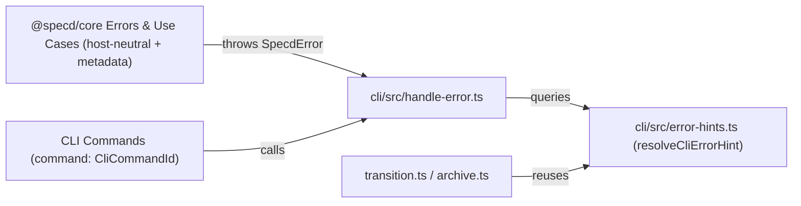

# Design: decouple-core-cli-error-hints

## Affected areas

### `@specd/core` (host-neutral error messages & structured metadata)

| File                                                                       | Symbol                                                  | Change                                                                                                                                                                                    | Risk / Impact                                                                                                                                    |
| -------------------------------------------------------------------------- | ------------------------------------------------------- | ----------------------------------------------------------------------------------------------------------------------------------------------------------------------------------------- | ------------------------------------------------------------------------------------------------------------------------------------------------ |
| `packages/core/src/domain/errors/depends-on-overwrite-error.ts`            | `DependsOnOverwriteError`                               | Remove `Use --force to overwrite curated dependencies.` from `constructor` message; keep `existingDeps` and `incomingDeps` getters and `areSame()`.                                       | Re-exported by `core` and `@specd/sdk`; thrown by `resolveCanonicalDependsOn` in `generate-spec-metadata.ts` and `materialize-spec-metadata.ts`. |
| `packages/core/src/domain/errors/historical-implementation-guard-error.ts` | `HistoricalImplementationGuardError`                    | Remove `without --force` from `constructor` message; keep `operation` and `changeName` getters.                                                                                           | Thrown by `DraftChange` and `DiscardChange`.                                                                                                     |
| `packages/core/src/domain/errors/happy-path-next-unavailable-error.ts`     | `HappyPathNextUnavailableError`, `happyPathNextMessage` | Add `readonly _state: ChangeState` + `get state(): ChangeState`; rewrite `happyPathNextMessage(state)` without `--next`.                                                                  | Thrown by `TransitionChange` when `to === 'next'` has no happy-path hop.                                                                         |
| `packages/core/src/application/errors/invalidate-requires-force-error.ts`  | `InvalidateRequiresForceError`                          | Remove `Use --force to revoke the reported gate(s)` from `constructor` message; keep `gates` and `recoveries` getters.                                                                    | Thrown by `InvalidateChange`.                                                                                                                    |
| `packages/core/src/application/errors/spec-not-in-change-error.ts`         | `SpecNotInChangeError`                                  | Add `readonly _specId: string`, `readonly _changeName: string` + `get specId()` and `get changeName()` getters; remove `Suggestion: use specd specs show ...` from `constructor` message. | Thrown by `EditChange`, `ValidateArtifacts`, and `PreviewSpec`.                                                                                  |
| `packages/core/src/application/services/detect-impl-links-in-scope.ts`     | `detectImplLinksInScope`                                | Remove `Re-run with --allow-out-of-scope if intentional.` from `message`; keep `blocked` and `outOfScopeSpecIds`.                                                                         | Consumed by `impl.linksInScope` workflow check (`workflow-check-registry.ts`).                                                                   |
| `packages/core/src/application/use-cases/invalidate-change.ts`             | `validateCommandShape`                                  | Replace `--target is not allowed with policy ...` and `At least one --target is required with policy ...` with host-neutral domain terms (`targets` / `policy`).                          | Private helper inside `InvalidateChange`.                                                                                                        |
| `packages/core/src/application/use-cases/update-spec-deps.ts`              | `UpdateSpecDeps.execute`                                | Replace `--set`, `--add`, `--remove`, `--clear` in `InvalidInputError` messages with host-neutral input field names (`set`, `add`, `remove`, `clear`).                                    | Thrown on conflicting or empty `UpdateSpecDepsInput`.                                                                                            |

### `@specd/cli` (centralized hint table & command context)

| File                                                  | Symbol                              | Change                                                                                                                                                                                                                                       |
| ----------------------------------------------------- | ----------------------------------- | -------------------------------------------------------------------------------------------------------------------------------------------------------------------------------------------------------------------------------------------- |
| `packages/cli/src/handle-error.ts`                    | `HandleErrorOptions`, `handleError` | Add `readonly command?: CliCommandId` to `HandleErrorOptions`; keep `lockRepairHint?: boolean` for backward compatibility; resolve `hint` via `resolveCliErrorHint(code, options ?? {}, metadata)` and pass to `cliError`.                   |
| `packages/cli/src/commands/spec/generate-metadata.ts` | `registerSpecGenerateMetadata`      | Pass `{ command: 'specs.generate-metadata' }` to `handleError` (and resolve hint for single-spec/batch `DependsOnOverwriteError` when surfaced).                                                                                             |
| `packages/cli/src/commands/spec/validate.ts`          | `registerSpecValidate`              | Pass `{ command: 'specs.validate' }` to `handleError`.                                                                                                                                                                                       |
| `packages/cli/src/commands/spec/deps.ts`              | `registerSpecDeps`                  | Pass `{ command: 'specs.deps', lockRepairHint: true }` (or `command: 'specs.deps'`) to `handleError`.                                                                                                                                        |
| `packages/cli/src/commands/change/invalidate.ts`      | `registerChangeInvalidate`          | Remove ad-hoc `--force` stderr line or route `InvalidateRequiresForceError` and targeting errors through `handleError(err, opts.format, { command: 'change.invalidate' })` / `resolveCliErrorHint`.                                          |
| `packages/cli/src/commands/change/transition.ts`      | `registerChangeTransition`          | Reuse `resolveCliErrorHint` in Repair Guide / `HappyPathNextUnavailableError` (`code: 'HAPPY_PATH_NEXT_UNAVAILABLE'`) and `impl.linksInScope` (`code: 'impl.linksInScope'`, `{ isSkippable }`) handling with `command: 'change.transition'`. |
| `packages/cli/src/commands/change/draft.ts`           | `registerChangeDraft`               | Pass `{ command: 'change.draft' }` to `handleError`.                                                                                                                                                                                         |
| `packages/cli/src/commands/change/discard.ts`         | `registerChangeDiscard`             | Pass `{ command: 'change.discard' }` to `handleError`.                                                                                                                                                                                       |
| `packages/cli/src/commands/change/archive.ts`         | `registerChangeArchive`             | Reuse `resolveCliErrorHint('impl.linksInScope', { command: 'change.archive' }, { isSkippable })` for `impl.linksInScope` failures and pass `{ command: 'change.archive' }` to `handleError`.                                                 |
| `packages/cli/src/commands/change/deps.ts`            | `registerChangeDeps`                | Pass `{ command: 'change.deps' }` to `handleError`.                                                                                                                                                                                          |

### Documentation (`docs/`)

- `docs/core/errors.md`: Document the host-neutral core error rule (no CLI flags/commands in `@specd/core` error messages) and the centralized CLI hint-resolution pattern.

## New constructs

### `packages/cli/src/error-hints.ts`

Centralized, declarative, two-table hint resolver for `@specd/cli`:

1. **Reusable hint catalog (`CLI_ERROR_HINTS`)** keyed by semantic `CliHintId`, so multiple commands/errors share the exact same hint text without duplication.
2. **Routing rule table (`CLI_ERROR_HINT_RULES`)** mapping `(code, commands?, when?) -> hintId`.

```ts
/**
 * Canonical CLI command identifiers used to select command-appropriate error hints.
 */
export type CliCommandId =
  | 'specs.generate-metadata'
  | 'specs.validate'
  | 'specs.deps'
  | 'change.invalidate'
  | 'change.transition'
  | 'change.draft'
  | 'change.discard'
  | 'change.archive'
  | 'change.deps'
  | 'change.edit'
  | 'change.validate'
  | 'change.spec-preview'

export interface CliHintContext {
  readonly command?: CliCommandId | undefined
  readonly lockRepairHint?: boolean | undefined
}

/**
 * Reusable catalog of CLI hint templates keyed by semantic hint ID.
 */
export const CLI_ERROR_HINTS = {
  'force.overwrite-deps': () => 'Use --force to overwrite curated dependencies.',
  'deps.repair-or-force-generate': () =>
    'Update curated dependencies with: specd specs deps add/set <spec-id>, or run: specd specs generate-metadata --force <spec-id>',
  'force.bypass-impl-guard': () =>
    'Re-run with --force to bypass the historical implementation guard.',
  'force.revoke-consent': () => 'Re-run with --force to revoke the reported gate(s).',
  'transition.explicit-step': () =>
    'Provide an explicit target <step> instead of --next, or check available transitions with: specd changes status <name>',
  'spec.show-canonical': (metadata) =>
    typeof metadata.specId === 'string' &&
    metadata.specId.length > 0 &&
    metadata.specId !== '<specPath required>'
      ? `Use specd specs show ${metadata.specId} to view the canonical spec.`
      : undefined,
  'lock.repair-deps': () =>
    'Repair with: specd specs deps remove <spec-id>, specd specs deps set <spec-id>, or specd specs deps clear <spec-id>',
  'deps.operation-flags': () =>
    'Use --add, --remove, --set, or --clear (--set is mutually exclusive with --add/--remove/--clear; --clear is mutually exclusive with --add/--remove).',
  'invalidate.target-flags': () =>
    'Provide --target <artifactId>[@<specId>] for surgical/downstream policy, and omit --target for none/global policy.',
  'checks.skip-impl-links-in-scope': () =>
    'Re-run with --skip-checks impl.linksInScope (or --allow-out-of-scope) if intentional.',
} as const satisfies Record<string, (metadata: Record<string, unknown>) => string | undefined>

export type CliHintId = keyof typeof CLI_ERROR_HINTS

export interface CliHintRule {
  readonly code: string
  readonly commands?: readonly CliCommandId[]
  readonly when?: (metadata: Record<string, unknown>) => boolean
  readonly hintId: CliHintId
}

/**
 * Declarative routing table mapping `(errorCode, command, metadata?)` to a reusable `CliHintId`.
 */
export const CLI_ERROR_HINT_RULES: readonly CliHintRule[] = [
  {
    code: 'DEPENDS_ON_OVERWRITE',
    commands: ['specs.generate-metadata'],
    hintId: 'force.overwrite-deps',
  },
  {
    code: 'DEPENDS_ON_OVERWRITE',
    commands: ['specs.validate'],
    hintId: 'deps.repair-or-force-generate',
  },
  {
    code: 'IMPLEMENTATION_DETECTED',
    commands: ['change.draft', 'change.discard'],
    hintId: 'force.bypass-impl-guard',
  },
  {
    code: 'INVALIDATE_REQUIRES_FORCE',
    commands: ['change.invalidate'],
    hintId: 'force.revoke-consent',
  },
  {
    code: 'HAPPY_PATH_NEXT_UNAVAILABLE',
    commands: ['change.transition'],
    hintId: 'transition.explicit-step',
  },
  { code: 'SPEC_NOT_IN_CHANGE', hintId: 'spec.show-canonical' },
  {
    code: 'INVALID_SPEC_LOCK',
    commands: ['specs.deps'],
    when: (metadata) =>
      metadata.fieldPath === 'dependsOn' ||
      (typeof metadata.fieldPath === 'string' && metadata.fieldPath.startsWith('dependsOn.')),
    hintId: 'lock.repair-deps',
  },
  { code: 'INVALID_INPUT', commands: ['change.deps'], hintId: 'deps.operation-flags' },
  { code: 'INVALID_INPUT', commands: ['change.invalidate'], hintId: 'invalidate.target-flags' },
  {
    code: 'impl.linksInScope',
    commands: ['change.transition', 'change.archive'],
    when: (metadata) => metadata.isSkippable === true,
    hintId: 'checks.skip-impl-links-in-scope',
  },
]

/**
 * Resolves an optional, command-appropriate CLI repair hint by matching `CLI_ERROR_HINT_RULES`
 * and rendering the corresponding entry from `CLI_ERROR_HINTS`.
 * Backward-compatible with `context.lockRepairHint` by treating it as `specs.deps` for `INVALID_SPEC_LOCK`.
 */
export function resolveCliErrorHint(
  code: string,
  context: CliHintContext,
  metadata: Record<string, unknown>,
): string | undefined
```

## Data models & Contracts

### Exact host-neutral `@specd/core` error messages

1. **`DependsOnOverwriteError` (`DEPENDS_ON_OVERWRITE`)**:
   - Message: `` `dependsOn would change (${parts.join('; ')}). Explicit force confirmation is required to overwrite curated dependencies.` ``
   - Metadata getters: `existingDeps`, `incomingDeps`.
2. **`HistoricalImplementationGuardError` (`IMPLEMENTATION_DETECTED`)**:
   - Message: `` `Cannot ${operation} change '${changeName}' after it has reached implementing without explicit force confirmation: implementation may already exist and specs and code could be left out of sync` ``
   - Metadata getters: `operation`, `changeName`.
3. **`HappyPathNextUnavailableError` (`HAPPY_PATH_NEXT_UNAVAILABLE`)**:
   - New getter: `get state(): ChangeState`
   - `happyPathNextMessage(state)`:
     - `'pending-spec-approval'` → `'cannot advance to next state: change is waiting for human spec approval'`
     - `'pending-signoff'` → `'cannot advance to next state: change is waiting for human signoff'`
     - `'archivable'` → `'cannot advance to next state: archiving is not a lifecycle transition'`
     - `'archiving'` → `'cannot advance to next state: archiving is a terminal state'`
     - `default` → `` `cannot advance to next state: no happy-path hop from '${state}'` ``
4. **`InvalidateRequiresForceError` (`INVALIDATE_REQUIRES_FORCE`)**:
   - Message: `'Change has active consent affected by this invalidation. Explicit force confirmation is required to revoke the reported gate(s); Core will select the required recovery target.'`
   - Metadata getters: `gates`, `recoveries`.
5. **`SpecNotInChangeError` (`SPEC_NOT_IN_CHANGE`)**:
   - New getters: `get specId(): string`, `get changeName(): string`
   - Message: `` `Spec '${specId}' is not in the current specIds of change '${changeName}'.` ``
6. **`detectImplLinksInScope`**:
   - Message: `` `Implementation sidecar updates would touch ${String(count)} ${noun} outside the change "${change.name}" scope (${list}).` ``
   - Returned fields: `{ blocked: true, outOfScopeSpecIds, message }`.
7. **`InvalidateChange` (`validateCommandShape`)**:
   - Forbidden targets: `` `targets are not allowed with policy '${effectivePolicy.artifacts}' — targeting is semantically irrelevant` ``
   - Missing targets: `` `At least one target is required with policy '${effectivePolicy.artifacts}'` ``
8. **`UpdateSpecDeps` (`InvalidInputError`)**:
   - Line 85: `'set is mutually exclusive with add, remove, and clear'`
   - Line 88: `'clear is mutually exclusive with add and remove'`
   - Line 97: `'at least one of add, remove, set, or clear must be provided'`

## Approach & Execution flow

1. Update the 8 `@specd/core` files (errors, `detect-impl-links-in-scope.ts`, `invalidate-change.ts`, `update-spec-deps.ts`) with host-neutral messages and new metadata getters (`HappyPathNextUnavailableError.state`, `SpecNotInChangeError.specId`, `SpecNotInChangeError.changeName`).
2. Create `packages/cli/src/error-hints.ts` with `CliCommandId`, `CliHintContext`, `CLI_ERROR_HINTS`, `CLI_ERROR_HINT_RULES`, and `resolveCliErrorHint`.
3. Update `packages/cli/src/handle-error.ts`:
   - Add `readonly command?: CliCommandId` to `HandleErrorOptions`.
   - Replace the inline `LOCK_REPAIR_HINT` branch with `resolveCliErrorHint(code, options ?? {}, metadata)`.
   - Pass `{ metadata, ...(hint !== undefined ? { hint } : {}) }` to `cliError(...)`.
4. Update the CLI command files (`spec/validate.ts`, `spec/generate-metadata.ts`, `spec/deps.ts`, `change/invalidate.ts`, `change/transition.ts`, `change/draft.ts`, `change/discard.ts`, `change/archive.ts`, `change/deps.ts`) to pass `command` to `handleError` and reuse `resolveCliErrorHint` in custom renderers.
5. Update `docs/core/errors.md` and affected unit/integration tests across `packages/core` and `packages/cli`.

## Error handling & Edge cases

- **Unknown or omitted `command` in `handleError`:** `resolveCliErrorHint` returns `undefined` for command-scoped errors (`DEPENDS_ON_OVERWRITE`, `IMPLEMENTATION_DETECTED`, `INVALIDATE_REQUIRES_FORCE`, `INVALID_INPUT`), ensuring no misleading flag hint is ever emitted.
- **`SpecNotInChangeError` with sentinel `<specPath required>`:** `resolveCliErrorHint` suppresses the `specd specs show` hint when `specId === '<specPath required>'` (used by `ValidateArtifacts` when `specPath` is omitted).
- **Backward compatibility:** `HandleErrorOptions.lockRepairHint` remains supported alongside `command: 'specs.deps'`.
- **Non-CLI consumers (`@specd/sdk`, `@specd/mcp`):** Receive clean, host-neutral `SpecdError.message` and structured metadata properties via getters.

## Key decisions

- **Decision:** Centralize CLI hints in a pure `(code, err, context, metadata) -> string | undefined` table/helper (`packages/cli/src/error-hints.ts`) invoked by `handleError` and custom command renderers.
- **Alternatives rejected:**
  - _Per-error boolean flags in `HandleErrorOptions`_: Does not scale across 8+ errors and duplicates hint formatting across commands.
  - _Keeping CLI flags in `@specd/core` error messages_: Violates hexagonal layer boundaries and produces false hints (e.g., `--force` in `specs validate`).

## Trade-offs

- **Centralized table coupling to `CliCommandId` union** → Mitigated by keeping `command` optional in `HandleErrorOptions` and limiting table entries strictly to errors that require CLI flag/command translation.
- **High blast radius (`CRITICAL` in code graph, 352 affected files)** → Mitigated by preserving all existing error class names, `code` strings, and `SpecdError` metadata getters, and keeping `lockRepairHint` backward-compatible.

## Spec impact

- **Direct dependents of modified specs:** `core:resolve-context-specs`, `core:validate-change-batch`, `sdk:run-graph-impact`, `core:materialize-spec-metadata`, `core:lifecycle-engine`, `core:change`, and `cli:*` command specs depending on `default:_global/error-handling-conventions`.
- **Assessment:** All dependent specs remain valid because no `code`, class name, or existing metadata getter is removed; only `message` prose is made host-neutral and new getters (`state`, `specId`, `changeName`) are additive.

## Dependency map



```
┌────────────────────────────┐      throws SpecdError       ┌──────────────────────────┐
│ @specd/core                │─────────────────────────────▶│ cli/src/handle-error.ts  │
│ (host-neutral + metadata)  │                              │ (command?: CliCommandId) │
└────────────────────────────┘                              └────────────┬─────────────┘
                                                                         │ queries
                                                                         ▼
┌────────────────────────────┐      reuses helper           ┌──────────────────────────┐
│ transition.ts / archive.ts │─────────────────────────────▶│ cli/src/error-hints.ts   │
└────────────────────────────┘                              │ (resolveCliErrorHint)    │
                                                            └──────────────────────────┘
```

## Testing

**Automated tests:**

- **`packages/core`:**
  - Unit tests for all 8 core files verifying `error.code`, structured metadata getters (`existingDeps`, `incomingDeps`, `operation`, `changeName`, `state`, `gates`, `recoveries`, `specId`, `outOfScopeSpecIds`), and asserting `error.message` does NOT contain `--force`, `--next`, `--allow-out-of-scope`, `--target`, `--set`, `--add`, `--remove`, `--clear`, or `specd specs show`.
- **`packages/cli`:**
  - `packages/cli/test/error-hints.spec.ts`: Unit tests covering `CLI_ERROR_HINTS`, `CLI_ERROR_HINT_RULES`, and `resolveCliErrorHint` across the `(code × command)` matrix (including `specs.validate` vs `specs.generate-metadata`, `SPEC_NOT_IN_CHANGE` with valid vs `<specPath required>`, `IMPLEMENTATION_DETECTED`, `INVALIDATE_REQUIRES_FORCE`, `HAPPY_PATH_NEXT_UNAVAILABLE`, `INVALID_INPUT`, `INVALID_SPEC_LOCK` with/without `dependsOn`, and `impl.linksInScope` with `isSkippable: true/false`).
  - `packages/cli/test/handle-error.spec.ts`: Verify `handleError` emits `hint` on stderr and in `json`/`toon` payloads without mutating `message`, and omits `hint` when `command` does not match.
  - Update existing CLI command tests (`spec-validate.spec.ts`, `spec-generate-metadata.spec.ts`, `change/change-invalidate.spec.ts`, `change/transition.spec.ts`, `change-draft.spec.ts`, `change-discard.spec.ts`, `change/archive.spec.ts`, `change-deps.spec.ts`).

**Manual / E2E verification:**

- Run `pnpm --filter @specd/core test` and `pnpm --filter @specd/cli test` and `pnpm build`.
- Run `node packages/cli/dist/index.js specs validate --all` on a spec with `dependsOn` drift and verify stderr suggests `specd specs deps` / `specd specs generate-metadata --force` instead of `--force` on `specs validate`.
