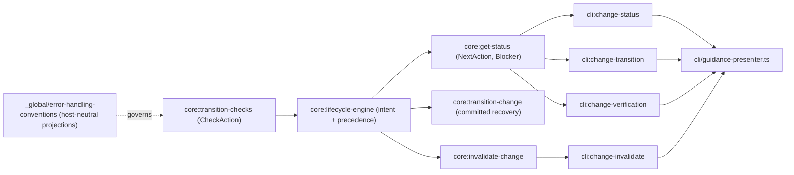

# Design: decouple-core-cli-workflow-guidance

## Goal and decisions (self-contained summary)

`@specd/core` MUST stop emitting CLI commands (`specd ...`), CLI flags (`--skip-checks ...`), and agent slash commands (`/specd-*`) in non-error projections. Core emits structured host-neutral data; `@specd/cli` (and a future `@specd/mcp`) project it. Checks own their remediation: `lifecycle-guidance.ts` holds no knowledge of any specific check.

Agreed decisions (all binding for implementation):

1. `CheckAction` (`kind`, `params?`, `guidance?`, `supersedesIntent?`) exists **only on `CheckResult`**. It is removed from the `Check` and `CustomCheckDefinition` interfaces and from `CheckPredicateFailedError.command` (replaced by `action`).
2. Built-in kinds are typed and reserved: `approve-spec`, `approve-signoff`, `start-verification` (`params.changeName`), `refresh-status` (`params.changeName`). There is no `redesign-spec` kind. Plugin kinds are namespaced `@${pluginName}.${id}`. One explicit kind per distinct action (never `approve` + a `gate` parameter).
3. `approval.spec` emits `approve-spec` on both `APPROVAL_REQUIRED` and `APPROVAL_STALE`: stale or revoked consent has already returned the change to `designing` through committed reconciliation, and the check only runs for the delivery hops bound from `ready`, where renewing consent is a fresh human approval. `approval.signoff` emits `approve-signoff` for both. `verification.current` emits `start-verification` / `refresh-status` with `supersedesIntent: false`.
4. Precedence (deterministic): lifecycle guidance considers only the failed predicates of the hop the recommendation waits on (`hopFailures`, resolved-binding order). The first failure with an `action` becomes `nextAction.action`. If that action does not declare `supersedesIntent: false`, `nextAction.intent` is `null`; otherwise `intent` keeps the phase value (`verify` for verification renewal) and the action is informational.
5. `LifecycleActionIntent` is strictly `'design' | 'implement' | 'verify' | 'archive'`.
6. Bypass: `bypassFlag` removed from core. `isSkippable` + `checkId` only. Verdict option `bypassFlags` is renamed `skippedCheckIds`; core never parses `--skip-checks`.
7. Validity blockers (`change-validity.ts`, `reconcile-change-validity.ts`) carry `action: CheckAction` (`start-verification`, `changeName`), not `details.command` or `details.remediation`.
8. Legacy parking states are gated by check bindings, not by code. `check-bindings.ts` adds `approval.spec` applicability (`to: '*'`, `along: 'forward'`) from `pending-spec-approval` and `spec-approved` (besides `ready`), and `approval.signoff` applicability (`to: 'archivable'`, `along: 'forward'`) from `pending-signoff` and `signed-off` (besides `done`). A historic change therefore cannot leave a parking state without consent, and guidance needs no drain branch: the failing check emits `approve-spec` / `approve-signoff` like at `ready` / `done`.
9. The two `pending-*` states leave through the delivery edges and never into another legacy state: `VALID_TRANSITIONS['pending-spec-approval'] = [implementing, designing]` and `VALID_TRANSITIONS['pending-signoff'] = [archivable, designing, done]` (forward exit first). `HAPPY_PATH_NEXT` gains `pending-spec-approval → implementing` and `pending-signoff → archivable`; `nextWorkflowStep` applies one rule to all four drain states. `spec-approved` and `signed-off` keep their exits but have no entry edge. Legacy changes are assumed to run under a legacy schema where every step is enabled; the design relies on that and does not add code for disabled steps.
10. Hardcoded state or gate knowledge made redundant by 8–9 is removed in this change: the approval "stay in place" branch and the drain branches of `resolveLifecycleNextHop`, the target-name `INVALID_TRANSITION` messages, `TransitionChange._assertDrainAndGateTargets`, the implicit `transition('spec-approved' | 'signed-off')` in `ApproveSpec` / `ApproveSignoff` (their eligible states come from `boundFromStates`), and the duplicated verification-boundary state lists in `reconcile-change-validity.ts` and `invalidate-verification.ts` (replaced by `isAtOrAfterVerificationBoundary`). Removing the four legacy states themselves, their manifest/schema lists, `DRAIN_OFFSETS`, `deliveryState`, and `DELIVERY_AXIS` remains a separate follow-up.
11. `committedRecoveryError` (`transition-change.ts`) and `invalidationNextAction` (`invalidate-change.ts`) evaluate the forward checks of the recovered state through the `CheckRegistry` instead of `checksByTarget: {}`.
12. CLI JSON/TOON keep `nextAction.command` and `blocker.bypassFlag` (computed at the CLI boundary) and additionally expose `intent` / `action`; `draftView` keeps `command: null` and exposes neither.
13. A global requirement (`default:_global/error-handling-conventions`, "Host-Neutral Core Projections") states the rule for all non-error projections.
14. Checks own their failure reporting. Every failed predicate in `TransitionChange` and `ArchiveChange` (built-in or plugin, `protocol.edge` included) is thrown as the single `CheckPredicateFailedError`; no use case switches on a check id to pick another class or reason. The error gains optional `from` / `to`. Each check emits its full payload in `details` (per-code contract in `core:transition-checks`) and a host-neutral `message`; the CLI renders by `checkId` / `code` (context from `details`, command from `action`, hints by check id). `SpecOverlapError` and `ArchiveDependencyMismatchError` are deleted; `InvalidStateTransitionError` keeps the entity-level rejection (`invalid-transition`) and `incomplete-artifact` (still used by `ApproveSpec` / `ApproveSignoff` for their eligibility failure, which is not a check) and loses `approval-required`, `gate-not-required`, `incomplete-tasks`, `missing-task-capability`. `ReadOnlyWorkspaceError`, `SchemaProviderIdentityMismatchError`, and `ArchiveImplementationStateError` remain for their non-check users.
15. Reconciled validity is not an input of the domain `nextHop`, and there is no application-layer hold either. `projectValidityNextHop` and the `guidedTransitions` filter are deleted. Stale spec or sign-off consent is covered by committed recovery plus the ordinary rules and the `approval.*` checks. Verification currency is owned by the `verification.current` check, now also bound to `done → archivable` (and from `pending-signoff` / `signed-off`), so stale evidence removes those targets and declares `start-verification`. Pending non-task artifact review is owned by the review summary (`deriveReview`), which already routes the recommendation; the reconciler persists file states first. Tests must prove the `preserve` policy case.
16. For a built-in kind without a command mapping, or without `changeName`, the CLI presenter returns `command: null` and exposes the host-neutral `guidance` in a separate `guidance` field (JSON, TOON and text); `command` is always an executable command or `null`.
17. The skippable-check hint is one generic form for every check: `Retry with --skip-checks <id> if an exception is granted`. `impl.linksInScope` no longer has a specific variant and the hint no longer mentions `--allow-out-of-scope` (which keeps working as input).
18. Unreachable "recovery to `ready`" scenarios are replaced by the reachable ones: recovery to `designing` (intent `design`) and recovery to `done` (`approve-signoff` action, or `verify` intent when verification is also stale).
19. `lifecycle-guidance.ts` keeps a single declarative state-to-phase table (the four phase intents are a fixed vocabulary); enabled steps, the verification boundary, and drain states stay derived from the pipeline topology. A blocked legacy `pending-*` state without hop action resolves its phase intent, never `null`.
20. Remaining delivery syntax leaves core entirely: `VerificationStaleError` loses `/specd-verify` and exposes `changeName` (the CLI adds a `VERIFICATION_STALE` hint); `detect-impl-links-in-scope` drops "Re-run with allowOutOfScope"; verification validity blockers `VERIFICATION_REQUIRED` and `VERIFICATION_IN_PROGRESS` carry `action`; `archiveRecoveryError` evaluates `evaluateLifecycle` with real forward checks instead of hard-coding `design` / `verify`; leftover `--skip-checks`, `/specd-*` and `bypassFlag` mentions in comments, JSDoc and test titles are removed; a contract test asserts core projections contain no `specd `, `--` or `/specd-`.
21. The change's paragraph-level delta edits (`type: paragraph` + `value`) never apply in the merged spec; they are converted to section-level edits so the intended wording (for example drain semantics in `approve-signoff` and `core:change`) is actually merged.

## Affected areas

### `@specd/core`

1. **`domain/services/transition-checks.ts`** (graph: `CheckResult` 71 direct logical targets, 103 total declarations)
   - Add exported `CheckAction`, `BuiltInCheckActionKind`, and typed factories (`approveSpecAction()`, `approveSignoffAction()`, `startVerificationAction(changeName)`, `refreshStatusAction(changeName)`); the verification factories set `supersedesIntent: false`.
   - `CheckResult.command?: string` → `readonly action?: CheckAction`. Remove `command` from `Check` and `CustomCheckDefinition`; do not add `action` to them.
   - `fail(...)`: replace the `command?: string` parameter with `action?: CheckAction`.
   - Export from `domain/services/index.ts` and `packages/core/src/public.ts`.
2. **`domain/services/check-registry.ts`** (`registerCustomCheck`): stop copying `command`; copy nothing for actions (results carry them).
3. **`domain/errors/check-predicate-failed-error.ts`**: `readonly command?: string` → `readonly action?: CheckAction`. Call sites: `transition-change.ts` (about lines 566, 574, 653) and `archive-change.ts` (about line 1592) pass `action: result.action`.
4. **`domain/checks/approval-spec.ts`**: `APPROVAL_STALE` and `APPROVAL_REQUIRED` → `fail(..., approveSpecAction())`. **`approval-signoff.ts`**: both codes → `approveSignoffAction()`.
5. **`domain/checks/verification-current.ts`**: remove `details.command` (`specd changes status ...`, `specd changes verification start ...`). `VERIFICATION_VALIDITY_UNAVAILABLE` → `refreshStatusAction(facts.name)`; `VERIFICATION_REQUIRED` / `VERIFICATION_IN_PROGRESS` / `VERIFICATION_STALE` → `startVerificationAction(facts.name)`.
6. **`domain/services/change-validity.ts`** (`verificationBlockers`, about line 544) and **`application/use-cases/reconcile-change-validity.ts`** (about line 487): replace `details: { command: ... }` on `VERIFICATION_STALE` with `action: startVerificationAction(name)`; no command string remains.
7. **`domain/services/lifecycle-verdict.ts`**
   - `LifecycleBlocker`: remove `bypassFlag`; add `readonly action?: CheckAction` (propagated from the failed `CheckResult` in `blockersFromFailedChecks`).
   - Rename the option `bypassFlags` → `skippedCheckIds` (type, `evaluateLifecycleVerdict` input, and the `bypassFlags` set built at the top of the function and passed to the two helpers at about lines 310/315/637/642/958). Delete `isBypassFlagActive` prefix parsing; replace with `isCheckSkipped(checkId, skipped)` that does a plain `has(checkId)`.
   - `dedupeBlockers` key: `code`, `checkId ?? null`, `isSkippable` (no `bypassFlag`).
   - `blockersFromFailedChecks`: stop emitting `bypassFlag`.
8. **`application/services/lifecycle-guidance.ts` & `lifecycle-evaluation.ts`**
   - Replace `resolveLifecycleCommand` with `resolveLifecycleIntent(change, nextHop, review, availableTransitions, approvals, schema, validity, hopFailures)` returning `{ intent: LifecycleActionIntent | null; action?: CheckAction }`.
   - `LifecycleNextAction.command` → `intent: LifecycleActionIntent | null` and `action?: CheckAction`.
   - Delete from this file: every CLI/slash string; `boundFromStates`; `activeSpecApproval` / `activeSignoff` inspection; `validity.specApproval` branch; `validity.signoff`; the `nextHop.reason === 'Renew verification in place'` match; every `pending-spec-approval` / `spec-approved` / `pending-signoff` / `signed-off` branch (legacy parking states are gated by the bound approval checks and resolve intent like their pipeline neighbour).
   - Keep topology-driven logic: `isWorkflowStepEnabled`, `isAtOrAfterVerificationBoundary`, `resolveWorkflowPipeline`; `review.required` / recovery `workflow-redesign` → `'design'`; `done`/`signed-off` → `'archive'`.
   - In-place verification renewal: when `verifying` is enabled and the verification boundary applies and validity shows stale/absent/attempt-active evidence, `intent` is `'verify'` (derived from topology and validity, not from reason text).
   - `evaluateLifecycle` computes `hopFailures`: the failed predicate results of `checksByTarget[nextHop.targetStep]` when `nextHop.targetStep !== change.state`; otherwise the failed predicate results of the first forward candidate whose evaluation has failures. Candidates are the entries of `validTransitions` (topology-legal, not predicate-filtered) that lie forward of the current state according to the verdict's `pipelinePosition` / `isForward` (which place drain states next to their anchor), ordered by the pipeline position of the target; this makes the rule work for legacy parking states without naming them. Order is the evaluator's resolved-binding order. It passes them to `resolveLifecycleIntent`.
   - Precedence implementation: `const first = hopFailures.find(r => r.action !== undefined)`. If found: `action = first.action`; `intent = first.action.supersedesIntent === false ? phaseIntent : null`. If not found: `intent = phaseIntent`.
9. **`application/use-cases/get-status.ts`** (graph: `NextAction` 20 affected declarations)
   - `Blocker`: remove `bypassFlag`; add `readonly action?: CheckAction`. `NextAction`: replace `command: string | null` with `intent: LifecycleActionIntent | null` and `action?: CheckAction`.
   - `_mergeBlockers`: stop setting `bypassFlag`; propagate `isSkippable`, `checkId`, `action`.
   - Failing-check fallback (about lines 742–758): use the failing check `action` when `nextAction.intent === null && nextAction.action === undefined`.
   - `_nextActionAfterArchiveOverlap`: `intent: 'archive'`, `reason: overlap.message` (no CLI flag, no `Use ... to archive anyway.`).
   - Drafted / `unchanged` status: `intent: null`, no `action`.
10. **`edit-change.ts` (`editNextAction`), `invalidate-verification.ts` (`nextFrom`), `invalidate-change.ts` (`invalidationNextAction`), `archive-change.ts` (`archiveRecoveryError`)**: return `intent: 'design' | 'verify' | null` (no slash commands).
11. **`transition-change.ts` (`committedRecoveryError`, about line 744) and `invalidate-change.ts` (about line 223)**: evaluate the forward checks of the recovered state (use `CheckRegistry` / the shared candidate evaluator already used by `GetStatus`) and pass the resulting `checksByTarget` to `evaluateLifecycle` instead of `{}`. `InvalidateChange` receives the `CheckRegistry` (and whatever the shared candidate evaluator needs) through its constructor deps; wire it in the kernel / `resolveInvalidateChangeDeps` factory.
12. **`application/errors/reconciled-operation-blocked-error.ts`** (about line 48): format the message from `nextAction.intent` / `nextAction.action?.kind` as host-neutral tokens, never a command string.
13. **`public.ts` and `packages/sdk/src/core-reexports.ts`**: export/re-export `CheckAction`, `BuiltInCheckActionKind`, the action factories, `LifecycleActionIntent`, and the updated `NextAction`, `Blocker`, `LifecycleNextAction`, `LifecycleBlocker`, `CheckResult`.
14. **`domain/services/check-bindings.ts`**: `approval.spec` applicability rows `{ scope: 'transition', from, to: '*', along: 'forward' }` for `from` in `ready`, `pending-spec-approval`, `spec-approved`; `approval.signoff` rows `{ scope: 'transition', from, to: 'archivable', along: 'forward' }` for `from` in `done`, `pending-signoff`, `signed-off`. `boundFromStates` picks them up with no code change. `classifyAlong` / `deliveryState` already classify a parking-state hop toward its delivery edge as `forward` and a hop to `designing` as `redesign`, so no other change is needed there.
15. **`domain/value-objects/change-state.ts`**: `VALID_TRANSITIONS['pending-spec-approval'] = ['implementing', 'designing']`, `VALID_TRANSITIONS['pending-signoff'] = ['archivable', 'designing', 'done']`; `HAPPY_PATH_NEXT` gains `pending-spec-approval: 'implementing'` and `pending-signoff: 'archivable'`. Update the doc comment above `VALID_TRANSITIONS`. `RECOVERY_ONLY_TRANSITIONS` unchanged.
16. **`domain/services/workflow-topology.ts`**: `nextWorkflowStep` drops the `pending-*` early `null` and applies the single drain rule to all four drain states (first exit other than `designing` admitted by `listWorkflowTransitions`). `DRAIN_STATES` and the drain branch of `listWorkflowTransitions` stay.
17. **`domain/services/lifecycle-verdict.ts` (`resolveLifecycleNextHop`, requested-target blockers)**:
    - Delete the two approval "stay in place" branches (they read `boundFromStates`, `change.activeSpecApproval`, `change.activeSignoff`, `approvals.*`). Staying in place arises from the forward candidate being absent from `availableTransitions`. At `ready`, add the fallback return `{ targetStep: 'ready', actionType: 'mechanical', reason: 'Remaining blockers prevent leaving ready' }` (the `done` branch already has its equivalent).
    - Replace the four per-state branches for `pending-spec-approval`, `spec-approved`, `pending-signoff`, `signed-off` (and `signed-off` inside the `done` branch) with one drain branch: when the state is a drain state and `nextWorkflowStep(state, schema, approvals)` is non-null and in `availableTransitions`, return `{ targetStep: thatStep, actionType: 'mechanical', reason: 'Ready to leave the legacy parking state' }`; otherwise `{ targetStep: state, actionType: 'mechanical', reason: 'Remaining blockers prevent leaving the legacy parking state' }`. The drain test reuses the existing `DRAIN_OFFSETS` keys (that table is removed in the follow-up together with the states).
    - Delete the two `INVALID_TRANSITION` special cases keyed on `pending-spec-approval` / `spec-approved` / `pending-signoff` / `signed-off` targets (about lines 646–668). `isWorkflowTransitionLegal` already yields the generic `INVALID_TRANSITION`.
18. **`application/use-cases/approve-spec.ts` and `approve-signoff.ts`**: eligibility is `boundFromStates('approval.spec' | 'approval.signoff').includes(state)` instead of `state !== 'ready' && state !== 'pending-spec-approval'` (and the signoff equivalent); delete `ctx.change.transition('spec-approved' | 'signed-off', actor)` and the `pending-*` branch. Update the class doc comments. The `InvalidStateTransitionError` target stays `'ready'` / `'done'`.
19. **`application/use-cases/transition-change.ts`**: delete `_assertDrainAndGateTargets` and its call site, along with the `isSpecDrain` / `isSignoffDrain` logic and the `gate-not-required` throws. Gate failures from parked states flow through the same generic path as every other failed predicate (`CheckPredicateFailedError`, see item 24).
20. **`domain/errors/happy-path-next-unavailable-error.ts`**: delete the `pending-spec-approval` / `pending-signoff` cases (they now have a happy-path hop).
21. **`application/use-cases/reconcile-change-validity.ts` and `invalidate-verification.ts`**: delete the local `VERIFICATION_STATES` set and the `verificationBoundary` state list; both call `isAtOrAfterVerificationBoundary(state, schema, approvals)` from `lifecycle-verdict.ts`. `reconcile-change-validity.ts` already has `this._deps.approvals`; `invalidate-verification.ts` obtains the `ApprovalGates` through its existing deps (add the dependency to its `Deps` and kernel wiring if it does not already hold it).

22. **`domain/errors/check-predicate-failed-error.ts`**: add optional `readonly from?: ChangeState` and `readonly to?: ChangeState` (constructor options); keep `action`, `details`, `skippable`. All throw sites pass the attempted hop (`archive` uses `from = change.state`, `to = 'archiving'`).
23. **Checks emit their own payload** (`domain/checks/*.ts`, the application `create*` wrappers where they own facts): `protocol.edge` → `{ from, to }`; `workflow.requires` → `{ artifactId, status?, blockedBy? }` with `blockedBy` computed in the check (move the `findBlockingParent(change, schema, artifactId)` call out of `transition-change.ts`; the function lives in `lifecycle-verdict.ts`, which imports `check-bindings.ts`, which imports the checks, so importing it from `domain/checks/workflow-requires.ts` would create an import cycle: extract it to its own pure domain module (for example `domain/services/find-blocking-parent.ts`) and re-export it from `lifecycle-verdict.ts` so the public name and the `core:lifecycle-engine` contract stay unchanged); `workflow.taskCompletion` → counts or `reason: 'missing-task-capability'`; `impl.filesResolved` → `files`; `deps.consistent` → every mismatch (already in `details.mismatches`); `spec.overlap` → `entries` (each `{ specId, changes: [{ name, state }] }`, the `OverlapEntry` shape the CLI already renders; the use case currently passes them separately); `workspace.readOnly` → `specs: [{ specId, workspace }]` and a `message` in the existing multi-line format (the use case currently rebuilds it from `workspaceMap`); `schema.nameMatch` → `{ changeName, changeSchemaName, schemaName }`. Facts the use case computes today (`overlapEntries`, `workspaceMap`) move into the check facts.
24. **`application/use-cases/transition-change.ts`**: delete `_mapFailedPredicate` and every `case`; both throw sites become one `new CheckPredicateFailedError(id, label, code, message, action, details, skippable, { from, to })`. Delete the `InvalidStateTransitionError` imports it no longer uses (the entity still throws it).
25. **`application/use-cases/archive-change.ts`**: delete `throwMappedArchiveFailure`'s switch; keep a single throw helper (same constructor call). The two private merge-time re-runs (about lines 1283, 1308, 1317) report through the same helper (`deps.consistent` → `CheckPredicateFailedError` with `mismatches`; implementation guard → `CheckPredicateFailedError` for `impl.linksInScope` / `impl.filesResolved`). Remove the imports of `SpecOverlapError`, `ArchiveDependencyMismatchError`, `ReadOnlyWorkspaceError`, and `ArchiveImplementationStateError` if unused afterwards. `SchemaProviderIdentityMismatchError` from `ResolveChangeSchema` is unchanged.
26. **Errors cleanup**: delete `domain/errors/spec-overlap-error.ts` and `archive-dependency-mismatch-error.ts` and their exports in `domain/errors/index.ts`, `public.ts`, `packages/sdk/src/core-reexports.ts`. In `domain/errors/invalid-state-transition-error.ts` trim `TransitionFailureReason` and `buildMessage` to `invalid-transition` and `incomplete-artifact` (delete `approval-required`, `gate-not-required`, `incomplete-tasks`, `missing-task-capability` and their message helpers `approvalRequiredMessage` / `gateNotRequiredMessage`); update `docs`-facing TSDoc. Check `packages/mcp` for any handling of the deleted classes before deleting.

Out of scope for this change (follow-up): removing the four legacy states, `DRAIN_STATES`, `DRAIN_OFFSETS`, `deliveryState` (`transition-checks.ts`), `DELIVERY_AXIS` (`change-validity.ts`), the drain lists in `build-schema.ts`, `schema-yaml-parser.ts`, `manifest.ts`, and `SKILL_HOP_SOURCES`.

### `@specd/cli`

1. **New `packages/cli/src/guidance-presenter.ts`** (parallel to `error-hints.ts`): the only place that knows CLI/slash syntax and `--skip-checks`.
2. **`commands/change/status.ts`**: project `bypass: --skip-checks <checkId>` (text) and `bypassFlag` (JSON/TOON) via `resolveCliBypassFlag`; project `nextAction.command` and the overlap `reason` suffix via `projectCliNextAction`; JSON/TOON additionally expose `nextAction.intent`, `nextAction.action`, and `blocker.action` for non-draft results; `draftView` output has `command: null` and no `intent`/`action`.
3. **`commands/change/transition.ts`**: read `cpErr.action` (not `cpErr.command`) and resolve through `resolveCliWorkflowCommand(null, action)`; both `renderTransitionRepairGuide` (text) and JSON/TOON failure output project `command` / `bypassFlag` via the presenter and expose `intent`/`action` additively.
4. **`commands/change/invalidate.ts`, `edit.ts`, `approve.ts`**: project `nextAction.command` via `projectCliNextAction` (text, JSON, TOON; `edit.ts` `appendEditGuidance` + structured output; `approve.ts` `enrichApprovalFailure` + stderr).
5. **`commands/change/verification.ts` & `_validity-present.ts`**: `PublicNextAction` / `projectNextAction` project `command` from `intent`/`action` via the presenter and resolve verification blocker actions with the real `changeName`.
6. **Failure rendering by check id** (`guidance-presenter.ts` or `error-hints.ts`): a `describeCheckFailure(err: CheckPredicateFailedError)` helper returns the context lines per `checkId` / `code` from `details` (blocking artifact and parent, task counts, every dependency mismatch, readOnly specs, overlap entries, open files) and `resolveCliErrorHint` keeps the hints keyed by check id (add `deps.consistent`: re-run dependency extraction or update the change dependencies). `transition.ts` drops `ReadOnlyWorkspaceError` / `ArchiveDependencyMismatchError` / `ArchiveImplementationStateError` from `isRepairGuideError` and the repair guide prints `from → to` plus the helper output; `archive.ts` handles `spec.overlap` as `CheckPredicateFailedError` (`details.entries`, `skippable`) instead of `SpecOverlapError`; `handle-error.ts` keeps `SchemaProviderIdentityMismatchError` for the non-check paths.

## New constructs

### `@specd/core` — `domain/services/transition-checks.ts`

```typescript
/** Reserved built-in action kinds. */
export type BuiltInCheckActionKind =
  | 'approve-spec'
  | 'approve-signoff'
  | 'start-verification'
  | 'refresh-status'

/** Host-neutral remediation declared by a failing check result. */
export interface CheckAction {
  /** Built-in kind, or plugin kind namespaced `@plugin.id`. */
  readonly kind: BuiltInCheckActionKind | string
  /** Structured params; built-in kinds have fixed shapes (changeName for verification kinds). */
  readonly params?: Readonly<Record<string, unknown>>
  /** Host-neutral prose fallback; MUST NOT contain CLI syntax. */
  readonly guidance?: string
  /** Default true: replaces the phase intent. false: refines it (phase intent kept). */
  readonly supersedesIntent?: boolean
}

export function approveSpecAction(): CheckAction // { kind: 'approve-spec' }
export function approveSignoffAction(): CheckAction // { kind: 'approve-signoff' }
export function startVerificationAction(changeName: string): CheckAction
// { kind: 'start-verification', params: { changeName }, supersedesIntent: false }
export function refreshStatusAction(changeName: string): CheckAction
// { kind: 'refresh-status', params: { changeName }, supersedesIntent: false }
```

### `@specd/core` — `application/services/lifecycle-guidance.ts`

```typescript
export type LifecycleActionIntent = 'design' | 'implement' | 'verify' | 'archive'

export interface LifecycleNextAction extends LifecycleNextHop {
  readonly intent: LifecycleActionIntent | null
  readonly action?: CheckAction
}

export function resolveLifecycleIntent(
  change: Change,
  nextHop: LifecycleNextHop,
  review: LifecycleReviewSummary,
  availableTransitions: readonly ChangeState[],
  approvals: { readonly spec: boolean; readonly signoff: boolean },
  schema: Schema,
  validity: ChangeValidityVerdict | undefined,
  hopFailures: readonly CheckResult[],
): { readonly intent: LifecycleActionIntent | null; readonly action?: CheckAction }
```

### `@specd/cli` — `packages/cli/src/guidance-presenter.ts`

```typescript
export interface CliProjectedNextAction {
  readonly targetStep: string
  readonly actionType: string
  readonly reason: string
  readonly command: string | null
}

/** intent first (when non-null), otherwise action; unknown kind → action.guidance ?? null. */
export function resolveCliWorkflowCommand(
  intent: LifecycleActionIntent | null,
  action?: CheckAction,
): string | null

/** `--skip-checks <checkId>` when isSkippable && checkId, else undefined. */
export function resolveCliBypassFlag(
  blocker: Pick<Blocker, 'isSkippable' | 'checkId'>,
): string | undefined

/** command + reason (overlap suffix ` Use --skip-checks <checkId> to archive anyway.` when a skippable OVERLAP_CONFLICT and intent === 'archive'). */
export function projectCliNextAction(
  nextAction: NextAction,
  blockers?: readonly Blocker[],
): CliProjectedNextAction
```

## Data models & contracts

- **Intent → CLI mapping (`resolveCliWorkflowCommand`, used when `intent !== null`):** `design` → `/specd-design`; `implement` → `/specd-implement`; `verify` → `/specd-verify`; `archive` → `/specd-archive`.
- **Action → CLI mapping (used when `intent === null`, and for blocker/repair-guide remediation):** `approve-spec` → `specd changes approve spec`; `approve-signoff` → `specd changes approve signoff`; `start-verification` → `specd changes verification start ${params.changeName}`; `refresh-status` → `specd changes status ${params.changeName}`. Missing/non-string `changeName` or unknown kind → `command: null` and the action's host-neutral `guidance` exposed in a separate `guidance` field (never in `command`, never a literal `<name>`).
- **Bypass mapping:** `isSkippable === true && checkId` → `--skip-checks <checkId>`; otherwise `undefined`.
- **CLI DTOs:** `nextAction` = `{ targetStep, actionType, reason, command, intent, action?, guidance? }` for active changes (`guidance` only when the kind has no command mapping); `blocker` = `{ code, message, label?, isSkippable, checkId?, bypassFlag?, action?, details? }`. For `draftView`: `nextAction.command: null`, no `intent`/`action`.
- **Core DTOs:** `NextAction` = `{ targetStep, actionType, reason, intent, action? }`; `Blocker` = `{ code, message, isSkippable, checkId?, label?, action?, details? }`. No `command`, no `bypassFlag`.

## Approach & execution flow

1. A check evaluates `CheckExecutionContext` and on failure returns `CheckResult` with `action` built by a factory (e.g. `approval.spec` stale or missing → `approveSpecAction()`).
2. `evaluateLifecycleVerdict` builds `LifecycleBlocker`s from failed results (propagating `isSkippable`, `checkId`, `action`) and removes skippable blockers whose `checkId` is in `skippedCheckIds`.
3. `evaluateLifecycle` derives `hopFailures` (target hop of `nextHop`, or the first failing forward candidate when `nextHop` holds in place) and calls `resolveLifecycleIntent`, which applies the precedence rule and topology-driven phase intents.
4. `GetStatus`, `EditChange`, `InvalidateChange`, `InvalidateVerification`, `TransitionChange` (committed recovery) return host-neutral `nextAction`/`blockers`.
5. `@specd/cli` presenter projects `command`, `bypassFlag`, and overlap `reason` for text/JSON/TOON.

## Error handling & edge cases

- Unknown plugin `CheckAction.kind` → `action.guidance ?? null`; never throws, never fabricates CLI syntax.
- Missing `changeName` in verification actions → guidance fallback; no literal `<name>`.
- Non-skippable blocker (`isSkippable: false` or no `checkId`) → no `bypass:` line, no `bypassFlag`, no overlap suffix.
- Drafted or `unchanged` status → `intent: null`, CLI `command: null`.
- `verifying` disabled → guidance never returns `'verify'`; routes from the failing check action (`approve-signoff`) or `'design'` / `'implement'` / `'archive'`.
- Legacy parking states → the bound approval check fails and its action drives guidance (`approve-spec` / `approve-signoff`); with consent recorded the change leaves through `implementing` / `archivable`. No Core code names these states to gate or recommend.
- Leaving a parking state backward (`pending-signoff → done`, any `→ designing`) is not gated: the bound rows only match forward hops.
- `skippedCheckIds` containing a flag-shaped string (`--skip-checks x`) does not skip anything in core.
- Multiple failing checks on the hop → first with an `action` in binding order wins; later ones are ignored.
- Failures on other hops or review-only blockers never contribute an action.

## Key decisions

- **`action` only on `CheckResult`.** Rationale: params come from `ctx`; a static default cannot carry `changeName` and would need a merge rule. Rejected: static `Check.action` + result override.
- **`supersedesIntent` flag.** Rationale: gates must replace the phase intent (consent first) while verification actions are the phase's own work (`/specd-verify` stays). Rejected: presenter-side special casing by kind; dropping `start-verification`.
- **Precedence scoped to the waiting hop.** Rationale: a plugin failing on another candidate must not hijack `implement`. Rejected: any public blocker.
- **Typed built-ins + namespaced plugin kinds.** Rationale: compile-time safety for core/CLI and an open ABI for plugins. Rejected: `Record<string, unknown>` everywhere with `typeof` checks.
- **No `redesign-spec` kind; stale consent is a committed recovery, not a check action.** Rationale: reconciliation already returns the change to `designing` before projection, so after recovery the ordinary `nextHop` rules recommend `designing` (design incomplete) or `ready` (design complete) and `approval.spec` at `ready` asks for a fresh `approve-spec`. Keeping a dedicated kind would be unreachable. Rejected: a `redesign-spec` action; a domain `nextHop` override that reads `validity.specApproval` (kept recommending `designing` forever, including at `ready`).
- **Bindings for the four legacy states, topology exits to the delivery edge.** Rationale: the check table already decides every gate, so legacy states need rows, not code; it also closes the hole where `pending-* → spec-approved/signed-off → next` skipped the gate. Rejected: no bindings (gate hole, guidance regression); keeping `pending-* → spec-approved/signed-off` (extends the legacy path this plan retires).
- **One generic check error; the CLI renders by check id.** Rationale: checks are self-sufficient (`code`, `details`, `action`), so re-packaging them into other classes is a translation that only existed for the old contract, and the CLI is the only host. Rejected: keeping dedicated classes with payloads; a per-check error factory (still a second contract to maintain).
- **Remove only the code the new bindings make redundant.** Rationale: keeps the change coherent without pulling in state removal. Rejected: leaving the hardcoded drain branches and implicit transitions (they would contradict the bindings).
- **Remove CLI flag parsing from core (`skippedCheckIds`).** Rationale: it is the coupling this change removes. Rejected: keeping a legacy normalizer.
- **Presenter at the CLI boundary with additive DTO fields.** Rationale: backward compatibility for skills plus future MCP.

## Trade-offs

- CLI DTO projection step: `status.ts`, `transition.ts`, `invalidate.ts`, `edit.ts`, `approve.ts`, `verification.ts` call presenter helpers; mitigated by centralizing in `guidance-presenter.ts`.
- Core tests asserting `nextAction.command` or `blocker.bypassFlag` must assert `intent`, `action`, `isSkippable`, `checkId`; CLI tests keep asserting rendered flags and commands.
- Public error contract change: callers that catch `SpecOverlapError`, `ArchiveDependencyMismatchError`, or `InvalidStateTransitionError` reasons for check failures must catch `CheckPredicateFailedError` and switch on `checkId`; `e.code` values change (for example `ARCHIVE_DEPENDENCY_MISMATCH` → `DEPS_INCONSISTENT`). Accepted because the CLI is the only host and the SDK type surface already breaks in this change.
- Spec-level behavior change for legacy changes: leaving `pending-*` now needs the approval to be recorded, and `ApproveSpec` / `ApproveSignoff` no longer move the change, so a historic change needs one extra `transition` after approving. Accepted because those states are legacy and this retires the implicit hop.
- `InvalidateChange` gains a `CheckRegistry` dependency and kernel wiring change; accepted so actions always come from checks.
- Concurrent changes touch the same specs (`change-context-notes`, `merged-spec-validity-gate`); deltas may need re-preview after the first one archives.

## Spec impact

- Modified specs: `core:transition-checks`, `core:lifecycle-engine`, `core:get-status`, `core:transition-change`, `core:invalidate-change`, `core:change`, `core:workflow-topology`, `core:approve-spec`, `core:approve-signoff`, `core:archive-change`, `core:workflow-model`, `cli:change-archive`, `cli:change-approve`, `skills:skill-templates-source`, `cli:change-status`, `cli:change-transition`, `cli:change-invalidate`, `cli:change-verification`, `default:_global/error-handling-conventions`.
- Dependents reviewed with no delta needed: `core:archive-change` (only references the skipped-check input and `CheckPredicateFailedError`; call site change is code-only), `cli:change-archive` (renders `--skip-checks` itself), `cli:change-edit` (delegates and does not assert `command`).
- Archive-order coordination: `core:transition-checks` is also targeted by `change-context-notes` (ready) and `merged-spec-validity-gate` (drafting); `core:transition-change`, `core:get-status`, `core:lifecycle-engine`, `cli:change-status`, `cli:change-transition` by `change-context-notes`; `core:archive-change` also by `change-context-notes` (ready) and `merged-spec-validity-gate` (drafting); `skills:skill-templates-source` also by `change-context-notes` (ready); `core:change` also by `change-context-notes` (ready), `change-schema-fallback-cache` (drafting), and `implementation-snapshot` (designing).

## Dependency map



```
┌───────────────────────────┐     CheckAction      ┌──────────────────────────────┐
│ Domain Checks             │─────────────────────▶│ lifecycle-verdict.ts         │
│ approval.* / verification │                      │ (isSkippable, checkId,       │
│ .current / plugins        │                      │  action; no bypassFlag)      │
└───────────────────────────┘                      └──────────────┬───────────────┘
                                                                  │ hopFailures
                                                                  ▼
┌───────────────────────────┐   intent / action    ┌──────────────────────────────┐
│ cli/guidance-presenter.ts │◀─────────────────────│ lifecycle-guidance.ts        │
│ (command, /skill, flags)  │                      │ get-status.ts & siblings     │
└───────────────────────────┘                      └──────────────────────────────┘
```

## Migration / Rollback

- In-memory/API refactor of core projection types and CLI presenters; no manifest, lockfile, or schema migration. Public type changes (`NextAction`, `Blocker`, `CheckResult`, `Check`, `CustomCheckDefinition`, `CheckPredicateFailedError`) are breaking for external consumers of `@specd/core`/`@specd/sdk`; document in the changelog.
- Follow-up (separate change): remove the four legacy states and the redundant drain scaffolding listed under "Out of scope" from the state model, manifest, and schema validation.
- Behavior note for historic manifests: a change in `pending-spec-approval` / `pending-signoff` keeps loading; after this change its approval no longer auto-advances it, and its exit hop is gated by the bound check.
- Rollback: `git revert` of the implementation commit.

## Testing

**Automated (each verify scenario maps to at least one test):**

- `@specd/core`:
  - `domain/checks/approval-spec.spec.ts`: `approve-spec` on both `APPROVAL_REQUIRED` and `APPROVAL_STALE`, no CLI strings, no `redesign-spec` kind (scenarios: approval.spec emits approve-spec when approval is stale).
  - `domain/checks/approval-signoff.spec.ts`: `approve-signoff` (scenario: approval.signoff emits approve-signoff).
  - `domain/checks/verification-current.spec.ts`: `start-verification` / `refresh-status` with `changeName`, `supersedesIntent: false`, no `details.command` (scenarios: verification.current emits informational action; asks for a status refresh).
  - `domain/services/transition-checks.spec.ts` / registry tests: `Check` and `CustomCheckDefinition` have no `action`/`command`; plugin namespaced kind preserved on `CheckResult` (scenarios: no static action; plugin action kinds namespaced; check result carries action); check bindings unchanged (scenario: gate bindings stay on ready and done).
  - `domain/services/lifecycle-verdict.spec.ts`: blockers omit `bypassFlag`, propagate `action`, match `skippedCheckIds`; flag-shaped ids are not interpreted (scenarios: blocker skippability without bypassFlag; propagates CheckAction; CLI flag syntax not interpreted; skip bypass allows transition).
  - `domain/services/change-validity.spec.ts` / `reconcile-change-validity.spec.ts`: `action` instead of `details.command`.
  - `application/services/lifecycle-guidance.spec.ts` and `lifecycle-evaluation.spec.ts`: phase intents; precedence (first failed action wins; other hops ignored); `supersedesIntent: false` keeps `'verify'`; stale approval in `designing` (incomplete → `design`, complete → `ready`) and in `ready` (`approve-spec`, never `designing`); verifying disabled never `'verify'`; legacy `pending-*` → phase intent; source file contains no check ids (a lint-style assertion that `lifecycle-guidance.ts` has no `approval.`/`boundFromStates` references).
  - `domain/checks/*.spec.ts`: each check emits the per-code `details` (`blockedBy` computed by `workflow.requires`; `mismatches`, `entries`, `specs`, `files`, task counts; `from` / `to` for `protocol.edge`); messages and details contain no CLI syntax.
  - `application/use-cases/transition-change.spec.ts` / `archive-change.spec.ts`: every failure is `CheckPredicateFailedError` with `from` / `to`, no switch on id, no `SpecOverlapError` / `ArchiveDependencyMismatchError`; update the tests that assert `InvalidStateTransitionError` reasons (`transition-change.spec.ts` lines asserting `approval-required`, `incomplete-*`) and `domain/errors/invalid-state-transition-error.spec.ts` / `host-neutral-errors.spec.ts`.
  - `application/use-cases/get-status.spec.ts`: `nextAction.intent`/`action`, `Blocker.action`, `isSkippable` + `checkId`, no `bypassFlag`, host-neutral overlap `reason`, drafted `intent: null`.
  - `application/use-cases/transition-change.spec.ts`: `CheckPredicateFailedError.action` (no `command`); committed recovery carries `nextAction` from evaluated forward checks, never `'verify'` when disabled; parked states exit to `implementing` / `archivable` only with consent, `spec-approved` / `signed-off` targets are `invalid-transition`.
  - `domain/value-objects/change-state.spec.ts`, `domain/services/workflow-topology.spec.ts`: new `pending-*` exits, `HAPPY_PATH_NEXT`, `nextWorkflowStep` single drain rule, no entry edge into `spec-approved` / `signed-off`.
  - `domain/services/check-bindings` / `transition-checks.spec.ts`: `boundFromStates` includes the legacy sources; parked-source attempts match forward only; backward and redesign do not match.
  - `domain/services/lifecycle-verdict.spec.ts`: generic in-place `nextHop` at `ready`, one drain rule, generic `INVALID_TRANSITION`; `approve-spec.spec.ts` / `approve-signoff.spec.ts`: eligibility from bindings, consent recorded without transition in `pending-*`, `spec-approved`, `signed-off`.
  - `reconcile-change-validity.spec.ts` / `invalidate-verification.spec.ts`: boundary decided by `isAtOrAfterVerificationBoundary` (including legacy states).
  - `application/use-cases/invalidate-change.spec.ts`: `nextAction` host-neutral; gate action from evaluated forward checks; verifying enabled → `'verify'`.
  - `edit-change`, `invalidate-verification`, `archive-change` tests updated to `intent`.
- `@specd/cli`:
  - `test/guidance-presenter.spec.ts` (new): `resolveCliWorkflowCommand` (all intents and kinds, intent-wins-over-informational-action, unknown kind → guidance, missing `changeName` → guidance), `resolveCliBypassFlag`, `projectCliNextAction` (overlap suffix only for skippable overlap with intent `archive`).
  - `status.spec.ts`, `transition.spec.ts`, `change-invalidate.spec.ts`, `change-verification` tests: text/JSON/TOON render commands, `--skip-checks <checkId>`, additive `intent`/`action`, drafted output without `intent`/`action`, real change name in verification remediation.
  - Specs for `edit.ts` / `approve.ts` guidance projection.
  - `describeCheckFailure` / `transition.spec.ts` / `archive.spec.ts`: per-check context lines, hints by check id, `from → to` header, no handling of the deleted classes; update the CLI tests that construct `InvalidStateTransitionError({ type: 'approval-required' })` (`transition.spec.ts` lines ~309, 358, 397, 803–818).
- `@specd/sdk`: re-export surface test for the new types.
- `default:_global/error-handling-conventions` scenarios are covered by the presenter and projection tests above (no `specd`, `--skip-checks`, or `/specd-` in core projections).

**Manual / E2E:**

- `pnpm --filter @specd/core test -- --run`, `pnpm --filter @specd/cli test -- --run`, `pnpm --filter @specd/sdk test -- --run`, then `pnpm build`.
- `node packages/cli/dist/index.js changes status <active-change> --format text` and `--format toon`: verify rendered next action, `bypass:` lines, and the additive fields.

**Documentation:**

- Update `docs/core/` and `docs/cli/` wherever `NextAction.command`, `Blocker.bypassFlag`, `CheckResult.command`, or `CustomCheckDefinition.command` is described; document the `CheckAction` ABI for plugin authors (namespaced kinds, `supersedesIntent`, `guidance` fallback) and the `skippedCheckIds` rename. Add a changelog/migration note for the breaking `@specd/core` type changes.
- Update the documentation listed in `tasks.md` group 12 (guide workflow, core domain-model / errors / use-cases / custom-checks, CLI reference, guide cli / custom-schemas); ADRs are historical and stay as they are.
- Update the skills shared note that says `nextAction.command` is "the exact CLI or skill command" only if the CLI JSON/TOON contract changes (it does not; `command` is preserved).

## Open questions

None.

## Audit remediation (second verification round)

The compliance audit of the first implementation found no missing requirement. It found residual wording and code gaps, which this round closes.

- **Spec side:** stale text in core specs (`nextAction.command`, `--skip-checks`, old `InvalidStateTransitionError` reasons, a self-contradicting `verify.md` for `cli:change-transition`) was rewritten in the deltas; `checkId`/`label` are always attached to blockers while `isSkippable` stays binding-derived.
- **Code side:** core messages must not name use-case inputs (`force`, `skipChecks`, `allowOutOfScope`) nor unprefixed commands, so the CLI hint layer owns every remedy; `workspace.readOnly` and the merge-time `deps.consistent` error follow the prescribed shapes; `change approve` prints the unchanged state; drafted status and `--help` schemas use the same CLI projection as active status.
- **Tests:** the static host-neutral test is widened and the scenarios the audit marked untested get dedicated tests (tasks 15.x).

## Audit remediation (third verification round)

Round 2 of the compliance audit found no missing requirement. It found four code gaps and several spec statements that disagreed with the code.

- **Archive:** the post-hook validity guard must not hide a failing predicate. The predicates re-run first, so a stale verification keeps its check-declared `start-verification` action; a blocked verdict with no failing predicate is a `ReconciledOperationBlockedError`.
- **Invalidate:** the force guard reads the canonical reconciled verdict (`observe` pass), not persisted projection status.
- **Transition hop:** the backward skill hop keeps invalidating sign-off inside the serialized transition mutation, so it stays atomic with the state change. Moving it into the reconciler would split one logical change into two persisted mutations. The spec now states that split of responsibility instead.
- **Specs:** deltas were aligned with the code (`checkId` always present on predicate blockers, intent `null` cases, `command` omitted rather than `null`, redesign preserving consent).

## Spec consent renewal in `ready`

The reconciler computes the recovery from the persisted consent status on every pass, so a consent already recovered to `designing` and stale in `ready` returned the change to `designing` again and could never be renewed. The rule predates this change (it comes from the materialized approval projection). Because `approval.spec` blocks leaving `ready` and consent is renewed there, `selectAutomaticRecovery` no longer requests spec-consent recovery from `ready`; later states, sign-off recovery and `workflow: redesign` recovery are unchanged. This is an interim fix inside the reconciler: moving gates and their recovery into state checks is a separate change, where the declarative per-gate `recovery` replaces this exemption.

## Audit remediation (fourth verification round)

Round 3 found that a committed recovery (`ReconciledOperationBlockedError`) had no CLI rendering, that the shared skill template did not describe `intent`/`action`/`guidance`, and several specs still stated the old `ready → designing` consent recovery. This round renders the committed recovery as a repair guide in `transition` and `archive`, completes the template and help schemas, carves `ready` out of the recovery wording everywhere, makes the forced-revocation preview use the effective policy, and makes the archive link materialization honor the `impl.linksInScope` bypass (omitting the out-of-scope links) so the reported `skippable` is actionable.

## Audit remediation (fifth verification round)

Round 4 found no high finding. The remaining work is (a) the `ready` carve-out wording in the two `change-edit` specs, which join this change's scope; (b) CLI parity with the specs (`approve` blocker form, `status --help` descriptions, one `bypass:` per skippable blocker for a failed check, `CHECK_NOT_SKIPPABLE` hint on `transition`, `error` identity in the transition failure record); (c) archive link materialization when a schema disables `impl.linksInScope` (links are omitted exactly as when the check is bypassed, so a disabled check never yields a failure that can be neither satisfied nor bypassed); (d) documentation (`docs/guide/configuration.md`, a superseding note on ADR 0028) and small consistency items (drain-state list reuse, JSDoc, `parseFormat` before mutation, test gaps).

## Audit remediation (sixth verification round)

Round 5 found no high finding. One medium: the `approve-spec` and `approve-signoff` scenarios claimed a stale consent in a legacy parking state is renewed in place, while the reconciler (correctly, and consistently with later states) recovers it first (to `designing`, or to `done` for sign-off). The specs now say so and add scenarios for both cases; the code is unchanged. The other items are leftovers: `transition-change` Purpose and Persistence scenario still mentioned validation clearing and redesign invalidation; missing tests for the `ready` scope edit (`EditChange`, CLI `change-edit`) and the parking recovery; the invalidate preview ignores hash-only drift (it now matches the reconciler); `@throws` of the approve use cases omit the schema-resolution errors; `docs/cli/cli-reference.md` lists neither the transition bypass options nor the structured failure record and mentions a check-specific archive hint that does not exist; and the transition bypass dedupe, TOON failure fields and the invalidate overlap suffix lack direct tests.

## Audit remediation (seventh verification round)

Round 6 found a real bug: `RECOVERY_ONLY_TRANSITIONS.signoff` lacked `pending-signoff`, so a stale sign-off in that legacy parking state made `Change.recover` throw instead of returning the change to `done`. `core:change` now states that every later state, legacy parking states included, is a valid recovery source, with scenarios, and the table gains the entry. The other items are an obsolete `transition-change` scenario (archiving → designing "downgrades artifacts" contradicted the requirement and the code), three documentation errors (`custom-checks.md` guidance-only action shown as `command:`, `cli-reference.md` claiming raw `isSkippable` on JSON blockers, `errors.md` property name and wording), JSDoc `@throws` gaps, and a few weak tests.

## Audit remediation (eighth verification round)

Round 7 found no high finding. Two medium findings about `lifecycle-guidance.ts` turned out to be spec gaps, not regressions: required review already resolved to `'design'` before this round (also under `preserve`: `preserve` keeps the lifecycle state, it does not change the recommended skill), and the `'verify'` branch is evaluated first. A probe showed that `review.required` and the reconciled `artifactReviewRequired` are derived independently (the first counts task artifacts and persisted statuses, the second counts fresh drift of non-task artifacts) and either one suffices. The specs now state that, the `get-status` preserve scenario describes the real behavior, and tests pin the three cases. The remaining items are documentation errors found by a wider docs sweep (`CheckPredicateFailedError` code, `deps.consistent` details, drafted `nextAction`, recovery from `ready`), `@throws` lists that omit propagated schema errors, host-neutral wording for hook skipping in the core specs (`skipHookPhases`, not `--skip-hooks`), and a few missing tests.

## Audit remediation (ninth verification round)

Round 8 audited every requirement and scenario of all 21 specs for the first time and found no high finding. The one behavioral bug: `GetStatus._mergeBlockers` deduplicated validity blockers against check failures by `code:message`, but the two sources word `VERIFICATION_IN_PROGRESS` and `VERIFICATION_STALE` differently, so status reported both (one without `checkId`/`label`); it now identifies a blocker by its code plus checkId and keeps the check's richer version, with a test that uses the real messages. The rest is wording and coverage: `edit-change` and `change-edit` described the policy input with names that do not exist (`invalidationPolicy`, `--invalidation-policy`), a few core specs still named CLI flags or an outdated delegation signature, the archive guard and the live-overlap override are now described as implemented, and docs gaps from a wider sweep (`predicateCode`, bypass ownership, approve states, error payloads).

## Audit remediation (tenth verification round)

Round 9 found no high finding and no new problem from round 9 itself. Everything it reported is closed here, so the change ends with no known open item (informational notes excluded). Spec side: `core:edit-change` and `core:create-change` described a `metadata.json` fallback for seeding `specDependsOn` that the code removed, the `Archivable guard` text contradicted the real guard order, a class (`ArchivePreflightError`) and a log entry that do not exist were still listed, three scenario titles used CLI or drain vocabulary, `workflow-model` and `invalidate-change` had small wording drift, and the lifecycle-engine/get-status specs now state how a validity blocker pairs with a check failure (by code and gate). Code side: the blocker merge pairs sign-off consent blockers with `approval.signoff` instead of treating every `APPROVAL_*` code as spec consent, `archive.ts` uses the same predicate as `transition.ts` to recognise `CheckPredicateFailedError`, `change edit --help` documents the full output, and the prototype-key check in `build-schema.ts` uses an own-property test. Tests close the remaining gaps (twin merge by gate, overlap override dropping the action, `ArtifactParseError`, missing hasher, after-persist abort, four-argument transition call, `resolveEditChangeDeps` equivalence). Docs: approve states in `cli-reference.md` and `workflow.md`, the archive bypass line, `TransitionFailureReason` fields and the repair-guide sample.

## Audit remediation (eleventh verification round)

Round 10 had no high finding, but its adversarial code review found real defects the spec-by-spec rounds could not see. (1) The blocker merge paired by exact code, so a revoked sign-off or a signed-off change with absent verification still produced two blockers for one condition, and the outcome depended on message wording and insertion order. The merge now works by condition family (spec consent, sign-off consent, verification): when a check failure of a family exists, the validity blockers of that family are dropped whatever their code or wording, and the check's message, label, `checkId` and action win. (2) The live-overlap override of the next action forced intent `archive` even when other blockers remained, so the CLI advised `--skip-checks spec.overlap` for an archive that the post-hook validity guard would still refuse; the override now applies only when overlap is the only blocker. (3) The archive debug-logging requirement was only partly implemented; the missing guard outcomes and fields are now logged and tested. (4) Smaller items: `designing → designing` skipped `skipChecks` validation, the force preview judged each gate separately, `change edit` printed unlabelled blockers in text and was untested in JSON, `AutomaticRecovery` and `ChangeValidityVerdict` were not exported so the CLI duck-typed them, dead parameters, a mislabeled fixture code, and several weak or missing tests. Not changed by design: one reconciliation commits a single recovery (documented, with a test, because iterating to a fixed point is a behavior change of its own), and the post-hook re-check versus final commit window in `TransitionChange`/`ArchiveChange` is investigated and reported rather than redesigned here.

Note added during round 11: the overlap scenarios first promised the `start-verification` action in `nextAction`. At `archivable` the next hop (`archiving`) has no failed predicate that declares it, and guidance takes the action only from the failed predicates of the selected hop, so the action stays on the verification blocker and `nextAction.action` is unset. The specs now say that; changing guidance to pull actions from blockers would be a separate design decision.

## Audit remediation (twelfth verification round)

Round 11 found no high finding. A scratch matrix of 480 combinations found one confirmed bug: the forced-invalidation guard and preview looked at the persisted status of each consent record regardless of whether that gate is enabled, while the reconciler treats a disabled gate as not required and commits no recovery. The guard and the preview now consider only enabled gates, so a valid consent of a disabled gate is revoked without `force` and previews nothing. The other findings: `change edit` omitted the next action `guidance` in text, public result types referenced types that no barrel exports (all of them are now exported from core and sdk), the merged blocker took its skippability from one target only (a merged blocker is skippable only if it is skippable on every target it appears on), the repair-guide catch in `transition` could mask the original error with a failure of its own status call, and several tests were weak or missing (disabled-gate rows of the force preview, sign-off only, ready exemption with a revoked approval, adopted action, skippability in both directions, ordering, `change edit` guidance and parity, `readAutomaticReturn`). The suspected item about validating `skipChecks` after the pre-reconcile is not a defect: if the reconcile commits a recovery the command fails with the committed-recovery error and the identifier is validated when the user retries.

## Audit remediation (thirteenth verification round)

Round 12 had no high finding and its guard matrices (1408 and 960 combinations) found no mismatch. It found one defect left by the round-11 skippability fix: when the same check fails on a transition target and in the archive checks with identical code and message, the merged blocker kept only the transition skippability, so a locked archive check could show a bypass hint. The merged blocker is now skippable only if it is skippable in both contexts. The remaining items close known gaps: the snapshot adapter logs the orphan outcome and corrupt manifest aborts and carries the change name in every log; the preflight-failed log distinguishes plan preparation from the batch preflight; the "effects completed" log is no longer written after a fatal hook failure; every type referenced by an exported result type is exported from core and sdk (`GetStatusResult` projections, `FingerprintDifference`, `ValidityFingerprint`, `InvalidationPolicyOverride`, `ProjectionInvalidation`, `ValidityInvalidationCause`); the invalidate spec says that only enabled gates require `force`, that revoking a disabled gate is recorded in history and that a revoked consent is not restored when the gate is re-enabled; `transition` prints only the original error when the status read fails; and the weak tests identified by the adversarial review are strengthened.

## Audit remediation (fourteenth verification round)

Round 13 had no high finding and no defect that permits something it should not; its only medium is conservative: the merged blocker took its skippability per check id, so one check bound on two targets with different messages could lose a legitimate bypass hint on the skippable one. Skippability is now keyed per blocker (check id and message), and a verdict blocker without a failing transition predicate no longer borrows skippability from archive bindings. The archive snapshot adapter now treats a manifest that is not an object, or that lacks a string `changeName`, as corrupt (it used to throw a raw `TypeError` or report `change "undefined"` as a foreign backup), distinguishes an absent manifest from an unreadable one and from an unknown workspace in its logs, and the spec states where each log takes the change name from. The invalidate spec states the re-enable behaviour per state and that a mix of enabled and disabled consent without `force` fails the guard without revoking anything. Tests close the remaining gaps (mutation M6 of the archive pre-seed, the transition TOON failure record, the unmasked-error test for both error types, the re-enable cases, a broader `.catch` guard). Suspected items that need a buggy logger port or local tampering (an unguarded `Logger.debug`, manifest path containment) are left as documented trade-offs. This is the last fix round: the change closes with a scenario verification and the full gates.

## Audit remediation (fifteenth verification round)

The closure audits that followed round 14 (a read-only pass over the rewritten `_mergeBlockers` with a 1575-case matrix and 17 mutations, and one over the snapshot adapter and its tests) found no high or medium defect, and one risk of data loss that predates this change: a backup manifest that exists but cannot be read (for example because of permissions) was skipped, so the next snapshot could overwrite a valid backup. An unreadable manifest now aborts the archive with `ArchiveOrphanBackupError` before any snapshot is taken. The same pass removes the `anonymousKey` branch of the blocker merge for codes without a family (a predicate failure could be absorbed into a blocker without `checkId`, label or skippability), and adds the tests that were missing (a verdict blocker with the same check id and message as an archive failure, a verdict blocker whose own skippability differs from the resolved one, canonical files and backup directory left untouched after a corrupt manifest, comment stripping in the `.catch(` guard). Items left open on purpose are recorded in `EXPLORATION-decouple-core-cli-workflow-guidance-followups.md` at the repository root.
