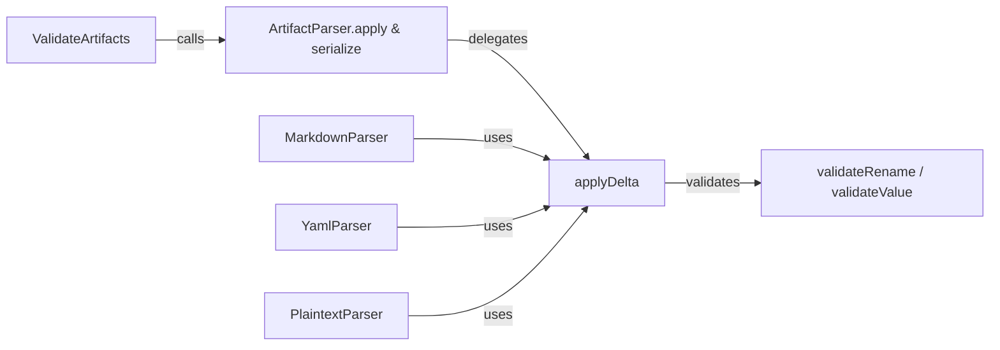

# Design: delta-merge-effective-change-checks

## Affected areas

### 1. `packages/core/src/application/ports/artifact-parser.ts`

- **Symbol:** `validateRename(descriptors, entry, nodeType, warnings?)` (lines 151–182)
  - **Current behavior:** Computes `const hasLabel = descriptor.identifiedBy.length > 0`. Any node with `identifiedBy: ['contains']` (such as markdown `paragraph`, plaintext `paragraph`, and plaintext `line`) is treated as having a `label`, so `rename` passes with only a warning.
  - **New behavior:** Compute `const hasNameIdentifier = descriptor.identifiedBy.includes('matches')`. If `!hasNameIdentifier`, return `` `\`rename\` is not valid on node type "${nodeType}" — this node has no name/label identifying property to rename` ``.
- **Symbol:** `validateValue(descriptors, entry, nodeType, warnings?)` (lines 100–137)
  - **Current behavior:** For `descriptor.isLeaf` with `descriptor.identifiedBy.length > 0`, warns `` `\`value\` on leaf-with-label "${nodeType}" — consider using \`rename\` to update the identifier` ``. On `paragraph` (`identifiedBy: ['contains']`), this misleadingly suggests `rename`.
  - **New behavior:** Check `const hasNameIdentifier = descriptor.identifiedBy.includes('matches')` instead of `descriptor.identifiedBy.length > 0` for the `leaf-with-label` warning, so `contains`-only leaf nodes (`paragraph`, `line`) accept `value` cleanly without a spurious `consider using rename` warning.

### 2. `packages/core/src/infrastructure/artifact-parser/_shared/apply-delta.ts`

- **Impact:** `specd graph impact` reports `riskLevel: MEDIUM` (6 affected files: `json-parser.ts`, `markdown-parser.ts`, `plaintext-parser.ts`, `yaml-parser.ts`, `registry.ts`, `composition-registries.ts`).
- **Phase 1 structural check (lines 314–359):**
  - Add check for `entry.op === 'modified'`: if `entry.content === undefined && entry.value === undefined && entry.rename === undefined`, throw `new DeltaApplicationError('`modified`entry must have at least one of`content`, `value`, or `rename`')`.
- **Phase 4 mutation & cache invalidation (`setChildren`, `updateNodeInTree`, `modified` branch lines 222–266, 493–611):**
  - Extract a small helper `stripParserCacheFields(clone: Record<string, unknown>): void` (or handle in `setChildren` and `modified` node cloning) that removes stale parser-internal serialization caches when a node or its `children` are mutated:
    - On any `setChildren(node, newChildren)` call (which mutates `node.children`, including `root` in `updateNodeInTree`), delete `_yaml` from the cloned node so `YamlParser.serialize()` never returns stale pre-delta YAML.
    - On `entry.op === 'modified'` when `entry.rename !== undefined`, `entry.content !== undefined`, or `entry.value !== undefined`: delete `_inlines`, `_blockquoteChildren`, and `_yaml` from the cloned target node so `MarkdownParser` and `YamlParser` serialize the updated `value` / `label` / `children` rather than stale cached inline/raw representations.
  - Note: Untouched sibling nodes and untouched ancestor nodes (whose `children` did not change) retain their `_inlines` untouched, preserving inline formatting fidelity for unmodified paragraphs/list-items.

### 3. `packages/core/src/infrastructure/artifact-parser/markdown-parser.ts`

- **Impact:** `specd graph impact` reports `riskLevel: CRITICAL` (13 affected files in `core`).
- **`nodeToMdastNodes` (`markdown-parser.ts:506-528, 544-560`):**
  - Because `applyDelta` clears `_inlines` and `_blockquoteChildren` on mutated `paragraph` and `list-item` nodes, `nodeToMdastNodes` naturally falls back to `node.value` for `paragraph` and `item.label` for `list-item`.
  - Additionally, in `MarkdownParser.apply`, no extra post-pass is needed if `applyDelta` strips `_inlines` and `_blockquoteChildren` on mutated nodes; however, if `node.type === 'paragraph'` has `value` updated and `_blockquoteChildren` was cleared, `nodeToMdastNodes` emits `{ type: 'paragraph', children: [{ type: 'text', value: typeof node.value === 'string' ? node.value : '' }] }`.

### 4. `packages/core/src/infrastructure/artifact-parser/yaml-parser.ts`

- **Impact:** Direct dependents are registry/composition wiring; `YamlParser.serialize(ast)` (lines 362–369) checks `const yamlStr = (ast.root as Record<string, unknown>)['_yaml']`.
- Because `setChildren(root, ...)` in `applyDelta` will no longer copy `_yaml` when `root.children` are replaced, any mutated YAML AST will have `ast.root._yaml === undefined`, causing `YamlParser.serialize(ast)` to fall through to `stringify(artifactNodeToJsValue(ast.root))` and emit the updated YAML.
- Unmodified YAML ASTs (`serialize(parse(content))` without `apply`) still retain `_yaml` on `ast.root` and continue to round-trip comments verbatim.

### 5. `packages/core/src/infrastructure/artifact-parser/plaintext-parser.ts`

- **`nodeTypes()` (`plaintext-parser.ts:113-131`):**
  - Change `paragraph` descriptor from `{ isCollection: true, isContainer: false, isLeaf: false }` to `{ isCollection: false, isSequence: false, isSequenceItem: false, isContainer: false, isLeaf: true }`.
  - Keep `identifiedBy: ['contains']` on `paragraph` and `line`.
  - With `isLeaf: true`, `validateValue` permits `value` updates on plaintext `paragraph` nodes, and `validateRename` (updated to require `'matches'`) rejects `rename` on both `paragraph` and `line`.
- **`apply()` (`plaintext-parser.ts:47-61`) and `_serializeParagraph()` (`plaintext-parser.ts:257-262`):**
  - `applyDelta`'s `replace` strategy already deletes `children` and sets `clone['value'] = newNode.value`, and `_serializeParagraph` falls back to `node.value` when `children` is absent.
  - Ensure `valueToNode` in `PlaintextParser.apply` splits multi-line string values or sets `value: String(value)` cleanly so `_serializeParagraph` emits the updated text.

### 6. `packages/core/src/application/use-cases/validate-artifacts.ts`

- **Method:** `ValidateArtifacts.execute` — delta application preview block (lines 490–532).
- **Current behavior:** Calls `parser.apply(baseAST, deltaEntries)` once and serializes `mergedResult.ast` into `validationContent`. Never checks whether each non-`no-op` entry actually changed the serialized output.
- **New behavior:** After `parser.apply(baseAST, deltaEntries)` succeeds (preserving atomic full-delta conflict/selector validation), run an in-memory sequential effective-change check across `deltaEntries` (see Approach & Execution flow below).

## New constructs

No new public classes, ports, or files are required. Two private/internal helpers are added:

1. In `packages/core/src/infrastructure/artifact-parser/_shared/apply-delta.ts`:

```typescript
/**
 * Removes parser-internal cached serialization fields from a cloned AST node
 * so serializers emit mutated `value`, `label`, or `children` rather than stale caches.
 */
function clearParserSerializationCaches(target: Record<string, unknown>): void {
  delete target['_inlines']
  delete target['_blockquoteChildren']
  delete target['_yaml']
}
```

2. In `packages/core/src/application/use-cases/validate-artifacts.ts`:

```typescript
/**
 * Verifies in memory that every non-`no-op` delta entry changes the serialized
 * artifact output relative to the immediately preceding state.
 *
 * @returns An error description for the first ineffective entry, or `null` if all entries are effective.
 */
function verifyDeltaOperationsEffective(
  parser: ArtifactParser,
  baseAST: ArtifactAST,
  deltaEntries: readonly DeltaEntry[],
): string | null
```

## Data models & Contracts

- **Validation failure format in `ValidateArtifacts`:**
  - When `verifyDeltaOperationsEffective` detects that entry at index `i` (0-based, or 1-based in message) with `entry.op` leaves `nextSerialized === previousSerialized`:
    - Push to `failures`:
      ```typescript
      {
        artifactId: artifactType.id,
        description: `Delta operation #${i + 1} (${entry.op}) produced no change in serialized output`,
        filename: validationFilename,
      }
      ```
    - Set `artifactFailed = true` so `validations[]` and `markComplete` are skipped for that artifact.

## Approach & Execution flow

### A. `applyDelta` (`packages/core/src/infrastructure/artifact-parser/_shared/apply-delta.ts`)

1. **Phase 1 (Structural checks):**
   - For every `entry` in `delta`:
     - If `entry.op === 'modified'` and `entry.content === undefined && entry.value === undefined && entry.rename === undefined`, throw `DeltaApplicationError`.
     - Run `validateContent`, `validateValue`, `validateRename` (where `validateRename` now requires `descriptor.identifiedBy.includes('matches')`).
2. **Phase 4 (Mutation):**
   - `setChildren(node, newChildren)` clones `node` excluding `children`, `value`, and calls `clearParserSerializationCaches(clone)` (clearing `_yaml`, `_inlines`, `_blockquoteChildren` on the mutated container/root).
   - Inside `entry.op === 'modified'`:
     - When applying `rename`, `content`, or `value`, call `clearParserSerializationCaches(clone)` on the cloned target node before returning `updated`.
     - Untouched sibling nodes are never passed through `setChildren` or `modified` cloning, so their `_inlines` remain intact.

### B. `ValidateArtifacts` (`packages/core/src/application/use-cases/validate-artifacts.ts`)

1. If `deltaEntries` are all `no-op`, existing no-op bypass skips `baseArtifact`, `deltaValidations`, `apply`, effective-change check, and `validations[]`.
2. Otherwise, after `baseAST = parser.parse(baseArtifact.content)` and `mergedResult = parser.apply(baseAST, deltaEntries)`:
   - Call `verifyDeltaOperationsEffective(parser, baseAST, deltaEntries)`:
     1. Set `let currentAST = baseAST` and `let previousSerialized = parser.serialize(baseAST)`.
     2. Loop `for (let i = 0; i < deltaEntries.length; i += 1)`:
        - `const entry = deltaEntries[i]!`
        - If `entry.op === 'no-op'`, `continue`.
        - `const stepResult = parser.apply(currentAST, [entry])`
        - `const nextSerialized = parser.serialize(stepResult.ast)`
        - If `nextSerialized === previousSerialized`, return `` `Delta operation #${i + 1} (${entry.op}) produced no change in serialized output` ``.
        - `currentAST = stepResult.ast`
        - `previousSerialized = nextSerialized`
     3. Return `null`.
3. If `verifyDeltaOperationsEffective` returns a non-null message, push a failure and set `artifactFailed = true`.
4. Otherwise continue to `validations[]`, metadata extraction, and `markComplete`.

## Error handling & Edge cases

- **Empty `modified` entry** (`{ op: 'modified', selector: ... }` with no `content`/`value`/`rename`): throws `DeltaApplicationError` in `applyDelta` Phase 1; `ValidateArtifacts` records it as a validation failure.
- **`rename` on `contains`-only nodes** (`paragraph` in markdown/plaintext, `line` in plaintext): `validateRename` returns error string; `applyDelta` throws `DeltaApplicationError`.
- **`modified` with identical `content`/`value`/`rename`:** `applyDelta` succeeds (or in `ValidateArtifacts` step 7, `nextSerialized === previousSerialized`), and `ValidateArtifacts` records a failure (`Delta operation #1 (modified) produced no change in serialized output`).
- **Multi-entry delta where entry #1 changes the file and entry #2 is a no-op `modified`:** Full `mergedResult` differs from `base`, so a naive whole-file check would miss it; sequential per-entry check in `verifyDeltaOperationsEffective` catches entry #2 specifically.
- **Sequential selector interaction:** Because `verifyDeltaOperationsEffective` advances `currentAST = stepResult.ast` after each effective entry, an `added` entry followed by a `modified` or `removed` entry targeting the newly added node (or adjacent sibling) resolves against the same evolving AST state as `applyDelta` Phase 4.
- **`added` followed by `removed` of the same node (net-zero across two ops, but each op changes intermediate serialized state):** Each individual op changes `previousSerialized !== nextSerialized`, so both ops are valid.
- **Only-`no-op` deltas:** Still bypassed completely before loading `baseArtifact`.
- **Untouched markdown inline formatting:** Only the mutated node and mutated ancestors clear `_inlines`; untouched sibling paragraphs keep `_inlines` and preserve `` `code` ``, `*em*`, `**strong**`.
- **YAML round-trip without delta:** `serialize(parse(yaml))` still returns `_yaml` with comments preserved because `root` was not passed through `setChildren`.

## Key decisions

- **Decision:** Clear cached serialization metadata (`_inlines`, `_blockquoteChildren`, `_yaml`) inside `applyDelta`'s `setChildren` and `modified` node-cloning paths rather than only in `MarkdownParser`.
  - **Rationale:** Centralizes cache invalidation for all adapters that use `applyDelta`, preventing every future adapter cache field from silently shadowing `value`/`label`/`children`.
  - **Alternative rejected:** Re-parsing the entire document on every op, which would destroy `_inlines` on untouched sibling paragraphs (violating `core:delta-format`).
- **Decision:** Perform sequential per-entry `serialize()` comparison in `ValidateArtifacts` rather than making `applyDelta` depend on `serialize()`.
  - **Rationale:** `applyDelta` is a pure AST-to-AST function that does not receive `serialize`; `ValidateArtifacts` already holds `parser: ArtifactParser` and runs in memory.
  - **Alternative rejected:** Comparing AST nodes inside `applyDelta` alone, which would miss serializer-level bugs (like `_inlines` or `_yaml` shadowing `value`).

## Trade-offs

- [Per-op `parser.serialize()` in `ValidateArtifacts` adds O(N) serializations for N delta entries] → Mitigation: Spec delta files are small (typically 1–20 entries) and `serialize()` is fast in-memory; only runs during validation of non-`no-op` deltas.
- [Clearing `_yaml` on mutated YAML root falls back to `stringify()` without preserving comments on edited YAML files] → Mitigation: Unmodified YAML (`parse` + `serialize`) still preserves comments via `_yaml`; mutated YAML must emit the new AST rather than stale comments.

## Spec impact

- **`core:delta-format`**, **`core:artifact-parser-port`**, **`core:validate-artifacts`** are updated directly in this change.
- Direct/transitive dependents such as `core:preview-spec`, `core:archive-change`, and `cli:change-validate` remain valid and benefit automatically from accurate `apply` + `serialize` output without requiring spec changes.

## Dependency map



```
┌────────────────────┐      ┌──────────────────────┐      ┌──────────────────────────┐
│ ValidateArtifacts  │─────▶│ ArtifactParser       │─────▶│ applyDelta               │
│ (per-op serialize  │      │ (Markdown/YAML/      │      │ + clearParserSerialization│
│  effective check)  │      │  Plaintext/JSON)     │      │   Caches()               │
└────────────────────┘      └──────────────────────┘      └──────────────────────────┘
                                       │
                                       ▼
                            ┌──────────────────────┐
                            │ validateRename       │
                            │ (requires 'matches') │
                            └──────────────────────┘
```

## Documentation

- No changes to `docs/` are required for this bugfix and validation hardening, as delta format rules and `ValidateArtifacts` semantics are governed by `specs/core/delta-format/spec.md`, `specs/core/artifact-parser-port/spec.md`, and `specs/core/validate-artifacts/spec.md`.

## Testing

**Automated tests (Vitest):**

- `packages/core/test/infrastructure/artifact-parser/apply-delta.spec.ts`:
  - Reject `modified` entry with none of `content`, `value`, `rename` (`DeltaApplicationError`).
  - Reject `rename` on `contains`-only nodes (`markdown` `paragraph`, `plaintext` `paragraph`/`line`).
- `packages/core/test/infrastructure/artifact-parser/markdown-parser.spec.ts`:
  - `paragraph` + `value` updates serialized output while preserving `_inlines` on untouched sibling paragraphs.
  - Blockquote `paragraph` + `value` updates serialized output.
  - `list-item` + `rename` updates serialized output (`- New item`).
- `packages/core/test/infrastructure/artifact-parser/yaml-parser.spec.ts`:
  - `modified`, `added`, and `removed` operations invalidate root `_yaml` and serialize updated YAML.
  - Unmodified `serialize(parse(content))` still preserves YAML comments.
- `packages/core/test/infrastructure/artifact-parser/plaintext-parser.spec.ts`:
  - `paragraph` + `value` succeeds and serializes updated text.
  - `paragraph` + `rename` and `line` + `rename` throw `DeltaApplicationError`.
- `packages/core/test/application/use-cases/validate-artifacts.spec.ts`:
  - `modified` with identical content fails effective-change check and does not call `markComplete`.
  - Multi-entry delta where second entry produces no serialized diff fails and identifies operation `#2`.
  - Buggy mock parser where `apply` changes AST metadata without changing `serialize()` fails effective-change check.
  - Valid multi-entry delta passes effective-change check and marks complete.
  - Only-`no-op` delta bypasses effective-change check.
  - `SpecRepository` is never written to.

**Manual / E2E verification:**

- Run `pnpm --filter @specd/core test` and `pnpm --filter @specd/core build` (or `pnpm build` / `pnpm test`).
- Verify `node packages/cli/dist/index.js changes validate` fails on a delta containing an ineffective `op: modified` and passes when every non-`no-op` operation changes the serialized spec.
