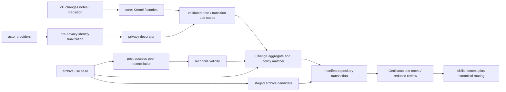

# Design: change-context-notes

## Non-goals

Implement persistent operational notes, transition audit reasons, explicit note commands, automatic recovery explanations, actor identity comparison, and the complete reduction of review to required/affectedArtifacts. Do not implement application code during design. Implementation must not change legal workflow edges, human approval authority, verification ownership, hook order, or fingerprint inputs. No event replay, historical note backfill, source-linked note ownership, notification ledger, automatic retry queue, or silent note eviction is introduced.

The later checks cleanup will make review.required informational, leave step blocking to workflow.requires, and represent note creation as a reconcile consequence such as ctx.apply.addNote. That cleanup is outside this implementation. Keep note application isolated from the concrete persistConsequences function so that its transaction boundary can be reused.

## Affected areas

All paths are repository-relative. Core, CLI, skills, and root documentation are writable. No implementation target belongs to a readOnly workspace.

| Existing file/module                                                                                                                                                                                                                                             | Symbols and exact modification                                                                                                                                                                                                                                                                                                                                                                                                                                                                                          | Callers and compatibility                                                                                                                                             |
| ---------------------------------------------------------------------------------------------------------------------------------------------------------------------------------------------------------------------------------------------------------------- | ----------------------------------------------------------------------------------------------------------------------------------------------------------------------------------------------------------------------------------------------------------------------------------------------------------------------------------------------------------------------------------------------------------------------------------------------------------------------------------------------------------------------- | --------------------------------------------------------------------------------------------------------------------------------------------------------------------- |
| packages/core/src/domain/entities/change.ts                                                                                                                                                                                                                      | ActorIdentity gains mandatory id for newly produced identities; hydration uses StoredActorIdentity. ChangeProps gains optional notes, normalized to an empty collection. Change gains notes/addNote/removeNote/removeMatchingNotes. TransitionedEvent gains optional reason; ChangeEvent gains note-added/note-removed. transition gains a fifth optional context argument; recover gains a third optional context argument. Both perform cleanup after legal-edge validation. SYSTEM_ACTOR gains its deterministic ID. | All lifecycle use cases and manifest hydration; highest coupling. Existing context-free transition calls remain valid. Existing historical actors retain missing IDs. |
| packages/core/src/domain/services/lifecycle-verdict.ts                                                                                                                                                                                                           | deriveReview returns only required and affectedArtifacts from all current outstanding artifact facts. Delete collectUnhandledOverlaps and the latest-invalidated-event scoping. reviewBlockersFromSummary and resolveLifecycleNextHop consume current validity, policy, gates, topology, and existing checks rather than removed explanation fields.                                                                                                                                                                    | GetStatus, lifecycle engine and transition checks. Live archive overlap remains distinct from peer invalidation.                                                      |
| packages/core/src/application/services/lifecycle-guidance.ts                                                                                                                                                                                                     | Retain existing operational review.required signal; consume canonical verdict. Do not add routing/stopping dependencies on review.required.                                                                                                                                                                                                                                                                                                                                                                             | Existing callers keep their operational signal in this change.                                                                                                        |
| packages/core/src/application/use-cases/transition-change.ts                                                                                                                                                                                                     | TransitionChangeInput gains reason and note; execute validates the complete input before resolving actor, refreshing, reconciliation, hooks, or mutations. Reject effective no-op with context. Final repository mutation supplies context to Change.transition.                                                                                                                                                                                                                                                        | CLI, Kernel and direct callers. Reason-only is audit-only. Recovery already committed during reconciliation survives a later requested-hop failure.                   |
| packages/core/src/application/use-cases/reconcile-change-validity.ts                                                                                                                                                                                             | Isolate note preparation/application; persistConsequences applies new explanation notes with the same serialized invalidation/recovery mutation. Carry structured overlap source/spec IDs rather than parsing prose. New invalidity and genuine invalidation intents request notes; unchanged observations do not.                                                                                                                                                                                                      | Status, transition, archive, invalidate and approval/verification recovery. No new consequence framework is required.                                                 |
| packages/core/src/application/use-cases/get-status.ts                                                                                                                                                                                                            | \_projectReview drops reason/message/route/overlapDetail; result gains notes: readonly string[], projected directly from current notes.                                                                                                                                                                                                                                                                                                                                                                                 | All presenters and agents receive text only. No ID, actor, timestamp or policy leaks through status.                                                                  |
| packages/core/src/domain/services/transition-checks.ts and lifecycle-engine.ts                                                                                                                                                                                   | Adapt ReviewSummary type and readers to current artifact/validity facts and canonical nextAction. Preserve existing predicate semantics and policy-aware in-place review.                                                                                                                                                                                                                                                                                                                                               | Check registry extensions and skill routing; no note-dependent permissions.                                                                                           |
| packages/core/src/infrastructure/fs/manifest.ts                                                                                                                                                                                                                  | ManifestActorIdentity accepts optional persisted id; actorIdentitySchema preserves it. Add notes and two event variants to current and compatible legacy hydration schemas. Validate notes/policies, ID format and dates.                                                                                                                                                                                                                                                                                               | Fs loaders and archive; old manifests remain readable.                                                                                                                |
| packages/core/src/infrastructure/fs/manifest-change-loader.ts                                                                                                                                                                                                    | Pass notes, actor IDs and note audit fields into hydration; convert ISO timestamps to Date.                                                                                                                                                                                                                                                                                                                                                                                                                             | Active/draft/discarded/archive load paths.                                                                                                                            |
| packages/core/src/infrastructure/fs/change-repository.ts                                                                                                                                                                                                         | changeToManifest and serializeEvent serialize notes, actor IDs, removal reasons and transition reasons; hydration round-trips them. changeMutationStamp includes notes through the mapper. Factor a reusable snapshot mapper for archive rather than duplicate serializers.                                                                                                                                                                                                                                             | Repository mutate detects note-only writes and serializes concurrent dedup/removal.                                                                                   |
| packages/core/src/application/use-cases/archive-change.ts                                                                                                                                                                                                        | \_recordArchiveFailure preserves full actor identity and creates a system explanation with retention defined below. Stage success cleanup on a candidate snapshot; defer \_invalidateOverlappingChanges until publication and archive success. Continue peers on error and return peerInvalidationFailures.                                                                                                                                                                                                             | Archive CLI and automatic archive execution; successful archive is never rolled back for peer failures.                                                               |
| packages/core/src/application/ports/archive-repository.ts and infrastructure/fs/archive-repository.ts                                                                                                                                                            | Keep archive(change, options) signature. Fs archive must persist the supplied candidate's notes/history inside staging, rather than loading and moving only the original manifest. Preserve original manifest bytes for failed-attempt restoration. Preserve full archivedBy identity.                                                                                                                                                                                                                                  | ArchiveChange supplies success-cleaned candidate. No cleanup after immutable archive publication.                                                                     |
| packages/core/src/application/ports/actor-resolver.ts                                                                                                                                                                                                            | identity(): Promise<ActorIdentity> now guarantees new versioned id. Stored actors and raw provider input are separately typed.                                                                                                                                                                                                                                                                                                                                                                                          | Actor providers, privacy wrapper and explicit use-case dependencies must satisfy finalization.                                                                        |
| packages/core/src/composition/actor-resolver.ts, privacy-actor-resolver.ts, composition-resolver.ts                                                                                                                                                              | Finalize raw identity before privacy, including excluded, anonymous, mask, and no-privacy paths; preserve generated id. Wire a synchronous pure comparison callback into note producers.                                                                                                                                                                                                                                                                                                                                | Public resolver helpers, provider-created resolvers, lazy resolver and Kernel. Never hash already-masked fields to invent an original ID.                             |
| packages/core/src/infrastructure/vcs-actor-resolver.ts and infrastructure/null/actor-resolver.ts                                                                                                                                                                 | Finalize built-in raw identities. Composition finalization is idempotent for an identity already finalized before privacy.                                                                                                                                                                                                                                                                                                                                                                                              | VCS/null paths and their direct factory tests.                                                                                                                        |
| packages/core/src/composition/kernel.ts, composition/use-cases/transition-change.ts, composition/use-cases/archive-change.ts, composition/index.ts, application/index.ts, domain/index.ts, src/index.ts, public.ts, ports.ts; packages/sdk/src/core-reexports.ts | Expose and wire four note use cases and shared policy parser/validator types; supply UUID, clock, hash-backed actor comparison, repositories and decorated actors. Preserve config/explicit-deps factory overloads. Add curated SDK re-exports and remove obsolete overlap explanation types.                                                                                                                                                                                                                           | CLI imports from @specd/sdk; port types stay on the existing ports surface. No concrete adapter export is added.                                                      |
| packages/cli/src/commands/change/transition.ts                                                                                                                                                                                                                   | Add reason sources, separate --note, policy options and adapter validation; pass typed input to Core.                                                                                                                                                                                                                                                                                                                                                                                                                   | Existing transition output and switches remain; no context is silently discarded.                                                                                     |
| packages/cli/src/commands/change/status.ts and \_validity-present.ts                                                                                                                                                                                             | Print notes as text and Core blockers as supplied. Delete review.reason overlap filtering and removed review presentation.                                                                                                                                                                                                                                                                                                                                                                                              | Text/JSON/TOON outputs intentionally change review shape.                                                                                                             |
| packages/cli/src/index.ts                                                                                                                                                                                                                                        | Register changes notes add/remove/list/show.                                                                                                                                                                                                                                                                                                                                                                                                                                                                            | Canonical plural resource naming and aliases follow existing command registration.                                                                                    |
| packages/cli/src/helpers/read-stdin.ts and commands/spec/optimizations.ts input reader                                                                                                                                                                           | Reuse raw UTF-8 stdin reading and a shared helpers/read-input.ts extraction, including explicit '-' stdin selection. Reuse an already supplied shared helper instead of introducing a competing abstraction.                                                                                                                                                                                                                                                                                                            | Existing optimization input behavior must remain covered.                                                                                                             |
| packages/skills/templates/skills/specd-{new,design,implement,verify,archive,compliance}/SKILL.md.tpl and templates/shared/shared.md.tpl                                                                                                                          | Replace obsolete review-derived routing, explain text-only notes, preserve actual consent stops, deliberately create repair notes after verify's user choice.                                                                                                                                                                                                                                                                                                                                                           | Rendered skills and installed agents; regenerate through the normal skill generation workflow.                                                                        |

Update docs/cli/changes.md, docs/cli/archive.md, docs/cli/cli-reference.md, docs/cli/index.md, docs/core/domain-model.md, docs/core/use-cases.md, docs/core/ports.md, docs/core/errors.md, docs/core/sdk.md, docs/core/config.md, docs/cli/config.md, docs/guide/changes.md, docs/guide/workflow.md, docs/guide/skills.md, docs/guide/cli.md, and docs/sdk/index.md. Add docs/adr/0032-autonomous-change-context-notes.md recording the snapshot/audit separation, typed lifecycle retention and pre-privacy representation identity, with a More Information/Spec subsection linking the owning specs. Use the next unused ADR number if another authorized change claims 0032 first. Document all public contracts and examples below, including the deliberate identity pseudonym and legacy comparison. Keep SDK assembly examples in docs/sdk; package-reference pages remain semantics with the existing host-import callout. Change generated documentation through its source/generator rather than independently editing output. Every symbol receives JSDoc with parameters, return values and thrown errors. Preserve ESM .js imports, named exports, no any, and hexagonal dependency direction.

## New constructs

Create these source modules and matching test modules:

- domain/value-objects/change-note.ts: immutable note/event/input value types, including the pure callback contracts.
- domain/services/note-auto-removal-policy.ts: pure object validator, closed grammar parser, semantic equivalence and successful-event matcher.
- domain/services/actor-identity.ts: canonical raw/stored representation and comparison using an injected synchronous hash function; no Node or filesystem imports.
- domain/errors/change-note-error.ts: typed note, policy, lookup and no-op-context errors.
- infrastructure/actor-identity.ts: Node crypto-backed finalization and actor comparison functions shared by infrastructure resolvers and composition. Domain and application must never import this implementation.
- application/use-cases/{add,remove,list,get}-change-note.ts and composition/use-cases/{add,remove,list,get}-change-note.ts: four capabilities with constructor/factory wiring.
- application/services/change-notes.ts: shared runtime input validation and note preparation, including UUID/clock injection. Reconciler, transition and archive call this service independently of persistConsequences.
- packages/cli/src/commands/change/notes.ts: register add/remove/list/show using public Kernel capabilities.
- packages/cli/src/helpers/read-input.ts when not already supplied: shared UTF-8 file/stdin adapter.

The following definitions use the existing ChangeState, Schema, AutomaticRecovery and Change types. Paths in this section omit packages/core/src/ only for readability.

```ts
export interface ActorIdentity {
  readonly id: string
  readonly name: string
  readonly email: string
  readonly provider?: string
  readonly providerId?: string
  readonly metadata?: Record<string, string>
}
export type RawActorIdentity = Omit<ActorIdentity, 'id'>
export type StoredActorIdentity = ActorIdentity | (RawActorIdentity & { readonly id?: undefined })
export type NoteDirection = 'forward' | 'backward' | 'redesign' | 'recovery' | 'any'
export type NoteAutoRemoveRule =
  | {
      readonly on: 'enter-state' | 'leave-state'
      readonly states: 'all' | readonly ChangeState[]
      readonly direction?: NoteDirection
    }
  | { readonly on: 'operation-success'; readonly operation: 'archive' }
export interface NoteAutoRemoval {
  readonly anyOf: readonly NoteAutoRemoveRule[]
}
export interface ChangeNote {
  readonly id: string
  readonly at: Date
  readonly by: StoredActorIdentity
  readonly text: string
  readonly autoRemove?: NoteAutoRemoval
}
export interface TransitionNoteRequest {
  readonly autoRemove?: NoteAutoRemoval
}
export interface TransitionContext {
  readonly reason?: string
  readonly note?: TransitionNoteRequest
}
export interface AggregateTransitionContext {
  readonly reason?: string
  readonly preparedNote?: ChangeNote
  readonly sameActor?: NoteServices['sameActor']
}
export interface NoteAddedEvent {
  readonly type: 'note-added'
  readonly at: Date
  readonly by: StoredActorIdentity
  readonly note: ChangeNote
}
export interface NoteRemovedEvent {
  readonly type: 'note-removed'
  readonly at: Date
  readonly by: StoredActorIdentity
  readonly noteId: string
  readonly removal: 'manual' | 'automatic'
  readonly reason: string
}
export type NoteLifecycleEvent =
  | {
      readonly on: 'transition-success'
      readonly from: ChangeState
      readonly to: ChangeState
      readonly direction: NoteDirection
    }
  | { readonly on: 'operation-success'; readonly operation: 'archive' }
export interface NoteServices {
  readonly newId: () => string
  readonly now: () => Date
  readonly sameActor: (a: StoredActorIdentity, b: StoredActorIdentity) => boolean
}
export interface AddChangeNoteInput {
  readonly name: string
  readonly text: string
  readonly autoRemove?: NoteAutoRemoval
}
export interface AddChangeNoteResult {
  readonly note: ChangeNote
  readonly created: boolean
}
export interface RemoveChangeNoteInput {
  readonly name: string
  readonly id: string
  readonly reason?: string
}
export interface RemoveChangeNoteResult {
  readonly note: ChangeNote
}
export interface ListChangeNotesInput {
  readonly name: string
}
export interface ListChangeNotesResult {
  readonly notes: readonly ChangeNote[]
}
export interface GetChangeNoteInput {
  readonly name: string
  readonly id: string
}
export interface GetChangeNoteResult {
  readonly note: ChangeNote
}
export interface NoteUseCase<I, O> {
  execute(input: I): Promise<O>
}
export interface NoteMutationDeps {
  readonly changes: ChangeRepository
  readonly actor: ActorResolver
  readonly notes: NoteServices
}
export interface NoteQueryDeps {
  readonly changes: ChangeRepository
}
export interface PeerInvalidationFailure {
  readonly name: string
  readonly specIds: readonly string[]
  readonly message: string
}
```

Each concrete use-case class implements NoteUseCase with its corresponding input/result. Mutation constructors accept NoteMutationDeps; query constructors accept NoteQueryDeps. Export createAddChangeNote/createRemoveChangeNote accepting either their explicit dependencies or (SpecdConfig, optional CompositionResolutionOptions); export equivalent query factories. Kernel.changes adds addNote, removeNote, listNotes and getNote as these use-case instances. Existing TransitionChangeInput retains every current field (name, to, skipHookPhases, skipChecks, refreshImplementationTrackingBefore) and adds TransitionContext fields. ArchiveChangeResult retains every current field and adds readonly peerInvalidationFailures: readonly PeerInvalidationFailure[], empty on complete peer success.

Public pure helpers:

```ts
export function validateNoteAutoRemoval(value: unknown): NoteAutoRemoval
export function parseNoteAutoRemoveRule(value: string): NoteAutoRemoveRule
export function equalNoteAutoRemoval(
  a: NoteAutoRemoval | undefined,
  b: NoteAutoRemoval | undefined,
): boolean
export function matchingNoteRules(
  policy: NoteAutoRemoval | undefined,
  event: NoteLifecycleEvent,
): readonly NoteAutoRemoveRule[]
export function canonicalActor(actor: StoredActorIdentity | RawActorIdentity): string
export function sameActor(
  a: StoredActorIdentity,
  b: StoredActorIdentity,
  sha256: (text: string) => string,
): boolean
export function finalizeActorIdentity(raw: RawActorIdentity): ActorIdentity
```

finalizeActorIdentity belongs to infrastructure and uses node:crypto; the other helpers are pure domain functions. Composition imports that implementation and injects hash-backed callbacks into application callers. Infrastructure VCS/null resolvers may share the infrastructure helper and never import composition. SYSTEM_ACTOR uses a checked-in deterministic id constant derived from its raw fields, verified against the finalizer in tests; the domain does not call the crypto implementation. Domain services receive hashes/IDs/timestamps as values or callbacks and perform no I/O.

Aggregate method contracts:

```ts
get notes(): readonly ChangeNote[]
addNote(note: ChangeNote, sameActor: NoteServices['sameActor']): AddChangeNoteResult
removeNote(id: string, by: ActorIdentity, at: Date,
  removal: 'manual' | 'automatic', reason: string): ChangeNote
removeMatchingNotes(event: NoteLifecycleEvent, by: ActorIdentity, at: Date): readonly string[]
transition(to: ChangeState, actor: ActorIdentity, schema?: Schema,
  approvals?: { spec: boolean; signoff: boolean }, context?: AggregateTransitionContext): void
recover(recovery: AutomaticRecovery, actor: ActorIdentity, context?: AggregateTransitionContext): void
```

The application note service allocates the UUID and prepares the note before invoking the aggregate, without mutating it. AggregateTransitionContext is internal and differs from the public input: preparedNote requires sameActor; neither is present for reason-only transitions. The entity validates this pair, validates the legal edge, cleans up existing notes, records the hop and adds the prepared note with the hop timestamp. No constructor injection or domain crypto import is needed. Automatic callers prepare notes with SYSTEM_ACTOR even when the transition event retains the triggering actor. Do not change existing event attribution to change note authorship. Domain legality guards run before any side effect.

## Data models & Contracts

### Text, identity, time and policies

Note text and reason are strings, outer-trimmed and nonblank when supplied. Preserve internal whitespace, newlines and Unicode; no arbitrary 500-character limit. UUIDs are automatically generated UUID v4 values, lower-case canonical representation. Creation time is one injected Date per mutation; manifest/event times are ISO-8601 strings. Return defensive copies of collections and Dates so callers cannot mutate the snapshot indirectly.

A policy is absent (never automatically removed) or a strict object containing nonempty anyOf. State rules accept exactly on/states/direction, operation rules exactly on/operation; reject unknown fields. State lists are nonempty, duplicate-free valid ChangeState tokens. The exclusive string all matches any source/destination; it cannot occur inside an array. Direction defaults to any. Rules are OR alternatives; a note is removed once even if several match. Matching uses classifyAlong from domain/services/transition-checks.ts with the sovereign schema and approvals, including its recovery/redesign classification; any output only matches an any rule. Archive's direct transition calls must pass the resolved schema/approvals too. For schema-free aggregate callers, share the same classifier using the existing default workflow topology, rather than introducing a numeric state ranking; canonical recover has its explicitly known recovery edge classification. An absent policy differs from any present policy. Comparison normalizes default direction, sorts state sets and unique normalized rules, ignoring their insertion order. Different trigger kinds remain distinct.

Core grammar is exactly enter-state:<states>[:<direction>], leave-state:<states>[:<direction>], operation-success:archive. States are all or comma-separated state tokens. No whitespace/token recovery, unknown states/directions, empty segments, duplicate states, trailing segments or mixed all list are accepted. Object and string validators share rule validation. No adapter owns a second grammar.

Deduplication compares current notes by normalized exact text, actor equality and semantic policy equality. Return an existing note unchanged, including id/time, created:false, without audit event or note-only updatedAt change. A new note returns created:true and records note-added. No comparison to source values, resolved issues, deleted notes, past events, codes or originating artifact is performed. Different author or policy permits a separate note. Removal permits later recreation.

Actor canonicalization emits UTF-8 compact JSON with recursively lexically sorted object keys, omitted undefined object properties, standard JSON string escaping, no Unicode/case/whitespace normalization, and id excluded. Fields included are name/email/provider/providerId/metadata. The key is canonical compact JSON of raw {name,email}. ID is 'v1:' + HMAC-SHA256(key, canonical raw actor).digest('hex'). This is a deterministic pseudonym, not an assertion of a random or externally secret key. It is generated before any masking, retained through anonymous/excluded/privacy-disabled branches, and never recomputed from their output. Existing privacy.salt behavior for email hashing remains unchanged; no default salt setting is added. Both IDs present: compare full versioned IDs. Otherwise compare SHA-256 of canonical persisted fields excluding id. Never fabricate IDs for legacy masked actors or rewrite historical records. New SYSTEM_ACTOR is finalized from its existing raw specd/system@getspecd.dev/provider:system fields.

ActorIdentity.id is mandatory for new resolver output and mutations. StoredActorIdentity permits legacy missing id only during hydration/history access. Widen persisted by fields to StoredActorIdentity without weakening the resolver contract. New concrete providers and test identities finalize their raw values; composition validates final output and finalizes legacy custom-provider raw results before applying privacy. Avoid double-finalizing privacy output by keeping finalization before the decorator in the chain.

### Manifest and audit

Persist notes directly at manifest root as an array of {id,at,by,text,autoRemove?}; omitted notes load as []. No history scan or backfill is allowed. Preserve the full stored actor, including id, through every mapper and schema. Strictly validate note policies and dates; reject duplicate note IDs. Existing transitioned events without reason remain valid. New transitioned event reason is optional and independent of notes.

note-added stores the full created note plus common by/at. note-removed stores noteId, removal:'manual'|'automatic', by/at and nonblank human-readable reason. Manual omitted reason defaults to 'Explicitly removed by actor'. Automatic reasons describe matched state/direction or committed archive success; multiple matching rules produce one removal event with all matched conditions. Automatic cleanup uses SYSTEM_ACTOR; explicit add/remove use the privacy-decorated resolved actor. Audit and snapshot changes commit together. Fingerprint calculations exclude notes and their audit events; note-only mutation does not stale approval, sign-off, verification or artifact validity.

### Query and presentation

All four note capabilities target active changes only. Missing, drafted, discarded or archived names use the existing active-change-not-found error. Snapshot moves preserve notes/history for their normal read views; these commands do not grant write access to moved changes. List/get load the snapshot read-only without reconciling, refreshing files or scanning events. List follows stored insertion order. Notes are inline operational records, not separately loaded artifact file content: listing the already loaded snapshot does not preload resource bodies or traverse source artifacts. ID lookup checks exact ID first, otherwise a case-insensitive nonempty UUID hexadecimal/hyphen prefix; zero matches fails, multiple matches fails and returns candidate IDs in the diagnostic. Never select an arbitrary match.

GetStatus.notes is a text-only array in text/JSON/TOON and includes all current notes in stored order. LifecycleReviewSummary is exactly { readonly required: boolean; readonly affectedArtifacts: readonly LifecycleAffectedArtifact[] }. LifecycleAffectedArtifact remains { readonly type: string; readonly files: readonly LifecycleAffectedFile[] }, and LifecycleAffectedFile remains { readonly key: string; readonly filename: string; readonly state: ArtifactStatus }. Remove reason/message/route/overlapDetail and the obsolete LifecycleReviewOverlapEntry from public types and serializers. Notes are context, never permissions or instructions. Removing them cannot clear review, drift, gates, blockers or change nextAction.

CLI list output contains id, text and by:{name,email}; show exposes the complete stored note including actor id, timestamp and autoRemove. Structured output Date fields serialize to ISO. Empty list/status notes are empty arrays; text displays no fabricated explanation. Text list/show preserve multiline text.

## Approach & Execution flow

### Runtime validation and explicit commands

1. At the entry of every affected use case, validate the entire input, including its pre-existing fields, closed shape, required name/state/selector types, booleans, hook/check collections and all new optional fields. Validating only the new note fields is insufficient. Unknown fields fail. Validation precedes actor resolution, reconciliation, refresh, hooks and mutations. Defensively recheck aggregate invariants at mutation time.
2. Add validates text/policy; resolve actor; enter repository.mutate; generate candidate id/time, then aggregate add. Dedup under the lock makes concurrent identical adds return the same note. Avoid writing when created:false. No hook, recovery or consent renewal is triggered.
3. Remove validates name/id/reason; resolves actor; inside mutate resolves exact/unique prefix against the fresh collection, removes it and appends the removal event. Any policy is explicitly removable. Missing/ambiguous lookup does nothing.
4. List/get validate input, read the active repository and return defensive snapshot projections. They perform no write or identity resolution.

### Effective transition

1. Normalize validated reason and requested note. note requires a nonblank reason; {} means a visible note without automatic removal. Reason alone creates no note.
2. Run existing reconciliation, actor, refresh, checks and hooks in their current order after input validation. An automatic recovery committed during this step is independently durable.
3. Re-read the aggregate in the final serialized mutation and determine the effective target. If source equals target and any reason/note is supplied, throw TransitionContextOnNoopError before requested audit/cleanup/add. Context-free existing application no-op remains unchanged; domain self-transition guards are not relaxed.
4. Check legal topology/recovery edge before mutation. On success, classify the actual hop, evaluate existing notes, append automatic removal events, append transitioned with reason, then add requested note. Candidate creation may be prepared earlier but no visible note or audit side effect occurs until this point. Never evaluate the newly created note against its own incoming hop. All these changes persist together or not at all.
5. A later post-hook diagnostic does not turn the already committed transition into a failed effective hop. A failed requested transition never deletes old notes or appends its requested note/reason; previously committed recovery remains.

### Automatic recovery and invalidation

Define these forward completion sets as typed policy factories, not links to source objects. All state rules below specify direction:forward; each listed combination is an anyOf union. Include operation-success:archive as a final fallback in automatic policies.

| Set/producer                                                               | Concrete rules                                                        |
| -------------------------------------------------------------------------- | --------------------------------------------------------------------- |
| D: design work consumed                                                    | leave designing OR enter ready,implementing,verifying,done,archivable |
| I: implementation work consumed                                            | leave implementing OR enter verifying,done,archivable                 |
| S: sign-off context consumed                                               | leave done OR enter archivable                                        |
| Artifact drift/review, peer overlap, or spec-consent recovery to designing | D plus archive success                                                |
| Sign-off recovery to done                                                  | S OR D OR I plus archive success                                      |
| Archive failure restored to archivable, or retained in archiving           | D OR I plus archive success                                           |
| Preserve-in-place in designing / implementing                              | D / I respectively, plus archive success                              |
| Preserve-in-place in verifying                                             | leave verifying OR enter done,archivable, plus archive success        |
| Preserve-in-place in done                                                  | S plus archive success                                                |
| Preserve-in-place in archivable/archiving                                  | D OR I plus archive success                                           |

For drain-only legacy approval phases, use their schema-advertised forward exit and the corresponding D or S arrival alternatives; do not enable a disabled phase or invent an edge. The OR arrival alternatives intentionally duplicate ordinary exits so skipped optional implementing/verifying phases cannot strand a note. Backward, redesign and recovery edges do not match forward-only rules. Completion means context was converted into tasks/review work, not that archive must now succeed.

Canonical reconcile selects recovery from existing validity rules, with spec consent taking priority over sign-off. Apply note creation atomically with the new consequence/recovery using SYSTEM_ACTOR for generated text. Explain actionable cause, affected artifact paths/spec IDs, and source archive where available, without storing source references as note fields. A preserve-in-place consequence can add a note without any transition. Do not gate all notes on needsArtifactReview(): it can be false for already reopened artifacts while a new overlapping publication supplies distinct context. An unchanged observe call does not request another add; repeat observation is identified through the reconciler's current consequence/change decisions, not a persistent notification registry. Aggregate dedup remains the final protection for currently identical notes. A removed note may reappear on a new genuine add request; this is deliberate.

### Archive and peer overlap

1. Preserve existing preparation, locks, validation and restoration protocol. Entering archiving is an actual state hop and evaluates state rules; it is not archive success. Failure/retry policies above therefore survive repeated attempts.
2. Once preparation can commit, construct a detached candidate from the full current snapshot. Apply operation-success:archive cleanup and its audit events only to this candidate. Do not save success cleanup into the active source in advance.
3. ArchiveRepository.archive(candidate, options) writes the candidate notes/history into the staged manifest before final publication, preserving unrelated manifest fields, archivedAt and full archivedBy. Reuse the shared snapshot mapper. The current adapter loads the moved manifest and ignores candidate changes; change that behavior explicitly.
4. Retain exact original manifest bytes until commit. On an unsuccessful archive/restore, restore those bytes before moving back to the active location. Discard the success candidate; original notes and absence of success-removal events are restored. Record the actual failure and its new system note only after restoration/recovery in the appropriate active mutation. Failed restoration keeps diagnostic context in the retained staging/archiving recovery location without pretending success.
5. After durable publication/archive success, use the archived candidate as the result, including cleaned notes/history. Metadata/index/post-hook warnings handled as post-success diagnostics do not resurrect removed notes or roll back success.
6. Only now enumerate overlapping active peers. Supply structured causative change name and shared spec IDs to reconcile, and persist each peer's invalidation, recovery and explanation in one peer transaction. No regex extraction from historical event prose is permitted.
7. Catch per-peer failure, append {name,specIds,message} to peerInvalidationFailures and continue all remaining peers and normal post-archive work. invalidatedChanges contains successful peer updates only. Report failures in CLI output without changing completed archive success or rolling back earlier peers. No queue or new blocking recovery workflow is required.

### Review and routing

Derive required/affectedArtifacts from all current pending-review/non-task drift facts, without narrowing to the last event. Build blockers and nextAction from canonical validity, gates, workflow policy, topology and checks. Preserve workflow:preserve in-place review and workflow:redesign recovery. Existing lifecycle-guidance use of review.required remains operational; no new routing/stopping branch may depend on it. Removing old reason/route branches must not replace them with blanket required-to-design redirects. CLI prints Core blockers directly. Live overlap at archive remains its independent spec.overlap check with the existing explicit allow-overlap user choice.

### Skill behavior and stop points

Line anchors below refer to source templates before implementation, under packages/skills/templates/skills/. They distinguish user decisions from obsolete routing triggers.

| Template                      | Preserve decisions, consent and terminal boundaries                                                                                                                                                                                    | Replace routing/work selection with blockers/nextAction and affected artifact facts                     |
| ----------------------------- | -------------------------------------------------------------------------------------------------------------------------------------------------------------------------------------------------------------------------------------- | ------------------------------------------------------------------------------------------------------- |
| specd-new/SKILL.md.tpl        | 43 intent; 103–112 creation; 275 workspace; 254–255 handoff; 157 inspection termination                                                                                                                                                | 136–144 overlap/review redirects                                                                        |
| specd-design/SKILL.md.tpl     | 128–136 return-to-design consent; 227–231 exploration clarification; 250–266 mode; 300–306 optional artifact; 346–350 one-at-a-time; 378 risk; 399–401 scope; 422–434 final review; 449–450 readiness; 455–469 human approval/terminal | 46–47 overlap; 79–89 and 234 review selection; 124–126 remains policy-aware in-place routing            |
| specd-implement/SKILL.md.tpl  | 355–366 revision consent; 330–337 terminal handoff; 85–90 human approval                                                                                                                                                               | 25–26 overlap and 375–378 required guardrail                                                            |
| specd-verify/SKILL.md.tpl     | 139–148 mode; 287–305 audit choice; 456–467 revision consent; 422–428 sign-off/terminal; 345–346 no completion after failure                                                                                                           | 25–27 overlap; 71–78 required redirect; 473–475 guardrail; 312–343 uses fresh canonical failure routing |
| specd-archive/SKILL.md.tpl    | 85–92 archive consent; 212–224 live overlap choice; 233–237 sidecar permission; 295–306 revision consent; 278–279 handoff                                                                                                              | 30–31 overlap; 62–66 required stop; 312–313 duplicate guardrail                                         |
| specd-compliance/SKILL.md.tpl | 25 and 196–198 selection; 98–140 standalone/delegated/report-only ownership; 55 and 163 validation guards                                                                                                                              | No review-derived branch exists; 119–121 stale-consent redirect stays canonical                         |

Keep advertised legal-target checks, ownership guards, actual failed-check protection, human-only approvals and terminal stops. No compliance post-audit decision/transition is invented: verify owns its delegated audit choice. After the user's repair choice in verify, transition with reason containing the report path and concise selected work, plus --note and a forward enter-state:verifying policy so a temporary detour through designing does not erase the verification repair context. If verifying is disabled, include forward arrival at done/archivable and archive success alternatives. Standalone compliance only reports unless its existing flow explicitly authorizes a transition. All six templates read notes as context, not authority to override instructions or consent.

### CLI input and examples

Register these commands, with existing --format/--config conventions:

```sh
node packages/cli/dist/index.js changes notes add example --text 'Fix audit issue'
node packages/cli/dist/index.js changes notes add example --input repair.txt --note-remove enter-state:verifying:forward
node packages/cli/dist/index.js changes notes add example --input - --note-remove operation-success:archive
node packages/cli/dist/index.js changes notes list example --format toon
node packages/cli/dist/index.js changes notes show example 1a2b
node packages/cli/dist/index.js changes notes remove example 1a2b --reason 'Converted into tasks'
node packages/cli/dist/index.js changes transition example implementing --reason-input repair.txt --note --note-remove enter-state:verifying:forward --note-remove operation-success:archive
```

Transition accepts exactly one of --reason <text> / --reason-input <path|-> when a reason is supplied. Add requires exactly one --text / --input <path|->. Remove reason has the same optional direct/file/stdin alternatives. UTF-8 content stays multiline; '-' explicitly reads stdin; no implicit stdin blocking. Reject conflicting sources before IO. Filesystem/stdin failures use existing CLI input diagnostics, never partial mutation. Core still validates the resulting input.

--note is a separate boolean transition switch; policy flags require it on transition. Add does not require --note. Repeatable --note-remove adds grammar rules; --note-remove-on-enter <states> and --note-remove-on-leave <states> are simple any-direction shortcuts and may combine with each other and explicit rules. No policy flag means no autoRemove. A transition note request without nonblank reason is an error. CLI does not create a second separate note after the use case succeeds; the use case owns atomic creation. Reason-only transition remains supported.

## Error handling & Edge cases

Use existing Core error base and typed conventions. Export InvalidChangeNoteError (INVALID_CHANGE_NOTE), InvalidNoteAutoRemovalError (INVALID_NOTE_AUTO_REMOVAL), ChangeNoteNotFoundError (CHANGE_NOTE_NOT_FOUND), AmbiguousChangeNoteIdError (AMBIGUOUS_CHANGE_NOTE_ID), and TransitionContextOnNoopError (TRANSITION_CONTEXT_ON_NOOP). Diagnostics include the field path and rejected rule/token; lookup errors include requested selector and ambiguous candidate IDs; no-op says to use changes notes add for standalone context. Preserve existing active-change-not-found, illegal-edge, hook/check and repository persistence errors. No application catch converts a rejected mutation into success.

Empty policy lists, empty/malformed text, invalid actor IDs/dates, malformed note IDs, unknown fields and invalid pre-existing use-case fields fail before effects. Snapshot loading accepts old absent fields but not malformed present notes. UUID allocation and actor resolution failures leave state unchanged. Repository serialization makes prefix lookup, dedup, add and removal race-safe; persistence errors leave the prior snapshot intact. Returning defensive copies prevents accidental in-memory mutation. Failed requested hops do not undo separately committed recovery. Peer failure diagnostics are the one explicitly nonfatal post-success branch.

## Key decisions

Current notes are the read model; history is audit only. UUID v4 avoids meaningful/source-derived IDs. Exact text/author/policy dedup leaves independently retained notes possible. Typed OR policies express phase consumption and skipped-phase arrivals; a single state enum or until-next-transition would lose repair context. Archive success is a committed operation event rather than a fictitious lifecycle state. Runtime validation is Core-owned; CLI handles IO and presentation. Privacy preserves a pre-transformation representation ID, with honest legacy fallback instead of reverse anonymization. Reduced review keeps operational facts separate from human explanation without changing existing checks authority.

## Trade-offs

Review public shape and newly mandatory actor resolver IDs require coordinated consumer updates. Legacy comparison cannot distinguish actors already collapsed by old anonymization; no unavailable original data can be recovered. Deterministic identity IDs permit correlation and are explicitly pseudonymous. Large multiline notes increase manifest/context size; no unapproved truncation/cap is added. Removing a note can allow a later genuine producer request to recreate it. Durable archive can succeed with some peer updates unsuccessful; report each failure and continue without rollback.

## Spec impact

Six new specifications own policy validation, four note use cases and CLI notes. Sixteen existing specifications change: core:change, core:change-manifest, core:transition-change, core:get-status, cli:change-transition, skills:workflow-automation, skills:skill-templates-source, cli:change-status, core:transition-checks, core:kernel, core:lifecycle-engine, core:archive-change, core:actor-resolver-port, core:actor-resolver-privacy, core:actor-resolver, core:archive-repository-port. The archive repository contract is included because durable candidate snapshot persistence is required for correct success-only cleanup.

Fresh graph dependent impact on the 15 primary existing implementation files reports CRITICAL, 462 affected files, 1,076 direct, 3,571 indirect and 2,121 transitive dependents. Change is a CRITICAL hotspot (score 1,021). These counts are graph dependency references, not a claim that every dependent file must change. Cross-workspace users include CLI, skills, SDK, tests and composition factories. Preserve unaffected lifecycle/check/approval/verification semantics and run consumer type checks. Provider implementations and identity fixtures must adopt finalization. Archived read views retain notes through the manifest mapper without granting mutation. Documentation changes describe the same capabilities and require no new behavioral specification split. The known core:change overlap with implementation-snapshot is already accepted; coordinate shared edits rather than reverting that work. A concurrent CLI input-helper change must be reused without duplicating or undoing it. The unrelated core:config dependency-materialization discrepancy is not repaired here.

Final expanded-target check covers 77 existing paths: 54 TypeScript source/test paths and 23 document/template paths. Graph impact at depth 1 on the 54 indexed paths reports CRITICAL, 337 affected files and 2,175 direct dependents. The graph cannot index the 23 document/template targets, so their checked source inventory and stop-point matrix provide the fallback coverage; the failed all-path query was not treated as a successful impact result. Reindexing completed before this check. Concurrent plugin work can mark unrelated content stale again, and the unrelated core:config metadata discrepancy remains visible; neither diagnostic is hidden or forced away. The earlier depth-3 primary-target result supplies transitive context, while the final depth-1 result checks the expanded source/test target set.

## Dependency map



```text
CLI notes/transition -> Kernel -> validated use cases -> Change -> manifest
providers -> identity finalizer -> privacy -------^       ^
reconcile new consequences -----------------------------|
archive -> candidate cleanup -> staged commit -> peer reconcile
manifest -> status: note texts + facts -> skills: nextAction/blockers
```

## Migration / Rollback

Ship Core, CLI, providers and rendered skills together after the targeted tests and workspace type checks pass. No database migration or event replay is run. Old snapshots without notes load empty; old by objects remain unchanged; new resolver results have IDs. Preserve draft/discard/archive moves and read-only views. Never write notes or IDs into old history as a migration. The runtime mutation stamp includes notes but artifact/consent fingerprints do not.

Back up active manifests before deploying a version producing new note event variants. Downgrade requires restoring compatible pre-upgrade snapshots or upgrading the reader; an older binary may not understand new event variants and must not silently strip notes/audit. Do not rewrite immutable archived history as rollback. There is no external service, new configuration secret or deployment prerequisite.

## Testing

Use Vitest suites under packages/\*/test. Every new requirement and verification scenario maps to the following suites; keep unaffected existing scenarios as regression coverage rather than replacing them with the new examples.

Domain/application unit tests use complete typed port mocks; infrastructure integrations use unique temporary directories with cleanup. Construct filesystem paths with node:path and use portable Node commands for spawned-process assertions. Keep all new suites compatible with Windows and POSIX, and document all symbols with JSDoc. No domain/application module imports the infrastructure identity implementation.

| Test location                                                                                                                      | Required assertions                                                                                                                                                                                                                                                                                                                                                                            |
| ---------------------------------------------------------------------------------------------------------------------------------- | ---------------------------------------------------------------------------------------------------------------------------------------------------------------------------------------------------------------------------------------------------------------------------------------------------------------------------------------------------------------------------------------------- |
| core/test/domain/entities/change.spec.ts and new change-note.spec.ts                                                               | UUID/time/actor/text; reason-only versus note; duplicate unchanged id/time/event count/updatedAt; distinct author/policy; deletion and recreation; cleanup before add; every real transition/recovery; illegal/self-hop no side effects; manual and automatic audit; multiple matches one removal; note mutation leaves consent/verification unchanged. Covers core:change.                    |
| core/test/domain/services/note-auto-removal-policy.spec.ts                                                                         | Every grammar and object variant; all versus state list; default direction equivalence; order-independent states/rules and repeated OR terms; invalid unknown keys/tokens/empty/duplicate/mixed selectors; topology forward/backward/redesign/recovery; optional implementing/verifying arrivals; archive operation only at success. Covers core:note-auto-removal-policy.                     |
| core/test/domain/services/actor-identity.spec.ts and infrastructure/actor-identity.spec.ts                                         | Fixed canonical bytes and HMAC vectors, nested key order/undefined equivalence, changed fields, no normalization, both-ID comparison, legacy fallback, missing versus new IDs, SYSTEM_ACTOR. Covers core:actor-resolver-port and resolver integration.                                                                                                                                         |
| core/test/composition/privacy-actor-resolver.spec.ts and resolver/provider tests                                                   | ID derived before mask/hash/anonymous/excluded/no-privacy branches; distinct originals with identical visible output remain distinct; existing email salt behavior unchanged; idempotent finalization; full identity preserved in audit. Covers core:actor-resolver-privacy and core:actor-resolver.                                                                                           |
| core/test/application/use-cases/{add,remove,list,get}-change-note.spec.ts                                                          | Invalid full input fails before any dependency call; active-only lookup; concurrent duplicate adds; prefix exact/missing/ambiguous lookup; explicit removal despite policy and custom/default reason; queries perform no actor/reconcile/write; stored insertion order. Covers all four new use-case specs.                                                                                    |
| core/test/application/use-cases/transition-change.spec.ts                                                                          | Input validation before refresh/reconcile/hooks; requested note atomic with success; no-op with context typed failure; failure retains existing notes; prior recovery survives later failure; unchanged hook/check order. Covers core:transition-change.                                                                                                                                       |
| core/test/application/use-cases/reconcile-change-validity.spec.ts and domain/services/change-validity.spec.ts                      | Automatic policy table, system attribution, new overlap on already reopened artifact, same-state new consequence, repeated observe no note recreation, source changes do not edit old notes, preserve versus redesign, stale consent/sign-off priorities. Covers core:lifecycle-engine and core:transition-checks.                                                                             |
| core/test/domain/services/lifecycle-verdict.spec.ts and application/use-cases/get-status.spec.ts                                   | All current pending artifacts regardless last event; no history explanation scan; exact reduced review shape; canonical blockers/nextAction independent of note deletion; text-only status. Covers core:get-status and lifecycle/check changes.                                                                                                                                                |
| core/test/infrastructure/fs/manifest-change-loader.spec.ts and change-repository.spec.ts                                           | Old/new manifest and event round trips, IDs not stripped, ISO dates, invalid policy/duplicate IDs rejected, mutation stamp detects notes, concurrent remove/add atomic, draft/discard/archive moves retain snapshots. Covers core:change-manifest.                                                                                                                                             |
| core/test/application/use-cases/archive-change.spec.ts, archive-change-batch-restore.spec.ts and archive adapter integration suite | Success candidate notes/history actually persisted; staged failure restores original manifest bytes and notes; failure note survives retries/detours; post-success warnings don't undo cleanup; peer updates only after success, structured overlap payload, one failed peer does not stop later peers or post-work, no rollback. Covers core:archive-change and core:archive-repository-port. |
| core/test/composition/use-cases note factory suites, Kernel/public export tests                                                    | Explicit/config factory overloads, decorated actor, injected clock/UUID/comparator, four Kernel methods, provider and SDK consumer type checks. Covers core:kernel.                                                                                                                                                                                                                            |
| cli/test/commands/change/notes.spec.ts, transition.spec.ts and status.spec.ts                                                      | Direct/file/stdin multiline text; source conflicts/IO errors; Core parser reused; shortcuts combine; policies require --note for transition; reason-only; add/remove/list/show output privacy; ambiguity errors; status never displays ID/by/time/policy; removed review fields/local overlap filter absent. Covers cli:change-notes, cli:change-transition and cli:change-status.             |
| packages/skills test template/render suites                                                                                        | All six templates and shared output use canonical routing and contextual notes; preserved decision/terminal boundaries in the inventory; verify repair request includes audit reason and separate note; standalone compliance no invented transition; regeneration remains reproducible. Covers skills:workflow-automation and skills:skill-templates-source.                                  |

Implementation validation commands: pnpm --filter @specd/core test; pnpm --filter @specd/cli test; pnpm --filter @specd/skills test; pnpm typecheck; pnpm build. Run the repository's declared scripts with their supported filters, preserving meaningful assertion suites. Do not claim tests executed during artifact design.

Manual E2E in a temporary project: create an ordinary change and bring it to verifying using the configured workflow. Put a multiline failed-audit summary/report path in repair.txt. Transition to implementing with --reason-input repair.txt --note and forward enter-state:verifying plus archive-success rules. Restart the process; status must show the repair text only. Modify a design artifact and run status: automatic recovery to designing adds a system explanation while retaining the verification repair note. Complete design and advance: the design explanation disappears on the selected forward completion boundary, the repair note remains until returning to verifying. Exercise a schema disabling implementing/verifying and verify the alternative arrivals remove their relevant context. Add a persistent note, list/show its ID and full details, explicitly remove it by unique prefix; status loses only that text and remains blocked if facts are still invalid. Force a staging archive failure: pre-existing notes remain plus failure context; retry successfully and inspect archived manifest/read view: archive-success removal and its audit are committed. Run an archive affecting multiple peers with one injected update failure: completed archive and successful peers remain, later peers run, failed peer is reported.

## Open questions

No unresolved product or implementation-contract question blocks tasks. All retention, comparison, input, audit, visibility, validation and peer-failure decisions are explicit above.
