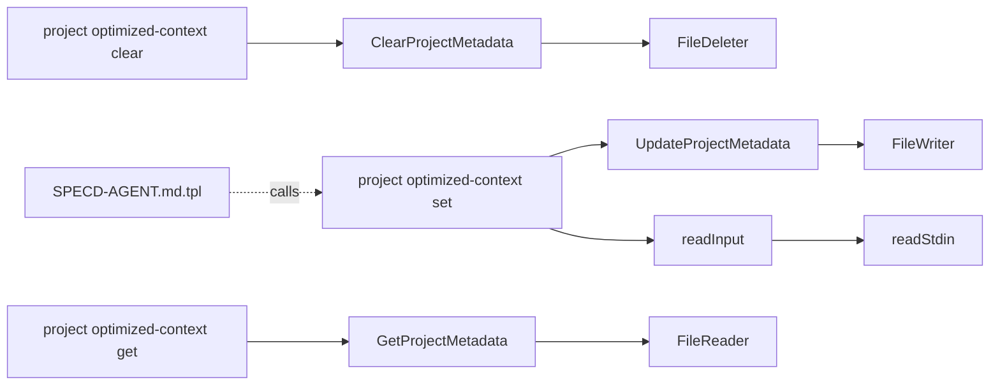

# Design: cli-input-dash-stdin

## Non-goals

- Do not rename or reshape `specs optimizations` (multi-field surface stays).
- Do not invent a plural `project optimizations` group.
- Do not change schema/graph/implementation `--file` path-selector flags.
- Do not edit generated agent files under `.claude/agents/` (or plugin install outputs); only the source template and its unit test.
- Do not extend the shared `FileWriter` port with `delete` (CRITICAL blast radius across composition). Clear uses a dedicated narrow deleter port instead.
- Do not change Core `UpdateProjectMetadata` payload shape (`{ optimizedContext: string }`) or hashing algorithm.

## Affected areas

### CLI — remove and replace command module

- `packages/cli/src/commands/project/update-metadata.ts`
  - **Remove** the file (or replace in place by renaming to `optimized-context.ts` — prefer new file + delete old for clearer git history).
  - Today: registers `update-metadata` with `--file` / implicit stdin; YAML-parses `{ optimizedContext }` into `kernel.project.updateMetadata`.
  - After: gone; no alias.

- `packages/cli/src/program.ts`
  - **Before:** `import { registerProjectUpdateMetadata } from './commands/project/update-metadata.js'` and `registerProjectUpdateMetadata(projectCmd)`.
  - **After:** `import { registerProjectOptimizedContext } from './commands/project/optimized-context.js'` and `registerProjectOptimizedContext(projectCmd)`.
  - Keep `registerProjectMetadata(projectCmd)` unchanged (full dump).
  - Risk: MEDIUM (program/run dependents).

- `packages/cli/src/commands/project/metadata.ts`
  - No payload flags today; ensure it stays inspection-only (no `--input`/`--text`/`--file`). No logic change required unless help text needs a one-line pointer to `optimized-context`.

- `packages/cli/src/commands/spec/optimizations.ts`
  - Replace local `readInput` with shared helper import from `helpers/read-input.ts`.
  - Behavior unchanged: `--input <path|->`.

- `packages/cli/src/helpers/read-stdin.ts`
  - Keep as low-level stdin drain used by `readInput`.

### Core — Kernel wiring

- `packages/core/src/composition/kernel.ts`
  - Extend `Kernel['project']` with `clearMetadata: ClearProjectMetadata` (name: `clearMetadata` to mirror `getMetadata` / `updateMetadata`).
  - Wire via `createClearProjectMetadata(resolveClearProjectMetadataDeps(resolver))`.

- `packages/core/src/application/use-cases/index.ts`, `packages/core/src/composition/use-cases/index.ts`, `packages/core/src/public.ts`, `packages/sdk/src/core-reexports.ts`
  - Export new types/factories consistently with existing project-metadata exports.

### Skills — template only

- `packages/skills/templates/agents/specd-project-context-optimizer/SPECD-AGENT.md.tpl`
  - Replace `specd project update-metadata --optimized-context "<optimized Markdown>"` with `specd project optimized-context set --text "<optimized Markdown>"`.

- `packages/skills/test/template-workflow.spec.ts`
  - Update expectation string accordingly.

### Docs

- Replace `docs/cli/project-update-metadata.md` with `docs/cli/project-optimized-context.md` (or rewrite in place and retitle).
- Update references in `docs/cli/project.md`, `docs/guide/cli.md`, and `docs/cli/cli-reference.md` (and any index links).
- Note in docs that after shipping, operators should run `specd project update` to refresh installed agent instruction files from templates.

## New constructs

### Shared CLI helper

```ts
// packages/cli/src/helpers/read-input.ts
import { readFile } from 'node:fs/promises'
import { readStdin } from './read-stdin.js'

/**
 * Reads content from a filesystem path, or from stdin when `path` is `-`.
 */
export async function readInput(path: string): Promise<string> {
  if (path === '-') {
    return readStdin()
  }
  return readFile(path, 'utf8')
}
```

### CLI command group

```ts
// packages/cli/src/commands/project/optimized-context.ts
export function registerProjectOptimizedContext(parent: Command): void
```

Registers parent command `optimized-context` with subcommands:

**get**

- Options: `--format`, `--config`
- Flow: `resolveCliContext` → `kernel.project.getMetadata.execute()` → if `metadata === null`, print absence message (text) / structured `{ result: 'absent' }` (json/toon); else print `metadata.optimized.context` (text) or structured payload including `optimizedContext` and optional `freshness.combinedHash` / `generated.at`.

**set**

- Options: `--text <string>`, `--input <path>`, `--format`, `--config`
- Exactly one of `--text` / `--input` required; mutual exclusion enforced via `cliError` before Kernel.
- Resolve string: `opts.text` OR `await readInput(opts.input)`.
- Call `kernel.project.updateMetadata.execute({ payload: { optimizedContext: text } })`.
- Success text: `updated project optimized context at ${result.path}`; json/toon: `{ result: 'ok', path }`.

**clear**

- Options: `--format`, `--config`
- Call `kernel.project.clearMetadata.execute()`
- Text: `cleared project optimized context at ${path}` or `no project optimized context to clear` when `cleared === false`.
- json/toon: `{ result: 'ok', path, cleared }`.

### Core FileDeleter port (narrow)

```ts
// packages/core/src/application/ports/file-deleter.ts
export interface FileDeleter {
  /**
   * Deletes a file at `path` if it exists.
   * @returns `true` when a file was deleted; `false` when it was already absent.
   */
  delete(path: string): Promise<boolean>
}
```

```ts
// packages/core/src/infrastructure/fs/file-deleter.ts
export class FsFileDeleter implements FileDeleter {
  async delete(path: string): Promise<boolean> {
    try {
      await fs.unlink(path)
      return true
    } catch (err) {
      if ((err as NodeJS.ErrnoException).code === 'ENOENT') return false
      throw err
    }
  }
}
```

Do **not** add `delete` to `FileWriter`.

### ClearProjectMetadata use case

```ts
// packages/core/src/application/use-cases/clear-project-metadata.ts
export interface ClearProjectMetadataResult {
  readonly path: string
  readonly cleared: boolean
}

export class ClearProjectMetadata {
  constructor(
    private readonly _config: SpecdConfig,
    private readonly _fileDeleter: FileDeleter,
  ) {}

  async execute(): Promise<ClearProjectMetadataResult> {
    const targetPath = join(this._config.configPath, 'project-metadata.json')
    const cleared = await this._fileDeleter.delete(targetPath)
    return { path: targetPath, cleared }
  }
}
```

Composition mirror of update-project-metadata:

```ts
// packages/core/src/composition/use-cases/clear-project-metadata.ts
export interface ClearProjectMetadataDeps {
  readonly config: SpecdConfig
  readonly fileDeleter: FileDeleter
}

export function resolveClearProjectMetadataDeps(
  resolver: CompositionResolver,
): ClearProjectMetadataDeps
export function createClearProjectMetadata(deps: ClearProjectMetadataDeps): ClearProjectMetadata
export function createClearProjectMetadata(
  config: SpecdConfig,
  options?: CompositionResolutionOptions,
): ClearProjectMetadata
```

`resolveClearProjectMetadataDeps` obtains `config` from resolver and constructs/resolves `FsFileDeleter` (or a resolver hook if one is added). Prefer constructing `new FsFileDeleter()` inside the resolve helper unless composition already has a file-deleter registry slot — do not force `FileWriter` changes.

Kernel:

```ts
project: {
  // existing…
  getMetadata: GetProjectMetadata
  updateMetadata: UpdateProjectMetadata
  clearMetadata: ClearProjectMetadata
}
```

## Data models & Contracts

### Set input (CLI → Core)

| Source         | Resolved Core payload                        |
| -------------- | -------------------------------------------- |
| `--text "…"`   | `{ optimizedContext: "…" }`                  |
| `--input path` | `{ optimizedContext: <utf8 file contents> }` |
| `--input -`    | `{ optimizedContext: <stdin utf8> }`         |

No JSON/YAML envelope. Empty string: Core schema today is `z.string().min(1)` — CLI SHOULD fail early if trimmed length is 0 with `cliError('optimized context must be non-empty', format)` before Kernel, matching Core.

### Get output

- Absent: text message; structured `{ result: 'absent' }`
- Present: text prints context body; structured `{ result: 'ok', optimizedContext, freshness?: { combinedHash }, generated?: { at } }`

### Clear output

`{ result: 'ok', path: string, cleared: boolean }`

### Persistence

Unchanged path: `{configPath}/project-metadata.json`. Clear deletes the whole file (cache is optimization-only).

## Approach & Execution flow

### set

1. Parse Commander options.
2. If both `--text` and `--input` → `cliError`.
3. If neither → `cliError('set requires --text or --input')`.
4. Resolve string via `--text` or `readInput`.
5. If empty/whitespace-only → `cliError`.
6. `resolveCliContext` → `updateMetadata.execute({ payload: { optimizedContext } })`.
7. Format success / `handleError`.

### get

1. `getMetadata.execute()`.
2. Branch on `metadata === null` vs present.
3. Format.

### clear

1. `clearMetadata.execute()`.
2. Format based on `cleared`.

### Registration

1. Add `registerProjectOptimizedContext`.
2. Remove `registerProjectUpdateMetadata` import/call.
3. Documentation coverage tests that scan help text must pick up the new command name.

## Error handling & Edge cases

| Case                                   | Behaviour                                 |
| -------------------------------------- | ----------------------------------------- |
| Missing `--text`/`--input` on set      | CLI error, exit 1, no Kernel              |
| Both `--text` and `--input`            | CLI error, exit 1                         |
| Empty optimized string                 | CLI error before Kernel                   |
| `--input` path missing                 | Node `readFile` throws → `handleError`    |
| Stdin EOF empty on `--input -`         | treat as empty → CLI error                |
| Corrupt `project-metadata.json` on get | Core returns `null` today → report absent |
| Clear when absent                      | success, `cleared: false`                 |
| Clear unlink permission error          | propagate via `handleError`               |

## Key decisions

- **Singular `project optimized-context` group** — project has one field; plural `optimizations` would lie.
- **`--text` not `--optimized-context`** — avoids redundant flag name on a command already named for that field.
- **Raw string `--input`** — matches agent markdown payloads; drops JSON envelope from the removed command.
- **Clear deletes the file** — entire file is the optimization cache; no half-cleared document.
- **Narrow `FileDeleter` port** — avoids CRITICAL `FileWriter` interface expansion.
- **Template-only agent update** — generated agents refresh via later `project update`.

### Alternatives rejected

- Keep `update-metadata` + only fix `--input`/`-` — still misnamed.
- `project optimizations get|set|clear` — dishonest plural.
- Extend `FileWriter.delete` — 100+ dependent files.
- Alias `update-metadata` → new command — user wanted removal like specs.

## Trade-offs

- [Breaking CLI] Agents/scripts using `update-metadata` or JSON envelopes break → Mitigation: removed-spec messaging; template update; docs.
- [Clear = full delete] Loses freshness block too → Acceptable: freshness only exists to validate the optimized string.
- [get vs metadata overlap] Two read paths → Mitigation: `metadata` = full dump; `optimized-context get` = field-focused.

## Spec impact

- `cli:project-update-metadata` → Removed (same pattern as `cli:spec-update-metadata`).
- `cli:project-metadata` → clarifies inspection-only; dependents unchanged.
- New `cli:project-optimized-context`, `core:clear-project-metadata`.
- `core:update-project-metadata` / `core:project-metadata` unchanged in requirements; used as dependencies.
- No further dependent CLI specs require requirement edits beyond docs consumers (`cli:guide` docs may mention the old command in prose — update docs in implement, not necessarily a guide spec delta unless documentation-coverage fails).

## Dependency map



```
┌──────────────────────────┐
│ project optimized-context│
│ get | set | clear        │
└────────────┬─────────────┘
             │
     ┌───────┼────────┐
     ▼       ▼        ▼
  GetPM   UpdatePM  ClearPM
     │       │        │
  FileReader FileWriter FileDeleter
```

## Migration / Rollback

1. Ship CLI + Core + template + docs.
2. Run `specd project update` in consuming repos to regenerate agent instructions from the updated template.
3. Rollback: restore `update-metadata` only by reverting the change; no on-disk schema migration (clear simply deletes cache).

## Testing

### Automated

- `packages/core/test/application/use-cases/clear-project-metadata.spec.ts` — delete present file; idempotent absent; result shape; factory resolves through `resolveClearProjectMetadataDeps`.
- `packages/core/test/infrastructure/fs/file-deleter.spec.ts` — unlink success / ENOENT.
- `packages/cli/test/commands/project-optimized-context.spec.ts` — register group; no `update-metadata`; set `--text` / `--input` / `--input -` (mock `readStdin`); reject missing/combined; clear paths; get absent/present (mock Kernel).
- `packages/cli/test/commands/spec-optimizations.spec.ts` — still pass after shared `readInput` refactor.
- `packages/skills/test/template-workflow.spec.ts` — expects `project optimized-context set --text`.

### Manual / E2E

```bash
node packages/cli/dist/index.js project optimized-context set --text "hello"
node packages/cli/dist/index.js project optimized-context get --format toon
node packages/cli/dist/index.js project metadata --format toon
echo "from stdin" | node packages/cli/dist/index.js project optimized-context set --input -
node packages/cli/dist/index.js project optimized-context clear --format toon
node packages/cli/dist/index.js project optimized-context clear --format toon   # idempotent
node packages/cli/dist/index.js project --help   # no update-metadata
```

### Docs

- Add/replace CLI reference pages; ensure documentation-coverage / help-text tests pass.

## Open questions

_None._
